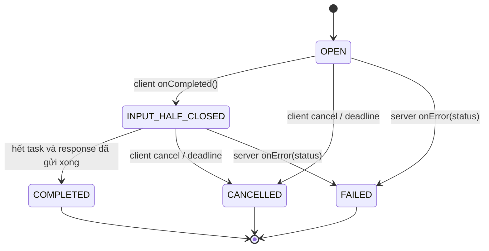

# Lỗi ở một hướng ảnh hưởng hướng còn lại thế nào?

## 1. Hai hướng truyền độc lập, nhưng cùng một RPC

Trong bidirectional streaming, client gửi request messages và server gửi response messages trên hai luồng dữ liệu riêng. Client có thể tiếp tục gửi khi đang nhận response; server cũng có thể chủ động phát dữ liệu khi chưa nhận request mới. Tuy nhiên, cả hai chiều thuộc **một RPC duy nhất**. Vì vậy cần phân biệt:

- **Lỗi nghiệp vụ của một message hoặc một tác vụ:** ứng dụng có thể báo lỗi cho đúng request bằng một response message, rồi tiếp tục xử lý các message khác.
- **Lỗi kết thúc RPC:** status lỗi, cancellation, deadline hoặc lỗi transport làm cuộc gọi kết thúc; cả hai chiều không thể tiếp tục trao đổi trên RPC đó.

Ví dụ một dashboard gửi lệnh cập nhật trong khi server phát tiến độ. Nếu một lệnh có dữ liệu không hợp lệ, server có thể trả `CommandRejected(request_id)` và vẫn phát tiến độ cho những lệnh khác. Nếu server gọi `responseObserver.onError(...)`, RPC kết thúc; client không thể tiếp tục gửi lệnh trên chính stream đó.

Sau bài này, người học có thể phân biệt lỗi message với lỗi RPC, xác định ảnh hưởng của lỗi ở client/server, thiết kế response lỗi có correlation ID, xử lý terminal callback và cleanup tài nguyên đúng cách trong Spring gRPC.

## 2. Phạm vi ảnh hưởng của từng loại lỗi

| Sự kiện | Ảnh hưởng đến request direction | Ảnh hưởng đến response direction |
| --- | --- | --- |
| Client gọi `onCompleted()` trên request observer | Đóng bình thường chiều client → server (half-close) | Server vẫn có thể tiếp tục gửi response |
| Server từ chối một request bằng response `CommandRejected` | Client vẫn có thể gửi request khác | Server tiếp tục gửi response cho các request còn lại |
| Server báo lỗi một tác vụ bằng `TaskFailed` | Request stream vẫn hoạt động | Response stream vẫn hoạt động; đây là lỗi nghiệp vụ |
| Client hủy toàn RPC hoặc deadline hết | Không gửi/nhận tiếp trên call đó | Không gửi/nhận tiếp trên call đó |
| Server gọi `responseObserver.onError(status)` | RPC kết thúc; client không gửi thêm request trên call | Response stream kết thúc với status lỗi |
| Lỗi transport/HTTP/2 làm call thất bại | RPC không còn khả năng tiếp tục | RPC không còn khả năng tiếp tục |

Điểm cần nhớ: **hai chiều độc lập về hoạt động gửi/nhận và half-close, không độc lập về terminal status của RPC**. gRPC không cung cấp hai status cuối riêng biệt để một chiều báo lỗi terminal trong khi chiều kia tiếp tục sống trên cùng call.

## 3. Phân biệt lỗi message và lỗi RPC

Hợp đồng ứng dụng nên mô tả lỗi có thể phục hồi như dữ liệu. Ví dụ:

```proto
syntax = "proto3";

package task.v1;

option java_multiple_files = true;
option java_package = "com.example.task.v1";

service TaskStream {
  rpc Exchange(stream ClientCommand) returns (stream ServerEvent);
}

message ClientCommand {
  string request_id = 1;
  oneof command {
    SubmitTask submit = 2;
    CancelTask cancel = 3;
  }
}

message SubmitTask {
  string payload = 1;
}

message CancelTask {
  string reason = 1;
}

message ServerEvent {
  string request_id = 1;
  oneof event {
    Accepted accepted = 2;
    Progress progress = 3;
    CommandRejected rejected = 4;
    TaskFailed failed = 5;
    TaskFinished finished = 6;
    Notice notice = 7;
  }
}

message Accepted { string detail = 1; }
message Progress { int32 percent = 1; }
message CommandRejected {
  string code = 1;
  string detail = 2;
}
message TaskFailed {
  string code = 1;
  string detail = 2;
}
message TaskFinished { string result = 1; }
message Notice { string text = 1; }
```

Các quy tắc của contract:

- `CommandRejected` có cùng `request_id` với command không hợp lệ. Server từ chối command đó nhưng không bắt buộc đóng RPC.
- `TaskFailed` kết thúc **một tác vụ** đã được chấp nhận. Các tác vụ khác trong cùng RPC vẫn có thể chạy.
- `Notice` là message chủ động, không gắn với request cụ thể.
- gRPC status như `INVALID_ARGUMENT`, `UNAUTHENTICATED`, `INTERNAL` hoặc `UNAVAILABLE` dùng cho lỗi khiến toàn bộ RPC không thể tiếp tục hoặc cần kết thúc theo contract.

Không nên dùng `responseObserver.onError()` cho mọi lỗi validation. Làm vậy sẽ biến một command sai thành lỗi terminal, khiến các command hợp lệ đang chờ cũng mất phiên giao tiếp.

## 4. Lỗi ở phía client

Client có thể gặp lỗi ở hai nơi khác nhau:

1. **Nguồn tạo request lỗi:** ví dụ UI không đọc được dữ liệu cho một lệnh. Nếu chỉ lệnh đó không hợp lệ, client vẫn có thể gửi một command khác hoặc gửi command hủy theo contract. Nếu producer đã hoàn tất bình thường, gọi `requestObserver.onCompleted()` để half-close.
2. **Lỗi cục bộ không thể tiếp tục phiên:** ví dụ state của client hỏng hoặc người dùng rời màn hình. Client có thể hủy toàn call qua `ClientCallStreamObserver.cancel(...)`. Đây là cancellation của RPC, không phải half-close.

Khi client nhận response, callback `onNext` nên bắt lỗi xử lý cục bộ. Không để exception của logic UI hoặc ghi file thoát khỏi callback một cách bất ngờ. Nếu message lỗi chỉ liên quan một request, đánh dấu request đó thất bại; nếu response vi phạm nghiêm trọng protocol và client không thể tiếp tục giải mã an toàn, hủy RPC và ghi nhận nguyên nhân.

Ví dụ xử lý response lỗi theo request:

```java
void handleEvent(ServerEvent event) {
    String requestId = event.getRequestId();
    switch (event.getEventCase()) {
        case REJECTED -> pending.fail(
                requestId, event.getRejected().getCode());
        case FAILED -> pending.fail(
                requestId, event.getFailed().getCode());
        case FINISHED -> pending.complete(
                requestId, event.getFinished().getResult());
        case PROGRESS -> pending.updateProgress(
                requestId, event.getProgress().getPercent());
        case ACCEPTED -> pending.markAccepted(requestId);
        case NOTICE -> showNotice(event.getNotice().getText());
        case EVENT_NOT_SET -> recordProtocolError(requestId);
    }
}
```

Các phương thức `pending` ở đây đại diện cho registry trạng thái theo `request_id`. Khi callback nhận được lỗi terminal `onError(Throwable)`, client cần hoàn tất tất cả request còn pending bằng trạng thái lỗi hoặc chưa xác định; không giữ chúng vô thời hạn.

## 5. Lỗi ở phía server

Server nhận request qua observer mà service trả về. Một lỗi trong xử lý request không nhất thiết là lỗi của transport:

- **Validation lỗi:** gửi `CommandRejected` cho request đó.
- **Tác vụ đã được chấp nhận nhưng xử lý thất bại:** gửi `TaskFailed` cho request đó.
- **Lỗi không thể tiếp tục toàn phiên:** kết thúc bằng `responseObserver.onError(Status...)`.
- **Client hủy hoặc deadline hết:** dừng các tác vụ nền và giải phóng tài nguyên; không cố gửi thêm response.

Ví dụ phần xử lý cốt lõi trong service:

```java
private void handleSubmit(ClientCommand command) {
    String id = command.getRequestId();
    if (id.isBlank() || command.getSubmit().getPayload().isBlank()) {
        emit(ServerEvent.newBuilder()
                .setRequestId(id)
                .setRejected(CommandRejected.newBuilder()
                        .setCode("INVALID_COMMAND")
                        .setDetail("request_id và payload là bắt buộc")
                        .build())
                .build());
        return; // Chỉ bỏ command này; RPC tiếp tục.
    }

    try {
        startTask(id, command.getSubmit().getPayload());
    } catch (TaskCapacityException ex) {
        emit(ServerEvent.newBuilder()
                .setRequestId(id)
                .setRejected(CommandRejected.newBuilder()
                        .setCode("CAPACITY_REACHED")
                        .setDetail("Server đang có quá nhiều tác vụ")
                        .build())
                .build());
    }
}

private void onTaskFailure(String requestId, Throwable cause) {
    emit(ServerEvent.newBuilder()
            .setRequestId(requestId)
            .setFailed(TaskFailed.newBuilder()
                    .setCode("PROCESSING_FAILED")
                    .setDetail("Không thể hoàn tất tác vụ")
                    .build())
            .build());
}
```

Các phương thức `emit` và `startTask` là điểm tích hợp của service; trong triển khai thật, `emit` phải tuần tự hóa các lần ghi vào cùng response observer, kiểm tra trạng thái terminal và áp dụng flow control. Không phát chi tiết exception nội bộ hoặc thông tin nhạy cảm cho client; ghi stack trace cùng correlation ID ở log server.

### 5.1. Khi nào server nên kết thúc toàn RPC?

Một số tình huống thường cần terminal status:

| Tình huống | Status gợi ý | Lý do |
| --- | --- | --- |
| Contract/protocol không thể diễn giải an toàn | `INVALID_ARGUMENT` hoặc `FAILED_PRECONDITION` | Không thể tiếp tục xử lý stream hợp lệ |
| Không có thông tin xác thực hợp lệ | `UNAUTHENTICATED` | Không cho phép tiếp tục phiên |
| Danh tính đã xác thực nhưng không có quyền | `PERMISSION_DENIED` | Toàn phiên không được phép |
| Hệ thống quá tải, không thể nhận thêm | `RESOURCE_EXHAUSTED` | Chính sách bảo vệ tài nguyên yêu cầu kết thúc |
| Lỗi nội bộ làm hỏng trạng thái phiên | `INTERNAL` | Không thể đảm bảo tính đúng đắn tiếp tục |
| Client hủy hoặc deadline hết | `CANCELLED` / `DEADLINE_EXCEEDED` | RPC đã bị hủy/hết hạn |

Status cụ thể phụ thuộc contract và nguyên nhân. Nếu chỉ một request sai payload, ưu tiên lỗi ở cấp message; nếu state chung của phiên không còn đáng tin cậy, kết thúc RPC.

## 6. Vòng đời terminal và cleanup

Một RPC chỉ có một kết thúc terminal. Sau `onCompleted()` hoặc `onError()`, không được gọi `onNext()` thêm. Server phải phối hợp callback request, timer, task completion và cancellation bằng trạng thái theo từng phiên.



Các nguyên tắc triển khai:

- Dùng `ServerCallStreamObserver.setOnCancelHandler(...)` để dừng timer, subscription và tác vụ còn chạy khi RPC bị hủy.
- `onCompleted()` ở request observer chỉ đánh dấu client half-close. Server vẫn có thể phát response cho những tác vụ đã nhận.
- Chỉ gọi `responseObserver.onCompleted()` khi toàn bộ công việc của phiên đã được giải quyết và không còn response cần phát.
- Dùng một cờ terminal hoặc state machine đồng bộ để bảo đảm chỉ một đường kết thúc thắng cuộc.
- Nếu tác vụ nền hoàn thành sau cancellation, bỏ qua kết quả muộn; không gọi `onNext()` trên observer đã kết thúc.
- Khi `onError(status)` kết thúc RPC, hủy tất cả task của phiên, không chỉ task gây lỗi.

Deadline gRPC áp dụng cho **toàn RPC**, không tự đặt lại cho từng message. Nếu mỗi tác vụ cần thời hạn riêng, ứng dụng phải quản lý timeout theo `request_id`; khi deadline toàn RPC hết, tất cả task của phiên phải dừng hoặc chuyển sang cơ chế xử lý độc lập đã thiết kế.

## 7. Flow control và lỗi khi bên nhận chậm

Lỗi ở một hướng có thể không phải exception. Ví dụ server vẫn tạo response hợp lệ nhưng client không đọc đủ nhanh; queue phía server tăng và cuối cùng có thể làm cạn bộ nhớ. gRPC Java cung cấp `isReady()` và `setOnReadyHandler(...)` trên các observer phía gửi để điều tiết output. Hãy dùng queue có giới hạn và chỉ drain khi observer sẵn sàng.

Nếu queue đầy:

- Có thể làm chậm hoặc từ chối producer ở tầng ứng dụng.
- Có thể gộp message trạng thái cũ nếu message mới thay thế được message cũ.
- Không gộp chunk dữ liệu hoặc sự kiện bắt buộc nếu điều đó làm mất tính toàn vẹn.
- Có thể kết thúc RPC bằng `RESOURCE_EXHAUSTED` nếu không còn cách giữ phiên an toàn.

Flow control đầu vào là cơ chế khác: manual inbound flow control cho phép yêu cầu thêm message khi ứng dụng đã xử lý xong. Không nhầm `request(n)` với `isReady()`: một bên điều tiết **nhận**, bên kia điều tiết **gửi**.

## 8. Kiểm thử ảnh hưởng giữa hai hướng

Integration test nên dùng in-process server/channel hoặc môi trường Spring gRPC test tương ứng. Các kịch bản cốt lõi:

| Kịch bản | Điều cần xác minh |
| --- | --- |
| Client gửi một command sai và sau đó command hợp lệ | Server phát `CommandRejected` cho ID sai, vẫn xử lý command hợp lệ |
| Một task thất bại trong khi task khác đang chạy | Chỉ task lỗi nhận `TaskFailed`; task còn lại tiếp tục phát tiến độ |
| Client half-close khi server còn task | Server tiếp tục response cho tới khi task kết thúc |
| Server gọi `onError(Status.INTERNAL)` | Client nhận terminal `onError`; không gửi/nhận tiếp trên RPC |
| Client cancel toàn call | Server cancel handler dừng timer/task; không có response muộn |
| Deadline hết khi có nhiều task | Toàn phiên kết thúc và mọi tài nguyên của phiên được dọn |
| Queue output đầy | Áp dụng chính sách overload đã định nghĩa; không tăng bộ nhớ vô hạn |
| Hai callback kết thúc chạy gần đồng thời | Chỉ một terminal event; không có `onNext` sau terminal |

Không chỉ kiểm tra message cuối cùng. Test cần xác nhận **task nào** bị ảnh hưởng, những task nào vẫn hoạt động và tài nguyên có dừng thật hay không. Dùng latch hoặc scheduler giả lập để điều khiển thời điểm lỗi và cancellation; tránh phụ thuộc vào `Thread.sleep()` trong assertion.

## 9. Sai lầm thường gặp

1. **Gọi `responseObserver.onError()` cho lỗi của một request.** Điều này kết thúc cả RPC và làm mất cơ hội xử lý request khác.
2. **Cho rằng lỗi ở request direction luôn cho phép response tiếp tục.** Chỉ lỗi nghiệp vụ được biểu diễn bằng message mới có thể được cô lập; lỗi terminal/cancellation của call ảnh hưởng cả hai chiều.
3. **Nhầm half-close với cancel.** `onCompleted()` của request observer đóng chiều gửi bình thường; `cancel()` hủy toàn call.
4. **Không cleanup publisher khi RPC bị hủy.** Timer có thể tiếp tục chạy và phát vào observer đã kết thúc.
5. **Để exception thoát khỏi callback `onNext`.** Bắt và phân loại lỗi ở đúng tầng; đừng để lỗi xử lý cục bộ làm terminal call ngoài ý muốn.
6. **Tiếp tục gửi sau terminal event.** Mọi producer cần kiểm tra trạng thái phiên trước khi enqueue hoặc phát.

## 10. Bài tập vận dụng

Mở rộng `TaskStream.Exchange` để một RPC xử lý nhiều task:

1. Client gửi hai command hợp lệ và một command sai payload.
2. Server trả `CommandRejected` cho command sai nhưng vẫn phát `Progress` và `TaskFinished` cho hai task hợp lệ.
3. Làm một task phát sinh lỗi nghiệp vụ; task còn lại vẫn hoàn tất.
4. Thêm lựa chọn lỗi hệ thống nghiêm trọng khiến server kết thúc RPC bằng `INTERNAL`; kiểm tra mọi task còn lại được dừng.
5. Kiểm thử riêng half-close, command hủy một task và cancel toàn RPC; quan sát callback nào chạy ở mỗi phía.

**Tiêu chí hoàn thành:** người học giải thích được vì sao lỗi nghiệp vụ có thể cô lập theo message trong khi terminal status/cancellation ảnh hưởng toàn RPC; triển khai được cả hai cách xử lý và chứng minh cleanup bằng kiểm thử.

### Tài liệu tham khảo

- [gRPC Core concepts](https://grpc.io/docs/what-is-grpc/core-concepts/): vòng đời RPC, streaming và kết thúc call.
- [gRPC Java StreamObserver API](https://grpc.github.io/grpc-java/javadoc/io/grpc/stub/StreamObserver.html): callback và terminal event.
- [gRPC Java ServerCallStreamObserver API](https://grpc.github.io/grpc-java/javadoc/io/grpc/stub/ServerCallStreamObserver.html): cancellation và flow control phía server.
- [gRPC Status codes](https://grpc.io/docs/guides/status-codes/): ý nghĩa status khi kết thúc RPC.
- [Spring gRPC Reference](https://docs.spring.io/spring-grpc/reference/): tích hợp server/client và kiểm thử trong Spring.
