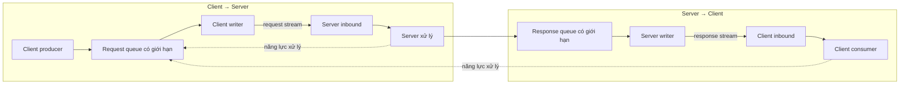

# Backpressure trong bidi stream

## 1. Vì sao bidirectional stream cần backpressure?

Trong một RPC bidirectional streaming của **Spring gRPC**, client gửi request messages trong khi server đồng thời phát response messages. Mỗi hướng có producer và consumer riêng. Nếu client tạo request nhanh hơn server xử lý, hoặc server phát dữ liệu nhanh hơn client đọc, dữ liệu có thể tích tụ trong buffer và queue của ứng dụng.

**Backpressure** là cơ chế điều tiết tốc độ producer theo khả năng tiếp nhận của consumer. Trong bidi stream, cần quản lý riêng cả hai hướng:

- **Client → server:** giới hạn số request đang được gửi/đang chờ xử lý; server chỉ yêu cầu thêm request khi còn năng lực xử lý.
- **Server → client:** server tạm dừng phát response khi transport chưa sẵn sàng; tiếp tục khi gRPC báo có thể ghi.

HTTP/2 flow control giúp điều tiết dữ liệu trên kết nối, nhưng không tự giới hạn mọi queue do ứng dụng tạo ra. Nếu producer cứ đưa message vào một hàng đợi không giới hạn, ứng dụng vẫn có thể hết bộ nhớ dù gRPC đang dùng HTTP/2.

Sau bài này, người học có thể sử dụng `isReady()` và `setOnReadyHandler()` để điều tiết chiều gửi, dùng manual inbound flow control khi cần, thiết kế queue có giới hạn và chọn chính sách phù hợp khi consumer chậm.

## 2. Hai chiều có hai điểm backpressure độc lập

Một RPC có thể bị nghẽn ở một chiều trong khi chiều còn lại vẫn có khả năng tiến triển. Ví dụ, server đang xử lý request chậm nên client cần giảm tốc độ gửi; đồng thời server vẫn có thể gửi heartbeat hoặc kết quả của request đã xử lý xong. Tuy nhiên, nếu queue response cũng đầy hoặc RPC bị hủy/hết deadline, cả call vẫn có thể kết thúc.

| Cơ chế | Điều tiết hướng | API tiêu biểu |
| --- | --- | --- |
| Outbound readiness | Phía local đang **gửi** message | `isReady()`, `setOnReadyHandler()` |
| Manual inbound flow control | Phía local đang **nhận** message | `disableAutoRequest()`, `request(n)` |
| Application queue limit | Buffer do ứng dụng sở hữu | Giới hạn số phần tử/byte, pause/resume producer |
| RPC lifecycle | Toàn cuộc gọi | deadline, cancellation, `onError`, `onCompleted` |

## 3. Điều tiết chiều gửi bằng isReady()

gRPC Java cung cấp `isReady()` trên `CallStreamObserver` và các lớp con:

- Server kiểm tra `ServerCallStreamObserver<ServerEvent>.isReady()` trước khi phát response.
- Client lấy `ClientCallStreamObserver<ClientRequest>` trong `ClientResponseObserver.beforeStart()` để kiểm tra readiness của request stream.
- `setOnReadyHandler(...)` đăng ký callback khi khả năng ghi chuyển sang trạng thái sẵn sàng. Callback phải kiểm tra lại `isReady()` trước khi drain queue.

`isReady() == true` **không có nghĩa peer đã đọc hoặc xử lý xong message**. Nó chỉ cho biết gRPC hiện có thể tiếp nhận thêm dữ liệu đầu ra mà không cần ứng dụng tiếp tục đẩy vào buffer nội bộ. Nếu cần biết consumer đã áp dụng dữ liệu, contract phải có ACK nghiệp vụ.

### 3.1. Một writer duy nhất với queue giới hạn

Khi nhiều producer cùng phát vào một observer, hãy gom message vào một queue và dùng một writer tuần tự hóa các lần `onNext()`. Ví dụ lớp dưới đây dùng chung được cho observer gửi ở client hoặc server:

~~~java
import io.grpc.stub.CallStreamObserver;
import java.util.ArrayDeque;
import java.util.Deque;

final class ReadyWriter<T> {
    enum Offer { ACCEPTED, FULL, CLOSED }

    private final CallStreamObserver<T> stream;
    private final Deque<T> queue = new ArrayDeque<>();
    private final int capacity;
    private boolean accepting = true;
    private boolean terminated;

    ReadyWriter(CallStreamObserver<T> stream, int capacity) {
        if (capacity <= 0) {
            throw new IllegalArgumentException("capacity phải > 0");
        }
        this.stream = stream;
        this.capacity = capacity;
        stream.setOnReadyHandler(this::drain);
    }

    synchronized Offer offer(T message) {
        if (!accepting || terminated) {
            return Offer.CLOSED;
        }
        if (queue.size() >= capacity) {
            return Offer.FULL;
        }
        queue.addLast(message);
        drainLocked();
        return Offer.ACCEPTED;
    }

    synchronized boolean hasCapacity() {
        return accepting && !terminated && queue.size() < capacity;
    }

    // Gọi khi producer đã tạo xong mọi message.
    synchronized void finishWhenDrained() {
        accepting = false;
        drainLocked();
    }

    // Chỉ dùng khi call đã bị hủy từ bên ngoài.
    synchronized void abandon() {
        accepting = false;
        terminated = true;
        queue.clear();
    }

    private void drain() {
        synchronized (this) {
            drainLocked();
        }
    }

    private void drainLocked() {
        while (!terminated && stream.isReady() && !queue.isEmpty()) {
            stream.onNext(queue.removeFirst());
        }
        if (!accepting && queue.isEmpty() && !terminated) {
            terminated = true;
            stream.onCompleted();
        }
    }
}
~~~

Mẫu này cho thấy ba nguyên tắc:

1. Queue có giới hạn; `offer()` trả `FULL` để producer quyết định pause, retry có giới hạn, gộp dữ liệu hoặc báo quá tải.
2. Chỉ writer gọi `stream.onNext()`; callback `onReady` tiếp tục drain khi gRPC sẵn sàng.
3. `finishWhenDrained()` ngừng nhận message mới và chỉ gọi `onCompleted()` sau khi queue đã được gửi hết.

Trong code production cần bổ sung xử lý exception khi ghi, terminal state cho lỗi, quota theo byte và teardown khi cancellation. `abandon()` chỉ dọn queue khi RPC đã kết thúc từ bên ngoài; không dùng nó thay cho terminal status bình thường.

### 3.2. Dùng writer ở server

Server lấy `ServerCallStreamObserver` từ response observer rồi gắn writer:

~~~java
ServerCallStreamObserver<ServerEvent> call =
        (ServerCallStreamObserver<ServerEvent>) responseObserver;
ReadyWriter<ServerEvent> writer = new ReadyWriter<>(call, 128);

call.setOnCancelHandler(() -> {
    writer.abandon();
    stopTaskPublishers();
});

// Từ request handler hoặc task publisher:
ReadyWriter.Offer result = writer.offer(event);
if (result == ReadyWriter.Offer.FULL) {
    pauseUpstreamProducer();
} else if (result == ReadyWriter.Offer.CLOSED) {
    stopUpstreamProducer();
}

// Chỉ gọi khi mọi nguồn phát của phiên đã hoàn tất:
writer.finishWhenDrained();
~~~

Tên `stopTaskPublishers()` và `pauseUpstreamProducer()` đại diện cho cơ chế của ứng dụng, ví dụ dừng subscription hoặc tạm ngưng consumer của message broker. Không được bỏ qua kết quả `FULL`; nếu producer tiếp tục tạo dữ liệu thì queue sẽ lại đầy.

### 3.3. Dùng writer ở client

Client đăng ký writer trong `ClientResponseObserver.beforeStart()`, trước khi bắt đầu gửi request:

~~~java
AtomicReference<ReadyWriter<ClientRequest>> writerRef =
        new AtomicReference<>();

ClientResponseObserver<ClientRequest, ServerEvent> responseObserver =
        new ClientResponseObserver<>() {
    @Override
    public void beforeStart(
            ClientCallStreamObserver<ClientRequest> requestStream) {
        writerRef.set(new ReadyWriter<>(requestStream, 64));
    }

    @Override
    public void onNext(ServerEvent event) {
        handleResponse(event);
    }

    @Override
    public void onError(Throwable error) {
        ReadyWriter<ClientRequest> writer = writerRef.get();
        if (writer != null) writer.abandon();
    }

    @Override
    public void onCompleted() {
        ReadyWriter<ClientRequest> writer = writerRef.get();
        if (writer != null) writer.abandon();
    }
};
~~~

Các producer như UI, timer hoặc event listener gọi `writerRef.get().offer(request)`. Nếu kết quả là `FULL`, client phải làm chậm nguồn phát hoặc hiển thị trạng thái quá tải; không tạo một queue thứ hai không giới hạn phía trước writer.

## 4. Điều tiết chiều nhận bằng manual inbound flow control

`isReady()` điều tiết **message đi ra**. Nếu vấn đề nằm ở việc ứng dụng nhận message nhanh hơn khả năng xử lý, có thể dùng manual inbound flow control:

- Server gọi `disableAutoRequest()` trên `ServerCallStreamObserver` trước khi trả request observer về gRPC; sau đó gọi `request(n)` khi đã có năng lực nhận thêm client request.
- Client triển khai `ClientResponseObserver.beforeStart()`, gọi `disableAutoRequest()` trên `ClientCallStreamObserver`, rồi gọi `request(n)` để cho phép nhận response từ server.

Ví dụ phía server, mỗi lần chỉ cho phép một request mới:

~~~java
ServerCallStreamObserver<ServerEvent> call =
        (ServerCallStreamObserver<ServerEvent>) responseObserver;
call.disableAutoRequest();
call.request(1); // Cho phép nhận message đầu tiên.

return new StreamObserver<ClientRequest>() {
    @Override
    public void onNext(ClientRequest request) {
        processAsync(request).whenComplete((result, error) -> {
            if (error != null) {
                failSession(error);
                return;
            }
            ReadyWriter.Offer accepted = responseWriter.offer(result);
            if (accepted == ReadyWriter.Offer.ACCEPTED
                    && responseWriter.hasCapacity()) {
                // Chỉ yêu cầu tiếp khi xử lý xong và còn chỗ cho kết quả.
                call.request(1);
            }
        });
    }
    // onError và onCompleted xử lý vòng đời phiên.
};
~~~

`hasCapacity()` ở đây là phép kiểm tra dung lượng còn trống mà writer cần cung cấp trong implementation thực tế. Nếu queue đã đầy, không gọi `request(1)`; cần đợi writer drain hoặc áp dụng chính sách quá tải rồi mới yêu cầu message tiếp theo. Mục tiêu là tránh nhận thêm request trong khi ứng dụng chưa có chỗ lưu kết quả của chúng.

Với nhiều producer hoặc queue có thể đầy giữa lúc kiểm tra và lúc callback chạy, writer nên phát tín hiệu `onCapacityAvailable` khi drain giải phóng chỗ; callback đó mới gọi `request(1)`. Đừng dùng polling hoặc giữ khóa writer trong lúc chờ năng lực xử lý.

Ở phía client, `ClientResponseObserver.beforeStart()` có thể thiết lập manual demand cho response:

~~~java
ClientResponseObserver<ClientRequest, ServerEvent> observer =
        new ClientResponseObserver<>() {
    private ClientCallStreamObserver<ClientRequest> call;

    @Override
    public void beforeStart(
            ClientCallStreamObserver<ClientRequest> requestStream) {
        call = requestStream;
        call.disableAutoRequest();
        call.request(1); // Cho phép nhận một response.
    }

    @Override
    public void onNext(ServerEvent event) {
        consumeAsync(event).whenComplete((ignored, error) -> {
            if (error != null) {
                call.cancel("Không xử lý được response", error);
            } else {
                call.request(1); // Đã xử lý xong, xin response tiếp.
            }
        });
    }

    @Override public void onError(Throwable error) { cleanup(); }
    @Override public void onCompleted() { cleanup(); }
};
~~~

Đây là mẫu khái niệm; trong code thực, bảo đảm tham chiếu call còn hợp lệ, callback completion không gọi `request(1)` sau terminal event, và xử lý exception từ consumer. Nếu xử lý nhiều response song song, chỉ yêu cầu thêm số lượng tương ứng với **dung lượng thực sự còn trống**.

## 5. Kết hợp hai chiều mà không tạo deadlock

Trong bidi stream, inbound demand và outbound readiness cần phối hợp nhưng không được chặn lẫn nhau:

1. Server chỉ yêu cầu thêm client request khi còn chỗ xử lý và có thể giữ kết quả cần phát.
2. Server chỉ drain response queue khi `responseObserver.isReady()`.
3. Client chỉ yêu cầu thêm server response khi consumer đã xử lý và còn chỗ trong buffer.
4. Client chỉ drain request queue khi request observer `isReady()`.
5. Không gọi `request(n)` hoặc chờ network bên trong một khóa đang được writer cần để phát message.

Tránh kiểu thiết kế: client chỉ đọc response sau khi gửi xong tất cả request, trong khi server ngừng nhận request khi response queue đầy. Hai bên có thể chờ lẫn nhau. Một bidi client nên duy trì **vòng nhận độc lập** với vòng gửi, và server cũng cần xử lý request trong khi writer response có thể đang tạm dừng.

## 6. Chính sách khi queue đầy

Không có một chính sách phù hợp cho mọi loại message. Chọn theo ý nghĩa dữ liệu:

| Loại dữ liệu | Chính sách phù hợp |
| --- | --- |
| Lệnh nghiệp vụ phải xử lý | Pause producer hoặc từ chối rõ ràng; không âm thầm bỏ |
| Trạng thái hiện tại có thể thay thế trạng thái cũ | Coalesce, chỉ giữ trạng thái mới nhất |
| Telemetry không bắt buộc đầy đủ | Có thể sample/drop theo quy tắc đã công bố |
| Chunk kết quả phải ghép đủ | Giữ thứ tự, giới hạn dung lượng; chuyển payload lớn sang object storage nếu cần |
| Heartbeat | Bỏ heartbeat cũ khi heartbeat mới thay thế được |
| Consumer quá chậm kéo dài | Có thể kết thúc RPC bằng `RESOURCE_EXHAUSTED` và yêu cầu client reconnect/backoff |

Nên giới hạn cả **số message và tổng byte**. Một queue 100 phần tử vẫn có thể tiêu thụ nhiều bộ nhớ nếu mỗi message chứa payload lớn. Ghi nhận số lần queue đầy, thời gian chờ, số byte đang đợi và số lần writer không ready để điều chỉnh capacity bằng dữ liệu vận hành.

## 7. Half-close, cancellation và lỗi

- Client gọi `requestObserver.onCompleted()` để half-close chiều request. Server vẫn có thể tiếp tục phát response đã được tạo; queue response chỉ được hoàn tất khi các producer phía server đã xong.
- Server gọi `responseObserver.onCompleted()` khi response queue đã drain và không còn công việc phát. Đây là kết thúc RPC thành công.
- Client hủy toàn call hoặc deadline hết thì server cần dừng producer, xóa queue và hủy subscription qua `setOnCancelHandler()`.
- Queue đầy có thể được xử lý bằng backpressure ở tầng ứng dụng; chỉ dùng `onError(Status.RESOURCE_EXHAUSTED)` khi chính sách là kết thúc RPC.
- Không gọi `onNext()` sau `onCompleted()` hoặc `onError()`. Mọi đường gửi phải đi qua cùng writer/state để phối hợp terminal event.

Deadline áp dụng cho toàn RPC, không tự gia hạn mỗi lần gửi message. Nếu mỗi tác vụ cần timeout riêng, ứng dụng phải quản lý deadline theo request ID. Với Spring gRPC, metadata/interceptor xử lý xác thực và tracing ở cấp call; dữ liệu thay đổi theo message phải nằm trong Protobuf. Dùng TLS/mTLS cho môi trường triển khai; không dùng plaintext ngoài thử nghiệm cục bộ.

## 8. Kiểm thử backpressure

Integration test có thể dùng in-process server/channel và consumer giả lập chậm. Những kịch bản quan trọng:

| Kịch bản | Kết quả cần xác minh |
| --- | --- |
| Client gửi nhanh hơn server xử lý | Inbound demand giảm tốc độ nhận; queue không tăng vô hạn |
| Server phát nhanh hơn client đọc | `isReady()` chuyển false, writer ngừng drain rồi tiếp tục qua onReady |
| Client gửi và nhận đồng thời | Vòng gửi không chặn vòng nhận; không deadlock |
| Queue chạm capacity | Producer được pause/reject/coalesce theo chính sách |
| Payload có kích thước lớn | Giới hạn byte được tuân thủ, không chỉ giới hạn số phần tử |
| Client half-close khi response còn chờ | Server tiếp tục drain response rồi kết thúc đúng lúc |
| Client cancel khi queue còn message | Queue được dọn, producer/subscription dừng, không phát sau terminal |
| Deadline hết khi writer đang chờ readiness | RPC kết thúc và tài nguyên được giải phóng |

Không chỉ kiểm tra message cuối cùng. Hãy đo maximum queue depth, tổng byte được buffer, số lần pause/resume, thời gian writer không ready và số request đã được yêu cầu nhưng chưa xử lý. Dùng latch hoặc scheduler kiểm soát để tạo consumer chậm một cách lặp lại được; tránh phụ thuộc vào `Thread.sleep()` trong assertion.

## 9. Sai lầm thường gặp

1. **Cho rằng HTTP/2 flow control tự giới hạn queue của ứng dụng.** Mọi queue do ứng dụng tạo phải có capacity.
2. **Gọi `onNext()` liên tục mà không kiểm tra `isReady()`.** Có thể làm tăng buffer và bộ nhớ.
3. **Coi `isReady()` là ACK của consumer.** Đây chỉ là tín hiệu khả năng ghi ở phía local.
4. **Nhầm outbound readiness với inbound demand.** `isReady()` điều tiết gửi; `request(n)` điều tiết nhận.
5. **Yêu cầu thêm inbound message khi chưa có chỗ xử lý kết quả.** Điều này chuyển nghẽn transport thành nghẽn bộ nhớ ứng dụng.
6. **Dùng chung một writer hoặc queue cho nhiều RPC.** State và capacity phải được quản lý theo phiên để một client chậm không chặn mọi client.
7. **Bỏ message bắt buộc khi queue đầy mà không báo lỗi.** Phải định nghĩa rõ pause, reject, persist, coalesce hoặc fail.

## 10. Bài tập vận dụng

Nâng cấp một dịch vụ bidi gửi lệnh và cập nhật trạng thái:

1. Cài `ReadyWriter` riêng cho request direction và response direction, mỗi queue có capacity cấu hình được.
2. Bật manual inbound flow control ở server và client; chỉ gọi `request(1)` sau khi message trước đã được xử lý và buffer còn chỗ.
3. Tạo client tiêu thụ response chậm, quan sát `isReady()` và queue depth ở server.
4. Thử ba chính sách khi đầy queue: pause, coalesce trạng thái và kết thúc bằng `RESOURCE_EXHAUSTED`.
5. Half-close request khi server còn response chờ; sau đó thử cancel toàn RPC và xác minh cả hai writer được cleanup.

**Tiêu chí hoàn thành:** cả hai hướng đều có cơ chế điều tiết phù hợp, queue được giới hạn theo số lượng/dung lượng, producer có phản ứng khi consumer chậm và RPC kết thúc không để lại tác vụ nền.

### Tài liệu tham khảo

- [gRPC Flow Control](https://grpc.io/docs/guides/flow-control/): flow control của streaming RPC và cách tránh producer vượt consumer.
- [gRPC Java CallStreamObserver API](https://grpc.github.io/grpc-java/javadoc/io/grpc/stub/CallStreamObserver.html): `isReady()`, `setOnReadyHandler()`, `disableAutoRequest()` và `request(n)`.
- [gRPC Java ClientResponseObserver API](https://grpc.github.io/grpc-java/javadoc/io/grpc/stub/ClientResponseObserver.html): thiết lập client call trong `beforeStart()`.
- [Spring gRPC Reference](https://docs.spring.io/spring-grpc/reference/): tích hợp gRPC server/client và quan sát hệ thống trong Spring.
