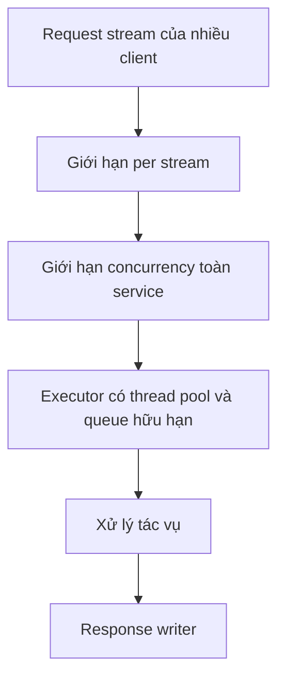

# Giới hạn concurrency của stream

## 1. Vì sao cần giới hạn concurrency?

Một RPC bidirectional streaming có thể nhận nhiều request trong khi server đồng thời gửi response. Nếu mỗi request tạo một tác vụ bất đồng bộ, một client có thể gửi hàng nghìn lệnh trong thời gian ngắn và khiến server tạo quá nhiều tác vụ, giữ quá nhiều dữ liệu hoặc chiếm hết thread pool. Khi nhiều client cùng làm vậy, một phiên có thể ảnh hưởng đến toàn bộ dịch vụ.

**Giới hạn concurrency** là quy tắc xác định có bao nhiêu công việc được phép chạy đồng thời trong một phạm vi. Với Spring gRPC, cần phân biệt ít nhất ba giới hạn:

- **Per stream:** số tác vụ đang chạy trong một RPC, giúp một client không chiếm quá nhiều tài nguyên.
- **Toàn service:** số tác vụ đang chạy trên tất cả RPC, bảo vệ năng lực tổng thể của server.
- **Executor/queue:** số thread và số tác vụ chờ được nhận, ngăn hàng đợi nội bộ tăng vô hạn.

Các giới hạn này bổ sung cho flow control. `isReady()` điều tiết khả năng gửi message; manual inbound flow control điều tiết số message được yêu cầu nhận; semaphore và executor giới hạn công việc mà ứng dụng thực sự chạy.

Sau bài học, người học có thể thiết kế giới hạn theo từng stream và toàn service, từ chối hoặc làm chậm request khi quá tải, giải phóng permit đúng mọi nhánh, và kiểm thử để chứng minh một stream không thể chiếm toàn bộ năng lực xử lý.

## 2. Ba tầng giới hạn



| Tầng | Câu hỏi cần trả lời | Cơ chế thường dùng |
| --- | --- | --- |
| Per stream | Một RPC được chạy tối đa bao nhiêu tác vụ? | `Semaphore` hoặc counter theo session |
| Toàn service | Tất cả RPC được chạy tối đa bao nhiêu tác vụ? | Semaphore dùng chung hoặc bulkhead |
| Executor | Có bao nhiêu tác vụ đang chạy và đang chờ? | `ThreadPoolExecutor` với queue hữu hạn |

Ví dụ đặt giới hạn:

- Mỗi RPC: tối đa **4** tác vụ đang chạy.
- Toàn service: tối đa **96** tác vụ được nhận vào executor, gồm tối đa 32 tác vụ đang chạy và 64 tác vụ chờ.
- Nếu một giới hạn đã đầy, server trả một response `TaskRejected` gắn với `request_id` để client biết request đó chưa được nhận xử lý.

Các con số chỉ là ví dụ. Giá trị thật cần dựa trên thời gian xử lý, bộ nhớ mỗi tác vụ, số CPU, kích thước payload và tải đồng thời dự kiến.

## 3. Phân biệt concurrency với flow control

| Cơ chế | Giới hạn cái gì? | Không giải quyết thay |
| --- | --- | --- |
| `isReady()` và `setOnReadyHandler()` | Khả năng ghi message của phía gửi | Số tác vụ nghiệp vụ đang chạy |
| `disableAutoRequest()` và `request(n)` | Số inbound message gRPC được yêu cầu chuyển tới ứng dụng | Giới hạn tổng tài nguyên của executor |
| Semaphore per stream | Số tác vụ đồng thời của một RPC | Giới hạn tổng service |
| Semaphore toàn service | Tổng tác vụ được nhận trên mọi RPC | Kích thước queue của executor nếu cấu hình không khớp |
| Executor queue hữu hạn | Số công việc chờ thread xử lý | Chính sách công bằng giữa các stream |

Một server có thể nhận message rất có kiểm soát nhưng vẫn tạo nhiều tác vụ bên trong mỗi callback. Ngược lại, giới hạn số tác vụ nhưng vẫn để queue response không giới hạn cũng có thể gây tăng bộ nhớ. Cần giới hạn ở đúng tầng phát sinh tài nguyên.

## 4. Hợp đồng Protobuf cho kết quả quá tải

Ví dụ `work_stream.proto`:

```proto
syntax = "proto3";

package work.v1;

option java_multiple_files = true;
option java_package = "com.example.work.v1";

service WorkStream {
  rpc Execute(stream WorkRequest) returns (stream WorkEvent);
}

message WorkRequest {
  string request_id = 1;
  string payload = 2;
}

message WorkEvent {
  string request_id = 1;
  oneof event {
    Accepted accepted = 2;
    Result result = 3;
    TaskRejected rejected = 4;
    TaskFailed failed = 5;
  }
}

message Accepted { string detail = 1; }
message Result { string value = 1; }
message TaskRejected {
  string reason = 1;
  int32 retry_after_ms = 2;
}
message TaskFailed {
  string reason = 1;
}
```

Khi hết capacity, server có thể gửi `TaskRejected` cho đúng request và giữ RPC hoạt động. Đây là **từ chối ở cấp tác vụ**, khác với việc gọi `responseObserver.onError(Status.RESOURCE_EXHAUSTED)` làm kết thúc toàn RPC.

Contract cần làm rõ:

- `Accepted` chỉ phát sau khi server đã dành được tài nguyên và nhận trách nhiệm xử lý.
- `TaskRejected` nghĩa là request chưa được nhận xử lý; client có thể thử lại theo chính sách backoff.
- `TaskFailed` nghĩa là request đã được nhận nhưng xử lý thất bại; client không nên hiểu nó là từ chối trước khi nhận.
- `retry_after_ms` là gợi ý, không phải cam kết server chắc chắn có capacity sau đúng khoảng thời gian đó.
- `request_id` phải duy nhất trong phạm vi phiên; nếu retry cùng một thao tác, ứng dụng cần quy tắc idempotency riêng.

## 5. Cấu hình executor có giới hạn trong Spring

Không dùng executor có queue không giới hạn cho tác vụ phát sinh từ stream. Một cấu hình đơn giản:

```java
package com.example.work;

import java.util.concurrent.ArrayBlockingQueue;
import java.util.concurrent.ThreadPoolExecutor;
import java.util.concurrent.TimeUnit;
import org.springframework.context.annotation.Bean;
import org.springframework.context.annotation.Configuration;

@Configuration
public class WorkExecutorConfig {
    @Bean(destroyMethod = "shutdown")
    ThreadPoolExecutor workExecutor() {
        return new ThreadPoolExecutor(
                8,                  // core threads
                32,                 // maximum threads
                30, TimeUnit.SECONDS,
                new ArrayBlockingQueue<>(64),
                new ThreadPoolExecutor.AbortPolicy());
    }
}
```

Executor trên có tối đa 32 worker thread và 64 tác vụ trong queue. Khi không còn chỗ, `execute()` ném `RejectedExecutionException`; service phải xử lý nhánh này và giải phóng mọi permit đã lấy. Không dùng `CallerRunsPolicy` một cách vô thức trong callback gRPC: nó có thể chạy công việc nặng ngay trên thread callback, làm chậm việc nhận message và tạo nghẽn ngược.

Nếu dùng semaphore toàn service để khớp với cấu hình này, có thể đặt tối đa **96** permit (32 running + 64 queued). Khi thay đổi số thread hoặc queue, phải điều chỉnh giới hạn tổng tương ứng. Semaphore không thay thế queue hữu hạn; cả hai phải cùng được cấu hình.

Semaphore `globalSlots` trong ví dụ là giới hạn của **một process Spring**. Nếu chạy nhiều replica, mỗi replica có quota riêng; muốn một giới hạn toàn cluster cần quota ở tầng gateway, bộ điều phối dùng chung hoặc cơ chế admission control phân tán.

## 6. Giới hạn per stream và toàn service trong server

Ví dụ dưới đây minh họa cách nhận một request, lấy permit theo thứ tự, gửi `Accepted` rồi đưa công việc vào executor. Một request bị từ chối do quá tải không làm kết thúc RPC.

```java
package com.example.work;

import com.example.work.v1.Accepted;
import com.example.work.v1.Result;
import com.example.work.v1.TaskFailed;
import com.example.work.v1.TaskRejected;
import com.example.work.v1.WorkEvent;
import com.example.work.v1.WorkRequest;
import com.example.work.v1.WorkStreamGrpc;
import io.grpc.stub.ServerCallStreamObserver;
import io.grpc.stub.StreamObserver;
import java.util.HashSet;
import java.util.Set;
import java.util.concurrent.Semaphore;
import java.util.concurrent.ThreadPoolExecutor;
import java.util.concurrent.RejectedExecutionException;
import org.springframework.stereotype.Service;

@Service
public class WorkStreamService extends WorkStreamGrpc.WorkStreamImplBase {
    private static final int PER_STREAM_LIMIT = 4;

    private final ThreadPoolExecutor executor;
    // Một semaphore dùng chung cho mọi RPC của service singleton.
    private final Semaphore globalSlots = new Semaphore(96);

    public WorkStreamService(ThreadPoolExecutor executor) {
        this.executor = executor;
    }

    @Override
    public StreamObserver<WorkRequest> execute(
            StreamObserver<WorkEvent> responseObserver) {
        ServerCallStreamObserver<WorkEvent> output =
                (ServerCallStreamObserver<WorkEvent>) responseObserver;
        Session session = new Session(output, executor, globalSlots);
        output.setOnCancelHandler(session::cancel);

        return new StreamObserver<>() {
            @Override
            public void onNext(WorkRequest request) {
                session.accept(request);
            }

            @Override
            public void onError(Throwable error) {
                session.cancel();
            }

            @Override
            public void onCompleted() {
                session.inputCompleted();
            }
        };
    }

    private static final class Session {
        private final Object writeLock = new Object();
        private final ServerCallStreamObserver<WorkEvent> output;
        private final ThreadPoolExecutor executor;
        private final Semaphore globalSlots;
        private final Semaphore streamSlots =
                new Semaphore(PER_STREAM_LIMIT);
        private final Set<String> activeIds = new HashSet<>();

        private int active;
        private boolean inputDone;
        private boolean terminated;

        Session(ServerCallStreamObserver<WorkEvent> output,
                ThreadPoolExecutor executor, Semaphore globalSlots) {
            this.output = output;
            this.executor = executor;
            this.globalSlots = globalSlots;
        }

        void accept(WorkRequest request) {
            synchronized (writeLock) {
                if (terminated || output.isCancelled()) {
                    cancelLocked();
                    return;
                }

                String id = request.getRequestId();
                if (id.isBlank()) {
                    rejectLocked(id, "INVALID_REQUEST", 0);
                    return;
                }
                if (activeIds.contains(id)) {
                    rejectLocked(id, "REQUEST_ALREADY_ACTIVE", 0);
                    return;
                }

                // Không chờ permit trong callback nhận request.
                if (!streamSlots.tryAcquire()) {
                    rejectLocked(id, "STREAM_LIMIT_REACHED", 500);
                    return;
                }
                if (!globalSlots.tryAcquire()) {
                    streamSlots.release();
                    rejectLocked(id, "SERVICE_LIMIT_REACHED", 1000);
                    return;
                }

                activeIds.add(id);
                active++;
                if (!emitLocked(WorkEvent.newBuilder()
                        .setRequestId(id)
                        .setAccepted(Accepted.newBuilder()
                                .setDetail("Đã nhận xử lý").build())
                        .build())) {
                    active--;
                    activeIds.remove(id);
                    streamSlots.release();
                    globalSlots.release();
                    return;
                }

                try {
                    executor.execute(() -> runTask(id, request.getPayload()));
                } catch (RejectedExecutionException rejected) {
                    // Request đã Accepted; lỗi dispatch là TaskFailed.
                    active--;
                    activeIds.remove(id);
                    streamSlots.release();
                    globalSlots.release();
                    emitLocked(WorkEvent.newBuilder()
                            .setRequestId(id)
                            .setFailed(TaskFailed.newBuilder()
                                    .setReason("EXECUTOR_UNAVAILABLE")
                                    .build())
                            .build());
                    finishIfReadyLocked();
                }
            }
        }

        private void runTask(String id, String payload) {
            try {
                if (isTerminated()) {
                    return;
                }
                // Thay bằng xử lý nghiệp vụ có timeout/cancellation phù hợp.
                String value = processPayload(payload);
                emit(WorkEvent.newBuilder()
                        .setRequestId(id)
                        .setResult(Result.newBuilder()
                                .setValue(value).build())
                        .build());
            } catch (RuntimeException error) {
                // Lỗi nghiệp vụ của một request không tự động kết thúc RPC.
                emit(WorkEvent.newBuilder()
                        .setRequestId(id)
                        .setFailed(TaskFailed.newBuilder()
                                .setReason("TASK_FAILED")
                                .build())
                        .build());
            } finally {
                synchronized (writeLock) {
                    active--;
                    activeIds.remove(id);
                    streamSlots.release();
                    globalSlots.release();
                    finishIfReadyLocked();
                }
            }
        }

        private String processPayload(String payload) {
            return "processed:" + payload;
        }

        private boolean isTerminated() {
            synchronized (writeLock) {
                return terminated || output.isCancelled();
            }
        }

        private boolean emit(WorkEvent event) {
            synchronized (writeLock) {
                return emitLocked(event);
            }
        }

        private boolean emitLocked(WorkEvent event) {
            if (terminated || output.isCancelled()) {
                cancelLocked();
                return false;
            }
            try {
                output.onNext(event);
                return true;
            } catch (RuntimeException error) {
                cancelLocked();
                return false;
            }
        }

        private void rejectLocked(String id, String reason, int retryMs) {
            emitLocked(WorkEvent.newBuilder()
                    .setRequestId(id)
                    .setRejected(TaskRejected.newBuilder()
                            .setReason(reason)
                            .setRetryAfterMs(retryMs)
                            .build())
                    .build());
        }

        void inputCompleted() {
            synchronized (writeLock) {
                inputDone = true;
                finishIfReadyLocked();
            }
        }

        void cancel() {
            synchronized (writeLock) {
                cancelLocked();
            }
        }

        private void cancelLocked() {
            terminated = true;
            // Tác vụ đang chạy giữ permit tới khi finally hoàn tất.
            // Không release permit sớm khi worker vẫn còn thực thi.
        }

        private void finishIfReadyLocked() {
            if (!terminated && inputDone && active == 0) {
                terminated = true;
                output.onCompleted();
            }
        }
    }
}
```

**Điểm quan trọng của ví dụ:**

- `streamSlots` nằm trong `Session`, nên mỗi RPC có giới hạn riêng. `globalSlots` nằm trong Spring service singleton, nên mọi phiên cùng chia sẻ một giới hạn tổng.
- Dùng `tryAcquire()` thay vì `acquire()` trong callback nhận request để không chặn thread gRPC. Khi không có permit, server trả `TaskRejected` cho request đó.
- Chỉ phát `Accepted` sau khi đã lấy được permit. Nếu executor từ chối vì queue đầy, server trả sự kiện lỗi tác vụ, giảm `active` và trả lại cả hai permit.
- Permit được trả trong `finally`, bao gồm cả trường hợp xử lý thành công hoặc ném exception. Không trả permit ngay khi RPC bị cancel nếu worker vẫn đang chạy; nếu không, giới hạn sẽ không còn phản ánh số công việc thực tế.
- Khi client half-close, server chờ `active == 0` rồi mới hoàn tất response. Khi RPC bị cancel, session ngừng phát; worker còn chạy tự kết thúc và trả permit trong `finally`.

Ví dụ giữ ID trong `activeIds` khi tác vụ còn chạy để ngăn hai bản sao cùng hoạt động đồng thời. Request bị từ chối trước khi lấy permit không được thêm vào tập này, nên client có thể thử lại cùng ID theo chính sách backoff. Sau khi task hoàn tất, ID được xóa khỏi tập active; nếu cần chống gửi trùng cả sau khi hoàn tất hoặc qua reconnect, hãy dùng kho idempotency có TTL/giới hạn dung lượng. Nếu executor từ chối sau khi đã gửi `Accepted`, server phát `TaskFailed(EXECUTOR_UNAVAILABLE)` vì request đã được tiếp nhận nhưng không thể dispatch.

Khi RPC bị hủy, mẫu này đánh dấu session kết thúc nhưng không tự ngắt một lời gọi nghiệp vụ đang block. Worker giữ permit cho tới khi thoát khỏi `processPayload()` và chạy `finally`. Trong production, đặt timeout cho I/O, truyền cancellation token hoặc lưu `Future` để yêu cầu interrupt nếu tác vụ hỗ trợ; **chỉ trả permit khi công việc thực sự dừng**, tránh nhận thêm task trong khi worker cũ vẫn tiêu thụ tài nguyên.

Đây là ví dụ tập trung vào concurrency, không phải một framework task hoàn chỉnh. Hệ thống thật cần bổ sung queue/response writer có giới hạn, flow control với `isReady()`, giới hạn payload/byte, xử lý exception khi gửi, và khả năng hủy nghiệp vụ có phối hợp. Nếu xử lý có thể bị treo, đặt timeout cho I/O và bảo đảm worker không giữ permit vô hạn.

## 7. Khi vượt giới hạn: từ chối, chờ hay giảm tốc?

Ba chiến lược thường dùng:

| Chiến lược | Hành vi | Phù hợp khi |
| --- | --- | --- |
| **Reject nhanh** | Trả `TaskRejected` khi không có permit | Client có thể retry/backoff hoặc báo người dùng |
| **Backpressure inbound** | Tạm không gọi `request(n)` để gRPC chưa chuyển thêm request vào ứng dụng | Muốn điều tiết tốc độ nhận thay vì từ chối |
| **Queue chờ có giới hạn** | Nhận một số request chờ, sau đó từ chối khi queue đầy | Công việc ngắn và độ trễ chờ có thể dự đoán |

Không nên giữ callback `onNext()` bằng cách chờ semaphore. Việc đó có thể làm nghẽn executor callback, cản trở xử lý message khác và làm phức tạp cancellation. Nếu chọn chờ, hãy biểu diễn chờ bằng queue có giới hạn hoặc inbound flow control.

Giới hạn semaphore trong ví dụ được kiểm tra **sau khi gRPC đã chuyển request tới callback**. Nó giới hạn số tác vụ được nhận chạy, nhưng tự nó không giới hạn số inbound message đang được transport chuyển tới. Nếu muốn điều tiết từ trước, có thể bật manual inbound flow control trên `ServerCallStreamObserver` bằng `disableAutoRequest()`, sau đó gọi `request(n)` khi ứng dụng có capacity. Vẫn cần `tryAcquire()` khi nhận message vì capacity toàn service có thể thay đổi do những RPC khác.

Khi reject, client nên dùng exponential backoff có jitter, giới hạn số lần retry và giữ idempotency key ổn định. Không retry liên tục theo `retry_after_ms` mà không có jitter vì nhiều client có thể đồng loạt gửi lại, tạo một đợt quá tải mới.

## 8. Chọn giới hạn và tránh starvation

Giới hạn quá thấp làm giảm throughput; quá cao làm tăng context switching, bộ nhớ và độ trễ. Bắt đầu từ tải đo được, sau đó điều chỉnh theo:

- Thời gian CPU và thời gian chờ I/O của mỗi tác vụ.
- Bộ nhớ trung bình/đỉnh của một tác vụ và kích thước payload.
- Số RPC hoạt động đồng thời và số tác vụ tối đa mỗi RPC.
- Kích thước queue và thời gian chờ chấp nhận được.
- Mục tiêu latency, tỷ lệ reject và khả năng mở rộng ngang.

Semaphore toàn service với `tryAcquire()` không đảm bảo công bằng tuyệt đối: một stream có thể liên tục giành permit trước stream khác. Giới hạn per stream giảm rủi ro nhưng không thay thế chính sách fairness. Nếu cần đảm bảo tenant không chiếm tài nguyên của nhau, có thể thêm quota theo tenant, weighted fair queue hoặc scheduler phân phối permit.

Đặt giới hạn ở nhiều lớp nhưng tránh cấu hình mâu thuẫn. Ví dụ global semaphore cho phép 200 task trong khi executor chỉ có 32 thread và queue không giới hạn sẽ khiến nhiều request được báo `Accepted` rồi nằm chờ lâu. Giới hạn tổng nên khớp với worker + queue, và timeout phải bao gồm cả thời gian chờ.

## 9. Kiểm thử concurrency

Integration test nên điều khiển thời điểm hoàn thành tác vụ bằng latch hoặc executor giả lập. Các assertion quan trọng:

| Kịch bản | Kết quả cần xác minh |
| --- | --- |
| Một stream gửi 5 request với limit 4 | Tối đa 4 tác vụ được nhận đồng thời; request thứ 5 bị reject hoặc chờ theo policy |
| Hai stream cùng gửi nhiều request | Tổng active task không vượt global limit |
| Executor queue đầy | Request bị reject đúng cách; không rò rỉ permit |
| Worker ném exception | Permit được trả trong `finally`; stream vẫn xử lý request khác nếu policy cho phép |
| Client half-close khi còn task | Response chỉ hoàn tất sau khi active task về 0 |
| Client cancel khi task đang chạy | Không phát response mới; permit chỉ trả khi worker thực sự kết thúc |
| Gửi trùng request ID đã nhận | Không chạy cùng một request hai lần trong phiên |
| Một stream liên tục gửi request | Các stream khác vẫn có cơ hội nhận permit theo quota/fairness policy |

Theo dõi các chỉ số:

- Active tasks theo stream và toàn service.
- Số permit còn trống ở mỗi lớp.
- Executor active thread, queue depth và số lần reject.
- Thời gian từ nhận request đến lúc bắt đầu xử lý.
- Thời gian xử lý, tỷ lệ timeout, cancellation và lỗi nghiệp vụ.
- Tỷ lệ request bị từ chối do giới hạn per stream so với giới hạn toàn service.

Nếu active task thấp nhưng latency cao, nguyên nhân có thể là I/O hoặc queue ở một tầng khác. Nếu executor queue tăng liên tục, tăng concurrency chưa chắc giải quyết được; cần tìm bottleneck thực tế.

## 10. Sai lầm thường gặp

1. **Chỉ giới hạn toàn service.** Một RPC có thể chiếm phần lớn permit; cần quota per stream hoặc tenant.
2. **Chỉ giới hạn per stream.** Nhiều client đồng thời vẫn có thể làm quá tải toàn service.
3. **Dùng queue không giới hạn.** Request được nhận nhưng tích tụ vô hạn khi tốc độ xử lý thấp hơn tốc độ gửi.
4. **Dùng `acquire()` chặn trong callback.** Có thể làm nghẽn luồng xử lý gRPC; cân nhắc reject hoặc inbound flow control.
5. **Quên release permit trong nhánh exception/rejection.** Dẫn đến rò rỉ permit và dịch vụ từ chối vĩnh viễn dù tải đã giảm.
6. **Release permit ngay khi cancel trong khi worker vẫn chạy.** Số tác vụ thực tế vượt giới hạn vì permit đã được cấp lại quá sớm.
7. **Dùng `CallerRunsPolicy` không có chủ đích.** Công việc nặng có thể chạy trên thread callback, làm giảm khả năng nhận request.
8. **Cấu hình semaphore và executor không khớp.** Nhiều request được Accepted nhưng chờ quá lâu hoặc bị executor reject ngay sau đó.

## 11. Bài tập vận dụng

Mở rộng `WorkStream.Execute`:

1. Đặt per-stream limit là 3 và global limit là 24; gửi request từ nhiều RPC cùng lúc.
2. Thử hai chính sách quá tải: reject nhanh bằng `TaskRejected`, và manual inbound flow control để chỉ nhận thêm khi còn permit.
3. Tạo payload có thời gian xử lý khác nhau, đo active task và queue depth.
4. Mô phỏng executor rejection và exception; xác minh permit được trả đúng một lần.
5. Hủy một RPC trong khi task còn chạy; chứng minh task không phát response sau cancel và permit chỉ được trả khi worker thoát.
6. Thử tải lệch giữa hai tenant và thêm quota/fairness nếu một tenant chiếm tài nguyên.

**Tiêu chí hoàn thành:** số tác vụ đồng thời không vượt giới hạn theo stream và toàn service; queue luôn hữu hạn; mọi permit được trả đúng lúc; quá tải được xử lý theo policy rõ ràng và có thể quan sát.

### Tài liệu tham khảo

- [gRPC Flow Control](https://grpc.io/docs/guides/flow-control/): điều tiết tốc độ gửi/nhận trong streaming RPC.
- [gRPC Java CallStreamObserver API](https://grpc.github.io/grpc-java/javadoc/io/grpc/stub/CallStreamObserver.html): readiness và manual inbound flow control.
- [Java ThreadPoolExecutor](https://docs.oracle.com/en/java/javase/21/docs/api/java.base/java/util/concurrent/ThreadPoolExecutor.html): giới hạn worker, queue và rejection policy.
- [Java Semaphore](https://docs.oracle.com/en/java/javase/21/docs/api/java.base/java/util/concurrent/Semaphore.html): quản lý số lượng permit cho công việc đồng thời.
- [Spring gRPC Reference](https://docs.spring.io/spring-grpc/reference/): tích hợp service gRPC trong Spring.
