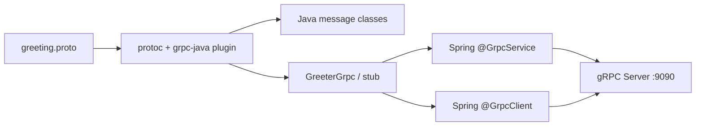

# Spring Boot starter cho gRPC

## 1. Mục tiêu và vị trí trong hệ sinh thái Spring

**Spring Boot starter cho gRPC** giúp ứng dụng Spring Boot khởi tạo máy chủ hoặc client gRPC bằng cấu hình và bean Spring, thay vì tự quản lý toàn bộ vòng đời của `Server`, `ManagedChannel` và các thành phần hạ tầng. gRPC dùng HTTP/2 làm transport, Protocol Buffers (Protobuf) làm định dạng thông điệp phổ biến và định nghĩa RPC theo hợp đồng `.proto`.

Sau bài này, người học có thể:

- Phân biệt gRPC starter, gRPC Java và plugin sinh mã từ Protobuf.
- Tạo hợp đồng unary RPC, sinh lớp Java, đăng ký triển khai gRPC như một thành phần Spring Boot.
- Cấu hình client gRPC, gọi RPC với deadline, xử lý status và metadata.
- Nhận biết cách bật TLS, tổ chức interceptor, kiểm thử và quan sát dịch vụ trong môi trường triển khai.
- Chọn đúng một hệ starter và kiểm tra khả năng tương thích phiên bản trước khi tích hợp.

Bài tập trung vào tích hợp Spring Boot trong dịch vụ **SPRING_GRPC**. Các phần streaming, bảo mật và giám sát được trình bày ở mức cần thiết để triển khai ứng dụng thực tế.

## 2. Starter giải quyết việc gì?

Một chương trình gRPC Java thuần thường tự tạo `ServerBuilder`, đăng ký `BindableService`, gọi `start()`, quản lý shutdown và tạo `ManagedChannelBuilder` ở phía client. Khi tích hợp Spring Boot, starter có thể cung cấp:

| Mối quan tâm | Vai trò thường gặp của starter |
| --- | --- |
| Server | Khởi động và dừng gRPC server cùng vòng đời ứng dụng; đăng ký các service được phát hiện qua Spring |
| Client | Tạo, cấu hình và quản lý channel/stub theo tên hoặc factory |
| Cấu hình | Ánh xạ properties/YAML cho cổng, địa chỉ, TLS và các chính sách transport |
| Mở rộng | Kết nối interceptor, credentials, health hoặc công cụ quan sát tùy khả năng của starter |
| Kiểm thử | Hỗ trợ đưa service dưới test context Spring và chọn cách chạy server khi test |

**Starter không thay thế hợp đồng Protobuf hay bước sinh mã.** Compiler `protoc` và plugin `protoc-gen-grpc-java` vẫn cần thiết để tạo message classes cùng lớp cơ sở/stub cho RPC.

### Chọn hệ starter trước khi viết code

Có hai hướng tích hợp thường gặp:

| Lựa chọn | Cách dùng | Lưu ý |
| --- | --- | --- |
| **Spring gRPC** thuộc hệ sinh thái Spring | Dùng các starter và API được công bố cho phiên bản Spring Boot/Spring gRPC cụ thể | Tên artifact, cách đăng ký service và cách tạo client có thể thay đổi giữa các dòng phát hành; tra tài liệu đúng phiên bản |
| **net.devh gRPC Spring Boot starter** (cộng đồng) | Dùng `grpc-server-spring-boot-starter`, `grpc-client-spring-boot-starter`, `@GrpcService` và `@GrpcClient` | Các annotation và cấu hình bên dưới **thuộc net.devh**, không mặc nhiên áp dụng cho Spring gRPC chính thức |

Phần thực hành chọn **net.devh** để minh họa trọn luồng vì API tích hợp rõ ràng. Khi dự án đã chọn Spring gRPC chính thức, cần chuyển toàn bộ đoạn đăng ký service/client sang API tương ứng; không trộn annotation hoặc cấu hình của hai hệ rồi giả định chúng tương đương.



## 3. Tạo hợp đồng Protobuf và sinh mã Java

Giả sử hệ thống có dịch vụ trả lời lời chào. Đặt tệp tại `src/main/proto/greeting.proto`:

```proto
syntax = "proto3";

package demo.greeting.v1;

option java_multiple_files = true;
option java_package = "dev.example.greeter.v1";
option java_outer_classname = "GreetingProto";

service Greeter {
  rpc SayHello(HelloRequest) returns (HelloReply);
}

message HelloRequest {
  string name = 1;
}

message HelloReply {
  string message = 1;
}
```

Tên `demo.greeting.v1.Greeter` là tên gRPC service trên wire; `java_package` điều khiển package của mã Java được sinh. Các số field (ví dụ `name = 1`) là một phần hợp đồng tương thích dữ liệu: **không tái sử dụng số field đã xóa** cho ý nghĩa mới; nên khai báo `reserved` khi xóa trường trong phiên bản sau.

Ví dụ cấu hình `build.gradle` (Groovy DSL) cho dự án Spring Boot dùng net.devh:

```groovy
plugins {
    id 'java'
    id 'org.springframework.boot' version 'BOOT_VERSION'
    id 'io.spring.dependency-management' version 'DEPENDENCY_MANAGEMENT_VERSION'
    id 'com.google.protobuf' version 'PROTOBUF_PLUGIN_VERSION'
}

def grpcVersion = 'GRPC_VERSION'
def protoVersion = 'PROTOBUF_VERSION'

repositories {
    mavenCentral()
}

dependencies {
    implementation 'org.springframework.boot:spring-boot-starter'
    implementation 'net.devh:grpc-server-spring-boot-starter:STARTER_VERSION'
    implementation 'net.devh:grpc-client-spring-boot-starter:STARTER_VERSION'

    implementation platform('io.grpc:grpc-bom:' + grpcVersion)
    implementation 'io.grpc:grpc-protobuf'
    implementation 'io.grpc:grpc-stub'
    implementation 'com.google.protobuf:protobuf-java:' + protoVersion

    testImplementation 'org.springframework.boot:spring-boot-starter-test'
    testImplementation 'io.grpc:grpc-inprocess'
}

protobuf {
    protoc {
        artifact = 'com.google.protobuf:protoc:' + protoVersion
    }
    plugins {
        grpc {
            artifact = 'io.grpc:protoc-gen-grpc-java:' + grpcVersion
        }
    }
    generateProtoTasks {
        all()*.plugins {
            grpc {}
        }
    }
}
```

Các chuỗi `BOOT_VERSION`, `DEPENDENCY_MANAGEMENT_VERSION`, `PROTOBUF_PLUGIN_VERSION`, `GRPC_VERSION`, `PROTOBUF_VERSION` và `STARTER_VERSION` là **vị trí cần thay bằng phiên bản thật**, không phải giá trị chạy được. Ưu tiên BOM/version catalog do dự án quản lý và đối chiếu ma trận tương thích của starter với Spring Boot, Java, gRPC và Protobuf. Một số tổ hợp `grpc-java`/JDK còn cần `compileOnly 'javax.annotation:javax.annotation-api:...'` cho annotation trong mã sinh; chỉ thêm khi có lỗi biên dịch tương ứng.

Chạy tác vụ Gradle `generateProto` để tạo message classes và `GreeterGrpc`; plugin Protobuf cũng nối bước sinh mã vào quá trình biên dịch Java. **Không chỉnh sửa file Java sinh ra**: thay hợp đồng `.proto`, sau đó sinh lại mã.

## 4. Khởi tạo Spring Boot server và đăng ký gRPC service

Ứng dụng Spring Boot thông thường:

```java
package dev.example;

import org.springframework.boot.SpringApplication;
import org.springframework.boot.autoconfigure.SpringBootApplication;

@SpringBootApplication
public class GreetingApplication {
    public static void main(String[] args) {
        SpringApplication.run(GreetingApplication.class, args);
    }
}
```

Đặt các lớp sau dưới package được Spring component scan quét (ở đây là `dev.example`).

Tách nghiệp vụ khỏi transport để có thể kiểm thử độc lập:

```java
package dev.example;

import org.springframework.stereotype.Service;

@Service
public class GreetingText {
    public String forName(String name) {
        return "Xin chào, " + name.trim() + "!";
    }
}
```

Triển khai service do Protobuf sinh và khai báo `@GrpcService` của **net.devh**:

```java
package dev.example;

import dev.example.greeter.v1.GreeterGrpc;
import dev.example.greeter.v1.HelloReply;
import dev.example.greeter.v1.HelloRequest;
import io.grpc.Status;
import io.grpc.stub.StreamObserver;
import net.devh.boot.grpc.server.service.GrpcService;

@GrpcService
public class GreetingGrpcService extends GreeterGrpc.GreeterImplBase {
    private final GreetingText greetingText;

    public GreetingGrpcService(GreetingText greetingText) {
        this.greetingText = greetingText;
    }

    @Override
    public void sayHello(
            HelloRequest request,
            StreamObserver<HelloReply> responseObserver) {

        if (request.getName().isBlank()) {
            responseObserver.onError(
                Status.INVALID_ARGUMENT
                    .withDescription("name không được để trống")
                    .asRuntimeException());
            return;
        }

        HelloReply reply = HelloReply.newBuilder()
            .setMessage(greetingText.forName(request.getName()))
            .build();

        responseObserver.onNext(reply);
        responseObserver.onCompleted();
    }
}
```

Với unary RPC, đường thành công thông thường là **một** `onNext(reply)` rồi `onCompleted()`. Khi lỗi, gọi `onError(...)` rồi kết thúc; tuyệt đối không tiếp tục `onNext`/`onCompleted` sau `onError`. Không để exception nghiệp vụ tự thoát và vô tình biến thành `UNKNOWN`; ánh xạ lỗi có chủ đích thành `Status` phù hợp.

Cấu hình `src/main/resources/application.yml` cho môi trường phát triển:

```yaml
spring:
  application:
    name: greeting-service

grpc:
  server:
    port: 9090
```

Cổng gRPC độc lập với `server.port` của Spring MVC/WebFlux khi ứng dụng cũng có HTTP server. Starter gRPC thường khởi động transport gRPC riêng, dù cả hai cùng chạy trong một tiến trình Spring Boot. Vì vậy mở đúng cổng ở Docker/Kubernetes, firewall và ingress hỗ trợ HTTP/2.

## 5. Tạo client gRPC trong một Spring bean

Với **net.devh**, một cấu hình client kết nối đến service ở máy local:

```yaml
grpc:
  client:
    greeting:
      address: static://localhost:9090
      negotiationType: PLAINTEXT
```

Cấu hình này có thể đặt cùng `grpc.server` khi chạy demo server và client trong một ứng dụng; ở hệ nhiều dịch vụ, đặt phần client trong ứng dụng gọi. `PLAINTEXT` chỉ phù hợp cho môi trường thử nghiệm hoặc kết nối đã được bảo vệ bằng hạ tầng được kiểm soát; với production nên cấu hình TLS/mTLS theo mô hình tin cậy.

```java
package dev.example;

import dev.example.greeter.v1.GreeterGrpc;
import dev.example.greeter.v1.HelloRequest;
import io.grpc.StatusRuntimeException;
import net.devh.boot.grpc.client.inject.GrpcClient;
import org.springframework.stereotype.Service;

import java.util.concurrent.TimeUnit;

@Service
public class GreetingGateway {
    @GrpcClient("greeting")
    private GreeterGrpc.GreeterBlockingStub stub;

    public String greet(String name) {
        HelloRequest request = HelloRequest.newBuilder()
            .setName(name)
            .build();

        try {
            return stub.withDeadlineAfter(800, TimeUnit.MILLISECONDS)
                .sayHello(request)
                .getMessage();
        } catch (StatusRuntimeException ex) {
            // Tầng gọi quyết định cách ánh xạ lỗi thành kết quả ứng dụng.
            throw ex;
        }
    }
}
```

Tên `greeting` trong `@GrpcClient("greeting")` trùng khóa cấu hình `grpc.client.greeting`. Stub được tạo từ channel do starter quản lý. Không tạo channel mới cho mỗi request: chi phí kết nối/HTTP/2 lớn và sẽ làm mất khả năng tái sử dụng kết nối. Blocking stub chặn luồng hiện tại; không gọi trực tiếp trên event loop của ứng dụng reactive. Với luồng reactive, dùng asynchronous/future stub và cơ chế chuyển đổi phù hợp.

**Deadline thuộc từng lời gọi.** Ví dụ trên dùng 800 ms như một giá trị minh họa, không phải SLA mặc định. Phải chọn theo yêu cầu độ trễ thực tế, bảo đảm tổng thời gian của các lời gọi lồng nhau còn nằm trong deadline phía ngoài. Nếu client hủy hoặc hết hạn, server cần dừng công việc có thể hủy thay vì tiếp tục xử lý tốn tài nguyên.

## 6. Metadata, interceptor và mã trạng thái

Metadata gRPC truyền thông tin ngoài protobuf payload: correlation ID, token, trace context hoặc các header nghiệp vụ nhỏ. Header dạng ASCII cần tên hợp lệ, thường dùng chữ thường; dữ liệu nhị phân dùng key kết thúc bằng `-bin` và marshaller tương ứng.

Ở phía server, interceptor có thể đọc metadata trước khi chuyển lời gọi vào service. Ví dụ chỉ minh họa việc lấy request ID:

```java
package dev.example;

import io.grpc.*;
import net.devh.boot.grpc.server.interceptor.GrpcGlobalServerInterceptor;

@GrpcGlobalServerInterceptor
public class RequestIdInterceptor implements ServerInterceptor {
    private static final Metadata.Key<String> REQUEST_ID =
        Metadata.Key.of("x-request-id", Metadata.ASCII_STRING_MARSHALLER);

    @Override
    public <ReqT, RespT> ServerCall.Listener<ReqT> interceptCall(
            ServerCall<ReqT, RespT> call,
            Metadata headers,
            ServerCallHandler<ReqT, RespT> next) {
        String requestId = headers.get(REQUEST_ID);
        // Gắn requestId vào gRPC Context hoặc tracing context nếu cần,
        // không ghi token/secret vào log.
        return next.startCall(call, headers);
    }
}
```

Annotation `@GrpcGlobalServerInterceptor` đăng ký interceptor toàn cục trong hệ **net.devh**. Nếu metadata cần truy cập sâu bên trong nghiệp vụ, dùng `io.grpc.Context` với phạm vi sống đúng RPC; tránh giữ thông tin request trong field singleton hoặc `ThreadLocal` không được truyền ngữ cảnh đúng cách qua callback bất đồng bộ. Ở client có thể dùng `ClientInterceptor` hoặc `MetadataUtils.newAttachHeadersInterceptor(...)` để đính metadata theo chính sách của ứng dụng.

| Status gRPC | Ví dụ | Hướng xử lý |
| --- | --- | --- |
| `INVALID_ARGUMENT` | Trường đầu vào sai hoặc thiếu | Trả thông báo xác thực, client sửa yêu cầu |
| `UNAUTHENTICATED` | Thiếu hoặc sai thông tin xác thực | Kiểm tra credentials |
| `PERMISSION_DENIED` | Có danh tính nhưng không đủ quyền | Kiểm tra chính sách ủy quyền |
| `NOT_FOUND` | Không tìm thấy tài nguyên | Xử lý kết quả không tồn tại |
| `DEADLINE_EXCEEDED` | Vượt thời hạn RPC | Ghi nhận độ trễ; cân nhắc retry nếu an toàn |
| `UNAVAILABLE` | Kết nối/server tạm thời không khả dụng | Có thể retry với backoff và giới hạn |
| `INTERNAL` | Lỗi nội bộ | Log chi tiết phía server; không tiết lộ dữ liệu nhạy cảm |

Đọc mã lỗi bằng `Status.fromThrowable(ex).getCode()` hoặc `ex.getStatus().getCode()` với `StatusRuntimeException`. Không tự động retry mọi lỗi: RPC tạo đơn hàng/thanh toán cần idempotency key hoặc cơ chế chống xử lý trùng trước khi retry.

## 7. Streaming và vòng đời lời gọi

Starter không thay đổi bốn kiểu RPC của gRPC, vì kiểu lời gọi nằm trong `.proto`:

| Kiểu RPC | Cú pháp trong service | Hành vi chính |
| --- | --- | --- |
| Unary | `rpc SayHello(Req) returns (Res);` | Một request, một response |
| Server streaming | `rpc Watch(Req) returns (stream Res);` | Một request, nhiều response |
| Client streaming | `rpc Upload(stream Req) returns (Res);` | Nhiều request, một response |
| Bidirectional streaming | `rpc Chat(stream Req) returns (stream Res);` | Hai luồng thông điệp độc lập |

Với streaming, một lời gọi có thể tồn tại lâu hơn unary. Cần xử lý cancellation, deadline, backpressure/flow control và giới hạn số message lưu trong bộ nhớ. Khi dùng asynchronous API, đọc khả năng `isReady()` và callback `setOnReadyHandler(...)` của `ServerCallStreamObserver` nếu phát luồng nhanh hơn tốc độ tiêu thụ; không coi `onNext` là một phép gửi có khả năng chặn an toàn trong mọi điều kiện.

Tư duy tích hợp Spring Boot vẫn tương tự: service implementation là bean, có thể inject lớp nghiệp vụ; channel và cấu hình transport do starter quản lý. Tuy nhiên phải thiết kế lifecycle của stream trong service để ngắt công việc nền khi client đã hủy kết nối.

## 8. TLS, cấu hình môi trường và vận hành

Ví dụ cấu hình TLS **theo tên property của net.devh** (đường dẫn chứng chỉ chỉ để minh họa):

```yaml
grpc:
  server:
    port: 9090
    security:
      enabled: true
      certificateChain: classpath:certs/server.crt
      privateKey: classpath:certs/server.key
  client:
    greeting:
      address: static://grpc.internal.example:9090
      negotiationType: TLS
      security:
        trustCertCollection: classpath:certs/ca.crt
```

Certificate phải phù hợp DNS/SAN của địa chỉ mà client gọi; không bỏ qua kiểm tra chứng chỉ để sửa lỗi kết nối. Nếu cần xác thực hai chiều, cấu hình client certificate, private key và trust của server theo API bản starter đang dùng. Trong production, secret nên được cấp qua hệ thống quản lý secret hoặc mount bảo mật; tránh commit private key vào repository.

Một số điểm cần đưa vào thiết kế triển khai:

- **Discovery và cân bằng tải:** địa chỉ `static://localhost:9090` chỉ dành cho local; dùng DNS/service discovery hoặc resolver/load balancing phù hợp khi có nhiều instance.
- **Health/readiness:** gRPC health checking và Spring Boot Actuator HTTP health là hai cơ chế khác nhau. Chỉ cấu hình Kubernetes gRPC health probe khi server thực sự cung cấp gRPC Health Checking Protocol; nếu dùng HTTP probe cần cổng và endpoint tương ứng.
- **Metrics/tracing:** đo số lời gọi, tỷ lệ theo status, p50/p95/p99 latency, active streams và thời gian xử lý; cấu hình instrumentation của gRPC, Micrometer/OpenTelemetry phù hợp thay vì mặc định cho rằng starter tự phát toàn bộ số liệu.
- **Giới hạn tài nguyên:** đặt giới hạn message size, concurrency, deadline và stream lifetime tùy tải; kiểm tra tác động của compression và số kết nối HTTP/2.
- **Tắt ứng dụng:** bảo đảm server/channel được shutdown có kiểm soát theo cơ chế của starter, cho phép RPC đang xử lý hoàn tất trong khoảng grace period phù hợp.

## 9. Kiểm thử và xác minh hành vi

### 9.1. Gọi thử server từ công cụ bên ngoài

Khởi động ứng dụng có `@GrpcService` và gọi bằng `grpcurl`, dùng trực tiếp file `.proto` để không phụ thuộc server reflection:

```bash
grpcurl -plaintext \
  -import-path src/main/proto \
  -proto greeting.proto \
  -d '{"name":"Linh"}' \
  localhost:9090 \
  demo.greeting.v1.Greeter/SayHello
```

Kết quả dự kiến:

```json
{
  "message": "Xin chào, Linh!"
}
```

Tham số `-plaintext` chỉ dùng với cấu hình local tương ứng; server bật TLS cần lệnh và CA trust phù hợp. Nếu chạy command trên PowerShell Windows, viết trên một dòng hoặc thay dấu xuống dòng theo cú pháp PowerShell.

### 9.2. Kiểm thử nhanh service bằng in-process gRPC

Bài test này dùng gRPC transport trong bộ nhớ, xác minh protobuf, binding và status mà không mở cổng mạng. Ví dụ với JUnit 5 và dependency `grpc-inprocess`:

```java
import dev.example.GreetingGrpcService;
import dev.example.GreetingText;
import dev.example.greeter.v1.GreeterGrpc;
import dev.example.greeter.v1.HelloRequest;
import io.grpc.ManagedChannel;
import io.grpc.Server;
import io.grpc.Status;
import io.grpc.StatusRuntimeException;
import io.grpc.inprocess.InProcessChannelBuilder;
import io.grpc.inprocess.InProcessServerBuilder;
import org.junit.jupiter.api.Test;

import static org.junit.jupiter.api.Assertions.*;

class GreetingGrpcServiceTest {
    @Test
    void returnsGreetingAndValidatesName() throws Exception {
        String serverName = InProcessServerBuilder.generateName();
        Server server = InProcessServerBuilder.forName(serverName)
            .directExecutor()
            .addService(new GreetingGrpcService(new GreetingText()))
            .build()
            .start();
        ManagedChannel channel = InProcessChannelBuilder.forName(serverName)
            .directExecutor()
            .build();

        try {
            var stub = GreeterGrpc.newBlockingStub(channel);
            var ok = stub.sayHello(HelloRequest.newBuilder()
                .setName("Linh").build());
            assertEquals("Xin chào, Linh!", ok.getMessage());

            var error = assertThrows(StatusRuntimeException.class, () ->
                stub.sayHello(HelloRequest.newBuilder().build()));
            assertEquals(Status.Code.INVALID_ARGUMENT,
                error.getStatus().getCode());
        } finally {
            channel.shutdownNow();
            server.shutdownNow();
        }
    }
}
```

Test này **không kiểm tra auto-configuration của Spring Boot**. Vì vậy vẫn cần một integration test chạy `@SpringBootTest` với cấu hình starter thật, cổng động hoặc server in-process do framework hỗ trợ, rồi gọi qua client thực. Test tích hợp cần xác nhận rằng service được đăng ký, properties được bind, interceptor chạy, deadline hoạt động và TLS/credentials hoạt động với chứng chỉ test.

### 9.3. Bộ tình huống nên xác minh

1. Request hợp lệ trả đúng response; tên rỗng trả `INVALID_ARGUMENT`, không trả `UNKNOWN`.
2. Client gọi sai endpoint hoặc server không sẵn sàng cho ra status kết nối phù hợp, không treo vô thời hạn.
3. RPC vượt deadline cho ra `DEADLINE_EXCEEDED` và server dừng công việc có thể hủy.
4. Metadata/correlation ID đi qua interceptor; token không xuất hiện trong log.
5. TLS thất bại khi không tin CA hoặc tên host sai, thành công với bộ chứng chỉ hợp lệ.
6. Với streaming, client hủy giữa chừng không khiến server tiếp tục phát vô hạn.

## 10. Những lỗi tích hợp hay gặp

| Triệu chứng | Nguyên nhân có thể | Cách kiểm tra |
| --- | --- | --- |
| Không tìm thấy `GreeterGrpc` | Chưa chạy sinh mã, `.proto` sai thư mục hoặc plugin gRPC chưa bật | Kiểm tra `generateProto` và source generated |
| `UNIMPLEMENTED` | Sai tên package/service/method hoặc server chưa đăng ký implementation | Đối chiếu `demo.greeting.v1.Greeter/SayHello` và bean `@GrpcService` |
| `UNAVAILABLE` | Sai địa chỉ/cổng, thiếu DNS/TLS hoặc server chưa sẵn sàng | Kiểm tra endpoint, log server, handshake và ingress HTTP/2 |
| `DEADLINE_EXCEEDED` | Deadline quá thấp, nghẽn thread, backend chậm | Đo latency, so với SLA và chuỗi lời gọi |
| Không inject được `@GrpcClient` | Sai tên channel, thiếu client starter hoặc trộn hệ starter | Kiểm tra bean, starter và `grpc.client.<name>` |
| Lỗi compile `javax.annotation.Generated` | Phụ thuộc annotation thiếu ở tổ hợp mã sinh/JDK nhất định | Bổ sung đúng API annotation theo toolchain |
| gRPC chạy nhưng Actuator health vẫn khác | Hai cổng và hai mô hình health khác nhau | Kiểm tra health endpoint, gRPC health service và probe cấu hình |

## 11. Quy trình triển khai đề xuất

Bắt đầu từ hợp đồng `.proto` và quy tắc tương thích schema; khóa bộ phiên bản Spring Boot, starter, Protobuf và gRPC; sinh mã Java; triển khai service và client dưới bean Spring; đặt deadline cùng status mapping; bổ sung interceptor, TLS, health và tracing; cuối cùng kiểm tra cả logic RPC lẫn auto-configuration Spring Boot trong môi trường giống production.

Điểm cốt lõi của **Spring Boot starter cho gRPC** là đưa gRPC vào vòng đời, cấu hình và dependency injection của Spring. Giao thức, hợp đồng Protobuf, semantics của deadline, status và streaming vẫn là trách nhiệm thiết kế của ứng dụng; starter chỉ tạo nền tảng tích hợp để triển khai các trách nhiệm đó nhất quán.
