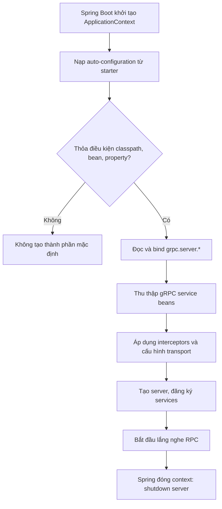

# Auto-configuration của gRPC server trong Spring Boot

## 1. Mục tiêu và phạm vi

Trong hệ **SPRING_GRPC**, lập trình viên định nghĩa RPC bằng Protocol Buffers, sinh lớp Java rồi triển khai gRPC server/client cho unary hoặc streaming RPC. **Auto-configuration của gRPC server** giúp Spring Boot nhận diện những thành phần gRPC có sẵn, ánh xạ cấu hình, tạo server và quản lý vòng đời server trong cùng `ApplicationContext`.

Sau bài học, người học có thể:

- Giải thích điều kiện Spring Boot kích hoạt cấu hình gRPC server và vì sao thêm dependency chưa đủ nếu service không được đăng ký.
- Tạo một gRPC service dưới dạng Spring bean và để starter tự đưa service vào server.
- Phân biệt cổng gRPC với cổng HTTP/Actuator, nhận biết nguồn properties có thể ghi đè cấu hình.
- Tổ chức interceptor, TLS, health, lifecycle và quan sát hoạt động của server.
- Kiểm thử tích hợp để xác minh auto-configuration thực sự tạo endpoint RPC.

**Quy ước:** Các ví dụ mã sử dụng starter cộng đồng **`net.devh:grpc-server-spring-boot-starter`**, với `@GrpcService` và prefix `grpc.server.*`. Spring cũng có dự án **Spring gRPC** với các starter và API khác. Các khái niệm Spring Boot auto-configuration tương tự nhau, nhưng **không trộn annotation, tên artifact hoặc properties giữa hai hệ**. Chọn bộ phiên bản được hỗ trợ và tra đúng tài liệu phiên bản đã chọn.

## 2. So sánh tạo server thủ công và tự cấu hình

Trong gRPC Java thuần, lập trình viên có thể tạo `Server` trực tiếp:

```java
Server server = ServerBuilder.forPort(9090)
    .addService(new GreetingGrpcService())
    .build()
    .start();

Runtime.getRuntime().addShutdownHook(
    new Thread(server::shutdown)
);
```

Đoạn trên phác họa cách khởi động server bằng tay, nhưng chưa thể hiện đầy đủ việc nhận dependency từ Spring, TLS, interceptor, health, graceful shutdown và xử lý lỗi khi khởi động.

Khi dùng starter, ứng dụng thường chỉ cần **hợp đồng `.proto`, lớp triển khai gRPC được Spring phát hiện và properties**. Server factory/lifecycle do starter phụ trách. Tránh đồng thời tự tạo `ServerBuilder.forPort(...)` rồi bật server qua starter trên cùng cổng, vì hai server có thể tranh chấp listener.



Phải tách rõ **ba lớp trách nhiệm**:

1. **Sinh mã Protobuf:** `protoc` và plugin gRPC tạo message classes, `*Grpc` base classes và stubs trong bước build. Spring Boot không sinh các lớp này.
2. **Dependency injection:** Spring tạo các bean ứng dụng, inject nghiệp vụ và tìm các class đã được đăng ký.
3. **Server auto-configuration:** Starter dựa trên các bean/properties đó để tạo gRPC server và quản lý vòng đời.

Auto-configuration không tự quyết định deadline, chính sách retry, phân quyền hay tính idempotent của các RPC nghiệp vụ.

## 3. Cơ chế auto-configuration của Spring Boot

### 3.1. Điều gì khiến cấu hình được kích hoạt?

`@SpringBootApplication` bao gồm việc bật auto-configuration. Starter gRPC có thể công bố các cấu hình tự động cho Spring nạp. Với Spring Boot 3, các auto-configuration thường được đăng ký trong `META-INF/spring/org.springframework.boot.autoconfigure.AutoConfiguration.imports`; các dòng Boot cũ có cơ chế đăng ký khác.

Một auto-configuration điển hình có thể phụ thuộc vào các điều kiện:

| Khái niệm | Ý nghĩa | Hệ quả khi kiểm tra lỗi |
| --- | --- | --- |
| `@ConditionalOnClass` | Kích hoạt khi có các lớp thư viện cần thiết | Thiếu starter hoặc dependency gRPC |
| `@ConditionalOnMissingBean` | Bean mặc định có thể nhường chỗ cho bean do ứng dụng cung cấp | Bean riêng khiến cấu hình mặc định không tạo |
| `@ConditionalOnProperty` | Tính năng có thể bật/tắt qua property | Cấu hình môi trường đã vô hiệu hóa tính năng |
| `@ConfigurationProperties` | Bind properties từ environment vào đối tượng cấu hình | Sai prefix, value hoặc bị profile ghi đè |
| Lifecycle của Spring | Khởi động/dừng tài nguyên theo context | Bean tồn tại nhưng server chưa lắng nghe |

Bảng này diễn giải **cơ chế chung của Spring Boot**; không có nghĩa mọi bản starter sử dụng tất cả annotation hay cùng cấu trúc bean. Muốn kiểm tra bản đang chạy, sử dụng condition report và log startup.

### 3.2. Phát hiện implementation của gRPC service

Ở phía gRPC Java, một implementation thường kế thừa lớp `GreeterGrpc.GreeterImplBase` do plugin gRPC sinh ra, và có khả năng được biến thành `ServerServiceDefinition`. Với **net.devh**, `@GrpcService` đánh dấu bean để cơ chế đăng ký service của starter nhận diện.

Hai tình huống gây lỗi phổ biến:

- Lớp có `@GrpcService` nhưng ở ngoài phạm vi `@ComponentScan`: Spring không tạo bean nên server không đăng ký service.
- Lớp kế thừa `GreeterImplBase` nhưng chỉ là object thông thường hoặc không được đăng ký theo API starter: server có thể khởi động mà không có method mong muốn.

Tên RPC thực tế là sự kết hợp của `package` và `service` trong `.proto`, không phụ thuộc vào tên package Java của class triển khai.

### 3.3. Khi nào server sẵn sàng?

Sau khi context có các bean thích hợp, starter tạo server và kích hoạt nó trong quá trình lifecycle. Một số starter dùng cơ chế Spring `SmartLifecycle`; thứ tự cụ thể cần kiểm tra theo phiên bản. Nếu không thể bind cổng hoặc chứng chỉ TLS sai, quá trình startup có thể thất bại.

**Có bean gRPC chưa chứng minh server đang nhận kết nối.** Hãy xác minh bằng log bind cổng và thực hiện một RPC ngoài tiến trình, đặc biệt trước khi cấu hình readiness.

## 4. Xây dựng ví dụ Spring Boot gRPC server

### 4.1. Định nghĩa hợp đồng

Đặt `src/main/proto/greeting.proto`:

```proto
syntax = "proto3";

package demo.greeting.v1;

option java_multiple_files = true;
option java_package = "dev.example.greeter.v1";

service Greeter {
  rpc SayHello(HelloRequest) returns (HelloReply);
}

message HelloRequest {
  string name = 1;
}

message HelloReply {
  string message = 1;
}
```

Ở đây, tên trên wire là `demo.greeting.v1.Greeter/SayHello`, còn mã Java sẽ thuộc `dev.example.greeter.v1`. Giữ nguyên số field khi tiến hóa schema; khi xóa field, nên `reserved` số field và tên nếu cần để tránh sử dụng lại một ý nghĩa cũ.

### 4.2. Dependencies và code generation

Ví dụ khung `build.gradle` dùng Groovy DSL:

```groovy
plugins {
    id 'java'
    id 'org.springframework.boot' version 'BOOT_VERSION'
    id 'io.spring.dependency-management' version 'DEPENDENCY_MANAGEMENT_VERSION'
    id 'com.google.protobuf' version 'PROTOBUF_PLUGIN_VERSION'
}

def grpcVersion = 'GRPC_VERSION'
def protobufVersion = 'PROTOBUF_VERSION'
def starterVersion = 'NET_DEVH_STARTER_VERSION'

repositories {
    mavenCentral()
}

dependencies {
    implementation 'org.springframework.boot:spring-boot-starter'
    implementation "net.devh:grpc-server-spring-boot-starter:${starterVersion}"

    implementation platform("io.grpc:grpc-bom:${grpcVersion}")
    implementation 'io.grpc:grpc-protobuf'
    implementation 'io.grpc:grpc-stub'
    implementation "com.google.protobuf:protobuf-java:${protobufVersion}"

    testImplementation 'org.springframework.boot:spring-boot-starter-test'
}

protobuf {
    protoc {
        artifact = "com.google.protobuf:protoc:${protobufVersion}"
    }
    plugins {
        grpc {
            artifact = "io.grpc:protoc-gen-grpc-java:${grpcVersion}"
        }
    }
    generateProtoTasks {
        all()*.plugins {
            grpc {}
        }
    }
}
```

**Tất cả chuỗi kết thúc bằng `_VERSION` là placeholder**, cần thay bằng bộ phiên bản hợp lệ trước khi build; đoạn mã chưa thể chạy nguyên văn. Nên quản lý các phiên bản này qua BOM hoặc version catalog tương thích với JDK, Spring Boot, net.devh, gRPC Java và Protobuf. Tùy tổ hợp JDK/code generator, mã gRPC Java sinh ra có thể cần thêm API chứa `javax.annotation.Generated`; chỉ bổ sung nếu phiên bản đang dùng yêu cầu.

Khi chạy sinh mã, dự án sẽ có `HelloRequest`, `HelloReply` và `GreeterGrpc.GreeterImplBase`. Không chỉnh sửa Java generated: thay `.proto` rồi sinh lại code.

### 4.3. Spring Boot application

```java
package dev.example;

import org.springframework.boot.SpringApplication;
import org.springframework.boot.autoconfigure.SpringBootApplication;

@SpringBootApplication
public class GrpcApplication {
    public static void main(String[] args) {
        SpringApplication.run(GrpcApplication.class, args);
    }
}
```

Đặt các lớp khác bên dưới package `dev.example` để thuộc vùng component scan mặc định.

### 4.4. gRPC service trở thành Spring bean

```java
package dev.example.grpc;

import dev.example.greeter.v1.GreeterGrpc;
import dev.example.greeter.v1.HelloReply;
import dev.example.greeter.v1.HelloRequest;
import io.grpc.Status;
import io.grpc.stub.StreamObserver;
import net.devh.boot.grpc.server.service.GrpcService;

@GrpcService
public class GreetingGrpcService extends GreeterGrpc.GreeterImplBase {

    @Override
    public void sayHello(
            HelloRequest request,
            StreamObserver<HelloReply> responseObserver) {

        String name = request.getName().trim();

        if (name.isEmpty()) {
            responseObserver.onError(
                Status.INVALID_ARGUMENT
                    .withDescription("name không được để trống")
                    .asRuntimeException());
            return;
        }

        HelloReply reply = HelloReply.newBuilder()
            .setMessage("Xin chào, " + name + "!")
            .build();

        responseObserver.onNext(reply);
        responseObserver.onCompleted();
    }
}
```

`@GrpcService` trong ví dụ **thuộc net.devh**, không phải annotation gRPC Java phổ quát. Khi Spring nhận diện bean này, starter đăng ký gRPC service vào server. Application code không phải gọi `server.addService(...)` hoặc `server.start()`.

Một unary RPC thành công phát ra một message bằng `onNext(...)` rồi `onCompleted()`. Khi gọi `onError(...)` phải kết thúc việc xử lý, không gửi thêm response. Chọn `Status.INVALID_ARGUMENT` cho lỗi dữ liệu đầu vào để client phân biệt với lỗi nội bộ.

### 4.5. Cấu hình theo môi trường

Tệp `src/main/resources/application.yml`:

```yaml
spring:
  application:
    name: greeting-grpc

grpc:
  server:
    port: ${GRPC_SERVER_PORT:9090}
```

Ở đây, `GRPC_SERVER_PORT` (nếu được cung cấp) quyết định cổng gRPC; nếu không, giá trị dự phòng là `9090`. Khi bật profile `dev`, có thể ghi đè trong `application-dev.yml`:

```yaml
grpc:
  server:
    port: 9191
```

Các nguồn cấu hình của Spring Boot có thứ tự ưu tiên: file profile, biến môi trường, command-line arguments và các nguồn khác. Để chẩn đoán, hãy tìm **giá trị thực sự đã bind** thay vì chỉ đọc một file YAML. Bất kỳ thay đổi port nào đều phải đồng bộ với cấu hình client và hạ tầng triển khai.

## 5. gRPC server có giống HTTP server của Spring Boot?

**Không.** Một ứng dụng Spring Boot có thể chạy gRPC server và HTTP server độc lập trong cùng JVM.

```text
Spring Boot ApplicationContext
|
+-- Spring beans: gRPC services, interceptors, business services
|
+-- gRPC server (net.devh starter)
|   +-- grpc.server.port = 9090
|   +-- HTTP/2 + gRPC
|
+-- HTTP server (chỉ khi có web stack)
    +-- server.port = 8080
    +-- REST / Actuator HTTP endpoints
```

| Thuộc tính | Phạm vi thông thường |
| --- | --- |
| `grpc.server.port` | Cổng gRPC của net.devh |
| `server.port` | Cổng HTTP của Spring Boot Web |
| `management.server.port` | Cổng HTTP quản trị nếu tách Actuator |

Chỉ thêm `spring-boot-starter` và gRPC server starter **không bắt buộc** phải có Spring MVC. Nếu ứng dụng cũng có web starter, thay đổi `server.port` không tự thay `grpc.server.port`.

Điều này ảnh hưởng trực tiếp đến Docker/Kubernetes, firewall, reverse proxy và ingress: phải mở đúng cổng gRPC và bảo đảm HTTP/2 hoặc h2c/TLS được hỗ trợ theo mô hình triển khai. Một ứng dụng HTTP khỏe mạnh ở cổng 8080 chưa chứng minh RPC đang hoạt động ở cổng 9090.

## 6. Đăng ký interceptor qua Spring

Server interceptor chạy trước service implementation, phù hợp để đọc metadata, xác thực caller, gắn correlation ID, đo latency hoặc ghi status RPC. Trong **net.devh**, `@GrpcGlobalServerInterceptor` có thể đưa một `ServerInterceptor` vào toàn bộ các service gRPC được quản lý.

Ví dụ đặt request ID từ metadata vào `io.grpc.Context`:

```java
package dev.example.grpc;

import io.grpc.Context;
import io.grpc.Contexts;
import io.grpc.Metadata;
import io.grpc.ServerCall;
import io.grpc.ServerCallHandler;
import io.grpc.ServerInterceptor;
import net.devh.boot.grpc.server.interceptor.GrpcGlobalServerInterceptor;

@GrpcGlobalServerInterceptor
public class RequestIdInterceptor implements ServerInterceptor {
    public static final Context.Key<String> REQUEST_ID =
        Context.key("grpc-request-id");

    private static final Metadata.Key<String> REQUEST_ID_HEADER =
        Metadata.Key.of(
            "x-request-id",
            Metadata.ASCII_STRING_MARSHALLER
        );

    @Override
    public <ReqT, RespT> ServerCall.Listener<ReqT> interceptCall(
            ServerCall<ReqT, RespT> call,
            Metadata headers,
            ServerCallHandler<ReqT, RespT> next) {

        String incoming = headers.get(REQUEST_ID_HEADER);
        String requestId = incoming == null ? "" : incoming;

        Context context =
            Context.current().withValue(REQUEST_ID, requestId);

        return Contexts.interceptCall(context, call, headers, next);
    }
}
```

Trong service, đọc `RequestIdInterceptor.REQUEST_ID.get()` nếu code chạy trong gRPC context thích hợp. Với code bất đồng bộ được dispatch sang executor khác, cần truyền context một cách chủ động khi cơ chế thực thi không tự giữ context.

Một số lưu ý:

- Metadata từ client **không mặc nhiên đáng tin**; cần giới hạn độ dài request ID, tránh đưa token/secret vào log.
- Global interceptor có tác động trên nhiều RPC; per-service interceptor và quy tắc sắp xếp thứ tự phụ thuộc API starter.
- Chú ý thứ tự authentication, authorization, tracing và metrics. Đặt sai thứ tự có thể khiến metric thiếu status hoặc cho phép xử lý trước khi xác thực.
- Không lưu metadata riêng từng RPC trong field của Spring singleton; dùng gRPC `Context` hoặc context tracing thích hợp.

Cũng như service, interceptor cần được Spring phát hiện/đăng ký theo API starter. Nếu tự khai báo `ServerBuilder` khác, nó không tự nhận các interceptor được đăng ký ở server của starter.

## 7. Mở rộng server và xử lý xung đột cấu hình

Thông số transport như keepalive, message size, executor, TLS hoặc service factory có thể cần điều chỉnh. Tùy phiên bản starter, các cấu hình này được công bố dưới dạng properties, bean customizer hoặc extension point khác.

**Nguyên tắc:** Ưu tiên cấu hình trên **server do starter quản lý**. Không tạo một server thứ hai để chỉnh một thuộc tính vốn có thể đưa vào factory/builder hiện tại.

Khi một auto-configuration sử dụng `@ConditionalOnMissingBean`, bean tùy biến có thể làm bean mặc định "back off". Tuy nhiên, thay thế bean hoặc ép bật bean overriding mà không hiểu dependency graph có thể khiến server không còn start đúng cách.

Một số câu hỏi cần xác minh trước khi customize:

1. Property hoặc extension point này thuộc hệ `net.devh` hay Spring gRPC chính thức?
2. Nó tác động đến toàn server hay một service riêng?
3. Có thể triển khai bằng interceptor mà không thay server factory không?
4. Đối tượng cấu hình được tạo trước hay sau khi server khởi động?
5. Thay đổi có cần restart để có hiệu lực không?

Nếu có hai implementation đăng ký cùng tên đầy đủ của một RPC service, gRPC server có thể thất bại khi build hoặc start. Tên đầy đủ lấy từ `package.service` trong Protobuf, không dựa trên tên class Java, vì vậy đổi package Java chưa đủ để tránh trùng.

## 8. TLS và bảo vệ gRPC server

Khi cần TLS, starter có thể bind thuộc tính bảo mật vào transport. Ví dụ cấu hình **net.devh** theo những phiên bản có hỗ trợ các property này:

```yaml
grpc:
  server:
    port: 9090
    security:
      enabled: true
      certificateChain: file:/run/secrets/grpc/tls.crt
      privateKey: file:/run/secrets/grpc/tls.key
```

Đây là đường dẫn minh họa; không có certificate/key thực trong bài. Kiểm tra chính xác cách starter nhận `file:`, `classpath:`, CA trust và client authentication theo phiên bản. Không đưa private key thật vào repository.

Vận hành TLS cần:

- Chứng chỉ server hợp lệ với tên DNS/SAN mà client kết nối.
- Client tin CA phù hợp; không bỏ qua hostname/CA validation để làm kết nối chạy.
- Nếu cần mTLS, cấu hình chứng chỉ phía client và chính sách xác minh CA phía server.
- Xác định rõ TLS kết thúc tại ingress/service mesh hay backend; bảo đảm tuyến giao tiếp còn lại có mức bảo vệ phù hợp.
- Quản lý secret/certificate rotation theo cơ chế hạ tầng và xác minh việc reload/restart theo khả năng thư viện.

TLS bảo vệ transport. **Authentication/authorization nghiệp vụ** vẫn cần áp dụng, chẳng hạn qua interceptor kiểm tra credentials, phân quyền cho từng RPC và hạn chế lộ metadata nhạy cảm.

## 9. Lifecycle, health và độ tin cậy

### 9.1. Khởi động và shutdown

Server do starter quản lý thường bắt đầu nghe sau khi khởi tạo các bean cần thiết và dừng theo vòng đời Spring context. Tuy nhiên, không nên giả định tất cả bản starter đều có graceful shutdown hoặc thời gian đợi RPC đang xử lý giống nhau.

Khi chạy trên Kubernetes hoặc tương đương:

- Chuyển instance sang trạng thái không sẵn sàng để tránh RPC mới trước khi dừng.
- Dành khoảng thời gian đủ cho các unary RPC đang chạy hoàn tất trong giới hạn cho phép.
- Với streaming RPC, xử lý cancellation, ngắt producer và giải phóng tài nguyên.
- Đồng bộ thời gian shutdown của ứng dụng với `terminationGracePeriodSeconds` và chính sách load balancer.

### 9.2. gRPC health khác Actuator health

Actuator thường cung cấp HTTP health endpoint; **gRPC Health Checking Protocol** là một gRPC service riêng. Bật Actuator **không đồng nghĩa** server đã có health service gRPC.

Nếu dùng Kubernetes gRPC probe, server phải hỗ trợ health service và probe phải nhắm đúng gRPC port. Nếu dùng HTTP probe, chọn cổng/đường dẫn HTTP management tương ứng. Readiness nên phản ánh khả năng tiếp nhận RPC thực sự, còn liveness nên dành cho tình trạng tiến trình không thể tự phục hồi.

### 9.3. Deadline, status và observability

Tính năng auto-configuration không tự thiết lập mọi deadline, retry hoặc tracing. Vẫn cần chính sách vận hành:

| Tín hiệu | Điều cần đo hoặc xử lý |
| --- | --- |
| `OK` và tần suất theo method | Thông lượng, phân bố traffic |
| `INVALID_ARGUMENT` | Dữ liệu client không hợp lệ |
| `UNAVAILABLE` | Kết nối, server, load balancer hoặc transport |
| `DEADLINE_EXCEEDED` | Độ trễ quá hạn, phụ thuộc upstream chậm |
| `CANCELLED` | Client hủy, stream kết thúc sớm |
| p50/p95/p99 latency | Theo dõi tail latency |
| Active streams, CPU, heap, executor | Tài nguyên cho streaming và tải cao |

Metrics, logging và tracing thường cần thêm integration hoặc instrumentation của gRPC, Micrometer hay OpenTelemetry đúng phiên bản. Không mặc định rằng chỉ thêm starter sẽ tự động xuất toàn bộ chỉ số.

Client cần đặt deadline phù hợp SLA; server nên kiểm tra cancellation/deadline cho công việc dài. Với các RPC có tác dụng phụ, retry chỉ an toàn nếu ứng dụng có cơ chế idempotency hoặc chống thực thi trùng.

## 10. Xác minh server bằng RPC thật

Sau khi chọn dependency versions hợp lệ, sinh mã và khởi động ứng dụng, gọi bằng `grpcurl`. Truyền trực tiếp hợp đồng `.proto` để không phụ thuộc server reflection:

```bash
grpcurl -plaintext \
  -import-path src/main/proto \
  -proto greeting.proto \
  -d '{"name":"An"}' \
  localhost:9090 \
  demo.greeting.v1.Greeter/SayHello
```

Kết quả mong đợi:

```json
{
  "message": "Xin chào, An!"
}
```

Gọi thêm `{"name":""}` để quan sát `INVALID_ARGUMENT`. Nếu server bật TLS, phải thay chế độ gọi và cung cấp trust CA phù hợp; cờ `-plaintext` chỉ dành cho endpoint không dùng TLS. Trên PowerShell, có thể viết lệnh `grpcurl` trên một dòng để tránh khác biệt cú pháp tiếp dòng.

Kiểm chứng một RPC thành công thể hiện đồng thời:

1. Server đã bind endpoint và nhận được request.
2. Service/method trong hợp đồng Protobuf đã được đăng ký.
3. Request/response được mã hóa, giải mã đúng.
4. Implementation được Spring tạo và chạy qua server của starter.
5. Status và response được trả qua transport gRPC.

Kiểm tra bean tồn tại hoặc log khởi động đơn lẻ chưa xác minh được đầy đủ cả chuỗi.

## 11. Integration test cho auto-configuration

Một unit test gọi trực tiếp `new GreetingGrpcService()` chỉ xác minh logic của service. Để kiểm tra **Spring Boot auto-configuration**, cần load Spring context rồi gửi RPC tới server do starter tạo.

Một số phiên bản **net.devh** hỗ trợ in-process server, nhờ đó test không mở TCP port. Với bản có `inProcessName` và `in-process:`, có thể cấu hình như sau.

Thêm dependencies cho test:

```groovy
testImplementation "net.devh:grpc-client-spring-boot-starter:${starterVersion}"
testImplementation 'io.grpc:grpc-inprocess'
```

Ví dụ integration test:

```java
package dev.example;

import dev.example.greeter.v1.GreeterGrpc;
import dev.example.greeter.v1.HelloRequest;
import net.devh.boot.grpc.client.inject.GrpcClient;
import org.junit.jupiter.api.Test;
import org.springframework.boot.test.context.SpringBootTest;

import static org.junit.jupiter.api.Assertions.assertEquals;

@SpringBootTest(properties = {
    "grpc.server.port=-1",
    "grpc.server.inProcessName=auto-config-test",
    "grpc.client.test.address=in-process:auto-config-test"
})
class GrpcServerAutoConfigurationTest {
    @GrpcClient("test")
    private GreeterGrpc.GreeterBlockingStub stub;

    @Test
    void registersServiceAndRespondsToRpc() {
        var reply = stub.sayHello(
            HelloRequest.newBuilder().setName("An").build()
        );
        assertEquals("Xin chào, An!", reply.getMessage());
    }
}
```

Trong những phiên bản net.devh hỗ trợ, `grpc.server.port=-1` vô hiệu listener network, `grpc.server.inProcessName` đặt tên in-process server và địa chỉ `in-process:...` của client kết nối tới server này. Phải kiểm tra lại tên properties với bản thư viện đang cài. Nếu starter không hỗ trợ in-process, chạy network integration test dùng cổng động và môi trường cô lập, tránh cố định một cổng xung đột trong CI.

**In-process test không xác minh TCP, HTTP/2 qua network, TLS handshake hoặc ingress.** Khi production dùng proxy/TLS, cần thêm network integration test với chứng chỉ test và endpoint giống triển khai thật.

Nên mở rộng kiểm thử:

- Request hợp lệ trả `OK`; request trống trả `INVALID_ARGUMENT`.
- Service không được đăng ký hoặc tên method sai trả `UNIMPLEMENTED`.
- Interceptor nhận metadata; token không bị log.
- Deadline/cancellation và shutdown không khiến server xử lý vô hạn.
- Cấu hình port/profile có hiệu lực như mong muốn.
- TLS/mTLS từ chối certificate/hostname sai và chấp nhận certificate hợp lệ.

## 12. Chẩn đoán sự cố tự cấu hình

Dùng thứ tự điều tra sau để tránh nhầm vấn đề:

```text
Dependency, version và classpath
  -> Spring Boot conditions + component scan
    -> server bind, listener và lifecycle
      -> transport/TLS, method name, metadata, status
        -> logic nghiệp vụ
```

| Triệu chứng | Nguyên nhân có thể | Cách kiểm tra |
| --- | --- | --- |
| Không thấy gRPC server khởi động | Thiếu server starter hoặc condition không thỏa | Dependency tree, Spring Boot condition report, startup logs |
| Không sinh được `GreeterGrpc` | Chưa cấu hình `protoc-gen-grpc-java` | Kiểm tra tác vụ `generateProto` và source generated |
| `UNIMPLEMENTED` | `@GrpcService` ngoài vùng scan, chưa đăng ký, sai tên RPC | Kiểm tra beans, `package/service/method` trong `.proto` |
| `UNAVAILABLE` | Sai địa chỉ/cổng, server chưa sẵn sàng, TLS hoặc proxy lỗi | Kiểm tra listener, handshake, ingress và client config |
| Address already in use | Trùng cổng với tiến trình hoặc server thủ công | Kiểm tra cổng và bỏ cấu hình server trùng |
| Đổi `server.port` nhưng RPC vẫn ở 9090 | Đổi cổng HTTP thay vì gRPC | Kiểm tra `grpc.server.port` |
| Interceptor không chạy | Class ngoài component scan, sai annotation/hệ starter | Kiểm tra Spring bean, `@GrpcGlobalServerInterceptor` |
| Profile đúng nhưng port khác dự kiến | Biến môi trường hoặc command line ghi đè | Xem effective property value và property source |
| Kubernetes gRPC health probe thất bại | Không có gRPC health service hoặc sai cổng | Kiểm tra health implementation và probe |
| HTTP Actuator khỏe nhưng gRPC lỗi | Hai listener hoặc hai health mechanism độc lập | Gửi RPC tới gRPC endpoint thật |

### Spring Boot condition report

Chạy ứng dụng ở môi trường phát triển với:

```bash
java -jar app.jar --debug
```

Tìm các mục gRPC trong **Condition Evaluation Report** để biết những điều kiện nào khớp hoặc bị loại. Tên class khác nhau theo starter/phiên bản. Nếu có Spring Boot Actuator và bật endpoint `conditions`, có thể quan sát report theo chính sách truy cập quản trị của hệ thống.

Khi điều tra, trả lời lần lượt:

1. Starter đúng hệ và đúng phiên bản đã nằm trong runtime classpath chưa?
2. Spring Boot đã nạp auto-configuration và thỏa các điều kiện chưa?
3. Context đã có gRPC service bean đúng annotation chưa?
4. Giá trị `grpc.server.port` cuối cùng lấy từ nguồn nào?
5. Server có lắng nghe và đăng ký full RPC method name không?
6. Client đang dùng đúng tên host, HTTP/2 và TLS mode không?

Trộn Spring gRPC chính thức với `net.devh` trong cùng ví dụ có thể khiến tên properties/annotation không khớp, hoặc tạo nhiều cơ chế quản lý server cùng lúc. Khi chuyển hệ starter, đối chiếu toàn bộ build, registration, customization và integration test.

## 13. Bài thực hành và tiêu chí hoàn thành

Hãy dùng ứng dụng `Greeter` đã xây ở phần 4 để làm các bước:

1. Chạy cấu hình gRPC cổng 9090 và gọi `SayHello` bằng `grpcurl`.
2. Đặt `GRPC_SERVER_PORT=9191`, khởi động lại, xác minh RPC hoạt động ở 9191.
3. Nếu có Spring Web, đổi `server.port` sang 8081 và quan sát gRPC không bị thay theo.
4. Trong bản thực hành, tạm bỏ `@GrpcService` để thấy server có thể chạy mà thiếu RPC; khôi phục annotation sau khi kiểm tra.
5. Thêm interceptor request ID; gửi metadata và xác minh context có giá trị tương ứng.
6. Chạy integration test tải Spring context thực thay vì chỉ khởi tạo service thủ công.
7. Bật TLS trong môi trường kiểm thử, thử kết nối với CA đúng và sai.
8. Theo dõi mã trạng thái gRPC và latency khi gửi cả request hợp lệ và không hợp lệ.

Một người hoàn thành bài cần giải thích được **auto-configuration được kích hoạt bởi điều kiện gì, service được đăng ký ra sao, server lấy cấu hình từ đâu và phải kiểm tra tầng nào khi RPC thất bại**. Đồng thời, cần hiểu startup tự động không thay thế các quyết định kiến trúc về metadata, deadline, status, TLS, streaming, monitoring và độ tin cậy.
