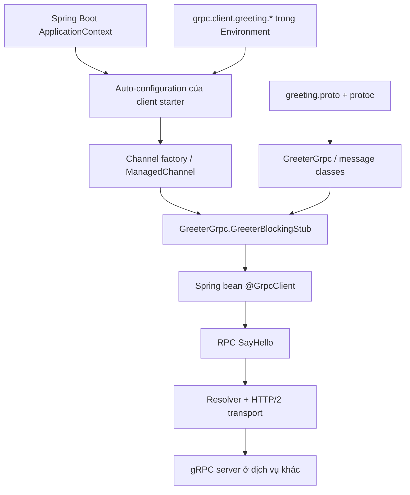

# Auto-configuration của gRPC client trong Spring Boot

## 1. Mục tiêu và bối cảnh

Trong module **SPRING_GRPC**, ứng dụng xây dựng dịch vụ gRPC từ hợp đồng Protocol Buffers, sinh mã Java rồi triển khai RPC unary hoặc streaming. Một ứng dụng Spring Boot đóng vai trò **client** thường phải gọi một hoặc nhiều dịch vụ gRPC khác. Nếu quản lý mọi kết nối thủ công, lập trình viên phải tự tạo `ManagedChannel`, cấu hình địa chỉ, TLS, interceptor, deadline và đóng channel đúng vòng đời ứng dụng.

**Auto-configuration của gRPC client** cho phép starter tích hợp các việc đó với cơ chế dependency injection và cấu hình của Spring Boot. Ứng dụng khai báo tên client, endpoint và các tuỳ chọn kết nối; starter cung cấp channel/stub phù hợp cho bean cần sử dụng.

Mục tiêu của bài học:

- Giải thích các bước từ dependency, properties đến channel và gRPC stub được Spring cung cấp.
- Phân biệt channel, stub, kết nối HTTP/2 và một lần gọi RPC.
- Tích hợp blocking, asynchronous hoặc future stub vào Spring bean và đặt deadline theo từng lần gọi.
- Truyền metadata, xử lý status, TLS và cân nhắc discovery/load balancing, retry.
- Kiểm thử auto-configuration của client bằng Spring Boot context cùng một gRPC server kiểm thử.
- Chẩn đoán lỗi thiếu bean, sai tên client, kết nối thất bại và cấu hình không được áp dụng.

**Phạm vi API trong ví dụ:** sử dụng **`net.devh:grpc-client-spring-boot-starter`**, với annotation `@GrpcClient` và cấu hình `grpc.client.<name>.*`. Dự án **Spring gRPC** thuộc hệ sinh thái Spring có starter và API riêng. Khi chuyển sang Spring gRPC, cần đối chiếu tài liệu đúng phiên bản; không mặc nhiên áp dụng annotation hoặc properties của `net.devh`.

## 2. Từ gRPC Java thuần đến Spring Boot client

Trong gRPC Java thuần, một lời gọi unary thường bắt đầu từ channel:

```java
ManagedChannel channel = ManagedChannelBuilder
    .forAddress("localhost", 9090)
    .usePlaintext()
    .build();

try {
    GreeterGrpc.GreeterBlockingStub stub =
        GreeterGrpc.newBlockingStub(channel);

    HelloReply reply = stub
        .withDeadlineAfter(1, TimeUnit.SECONDS)
        .sayHello(
            HelloRequest.newBuilder().setName("An").build()
        );
} finally {
    channel.shutdown();
}
```

Đoạn trên chỉ minh hoạ cách dựng channel và gọi RPC; chưa trình bày xử lý chờ shutdown đầy đủ. Trong ứng dụng có nhiều request, **không nên tạo và đóng channel mới cho mỗi lần gọi** vì tốn chi phí DNS, kết nối, TLS/HTTP/2 và tài nguyên luồng.

Với starter, ứng dụng dùng cấu hình tên client và yêu cầu inject một stub. Starter tạo các đối tượng kết nối theo chính sách của nó và gắn vòng đời chúng với Spring context.



Sơ đồ cho thấy auto-configuration chỉ quản lý **hạ tầng client**; bước sinh stub và message Java từ `.proto` vẫn do công cụ Protobuf trong build thực hiện.

## 3. Phân biệt channel, stub và RPC

| Thành phần | Trách nhiệm | Phạm vi sống |
| --- | --- | --- |
| `ManagedChannel` | Quản lý kết nối, name resolver, load balancing, transport HTTP/2, TLS và tài nguyên mạng | Thường được tái sử dụng cho nhiều RPC |
| Blocking stub | API đồng bộ; lời gọi chặn thread cho tới kết quả/lỗi | Có thể giữ trong bean, tạo bản dẫn xuất với option cho từng call |
| Async stub | API callback dùng `StreamObserver`; thích hợp streaming hoặc xử lý bất đồng bộ | Tái sử dụng, tạo biến thể cấu hình rẻ |
| Future stub | API bất đồng bộ trả về future cho các unary RPC được hỗ trợ | Tái sử dụng, truyền kết quả qua pipeline bất đồng bộ |
| Một RPC | Gồm metadata, deadline, request/response, status và khả năng cancellation | Bắt đầu và kết thúc riêng biệt |

Một channel **không đồng nghĩa một TCP connection cố định**. Tuỳ resolver/load balancer, channel có thể quản lý nhiều subchannel/kết nối và trạng thái của chúng. Kết nối thường được thiết lập theo nhu cầu, nên việc bean client đã được tạo chưa chắc đồng nghĩa server đã sẵn sàng.

Các stub gRPC Java được thiết kế theo kiểu bất biến: `withDeadlineAfter(...)`, `withInterceptors(...)` và những phương thức `with...` tương tự tạo **stub dẫn xuất**, không sửa stub gốc. Nhờ vậy có thể inject một stub dùng chung nhưng đặt deadline, metadata hay credentials phù hợp cho mỗi lần gọi.

**Lưu ý về thread:** blocking stub khiến thread gọi chờ. Trong Spring WebFlux hoặc luồng event loop, không gọi blocking stub trực tiếp trên event loop; dùng async/future API hoặc chuyển công việc blocking sang executor phù hợp.

## 4. Các bước Spring Boot tự cấu hình client

Một starter gRPC client phù hợp thường thực hiện chuỗi công việc:

1. **Được phát hiện từ classpath.** Spring Boot nạp auto-configuration đã được starter đăng ký nếu các điều kiện về class/bean/property phù hợp.
2. **Đọc configuration.** Các thuộc tính thuộc `grpc.client.*` được ánh xạ vào đối tượng cấu hình client theo API của starter.
3. **Tạo channel khi được yêu cầu.** Channel factory dùng tên client, địa chỉ, resolver, security và các tuỳ chọn để cấp `ManagedChannel`.
4. **Tạo hoặc inject stub.** Với `net.devh`, annotation `@GrpcClient("name")` trên field hoặc vị trí được bản starter hỗ trợ cho biết cần dùng cấu hình client tên nào.
5. **Áp dụng thành phần mở rộng.** Interceptor, channel builder customizer, credential hoặc load balancing có thể được thêm theo extension point của phiên bản.
6. **Quản lý vòng đời.** Channel do starter quản lý được đóng khi context dừng, theo chính sách thư viện.

Các điểm có thể làm auto-configuration không chạy như mong đợi:

| Cơ chế Spring | Hệ quả thường gặp |
| --- | --- |
| `@ConditionalOnClass` | Thiếu dependency khiến cấu hình không kích hoạt |
| `@ConditionalOnMissingBean` | Bean do ứng dụng tự khai báo thay thế hoặc làm cấu hình mặc định không được tạo |
| `@ConfigurationProperties` | Property sai tên hoặc giá trị khiến cấu hình client không được bind đúng |
| Component scan | Lớp cần inject stub không là Spring bean, nên annotation không được xử lý |
| Bean post-processing | Cách inject `@GrpcClient` của starter cần bean được Spring quản lý, không phải đối tượng tự `new` |

Đây là cơ chế Spring Boot chung. Tên class factory, thời điểm tạo channel và loại condition thực tế thay đổi theo starter/phiên bản.

## 5. Thực hành từ hợp đồng Protobuf đến client

### 5.1. Định nghĩa unary RPC

Giả sử đã có một gRPC server triển khai dịch vụ lời chào. Phía client cần cùng hợp đồng `greeting.proto`:

```proto
syntax = "proto3";

package demo.greeting.v1;

option java_multiple_files = true;
option java_package = "dev.example.greeter.v1";

service Greeter {
  rpc SayHello(HelloRequest) returns (HelloReply);
}

message HelloRequest {
  string name = 1;
}

message HelloReply {
  string message = 1;
}
```

`package` của Protobuf tạo tên RPC đầy đủ `demo.greeting.v1.Greeter/SayHello`. `java_package` điều khiển package của lớp Java sinh ra. Nếu client và server dùng hợp đồng không tương thích, lỗi có thể xuất hiện ngay khi gọi method hoặc khi diễn giải thông điệp.

Trong hệ nhiều dịch vụ, nên phát hành schema như một artifact hoặc dùng một nguồn quản lý hợp đồng chung để client/server cùng cập nhật có kiểm soát. Đổi field cần tôn trọng quy tắc tương thích Protobuf, giữ số field đã dùng và dành `reserved` cho những field đã bị xóa.

### 5.2. Khai báo Gradle dependencies

Ví dụ `build.gradle` (Groovy DSL):

```groovy
plugins {
    id 'java'
    id 'org.springframework.boot' version 'SPRING_BOOT_VERSION'
    id 'io.spring.dependency-management' version 'DEPENDENCY_MANAGEMENT_VERSION'
    id 'com.google.protobuf' version 'PROTOBUF_GRADLE_PLUGIN_VERSION'
}

def grpcVersion = 'GRPC_JAVA_VERSION'
def protobufVersion = 'PROTOBUF_JAVA_VERSION'
def clientStarterVersion = 'NET_DEVH_STARTER_VERSION'

repositories {
    mavenCentral()
}

dependencies {
    implementation 'org.springframework.boot:spring-boot-starter'
    implementation "net.devh:grpc-client-spring-boot-starter:${clientStarterVersion}"

    implementation platform("io.grpc:grpc-bom:${grpcVersion}")
    implementation 'io.grpc:grpc-protobuf'
    implementation 'io.grpc:grpc-stub'
    implementation "com.google.protobuf:protobuf-java:${protobufVersion}"

    testImplementation 'org.springframework.boot:spring-boot-starter-test'
}

protobuf {
    protoc {
        artifact = "com.google.protobuf:protoc:${protobufVersion}"
    }
    plugins {
        grpc {
            artifact = "io.grpc:protoc-gen-grpc-java:${grpcVersion}"
        }
    }
    generateProtoTasks {
        all()*.plugins {
            grpc {}
        }
    }
}
```

Các giá trị dạng `..._VERSION` là **placeholder cần thay bằng phiên bản tương thích**, không phải phiên bản thật; ví dụ chưa build được nếu giữ nguyên. Nên sử dụng BOM/version catalog đã được dự án xác nhận và đối chiếu tương thích giữa Java, Spring Boot, `net.devh`, gRPC Java, Protobuf và plugin Gradle. Tùy bản gRPC generator/JDK, có thể cần dependency annotation API cung cấp `javax.annotation.Generated`.

Sau bước sinh mã (ví dụ tác vụ Gradle `generateProto`), Java sources có `HelloRequest`, `HelloReply`, `GreeterGrpc` cùng các loại stub. Không sửa trực tiếp mã generated.

### 5.3. Tạo ứng dụng Spring Boot

```java
package dev.example.client;

import org.springframework.boot.SpringApplication;
import org.springframework.boot.autoconfigure.SpringBootApplication;

@SpringBootApplication
public class GreeterClientApplication {
    public static void main(String[] args) {
        SpringApplication.run(GreeterClientApplication.class, args);
    }
}
```

Đặt các bean ở cùng package hoặc package con như `dev.example.client.gateway` để Spring component scan nhận diện. Ứng dụng chỉ làm gRPC client không bắt buộc thêm `spring-boot-starter-web`.

### 5.4. Đặt tên client và endpoint

Tệp `src/main/resources/application.yml` cho môi trường phát triển:

```yaml
spring:
  application:
    name: greeting-client

grpc:
  client:
    greeting:
      address: "${GREETING_GRPC_ADDRESS:static://localhost:9090}"
      negotiationType: PLAINTEXT
```

Trong ví dụ **net.devh**:

- `greeting` là **tên logic của client**, dùng lại trong `@GrpcClient("greeting")`.
- `address` cho biết đích kết nối. `static://localhost:9090` là địa chỉ minh họa cho một server trên máy phát triển; production có thể dùng DNS/discovery phù hợp.
- `GREETING_GRPC_ADDRESS` cho phép triển khai thay endpoint mà không đổi code.
- `negotiationType: PLAINTEXT` nghĩa là không bật TLS trong demo; ở production, nên chọn transport security phù hợp.

Với nhiều dịch vụ gRPC, khai báo nhiều tên client dưới `grpc.client`, ví dụ `inventory` và `payment`. Cấu hình từng tên có thể khác nhau về endpoint, credentials, deadline hoặc interceptor. Không dùng chung một tên nếu hai backend có chính sách kết nối không tương thích.

**Hai nhóm properties phải được phân biệt:** `grpc.server.*` điều khiển server do starter server quản lý, còn `grpc.client.<name>.*` điều khiển kênh gọi ra ngoài. `server.port` của Spring Web không quyết định endpoint gRPC client.

### 5.5. Inject stub vào một Spring service

```java
package dev.example.client.gateway;

import dev.example.greeter.v1.GreeterGrpc;
import dev.example.greeter.v1.HelloReply;
import dev.example.greeter.v1.HelloRequest;
import io.grpc.StatusRuntimeException;
import net.devh.boot.grpc.client.inject.GrpcClient;
import org.springframework.stereotype.Service;

import java.util.concurrent.TimeUnit;

@Service
public class GreetingGateway {
    @GrpcClient("greeting")
    private GreeterGrpc.GreeterBlockingStub greeter;

    public String greet(String name) {
        HelloRequest request = HelloRequest.newBuilder()
            .setName(name)
            .build();

        try {
            HelloReply reply = greeter
                .withDeadlineAfter(800, TimeUnit.MILLISECONDS)
                .sayHello(request);

            return reply.getMessage();
        } catch (StatusRuntimeException ex) {
            // Tầng ứng dụng sẽ ánh xạ status thành lỗi phù hợp.
            throw ex;
        }
    }
}
```

`@GrpcClient` **không phải** annotation của gRPC Java thuần; đây là integration point của `net.devh`. Vì `GreetingGateway` là Spring bean, starter có thể inject stub tương ứng với cấu hình `grpc.client.greeting`. Nếu tự gọi `new GreetingGateway()`, Spring không xử lý injection và field `greeter` có thể là `null`.

Deadline `800 ms` chỉ là ví dụ. Giá trị thực tế cần xuất phát từ SLA, độ trễ mạng và ngân sách thời gian của request ở tầng gọi. Trong ứng dụng production, nên đưa deadline vào cấu hình ứng dụng và đặt theo từng RPC, tránh áp một giá trị cố định cho mọi method bất kể chi phí nghiệp vụ.

**Cần chú ý:** kết quả return là thông điệp được trả từ server; tầng client không cần tự xây dựng transport hoặc tự gọi `channel.shutdown()` trong mỗi method.

## 6. Các kiểu stub và lựa chọn cách gọi

gRPC Java sinh ba loại stub phổ biến. Starter có thể inject loại stub tương ứng nếu được phiên bản và phương thức injection hỗ trợ.

| Stub | Dạng gọi | Khi nên dùng |
| --- | --- | --- |
| `GreeterGrpc.GreeterBlockingStub` | `sayHello(request)` trả response hoặc ném exception | Ứng dụng đồng bộ, request ngắn, thread có thể chờ |
| `GreeterGrpc.GreeterStub` | `sayHello(request, responseObserver)` | Callback, server streaming, client streaming, bidirectional streaming |
| `GreeterGrpc.GreeterFutureStub` | `sayHello(request)` trả future | Unary bất đồng bộ và tích hợp pipeline future |

Ví dụ với async stub cho unary:

```java
@GrpcClient("greeting")
private GreeterGrpc.GreeterStub asyncGreeter;

public void greetAsync(
        String name,
        StreamObserver<HelloReply> responseObserver) {

    HelloRequest request = HelloRequest.newBuilder()
        .setName(name)
        .build();

    asyncGreeter
        .withDeadlineAfter(800, TimeUnit.MILLISECONDS)
        .sayHello(request, responseObserver);
}
```

`StreamObserver` nhận lần lượt `onNext` rồi `onCompleted` khi thành công, hoặc `onError` khi thất bại. Callbacks cần xử lý exception hợp lý; không nên gọi blocking APIs từ event loop hoặc callback quan trọng mà không quản lý executor.

Với **client streaming**, Java async stub thường trả về request observer, cho phép client gửi nhiều message. Với **bidirectional streaming**, hai phía phát thông điệp độc lập. Auto-configuration giữ vai trò tạo channel/stub; người viết vẫn phải quản lý luồng, cancellation, flow control và backpressure, nhất là khi phát hàng nghìn message hoặc stream tồn tại lâu.

## 7. Deadline, cancellation và timeout

Client nên chỉ rõ **thời hạn cho từng RPC**:

```java
HelloReply reply = greeter
    .withDeadlineAfter(500, TimeUnit.MILLISECONDS)
    .sayHello(request);
```

Deadline được gắn vào `CallOptions` của stub dẫn xuất; nó **không đổi** cấu hình deadline của stub dùng chung. Khi deadline hết, client có thể nhận `Status.Code.DEADLINE_EXCEEDED`. Nếu người dùng hủy request, RPC phía dưới cũng nên được hủy khi có thể.

Không nhầm các timeout sau:

| Khái niệm | Ý nghĩa |
| --- | --- |
| Deadline RPC | Thời hạn hoàn tất một lời gọi, gồm cả thời gian đợi sẵn sàng và xử lý |
| Connect timeout/handshake | Các mốc thời gian liên quan thiết lập transport, tùy thư viện/cấu hình |
| Keepalive | Ping giúp phát hiện kết nối không phản hồi, không thay deadline của RPC |
| Server-side timeout | Chính sách xử lý và hủy công việc phía server, cần phối hợp với deadline client |

Trong chuỗi dịch vụ A → B → C, tổng độ trễ cần nằm trong ngân sách request ban đầu. Việc tạo deadline mới quá rộng cho mỗi hop có thể khiến hệ thống tiếp tục xử lý sau khi caller không còn cần kết quả. Với Spring và gRPC async, cần kiểm chứng cách `io.grpc.Context` cùng deadline được truyền khi công việc chuyển executor.

**Retry phải có giới hạn.** `UNAVAILABLE` có thể là lỗi tạm thời, nhưng một retry sau timeout có thể làm thực hiện lại RPC trước đó. Những RPC có tác dụng phụ như tạo đơn hoặc thu tiền cần idempotency key, retry budget, backoff/jitter và giới hạn tổng deadline. Không retry `INVALID_ARGUMENT`, `UNAUTHENTICATED` hay `PERMISSION_DENIED` như lỗi tạm thời.

## 8. Xử lý status gRPC trong tầng client

Một lời gọi unary blocking có thể ném `StatusRuntimeException`. Đọc mã lỗi từ `ex.getStatus().getCode()` hoặc `Status.fromThrowable(ex).getCode()`.

```java
try {
    return greeter
        .withDeadlineAfter(1, TimeUnit.SECONDS)
        .sayHello(request)
        .getMessage();
} catch (StatusRuntimeException ex) {
    switch (ex.getStatus().getCode()) {
        case INVALID_ARGUMENT:
            throw new IllegalArgumentException(
                "Yêu cầu lời chào không hợp lệ", ex
            );
        case UNAVAILABLE:
            // Có thể áp dụng retry có kiểm soát ở tầng phù hợp.
            throw new IllegalStateException(
                "Dịch vụ lời chào chưa sẵn sàng", ex
            );
        case DEADLINE_EXCEEDED:
            throw new IllegalStateException(
                "Dịch vụ lời chào phản hồi quá hạn", ex
            );
        default:
            throw ex;
    }
}
```

Đoạn code là ví dụ **ánh xạ lỗi**, chưa triển khai retry. Không biến mọi `StatusRuntimeException` thành lỗi chung rồi làm mất gRPC status/cause; điều đó cản trở giám sát và quyết định retry.

| Status | Tình huống thường gặp | Cách ứng xử |
| --- | --- | --- |
| `INVALID_ARGUMENT` | Thông tin request không hợp lệ | Sửa dữ liệu, không retry nguyên yêu cầu |
| `UNAUTHENTICATED` | Thiếu/không hợp lệ credentials | Lấy lại thông tin xác thực qua quy trình cho phép |
| `PERMISSION_DENIED` | Caller không đủ quyền | Báo lỗi phân quyền, không retry mù |
| `NOT_FOUND` | Không tìm thấy tài nguyên | Xử lý theo ngữ nghĩa nghiệp vụ |
| `UNAVAILABLE` | Backend hoặc kết nối tạm không sẵn sàng | Cân nhắc retry với backoff và giới hạn |
| `DEADLINE_EXCEEDED` | Hết ngân sách thời gian | Đo latency, cân nhắc retry nếu an toàn |
| `CANCELLED` | Lời gọi bị hủy | Giải phóng công việc, phân biệt hủy chủ động |

Cũng cần phân biệt `UNIMPLEMENTED` (thường do method/service không được server đăng ký hoặc hai phía dùng hợp đồng sai) với `UNAVAILABLE` (thường liên quan vận chuyển/kết nối). Khi gặp lỗi, ghi method, status, duration và request ID; không ghi payload hay token nhạy cảm không cần thiết.

## 9. Metadata, interceptor và credentials

Metadata gRPC là các cặp key/value đi kèm lời gọi, truyền request ID, trace context hoặc authentication data. Metadata không nằm trong protobuf message schema.

### 9.1. Gắn request ID cho một RPC

Với Java gRPC, có thể tạo một stub dẫn xuất có interceptor gắn metadata cho **một lời gọi**:

```java
import io.grpc.Metadata;
import io.grpc.stub.MetadataUtils;

Metadata.Key<String> requestIdKey = Metadata.Key.of(
    "x-request-id",
    Metadata.ASCII_STRING_MARSHALLER
);

Metadata headers = new Metadata();
headers.put(requestIdKey, "req-42");

GreeterGrpc.GreeterBlockingStub callStub = greeter
    .withInterceptors(
        MetadataUtils.newAttachHeadersInterceptor(headers)
    )
    .withDeadlineAfter(800, TimeUnit.MILLISECONDS);

HelloReply reply = callStub.sayHello(request);
```

`withInterceptors(...)` trả stub mới, không chỉnh sửa stub gốc được inject. Với metadata thay đổi theo request, tạo interceptor hoặc `CallCredentials` thích hợp cho **ngữ cảnh của request đó**; không gắn request ID vào một singleton stub rồi tái sử dụng cho mọi người dùng.

Tên key ASCII thường dùng chữ thường; key dành cho dữ liệu nhị phân cần hậu tố `-bin` và marshaller phù hợp. Giới hạn kích thước metadata và tránh gửi dữ liệu người dùng không cần thiết.

### 9.2. Interceptor toàn cục và per-client

Một client interceptor có thể thêm tracing, correlation ID, audit, metrics hoặc kiểm tra metadata khi nhận status. Trong **net.devh**, các phiên bản có thể cung cấp cách đăng ký interceptor toàn cục (ví dụ annotation `@GrpcGlobalClientInterceptor`) hoặc gắn interceptor theo client bằng cấu hình/hook riêng.

Chọn phạm vi thích hợp: interceptor tracing có thể toàn cục, nhưng credential của dịch vụ thanh toán cần được cấu hình đúng cho riêng client `payment`. **Thứ tự interceptor có thể ảnh hưởng đến cách metadata và status được ghi nhận**, vì vậy cần kiểm tra trong integration test.

### 9.3. Credentials cho lời gọi đã xác thực

Không đưa token cố định vào file `application.yml` hoặc log. Với gRPC Java, `CallCredentials` có thể gắn thông tin xác thực theo từng RPC; token cần được lấy/đổi mới theo cơ chế phù hợp và thường phải đi qua TLS. Transport credentials kiểm tra định danh server; call credentials xác thực caller. Hai lớp có mục đích khác nhau.

## 10. TLS, mTLS và cấu hình theo môi trường

Trong môi trường local, `PLAINTEXT` giúp thử nghiệm nhanh. Khi triển khai qua mạng không hoàn toàn tin cậy, dùng TLS và xác minh chứng chỉ.

Ví dụ cấu hình client **net.devh** (tên property cần đối chiếu phiên bản):

```yaml
grpc:
  client:
    greeting:
      address: "${GREETING_GRPC_ADDRESS:static://greeter.internal.example:9090}"
      negotiationType: TLS
      security:
        trustCertCollection: file:/run/secrets/grpc/ca.crt
```

Client phải tin CA ký chứng chỉ server và xác minh tên máy theo SAN của certificate. Địa chỉ DNS, SNI và chứng chỉ phải phù hợp; không tắt hostname verification hoặc dùng trust-all trong production.

Với **mTLS**, ngoài CA trust phía client, client còn phải gửi certificate/private key của mình và server phải cấu hình client authentication. Đường dẫn, property và hỗ trợ reload chứng chỉ khác nhau giữa các bản starter; nên cấu hình theo tài liệu phiên bản đã chọn.

Các môi trường thường cần tách:

| Môi trường | Endpoint | Bảo vệ |
| --- | --- | --- |
| Local | `static://localhost:9090` | Có thể `PLAINTEXT` cho vòng phát triển cô lập |
| CI integration test | Server in-process hoặc TCP tạm thời | Test chức năng; thêm test TLS riêng |
| Staging | Service DNS/ingress gần production | TLS/mTLS với CA thử nghiệm |
| Production | DNS/discovery của dịch vụ | TLS/mTLS và secret/certificate management |

Khi truy cập qua proxy hoặc service mesh, làm rõ nơi TLS kết thúc, HTTP/2 được giữ ở hop nào và địa chỉ nào client thật sự gọi. Đừng giả định endpoint có TLS chỉ vì ingress phía ngoài dùng HTTPS.

## 11. Discovery, load balancing và vòng đời channel

Một channel gRPC có thể sử dụng name resolver để chuyển target logic thành danh sách endpoint; load balancer lựa chọn subchannel cho RPC. Sự hỗ trợ scheme (chẳng hạn `static://` hoặc `dns:///`), chính sách `round_robin` và service discovery tuỳ vào gRPC Java và starter cụ thể. **Không phải cứ thêm nhiều DNS A records là mọi client mặc định sẽ tự round robin.**

Khi thiết kế endpoint:

- Sử dụng tên service ổn định, không ghi cứng IP của pod.
- Kiểm tra resolver thực sự được kích hoạt bởi scheme nào.
- Kiểm tra chính sách load balancing, connection reuse và cách xử lý endpoint không khả dụng.
- Với ingress HTTP/2, xác minh khả năng giữ kết nối và phân phối traffic của proxy.
- Đặt deadline cho RPC, kết hợp retry có giới hạn và circuit breaking nếu kiến trúc yêu cầu.

**Tái sử dụng channel:** channel có thể tốn tài nguyên kết nối và threads; không khởi tạo nó trong mỗi method. Starter thường quản lý vòng đời channel theo tên client. Nếu một thành phần ứng dụng **tự tạo** channel riêng ngoài starter, chính thành phần đó phải gọi `shutdown()`, chờ đóng thích hợp, và chỉ dùng `shutdownNow()` khi cần buộc hủy.

Trạng thái channel có thể chuyển qua `IDLE`, `CONNECTING`, `READY`, `TRANSIENT_FAILURE`, `SHUTDOWN`. `READY` thể hiện trạng thái kết nối theo góc nhìn channel, **chưa chứng minh toàn bộ RPC và dependencies của backend đều hoạt động**. Khi cần kiểm tra nghiệp vụ, gửi RPC health hoặc RPC kiểm thử hợp lệ.

## 12. Kiểm thử auto-configuration của gRPC client

### 12.1. Phân biệt test logic và test tích hợp

Unit test dùng stub mock để kiểm tra `GreetingGateway` ánh xạ request/response và status như mong đợi. Loại test đó **không chứng minh** Spring đã đọc `grpc.client.greeting` hay inject đúng stub.

Integration test nên:

1. Khởi động một server gRPC kiểm thử có RPC thật.
2. Tải Spring Boot context cùng gRPC client starter.
3. Để starter inject stub vào `GreetingGateway`.
4. Gửi lời gọi qua gateway và kiểm tra kết quả/status.

Nếu starter và phiên bản hỗ trợ target `in-process:...`, có thể dùng server gRPC Java trong cùng JVM để tránh mở cổng.

### 12.2. Ví dụ kiểm thử client với server in-process

Thêm vào dependencies test:

```groovy
testImplementation 'io.grpc:grpc-inprocess'
```

Với `GreetingGateway` ở phần 5 và starter **net.devh có hỗ trợ in-process address**, minh họa JUnit 5:

```java
package dev.example.client;

import dev.example.client.gateway.GreetingGateway;
import dev.example.greeter.v1.GreeterGrpc;
import dev.example.greeter.v1.HelloReply;
import dev.example.greeter.v1.HelloRequest;
import io.grpc.Server;
import io.grpc.inprocess.InProcessServerBuilder;
import io.grpc.stub.StreamObserver;
import org.junit.jupiter.api.AfterAll;
import org.junit.jupiter.api.BeforeAll;
import org.junit.jupiter.api.Test;
import org.springframework.beans.factory.annotation.Autowired;
import org.springframework.boot.test.context.SpringBootTest;

import static org.junit.jupiter.api.Assertions.assertEquals;

@SpringBootTest(properties = {
    "grpc.client.greeting.address=in-process:greeting-client-test"
})
class GreetingClientIntegrationTest {
    private static Server testServer;

    @Autowired
    GreetingGateway gateway;

    @BeforeAll
    static void startServer() throws Exception {
        testServer = InProcessServerBuilder
            .forName("greeting-client-test")
            .directExecutor()
            .addService(new GreeterGrpc.GreeterImplBase() {
                @Override
                public void sayHello(
                        HelloRequest request,
                        StreamObserver<HelloReply> observer) {
                    observer.onNext(
                        HelloReply.newBuilder()
                            .setMessage("Xin chào, " + request.getName() + "!")
                            .build()
                    );
                    observer.onCompleted();
                }
            })
            .build()
            .start();
    }

    @AfterAll
    static void stopServer() {
        if (testServer != null) {
            testServer.shutdownNow();
        }
    }

    @Test
    void injectsClientAndCallsRealGrpcMethod() {
        assertEquals("Xin chào, An!", gateway.greet("An"));
    }
}
```

Test giả định `@SpringBootTest` dùng `GreeterClientApplication`, class `GreetingGateway` được component scan, và phiên bản net.devh hỗ trợ cú pháp `in-process:<name>`. **Tên server in-process đặt cố định chỉ phù hợp khi không có test khác dùng cùng tên trong cùng JVM**; bộ test chạy song song cần cô lập tên hoặc dùng cách cấp target động mà starter hỗ trợ.

**Giới hạn:** in-process transport giúp kiểm tra Spring context, stub injection, deadline và xử lý RPC; nó không kiểm tra TCP/HTTP/2 qua mạng, proxy, DNS hoặc TLS. Cần bổ sung ít nhất một integration test qua network với cấu hình gần production khi những yếu tố đó là quan trọng.

### 12.3. Các tình huống cần kiểm chứng

- Tên trong `@GrpcClient("greeting")` khớp với `grpc.client.greeting`.
- RPC hợp lệ trả response và lỗi server trả status đúng.
- Khi server không sẵn sàng, client không chờ vô thời hạn nhờ deadline.
- Metadata hoặc interceptor đi qua được đến phía server.
- Sử dụng TLS sai CA/hostname bị từ chối; đúng CA và hostname thì kết nối được.
- Với streaming, hủy giữa chừng dừng cả xử lý ở phía client và server.
- Khi ApplicationContext đóng, channel do starter quản lý cũng được giải phóng.

## 13. Chẩn đoán các lỗi phổ biến

| Triệu chứng | Nguyên nhân có thể | Cách kiểm tra |
| --- | --- | --- |
| Field `@GrpcClient` là `null` | Class không phải Spring bean, bị tạo bằng `new` hoặc cách inject không được starter hỗ trợ | Kiểm tra component scan và cơ chế inject |
| Không tạo được bean/client | Thiếu client starter, version xung đột hoặc auto-configuration không được nạp | Runtime classpath, dependency tree, condition report |
| `UNAVAILABLE` | Sai target/cổng, DNS, server chưa sẵn sàng, proxy hoặc TLS không tương thích | Kiểm tra endpoint, resolver, handshake, transport |
| `UNIMPLEMENTED` | Sai service/method đầy đủ hoặc server chưa đăng ký endpoint | So sánh hợp đồng Protobuf và server registration |
| `DEADLINE_EXCEEDED` | Server chậm, network chậm hoặc deadline quá ngắn | Quan sát latency theo method và dependency |
| `INVALID_ARGUMENT` | Request sai yêu cầu hợp đồng | Kiểm tra validation và payload |
| Không có metadata | Interceptor chưa được gắn, stub dẫn xuất không được dùng hoặc context bị mất | Kiểm tra interceptor chain và client call |
| `PLAINTEXT` không gọi được TLS server | Sai chế độ negotiation | Đồng bộ TLS settings và CA trust |
| Cấu hình client không đổi | Sai tên client hoặc property source có ưu tiên cao hơn | Xem effective `grpc.client.<name>.*` và profile |
| App chạy nhưng lời gọi đầu tiên thất bại | Channel kết nối lazy, backend chưa sẵn sàng hoặc chính sách timeout | Kiểm tra readiness và deadline |
| Tạo channel liên tục, tài nguyên tăng | Tự tạo channel mỗi request thay vì dùng factory/stub | Tái sử dụng channel do starter quản lý |

Spring Boot có **Condition Evaluation Report** giúp tìm lý do auto-configuration được kích hoạt hoặc bỏ qua. Ở môi trường phát triển có thể chạy:

```bash
java -jar app.jar --debug
```

Khi xem report, cần xác minh cả auto-configuration của client starter, bean nơi cần inject stub, và tên cấu hình channel. Không công khai endpoint Actuator quản trị hoặc metadata credentials ngoài môi trường quản trị an toàn.

Một hướng điều tra theo thứ tự:

```text
Đúng client starter / các phiên bản?
  -> Bean Spring có được tạo và @GrpcClient được xử lý?
    -> Tên client, address, resolver, security có đúng?
      -> Channel kết nối tới server được không?
        -> RPC method, metadata, deadline, status có đúng?
```

## 14. Thực hành và tiêu chí hoàn thành

Hãy triển khai client `GreetingGateway` gọi một server `Greeter` đã biết, sau đó thực hiện:

1. Gọi `SayHello` thành công từ Spring bean dùng `@GrpcClient("greeting")`.
2. Đổi `GREETING_GRPC_ADDRESS` sang một endpoint không tồn tại, kiểm tra `UNAVAILABLE` hoặc `DEADLINE_EXCEEDED` theo tình huống, bảo đảm lời gọi có deadline.
3. Giữ nguyên channel, tạo stub dẫn xuất với hai deadline khác nhau và giải thích vì sao stub gốc không bị sửa.
4. Gắn `x-request-id` vào đúng từng RPC; kiểm tra phía server nhận giá trị tương ứng.
5. Tạo integration test có Spring context để chứng minh starter đã inject stub thật.
6. Thử blocking và async stub; xác định nơi không được chặn event loop.
7. Bật TLS tại môi trường kiểm thử; kiểm tra trust CA, hostname và trạng thái handshake.
8. Ghi metrics số RPC theo status, thời gian phản hồi, retry count nếu dùng retry, cùng số active streams khi có streaming RPC.

Người học hoàn thành bài có thể trình bày **chuỗi từ `grpc.client.<name>` đến `@GrpcClient`, stub, channel và lời gọi trên wire**, giải thích vì sao channel nên được tái sử dụng, và phân biệt lỗi wiring của Spring với lỗi transport, status hay nghiệp vụ.

Auto-configuration giúp client Spring Boot hoạt động nhất quán với cấu hình, bean và lifecycle ứng dụng. Dù vậy, người phát triển vẫn chịu trách nhiệm về tính tương thích hợp đồng Protobuf, lựa chọn stub, deadline, metadata, security, cancellation, kiểm thử tích hợp và độ tin cậy trong các RPC liên dịch vụ.
