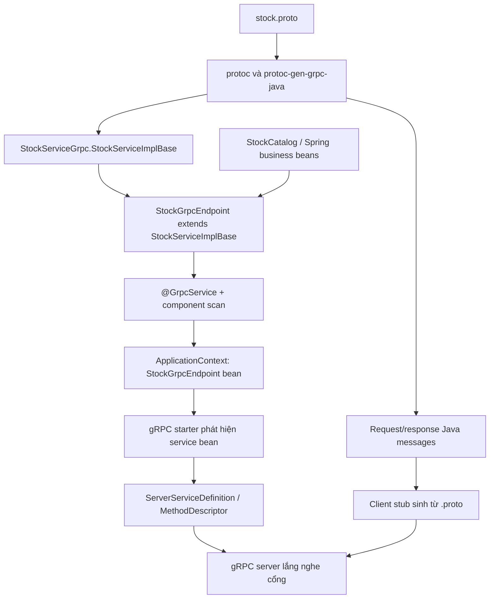
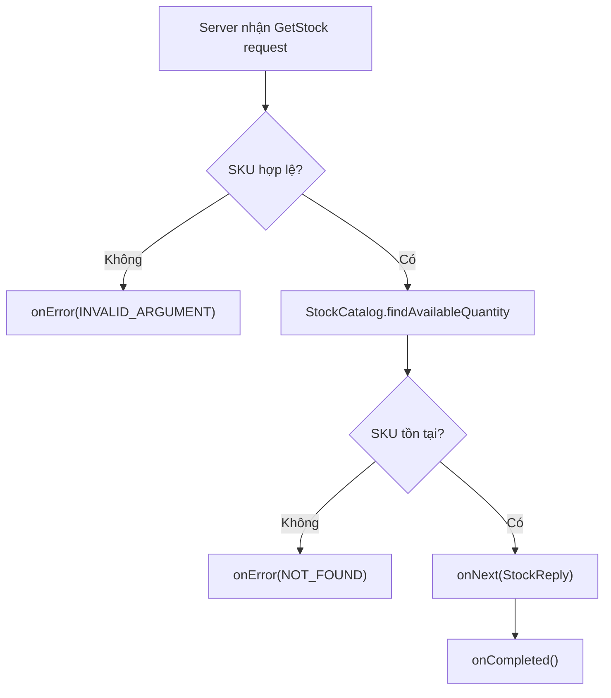

# Đăng ký service vào Spring ApplicationContext

## 1. Đăng ký gRPC service trong Spring Boot nghĩa là gì?

Trong hệ **SPRING_GRPC**, lập trình viên định nghĩa giao diện RPC bằng Protocol Buffers, sinh mã Java và triển khai các phương thức unary hoặc streaming. Để dịch vụ này sử dụng được dependency injection, cấu hình và vòng đời ứng dụng Spring Boot, lớp triển khai gRPC cần được **đăng ký thành bean trong `ApplicationContext`**. Sau đó, cơ chế tích hợp gRPC mới có thể phát hiện bean và đưa phương thức RPC vào máy chủ gRPC.

Đây là hai việc có liên quan nhưng khác nhau:

- **Đăng ký Spring bean:** Spring biết lớp nào phải được tạo, inject các dependency nào và quản lý vòng đời đối tượng.
- **Đăng ký gRPC service với server:** gRPC server nhận một `ServerServiceDefinition`, từ đó biết tên service/method trên wire và handler nào sẽ xử lý yêu cầu.

Một class Java tồn tại trong source code chưa chắc đã là Spring bean. Một Spring bean kế thừa lớp gRPC được sinh ra cũng chưa chắc đã được starter gắn vào server. Việc kiểm thử cần chứng minh **cả hai bước** đã xảy ra.

Sau bài này, người học có thể:

1. Giải thích đường đi từ `.proto` đến `BindableService`, Spring bean và phương thức RPC được đăng ký.
2. Sử dụng `@GrpcService` của starter thích hợp cùng component scan và constructor injection.
3. Chọn vị trí đặt bean, quản lý singleton state và tách nghiệp vụ khỏi tầng gRPC.
4. Dùng profile/condition để kiểm soát lúc nào service xuất hiện; tránh đăng ký trùng.
5. Kiểm tra bean trong `ApplicationContext` và thực hiện integration test gọi RPC thật.
6. Xử lý các vấn đề metadata, deadline, status, interceptor, TLS và streaming liên quan đến bean lifecycle.

**Phạm vi API:** Ví dụ sử dụng **`net.devh:grpc-server-spring-boot-starter`** với annotation `net.devh.boot.grpc.server.service.GrpcService`. Dự án **Spring gRPC** thuộc hệ sinh thái Spring có cơ chế đăng ký service bean và các API khác tùy phiên bản. Không mặc định `@GrpcService` hay property của `net.devh` có trong Spring gRPC chính thức.

## 2. Từ hợp đồng Protobuf đến ApplicationContext và gRPC server

Các thành phần phối hợp như sau:



Có bốn đối tượng quan trọng cần hiểu:

| Đối tượng | Được tạo bởi | Vai trò |
| --- | --- | --- |
| `StockServiceGrpc.StockServiceImplBase` | Plugin sinh mã gRPC Java từ `.proto` | Lớp cơ sở cho implementation phía server |
| `StockGrpcEndpoint` | Lập trình viên | Mã xử lý từng RPC, gọi business service |
| Bean `StockGrpcEndpoint` | Spring `ApplicationContext` | Đối tượng được inject dependency và quản lý lifecycle |
| `ServerServiceDefinition` | gRPC Java qua `bindService()` | Liên kết service/method gRPC với handler cụ thể |

Trong gRPC Java, base class được sinh thường triển khai `io.grpc.BindableService` và cung cấp `bindService()` để dựng định nghĩa service. Starter tận dụng cơ chế này để đăng ký service khi xây dựng server.

**Mã sinh từ `.proto` không tự động trở thành bean.** Người viết cần tạo implementation, rồi dùng cách đăng ký tương ứng với starter đang chạy.

## 3. Chuẩn bị một hợp đồng gRPC cụ thể

Giả sử ứng dụng quản lý số lượng hàng tồn kho. Đặt file `src/main/proto/stock.proto`:

```proto
syntax = "proto3";

package inventory.v1;

option java_multiple_files = true;
option java_package = "dev.example.stock.v1";

service StockService {
  rpc GetStock (GetStockRequest) returns (StockReply);
}

message GetStockRequest {
  string sku = 1;
}

message StockReply {
  string sku = 1;
  int32 quantity = 2;
}
```

Sau khi chạy `protoc` với các plugin Java và gRPC Java, dự án có các lớp như `GetStockRequest`, `StockReply` và `StockServiceGrpc.StockServiceImplBase`.

Để thực hành với **net.devh**, build cần Spring Boot, gRPC server starter và thư viện sinh mã. Đoạn Groovy DSL tối thiểu mô tả phần phụ thuộc liên quan:

```groovy
dependencies {
    implementation 'org.springframework.boot:spring-boot-starter'
    implementation "net.devh:grpc-server-spring-boot-starter:NET_DEVH_VERSION"

    implementation platform("io.grpc:grpc-bom:GRPC_JAVA_VERSION")
    implementation 'io.grpc:grpc-protobuf'
    implementation 'io.grpc:grpc-stub'

    testImplementation 'org.springframework.boot:spring-boot-starter-test'
    testImplementation 'io.grpc:grpc-inprocess'
}
```

Các chuỗi `NET_DEVH_VERSION` và `GRPC_JAVA_VERSION` là **placeholder**, phải thay bằng các phiên bản thực được xác nhận tương thích trước khi build. Dependency cho `protoc`, `protobuf-java` và plugin Gradle/Maven sinh mã cũng phải được khai báo theo hệ build của dự án; ví dụ chỉ tập trung vào cơ chế đăng ký service, không trình bày toàn bộ build script. Khi đổi Java hoặc Spring Boot, kiểm tra tương thích của starter, gRPC Java và Protobuf. Một số toolchain còn cần annotation API phù hợp cho mã Java sinh ra.

Tên gRPC đầy đủ của method trong ví dụ là:

```text
inventory.v1.StockService/GetStock
```

Đây là tên trên wire. Nó **khác** với Java package `dev.example.stock.v1`, vốn chỉ quyết định package của source generated.

## 4. Tạo ApplicationContext và vùng component scan

Một Spring Boot application ví dụ:

```java
package dev.example.stock;

import org.springframework.boot.SpringApplication;
import org.springframework.boot.autoconfigure.SpringBootApplication;

@SpringBootApplication
public class StockApplication {
    public static void main(String[] args) {
        SpringApplication.run(StockApplication.class, args);
    }
}
```

`@SpringBootApplication` kết hợp cấu hình ứng dụng, auto-configuration và component scan. Theo mặc định, Spring scan package chứa `StockApplication` cùng các package con, ví dụ:

```text
dev.example.stock
├── StockApplication                  -> @SpringBootApplication
├── domain
│   ├── StockCatalog                  -> interface nghiệp vụ
│   └── InMemoryStockCatalog          -> @Service
└── grpc
    └── StockGrpcEndpoint             -> @GrpcService
```

Nếu đặt endpoint dưới `com.other.grpc` nhưng không mở rộng component scan hoặc import cấu hình, Spring có thể không phát hiện class. Hậu quả là server vẫn khởi động nhưng method `GetStock` không được đăng ký.

**Quy tắc thực hành:** đặt application class ở package gốc của ứng dụng, sau đó tổ chức các bean nghiệp vụ và gRPC adapter ở các package con. Khi phải chia module hoặc package ngoài vùng scan, cấu hình `@ComponentScan` hoặc import bean cụ thể có chủ đích và kiểm tra kết quả trong integration test.

## 5. Tách nghiệp vụ thành bean rồi inject vào gRPC service

Một gRPC endpoint nên là adapter nhận Protobuf request, chuyển vào nghiệp vụ rồi trả Protobuf response. Không để logic tồn kho, truy vấn dữ liệu, authorization và mapping gRPC lẫn vào cùng một class nếu có thể tách hợp lý.

### 5.1. Hợp đồng nghiệp vụ

```java
package dev.example.stock.domain;

import java.util.OptionalInt;

public interface StockCatalog {
    OptionalInt findAvailableQuantity(String sku);
}
```

### 5.2. Implementation được Spring quản lý

```java
package dev.example.stock.domain;

import org.springframework.stereotype.Service;

import java.util.Map;
import java.util.OptionalInt;

@Service
public class InMemoryStockCatalog implements StockCatalog {
    private final Map<String, Integer> quantities =
        Map.of("SKU-001", 7, "SKU-002", 12);

    @Override
    public OptionalInt findAvailableQuantity(String sku) {
        Integer quantity = quantities.get(sku);
        return quantity == null
            ? OptionalInt.empty()
            : OptionalInt.of(quantity);
    }
}
```

`@Service` là stereotype Spring; class được scan và tạo thành bean. Spring có thể inject implementation này vào mọi bean phụ thuộc vào interface `StockCatalog`, miễn là chỉ có một candidate hoặc cấu hình qualifier rõ ràng.

Trong ứng dụng thực, `StockCatalog` có thể truy vấn database, cache hay gọi sang upstream qua gRPC client. Việc tách tầng này giúp test nghiệp vụ mà không cần mở gRPC server, đồng thời dễ áp dụng transaction và chính sách retry ở ranh giới thích hợp.

### 5.3. Endpoint gRPC với `@GrpcService`

```java
package dev.example.stock.grpc;

import dev.example.stock.domain.StockCatalog;
import dev.example.stock.v1.GetStockRequest;
import dev.example.stock.v1.StockReply;
import dev.example.stock.v1.StockServiceGrpc;
import io.grpc.Status;
import io.grpc.stub.StreamObserver;
import net.devh.boot.grpc.server.service.GrpcService;

import java.util.OptionalInt;

@GrpcService
public class StockGrpcEndpoint
        extends StockServiceGrpc.StockServiceImplBase {

    private final StockCatalog catalog;

    public StockGrpcEndpoint(StockCatalog catalog) {
        this.catalog = catalog;
    }

    @Override
    public void getStock(
            GetStockRequest request,
            StreamObserver<StockReply> responseObserver) {

        String sku = request.getSku().trim();
        if (sku.isEmpty()) {
            responseObserver.onError(
                Status.INVALID_ARGUMENT
                    .withDescription("sku không được để trống")
                    .asRuntimeException());
            return;
        }

        OptionalInt quantity = catalog.findAvailableQuantity(sku);
        if (quantity.isEmpty()) {
            responseObserver.onError(
                Status.NOT_FOUND
                    .withDescription("Không tìm thấy SKU")
                    .asRuntimeException());
            return;
        }

        StockReply reply = StockReply.newBuilder()
            .setSku(sku)
            .setQuantity(quantity.getAsInt())
            .build();

        responseObserver.onNext(reply);
        responseObserver.onCompleted();
    }
}
```

Ở đây, `@GrpcService` là annotation của **net.devh**, giúp Spring phát hiện endpoint như bean và giúp cơ chế đăng ký gRPC của starter nhận diện service. Không cần tự tạo đối tượng bằng `new StockGrpcEndpoint(...)` trong `main()`.

**Constructor injection** làm phụ thuộc `StockCatalog` rõ ràng và cho phép dùng `final`. Khi dependency không tồn tại hoặc có nhiều bean cùng kiểu mà không có cách chọn, Spring có thể báo lỗi tại startup. Đây là tín hiệu cần sửa cấu hình wiring, không phải lý do để tạo đối tượng thủ công ngoài context.

### 5.4. Cấu hình cổng server

Trong `src/main/resources/application.yml` (net.devh):

```yaml
spring:
  application:
    name: stock-grpc

grpc:
  server:
    port: 9090
```

Với ứng dụng chỉ làm gRPC server, không bắt buộc phải có `spring-boot-starter-web`. Nếu có web starter, `grpc.server.port` điều khiển cổng gRPC, còn `server.port` thường điều khiển HTTP server của Spring Boot; chúng là hai listener khác nhau.

Khi component scan đã phát hiện endpoint, starter sẽ lấy gRPC service definition từ bean và đăng ký nó với server tại cổng cấu hình. Ứng dụng không phải gọi `ServerBuilder.forPort(9090).addService(...)` thủ công.

## 6. Chính xác lúc nào một bean trở thành gRPC service?

**Đối với net.devh**, dùng `@GrpcService` trên class endpoint là lựa chọn trực tiếp, rõ ràng. Chỉ đánh dấu một lớp gRPC bằng `@Service` thông thường có thể tạo Spring bean nhưng **không bảo đảm** starter net.devh nhận class đó làm gRPC service được xuất bản. Ngược lại, một class được đánh dấu `@GrpcService` nhưng bị loại khỏi component scan hoặc condition cũng không có trong context để đăng ký.

Khi dùng **Spring gRPC chính thức**, quy tắc đăng ký `BindableService` được mô tả trong tài liệu của hệ starter tương ứng. Một số cơ chế nhận bean `BindableService` trực tiếp hoặc sử dụng registration/customizer riêng. Không tự động coi tên annotation giữa hai hệ là tương đương.

| Trạng thái | Có Spring bean? | RPC có sẵn trên gRPC server? |
| --- | --- | --- |
| Class implementation tồn tại nhưng không được đăng ký | Không | Không |
| Class được Spring tạo bằng `@Service`, nhưng starter cần metadata gRPC khác | Có | Chưa chắc |
| `@GrpcService` net.devh nằm trong component scan và startup thành công | Có | Thông thường có |
| Bean bị tắt bởi profile hoặc condition | Không | Không |
| Hai implementation công bố cùng một tên gRPC service | Có thể có cả hai | Có thể lỗi khi đăng ký/build server |

**Không nhầm tên Spring bean và tên gRPC service.** Tên bean có thể là `stockGrpcEndpoint`, trong khi tên gRPC service trên wire vẫn là `inventory.v1.StockService` từ `.proto`. Đổi tên bean hoặc package Java không thay tên RPC. Hai endpoint đăng ký cùng service name có thể đụng độ dù tên Spring bean khác nhau.

### Một điểm mở rộng: đăng ký có điều kiện

Có thể bật/tắt Spring bean theo profile cho những môi trường cụ thể:

```java
import org.springframework.context.annotation.Profile;
import net.devh.boot.grpc.server.service.GrpcService;

@GrpcService
@Profile("stock-api")
public class StockGrpcEndpoint
        extends StockServiceGrpc.StockServiceImplBase {
    // Ví dụ minh họa annotation; phương thức RPC giữ như phần 5.
}
```

Đây là **biến thể minh họa**, không phải class thứ hai cần thêm cạnh implementation phần 5. Khi profile `stock-api` không bật, bean không được tạo và RPC tương ứng không được đăng ký. Server có thể tiếp tục khởi động với các service khác, nên cần kiểm tra số lượng/loại service được công bố trước khi đưa instance vào nhận traffic.

Ngoài `@Profile`, có thể dùng `@ConditionalOnProperty` cho feature flags. Tuy nhiên, điều kiện tạo bean được đánh giá lúc context khởi tạo; đổi một biến môi trường khi ứng dụng đang chạy không nhất thiết thêm/xóa service ngay. Thường cần restart hoặc cơ chế tái cấu hình được thiết kế cụ thể.

## 7. Scope và an toàn luồng của Spring bean

Theo mặc định, Spring tạo **singleton bean** trong một `ApplicationContext`. Một instance `StockGrpcEndpoint` vì thế có thể xử lý nhiều RPC đồng thời. Điều này có hệ quả rất quan trọng:

- Các field được inject như `StockCatalog` thường là dependency dùng chung.
- Không lưu request hiện tại, token, request ID hoặc `StreamObserver` đang xử lý vào field mutable của singleton.
- Không dùng biến đếm thông thường để thay thế cơ chế đồng bộ nếu có cập nhật từ nhiều RPC.
- Nếu có cache hoặc state chung, phải thiết kế tính nhất quán và đồng thời rõ ràng.
- Không chuyển endpoint sang `prototype`/request-scoped tùy tiện; gRPC server cần một service definition và lifecycle ổn định. HTTP request scope của Spring MVC không tự áp dụng cho RPC gRPC.

Một ví dụ **sai**:

```java
@GrpcService
public class UnsafeEndpoint extends SomeGrpc.SomeImplBase {
    private String currentRequestId; // Có thể bị RPC khác ghi đè

    // Trong RPC A: currentRequestId = "A";
    // Trong RPC B: currentRequestId = "B";
    // RPC A có thể đọc nhầm "B".
}
```

Đoạn trên là mã minh họa vấn đề đồng thời, **không phải một implementation hoàn chỉnh**. Cách đúng là dùng biến local của handler cho dữ liệu chỉ cần trong phương thức, hoặc `io.grpc.Context` khi cần truyền context xuyên interceptor/callback.

### Gắn metadata qua gRPC Context

Interceptor có thể đọc header `x-request-id` và đưa vào context của lời gọi:

```java
package dev.example.stock.grpc;

import io.grpc.Context;
import io.grpc.Contexts;
import io.grpc.Metadata;
import io.grpc.ServerCall;
import io.grpc.ServerCallHandler;
import io.grpc.ServerInterceptor;
import net.devh.boot.grpc.server.interceptor.GrpcGlobalServerInterceptor;

@GrpcGlobalServerInterceptor
public class RequestIdInterceptor implements ServerInterceptor {
    public static final Context.Key<String> REQUEST_ID =
        Context.key("request-id");

    private static final Metadata.Key<String> HEADER =
        Metadata.Key.of(
            "x-request-id",
            Metadata.ASCII_STRING_MARSHALLER
        );

    @Override
    public <ReqT, RespT> ServerCall.Listener<ReqT> interceptCall(
            ServerCall<ReqT, RespT> call,
            Metadata headers,
            ServerCallHandler<ReqT, RespT> next) {

        String incoming = headers.get(HEADER);
        String requestId = incoming == null ? "" : incoming;

        Context child =
            Context.current().withValue(REQUEST_ID, requestId);

        return Contexts.interceptCall(child, call, headers, next);
    }
}
```

Trong handler, `RequestIdInterceptor.REQUEST_ID.get()` truy cập giá trị gắn với context đang hoạt động. Với code chuyển sang executor khác, cần truyền context đúng cách; `ThreadLocal` tự tạo không bảo đảm giữ metadata xuyên callback bất đồng bộ. Metadata từ client không mặc nhiên đáng tin: giới hạn độ dài, xác thực/chuẩn hóa khi dùng và không ghi token vào log.

## 8. Dependency injection, proxy và transaction

### 8.1. Tách nghiệp vụ để kiểm thử và mở rộng

Cấu trúc đề xuất:

```text
gRPC Client
    |
    | HTTP/2 + Protobuf
    v
StockGrpcEndpoint (@GrpcService / adapter)
    |
    | Java method + dependency injection
    v
StockCatalog (@Service / nghiệp vụ)
    |
    +--> Database / Cache / Downstream gRPC Client
```

Đặt các quy tắc nghiệp vụ ở `StockCatalog` hoặc use case riêng giúp endpoint không phụ thuộc chi tiết lưu trữ. Điều này cũng giúp các client khác như REST hoặc message consumer có thể dùng cùng logic.

### 8.2. AOP và transaction

Spring có thể áp dụng proxy cho các bean được tạo bởi context, ví dụ để xử lý `@Transactional`, security hoặc instrumentation. Với gRPC, nên đặt transaction ngắn gọn ở **business service**, nơi có ranh giới dữ liệu rõ ràng:

```java
@Service
public class DatabaseStockCatalog implements StockCatalog {
    private final StockRepository repository;

    public DatabaseStockCatalog(StockRepository repository) {
        this.repository = repository;
    }

    @Override
    @Transactional(readOnly = true)
    public OptionalInt findAvailableQuantity(String sku) {
        return repository.findQuantityBySku(sku);
    }
}
```

Đoạn này là **mã minh họa**, giả định dự án đã có `StockRepository` và Spring transaction infrastructure, nên không chạy độc lập. Ý chính: gRPC endpoint gọi qua Spring bean đã được inject để transaction interceptor có cơ hội hoạt động.

Một số lưu ý:

- Gọi `this.someTransactionalMethod()` từ chính bean có thể bỏ qua Spring proxy với proxy-based AOP; ưu tiên gọi phương thức qua bean thích hợp.
- `@Transactional` gắn trên phương thức đồng bộ không tự kéo dài transaction qua mọi callback asynchronous.
- Không giữ transaction database mở trong suốt một streaming RPC dài hạn nếu không thực sự cần thiết.
- Khi dùng proxy quanh một `BindableService`, cần kiểm tra tính tương thích với cơ chế tìm/đăng ký service của starter theo phiên bản. Không dựa vào tên proxy để suy ra tên gRPC service.

## 9. Lỗi RPC và ranh giới trách nhiệm của bean

Đăng ký bean thành công mới chứng minh việc wiring; handler vẫn phải thực hiện đúng semantics của gRPC.

Với unary RPC, luồng hoàn tất chuẩn là:



Không gọi `onCompleted()` sau `onError()`. Không gửi thêm message sau khi terminal event đã xảy ra. Với exception ngoài dự kiến, nên log ở phía server một cách có kiểm soát và chuyển thành `Status.INTERNAL` phù hợp khi cần; không trả stack trace hoặc thông tin nhạy cảm cho client.

| Mã status | Trường hợp minh họa | Lưu ý |
| --- | --- | --- |
| `INVALID_ARGUMENT` | Thiếu SKU hoặc input sai | Sửa request trước khi gọi lại |
| `NOT_FOUND` | Không có SKU đã yêu cầu | Là một kết quả nghiệp vụ hợp lệ về mặt xử lý lỗi |
| `UNAUTHENTICATED` | Thiếu/không hợp lệ danh tính caller | Thường được xử lý ở interceptor/security layer |
| `PERMISSION_DENIED` | Caller không đủ quyền | Không tiết lộ dữ liệu bị bảo vệ |
| `DEADLINE_EXCEEDED` | Client vượt deadline | Handler xử lý lâu cần kiểm tra cancellation |
| `UNAVAILABLE` | Server hoặc transport không sẵn sàng | Có thể retry theo chính sách idempotency |
| `INTERNAL` | Lỗi server chưa dự kiến | Theo dõi log/tracing để điều tra |

Đặc biệt, Spring business exception không tự động có ánh xạ gRPC status đúng ý nghĩa. Hãy quyết định cách ánh xạ ở lớp adapter hoặc interceptor xử lý lỗi, rồi kiểm thử contract với client.

### Streaming và lifecycle của bean

Một singleton endpoint cũng có thể triển khai server streaming, client streaming hoặc bidirectional streaming nếu `.proto` định nghĩa. Tuy nhiên, mỗi stream cần state riêng gắn với lời gọi, không lưu `StreamObserver` hoặc bộ đệm request của stream vào field chung. Với stream dài, phải:

1. Theo dõi cancellation và deadline để dừng producer.
2. Tránh giữ nhiều message vô hạn trong bộ nhớ; tôn trọng flow control/backpressure.
3. Hủy công việc nền, giải phóng subscription và tài nguyên khi stream hoàn tất hoặc lỗi.
4. Không giả định callback luôn chạy trên một thread cố định.

Auto-configuration chỉ đăng ký implementation; nó không giải quyết các yêu cầu đồng thời và vòng đời riêng của từng stream.

## 10. Kiểm tra bean có mặt trong ApplicationContext

Một câu hỏi chẩn đoán đầu tiên là: **Spring có tạo bean chưa?**

Ví dụ một test dùng `@SpringBootTest` chỉ để kiểm tra bean được đăng ký:

```java
package dev.example.stock;

import dev.example.stock.grpc.StockGrpcEndpoint;
import dev.example.stock.domain.StockCatalog;
import org.junit.jupiter.api.Test;
import org.springframework.beans.factory.annotation.Autowired;
import org.springframework.boot.test.context.SpringBootTest;

import static org.junit.jupiter.api.Assertions.assertNotNull;

@SpringBootTest(properties = {
    "grpc.server.port=-1",
    "grpc.server.inProcessName=stock-bean-test"
})
class StockBeanContextTest {
    @Autowired
    private StockGrpcEndpoint grpcEndpoint;

    @Autowired
    private StockCatalog catalog;

    @Test
    void springCreatesGrpcEndpointAndBusinessDependency() {
        assertNotNull(grpcEndpoint);
        assertNotNull(catalog);
    }
}
```

Ví dụ test này giả định phiên bản net.devh hỗ trợ cấu hình server in-process thông qua `grpc.server.inProcessName` và tắt listener mạng bằng `grpc.server.port=-1`. Với phiên bản không hỗ trợ, dùng cấu hình server test phù hợp, chẳng hạn cổng TCP động. **Test bean tồn tại chưa xác nhận RPC đã được đăng ký**. Để xác minh toàn bộ, phải gọi RPC.

### Phân biệt các câu hỏi khi kiểm tra

| Câu hỏi | Công cụ/cách xác minh |
| --- | --- |
| Bean endpoint có tồn tại? | `ApplicationContext.getBean(StockGrpcEndpoint.class)` hoặc `@Autowired` |
| Dependency đã được inject? | Gọi method test và kiểm tra ứng xử; không tự `new` endpoint |
| Annotation có được nhận diện? | Kiểm tra class/bean và starter đúng hệ |
| RPC method đã được đăng ký trên server? | Dùng `grpcurl` hoặc gRPC client thật tới server |
| Properties đã được áp dụng? | Kiểm tra Spring Environment, startup log và endpoint thực tế |
| Auto-configuration đã thỏa condition? | Xem Spring Boot Condition Evaluation Report |

## 11. Integration test cho cả Spring bean và gRPC registration

Với phiên bản **net.devh hỗ trợ in-process gRPC server**, có thể chạy `@SpringBootTest` để khởi tạo context thật, sau đó kết nối bằng client gRPC Java in-process.

Điều kiện chuẩn bị:

- Có `spring-boot-starter-test` và `io.grpc:grpc-inprocess` trong dependencies test.
- Lớp `StockGrpcEndpoint` được scan.
- Phiên bản net.devh có hỗ trợ `grpc.server.inProcessName` và `grpc.server.port=-1`.

Ví dụ JUnit 5:

```java
package dev.example.stock;

import dev.example.stock.grpc.StockGrpcEndpoint;
import dev.example.stock.v1.GetStockRequest;
import dev.example.stock.v1.StockReply;
import dev.example.stock.v1.StockServiceGrpc;
import io.grpc.ManagedChannel;
import io.grpc.Status;
import io.grpc.StatusRuntimeException;
import io.grpc.inprocess.InProcessChannelBuilder;
import org.junit.jupiter.api.Test;
import org.springframework.beans.factory.annotation.Autowired;
import org.springframework.boot.test.context.SpringBootTest;

import java.util.concurrent.TimeUnit;

import static org.junit.jupiter.api.Assertions.*;

@SpringBootTest(properties = {
    "grpc.server.port=-1",
    "grpc.server.inProcessName=stock-context-test"
})
class StockGrpcRegistrationTest {
    @Autowired
    private StockGrpcEndpoint endpoint;

    @Test
    void registersSpringBeanAndServesRpc() {
        assertNotNull(endpoint);

        ManagedChannel channel = InProcessChannelBuilder
            .forName("stock-context-test")
            .directExecutor()
            .build();

        try {
            var stub = StockServiceGrpc.newBlockingStub(channel)
                .withDeadlineAfter(2, TimeUnit.SECONDS);

            StockReply reply = stub.getStock(
                GetStockRequest.newBuilder()
                    .setSku("SKU-001")
                    .build()
            );

            assertEquals("SKU-001", reply.getSku());
            assertEquals(7, reply.getQuantity());

            StatusRuntimeException invalid = assertThrows(
                StatusRuntimeException.class,
                () -> stub.getStock(
                    GetStockRequest.newBuilder().build()
                )
            );
            assertEquals(
                Status.Code.INVALID_ARGUMENT,
                invalid.getStatus().getCode()
            );
        } finally {
            channel.shutdownNow();
        }
    }
}
```

Test này chứng minh:

- Spring đã tạo endpoint và dependency của nó.
- Starter đã đưa service definition vào server.
- gRPC Java đã route method từ Protobuf tới implementation.
- Response và status từ một lời gọi thật được truyền đúng.

Tên in-process cần được cô lập nếu có nhiều test context chạy song song trong cùng JVM. Nếu phiên bản starter không hỗ trợ cấu hình này, thay bằng server mở TCP port động trong môi trường test cô lập và kết nối qua gRPC client thật. **In-process transport không kiểm tra HTTP/2 qua mạng, proxy hay TLS handshake**; hệ thống production cần thêm network integration test để xác minh các lớp đó.

## 12. Gọi thử bằng grpcurl và xác định loại lỗi

Trong môi trường phát triển, khi server đang nghe ở cổng 9090, có thể gọi trực tiếp bằng hợp đồng:

```bash
grpcurl -plaintext \
  -import-path src/main/proto \
  -proto stock.proto \
  -d '{"sku":"SKU-001"}' \
  localhost:9090 \
  inventory.v1.StockService/GetStock
```

Response mong đợi:

```json
{
  "sku": "SKU-001",
  "quantity": 7
}
```

Gọi với `{"sku":""}` cần trả `INVALID_ARGUMENT`. Gọi SKU chưa tồn tại sẽ trả `NOT_FOUND` theo implementation trên. Ví dụ dùng `-plaintext` vì server local chưa cấu hình TLS; với TLS, phải dùng chế độ kết nối/chứng chỉ tương ứng.

Nếu shell là PowerShell trên Windows, hãy đưa lệnh `grpcurl` lên một dòng hoặc dùng ký tự tiếp dòng đúng của PowerShell thay cho dấu `\` kiểu Bash.

Khi gặp lỗi, tách các tầng:

| Hiện tượng | Tầng cần kiểm tra |
| --- | --- |
| Spring báo lỗi không tìm thấy `StockCatalog` | Dependency injection: bean nghiệp vụ thiếu hoặc component scan sai |
| Spring có bean nhưng method gRPC trả `UNIMPLEMENTED` | Service chưa được starter đăng ký hoặc client gọi sai full method name |
| `UNAVAILABLE` / connection refused | Cổng sai, server chưa listen, mạng hoặc TLS/HTTP/2 |
| Server startup lỗi `Address already in use` | Trùng cổng với tiến trình khác hoặc server tạo thủ công |
| `INVALID_ARGUMENT` | Service đã chạy và kiểm tra input không hợp lệ |
| `DEADLINE_EXCEEDED` | Deadline RPC hết; điều tra latency và cancellation |
| Lỗi khác biệt giữa các môi trường | Profile, property source, Bean conditions, TLS hoặc deployment |

Lưu ý không tự suy rằng `UNIMPLEMENTED` luôn có nghĩa thiếu bean: cùng status có thể xuất hiện khi hợp đồng client và server lệch tên package/service/method.

## 13. Một số vấn đề cần tránh trong ứng dụng thực tế

### 13.1. Đăng ký hai bean cho cùng một service

Nếu hai class cùng triển khai `inventory.v1.StockService` và cả hai đều được phát hiện/đăng ký, server có thể báo duplicate service name. Đây là xung đột trên **tên gRPC service**, không nhất thiết trên tên Spring bean.

Khi cần nhiều implementation cho nhiều môi trường, có thể dùng profile/condition để chỉ bật một cái, hoặc tách thành các process/server riêng. Nếu cần nhiều version API đồng thời, khai báo tên service/package Protobuf khác nhau theo chiến lược versioning thích hợp.

### 13.2. Nhầm `@Service` với `@GrpcService`

`@Service` giúp Spring tạo bean nghiệp vụ. Với hệ `net.devh` đang minh họa, `@GrpcService` báo cho starter biết đây là endpoint gRPC cần đăng ký. Đừng giả định đặt `@Service` lên mọi lớp kế thừa gRPC base tự động xuất bản RPC.

Khi sử dụng Spring gRPC chính thức hoặc bản starter khác, chọn đúng cơ chế đăng ký `BindableService` được hệ đó hỗ trợ.

### 13.3. Dùng `new` thay cho injection

Ví dụ không mong muốn:

```java
StockGrpcEndpoint endpoint =
    new StockGrpcEndpoint(new InMemoryStockCatalog());
```

Đối tượng này được tạo ngoài Spring, vì vậy không nhận cấu hình bean lifecycle, proxy hoặc đăng ký của starter theo cách mong đợi. Có thể khởi tạo trực tiếp trong unit test thuần, nhưng không nên thay thế wiring Spring bằng nó trong runtime.

### 13.4. Tự xây server trùng với starter

Nếu dùng auto-configuration, không nên tạo thêm `ServerBuilder.forPort(9090)` ở `main()`. Khi cần chỉnh interceptor, keepalive, TLS hay message size, hãy dùng extension point hoặc properties được starter/version công bố cho server mà nó quản lý.

### 13.5. Giữ dữ liệu riêng từng RPC trong singleton

Bất kỳ request state nào cũng phải nằm trong local variable, context hoặc object chỉ thuộc RPC/stream. Việc chia sẻ `StreamObserver` hoặc thông tin authentication qua mutable field của bean có thể gây rò rỉ dữ liệu giữa các caller.

### 13.6. Bỏ qua TLS, health và monitoring

Đăng ký service thành công chưa đồng nghĩa dịch vụ production sẵn sàng. Cần xác minh:

- TLS/mTLS có certificate, hostname và trust chain đúng; không commit private key.
- Authentication/authorization interceptor dùng metadata và status phù hợp.
- Deadline và cancellation được hỗ trợ, đặc biệt trong streaming RPC.
- Health/readiness thực sự kiểm tra khả năng nhận RPC; gRPC Health Checking Protocol khác HTTP Actuator health.
- Metrics/trace có số request theo method/status, p95/p99 latency, active streams và trạng thái tài nguyên.
- Shutdown của Spring context đồng bộ với thời gian dừng do container/orchestrator cấp.

## 14. Thực hành củng cố

Với dịch vụ `StockService` ở trên, thực hiện lần lượt:

1. Khởi chạy Spring Boot, gọi `GetStock` cho `SKU-001` bằng `grpcurl` và xác nhận quantity bằng 7.
2. Kiểm tra trong `ApplicationContext` có bean `StockGrpcEndpoint` và `StockCatalog`.
3. Tạm chuyển `StockGrpcEndpoint` sang package ngoài vùng scan trong nhánh thực hành; quan sát phương thức không còn được đăng ký, rồi khôi phục.
4. Dùng `@Profile` để bật/tắt endpoint và xác nhận khác biệt giữa *bean không tồn tại* với *server không chạy*.
5. Tạo thêm một implementation trùng tên gRPC service trong môi trường test và quan sát lỗi đăng ký; loại bỏ bản trùng.
6. Gửi SKU rỗng, SKU không tồn tại và SKU hợp lệ; đối chiếu `INVALID_ARGUMENT`, `NOT_FOUND` và `OK`.
7. Thêm interceptor request ID; kiểm tra hai RPC đồng thời không đọc nhầm metadata của nhau.
8. Chạy integration test Spring context và RPC in-process; khi triển khai có TLS, bổ sung network test với bộ certificate thử nghiệm.

Có thể tự đánh giá bằng ba câu hỏi: **Lớp nào là Spring bean? Cơ chế nào biến bean thành gRPC service trên server? Cách nào xác minh cả bean và RPC đã thực sự hoạt động?** Nếu trả lời được các câu hỏi này và thực hiện được các bài test, người học đã nắm nguyên tắc đăng ký service vào `Spring ApplicationContext`.

Với **SPRING_GRPC**, Spring chịu trách nhiệm tạo và kết nối các thành phần Java, còn gRPC chịu trách nhiệm định nghĩa method, vận chuyển thông điệp Protobuf và kết thúc lời gọi bằng status. Tổ chức service thành Spring bean giúp tái sử dụng dependency injection và các quy tắc cấu hình/lifecycle, nhưng việc phát hành endpoint, bảo vệ truy cập, xử lý streaming và duy trì độ tin cậy vẫn cần được thiết kế và kiểm chứng rõ ràng.
