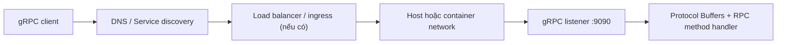
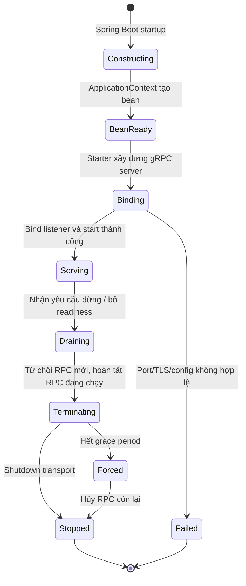
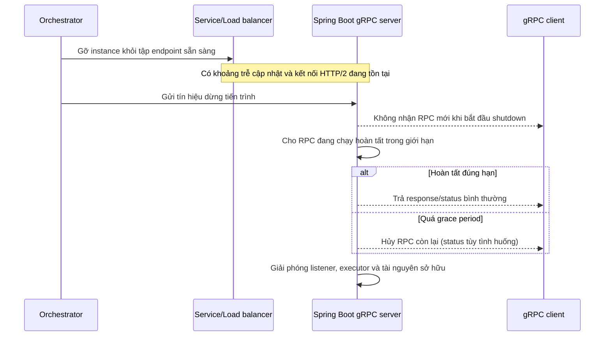

# Cấu hình port và server lifecycle trong Spring Boot gRPC

## 1. Mục tiêu bài học

Khi phát triển **SPRING_GRPC**, ứng dụng Spring Boot có thể triển khai server gRPC dựa trên hợp đồng Protocol Buffers, mã Java được sinh tự động và các phương thức unary hoặc streaming. Để server thực sự phục vụ client, lập trình viên cần biết **cổng nào đang được mở**, **server được khởi động vào thời điểm nào**, **cách dừng nhận RPC mới** và **cách giải phóng những lời gọi đang xử lý**.

Bài này tập trung vào hai chủ đề trong chương **Spring Boot integration**:

- **Port configuration:** xác định cổng lắng nghe gRPC, địa chỉ bind, cách cấu hình theo profile và môi trường, phân biệt cổng gRPC với HTTP/Actuator, ánh xạ cổng qua container hoặc Kubernetes.
- **Server lifecycle:** nhận diện giai đoạn Spring tạo bean, khởi động gRPC listener, đưa ứng dụng vào trạng thái sẵn sàng, graceful shutdown, buộc dừng khi quá hạn và giải phóng tài nguyên.

Sau khi học, bạn có thể cấu hình và vận hành một server gRPC mà không nhầm trạng thái bean Spring với trạng thái socket mạng; kiểm tra các lỗi như `Address already in use`, `UNAVAILABLE`, `DEADLINE_EXCEEDED`; thiết kế quy trình shutdown phù hợp với unary và streaming RPC.

**Hệ API minh họa:** `net.devh:grpc-server-spring-boot-starter`, sử dụng `@GrpcService` và `grpc.server.*`. Dự án **Spring gRPC** thuộc hệ sinh thái Spring có các starter và điểm mở rộng riêng. Hãy dùng đúng thuộc tính và lifecycle contract trong tài liệu của phiên bản được dự án lựa chọn; không mặc định mọi starter có cùng tên property.

## 2. Port, listener và endpoint là những khái niệm khác nhau

Đối với một gRPC server, nên phân biệt:

| Khái niệm | Ý nghĩa | Ví dụ |
| --- | --- | --- |
| Bind address | Địa chỉ mạng mà tiến trình lắng nghe | `127.0.0.1` hoặc một giao diện mạng của container |
| Bind port | Cổng TCP mà gRPC transport mở | `9090` |
| Target của client | Tên/địa chỉ mà client yêu cầu kết nối | `dns:///stock-grpc.internal:50051` |
| Mapped/forwarded port | Cổng bên ngoài được proxy/container đưa đến listener | `localhost:50051 → container:9090` |
| gRPC service/method | Tên RPC trên HTTP/2 sau khi kết nối thành công | `demo.probe.v1.ProbeService/Ping` |

**Một server lắng nghe thành công trên `localhost:9090` không có nghĩa mọi máy khác có thể kết nối.** Bind trên loopback chỉ nhận kết nối tại host tương ứng; bind trên giao diện mạng cần thiết và cấu hình firewall/port mapping mới cho phép client ngoài host truy cập.

Tương tự, việc client biết đúng port không bảo đảm gọi được RPC: hai phía còn phải thống nhất HTTP/2, TLS, tên service/method từ `.proto`, metadata và chính sách bảo mật.



### Port hợp lệ và các giá trị đặc biệt

Port TCP thông thường là số nguyên từ **1 đến 65535**. Những port thấp có thể chịu ràng buộc quyền hệ điều hành. Khi chọn port ứng dụng, ưu tiên cổng được quản lý qua cấu hình thay vì hard-code trong code Java.

Một số bản starter cho phép các giá trị đặc biệt phục vụ kiểm thử, như `0` (hệ điều hành cấp cổng còn trống) hoặc `-1` (không mở TCP listener khi dùng in-process server). **Đây là quy ước của từng starter/phiên bản**, không phải quy tắc chung của TCP; cần kiểm tra tài liệu và khả năng lấy lại port thực tế trước khi dựa vào chúng trong test.

## 3. Phân biệt cổng gRPC với cổng HTTP của Spring Boot

Trong một ứng dụng Spring Boot có thể đồng thời tồn tại:

```text
Spring Boot process / ApplicationContext
|
+-- Bean nghiệp vụ và gRPC service implementation
|
+-- gRPC server được starter quản lý
|    +-- HTTP/2 + gRPC
|    +-- grpc.server.port = 9090 (ví dụ net.devh)
|
+-- Spring MVC / WebFlux HTTP server, nếu có web starter
|    +-- REST endpoint
|    +-- server.port = 8080
|
+-- Actuator HTTP management server, nếu cấu hình tách riêng
     +-- management.server.port = 8081
```

| Property | Điều khiển | Điều kiện áp dụng |
| --- | --- | --- |
| `grpc.server.port` | Cổng gRPC server của `net.devh` | Có gRPC server starter tương ứng |
| `server.port` | Cổng HTTP web server của Spring Boot | Có servlet/reactive web stack |
| `management.server.port` | Cổng HTTP management riêng của Actuator | Có Actuator và bật chế độ management server riêng |

Nếu ứng dụng chỉ có `spring-boot-starter` và gRPC server starter thì **không cần** Spring MVC để phục vụ gRPC. Ngược lại, khi thêm `spring-boot-starter-web`, một tiến trình có thể có **hai listener riêng**, dùng port khác nhau.

Ví dụ cấu hình có cả HTTP và gRPC:

```yaml
server:
  port: 8080

grpc:
  server:
    port: 9090

management:
  server:
    port: 8081
```

Không gán cả gRPC listener và HTTP listener độc lập vào cùng địa chỉ/cổng TCP. Nếu cần client HTTP và gRPC đi qua cùng một cổng public, phải có **kiến trúc chia sẻ listener hoặc proxy/ingress** hỗ trợ giao thức phù hợp; một phép đổi `server.port` đơn thuần không làm hai server chia sẻ socket.

## 4. Cấu hình `grpc.server.port` theo môi trường

Với **net.devh**, tệp `src/main/resources/application.yml` có thể khai báo:

```yaml
spring:
  application:
    name: probe-grpc

grpc:
  server:
    port: ${GRPC_SERVER_PORT:9090}
```

Cú pháp Spring `${GRPC_SERVER_PORT:9090}` nghĩa là ưu tiên giá trị từ biến cấu hình `GRPC_SERVER_PORT`; nếu chưa có thì dùng `9090`. Lưu ý tên biến môi trường phù hợp cơ chế relaxed binding của Spring Boot và quy ước triển khai; ưu tiên một tên thống nhất trong CI/CD và hạ tầng.

Có thể có cấu hình theo profile, ví dụ `application-dev.yml`:

```yaml
grpc:
  server:
    port: 9191
```

Khi bật profile `dev`, giá trị trong file profile tham gia cơ chế phân giải properties. Tuy nhiên, các nguồn cấu hình như command-line arguments, biến môi trường hoặc deployment configuration có **thứ tự ưu tiên** nhất định. Khi port thực tế khác dự kiến, phải truy nguồn giá trị đã được bind vào starter.

Ví dụ ghi đè bằng tham số khởi động:

```bash
java -jar app.jar --grpc.server.port=9292
```

Phân biệt thay đổi cấu hình **trước khi ứng dụng khởi động** với thay đổi biến môi trường **sau khi listener đã bind**. Thông thường, việc đổi port sau startup cần restart hoặc cơ chế tái khởi tạo server được hỗ trợ rõ ràng; không giả định Spring tự chuyển listener sang port mới khi một property thay đổi.

### Địa chỉ bind và địa chỉ public

Port chỉ xác định một nửa endpoint. Bind address quyết định giao diện mạng nào nhận kết nối. Một số starter có property điều khiển địa chỉ bind; tên property và giá trị mặc định phải xem theo phiên bản đang dùng.

Các tình huống cần nhớ:

- **Local development:** chỉ cho phép truy cập từ máy phát triển thì bind loopback là hợp lý.
- **Container:** tiến trình thường cần bind vào giao diện mạng của container để Kubernetes Service/Docker port mapping truy cập được; chỉ bind `127.0.0.1` bên trong container có thể khiến client ngoài container không kết nối.
- **Production:** địa chỉ client gọi thường là DNS của Kubernetes Service, load balancer hoặc ingress, không phải bind address nội bộ của server.
- **Security:** không công khai cổng gRPC không cần thiết; bind rộng phải đi cùng firewall, network policy, TLS và authorization.

## 5. Ví dụ server gRPC tự chứa với Spring Boot

### 5.1. Hợp đồng Protocol Buffers

Đặt `src/main/proto/probe.proto`:

```proto
syntax = "proto3";

package demo.probe.v1;

option java_multiple_files = true;
option java_package = "dev.example.probe.v1";

service ProbeService {
  rpc Ping(PingRequest) returns (PingReply);
}

message PingRequest {
  string value = 1;
}

message PingReply {
  string value = 1;
}
```

Sau bước sinh mã bằng `protoc` và plugin `protoc-gen-grpc-java`, ứng dụng có `PingRequest`, `PingReply`, `ProbeServiceGrpc.ProbeServiceImplBase` cùng các client stubs. **Server lifecycle và sinh mã Protobuf là hai quá trình khác nhau**: Spring Boot không tự tạo Java classes từ `.proto`.

### 5.2. Khung dependencies Gradle

Ví dụ `build.gradle` với Groovy DSL:

```groovy
plugins {
    id 'java'
    id 'org.springframework.boot' version 'SPRING_BOOT_VERSION'
    id 'io.spring.dependency-management' version 'DEPENDENCY_MANAGEMENT_VERSION'
    id 'com.google.protobuf' version 'PROTOBUF_PLUGIN_VERSION'
}

def grpcVersion = 'GRPC_JAVA_VERSION'
def protobufVersion = 'PROTOBUF_VERSION'
def starterVersion = 'NET_DEVH_STARTER_VERSION'

repositories {
    mavenCentral()
}

dependencies {
    implementation 'org.springframework.boot:spring-boot-starter'
    implementation "net.devh:grpc-server-spring-boot-starter:${starterVersion}"

    implementation platform("io.grpc:grpc-bom:${grpcVersion}")
    implementation 'io.grpc:grpc-protobuf'
    implementation 'io.grpc:grpc-stub'
    implementation "com.google.protobuf:protobuf-java:${protobufVersion}"

    testImplementation 'org.springframework.boot:spring-boot-starter-test'
}

protobuf {
    protoc {
        artifact = "com.google.protobuf:protoc:${protobufVersion}"
    }
    plugins {
        grpc {
            artifact = "io.grpc:protoc-gen-grpc-java:${grpcVersion}"
        }
    }
    generateProtoTasks {
        all()*.plugins {
            grpc {}
        }
    }
}
```

Tất cả giá trị kết thúc bằng `_VERSION` là **placeholder**, không chạy được nếu chưa thay. Trước khi build, chọn bộ phiên bản Spring Boot, Java, net.devh, gRPC Java, Protobuf và plugin sinh mã tương thích; nên sử dụng BOM/version catalog của dự án. Một số tổ hợp Java/gRPC generator có thể yêu cầu API chứa `javax.annotation.Generated` để biên dịch mã sinh.

### 5.3. Application và gRPC service bean

Ứng dụng Spring Boot:

```java
package dev.example;

import org.springframework.boot.SpringApplication;
import org.springframework.boot.autoconfigure.SpringBootApplication;

@SpringBootApplication
public class ProbeApplication {
    public static void main(String[] args) {
        SpringApplication.run(ProbeApplication.class, args);
    }
}
```

Implementation:

```java
package dev.example.probe;

import dev.example.probe.v1.PingReply;
import dev.example.probe.v1.PingRequest;
import dev.example.probe.v1.ProbeServiceGrpc;
import io.grpc.Status;
import io.grpc.stub.StreamObserver;
import net.devh.boot.grpc.server.service.GrpcService;

@GrpcService
public class ProbeGrpcService
        extends ProbeServiceGrpc.ProbeServiceImplBase {

    @Override
    public void ping(
            PingRequest request,
            StreamObserver<PingReply> responseObserver) {

        String value = request.getValue().trim();
        if (value.isEmpty()) {
            responseObserver.onError(
                Status.INVALID_ARGUMENT
                    .withDescription("value không được để trống")
                    .asRuntimeException());
            return;
        }

        PingReply reply = PingReply.newBuilder()
            .setValue("pong: " + value)
            .build();

        responseObserver.onNext(reply);
        responseObserver.onCompleted();
    }
}
```

`@GrpcService` trong ví dụ là annotation của **net.devh**. Lớp nằm dưới package `dev.example` nên được component scan mặc định của `@SpringBootApplication` tìm thấy. Starter thu thập service bean, tạo server và đăng ký phương thức `demo.probe.v1.ProbeService/Ping`. Không viết thêm `ServerBuilder.forPort(9090)` trong `main()` khi dùng starter quản lý server.

Để xác minh listener đã hoạt động, có thể dùng `grpcurl` với hợp đồng:

```bash
grpcurl -plaintext \
  -import-path src/main/proto \
  -proto probe.proto \
  -d '{"value":"ready"}' \
  localhost:9090 \
  demo.probe.v1.ProbeService/Ping
```

Kết quả mong đợi:

```json
{
  "value": "pong: ready"
}
```

Lệnh dùng `-plaintext` cho cấu hình local chưa bật TLS. Nếu server sử dụng TLS, client phải xác thực chứng chỉ phù hợp. Trên PowerShell, đưa lệnh vào một dòng hoặc thay dấu nối dòng theo cú pháp của PowerShell.

## 6. Server lifecycle qua các giai đoạn

Một ứng dụng có gRPC starter thường trải qua chuỗi:



Sơ đồ thể hiện **mô hình vận hành**; không ngụ ý mọi starter có chính xác những trạng thái hoặc callback cùng tên.

### 6.1. Bean được tạo trước khi có listener

Spring Boot tạo `ApplicationContext`, xử lý auto-configuration, đăng ký các bean gRPC và dependency nghiệp vụ. Sau đó, starter khởi động server theo tích hợp lifecycle của phiên bản.

Trong một số hệ starter, việc quản lý server được gắn với Spring `SmartLifecycle`. Vì vậy:

- **Bean tồn tại** không chắc listener đã bind xong.
- **Socket đã mở** không chắc mọi backend dependency và RPC nghiệp vụ đều sẵn sàng.
- **Log ứng dụng đã in** không đủ để chứng minh client có thể gọi đúng RPC.

Để xác nhận startup, cần một lời gọi RPC thật hoặc một readiness check phản ánh khả năng phục vụ gRPC.

### 6.2. Khi nào client có thể kết nối?

Ở giai đoạn bind thành công, hệ điều hành đã dành cổng TCP cho server. Kết nối TCP thành công vẫn có thể dẫn tới lỗi gRPC do TLS/HTTP/2, tên RPC hoặc metadata. Ở phía client, `ManagedChannel` có thể kết nối theo nhu cầu, nên client bean tồn tại không chứng minh kết nối đã được thiết lập.

Đối với Spring Boot, không đồng nhất máy chủ gRPC đã lắng nghe với thời điểm Spring phát sự kiện `ApplicationReadyEvent`; muốn dùng sự kiện này để điều phối readiness cần kiểm tra trình tự lifecycle của starter cụ thể. Một readiness check thực sự nên kiểm tra cả hạ tầng thiết yếu của dịch vụ.

### 6.3. Lỗi bind port

Nếu tiến trình khác đang giữ địa chỉ/cổng, server có thể lỗi khi `bind` với thông báo như `Address already in use`. Trong trường hợp đó, Spring Boot có thể không khởi động ứng dụng thành công.

Các nguyên nhân thực tế:

1. Cổng `9090` đã được một tiến trình khác dùng.
2. Hai gRPC server được tạo trong cùng ứng dụng, một thủ công và một qua starter.
3. Giao diện mạng cần bind không tồn tại hoặc không được cấp quyền.
4. Cấu hình profile/deployment khiến hai server độc lập bind cùng cổng.
5. Cấu hình TLS hoặc thông số transport không hợp lệ khiến startup thất bại, dù cổng chưa bị chiếm.

Cách xử lý đúng là xác định **địa chỉ bind, cổng hiệu lực và tiến trình sở hữu listener**. Không đổi cổng tùy tiện trong production nếu client/ingress vẫn định tuyến tới port cũ.

## 7. Spring quản lý vòng đời server như thế nào?

Auto-configuration gắn tài nguyên gRPC với Spring context. Khi ứng dụng chạy, starter chịu trách nhiệm tạo và start server; khi context đóng, cơ chế quản lý của starter dừng server và giải phóng những tài nguyên mà nó sở hữu.

### Không đóng server của starter trong business bean

Tránh viết `@PreDestroy` của một bean nghiệp vụ rồi gọi thủ công vào một `Server` do starter quản lý, bởi:

- Trình tự shutdown của Spring và starter có thể bị phá vỡ.
- Cấu hình graceful shutdown của starter có thể bị bỏ qua.
- Stream và interceptors có thể bị hủy trong khi bean khác vẫn đang sử dụng.
- Server có thể bị dừng nhiều lần từ những nơi khác nhau, khó chẩn đoán.

Khi muốn thay chính sách shutdown, kiểm tra **extension point hoặc properties chính thức của bản starter**, thay vì lấy trực tiếp server và áp đặt lifecycle riêng.

### Phân biệt server do starter quản lý và server thủ công

Với gRPC Java thuần, ngữ nghĩa của API shutdown có thể được minh họa:

```java
server.shutdown(); // Ngừng nhận lời gọi mới; cho RPC đang chạy cơ hội hoàn tất.

if (!server.awaitTermination(20, TimeUnit.SECONDS)) {
    server.shutdownNow(); // Buộc hủy những lời gọi còn tồn tại.
}
```

Đây là **đoạn mã minh họa cho server được tự quản lý**, không phải code cần chép vào ứng dụng đã dùng starter. `shutdown()` là yêu cầu graceful, `shutdownNow()` là yêu cầu buộc dừng; `awaitTermination(...)` chờ server kết thúc và có thể bị ngắt, nên ứng dụng thật cần xử lý `InterruptedException` đúng cách.

Không xem thời gian `20 giây` trong ví dụ là mặc định của Spring hay gRPC. Grace period phải xuất phát từ SLA, thời gian RPC dài nhất được phép và thời gian dừng do hạ tầng cấp.

## 8. Graceful shutdown và yêu cầu đang xử lý

**Graceful shutdown** cho phép server ngừng tiếp nhận công việc mới và tạo cơ hội cho RPC đang chạy hoàn tất trong khoảng thời gian có giới hạn. Trong ứng dụng phân tán, việc server dừng nhận kết nối mới, load balancer ngừng gửi traffic và client xử lý retry phải được thiết kế cùng nhau.



Sơ đồ là trình tự mong muốn. **Chỉ gỡ readiness không đủ để bảo đảm tuyệt đối không còn RPC mới**: load balancer có độ trễ, client có thể giữ kết nối HTTP/2, hoặc caller có thể truy cập trực tiếp. Server và client vẫn cần có hành vi phù hợp khi nhận tín hiệu shutdown.

### Unary RPC

Đối với unary RPC ngắn, mục tiêu thường là cho những lời gọi gần hoàn tất trả response trong thời gian grace. Với lời gọi dài hơn deadline của client hoặc thời gian shutdown, server cần ngừng công việc có thể hủy để tránh tiêu tốn CPU và tài nguyên upstream.

Ở phía client, `DEADLINE_EXCEEDED` không có nghĩa server chắc chắn chưa xử lý side effect. Nếu định retry thao tác tạo đơn hàng, trừ tồn kho hoặc thanh toán, cần bảo vệ bằng idempotency key hoặc cơ chế chống thực hiện trùng.

### Streaming RPC

Server streaming, client streaming và bidirectional streaming có thể kéo dài phút hoặc hàng giờ. Nếu đợi mọi stream hoàn tất tự nhiên mà không có giới hạn, tiến trình có thể không bao giờ dừng.

Cần thiết kế thêm:

- Giới hạn thời lượng stream và yêu cầu client kết nối lại khi cần.
- Theo dõi cancellation, deadline và trạng thái `StreamObserver`.
- Hủy producer/subscription hoặc công việc nền khi stream kết thúc, bị lỗi hay bị client hủy.
- Dừng phát message mới sau khi stream đã kết thúc.
- Tôn trọng flow control/backpressure; không tích luỹ vô hạn message để “chờ gửi hết” trong lúc shutdown.

Với gRPC Java, `ServerCallStreamObserver` có hỗ trợ callback cancellation và thông tin readiness. Ví dụ ngắn sau minh hoạ cách **đăng ký callback huỷ** trong một phương thức streaming đã có `responseObserver`:

```java
if (responseObserver instanceof ServerCallStreamObserver<?> observer) {
    observer.setOnCancelHandler(() -> {
        // Hủy tác vụ phát stream hoặc subscription của lời gọi này.
        // Không lưu request state vào field singleton của @GrpcService.
    });
}
```

Đây là **mảnh mã minh họa**, không phải service hoàn chỉnh. Khi triển khai thực tế, phải quản lý tác vụ producer riêng của stream, đồng bộ terminal event và cancellation; không giả định callback luôn chạy trên cùng một thread. Đặc biệt với Java cũ không hỗ trợ pattern matching `instanceof`, dùng cú pháp cast thông thường.

## 9. Kết hợp readiness và liveness

Khi ứng dụng chạy trong container/orchestrator, cần phân biệt:

| Tín hiệu | Câu hỏi nó trả lời | Nên phản ánh |
| --- | --- | --- |
| Liveness | Tiến trình có rơi vào trạng thái không thể tự phục hồi? | Tình trạng sống của process/runtime |
| Readiness | Instance hiện có thể tiếp nhận RPC hợp lệ? | Listener gRPC và những dependency thiết yếu |
| gRPC health service | Service gRPC được health protocol báo trạng thái nào? | Trạng thái theo tên service nếu được triển khai |
| Spring Boot Actuator health | Các HealthIndicator của Spring Boot báo gì? | Health qua HTTP/management endpoint tương ứng |

**gRPC Health Checking Protocol** và **Spring Boot Actuator HTTP health** là hai cơ chế riêng. Chỉ bật Actuator không chứng minh gRPC health method đã được đăng ký.

Một probe kiểm tra TCP chỉ cho biết cổng đang chấp nhận kết nối TCP, chưa chứng minh RPC hoạt động hoặc service cần thiết đã sẵn sàng. Nếu dùng Kubernetes `grpc` readiness probe, server cần thực sự hỗ trợ gRPC Health Checking Protocol và probe phải trỏ đúng port. Mô hình TLS, proxy và các giới hạn của loại probe cần được xác minh theo hạ tầng đang chạy.

Trong quy trình shutdown, đưa readiness sang trạng thái không sẵn sàng là cách để hạ tầng ngừng chọn instance cho traffic mới. **Không dùng liveness để đánh dấu tạm thời “đang drain”** nếu điều đó làm orchestrator kill tiến trình sớm hơn grace period mong muốn.

## 10. Port mapping trong Docker và Kubernetes

### 10.1. Docker: cổng host và cổng container

Giả sử gRPC server trong container thực sự nghe ở `9090`, có thể ánh xạ:

```bash
docker run --rm -p 50051:9090 my-grpc-image
```

Khi đó, client trên host gọi `localhost:50051` nhưng tiến trình bên trong container vẫn bind `9090`. Lệnh trên giả định image `my-grpc-image` đã được build và ứng dụng trong container lắng nghe trên giao diện mạng phù hợp; `-p` **không tự đổi `grpc.server.port`**.

Nếu ứng dụng chỉ bind `127.0.0.1` trong container, ánh xạ port có thể không truy cập được từ host như mong đợi. Cần kiểm tra cả bind address lẫn mapped port.

### 10.2. Kubernetes: containerPort, Service port, targetPort

Giả sử một pod chạy gRPC tại `9090` và Kubernetes Service công bố nội bộ tại `50051`. Phần liên quan của Deployment:

```yaml
apiVersion: apps/v1
kind: Deployment
metadata:
  name: probe-grpc
spec:
  replicas: 2
  selector:
    matchLabels:
      app: probe-grpc
  template:
    metadata:
      labels:
        app: probe-grpc
    spec:
      terminationGracePeriodSeconds: 45
      containers:
        - name: probe-grpc
          image: registry.example/probe-grpc:1.0
          ports:
            - name: grpc
              containerPort: 9090
          env:
            - name: GRPC_SERVER_PORT
              value: "9090"
```

Phần Service:

```yaml
apiVersion: v1
kind: Service
metadata:
  name: probe-grpc
spec:
  selector:
    app: probe-grpc
  ports:
    - name: grpc
      protocol: TCP
      port: 50051
      targetPort: 9090
```

Đây là **mẫu minh họa port mapping**, chưa bao gồm readiness/liveness probes, security, image hợp lệ, resource limits và cấu hình production đầy đủ.

- `containerPort: 9090` mô tả port container; tự nó không khiến Java server mở port.
- `GRPC_SERVER_PORT=9090` được đưa cho ứng dụng, nếu Spring cấu hình sử dụng biến này.
- `Service port: 50051` là cổng client bên trong cluster kết nối.
- `targetPort: 9090` là cổng đích trên pod.
- `terminationGracePeriodSeconds: 45` là giới hạn cấp pod; thời gian shutdown thực tế còn phụ thuộc hook, runtime và starter.

Khi thêm ingress hoặc mesh, phải kiểm tra hỗ trợ gRPC/HTTP2, TLS termination và timeouts của proxy. Một ứng dụng nhận RPC qua Service port nhưng báo sai protocol ở ingress vẫn có thể gây `UNAVAILABLE`.

### 10.3. Trình tự drain trong Kubernetes

Quy trình nên hướng tới:

1. Chặn hoặc giảm lựa chọn pod cho RPC mới bằng readiness và cập nhật endpoint.
2. Cho hạ tầng thời gian đồng bộ routing nếu mô hình triển khai yêu cầu.
3. Khi nhận SIGTERM, Spring đóng context và starter bắt đầu shutdown server.
4. RPC đang chạy có cơ hội hoàn tất; stream dài nhận cancellation hoặc cơ chế kết thúc có kiểm soát.
5. Khi hết ngân sách shutdown, những RPC còn lại có thể bị buộc dừng.
6. Giám sát tỷ lệ `UNAVAILABLE`, `CANCELLED`, `DEADLINE_EXCEEDED` quanh thời điểm rolling update.

Cách hiện thực chi tiết phụ thuộc orchestrator, load balancer, starter và thời gian client giữ kết nối. Không đặt một lệnh `sleep` dài trong preStop chỉ vì muốn “graceful” nếu chưa hiểu thứ tự SIGTERM, propagation của readiness và ngân sách grace thực tế.

## 11. TLS ảnh hưởng gì đến listener và quá trình khởi động?

Một gRPC server có thể mở cổng TCP nhưng thất bại khi xử lý TLS nếu certificate, private key hoặc cấu hình trust sai. Với net.devh, ví dụ cấu hình TLS thường gặp là:

```yaml
grpc:
  server:
    port: 9090
    security:
      enabled: true
      certificateChain: file:/run/secrets/grpc/tls.crt
      privateKey: file:/run/secrets/grpc/tls.key
```

Đường dẫn chỉ để minh họa. Tên properties, hỗ trợ `file:`/`classpath:` và mTLS cần xác minh theo bản starter đang dùng. Không commit private key thật.

Cần tách ba khả năng:

1. **Bind thất bại:** server chưa mở được listener, thường do cổng/giao diện hoặc cấu hình server.
2. **TLS handshake thất bại:** socket mạng có thể có nhưng client/server không thống nhất TLS, chứng chỉ/hostname/CA hoặc phiên bản giao thức.
3. **RPC thất bại sau handshake:** method, metadata, quyền truy cập, deadline hoặc logic nghiệp vụ gây status khác.

Cổng gRPC không tự thay đổi khi bật TLS; nhưng client phải dùng kết nối TLS và trust chain phù hợp. Với mTLS, server còn xác minh certificate của client; khi có proxy terminate TLS, cần xác định rõ đoạn nào được mã hoá và ai là peer thực tế được xác thực.

## 12. Deadline, status và server lifecycle

Các lỗi trên client khi server start/stop không hoàn toàn giống nhau:

| Tình huống | Trạng thái client có thể gặp | Cách phân tích |
| --- | --- | --- |
| Chưa có listener tại port | `UNAVAILABLE` hoặc lỗi kết nối được chuyển thành status | Kiểm tra address/port và server startup |
| Server đang khởi động, client đã gọi | `UNAVAILABLE` hoặc `DEADLINE_EXCEEDED` tùy thời điểm/option | Readiness và deadline của client |
| Server drain khi RPC mới tới | `UNAVAILABLE` hoặc status khác theo transport/timing | Routing, GOAWAY, retry policy |
| RPC đang xử lý bị client hủy | `CANCELLED` phía client hoặc dấu hiệu context cancelled phía server | Hủy producer, giải phóng tài nguyên |
| RPC vượt deadline | `DEADLINE_EXCEEDED` | Đo latency, chặn công việc thừa |
| Service/method chưa đăng ký | `UNIMPLEMENTED` | Kiểm tra `.proto` và service bean |
| Server nhận request không hợp lệ | `INVALID_ARGUMENT` | Validation trong handler |

Bảng này nêu **các status có thể xuất hiện**, không cam kết mã lỗi duy nhất cho mọi thứ tự shutdown hoặc giao thức proxy. Cách phân loại phải dựa trên log, status, timestamp và trạng thái kết nối tại thời điểm lỗi.

Deadline nên được đặt tại client cho từng RPC, ví dụ:

```java
ProbeServiceGrpc.ProbeServiceBlockingStub callStub =
    stub.withDeadlineAfter(750, TimeUnit.MILLISECONDS);

PingReply reply = callStub.ping(
    PingRequest.newBuilder().setValue("ready").build()
);
```

Đây là đoạn minh họa khi biến `stub` đã được tạo/inject. `withDeadlineAfter` tạo stub dẫn xuất, không làm thay đổi stub dùng chung. Deadline giúp giới hạn thời gian caller chờ, **không tự bảo đảm công việc ở server đã dừng hoàn toàn**. Với công việc lâu, server cần hỗ trợ kiểm tra cancellation và dừng upstream/background tasks phù hợp.

## 13. Quan sát startup và shutdown

Để vận hành tin cậy, không chỉ quan sát “process còn sống”. Nên thu thập:

| Tín hiệu | Tác dụng |
| --- | --- |
| Startup/bind event và cổng thực tế | Phát hiện port sai hoặc không mở listener |
| Tỷ lệ RPC theo method và status | Nhận biết lỗi lúc rolling deployment |
| p50/p95/p99 latency | Phát hiện độ trễ và tail latency |
| Số active RPC/streams | Xác định số lời gọi còn tồn tại trong lúc drain |
| `UNAVAILABLE` và `DEADLINE_EXCEEDED` | Phát hiện routing/transport và timeout |
| TLS handshake errors | Điều tra mismatch certificate/trust/hostname |
| Thời gian từ tín hiệu shutdown đến tiến trình dừng | Điều chỉnh grace period |
| CPU, heap, executor, connection count | Phát hiện tài nguyên chưa được giải phóng |

Tùy bản starter, cần thêm Micrometer, OpenTelemetry hoặc gRPC interceptors/instrumentation để ghi đầy đủ metrics/traces; đừng mặc định mọi chỉ số tự xuất hiện sau khi thêm starter.

Khi log:

- Ghi environment/profile, cổng đã cấu hình và thông tin endpoint cần thiết.
- Không ghi private key, token, dữ liệu nhạy cảm hoặc toàn bộ protobuf payload không có lý do.
- Dùng request ID/tracing context để nối log giữa client và server; metadata phải được chuyển qua interceptor hoặc cơ chế tracing thích hợp.
- Phân biệt log startup của Spring context với log server thực sự bind cổng; nếu có nhiều server, phải ghi rõ tên và port.

## 14. Kiểm thử port và lifecycle có hệ thống

### 14.1. Kiểm tra bằng một RPC

Khởi động demo ở `9090` rồi gọi `Ping`. Sau đó đặt `GRPC_SERVER_PORT=9191` và khởi động lại: client phải chuyển sang `9191`. Khi thay cổng, kiểm tra port cũ không còn là listener của ứng dụng mới; port cũ có thể vẫn do một tiến trình khác chiếm, vì vậy cần xem cả process owner.

Trên môi trường Windows, có thể xem listener TCP bằng PowerShell:

```powershell
Get-NetTCPConnection -State Listen -LocalPort 9090
```

Lệnh chỉ cho biết hệ điều hành có listener ở cổng đó; **không chứng minh listener thuộc về gRPC service mong muốn** và không kiểm tra TLS/Protobuf. Để kiểm tra end-to-end, phải tiếp tục gọi RPC.

### 14.2. Integration test với Spring context

Một test đơn thuần gọi `new ProbeGrpcService()` chỉ kiểm tra nghiệp vụ. Để kiểm tra auto-configuration, tạo Spring Boot test context và một gRPC channel gọi vào service thực sự được starter đăng ký.

Nếu phiên bản net.devh hỗ trợ `inProcessName`, có thể dùng cấu hình thử nghiệm:

```java
@SpringBootTest(properties = {
    "grpc.server.port=-1",
    "grpc.server.inProcessName=probe-test"
})
class ProbeRegistrationTest {
    // Tạo InProcessChannelBuilder.forName("probe-test").
    // Gọi ProbeServiceGrpc.newBlockingStub(channel).ping(...).
    // Xác minh response/status, shutdown channel khi test xong.
}
```

Đoạn này là **khung test**, chưa phải lớp test chạy độc lập. Nó giúp kiểm tra đăng ký bean và lời gọi, nhưng **không kiểm tra bind TCP hay port mapping** vì transport in-process bỏ qua mạng. Property `-1` và `inProcessName` phải được phiên bản starter dùng trong test hỗ trợ.

Để kiểm tra **port/lifecycle thực tế**, cần một network integration test hoặc smoke test mở listener, gọi RPC qua TCP, gửi tín hiệu shutdown có kiểm soát và quan sát cổng được giải phóng. Tránh dùng cùng một cổng cố định cho nhiều test chạy song song trong CI.

### 14.3. Bộ tình huống kiểm thử

| Tình huống | Kết quả kỳ vọng |
| --- | --- |
| Start với port hợp lệ chưa bị chiếm | Listener mở, RPC hợp lệ trả `OK` |
| Port bị chiếm | Startup báo lỗi bind rõ ràng; không thông báo readiness giả |
| Port thay bằng profile/ENV | Listener sử dụng cấu hình có hiệu lực, client gọi được đúng đích |
| Thay `server.port` khi có web server | Cổng gRPC vẫn theo `grpc.server.port` |
| Không đăng ký `@GrpcService` | Server có thể chạy nhưng RPC thiếu trả `UNIMPLEMENTED` |
| Tắt server khi unary RPC đang chạy | Hoàn tất trong grace period nếu đủ thời gian và được hỗ trợ |
| Tắt server khi stream dài còn hoạt động | Không treo vĩnh viễn; cancellation và giải phóng tài nguyên phù hợp |
| TLS bật, client plaintext | Kết nối/RPC thất bại; không “rớt về plaintext” |
| Rolling update hai replica | Request mới chuyển sang replica sẵn sàng; tỷ lệ lỗi nằm trong mục tiêu triển khai |

## 15. Chẩn đoán lỗi theo triệu chứng

| Triệu chứng | Nguyên nhân thường gặp | Bước kiểm tra |
| --- | --- | --- |
| `Address already in use` | Cổng đã bị giữ, hoặc tạo thêm server thủ công | Xác định tiến trình dùng port; kiểm tra starter và server builder |
| Spring context có bean nhưng port không mở | Server chưa start, auto-configuration bị loại, hoặc lỗi bind | Startup log, condition report, giá trị properties |
| `UNAVAILABLE` | Sai host/port, server chưa ready, proxy/TLS sai | Listener TCP, hostname, TLS handshake, gRPC call |
| Client ở host không gọi được container | Bind loopback trong container hoặc thiếu port mapping | Bind address, Docker/Kubernetes Service/targetPort |
| `UNIMPLEMENTED` | Service chưa đăng ký hoặc tên gRPC method sai | `.proto`, bean `@GrpcService`, full RPC name |
| Port gRPC không đổi theo `server.port` | Đó là cổng HTTP của Spring | Xem `grpc.server.port` |
| Port khác với file `application.yml` | Profile/ENV/command-line ghi đè | Xem effective configuration của Spring |
| Shutdown chậm vô hạn | Stream dài không dừng, tác vụ nền chưa hủy | Active streams, cancellation, shutdown grace |
| Client hay lỗi lúc deploy | Drain/routing chưa đồng bộ, deadline quá ngắn | Readiness, endpoint propagation, retry policy |
| Health probe OK nhưng RPC hỏng | Probe không kiểm tra gRPC handler hoặc dependency | Kiểm tra gRPC health service, RPC thật |
| TLS handshake lỗi sau khi đổi certificate | Trust/SAN/SNI/cert chain không phù hợp | Chứng chỉ server/client và TLS termination |

Nếu cần xác định nguyên nhân auto-configuration, trong môi trường phát triển có thể khởi động Spring Boot với:

```bash
java -jar app.jar --debug
```

Xem **Condition Evaluation Report** và các log liên quan đến gRPC; tên các class auto-configuration và server lifecycle phụ thuộc starter/phiên bản. Condition report giải thích việc khởi tạo bean, còn trạng thái listener phải xác minh riêng.

## 16. Bài thực hành

Với ví dụ `ProbeService/Ping`, thực hiện một chuỗi thử nghiệm có thể quan sát rõ:

1. Chạy Spring Boot với port `9090`; dùng `grpcurl` gửi `{"value":"ready"}` và xác nhận response `pong: ready`.
2. Cấu hình port qua biến môi trường thành `9191`, restart, đổi địa chỉ client rồi xác minh kết nối mới.
3. Nếu ứng dụng có Spring Web, giữ gRPC ở `9191` nhưng đổi `server.port` của HTTP; ghi nhận hai listener độc lập.
4. Dùng một tiến trình thử nghiệm khác chiếm port `9191`, quan sát lỗi startup gRPC; giải phóng cổng và khởi động lại.
5. Chạy trong Docker với `-p 50051:9191`, đối chiếu port host/container và kiểm tra bind address.
6. Thiết kế một unary RPC mô phỏng tác vụ chậm có giới hạn, gửi tín hiệu dừng; đo xem nó có hoàn thành trong ngân sách graceful shutdown không.
7. Với streaming RPC, mô phỏng client hủy và xác minh producer dừng, active streams giảm, tài nguyên được giải phóng.
8. Thử TLS trong môi trường kiểm thử; phân biệt lỗi bind, lỗi handshake và lỗi method/status.
9. Trong Kubernetes (nếu có), quan sát readiness, endpoint của Service, thời gian từ SIGTERM đến khi pod dừng và tỷ lệ `UNAVAILABLE` khi rolling update.

Bạn đã nắm chủ đề khi có thể giải thích: **Cổng được chọn từ nguồn cấu hình nào? Server thực sự bind ở đâu? Khi nào được nhận RPC? Khi nào ngừng nhận RPC mới? Các lời gọi còn chạy được xử lý thế nào?** Những câu trả lời này là nền tảng để triển khai gRPC bằng Spring Boot một cách có thể kiểm thử và vận hành.

Với **SPRING_GRPC**, cấu hình port kết nối hợp đồng Protobuf và service bean với mạng thực tế; server lifecycle bảo đảm việc khởi động/dừng phù hợp với Spring Boot và hạ tầng. Thiết kế đúng cả hai giúp giữ tính khả dụng, độ tin cậy và khả năng quan sát của unary lẫn streaming RPC trong môi trường sản xuất.
