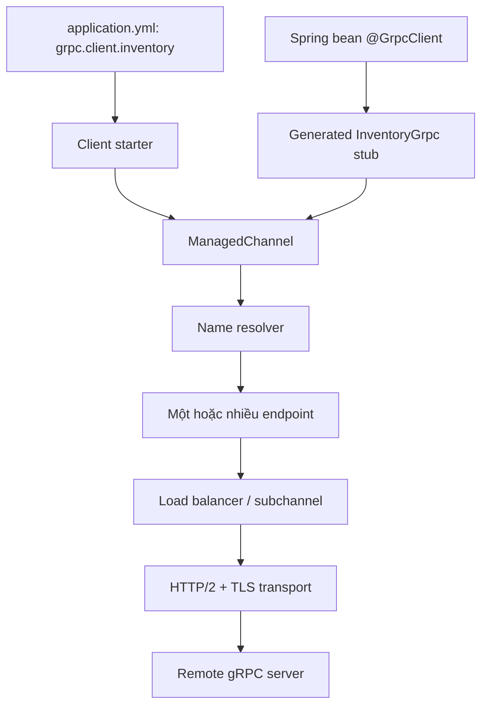
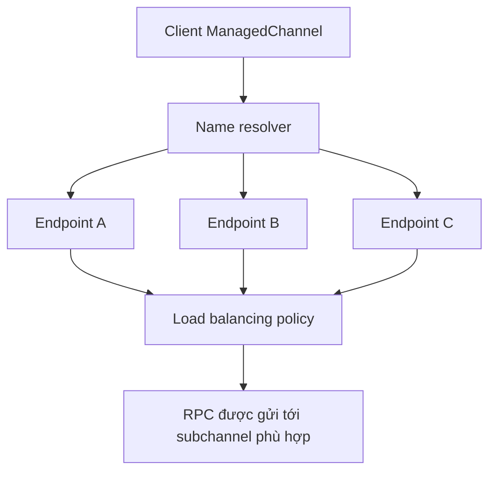

# Cấu hình channel đến remote server trong Spring Boot gRPC

## 1. Vì sao phải cấu hình channel đến remote server?

Trong **SPRING_GRPC**, một dịch vụ thường gọi nhiều dịch vụ gRPC khác qua mạng: order gọi inventory, payment gọi fraud detection, hoặc một API gateway gọi các backend chuyên biệt. Phía gọi cần một **channel** để tìm endpoint, thiết lập transport HTTP/2, áp dụng TLS và gửi các RPC đến server từ xa.

Trong gRPC Java, channel thường được biểu diễn bởi `ManagedChannel`. Khi dùng Spring Boot starter, ứng dụng có thể khai báo một client có tên và target trong cấu hình; starter tạo và quản lý channel rồi cung cấp stub cho Spring bean.

Bài này tập trung vào cách cấu hình **channel tới remote server**:

- Chọn target và scheme địa chỉ phù hợp: địa chỉ cố định, DNS hoặc service discovery.
- Khai báo nhiều channel có tên riêng và inject đúng stub.
- Chọn plaintext hay TLS, cấu hình trust certificate và xác minh danh tính server.
- Hiểu resolver, load balancing, tái sử dụng channel và thời điểm kết nối.
- Kiểm thử kết nối từ ứng dụng tới server từ xa và chẩn đoán lỗi mạng.

Ví dụ sử dụng **`net.devh:grpc-client-spring-boot-starter`**, với prefix `grpc.client.<name>.*` và annotation `@GrpcClient`. Spring gRPC chính thức có cách cấu hình client riêng; cần theo tài liệu đúng phiên bản thay vì sao chép properties của net.devh.

## 2. Channel, target và stub

Ba khái niệm thường bị nhầm:

| Thành phần | Vai trò | Ví dụ |
| --- | --- | --- |
| Target | Địa chỉ logic client muốn kết nối | `static://inventory.internal:9090` |
| Channel (`ManagedChannel`) | Quản lý name resolution, kết nối/subchannel, transport và trạng thái | Channel có tên `inventory` trong cấu hình Spring |
| Stub | API type-safe sinh từ Protobuf để gọi method trên channel | `InventoryGrpc.InventoryBlockingStub` |

Channel không phải một TCP socket duy nhất gắn cố định với một server. Nó là đối tượng quản lý kết nối: resolver có thể phân giải một target thành một hoặc nhiều địa chỉ; load balancer chọn subchannel phù hợp; transport thiết lập và tái sử dụng kết nối HTTP/2.

Stub là lớp gọi RPC được sinh từ hợp đồng `.proto`. Nó sử dụng channel đã được cấu hình để thực hiện các method. Một channel có thể phục vụ nhiều RPC và nhiều stub; không cần mở channel mới cho từng request.



**Channel có thể được tạo trước khi kết nối mạng thành công.** Nhiều implementation dùng kết nối lazy hoặc thiết lập transport theo nhu cầu. Vì vậy việc Spring inject stub thành công không chứng minh remote server đang hoạt động. Cần gọi RPC hoặc health check để xác minh khả năng phục vụ.

## 3. Đặt tên client và cấu hình target

### 3.1. Một remote server với địa chỉ cố định

Với starter net.devh, có thể khai báo trong `src/main/resources/application.yml`:

```yaml
grpc:
  client:
    inventory:
      address: "static://inventory.internal:9090"
      negotiationType: TLS
```

Trong cấu hình này:

- `inventory` là tên logic của channel/client.
- `address` là target mà channel sử dụng.
- `static://inventory.internal:9090` là địa chỉ cố định minh họa theo scheme static của starter.
- `negotiationType: TLS` yêu cầu kết nối bảo mật; phần trust certificate cần được cấu hình nếu môi trường dùng CA riêng.

Tên `inventory` được dùng lại khi inject stub bằng `@GrpcClient("inventory")`. Nếu tên annotation không khớp khóa cấu hình, client có thể không nhận endpoint hoặc các tuỳ chọn mong muốn.

Không đặt địa chỉ `localhost` cho một dịch vụ chạy ở container hoặc máy khác nếu `localhost` không trỏ đến remote host đó. Trong Docker/Kubernetes, `localhost` bên trong một container thường chỉ chính container/pod đó.

### 3.2. Dùng biến môi trường theo deployment

Không nên hard-code endpoint production trong source code. Có thể dùng placeholder của Spring:

```yaml
grpc:
  client:
    inventory:
      address: "${INVENTORY_GRPC_ADDRESS:static://localhost:9090}"
      negotiationType: PLAINTEXT
```

Giá trị mặc định trên chỉ dành cho local development. Ở staging/production, cung cấp `INVENTORY_GRPC_ADDRESS` theo DNS hoặc địa chỉ service thực tế và chọn TLS phù hợp. Khi biến môi trường không được thiết lập, Spring dùng giá trị sau dấu `:`; điều này tiện cho local nhưng cần cẩn thận để production không vô tình chạy plaintext.

Có thể tách profile:

```yaml
# application-local.yml
grpc:
  client:
    inventory:
      address: "static://localhost:9090"
      negotiationType: PLAINTEXT
```

```yaml
# application-prod.yml
grpc:
  client:
    inventory:
      address: "dns:///inventory-grpc.internal:9090"
      negotiationType: TLS
      security:
        trustCertCollection: file:/run/secrets/grpc/inventory-ca.crt
```

Tên property trong ví dụ thuộc net.devh; kiểm tra phiên bản đang dùng để xác nhận định dạng resource và các trường security. Đừng lưu private key hoặc token thật trong file cấu hình được commit.

### 3.3. Một ứng dụng gọi nhiều remote server

Mỗi backend nên có tên client riêng khi endpoint hoặc chính sách bảo mật khác nhau:

```yaml
grpc:
  client:
    inventory:
      address: "dns:///inventory-grpc.internal:9090"
      negotiationType: TLS
    payment:
      address: "dns:///payment-grpc.internal:9090"
      negotiationType: TLS
    fraud:
      address: "dns:///fraud-grpc.internal:9090"
      negotiationType: TLS
```

Tên client thể hiện **vai trò logical** của remote service, không nhất thiết là tên class hay package Protobuf. Nhờ vậy có thể đổi endpoint qua deployment config mà không sửa code nghiệp vụ.

Không dùng chung một channel chỉ vì các dịch vụ đang nghe cùng port. Mỗi channel cần target, trust policy, resolver và chính sách kết nối đúng với remote service tương ứng.

## 4. Inject stub theo tên channel

Giả sử Protobuf đã sinh ra `InventoryGrpc.InventoryBlockingStub`. Một gateway Spring có thể inject stub:

```java
package dev.example.order.gateway;

import dev.example.inventory.v1.GetStockRequest;
import dev.example.inventory.v1.InventoryGrpc;
import dev.example.inventory.v1.StockReply;
import io.grpc.StatusRuntimeException;
import net.devh.boot.grpc.client.inject.GrpcClient;
import org.springframework.stereotype.Service;

import java.util.concurrent.TimeUnit;

@Service
public class InventoryGateway {
    @GrpcClient("inventory")
    private InventoryGrpc.InventoryBlockingStub inventoryStub;

    public StockReply getStock(String sku) {
        GetStockRequest request = GetStockRequest.newBuilder()
            .setSku(sku)
            .build();

        try {
            return inventoryStub
                .withDeadlineAfter(700, TimeUnit.MILLISECONDS)
                .getStock(request);
        } catch (StatusRuntimeException ex) {
            // Tầng ứng dụng quyết định cách ánh xạ status.
            throw ex;
        }
    }
}
```

`@GrpcClient("inventory")` là integration annotation của net.devh. Nó yêu cầu starter inject stub sử dụng client cấu hình với tên `inventory`. Vì gateway là Spring bean, cơ chế inject của starter mới được áp dụng; không tự tạo gateway bằng `new InventoryGateway()` trong runtime.

Đoạn code minh họa blocking stub. Lời gọi sẽ chặn thread cho tới khi nhận response hoặc lỗi. Nếu gateway được gọi từ WebFlux event loop, không gọi blocking stub trực tiếp trên event loop; sử dụng async/future stub hoặc chuyển phần blocking sang executor phù hợp.

### Nhiều stub từ một channel

Một channel có thể tạo nhiều loại stub cho cùng service:

- `InventoryBlockingStub` cho lời gọi đồng bộ.
- `InventoryStub` cho callback và streaming.
- `InventoryFutureStub` cho unary RPC theo future.

Các stub gRPC thường bất biến. Phương thức như `withDeadlineAfter(...)` tạo một stub dẫn xuất có CallOptions mới, không thay đổi stub gốc được inject. Đây là cách đặt deadline theo từng RPC mà vẫn tái sử dụng channel.

## 5. Chọn target scheme và name resolver

Target không chỉ là chuỗi host:port. Scheme giúp gRPC chọn cơ chế phân giải địa chỉ.

| Scheme/target | Ý nghĩa | Khi dùng |
| --- | --- | --- |
| `static://host:port` | Resolver static của starter net.devh | Một endpoint cố định, local hoặc môi trường đơn giản |
| `dns:///host:port` | DNS name resolver của gRPC Java | Service có DNS name, có thể trả nhiều địa chỉ |
| `in-process:name` | Kết nối trong cùng JVM qua in-process transport nếu starter hỗ trợ | Kiểm thử tích hợp |
| Target tuỳ chỉnh | Resolver do thư viện/hạ tầng cung cấp | Service discovery hoặc định tuyến đặc thù |

Scheme được hỗ trợ tùy vào starter và các resolver có trong runtime classpath. Không giả định mọi URI hợp lệ đều được tự động nhận diện.

### 5.1. Static target

`static://inventory.internal:9090` phù hợp khi client luôn kết nối một endpoint đã biết. Đơn giản, dễ kiểm thử và ít phụ thuộc vào discovery. Tuy nhiên, khi backend đổi IP hoặc có nhiều instance, phải đảm bảo resolver/endpoint được cập nhật; không nên ghi cứng IP pod ngắn hạn vào source code.

### 5.2. DNS target

`dns:///inventory-grpc.internal:9090` yêu cầu resolver DNS phân giải hostname. Trong môi trường Kubernetes, tên Service nội bộ thường ổn định dù pod phía sau thay đổi. Tuy nhiên, kết quả DNS, TTL, cache và cách client phản ứng khi endpoint đổi phụ thuộc resolver và runtime.

DNS trả về nhiều địa chỉ **không tự động chứng minh** client đang round robin. gRPC Java còn cần chính sách load balancing phù hợp; mặc định và khả năng cấu hình service config phụ thuộc phiên bản. Nếu yêu cầu phân phối tải, cần xác minh policy thực tế bằng integration/load test.

### 5.3. Service discovery

Nếu dùng Spring Cloud Discovery, Kubernetes DNS hoặc registry khác, xác định rõ thành phần nào chịu trách nhiệm chuyển tên service thành danh sách endpoint. Một số hệ cần resolver/customizer hoặc thư viện tích hợp riêng; chỉ thêm dependency discovery không đảm bảo gRPC channel tự sử dụng registry.

Trước khi chọn resolver, hãy xác định:

1. Target logic có ổn định khi instance restart không?
2. Resolver trả về một hay nhiều địa chỉ?
3. Client cập nhật danh sách endpoint sau khi pod thay đổi như thế nào?
4. Load balancer chọn endpoint theo policy nào?
5. Khi một endpoint lỗi, channel có chuyển sang endpoint khác không?
6. Health/readiness của backend được phản ánh vào routing ra sao?

## 6. TLS và xác minh remote server

Khi channel gọi qua mạng không hoàn toàn tin cậy, cần TLS để mã hóa transport và xác minh danh tính server. Với net.devh, ví dụ cấu hình trust certificate collection:

```yaml
grpc:
  client:
    inventory:
      address: "dns:///inventory-grpc.internal:9090"
      negotiationType: TLS
      security:
        trustCertCollection: file:/run/secrets/grpc/inventory-ca.crt
```

Đường dẫn `file:/run/secrets/grpc/inventory-ca.crt` chỉ là ví dụ. Tệp CA phải được mount và có quyền đọc phù hợp trong runtime. Hãy kiểm tra tên property và resource loader trong đúng phiên bản net.devh.

### TLS thực hiện những gì?

1. Client và server thương lượng TLS trên transport.
2. Client xác minh certificate chain dựa trên CA trust.
3. Client kiểm tra tên máy mà certificate đại diện, thường qua SAN.
4. Sau handshake, gRPC trao đổi metadata và Protobuf message trên kết nối đã mã hóa.

Nếu client gọi `inventory-grpc.internal` nhưng certificate không có SAN phù hợp, kết nối có thể thất bại dù CA đã được tin cậy. Không tắt hostname verification hoặc dùng trust-all để che lỗi certificate; cần sửa DNS/SAN hoặc trust chain.

### mTLS và call credentials

TLS một chiều chủ yếu giúp client xác minh server. Nếu yêu cầu xác minh cả client, dùng **mutual TLS (mTLS)**: client gửi certificate/key, server xác minh certificate đó theo trust policy. Các property cấp certificate client và private key tùy phiên bản starter; kiểm tra tài liệu trước khi cấu hình.

Cũng cần phân biệt:

- **Transport credentials:** bảo vệ kết nối và xác minh peer ở tầng TLS.
- **Call credentials:** thông tin xác thực theo RPC, thường được gắn qua `CallCredentials` hoặc cơ chế auth interceptor.
- **Authorization:** quyết định caller có được phép gọi method/tài nguyên hay không, thường do server thực hiện.

Không đưa bearer token vào địa chỉ channel hoặc log. Metadata chứa token cần được bảo vệ và chỉ gửi trên transport được mã hóa.

### PLAINTEXT chỉ dành cho mạng phù hợp

`negotiationType: PLAINTEXT` hữu ích cho local development hoặc mạng test được cô lập. Không dùng mặc định này cho traffic production qua mạng không tin cậy. Nếu proxy terminate TLS, cần xác định rõ hop từ proxy tới backend có được mã hóa và xác thực hay không.

## 7. Deadline, retry và connection lifecycle

### Deadline thuộc RPC, không thuộc vòng đời channel

Channel có thể được tái sử dụng lâu dài, nhưng mỗi RPC nên có deadline riêng. Ví dụ:

```java
InventoryGrpc.InventoryBlockingStub call =
    inventoryStub.withDeadlineAfter(700, TimeUnit.MILLISECONDS);

StockReply reply = call.getStock(request);
```

Deadline giới hạn thời gian caller chờ kết quả. Nó không tự bảo đảm remote server dừng công việc khi client đã hết hạn; server cần quan sát cancellation/deadline và hủy tác vụ có thể hủy.

Trong chuỗi order → inventory → database, deadline của lời gọi inventory phải nằm trong ngân sách thời gian còn lại của request order. Không đặt deadline quá dài cho từng hop khiến tổng thời gian vượt SLA.

### Retry cần an toàn

`UNAVAILABLE` có thể là lỗi tạm thời do server restart, endpoint không sẵn sàng hoặc kết nối bị mất. Tuy nhiên, nếu client timeout sau khi server đã xử lý side effect nhưng response chưa tới, retry có thể thực hiện nghiệp vụ lần thứ hai.

Chỉ retry khi:

- RPC idempotent hoặc có idempotency key.
- Lỗi có thể retry theo chính sách đã định nghĩa.
- Có giới hạn attempts, exponential backoff và jitter.
- Tổng thời gian retry không vượt deadline của caller.
- Có metrics để phát hiện retry storm.

Không retry vô hạn, và không retry lỗi input như `INVALID_ARGUMENT` hoặc lỗi quyền như `PERMISSION_DENIED`.

### Channel và connection reuse

Channel nên được tạo theo vòng đời ứng dụng hoặc client logic, rồi tái sử dụng cho nhiều RPC. Không tạo channel mới trong từng method và không đóng channel sau mỗi response.

Khi starter tạo channel, starter quản lý lifecycle và đóng channel khi Spring context dừng theo cơ chế phiên bản. Nếu ứng dụng tự tạo channel thủ công bên ngoài starter, ứng dụng tự chịu trách nhiệm gọi `shutdown()`, chờ termination và buộc dừng nếu cần.

Channel có thể ở trạng thái `IDLE`, `CONNECTING`, `READY`, `TRANSIENT_FAILURE` hoặc `SHUTDOWN`. Không nên dùng trạng thái channel làm health check nghiệp vụ duy nhất: `READY` không bảo đảm mọi method/backend dependency đều hoạt động.

## 8. Load balancing và nhiều remote instance

Khi một service có nhiều replica, client cần biết endpoint nào có thể nhận request. Có hai mô hình thường gặp:

**Proxy/load balancer phía ngoài:** channel kết nối một hostname/virtual IP của load balancer. Load balancer chọn backend theo policy của nó. Cần bảo đảm proxy hỗ trợ gRPC/HTTP2, giữ đúng metadata, deadline và status.

**Client-side load balancing:** resolver trả danh sách endpoint cho gRPC client; load balancer phía client chọn subchannel cho mỗi RPC. Cách này đòi hỏi resolver và policy tương thích.



Sơ đồ mô tả client-side resolution ở mức khái niệm. Không phải mọi target hoặc starter đều tự bật mô hình này. Với DNS resolver, cần kiểm tra service config/load balancing policy; với Kubernetes Service, cần hiểu traffic được phân phối ở lớp TCP hay ở lớp gRPC và tác động của kết nối HTTP/2 dài hạn.

Các điểm cần kiểm chứng khi có nhiều replica:

- DNS/resolver có trả danh sách endpoint đúng không?
- Resolver refresh khi endpoint thay đổi như thế nào?
- Policy mặc định là gì và có hỗ trợ policy mong muốn không?
- Channel có loại bỏ subchannel lỗi hoặc chuyển sang endpoint khỏe không?
- Một kết nối HTTP/2 lâu dài có làm traffic dồn vào một backend không?
- Health/readiness có ảnh hưởng đến endpoint list hay không?

## 9. Tuỳ chỉnh channel và interceptor

Đôi khi cần thêm client interceptor để gắn trace context, request ID, auth metadata hoặc metrics. Một số phiên bản net.devh hỗ trợ đăng ký global client interceptor, per-client interceptor hoặc channel customizer. Hãy dùng extension point đúng tài liệu phiên bản; không tạo channel thứ hai chỉ để gắn interceptor.

Ví dụ Java thuần cho một stub dẫn xuất với metadata request ID:

```java
Metadata.Key<String> requestIdKey = Metadata.Key.of(
    "x-request-id",
    Metadata.ASCII_STRING_MARSHALLER
);

Metadata headers = new Metadata();
headers.put(requestIdKey, "order-847");

InventoryGrpc.InventoryBlockingStub callStub = inventoryStub
    .withInterceptors(
        MetadataUtils.newAttachHeadersInterceptor(headers)
    )
    .withDeadlineAfter(700, TimeUnit.MILLISECONDS);

StockReply reply = callStub.getStock(request);
```

Đoạn code minh họa gắn metadata vào lời gọi sử dụng stub dẫn xuất. Với request ID hoặc token thay đổi theo từng caller, đừng gắn giá trị vào một interceptor singleton theo cách làm rò rỉ thông tin giữa các request. Dùng context/credentials theo từng call và kiểm soát thứ tự interceptor.

### Keepalive và giới hạn message

Các channel có thể cần tuỳ chỉnh keepalive, inbound message size, metadata size, executor hoặc các tham số transport khác. Chỉ bật khi có yêu cầu vận hành được đo lường:

- Keepalive có thể phát hiện kết nối không phản hồi, nhưng ping quá thường xuyên có thể bị server/proxy giới hạn.
- Keepalive không thay thế deadline RPC hoặc health check.
- Giới hạn message size bảo vệ bộ nhớ; phải phù hợp kích thước protobuf hợp lệ của ứng dụng.
- Tăng giới hạn quá lớn có thể làm tăng rủi ro memory pressure.
- Executor phải đủ sức xử lý concurrency mà không gây starvation.

Các property/customizer cụ thể khác nhau theo starter và phiên bản. Bắt đầu bằng cấu hình mặc định, đo tải thực, rồi thay đổi từng tham số và quan sát metrics.

## 10. Kiểm thử channel tới remote server

### 10.1. Smoke test bằng grpcurl

Nếu remote server đã công bố hợp đồng `inventory.proto`, có thể kiểm tra trực tiếp:

```bash
grpcurl \
  -import-path src/main/proto \
  -proto inventory.proto \
  -d '{"sku":"SKU-001"}' \
  inventory-grpc.internal:9090 \
  inventory.v1.Inventory/GetStock
```

Lệnh bỏ `-plaintext` vì ví dụ giả định endpoint dùng TLS mặc định. Nếu cần CA riêng, cung cấp trust CA bằng tuỳ chọn tương ứng của grpcurl; không bỏ xác minh certificate. Với endpoint plaintext trong local test, dùng `-plaintext`.

Smoke test giúp phân biệt lỗi DNS/TCP/TLS với lỗi RPC method, nhưng chưa chứng minh Spring Boot đã inject đúng channel.

### 10.2. Integration test qua Spring Boot client

Một integration test tốt cần:

1. Load Spring Boot context có `grpc-client-spring-boot-starter`.
2. Cấu hình một target test mà client starter hỗ trợ, ví dụ in-process server nếu phù hợp.
3. Inject gateway hoặc stub như production.
4. Thực hiện RPC và xác minh response/status.
5. Đóng server/channel test theo đúng thứ tự.

Với test qua TCP, nên dùng cổng động hoặc một test container/server riêng, tránh cổng cố định gây xung đột khi CI chạy song song. In-process test không kiểm tra DNS, TLS handshake, network proxy hoặc port mapping; do đó hệ thống production cần thêm network integration test cho các phần này.

### 10.3. Kiểm thử TLS và endpoint discovery

Trong môi trường staging/test:

- Certificate hợp lệ, hostname đúng và CA được tin cậy: RPC thành công.
- CA không tin cậy: handshake thất bại.
- SAN không khớp hostname: xác minh peer thất bại.
- DNS trỏ tới endpoint không tồn tại: lỗi resolver/connectivity được ghi nhận.
- Một trong nhiều replica ngừng hoạt động: quan sát resolver/load balancer chuyển hướng theo policy.
- Server restart hoặc rolling update: client xử lý retry/cancellation theo deadline và idempotency.

Không dùng production credential hoặc private key trong bộ test; sử dụng certificate và secret riêng cho môi trường kiểm thử.

## 11. Chẩn đoán lỗi kết nối remote

| Triệu chứng | Nguyên nhân thường gặp | Hướng kiểm tra |
| --- | --- | --- |
| Không inject được stub | Sai tên `@GrpcClient`, thiếu starter hoặc bean không do Spring tạo | Kiểm tra bean, dependency và tên client |
| `UNAVAILABLE` | Host/port sai, DNS, server down, proxy hoặc firewall | Kiểm tra target, DNS lookup, TCP reachability và server log |
| `UNAUTHENTICATED` | Credentials thiếu hoặc không hợp lệ | Kiểm tra token/call credentials và auth policy |
| TLS handshake failure | CA, certificate chain, SAN, SNI hoặc negotiation không khớp | Xem certificate và hostname client thực sự gọi |
| `UNIMPLEMENTED` | Method/service không tồn tại ở server hoặc contract lệch | Đối chiếu package/service/method trong proto |
| `DEADLINE_EXCEEDED` | Backend chậm hoặc deadline quá ngắn | Đo latency, dependency và deadline budget |
| Client chỉ gọi được một replica | Resolver/policy không phân phối hoặc channel/proxy giữ kết nối | Xem endpoint list, load-balancing policy, proxy |
| Chỉ lỗi trong container | Dùng localhost sai ngữ cảnh, DNS hoặc network policy | Kiểm tra địa chỉ trong network namespace |
| Cấu hình mới không có tác dụng | Profile/ENV/command line ghi đè hoặc channel đã được tạo | Kiểm tra effective properties và lifecycle restart |

Khi điều tra theo thứ tự:

1. **Tên client:** `@GrpcClient("inventory")` có trùng `grpc.client.inventory`?
2. **Target:** scheme, hostname và port có đúng từ môi trường chạy ứng dụng?
3. **Resolver:** scheme có được runtime hỗ trợ và DNS có phân giải được?
4. **Transport:** plaintext/TLS, HTTP/2, CA và hostname có thống nhất?
5. **RPC:** server có đăng ký đúng full method name, metadata và status?
6. **Thời gian:** deadline có đủ cho network và backend latency?
7. **Routing:** nếu nhiều replica, resolver/load balancer có chọn endpoint khỏe?

## 12. Bài thực hành

Dùng một Spring Boot application gọi hai remote gRPC service giả lập là `inventory` và `payment`:

1. Cấu hình hai tên client với target local khác port; inject hai stub vào hai gateway riêng.
2. Đổi `inventory.address` sang DNS target và xác minh resolver phân giải đúng hostname.
3. Thử target sai port, ghi nhận lỗi kết nối và bảo đảm RPC có deadline.
4. Chuyển inventory sang TLS với CA test; thử certificate hợp lệ, CA sai và hostname không khớp.
5. Cấu hình nhiều endpoint test và xác minh chính sách load balancing thực sự được áp dụng, không chỉ dựa vào việc DNS trả nhiều IP.
6. Gắn request ID/tracing metadata cho từng RPC và xác minh server nhận đúng context.
7. Chạy integration test qua Spring context để kiểm tra starter inject channel/stub; bổ sung network test để kiểm tra TLS và DNS.
8. Quan sát status, latency, retry count và endpoint được chọn khi một replica dừng.

Người học hoàn thành bài có thể giải thích được **target được phân giải thành endpoint ra sao, channel được tái sử dụng thế nào, TLS xác minh remote server bằng cách nào và resolver/load balancer ảnh hưởng đến lựa chọn backend ra sao**. Những kiến thức này giúp ứng dụng Spring Boot kết nối tới remote gRPC server một cách an toàn, có thể cấu hình theo môi trường và có khả năng phục hồi khi backend thay đổi.
