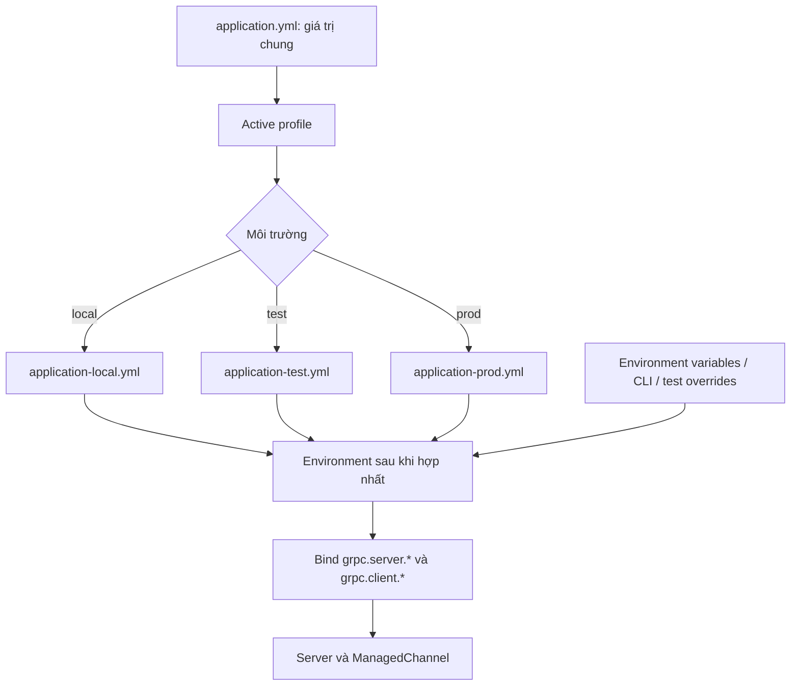

# Profile cho local, test và production trong Spring Boot gRPC

## 1. Mục tiêu và phạm vi

Một ứng dụng **SPRING_GRPC** thường chạy ở nhiều môi trường: local để phát triển, test để kiểm chứng tích hợp và production để phục vụ traffic thật. Mỗi môi trường có thể dùng cổng, remote target, TLS certificate, secret và chính sách vận hành khác nhau.

Spring Boot **profile** cho phép chọn cấu hình theo môi trường mà không phải sửa code hoặc tạo artifact riêng. Với gRPC, profile thường quyết định:

- Port và thuộc tính listener của gRPC server.
- Target của từng gRPC client, resolver và endpoint.
- Dùng plaintext trong mạng local cô lập hay TLS/mTLS trong production.
- Cách test kết nối: in-process server hoặc server qua TCP.
- Các bean thay thế dành riêng cho local/test và bean thật trong production.

Bài này tập trung vào tổ chức profile và kiểm soát cấu hình gRPC theo môi trường. Ví dụ sử dụng **`net.devh:grpc-server-spring-boot-starter`** và **`net.devh:grpc-client-spring-boot-starter`**, với prefix `grpc.server.*` và `grpc.client.<name>.*`. Nếu dự án dùng Spring gRPC chính thức, hãy đối chiếu tên property và extension point của đúng phiên bản.

## 2. Profile và cách Spring Boot hợp nhất cấu hình

Spring Boot nạp cấu hình chung từ `application.yml` và cấu hình riêng của profile đang hoạt động, ví dụ `application-local.yml`, `application-test.yml` hoặc `application-prod.yml`. Cấu hình profile-specific có thể ghi đè giá trị chung. Các nguồn có ưu tiên cao hơn như environment variables, command-line arguments và test property sources cũng có thể thay đổi giá trị hiệu lực.



Cần phân biệt:

- **Profile chọn cấu hình**, không tự tạo server/client. Starter, auto-configuration và service bean vẫn phải có mặt.
- **`@Profile` chọn bean hoặc cấu hình Java** dựa trên profile hoạt động.
- **Property source quyết định giá trị cuối cùng.** Nếu port khác YAML, kiểm tra active profile và nguồn ghi đè.
- Có thể bật nhiều profile, nhưng nên tránh kết hợp các profile có chính sách đối nghịch như `local` và `prod`.
- Không khai báo `spring.profiles.active` trong một file profile-specific như `application-prod.yml`. Chọn profile từ môi trường chạy, command line hoặc cấu hình cấp cao.

## 3. Tổ chức application.yml và các profile

### 3.1. Cấu hình chung

Giữ ở `application.yml` các giá trị thực sự dùng chung:

```yaml
spring:
  application:
    name: inventory-grpc
```

Không đặt endpoint local, plaintext, certificate production hoặc secret dùng riêng môi trường ở đây. Điều đó tránh việc production vô tình kế thừa target local hoặc transport không phù hợp.

### 3.2. Local: application-local.yml

Giả sử server của ứng dụng nghe cổng 9090, còn một inventory server khác chạy local ở cổng 9091:

```yaml
grpc:
  server:
    port: 9090
  client:
    inventory:
      address: "static://localhost:9091"
      negotiationType: PLAINTEXT
```

Cấu hình giả định inventory server đã được khởi động riêng. Nếu client gọi server cùng ứng dụng, target phải trỏ đúng cổng của server đó; nếu gọi một container khác, dùng hostname của container/service thay cho `localhost`.

Plaintext chỉ phù hợp với loopback hoặc mạng phát triển được cô lập. Không lấy cấu hình local làm mặc định production.

### 3.3. Test: application-test.yml

Nếu integration test chạy client và server trong cùng JVM, có thể dùng in-process transport khi starter hỗ trợ:

```yaml
grpc:
  server:
    port: -1
    inProcessName: inventory-test
  client:
    inventory:
      address: "in-process:inventory-test"
```

Với các phiên bản net.devh có hỗ trợ, `port: -1` tắt listener TCP và `inProcessName` đặt tên server trong bộ nhớ; client dùng target in-process tương ứng. Đây là cấu hình dành cho test, không dùng khi triển khai thật.

Tên property và scheme in-process cần xác minh theo phiên bản starter. Nếu không được hỗ trợ, dùng server test qua TCP với cổng động được cấp bởi môi trường kiểm thử và truyền target thực tế cho client. Tránh hard-code một cổng cố định khi CI chạy test song song.

### 3.4. Production: application-prod.yml

Production thường cần cổng do deployment cấp, TLS cho server và TLS khi client kết nối remote inventory:

```yaml
grpc:
  server:
    port: ${GRPC_SERVER_PORT:9090}
    security:
      enabled: true
      certificateChain: file:${GRPC_SERVER_CERT_PATH}
      privateKey: file:${GRPC_SERVER_KEY_PATH}
  client:
    inventory:
      address: ${INVENTORY_GRPC_TARGET}
      negotiationType: TLS
      security:
        trustCertCollection: file:${INVENTORY_GRPC_CA_PATH}
```

Các placeholder được cung cấp từ environment hoặc secret mount của deployment. Không có giá trị mặc định cho certificate, private key, CA hoặc remote target: nếu thiếu cấu hình bắt buộc, ứng dụng nên thất bại khi khởi động để lỗi được phát hiện sớm.

Đường dẫn `file:` và tên property là ví dụ cho net.devh; xác minh theo phiên bản đang dùng. Private key không được commit vào repository hoặc ghi vào log. Mount secret với quyền đọc tối thiểu và có quy trình xoay vòng certificate.

## 4. Kích hoạt profile khi chạy ứng dụng

Chọn profile bằng tham số command line:

```bash
java -jar inventory-grpc.jar --spring.profiles.active=local
```

Hoặc dùng biến môi trường trên Linux/macOS:

```bash
SPRING_PROFILES_ACTIVE=prod java -jar inventory-grpc.jar
```

Trong PowerShell:

```powershell
$env:SPRING_PROFILES_ACTIVE = "local"
java -jar inventory-grpc.jar
```

Trong Docker/Kubernetes, profile thường được truyền qua environment variable hoặc cấu hình deployment:

```yaml
env:
  - name: SPRING_PROFILES_ACTIVE
    value: "prod"
  - name: GRPC_SERVER_PORT
    value: "9090"
```

Đây là phần trích của container spec, không phải toàn bộ Deployment. Profile `prod` chỉ chọn file cấu hình; các biến `GRPC_SERVER_CERT_PATH`, `GRPC_SERVER_KEY_PATH`, `INVENTORY_GRPC_TARGET` và `INVENTORY_GRPC_CA_PATH` vẫn phải được cấp từ secret/config phù hợp.

Không đặt `SPRING_PROFILES_ACTIVE=prod` cố định trong Docker image nếu cùng image được triển khai ở local, test và staging. Hãy để môi trường triển khai chọn profile để artifact có thể dùng lại.

## 5. Dùng @Profile cho bean theo môi trường

File YAML phù hợp với port, target và các thuộc tính starter. Khi hành vi Java cần thay đổi theo môi trường, dùng `@Profile`.

Ví dụ bean giả lập chỉ dành cho local:

```java
@Configuration
@Profile("local")
public class LocalInventoryConfiguration {
    @Bean
    InventoryLookup localInventoryLookup() {
        return sku -> OptionalInt.of(5);
    }
}
```

Implementation production có thể dựa vào repository thật:

```java
@Configuration
@Profile("prod")
public class ProductionInventoryConfiguration {
    @Bean
    InventoryLookup productionInventoryLookup(
            InventoryRepository repository) {
        return repository::findAvailableQuantity;
    }
}
```

Hai cấu hình cung cấp cùng kiểu bean `InventoryLookup`, nhưng chỉ cấu hình khớp profile được nạp. Nếu không có profile phù hợp, Spring có thể báo thiếu dependency khi khởi động. Đây thường là hành vi an toàn hơn việc âm thầm dùng implementation giả trong production.

Không dùng `@Profile` để che giấu cấu hình bảo mật thiếu sót. TLS, trust store và target production phải được cấu hình tường minh; thiếu biến bắt buộc không được fallback sang plaintext.

## 6. Profile điều khiển gRPC server và client ra sao?

### Server

Với net.devh, `grpc.server.*` điều khiển server do server starter quản lý:

| Nhóm cấu hình | Local | Test | Production |
| --- | --- | --- | --- |
| Port | Cổng cố định dễ gọi | In-process hoặc TCP port động | Port deployment cấp |
| TLS | Có thể plaintext trên loopback | In-process hoặc certificate test | TLS/mTLS theo trust policy |
| Bind address | Loopback nếu chỉ truy cập local | Nội bộ test | Giao diện mạng/container phù hợp |
| Health | Có thể kiểm tra thủ công | Assertion trong test | Readiness và gRPC health nếu triển khai |
| Logging | Chi tiết phục vụ phát triển | Đủ thông tin chẩn đoán | Có kiểm soát, không lộ dữ liệu nhạy cảm |

Tên property và khả năng hỗ trợ từng trường tùy starter/version. Không giả định mọi starter có cùng schema cấu hình.

### Client

Prefix `grpc.client.<name>.*` cho phép một ứng dụng có nhiều remote client. Ví dụ inventory và payment dùng endpoint/trust policy riêng:

```yaml
grpc:
  client:
    inventory:
      address: ${INVENTORY_GRPC_TARGET}
      negotiationType: TLS
      security:
        trustCertCollection: file:${INVENTORY_GRPC_CA_PATH}
    payment:
      address: ${PAYMENT_GRPC_TARGET}
      negotiationType: TLS
      security:
        trustCertCollection: file:${PAYMENT_GRPC_CA_PATH}
```

Không cần tạo profile Java riêng cho từng remote nếu khác biệt chỉ là target hoặc CA path; properties theo profile/environment thường đủ. Chỉ tạo cấu hình bean riêng khi có khác biệt về hành vi hoặc extension point.

Gateway có thể dùng tên client ổn định, không phụ thuộc môi trường:

```java
@Service
public class InventoryGateway {
    @GrpcClient("inventory")
    private InventoryGrpc.InventoryBlockingStub stub;

    public StockReply getStock(String sku) {
        return stub.withDeadlineAfter(700, TimeUnit.MILLISECONDS)
            .getStock(GetStockRequest.newBuilder()
                .setSku(sku)
                .build());
    }
}
```

Code nghiệp vụ không cần biết đang chạy local hay production. Profile quyết định target và transport mà channel sử dụng. Annotation `@GrpcClient` trong ví dụ thuộc net.devh; Spring gRPC chính thức có cơ chế inject client riêng.

## 7. Kết hợp profile, profile group và property precedence

Spring Boot cho phép bật nhiều profile, ví dụ `prod,observability`. Nếu nhiều file profile cùng khai báo một property, thứ tự profile và property source quyết định giá trị cuối cùng. Điều này hữu ích khi tách cấu hình môi trường khỏi cấu hình tính năng, nhưng có thể gây lỗi nếu `local` và `prod` cùng được bật.

Một số quy tắc thực hành:

- Chọn một profile môi trường chính: `local`, `test`, `staging` hoặc `prod`.
- Dùng profile group nếu muốn một profile kích hoạt thêm cấu hình chức năng.
- Không khai báo `spring.profiles.active` trong file profile-specific.
- Không để cấu hình chung có fallback plaintext cho production.
- Tránh khai báo cùng một property ở nhiều nơi nếu không có lý do rõ ràng.
- Ghi nhận profile đang hoạt động và endpoint đã resolve, nhưng không log secret.
- Với target/certificate bắt buộc ở production, không cung cấp giá trị mặc định có thể khiến ứng dụng âm thầm kết nối nhầm local.

Ví dụ profile group khai báo trong cấu hình cơ sở:

```yaml
spring:
  profiles:
    group:
      production:
        - prod
        - observability
```

Khi chạy với `--spring.profiles.active=production`, Spring kích hoạt các profile trong group. Đặt group ở cấu hình cơ sở, không đặt trong một file profile-specific được kích hoạt bởi chính group đó.

Thứ tự ưu tiên cụ thể có thể chịu ảnh hưởng của test property sources, command-line arguments, system properties và environment variables. Khi chẩn đoán, hãy đọc giá trị đã bind vào cấu hình và nguồn cung cấp nó; không suy ra chỉ từ tên file.

## 8. Kiểm thử cấu hình theo profile

### 8.1. Chọn test profile

Spring Test cho phép chọn profile khi tạo context:

```java
@SpringBootTest
@ActiveProfiles("test")
class InventoryGrpcIntegrationTest {
    // Inject gateway/stub và gọi RPC qua test transport.
}
```

Test sẽ nạp `application-test.yml` cùng cấu hình chung. Nếu dùng in-process server, xác minh starter hỗ trợ target và server name tương ứng. Nếu test cần TLS, dùng certificate test riêng thay vì tắt xác minh certificate.

### 8.2. Kiểm tra đúng điều cần kiểm chứng

Không chỉ assert rằng Spring context khởi tạo thành công. Nên kiểm tra:

1. Profile test thực sự được kích hoạt.
2. Giá trị server port/transport đúng cấu hình test.
3. Client target trỏ đến server test, không gọi nhầm production.
4. RPC thực hiện được và trả response/status mong muốn.
5. Server/channel test được giải phóng sau khi test kết thúc.
6. Không có secret hoặc credential production trong test context.

In-process test kiểm tra wiring Spring, stub và RPC handler nhưng không kiểm tra DNS, TCP, TLS handshake hay proxy. Vì vậy, nếu production dùng TLS hoặc service discovery, bổ sung network integration test hoặc smoke test trên staging.

### 8.3. Kiểm tra giá trị hiệu lực

Khi profile đã chọn nhưng endpoint không đúng, kiểm tra:

- `Environment.getActiveProfiles()` để xác nhận profile đang hoạt động.
- Giá trị property `grpc.client.inventory.address` và `grpc.server.port` sau khi hợp nhất.
- Property source nào đã cung cấp giá trị cuối cùng.
- Environment variables và command-line arguments có ghi đè file profile không.

Spring Boot Actuator có thể cung cấp endpoint `env` hoặc `configprops` nếu được bật, nhưng phải giới hạn quyền truy cập vì những endpoint này có thể tiết lộ thông tin cấu hình. Không công khai endpoint quản trị hoặc giá trị secret ra Internet.

## 9. Chẩn đoán lỗi thường gặp

| Triệu chứng | Nguyên nhân có thể | Cách xử lý |
| --- | --- | --- |
| Local gọi được, production `UNAVAILABLE` | Target production sai, DNS/network policy hoặc port mapping | Kiểm tra target đã resolve, DNS và reachability từ pod |
| Production lỗi TLS handshake | CA, SAN, certificate chain hoặc TLS termination sai | Kiểm tra certificate và trust policy của đúng endpoint |
| Test gọi nhầm server local/production | Test profile chưa kích hoạt hoặc property bị ghi đè | Kiểm tra active profiles và effective target |
| Không có gRPC listener trong test | Cấu hình test tắt TCP listener nhưng test lại dùng TCP channel | Dùng in-process target hoặc bật TCP port test phù hợp |
| Cổng không đổi theo profile | File profile không được nạp hoặc environment/CLI ghi đè | Xem active profile và property sources |
| Production vô tình dùng plaintext | Giá trị mặc định chung bị kế thừa | Bỏ fallback plaintext; đặt TLS tường minh trong prod |
| Spring không tạo bean nghiệp vụ | `@Profile` không khớp profile active | Kiểm tra annotation và active profiles |
| Có nhiều bean cùng kiểu | Profile/cấu hình cùng tạo implementation hoặc profile chồng lấn | Chọn profile rõ ràng hoặc dùng qualifier/condition |
| Profile group không hoạt động | Khai báo group sai vị trí hoặc kích hoạt nhầm profile | Đặt group ở config cơ sở, kiểm tra active profile |

## 10. Quy trình triển khai

1. Giữ `application.yml` cho tên ứng dụng và giá trị thật sự chung.
2. Đặt endpoint local và plaintext loopback trong `application-local.yml`.
3. Đặt in-process hoặc test server target trong `application-test.yml`.
4. Đặt remote target, TLS và secret path bắt buộc trong `application-prod.yml`.
5. Chọn profile từ môi trường chạy, không hard-code vào artifact.
6. Chạy integration test với `@ActiveProfiles("test")`, xác minh client không trỏ nhầm môi trường.
7. Trước khi deploy, xác minh biến môi trường/secret production đã được cấp và certificate hợp lệ.
8. Sau khi deploy, smoke test RPC qua đúng DNS/port/TLS path và theo dõi status, latency.

Profile phải làm rõ môi trường ứng dụng đang chạy và chính sách kết nối gRPC tương ứng. Local ưu tiên vòng lặp phát triển nhanh, test ưu tiên cô lập và tái lập, production ưu tiên endpoint ổn định, TLS, secret management và khả năng quan sát. Code service/client có thể dùng chung; cấu hình môi trường quyết định channel và transport được tạo như thế nào.
