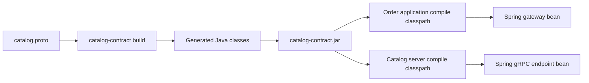

# Bean phụ thuộc vào generated type trong Spring Boot gRPC

## 1. Generated type đi vào Spring bean như thế nào?

Trong **SPRING_GRPC**, hợp đồng Protocol Buffers được biên dịch thành các lớp Java. Ứng dụng Spring Boot dùng những lớp đó để biểu diễn request/response, gọi RPC qua stub hoặc triển khai service bằng lớp base được sinh. Khi một Spring bean sử dụng các kiểu này, nó có **phụ thuộc ở mức compile-time** vào generated code; nếu cần gọi remote gRPC server, nó còn cần một stub được gắn với channel runtime.

Cần phân biệt ba việc:

1. **Code generation:** `protoc` và plugin gRPC Java sinh message classes, service base class và client stubs.
2. **Java dependency:** module ứng dụng cần có generated classes trên compile classpath để biên dịch các import và method signatures.
3. **Spring dependency injection:** Spring tạo bean ứng dụng; gRPC starter cung cấp stub hoặc đăng ký service implementation theo cơ chế của starter.

Generated type không tự trở thành Spring bean chỉ vì nó được sinh ra hoặc nằm trong classpath. Một message như `ProductRequest` là object dữ liệu; một stub như `CatalogBlockingStub` là client API gắn với channel; một service implementation kế thừa `CatalogImplBase` mới là thành phần được đăng ký làm endpoint.

Bài này tập trung vào cách tổ chức những phụ thuộc đó trong Spring ApplicationContext, cách inject stub và đăng ký service, ranh giới module, cùng các lỗi thường gặp.

**API minh họa:** `net.devh:grpc-client-spring-boot-starter` và `net.devh:grpc-server-spring-boot-starter`, dùng `@GrpcClient` và `@GrpcService`. Nếu dự án dùng Spring gRPC chính thức, thay các điểm tích hợp theo đúng API của phiên bản đó.

## 2. Những loại generated type thường gặp

Từ một file `catalog.proto`, plugin có thể sinh nhiều loại Java type:

| Generated type | Vai trò | Dùng trong Spring ra sao? |
| --- | --- | --- |
| `ProductRequest`, `ProductReply` | Protobuf message cho request/response | Tạo trong method, truyền/nhận qua RPC |
| `CatalogGrpc.CatalogBlockingStub` | Client stub đồng bộ | Inject vào gateway bean qua starter |
| `CatalogGrpc.CatalogStub` | Client stub bất đồng bộ/streaming | Inject khi cần callback hoặc streaming |
| `CatalogGrpc.CatalogFutureStub` | Client stub dùng future cho unary RPC hỗ trợ | Inject khi cần API future |
| `CatalogGrpc.CatalogImplBase` | Lớp base để server triển khai method | Concrete subclass trở thành gRPC service bean |
| Method descriptors | Mô tả tên và kiểu RPC ở runtime | Generated code sử dụng; thường không cần đăng ký thành Spring bean |

Một generated type là **kiểu Java có thể import và sử dụng**, không đồng nghĩa với Spring component. Đặc biệt:

- Không đặt `@Component` lên generated message class.
- Không khai báo một bean singleton cho `ProductRequest` hay `ProductReply`.
- Không tự tạo stub bằng constructor nội bộ hoặc giữ một `ManagedChannel` riêng nếu starter đã quản lý channel.
- Không chỉnh sửa source generated; thay đổi hợp đồng trong `.proto` rồi sinh lại code.

## 3. Hợp đồng Protobuf và tên Java được sinh

Ví dụ `src/main/proto/catalog.proto`:

```proto
syntax = "proto3";

package catalog.v1;

option java_package = "dev.example.catalog.v1";
option java_multiple_files = true;

service Catalog {
  rpc GetProduct(ProductRequest) returns (ProductReply);
}

message ProductRequest {
  string sku = 1;
}

message ProductReply {
  bool found = 1;
  string sku = 2;
  string name = 3;
}
```

Với `java_multiple_files = true`, các message thường được sinh thành top-level Java classes trong package `dev.example.catalog.v1`, ví dụ:

- `dev.example.catalog.v1.ProductRequest`
- `dev.example.catalog.v1.ProductReply`
- `dev.example.catalog.v1.CatalogGrpc`

Nếu không bật `java_multiple_files`, các message có thể được đặt lồng trong outer class do protoc sinh. Vì vậy, package và tên class Java phải lấy từ cấu hình Protobuf thực tế, không suy đoán chỉ từ tên file.

Hai namespace có mục đích khác nhau:

| Khai báo | Mục đích |
| --- | --- |
| `package catalog.v1;` | Tên service/method trên gRPC wire |
| `option java_package = "...";` | Package Java của generated source |
| `option java_multiple_files = true;` | Cách tổ chức message classes trong Java |

Tên RPC đầy đủ trong ví dụ là `catalog.v1.Catalog/GetProduct`; nó không thay đổi chỉ vì đổi package Java. Khi thay đổi package/service trong `.proto`, phải đánh giá tương thích và cập nhật client/server tương ứng.

## 4. Generated code phải có trên compile classpath

Spring không thể inject một kiểu Java mà module ứng dụng chưa biên dịch được. Trước khi xét tới ApplicationContext, generated source hoặc artifact chứa generated classes phải được đưa vào build.

Một module dùng Gradle có thể khai báo các thư viện runtime cơ bản:

```groovy
dependencies {
    implementation platform("io.grpc:grpc-bom:GRPC_VERSION")
    implementation "com.google.protobuf:protobuf-java:PROTOBUF_VERSION"
    implementation "io.grpc:grpc-protobuf"
    implementation "io.grpc:grpc-stub"

    implementation "net.devh:grpc-client-spring-boot-starter:NET_DEVH_VERSION"
}
```

Các chuỗi `*_VERSION` là placeholder cần thay bằng bộ phiên bản tương thích. Cấu hình plugin Protobuf và `protoc-gen-grpc-java` phải sinh source trước bước compile Java. Ví dụ trên chỉ nêu dependencies liên quan, không phải build script đầy đủ.

Có hai cách tổ chức thường gặp:

**Sinh code trong cùng module:** module ứng dụng chứa `.proto`, plugin sinh Java vào source set được build system quản lý, sau đó các bean import trực tiếp generated types.

**Dùng module hợp đồng riêng:** một module `catalog-contract` sinh và đóng gói generated classes thành JAR; module client/server khai báo dependency vào JAR đó. Cách này phù hợp khi nhiều ứng dụng dùng chung hợp đồng.



Khi dùng contract artifact riêng, client và server phải thống nhất phiên bản schema theo chính sách phát hành. Tránh vừa phụ thuộc JAR generated vừa sinh lại cùng package/class trong module ứng dụng, vì có thể dẫn đến duplicate classes hoặc runtime không rõ class nào được nạp.

## 5. Bean client phụ thuộc vào generated stub

Phía client thường có một Spring bean làm gateway. Gateway chuyển dữ liệu nghiệp vụ thành Protobuf request, gọi generated stub và chuyển response về kiểu mà phần còn lại của ứng dụng cần.

Cấu hình channel trong ví dụ net.devh:

```yaml
grpc:
  client:
    catalog:
      address: "static://catalog.internal:9090"
      negotiationType: TLS
```

Tên `catalog` là client name. Nó phải khớp với tên trong `@GrpcClient("catalog")`.

Ví dụ bean:

```java
package dev.example.order.gateway;

import dev.example.catalog.v1.CatalogGrpc;
import dev.example.catalog.v1.ProductReply;
import dev.example.catalog.v1.ProductRequest;
import io.grpc.StatusRuntimeException;
import net.devh.boot.grpc.client.inject.GrpcClient;
import org.springframework.stereotype.Service;

import java.util.Optional;
import java.util.concurrent.TimeUnit;

@Service
public class CatalogGateway {
    @GrpcClient("catalog")
    private CatalogGrpc.CatalogBlockingStub catalogStub;

    public Optional<Product> findProduct(String sku) {
        ProductRequest request = ProductRequest.newBuilder()
            .setSku(sku)
            .build();

        try {
            ProductReply reply = catalogStub
                .withDeadlineAfter(600, TimeUnit.MILLISECONDS)
                .getProduct(request);

            if (!reply.getFound()) {
                return Optional.empty();
            }

            return Optional.of(
                new Product(reply.getSku(), reply.getName())
            );
        } catch (StatusRuntimeException ex) {
            throw ex;
        }
    }
}
```

`Product` là kiểu domain của ứng dụng, không phải generated Protobuf message. Ví dụ giả định kiểu này đã được định nghĩa trong module nghiệp vụ. Việc chuyển đổi response sang domain object giúp phần còn lại của ứng dụng ít phụ thuộc vào schema wire hơn.

Điểm cần hiểu:

- `@GrpcClient("catalog")` là integration annotation của net.devh, không phải annotation của Spring Framework hay gRPC Java thuần.
- `CatalogBlockingStub` là generated type nhưng instance được starter tạo/gắn với channel theo cấu hình client.
- `CatalogGateway` là Spring bean vì có `@Service`; starter xử lý injection trên bean đó.
- Không tự `new CatalogGateway()` trong runtime, vì đối tượng tạo ngoài Spring không được xử lý injection.
- Không tạo channel mới trong mỗi lần gọi. Tái sử dụng stub/channel do starter quản lý; tạo stub dẫn xuất cho deadline/call options riêng.

Nếu gateway chạy trong WebFlux event loop, không gọi blocking stub trực tiếp trên event loop. Dùng async/future stub hoặc chuyển phần blocking sang executor phù hợp.

## 6. Bean server kế thừa generated service base class

Phía server sử dụng generated base class để triển khai method đã khai báo trong `.proto`. Concrete implementation được đăng ký làm Spring bean và gRPC service.

Ví dụ:

```java
package dev.example.catalog.endpoint;

import dev.example.catalog.application.ProductCatalog;
import dev.example.catalog.domain.Product;
import dev.example.catalog.v1.CatalogGrpc;
import dev.example.catalog.v1.ProductReply;
import dev.example.catalog.v1.ProductRequest;
import io.grpc.Status;
import io.grpc.stub.StreamObserver;
import net.devh.boot.grpc.server.service.GrpcService;

import java.util.Optional;

@GrpcService
public class CatalogGrpcEndpoint
        extends CatalogGrpc.CatalogImplBase {

    private final ProductCatalog productCatalog;

    public CatalogGrpcEndpoint(ProductCatalog productCatalog) {
        this.productCatalog = productCatalog;
    }

    @Override
    public void getProduct(
            ProductRequest request,
            StreamObserver<ProductReply> responseObserver) {

        String sku = request.getSku().trim();
        if (sku.isEmpty()) {
            responseObserver.onError(
                Status.INVALID_ARGUMENT
                    .withDescription("sku không được để trống")
                    .asRuntimeException());
            return;
        }

        Optional<Product> product = productCatalog.findBySku(sku);
        if (product.isEmpty()) {
            responseObserver.onNext(
                ProductReply.newBuilder().setFound(false).build()
            );
            responseObserver.onCompleted();
            return;
        }

        Product value = product.get();
        ProductReply reply = ProductReply.newBuilder()
            .setFound(true)
            .setSku(value.sku())
            .setName(value.name())
            .build();

        responseObserver.onNext(reply);
        responseObserver.onCompleted();
    }
}
```

Ở đây `CatalogGrpcEndpoint` là concrete Spring bean và cũng là gRPC service implementation. `CatalogImplBase` chỉ là lớp generated base; không cần đăng ký nó như bean riêng. Constructor injection giữ dependency nghiệp vụ rõ ràng và giúp kiểm thử endpoint dễ hơn.

Với unary RPC, handler phát một response bằng `onNext()` rồi kết thúc bằng `onCompleted()`. Khi lỗi, dùng `onError()` và không phát thêm terminal event sau đó. Generated message được tạo trong từng lời gọi; không giữ builder mutable dùng chung trong field của singleton endpoint.

## 7. Message type không phải bean và không nên dùng làm singleton state

Protobuf Java messages là immutable value objects sau khi build. Chúng thích hợp để truyền qua method, lưu trong biến local hoặc dùng làm dữ liệu kết quả. Tuy nhiên, builder dùng để tạo message là object mutable; không chia sẻ một builder giữa các RPC đồng thời.

Mẫu nên dùng:

```java
ProductRequest request = ProductRequest.newBuilder()
    .setSku(sku)
    .build();
```

Mẫu cần tránh trong singleton bean:

```java
// Không dùng builder mutable chung cho nhiều lời gọi.
private final ProductRequest.Builder sharedBuilder =
    ProductRequest.newBuilder();
```

Nếu nhiều request cùng thao tác trên một builder, dữ liệu có thể bị ghi đè hoặc trộn lẫn. Tạo builder mới theo từng lần gọi là cách đơn giản và an toàn.

Tương tự, không inject một `ProductReply` hoặc `ProductRequest` làm singleton bean chỉ để “dùng lại”. Message là dữ liệu của một lần xử lý, không phải dependency có lifecycle của Spring. Nếu cần giá trị mặc định, dùng factory hoặc tạo message mới từ builder.

## 8. Module boundary và tương thích generated artifact

Khi nhiều Spring service cùng sử dụng generated types, một module hợp đồng riêng giúp thống nhất nguồn code:

- Chỉ một module chịu trách nhiệm sinh và phát hành contract artifact.
- Client/server khai báo dependency vào phiên bản contract đã chọn.
- Không để mỗi module tự sinh cùng package/class từ các bản `.proto` khác nhau.
- Nâng version contract có kiểm soát; kiểm tra tương thích wire trước khi deploy lệch phiên bản.
- Không sửa generated source để thêm annotation Spring hoặc business logic.

Nếu muốn generated type có annotation hoặc hành vi riêng cho ứng dụng, nên tạo adapter/domain type hoặc cấu hình generator phù hợp; không sửa trực tiếp file được sinh vì thay đổi sẽ mất khi chạy lại code generation.

Generated message type cũng không nên trở thành toàn bộ domain model của hệ thống nếu schema wire và nghiệp vụ có vòng đời khác nhau. Gateway/endpoint có thể chuyển đổi giữa Protobuf DTO và domain object để giảm coupling.

## 9. Kiểm thử dependency vào generated type

Nên kiểm tra theo từng lớp:

| Loại kiểm thử | Điều chứng minh | Điều chưa chứng minh |
| --- | --- | --- |
| Compile/code generation | `.proto` sinh ra class đúng và module import được | Spring đã inject stub hoặc đăng ký endpoint |
| Unit test mapping | Bean chuyển domain ↔ Protobuf đúng | Channel/transport thật hoạt động |
| Spring context test | Bean được tạo và dependency Spring được inject | RPC đã được route qua server |
| gRPC integration test | Generated stub gọi đúng service/method và nhận status/response | DNS/TLS/proxy production nếu dùng in-process |
| Network test | Channel, TLS và remote endpoint hoạt động qua mạng test | Hành vi tải production ở quy mô lớn |

Với client bean dùng `@GrpcClient`, integration test nên khởi tạo Spring context và gọi qua gateway thật. Có thể dùng in-process server nếu starter/version hỗ trợ target đó; nếu không, mở test server qua TCP port động. Không dùng port cố định trong CI chạy song song.

Với server bean, test phải xác nhận implementation được Spring tạo và gRPC server đăng ký method. Chỉ `@Autowired CatalogGrpcEndpoint` thành công chưa chứng minh method đã được bind; thực hiện RPC bằng generated stub để kiểm tra toàn bộ đường đi.

## 10. Chẩn đoán lỗi thường gặp

| Triệu chứng | Tầng lỗi | Hướng kiểm tra |
| --- | --- | --- |
| Không tìm thấy `ProductRequest` hoặc `CatalogGrpc` khi compile | Code generation/compile classpath | Kiểm tra `.proto`, plugin, generated source và contract dependency |
| `package dev.example.catalog.v1 does not exist` | Package Java sinh không như import | Đối chiếu `java_package`, `java_multiple_files` và package thực |
| Bean client không được inject | Spring/starter wiring | Bean có thuộc ApplicationContext không, starter có đúng không, tên `@GrpcClient` có khớp property không |
| Stub tồn tại nhưng RPC `UNAVAILABLE` | Channel/transport | Target, DNS, port, TLS và server readiness |
| RPC trả `UNIMPLEMENTED` | Service registration hoặc contract | Endpoint có được đăng ký không; full service/method name có khớp không |
| Hai module có class trùng | Module dependency/code generation | Chỉ dùng một nguồn generated artifact cho mỗi package/version |
| Builder tạo request có dữ liệu sai khi gọi đồng thời | Quản lý state trong bean | Tạo builder local cho từng RPC, không chia sẻ mutable builder |
| Spring không tạo endpoint | Component scan/annotation | `@GrpcService` đúng starter, package được scan và dependency nghiệp vụ có bean |
| Compile được nhưng context fail | Spring dependency injection | Kiểm tra constructor dependency, condition và bean ambiguity |

Điều tra theo thứ tự giúp phân biệt lỗi ở compile-time với runtime:

1. Generated source đã được tạo và nằm trên compile classpath chưa?
2. Import đang dùng đúng `java_package` và cách tổ chức class không?
3. Bean ứng dụng có được Spring tạo không?
4. Stub/service được đăng ký theo API starter đúng phiên bản không?
5. Channel có kết nối được remote server không?
6. RPC có đúng method, request schema và status không?

## 11. Quy trình áp dụng

1. Định nghĩa `.proto` và thống nhất `java_package`, service/package wire.
2. Sinh code trong cùng module hoặc phát hành contract artifact riêng.
3. Khai báo dependencies để generated types có trên compile classpath.
4. Dùng message classes như dữ liệu; tạo builder mới theo từng request.
5. Inject generated stub vào gateway bean bằng cơ chế client starter.
6. Kế thừa generated service base class và đăng ký concrete endpoint bean bằng cơ chế server starter.
7. Chuyển đổi Protobuf message với domain type ở ranh giới adapter khi cần.
8. Kiểm tra compile, Spring context và một RPC integration thực tế.

Điểm cốt lõi là **generated type cung cấp hợp đồng và API Java; Spring quản lý các bean sử dụng những type đó; gRPC starter nối stub/service với channel/server**. Khi phân biệt đúng ba trách nhiệm này, ứng dụng tránh được việc biến message thành bean, tự tạo channel sai vòng đời hoặc nhầm lỗi compile-time với lỗi dependency injection runtime.
