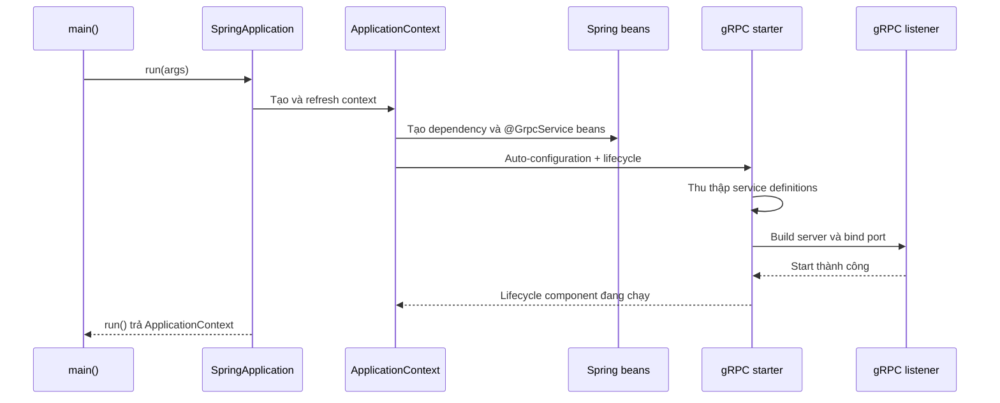

# Khởi động server cùng Spring Boot

## 1. Mục tiêu và phạm vi

Trong hệ **SPRING_GRPC**, ứng dụng Spring Boot cung cấp các RPC được định nghĩa bằng Protocol Buffers. Khi ứng dụng khởi động, gRPC server phải được tạo, nhận các service implementation, bind vào địa chỉ/cổng và bắt đầu nhận HTTP/2 requests. Khi ứng dụng dừng, server phải ngừng nhận lời gọi mới và giải phóng tài nguyên.

Tích hợp đúng nghĩa là **để vòng đời gRPC server gắn với vòng đời `ApplicationContext`**:

- Spring tạo các bean nghiệp vụ và gRPC endpoint.
- gRPC starter thu thập service đã đăng ký và dựng server.
- Server bắt đầu lắng nghe trong giai đoạn lifecycle mà starter quản lý.
- Khi Spring context đóng, starter dừng server và giải phóng transport.

Bài này tập trung vào trình tự startup, thời điểm server sẵn sàng, cách tránh khởi động trùng, xử lý lỗi bind và phối hợp shutdown. Ví dụ dùng **`net.devh:grpc-server-spring-boot-starter`** với `@GrpcService`; dự án Spring gRPC chính thức có API và lifecycle integration riêng, cần theo tài liệu đúng phiên bản.

## 2. Trình tự startup từ SpringApplication đến gRPC listener

Khi gọi `SpringApplication.run(...)`, Spring Boot khởi tạo Environment, nạp cấu hình, tạo ApplicationContext và thực hiện refresh. Trong quá trình đó, auto-configuration của gRPC starter đăng ký các thành phần cần thiết để tạo server.

Một luồng khái quát:



Các giai đoạn cần phân biệt:

1. **Nạp cấu hình:** Spring đọc `application.yml`, profile, environment variables và các nguồn cấu hình khác.
2. **Tạo bean:** Spring khởi tạo dependency nghiệp vụ, interceptor và service implementation theo component scan/condition.
3. **Chuẩn bị server:** starter lấy các gRPC service definition và cấu hình transport để dựng server.
4. **Bind và start:** server mở listener tại địa chỉ/cổng được cấu hình. Nếu bind thất bại, startup có thể thất bại.
5. **Ứng dụng sẵn sàng:** Spring Boot tiếp tục các bước startup và phát các event tương ứng.

Sơ đồ mô tả mô hình tích hợp điển hình. Thứ tự callback nội bộ và lớp lifecycle cụ thể phụ thuộc starter/version; cần đối chiếu tài liệu của dependency thực tế.

## 3. Đăng ký service để starter có thể khởi động server

Starter chỉ có thể đăng ký những service mà nó nhận diện được. Với **net.devh**, endpoint thường là Spring bean được đánh dấu `@GrpcService` và kế thừa base class do plugin gRPC Java sinh ra.

Ví dụ hợp đồng:

```proto
syntax = "proto3";

package demo.status.v1;

option java_multiple_files = true;
option java_package = "dev.example.status.v1";

service StatusService {
  rpc Check(CheckRequest) returns (CheckReply);
}

message CheckRequest {
  string component = 1;
}

message CheckReply {
  string state = 1;
}
```

Implementation:

```java
package dev.example.status;

import dev.example.status.v1.CheckReply;
import dev.example.status.v1.CheckRequest;
import dev.example.status.v1.StatusServiceGrpc;
import io.grpc.Status;
import io.grpc.stub.StreamObserver;
import net.devh.boot.grpc.server.service.GrpcService;

@GrpcService
public class StatusGrpcService
        extends StatusServiceGrpc.StatusServiceImplBase {

    @Override
    public void check(
            CheckRequest request,
            StreamObserver<CheckReply> responseObserver) {

        String component = request.getComponent().trim();
        if (component.isEmpty()) {
            responseObserver.onError(
                Status.INVALID_ARGUMENT
                    .withDescription("component không được để trống")
                    .asRuntimeException());
            return;
        }

        CheckReply reply = CheckReply.newBuilder()
            .setState("available: " + component)
            .build();

        responseObserver.onNext(reply);
        responseObserver.onCompleted();
    }
}
```

`@GrpcService` là annotation của net.devh. Class cũng phải nằm trong phạm vi component scan của ứng dụng hoặc được đăng ký theo cơ chế Spring tương ứng. Generated base class cung cấp service definition; concrete bean là implementation mà starter đưa vào server.

Ứng dụng Spring Boot:

```java
package dev.example;

import org.springframework.boot.SpringApplication;
import org.springframework.boot.autoconfigure.SpringBootApplication;

@SpringBootApplication
public class StatusApplication {
    public static void main(String[] args) {
        SpringApplication.run(StatusApplication.class, args);
    }
}
```

Không cần tự gọi `new StatusGrpcService()`, `ServerBuilder.addService(...)` hoặc `server.start()` trong `main()` khi đã dùng starter quản lý server. Nếu tự tạo một server thứ hai, ứng dụng có thể bind trùng port hoặc đăng ký cùng service hai lần.

## 4. Server lifecycle và Spring lifecycle

Spring có cơ chế quản lý các thành phần cần start/stop cùng context, trong đó có contract `Lifecycle` và `SmartLifecycle`. Các starter gRPC thường tích hợp server vào cơ chế này hoặc một lifecycle abstraction tương đương.

Với mô hình `SmartLifecycle`, Spring lifecycle processor gọi `start()` cho các thành phần tự khởi động trong giai đoạn refresh. Khi context đóng, nó gọi quá trình `stop()` theo thứ tự lifecycle. Một số triển khai cung cấp callback để báo hoàn tất shutdown bất đồng bộ.

Điều này đem lại các lợi ích:

- Server được start khi các thành phần Spring cần thiết đã được tạo.
- Startup failure có thể truyền về Spring Boot thay vì bị che trong một thread tự tạo.
- Server được dừng khi context đóng, kể cả khi ứng dụng dừng qua shutdown hook thông thường.
- Thứ tự start/stop có thể được điều phối theo lifecycle phase nếu starter hỗ trợ.

Không nên phụ thuộc vào tên class nội bộ hoặc phase cụ thể nếu chưa kiểm tra phiên bản starter. Điểm cần dựa vào là **server do starter quản lý và lifecycle của nó được gắn với context**.

### Vì sao không tự start server trong @PostConstruct?

`@PostConstruct` chạy trong quá trình khởi tạo bean. Nếu tự tạo và start server tại đó:

- Các bean khác có thể chưa hoàn tất khởi tạo.
- Service discovery/interceptor/transport customization của starter có thể chưa được áp dụng.
- Server thủ công không tự động được starter quản lý shutdown.
- Một lần refresh/test context khác có thể tạo server trùng.

Tương tự, không dùng `ApplicationRunner` hoặc `ApplicationReadyEvent` để start một server vốn đã được starter quản lý. Các hook này dành cho công việc ứng dụng sau giai đoạn startup phù hợp, không phải để tạo một lifecycle song song.

## 5. Phân biệt ApplicationEvent với trạng thái gRPC server

Spring Boot phát nhiều event trong quá trình khởi động. Những event này hữu ích cho logging, metrics hoặc điều phối tác vụ, nhưng không phải tất cả đều có cùng ý nghĩa:

| Event | Thời điểm khái quát | Cách sử dụng phù hợp |
| --- | --- | --- |
| `ApplicationStartingEvent` | Rất sớm, trước khi context được tạo đầy đủ | Logging bootstrap; không kỳ vọng bean đã sẵn sàng |
| `ApplicationEnvironmentPreparedEvent` | Environment đã được chuẩn bị | Quan sát profile/property sources |
| `ApplicationContextInitializedEvent` | Context đã tạo, trước khi bean definitions được nạp đầy đủ | Bootstrap customization |
| `ApplicationPreparedEvent` | Context đã chuẩn bị, trước refresh | Công việc chuẩn bị context |
| `ApplicationStartedEvent` | Context đã refresh, trước application runners | Quan sát ứng dụng sau context refresh |
| `ApplicationReadyEvent` | Runners hoàn tất, ứng dụng báo ready | Tín hiệu ứng dụng đã hoàn tất startup |
| `ContextClosedEvent` | Context đang đóng | Quan sát quá trình shutdown |

Với các starter dùng auto-start lifecycle trong quá trình refresh, gRPC listener thường đã được start trước `ApplicationStartedEvent`. Tuy nhiên, phải xác minh hành vi của starter/version cụ thể và không dùng event này làm cam kết phổ quát cho mọi tích hợp gRPC.

`ApplicationReadyEvent` cũng không thay thế health check RPC. Một process có thể đã phát event ready nhưng backend dependency của một method cụ thể vẫn không hoạt động. Readiness cần phản ánh điều kiện thực tế để nhận traffic.

## 6. Cấu hình startup tối thiểu và điều kiện tiên quyết

Với net.devh, cấu hình server local cơ bản:

```yaml
spring:
  application:
    name: status-grpc

grpc:
  server:
    port: 9090
```

Trước khi start, cần bảo đảm:

- Dependency server starter nằm trên runtime classpath và tương thích với Spring Boot/JDK.
- Generated service classes đã được sinh từ `.proto`.
- Implementation bean được component scan và đăng ký bằng API starter đúng hệ.
- Port chưa bị tiến trình khác chiếm và bind address phù hợp môi trường.
- Nếu bật TLS, certificate/private key tồn tại, đọc được và cấu hình đúng.
- Dependency mà service cần được khởi tạo thành công.

Có thể dùng biến môi trường cho port:

```yaml
grpc:
  server:
    port: ${GRPC_SERVER_PORT:9090}
```

Nếu ứng dụng có Spring Web, `server.port` là cổng HTTP còn `grpc.server.port` là cổng gRPC của net.devh. Hai listener có thể chạy song song trong một process; không tự dùng chung một TCP port nếu không có kiến trúc chia sẻ listener/proxy được thiết kế rõ ràng.

## 7. Startup failure: khi nào ứng dụng phải dừng?

Một server không thể bind hoặc không thể dựng transport đúng cách không nên được báo là sẵn sàng. Các lỗi startup thường gặp:

| Triệu chứng | Nguyên nhân | Hướng xử lý |
| --- | --- | --- |
| `Address already in use` | Port đã được process khác hoặc server thứ hai chiếm | Kiểm tra listener và bỏ server khởi tạo trùng |
| Không tìm thấy service implementation | Bean ngoài component scan, thiếu `@GrpcService` hoặc sai starter annotation | Kiểm tra bean và full RPC service name |
| Không tạo được generated class | Code generation chưa chạy hoặc contract module không có trên classpath | Kiểm tra `.proto`, plugin và dependency |
| Không đọc được private key/certificate | Secret mount sai hoặc quyền file không đủ | Kiểm tra đường dẫn và permission |
| Dependency injection thất bại | Bean nghiệp vụ thiếu hoặc có nhiều candidate | Kiểm tra constructor dependency, qualifier và profile |
| Port bind sai giao diện | Bind address không phù hợp network/container | Kiểm tra địa chỉ listener và network namespace |

Nếu listener là điều kiện bắt buộc để instance phục vụ request, startup phải fail rõ ràng khi không thể start. Không bắt exception rồi tiếp tục để process sống nhưng không có server, vì load balancer có thể đưa traffic tới một instance không phục vụ được.

Trong triển khai có nhiều thành phần độc lập, có thể có ứng dụng không cần cung cấp gRPC server ở một profile cụ thể. Khi đó, tắt server phải là quyết định cấu hình/profile có chủ đích, không phải kết quả ngẫu nhiên của một lỗi bị nuốt.

## 8. Readiness: server đã start chưa và đã phục vụ được chưa?

Có ít nhất ba trạng thái khác nhau:

1. **Spring context đã tạo bean:** dependency injection hoàn tất.
2. **gRPC listener đã bind:** transport có thể nhận kết nối.
3. **Service sẵn sàng xử lý nghiệp vụ:** dependency thiết yếu, dữ liệu và chính sách bảo mật đáp ứng yêu cầu.

Không nên đánh đồng ba trạng thái này. Một TCP probe chỉ xác nhận listener chấp nhận kết nối; một gRPC health service có thể báo trạng thái theo service; một RPC nghiệp vụ còn kiểm tra sâu hơn nhưng không nên dùng thao tác có side effect làm probe.

**gRPC Health Checking Protocol** là service riêng. Spring Boot Actuator health thường là HTTP endpoint. Bật Actuator không tự động chứng minh server đã đăng ký gRPC health service.

Trong Kubernetes hoặc orchestrator tương tự:

- Readiness probe quyết định instance có được nhận traffic mới hay không.
- Liveness probe xác định process có ở trạng thái cần restart hay không.
- Nếu dùng gRPC probe, server phải cung cấp health checking protocol và probe phải trỏ đúng port.
- Readiness có thể kiểm tra các dependency thiết yếu, nhưng không nên đánh dấu toàn bộ process unhealthy chỉ vì một dependency phụ không thiết yếu tạm thời lỗi.

Khi service có nhiều RPC với yêu cầu dependency khác nhau, health status theo service name giúp phân biệt khả năng phục vụ thay vì chỉ dùng một cờ process-wide.

## 9. Shutdown và giải phóng tài nguyên

Khi Spring context đóng, starter cần dừng server. Với gRPC Java thuần, ý tưởng shutdown có thể minh họa như sau:

```java
server.shutdown(); // Ngừng nhận RPC mới và cho lời gọi đang chạy hoàn tất.

if (!server.awaitTermination(20, TimeUnit.SECONDS)) {
    server.shutdownNow(); // Buộc hủy lời gọi còn lại.
}
```

Đây là ví dụ cho server tự quản lý, không phải code cần thêm vào ứng dụng dùng starter. Starter chịu trách nhiệm shutdown server mà nó tạo; chính sách graceful timeout và thứ tự đóng cần kiểm tra theo version.

Một quy trình shutdown tốt gồm:

1. Đưa instance ra khỏi trạng thái readiness để hạ tầng ngừng chọn nó cho traffic mới.
2. Bắt đầu đóng Spring context; server lifecycle chuyển sang shutdown.
3. Cho unary RPC đang xử lý cơ hội hoàn tất trong grace period.
4. Yêu cầu stream dài kết thúc/cancel theo chính sách đã thiết kế.
5. Khi hết grace period, hủy các RPC còn lại và giải phóng transport/executor.
6. Ghi nhận thời gian shutdown và số lời gọi bị hủy để điều chỉnh vận hành.

Không giữ một `Server` reference trong bean nghiệp vụ rồi gọi `shutdown()` từ `@PreDestroy` nếu starter đang sở hữu lifecycle. Điều đó có thể dừng server sai thứ tự hoặc dừng nhiều lần.

### Streaming cần xử lý cancellation

Streaming RPC có thể kéo dài hơn thời gian dừng process. Endpoint phải theo dõi cancellation, deadline và terminal event; khi client hủy hoặc server bắt đầu dừng, cần hủy producer/subscription và giải phóng tài nguyên.

Không lưu `StreamObserver` của một RPC vào field mutable dùng chung trong singleton service. Mỗi stream có state riêng; việc phát message phải dừng sau `onCompleted()` hoặc `onError()`. Graceful shutdown không thể chờ vô hạn mọi stream tự kết thúc.

## 10. Kiểm thử thời điểm startup và đăng ký service

Một unit test tạo service bằng `new` chỉ kiểm tra logic handler. Để kiểm tra startup cùng Spring Boot, cần khởi tạo context và thực hiện RPC qua server do starter quản lý.

Một bài integration test nên xác minh:

- ApplicationContext khởi tạo thành công.
- Service bean được phát hiện.
- Server start theo lifecycle của starter.
- Generated client stub gọi được method.
- Status và response đúng.
- Khi context đóng, listener/channel test được giải phóng.

Ví dụ test theo ý tưởng với Spring Boot:

```java
@SpringBootTest(properties = {
    "grpc.server.port=0"
})
class GrpcStartupIntegrationTest {

    @Test
    void applicationContextStartsWithGrpcServer() {
        // Inject generated stub hoặc tạo test channel
        // tới port được server test cấp.
        // Gọi RPC và assert response/status.
    }
}
```

Đoạn trên là khung minh họa; cách lấy port được cấp khi cấu hình `0` phụ thuộc starter/version. Một số bản net.devh có annotation hoặc bean để truy cập local server port. Nếu dùng in-process server, xác minh `inProcessName` và target tương ứng được phiên bản đó hỗ trợ.

**In-process test không kiểm tra TCP, HTTP/2 qua mạng, TLS handshake hoặc ingress.** Khi các yếu tố này quan trọng trong production, bổ sung network integration test với port động và certificate test. Không dùng cổng cố định cho test chạy song song trong CI.

## 11. Quan sát startup và xử lý lỗi theo tầng

Khi ứng dụng khởi động nhưng client không gọi được, kiểm tra theo thứ tự:

```text
Build / generated classes
    -> Spring bean discovery
        -> gRPC server factory và lifecycle
            -> bind address / port / TLS
                -> service registration
                    -> RPC method / status / business dependency
```

| Dấu hiệu | Cần kiểm tra |
| --- | --- |
| Compile lỗi | Generated source, Protobuf plugin và contract dependency |
| Context refresh lỗi | Bean wiring, auto-configuration conditions, profile |
| Không có log bind/start | Lifecycle component và cấu hình server |
| `Address already in use` | Port owner và server khởi tạo trùng |
| TCP kết nối được nhưng `UNIMPLEMENTED` | Service/method chưa đăng ký hoặc full method name sai |
| `UNAVAILABLE` | Listener, DNS, network, TLS hoặc server readiness |
| `DEADLINE_EXCEEDED` | Backend chậm, deadline và cancellation |
| Process ready nhưng health RPC fail | Health service chưa đăng ký hoặc readiness logic chưa đúng |

Nên quan sát:

- Thời điểm context bắt đầu refresh, server start thành công và ứng dụng báo ready.
- Cổng/address hiệu lực, nhưng không ghi certificate/private key hoặc secret.
- Số RPC theo method/status và latency.
- Số stream đang hoạt động, cancellation và lỗi quanh thời điểm shutdown.
- Thời gian từ SIGTERM đến khi process kết thúc.

Tên logger/class nội bộ khác nhau theo starter/version. Hãy dùng log startup của thư viện và metrics/instrumentation đã tích hợp; không phụ thuộc vào một tên class không được công bố như API ổn định.

## 12. Quy trình triển khai

1. Đưa server starter và generated code tương thích vào runtime classpath.
2. Đăng ký concrete gRPC implementation thành Spring bean bằng API của starter.
3. Đặt cấu hình listener/TLS cần thiết trước khi context refresh.
4. Để starter tạo và start server theo lifecycle; không tự start server trong `main`, `@PostConstruct` hoặc runner.
5. Xác minh listener và gọi một RPC thật trước khi coi instance sẵn sàng.
6. Cấu hình readiness/health phù hợp với service và dependency thiết yếu.
7. Khi dừng, gỡ readiness trước, để lifecycle của starter shutdown server và giới hạn thời gian drain.
8. Kiểm thử cả startup failure, RPC trong lúc hoạt động và shutdown khi có lời gọi/stream đang chạy.

Với **SPRING_GRPC**, khởi động server cùng Spring Boot là việc phối hợp giữa ApplicationContext, generated service implementation, gRPC starter và transport. Khi starter sở hữu lifecycle, server được khởi động/dừng nhất quán với ứng dụng; readiness, deadline, cancellation và graceful shutdown vẫn cần được thiết kế và kiểm thử theo yêu cầu vận hành.
