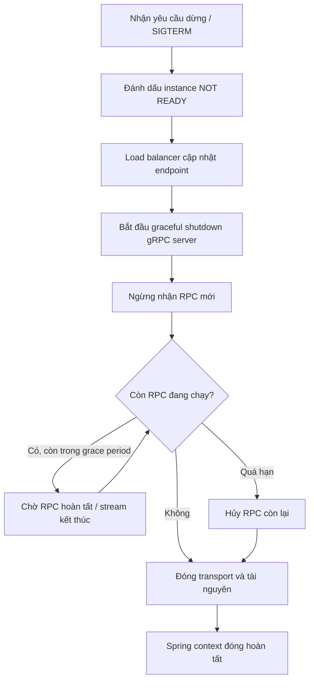

# Tắt server có kiểm soát trong Spring Boot gRPC

## 1. Vì sao cần graceful shutdown?

Trong hệ **SPRING_GRPC**, một gRPC server có thể đang xử lý hàng trăm RPC khi tiến trình Spring Boot nhận yêu cầu dừng. Nếu process kết thúc ngay, các lời gọi đang chạy có thể bị ngắt, client nhận lỗi transport, stream bị mất và công việc nền không được giải phóng.

**Tắt server có kiểm soát (graceful shutdown)** là quy trình ngừng tiếp nhận công việc mới, tạo cơ hội cho RPC đang xử lý hoàn tất trong một khoảng thời gian hữu hạn, sau đó buộc dừng phần còn lại và giải phóng tài nguyên.

Bài này tập trung vào:

- Quan hệ giữa Spring `ApplicationContext` và lifecycle của gRPC server.
- Khác biệt giữa `shutdown()`, `shutdownNow()` và chờ server kết thúc.
- Drain traffic trước khi đóng listener, đặc biệt trong deployment nhiều replica.
- Cách xử lý unary RPC, streaming RPC, cancellation và deadline.
- Phối hợp SIGTERM, Kubernetes termination grace period và timeout của Spring.
- Kiểm thử, quan sát và chẩn đoán quá trình dừng.

Ví dụ tích hợp dùng **`net.devh:grpc-server-spring-boot-starter`** với server do starter quản lý. Spring gRPC chính thức có lifecycle contract riêng theo phiên bản. Hãy dùng đúng API của starter đang chạy; không giả định mọi starter có cùng property điều khiển graceful timeout.

## 2. Hai giai đoạn của một lần shutdown

Một lần dừng server có kiểm soát cần phân biệt **drain** và **termination**:

1. **Drain:** đánh dấu instance không còn sẵn sàng, để hạ tầng ngừng chọn nó cho traffic mới; server bắt đầu từ chối RPC mới theo cơ chế shutdown.
2. **Termination:** chờ RPC hiện tại hoàn tất trong grace period; khi hết thời gian, hủy các RPC còn lại, đóng transport và giải phóng tài nguyên.

Luồng khái quát:



Hai giai đoạn có thể chồng lấn theo cách tích hợp và hạ tầng. Ví dụ, orchestrator bắt đầu loại pod khỏi endpoint list trong khi ứng dụng cũng đang đóng server. Điều quan trọng là có **ngân sách thời gian tổng thể** và biết bước nào chịu trách nhiệm cho từng hành động.

Không nên coi graceful shutdown là “ngủ một khoảng thời gian rồi thoát”. Một khoảng chờ cố định không chứng minh traffic đã được drain, cũng không bảo đảm RPC đã hoàn tất.

## 3. shutdown() và shutdownNow() trong gRPC Java

API `io.grpc.Server` cung cấp hai cách dừng với ngữ nghĩa khác nhau:

| API | Hành vi | Thời điểm dùng |
| --- | --- | --- |
| `shutdown()` | Bắt đầu orderly shutdown: ngừng nhận RPC mới, cho các RPC hiện tại cơ hội hoàn tất | Bước graceful đầu tiên |
| `awaitTermination(timeout, unit)` | Chờ server kết thúc trong giới hạn thời gian | Chờ drain hoàn tất |
| `shutdownNow()` | Yêu cầu hủy các RPC còn tồn tại và dừng server nhanh hơn | Khi grace period đã hết hoặc cần dừng khẩn cấp |

Ví dụ sau minh họa cách quản lý một **server được tạo thủ công** bằng gRPC Java:

```java
server.shutdown();

try {
    if (!server.awaitTermination(20, TimeUnit.SECONDS)) {
        server.shutdownNow();
        server.awaitTermination(5, TimeUnit.SECONDS);
    }
} catch (InterruptedException ex) {
    server.shutdownNow();
    Thread.currentThread().interrupt();
}
```

Trong ví dụ, server có tối đa 20 giây để hoàn tất graceful shutdown; nếu chưa xong thì yêu cầu hủy và chờ thêm tối đa 5 giây. Các con số chỉ là minh họa, không phải mặc định của gRPC hoặc Spring.

**Với server do Spring starter quản lý, không sao chép đoạn code này vào một bean khác để gọi cùng server lần nữa.** Starter sở hữu đối tượng server và vòng đời của nó. Hãy cấu hình hoặc mở rộng chính lifecycle của starter theo API được công bố. Chỉ tự gọi `shutdown()` khi ứng dụng thực sự tự tạo và sở hữu `Server`.

`shutdownNow()` là biện pháp cuối cùng. Nó có thể làm client nhận `CANCELLED`, `UNAVAILABLE` hoặc lỗi transport tùy thời điểm và cách kết nối. Không được giả định mọi client đều nhận cùng một status.

## 4. Spring đóng gRPC server qua ApplicationContext

Khi Spring `ApplicationContext` đóng, Spring dừng các thành phần có lifecycle mà context quản lý. Một số starter gRPC tích hợp server với `Lifecycle` hoặc `SmartLifecycle`; cơ chế cụ thể phụ thuộc version.

Với một lifecycle component, Spring có thể gọi `stop()` khi context đóng. Nếu component hỗ trợ callback bất đồng bộ, nó cần báo hoàn tất shutdown khi server đã dừng. Thứ tự stop có thể chịu ảnh hưởng của lifecycle phase và quan hệ phụ thuộc giữa các bean.

Quy trình điển hình:

1. Ứng dụng nhận yêu cầu đóng context.
2. Spring bắt đầu dừng các lifecycle component theo thứ tự được điều phối.
3. gRPC starter yêu cầu server shutdown.
4. Server ngừng nhận RPC mới và chờ các RPC đang xử lý theo chính sách của starter.
5. Starter hoàn tất stop; Spring tiếp tục đóng các bean và context.

Điểm cần nhớ:

- Bean service không nên tự đóng server do starter sở hữu.
- Không tạo server thủ công trong `@PostConstruct`, `ApplicationRunner` hoặc `ApplicationReadyEvent` khi starter đã tự quản lý server.
- Không gọi `shutdownNow()` từ `@PreDestroy` của một bean nghiệp vụ chỉ vì muốn “chắc chắn server đã dừng”.
- Không giả định context đã đóng nghĩa là mọi công việc downstream đã được hủy, nếu handler không truyền cancellation tới các tác vụ đó.

Nếu cần thay đổi thời gian drain, hãy kiểm tra tài liệu và extension point của starter cụ thể. Không tự đoán tên property như `grpc.server.shutdown-timeout` khi chưa xác minh version hỗ trợ.

## 5. Spring Boot timeout và timeout riêng của gRPC

Spring Boot có một số cấu hình shutdown liên quan đến lifecycle và web server. Cần phân biệt:

| Cấu hình/khái niệm | Phạm vi |
| --- | --- |
| `spring.lifecycle.timeout-per-shutdown-phase` | Giới hạn thời gian Spring chờ một lifecycle phase dừng |
| `server.shutdown=graceful` | Graceful shutdown của embedded web server Spring Boot |
| gRPC server shutdown policy | Ngừng nhận RPC, chờ/hủy RPC đang chạy theo implementation/starter |
| `terminationGracePeriodSeconds` | Ngân sách thời gian Kubernetes cấp cho việc kết thúc pod |

Ví dụ cấu hình Spring lifecycle timeout:

```yaml
spring:
  lifecycle:
    timeout-per-shutdown-phase: 25s
```

Property này điều khiển thời gian Spring chờ lifecycle phase, **không tự định nghĩa toàn bộ chính sách drain của gRPC**. Tương tự, `server.shutdown=graceful` áp dụng cho embedded web server được Spring Boot hỗ trợ; không mặc nhiên chứng minh gRPC starter cũng dùng cùng cơ chế hoặc cùng timeout.

Cần kiểm tra ba giới hạn độc lập:

- Timeout mà gRPC starter dùng khi dừng server.
- Timeout Spring dành cho lifecycle phase để chờ component stop hoàn tất.
- Grace period do container/orchestrator cấp trước khi buộc kill process.

Nếu timeout bên trong dài hơn timeout bên ngoài, process có thể bị kill trước khi gRPC hoàn tất drain. Ngược lại, timeout bên trong quá ngắn sẽ hủy RPC dù pod còn thời gian chờ.

## 6. Drain traffic trước khi dừng listener

Trong hệ thống nhiều replica, server không nên đợi đến lúc socket đóng mới báo rằng nó không còn nhận traffic. Load balancer hoặc service discovery cần thời gian cập nhật endpoint.

Một trình tự triển khai thường dùng:

1. Đưa readiness của instance sang trạng thái không nhận traffic.
2. Chờ endpoint controller/load balancer cập nhật trạng thái.
3. Bắt đầu graceful shutdown server.
4. Cho những RPC đã được nhận hoàn tất trong ngân sách thời gian.
5. Hủy các RPC còn lại khi hết grace period.
6. Đóng context và kết thúc process.

Khoảng chờ giữa bước 1 và 3 phải dựa trên thời gian cập nhật routing thực tế, không phải một con số tùy ý. Kết nối HTTP/2 có thể tồn tại lâu; client đã kết nối trước đó có thể tiếp tục mở RPC mới cho tới khi server bắt đầu shutdown hoặc transport gửi tín hiệu đóng phù hợp.

### Readiness khác liveness

- **Readiness:** instance có nên được chọn để nhận request mới không?
- **Liveness:** process có còn sống và có thể tiếp tục chạy không?

Khi drain, thường cần chuyển readiness sang không sẵn sàng nhưng vẫn giữ process sống để hoàn tất RPC. Nếu đánh dấu liveness thất bại ngay khi bắt đầu drain, orchestrator có thể restart/kill pod quá sớm.

Nếu dùng Spring Boot Availability API, có thể chuyển trạng thái readiness của ứng dụng; ví dụ minh họa:

```java
AvailabilityChangeEvent.publish(
    applicationContext,
    ReadinessState.REFUSING_TRAFFIC
);
```

Đoạn này cập nhật trạng thái readiness của Spring Boot. Nó chỉ có tác dụng với hạ tầng/probe được cấu hình để đọc trạng thái đó; **không tự động cập nhật gRPC Health Checking Protocol** nếu server health service không được nối với trạng thái ứng dụng.

gRPC Health Checking Protocol và Actuator HTTP health là hai cơ chế khác nhau. Nếu dùng gRPC health probe, phải bảo đảm health service báo `NOT_SERVING` cho service phù hợp trong quá trình drain.

## 7. Kubernetes, SIGTERM và ngân sách termination

Khi Kubernetes kết thúc pod, container thường nhận SIGTERM và có một khoảng thời gian grace trước khi bị SIGKILL. `terminationGracePeriodSeconds` là ngân sách tổng, trong đó thời gian chạy `preStop` hook cũng được tính.

Ví dụ phần cấu hình liên quan:

```yaml
spec:
  terminationGracePeriodSeconds: 45
  containers:
    - name: grpc-service
      image: example/grpc-service:1.0
      ports:
        - name: grpc
          containerPort: 9090
```

Đây là đoạn trích minh họa, chưa phải Deployment hoàn chỉnh. Nếu có `preStop`, cần tính thời gian thực thi hook vào cùng ngân sách 45 giây. Không đặt một lệnh sleep dài mà không đo thời gian endpoint propagation và thời gian drain còn lại.

### Lập ngân sách shutdown

Giả sử:

- 5 giây cho readiness/endpoint propagation.
- 25 giây cho gRPC graceful drain.
- 5 giây để force shutdown và giải phóng tài nguyên.
- Phần còn lại dành cho Spring context và runtime exit.

Tổng phải nhỏ hơn grace period do orchestrator cấp, có chừa biên an toàn cho scheduling và cleanup. Các số này chỉ là ví dụ để lập kế hoạch; đo thời gian thực tế của hệ thống trước khi chốt.

Nếu process nhận SIGKILL hoặc máy bị mất điện, shutdown hook không được bảo đảm chạy. Vì vậy graceful shutdown giúp giảm lỗi khi dừng bình thường, nhưng không thay thế durability, idempotency hoặc khả năng phục hồi sau crash.

## 8. Xử lý RPC đang chạy

### Unary RPC

Unary thường ngắn và có thể hoàn tất trong grace period. Server nên:

- Đặt deadline hợp lý ở client để request không kéo dài vô hạn.
- Kiểm tra cancellation/deadline trong công việc dài hoặc khi gọi upstream.
- Không bắt đầu side effect mới khi request đã bị hủy nếu có thể phát hiện.
- Thiết kế thao tác có tác dụng phụ theo hướng idempotent nếu client có thể retry sau lỗi transport.

Nếu server đã ghi dữ liệu nhưng chưa gửi response trước khi bị ngắt, client có thể không biết thao tác đã hoàn tất hay chưa. Vì vậy `UNAVAILABLE` hoặc timeout không đồng nghĩa nghiệp vụ chắc chắn chưa chạy. Với tạo đơn, trừ tồn kho hoặc thanh toán, dùng idempotency key hoặc cơ chế chống thực thi trùng.

### Server streaming

Server streaming có thể giữ RPC mở trong thời gian dài. Khi shutdown:

- Ngừng tạo dữ liệu mới cho stream đang drain.
- Để stream kết thúc tự nhiên nếu còn trong grace period và có điều kiện hoàn tất.
- Khi bị cancel, dừng producer, scheduler, subscription và giải phóng buffer.
- Không tiếp tục gọi `onNext()` sau `onCompleted()` hoặc `onError()`.

### Client streaming và bidirectional streaming

Ở client streaming/bidirectional streaming, hai phía có thể tiếp tục gửi message độc lập. Cần có chính sách kết thúc stream: client ngừng gửi, server hoàn tất phản hồi, hoặc một phía hủy call khi shutdown.

Không giữ `StreamObserver` của từng call trong field mutable của singleton service. State phải thuộc về call/stream cụ thể, được giải phóng khi terminal event hoặc cancellation xảy ra.

## 9. Nhận biết client cancellation và giải phóng tác vụ nền

Với gRPC Java, server có thể dùng `ServerCallStreamObserver` để nhận biết client đã hủy call. Ví dụ mảnh code trong một streaming handler:

```java
if (responseObserver instanceof ServerCallStreamObserver<?> serverObserver) {
    serverObserver.setOnCancelHandler(() -> {
        // Hủy producer hoặc subscription thuộc riêng stream này.
        // Giải phóng buffer/tài nguyên của call.
    });
}
```

Đây là mảnh minh họa, không phải service hoàn chỉnh. Handler cần quản lý producer và terminal state của stream cụ thể. Nếu tác vụ đang chạy trong executor hoặc gọi downstream service, callback cancellation phải truyền tín hiệu hủy tới những thành phần đó.

Một số nguyên tắc:

- Dùng biến local hoặc object riêng cho mỗi call; không chia sẻ state giữa các RPC.
- Hủy scheduled task, reactive subscription hoặc future khi call bị cancel.
- Đóng resource như cursor, file stream hoặc subscription trong cleanup path.
- Đảm bảo cleanup an toàn khi callback cancellation và callback hoàn tất cạnh tranh nhau.
- Không chặn thread gRPC bằng vòng lặp chờ shutdown.

Cancellation là tín hiệu để ứng dụng dừng công việc; nó không tự động hủy mọi tác vụ mà handler đã tạo. Mỗi tầng downstream phải hỗ trợ cancellation hoặc có timeout riêng.

## 10. Kiểm thử graceful shutdown

Unit test cho handler không chứng minh lifecycle shutdown hoạt động. Cần test ở mức Spring context và network.

### 10.1. Test Spring context đóng

Một integration test nên:

1. Khởi động Spring context có gRPC server.
2. Gọi một RPC thành công để xác nhận server đã bind và service được đăng ký.
3. Gọi `context.close()` hoặc đóng context test theo cách được quản lý.
4. Xác minh server ngừng nhận RPC mới và tài nguyên được giải phóng.
5. Nếu có RPC đang chạy, kiểm tra nó hoàn tất trong grace period hoặc bị hủy đúng giới hạn.

Đừng chỉ assert `ApplicationContext` đã đóng; điều đó không chứng minh socket đã được giải phóng hoặc stream đã được cleanup.

### 10.2. Test có RPC đang chạy

Tạo một RPC test có thể điều khiển thời gian hoàn tất, ví dụ handler chờ một latch hoặc tín hiệu test. Sau đó:

- Bắt đầu RPC và xác nhận server đã nhận call.
- Đóng context trong khi call đang chạy.
- Giải phóng latch trước khi hết grace period và xác minh response được trả.
- Lặp lại với call không được giải phóng, xác minh force shutdown/cancellation xảy ra trong giới hạn.
- Kiểm tra cleanup callback và không còn task nền.

Dùng test timeout để tránh CI bị treo nếu lifecycle không hoàn tất.

### 10.3. Test qua process/container

Để kiểm tra SIGTERM thực tế, chạy ứng dụng trong process hoặc container riêng:

- Gửi SIGTERM theo cách môi trường hỗ trợ.
- Ghi timestamp khi bắt đầu dừng.
- Gọi RPC mới trong giai đoạn drain và quan sát server từ chối/không nhận call theo chính sách.
- Theo dõi RPC đang chạy và thời gian process thoát.
- Xác minh process kết thúc trước termination grace period.
- Kiểm tra port/listener được giải phóng.

In-process test không kiểm tra signal, TCP, HTTP/2, load balancer hoặc Kubernetes endpoint propagation. Những phần này cần network/deployment test riêng.

## 11. Quan sát và chẩn đoán

Trong thời gian deploy hoặc restart, nên theo dõi:

| Tín hiệu | Điều cần quan sát |
| --- | --- |
| Readiness transition | Thời điểm instance ngừng nhận traffic mới |
| Active RPC/streams | Số call còn tồn tại khi bắt đầu drain |
| RPC status | `CANCELLED`, `UNAVAILABLE`, `DEADLINE_EXCEEDED` quanh shutdown |
| Shutdown duration | Thời gian từ SIGTERM đến process exit |
| Forced shutdown count | Số RPC phải hủy sau grace period |
| Resource cleanup | Executor, subscription, cursor, connection còn tồn tại không |
| Retry rate | Client có retry đồng loạt gây tải lên replica còn lại không |

Một số tình huống thường gặp:

| Triệu chứng | Nguyên nhân có thể | Hướng xử lý |
| --- | --- | --- |
| Pod bị SIGKILL trước khi drain xong | Grace period nhỏ hơn tổng thời gian hook + shutdown | Tính lại ngân sách và đo thời gian thực |
| RPC mới vẫn đến pod đang dừng | Readiness propagation chậm hoặc HTTP/2 connection cũ | Drain sớm, kiểm tra load balancer và server shutdown |
| Process không thoát | Stream/tác vụ nền không kết thúc hoặc lifecycle stop không báo hoàn tất | Kiểm tra active calls, cancellation và callback lifecycle |
| Client nhận nhiều `UNAVAILABLE` khi rollout | Replica bị dừng trước khi routing cập nhật hoặc retry không phù hợp | Phối hợp readiness, drain và retry budget |
| RPC side effect bị lặp | Client retry sau khi response bị mất | Idempotency key và deduplication |
| Cleanup chạy hai lần | Nhiều nơi cùng sở hữu việc đóng tài nguyên | Xác định một lifecycle owner và làm cleanup idempotent |

Không log token, private key hoặc payload nhạy cảm để chẩn đoán. Dùng request ID/trace ID để nối log client-server và ghi rõ thời điểm bắt đầu drain, bắt đầu force shutdown và process exit.

## 12. Quy trình áp dụng

1. Xác định server được tạo và sở hữu bởi gRPC starter hay bởi code ứng dụng.
2. Dùng lifecycle của starter để dừng server; không tạo một đường shutdown thứ hai.
3. Chuyển readiness sang không nhận traffic trước khi đóng listener nếu hạ tầng cần thời gian cập nhật endpoint.
4. Bắt đầu graceful shutdown và chờ RPC đang chạy trong một giới hạn rõ ràng.
5. Truyền cancellation tới stream producer và các tác vụ downstream.
6. Khi hết grace period, force shutdown phần còn lại và giải phóng tài nguyên.
7. Đặt timeout Spring lifecycle và termination grace của orchestrator lớn hơn tổng ngân sách drain/cleanup cần thiết.
8. Kiểm thử cả context close, RPC đang chạy, stream bị cancel và SIGTERM qua network/container.
9. Theo dõi thời gian shutdown, status RPC và số call bị force-cancel sau mỗi lần rollout.

Với **SPRING_GRPC**, tắt server có kiểm soát là sự phối hợp giữa gRPC server lifecycle, Spring ApplicationContext, client deadline/cancellation và hạ tầng điều phối. Khi mỗi RPC có giới hạn thời gian, stream có cleanup rõ ràng và server có một lifecycle owner duy nhất, việc deploy/restart sẽ giảm gián đoạn và tránh giữ tài nguyên vô thời hạn.
