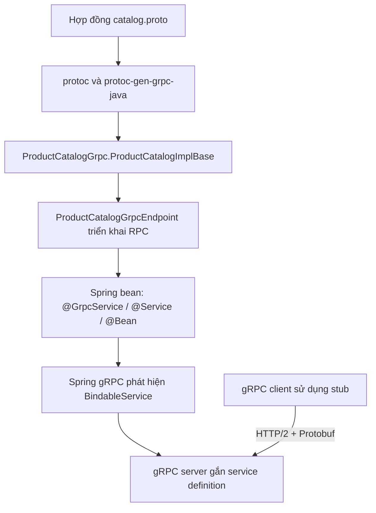

# Đăng ký gRPC service bean trong Spring

## Mục tiêu bài học

Sau bài này, bạn có thể:

1. Giải thích vì sao một lớp Java triển khai RPC chưa đủ để được gRPC server phục vụ.
2. Tạo lớp triển khai từ mã Java sinh bởi Protocol Buffers và đăng ký lớp đó thành Spring bean.
3. Chọn cách đăng ký bằng `@GrpcService`, `@Service` hoặc `@Bean` trong **Spring gRPC chính thức**.
4. Xác minh service xuất hiện trong Spring context và có thể được gọi qua mạng.
5. Nhận diện các lỗi thường gặp về component scan, đăng ký trùng, cấu hình server và ánh xạ gRPC status.

**Bối cảnh:** Trong hệ sinh thái Spring, gRPC cho phép các ứng dụng gọi thủ tục từ xa dựa trên hợp đồng Protocol Buffers. Mã Java sinh từ `.proto` cung cấp lớp cơ sở cho server và stub cho client. Spring quản lý vòng đời, dependency injection và việc đăng ký các đối tượng triển khai dịch vụ lên gRPC server. Đây là bước nền trước khi mở rộng sang streaming RPC, metadata, deadline, interceptor, TLS, kiểm thử tích hợp và giám sát hiệu năng, độ tin cậy.

> **Phạm vi thư viện:** Bài sử dụng Spring gRPC do dự án Spring phát triển, với annotation `org.springframework.grpc.server.service.GrpcService` và cơ chế tự phát hiện `io.grpc.BindableService`. Một số dự án cũ dùng starter cộng đồng `net.devh:grpc-*-spring-boot-starter` có annotation `net.devh.boot.grpc.server.service.GrpcService`; không trộn package, cấu hình và cách đăng ký giữa hai hệ này.

## 1. Spring đăng ký gRPC service như thế nào?

Trong gRPC Java, một service có thể gắn vào server nếu triển khai giao diện `io.grpc.BindableService`. Khi biên dịch một hợp đồng `.proto`, công cụ sinh mã gRPC Java thường tạo lớp `XxxGrpc.XxxImplBase` đã triển khai giao diện này. Bạn kế thừa lớp cơ sở, override phương thức RPC, rồi cho Spring quản lý instance đó dưới dạng bean.

Với ứng dụng Spring Boot có hạ tầng Spring gRPC server tương ứng, các **bean `BindableService`** được phát hiện và gắn vào gRPC server. Không phải đăng ký thủ công từng method trên `ServerBuilder` trong trường hợp thông thường.



| Thành phần | Trách nhiệm | Điều cần nhớ |
| --- | --- | --- |
| `.proto` | Định nghĩa tên service, RPC, message, kiểu dữ liệu | Là hợp đồng chung giữa server và client |
| `XxxGrpc.XxxImplBase` | Lớp cơ sở phía server do plugin gRPC Java tạo | Triển khai `BindableService` |
| `@Service` | Đánh dấu một Spring component để component scan phát hiện | Đủ để đăng ký nếu bean triển khai `BindableService` |
| `@GrpcService` của Spring | Đánh dấu service bean và hỗ trợ cấu hình như interceptor theo service | **Không bắt buộc** cho mọi `BindableService` bean |
| `@Bean` | Khai báo bean bằng phương thức trong cấu hình Spring | Hữu ích khi muốn khởi tạo service có điều kiện |
| gRPC server | Mở cổng/transport và định tuyến đến service definition | Cần dependency và auto-configuration server hoạt động |

Lưu ý có **hai việc riêng**: (1) đưa implementation vào `ApplicationContext`; (2) để hạ tầng gRPC server bind implementation đó. Nếu chỉ tạo object bằng `new` ngoài Spring, Spring sẽ không tự phát hiện. Nếu Spring context có bean nhưng ứng dụng thiếu server factory/transport phù hợp, vẫn chưa có cổng gRPC để client gọi.

## 2. Chuẩn bị ứng dụng Spring gRPC

Ví dụ sử dụng Java và Spring Boot với starter gRPC server chính thức. Khi tạo dự án bằng [Spring Initializr](https://start.spring.io/), có thể chọn dependency **gRPC** và cấu hình Protobuf code generation. Với dự án dùng Spring Boot 4.x và dependency management tương ứng, thành phần server thường là:

```xml
<!-- Đoạn dependency trong pom.xml; phiên bản được Spring Boot quản lý. -->
<dependency>
    <groupId>org.springframework.boot</groupId>
    <artifactId>spring-boot-starter-grpc-server</artifactId>
</dependency>
```

Để sinh Java message và gRPC stub từ `.proto`, build phải cấu hình compiler Protocol Buffers và plugin gRPC Java. Với Maven theo Spring Boot 4.x, một cấu hình thường gặp là plugin `io.github.ascopes:protobuf-maven-plugin` trong phần `<build><plugins>`. Nếu dùng Gradle, có thể dùng plugin `com.google.protobuf` và khai báo plugin `grpc`. Cách cấu hình và phiên bản cụ thể phụ thuộc BOM của dự án; kiểm tra theo [tài liệu Spring Boot gRPC](https://docs.spring.io/spring-boot/reference/io/grpc.html).

Giả sử cấu trúc mã nguồn:

```text
src/main/
  proto/catalog.proto
  java/com/example/catalog/CatalogApplication.java
  java/com/example/catalog/ProductLookup.java
  java/com/example/catalog/grpc/ProductCatalogGrpcEndpoint.java
```

Các class Java trong `com.example.catalog.proto` dưới đây được **sinh ra** từ `.proto`; không viết chúng bằng tay. Package của lớp chạy Spring Boot nên là `com.example.catalog` (hoặc package cha), để component scan bao phủ `com.example.catalog.grpc`.

## 3. Tạo hợp đồng Protocol Buffers

Tệp `src/main/proto/catalog.proto`:

```proto
syntax = "proto3";

package catalog.v1;

option java_package = "com.example.catalog.proto";
option java_multiple_files = true;

service ProductCatalog {
  rpc GetProduct(GetProductRequest) returns (GetProductReply);
}

message GetProductRequest {
  string product_id = 1;
}

message GetProductReply {
  string product_id = 1;
  string name = 2;
  int64 price_cents = 3;
}
```

Sau bước sinh mã, ta có các kiểu như `ProductCatalogGrpc`, `GetProductRequest`, `GetProductReply`. Trong `ProductCatalogGrpc` có `ProductCatalogImplBase`, còn phương thức RPC `GetProduct` tương ứng với method Java `getProduct(...)`. Tên đầy đủ dùng trên giao thức là `catalog.v1.ProductCatalog/GetProduct`; phần `catalog.v1` đến từ `package` trong file `.proto`, không phải `java_package`.

## 4. Xây lớp nghiệp vụ để gRPC endpoint gọi tới

Nên để lớp gRPC làm phần chuyển đổi request/response và status, còn logic nghiệp vụ nằm trong bean Spring riêng. Ví dụ dữ liệu cố định sau giúp thực hành mà chưa cần database.

Tệp `src/main/java/com/example/catalog/ProductLookup.java`:

```java
package com.example.catalog;

import java.util.Map;
import java.util.Optional;

import org.springframework.stereotype.Service;

@Service
public class ProductLookup {

    private final Map<String, Product> products = Map.of(
            "sku-1", new Product("sku-1", "Bàn phím cơ", 1_250_000L),
            "sku-2", new Product("sku-2", "Chuột không dây", 390_000L));

    public Optional<Product> findById(String productId) {
        return Optional.ofNullable(products.get(productId));
    }

    public record Product(String id, String name, long priceCents) {
    }
}
```

Ở đây, `ProductLookup` được đăng ký bằng `@Service`, sau đó được **constructor injection** vào gRPC endpoint. `price_cents` chỉ là đơn vị nhỏ nhất của tiền tệ trong ví dụ; hệ thống thực cần xác định rõ currency và quy tắc tiền tệ trong hợp đồng.

## 5. Cách đăng ký thứ nhất: dùng `@GrpcService`

Tệp `src/main/java/com/example/catalog/grpc/ProductCatalogGrpcEndpoint.java`:

```java
package com.example.catalog.grpc;

import com.example.catalog.ProductLookup;
import com.example.catalog.proto.GetProductReply;
import com.example.catalog.proto.GetProductRequest;
import com.example.catalog.proto.ProductCatalogGrpc;
import io.grpc.Status;
import io.grpc.stub.StreamObserver;
import org.springframework.grpc.server.service.GrpcService;

@GrpcService
public class ProductCatalogGrpcEndpoint
        extends ProductCatalogGrpc.ProductCatalogImplBase {

    private final ProductLookup productLookup;

    public ProductCatalogGrpcEndpoint(ProductLookup productLookup) {
        this.productLookup = productLookup;
    }

    @Override
    public void getProduct(GetProductRequest request,
                           StreamObserver<GetProductReply> observer) {
        String id = request.getProductId().trim();

        if (id.isEmpty()) {
            observer.onError(Status.INVALID_ARGUMENT
                    .withDescription("product_id không được rỗng")
                    .asRuntimeException());
            return;
        }

        var found = productLookup.findById(id);
        if (found.isEmpty()) {
            observer.onError(Status.NOT_FOUND
                    .withDescription("Không tìm thấy sản phẩm: " + id)
                    .asRuntimeException());
            return;
        }

        ProductLookup.Product product = found.get();
        GetProductReply reply = GetProductReply.newBuilder()
                .setProductId(product.id())
                .setName(product.name())
                .setPriceCents(product.priceCents())
                .build();

        observer.onNext(reply);
        observer.onCompleted();
    }
}
```

**Vì sao chỉ một annotation là đủ?** `@GrpcService` của `org.springframework.grpc` đồng thời là một stereotype Spring service, nên component scan đưa đối tượng vào context. Vì lớp kế thừa `ProductCatalogImplBase` (một `BindableService`), Spring gRPC nhận diện và gắn definition lên server. Spring tiêm `ProductLookup` qua constructor như với các bean thông thường.

Một RPC kiểu unary kết thúc đúng **một lần**: nhánh thành công gọi `onNext(reply)` rồi `onCompleted()`; nhánh lỗi gọi `onError(...)` và `return`. Không tiếp tục gọi `onNext`/`onCompleted` sau `onError`. Mã trạng thái `INVALID_ARGUMENT` phù hợp cho request thiếu định danh và `NOT_FOUND` phù hợp khi sản phẩm không tồn tại. Tránh ném exception Java tùy ý rồi mặc định coi đó là status nghiệp vụ rõ ràng.

Tệp `src/main/java/com/example/catalog/CatalogApplication.java`:

```java
package com.example.catalog;

import org.springframework.boot.SpringApplication;
import org.springframework.boot.autoconfigure.SpringBootApplication;

@SpringBootApplication
public class CatalogApplication {
    public static void main(String[] args) {
        SpringApplication.run(CatalogApplication.class, args);
    }
}
```

Trong trường hợp ứng dụng dùng Netty gRPC server mặc định từ starter, gRPC server thường lắng nghe trên cổng **9090**. Có thể đổi bằng `spring.grpc.server.port`, ví dụ:

```yaml
spring:
  grpc:
    server:
      port: 9091
```

`spring.grpc.server.port` áp dụng cho server gRPC native; nếu chạy gRPC dưới servlet container thì cấu hình cổng phụ thuộc web server (`server.port`) và HTTP/2. Không đồng nhất cổng gRPC với cổng HTTP REST của Spring MVC.

## 6. Cách đăng ký thứ hai: `@Service` hoặc `@Bean`

`@GrpcService` tiện khi muốn gắn thông tin gRPC trực tiếp lên lớp, nhất là interceptor theo service. Tuy nhiên, với Spring gRPC chính thức, **mọi bean triển khai `BindableService` đều có thể được đăng ký**. Vì vậy một lớp được gắn `@Service` cũng hoạt động:

```java
import org.springframework.stereotype.Service;

@Service
public class ProductCatalogGrpcEndpoint
        extends ProductCatalogGrpc.ProductCatalogImplBase {
    // Constructor và getProduct(...) giữ như ví dụ ở trên.
}
```

Nếu muốn cấu hình riêng cách khởi tạo, có thể bỏ cả `@Service` và `@GrpcService` trên implementation, rồi khai báo qua `@Bean`:

```java
package com.example.catalog.grpc;

import com.example.catalog.ProductLookup;
import io.grpc.BindableService;
import org.springframework.context.annotation.Bean;
import org.springframework.context.annotation.Configuration;

@Configuration(proxyBeanMethods = false)
public class CatalogGrpcConfiguration {

    @Bean
    BindableService productCatalogGrpcService(ProductLookup lookup) {
        return new ProductCatalogGrpcEndpoint(lookup);
    }
}
```

**Hai đoạn trên là hai phương án thay thế**, không thêm đồng thời vào cùng ứng dụng đang dùng `@GrpcService`. Đặc biệt, nếu vừa để `@GrpcService` trên `ProductCatalogGrpcEndpoint` vừa tạo thêm bean qua `@Bean`, Spring có thể có hai instance cùng bind service name `catalog.v1.ProductCatalog`, dẫn tới xung đột đăng ký. Khi dùng `@Bean`, lớp implementation phải **không còn** stereotype để được component scan tự tạo.

Chọn phương án dựa trên nhu cầu:

| Cách đăng ký | Phù hợp khi | Chú ý |
| --- | --- | --- |
| `@GrpcService` ở lớp | Cách thông thường, cần interceptor riêng service | Import đúng `org.springframework.grpc.server.service.GrpcService` |
| `@Service` ở lớp | Chỉ cần Spring quản lý một `BindableService` | Không cấu hình interceptor theo service qua annotation này |
| `@Bean` ở cấu hình | Muốn tự tạo instance, dùng điều kiện/profile hoặc một thư viện có sẵn | Tránh đăng ký trùng và giữ kiểu trả về là `BindableService` |

Chẳng hạn, bạn chỉ muốn đăng ký `ProductCatalog` tại một số môi trường. Trong **phương án dùng `@Bean`**, có thể thêm `@ConditionalOnProperty(name = "app.grpc.catalog.enabled", havingValue = "true", matchIfMissing = true)` lên phương thức `productCatalogGrpcService`, rồi đặt `app.grpc.catalog.enabled=false` tại môi trường không muốn cung cấp RPC này. Điều kiện này chi phối sự tồn tại của bean nên cũng chi phối việc server phát hiện service. Tương tự, có thể dùng `@Profile` nếu muốn kích hoạt theo Spring profile.

### Trường hợp có nhiều gRPC server trong một ứng dụng

Theo mặc định, các bean `BindableService` khả dụng sẽ được gắn vào các gRPC server do Spring gRPC quản lý. Nếu chạy cả server native và in-process, đừng mặc nhiên cho rằng hai server cung cấp tập RPC khác nhau. Khi cần phân chia, Spring gRPC có `ServerServiceDefinitionFilter` kết hợp cấu hình server factory để chọn service nào được bind vào từng server. Đây là bước cấu hình nâng cao; yêu cầu cơ bản vẫn là cung cấp bean `BindableService` duy nhất cho mỗi service contract tại mỗi server tương ứng.

## 7. Gắn interceptor vào một service đã đăng ký

Một lợi thế của `@GrpcService` là khai báo interceptor áp dụng cho **riêng** bean đó. Ví dụ muốn ghi lại tên RPC khi client gọi ProductCatalog:

```java
package com.example.catalog.grpc;

import io.grpc.Metadata;
import io.grpc.ServerCall;
import io.grpc.ServerCallHandler;
import io.grpc.ServerInterceptor;
import java.util.logging.Logger;
import org.springframework.stereotype.Component;

@Component
public class RpcLoggingInterceptor implements ServerInterceptor {
    private static final Logger LOG =
            Logger.getLogger(RpcLoggingInterceptor.class.getName());

    @Override
    public <ReqT, RespT> ServerCall.Listener<ReqT> interceptCall(
            ServerCall<ReqT, RespT> call,
            Metadata headers,
            ServerCallHandler<ReqT, RespT> next) {
        LOG.info(() -> "gRPC call: "
                + call.getMethodDescriptor().getFullMethodName());
        return next.startCall(call, headers);
    }
}
```

Thay annotation ở implementation thành:

```java
@GrpcService(interceptors = RpcLoggingInterceptor.class)
public class ProductCatalogGrpcEndpoint
        extends ProductCatalogGrpc.ProductCatalogImplBase {
    // ...
}
```

`RpcLoggingInterceptor` là Spring bean nên Spring gRPC có thể lấy đúng interceptor để gắn cho service. Muốn áp dụng cho **tất cả** services, khai báo bean `ServerInterceptor` kèm `@GlobalServerInterceptor` thay vì đặt danh sách trên từng `@GrpcService`. Interceptor thường được dùng để xử lý metadata, xác thực, correlation ID, deadline, log và số liệu quan sát; không nhồi tất cả logic đó vào method `getProduct`.

Ở môi trường thật, hạn chế ghi payload hoặc metadata nhạy cảm ra log. Ví dụ trên chỉ ghi tên RPC để minh họa điểm gắn interceptor.

## 8. Kiểm tra service đã được đăng ký

### 8.1. Kiểm tra bean trong Spring context

Tạo kiểm thử sau (cần dependency test của Spring Boot và JUnit/AssertJ):

```java
package com.example.catalog;

import io.grpc.BindableService;
import org.junit.jupiter.api.Test;
import org.springframework.beans.factory.annotation.Autowired;
import org.springframework.boot.test.context.SpringBootTest;
import org.springframework.context.ApplicationContext;

import static org.assertj.core.api.Assertions.assertThat;

@SpringBootTest(properties = "spring.grpc.server.port=0")
class GrpcBeanRegistrationTest {

    @Autowired
    ApplicationContext context;

    @Test
    void catalogServiceIsPresent() {
        var services = context.getBeansOfType(BindableService.class).values();

        assertThat(services).anySatisfy(service ->
                assertThat(service.bindService()
                        .getServiceDescriptor()
                        .getName())
                        .isEqualTo("catalog.v1.ProductCatalog"));
    }
}
```

Kiểm thử này xác nhận bean tồn tại và công bố đúng gRPC service descriptor. Nó **chưa thay thế** kiểm thử gọi RPC thực sự. `spring.grpc.server.port=0` giúp server native chọn cổng động trong test, tránh tranh chấp với ứng dụng khác.

### 8.2. Gọi RPC thật bằng `grpcurl`

Sau khi chạy ứng dụng trên cổng mặc định 9090, có thể gọi bằng `grpcurl`. Lệnh sau truyền file `.proto` trực tiếp, vì vậy không phụ thuộc vào việc đã bật server reflection:

```bash
grpcurl -plaintext \
  -import-path src/main/proto \
  -proto catalog.proto \
  -d '{"productId":"sku-1"}' \
  localhost:9090 catalog.v1.ProductCatalog/GetProduct
```

Kết quả kỳ vọng:

```json
{
  "productId": "sku-1",
  "name": "Bàn phím cơ",
  "priceCents": "1250000"
}
```

`int64` có thể được biểu diễn dưới dạng **chuỗi JSON** theo quy tắc ProtoJSON, nên `priceCents` ở trên là `"1250000"`. Một số công cụ client có thể trình bày khác nhau; giá trị logic vẫn là 1.250.000.

Kiểm tra lỗi dữ liệu thiếu hoặc không tồn tại:

```bash
grpcurl -plaintext -import-path src/main/proto -proto catalog.proto \
  -d '{"productId":""}' localhost:9090 catalog.v1.ProductCatalog/GetProduct

grpcurl -plaintext -import-path src/main/proto -proto catalog.proto \
  -d '{"productId":"sku-999"}' localhost:9090 catalog.v1.ProductCatalog/GetProduct
```

Kỳ vọng lần lượt là gRPC status `INVALID_ARGUMENT` và `NOT_FOUND`. Nếu bạn đổi cổng trong `application.yml`, phải thay `localhost:9090` tương ứng. `-plaintext` chỉ thích hợp khi server đang dùng kết nối không TLS, chẳng hạn trong môi trường phát triển. Với TLS, client phải cấu hình kết nối an toàn phù hợp.

Nếu muốn gọi `grpcurl ... list` mà không truyền `-proto`, server phải hỗ trợ gRPC Reflection; với Spring gRPC cần dependency tùy chọn `io.grpc:grpc-services` và cấu hình reflection thích hợp. **Không có reflection** không đồng nghĩa service chưa được đăng ký.

## 9. Lỗi thường gặp và cách chẩn đoán

| Biểu hiện | Nguyên nhân có thể | Cách kiểm tra / sửa |
| --- | --- | --- |
| Test không tìm thấy `BindableService` bean | Implementation nằm ngoài component scan, thiếu stereotype hoặc cấu hình `@Bean` chưa được nạp | Đặt `@SpringBootApplication` ở package cha; kiểm tra điều kiện/profile và import annotation |
| Bean có trong context nhưng client không kết nối được (`UNAVAILABLE`) | gRPC server chưa chạy, sai port/host, TLS không khớp hoặc thiếu transport server | Kiểm tra starter, log startup, `spring.grpc.server.port` và cấu hình TLS |
| Client kết nối được nhưng RPC trả `UNIMPLEMENTED` | Sai tên `package.Service/Method`, service chưa được bind hoặc chưa override method phù hợp | So sánh tên RPC trong `.proto` với descriptor của bean; kiểm tra `bindService()` |
| Startup lỗi trùng tên gRPC service | Hai bean `BindableService` cùng cung cấp một service descriptor | Chỉ chọn **một** cách đăng ký; rà soát cả component scan lẫn `@Bean` |
| Code Java không có `ProductCatalogGrpc` | Chưa sinh gRPC Java stub, sai cấu hình plugin hoặc package generated sources chưa nhận diện | Kiểm tra bước compile proto và `java_package` |
| `@GrpcService` không nhận diện hoặc import sai | Đang dùng annotation của starter cộng đồng hoặc dependency không tương thích | Dùng `org.springframework.grpc.server.service.GrpcService` với Spring gRPC chính thức |
| `@GrpcService(interceptors=...)` không hoạt động | Interceptor chưa là bean, dùng sai loại hoặc cấu hình nhầm phạm vi | Đăng ký interceptor với Spring, phân biệt interceptor global và per-service |

**Quy trình gỡ lỗi hiệu quả:** đầu tiên xác nhận file `.proto` sinh ra `*Grpc` như dự kiến; tiếp theo xác nhận Spring có bean `BindableService`; tiếp theo kiểm tra `bindService().getServiceDescriptor().getName()`; sau cùng kiểm tra cổng, transport và request thực tế. Trình tự này giúp tìm đúng tầng đang lỗi.

## 10. Bài tập thực hành

1. Thêm RPC `ListProducts(ListProductsRequest) returns (ListProductsReply)` vào `catalog.proto`; cập nhật implementation và kiểm tra rằng **cùng một bean** cung cấp cả `GetProduct` và `ListProducts`.
2. Thử thay `@GrpcService` bằng `@Service` và chạy lại kiểm thử `GrpcBeanRegistrationTest`. Giải thích vì sao service vẫn được phát hiện.
3. Chuyển sang phương án `@Bean`; thử bật/tắt bằng `app.grpc.catalog.enabled`. Quan sát số lượng `BindableService` bean và kết quả gọi RPC qua client.
4. Gắn `RpcLoggingInterceptor` cho riêng ProductCatalog; thêm một service khác và chứng minh interceptor chỉ ghi log cho ProductCatalog.
5. Cố tình chuyển endpoint ra ngoài component scan hoặc khai báo trùng hai bean, rồi phân tích lỗi và khôi phục đăng ký đúng.

### Câu hỏi tự kiểm tra

- Vì sao `ProductCatalogGrpc.ProductCatalogImplBase` khác với `ProductCatalogGrpc.ProductCatalogBlockingStub`? Đối tượng nào dùng ở server và đối tượng nào dùng ở client?
- Tại sao `@GrpcService` của Spring không phải điều kiện bắt buộc để đăng ký một `BindableService`?
- Khác nhau thế nào giữa **bean tồn tại trong `ApplicationContext`** và **RPC truy cập được qua gRPC server**?
- Làm thế nào để tránh đăng ký trùng một service khi vừa có component scanning vừa có cấu hình `@Bean`?
- Khi nhận `UNIMPLEMENTED` nhưng kết nối gRPC thành công, bạn nên kiểm tra điều gì trước?

## Tài liệu tham khảo

- [Spring gRPC — GRPC Server](https://docs.spring.io/spring-grpc/reference/server.html): cơ chế phát hiện `BindableService`, server factory, interceptor và filtering.
- [Spring gRPC — `@GrpcService` API](https://docs.spring.io/spring-grpc/reference/api/java/org/springframework/grpc/server/service/GrpcService.html): annotation tùy chọn và cấu hình interceptor theo service.
- [Spring Boot — gRPC](https://docs.spring.io/spring-boot/reference/io/grpc.html): starter, Protobuf code generation, server configuration và kiểm thử.
- [Protocol Buffers — ProtoJSON](https://protobuf.dev/programming-guides/json/): cách ánh xạ message Protobuf sang JSON, bao gồm trường `int64`.

**Kết quả mong đợi:** Có một bean Spring triển khai `BindableService` từ mã sinh bởi `.proto`, được gRPC server bind thành service `catalog.v1.ProductCatalog`; client gọi được `GetProduct`, nhận dữ liệu hợp lệ hoặc gRPC status có ý nghĩa. Đó là nền tảng để phát triển các dịch vụ Spring gRPC phức tạp hơn.
