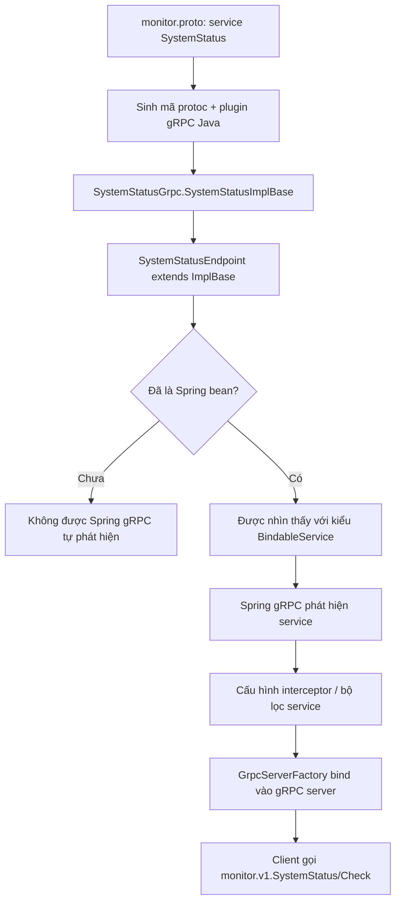

# Annotation hoặc cơ chế nhận diện service

## Mục tiêu học tập

Khi phát triển dịch vụ **SPRING_GRPC**, bạn dùng Protocol Buffers để định nghĩa hợp đồng RPC, sinh mã Java và triển khai server/client cho cả unary lẫn streaming RPC. Một câu hỏi nền tảng là: **Spring tìm thấy implementation bằng cách nào, và điều gì khiến RPC thực sự xuất hiện trên gRPC server?**

Sau bài này, bạn có thể:

1. Phân biệt **gRPC service**, **Spring bean** và **gRPC server**.
2. Giải thích vai trò của giao diện `io.grpc.BindableService` trong cơ chế nhận diện.
3. Đăng ký service bằng `@GrpcService`, `@Service` hoặc `@Bean` và hiểu khi nào nên chọn cách nào.
4. Phân biệt annotation `@GrpcService` của **Spring gRPC chính thức** với annotation tên giống của thư viện cộng đồng.
5. Gắn interceptor ở phạm vi service hoặc toàn cục; nhận diện các tình huống component scan, điều kiện bean, đăng ký trùng và lọc theo server.
6. Kiểm tra độc lập hai bước: **service là bean trong Spring context** và **RPC đã được server công bố**.

> **Phạm vi phiên bản:** Ví dụ dùng hệ sinh thái Spring gRPC chính thức cùng Spring Boot có starter gRPC server (chẳng hạn Spring Boot 4.x). Trong tài liệu này, `@GrpcService` nghĩa là `org.springframework.grpc.server.service.GrpcService`, không phải annotation của starter `net.devh`.

## 1. Spring nhận diện service ở cấp độ nào?

Trong một ứng dụng gRPC Java, có ba khái niệm dễ bị nhầm lẫn:

| Khái niệm | Ví dụ | Vai trò |
| --- | --- | --- |
| Hợp đồng gRPC | `service SystemStatus { rpc Check(...); }` trong `.proto` | Xác định tên service, RPC và message được trao đổi giữa client/server |
| Implementation phía server | `SystemStatusGrpc.SystemStatusImplBase` được kế thừa bởi lớp `SystemStatusEndpoint` | Cung cấp logic xử lý mỗi RPC; implementation có khả năng `bindService()` |
| Spring bean | Instance `SystemStatusEndpoint` được Spring tạo và quản lý | Đối tượng mà hạ tầng Spring gRPC có thể tìm thấy trong `ApplicationContext` |
| gRPC server | Server gRPC chạy trên Netty, servlet hoặc in-process | Nhận kết nối HTTP/2 hoặc cuộc gọi in-process, định tuyến tới service đã bind |

Một lớp Java có phương thức tên `check` không tự động biến thành endpoint gRPC. Đối với gRPC Java, giao diện then chốt là:

```java
package io.grpc;

public interface BindableService {
    ServerServiceDefinition bindService();
}
```

Đoạn trên mô tả **hợp đồng cốt lõi** của giao diện, không phải file bạn cần tạo. Với plugin sinh mã `protoc-gen-grpc-java`, lớp `SystemStatusGrpc.SystemStatusImplBase` được sinh từ `.proto` đã triển khai `BindableService`. Khi bạn kế thừa lớp đó và override các RPC, đối tượng implementation cũng là một `BindableService`.

**Nguyên tắc nhận diện của Spring gRPC:** khi hạ tầng server được cấu hình, Spring gRPC tìm các **Spring bean có kiểu `BindableService`** và bind định nghĩa service tương ứng vào server. Annotation `@GrpcService` là một cách tiện lợi để tạo bean và gắn cấu hình riêng; nó **không phải điều kiện bắt buộc** cho mọi gRPC service. Cơ chế này được mô tả trong [Spring gRPC — GRPC Server](https://docs.spring.io/spring-grpc/reference/server.html).



Điểm quan trọng: bean tồn tại trong `ApplicationContext` chưa đảm bảo client kết nối được. Ứng dụng vẫn cần một server factory/transport hoạt động, cổng hoặc địa chỉ chính xác, và nếu có TLS thì client phải bắt tay TLS thành công.

## 2. Annotation nào có tác dụng gì?

### 2.1. `@GrpcService` của Spring gRPC

Import chính xác:

```java
import org.springframework.grpc.server.service.GrpcService;
```

Trong Spring gRPC chính thức, `@GrpcService` là annotation có thể đặt trên **lớp** hoặc **phương thức tạo bean**. Nó được meta-annotate với các annotation Spring tương ứng (`@Service` và `@Bean`), nên có thể dùng để khai báo bean, đồng thời bổ sung thông tin gRPC:

```java
@GrpcService
public class SystemStatusEndpoint
        extends SystemStatusGrpc.SystemStatusImplBase {
    // Implementation các RPC.
}
```

Ba thuộc tính thường dùng:

| Thuộc tính `@GrpcService` | Ý nghĩa | Giá trị mặc định |
| --- | --- | --- |
| `interceptors` | Danh sách **kiểu** `ServerInterceptor` bean áp dụng riêng cho service | Mảng rỗng |
| `interceptorNames` | Danh sách **tên bean** interceptor áp dụng riêng cho service | Mảng rỗng |
| `blendWithGlobalInterceptors` | Cho phép trộn interceptor riêng với interceptor global theo thứ tự Spring; nếu `false`, nhóm global được áp dụng trước nhóm riêng | `false` |

Annotation này chỉ nên được đặt trên bean thực sự là `BindableService`. Nó không tự biến một lớp Java thường, một REST `@Controller` hay client stub thành gRPC server implementation.

### 2.2. `@Service` và `@Component`

Đây là các stereotype annotation thông thường của Spring. Khi lớp triển khai `BindableService` và được component scan phát hiện, **`@Service` đã đủ**:

```java
import org.springframework.stereotype.Service;

@Service
public class SystemStatusEndpoint
        extends SystemStatusGrpc.SystemStatusImplBase {
    // Implementation các RPC.
}
```

Về mặt đưa bean vào context, `@Component` cũng có thể đáp ứng; `@Service` thể hiện ý nghĩa nghiệp vụ rõ hơn. Nếu không dùng metadata riêng của gRPC, bạn không bắt buộc phải thêm `@GrpcService`.

### 2.3. `@Bean` trong `@Configuration`

Bạn cũng có thể tạo `BindableService` bằng phương thức factory:

```java
import io.grpc.BindableService;
import org.springframework.context.annotation.Bean;
import org.springframework.context.annotation.Configuration;

@Configuration(proxyBeanMethods = false)
class GrpcEndpointConfiguration {

    @Bean
    BindableService systemStatusEndpoint(HealthProbe probe) {
        return new SystemStatusEndpoint(probe);
    }
}
```

Đây là **phương án thay thế** cách gắn stereotype trên lớp: trong biến thể dùng `@Bean`, hãy bỏ `@Service`/`@GrpcService` khỏi `SystemStatusEndpoint` để tránh tạo hai bean cung cấp cùng một gRPC service. Khai báo kiểu trả về `BindableService` giúp Spring và người đọc nhận diện rõ bean này thuộc nhóm service cần bind.

Bạn cũng có thể đặt `@GrpcService(interceptors = ...)` **trên phương thức factory** khi cần cấu hình interceptor riêng; `@GrpcService` ở vị trí phương thức có vai trò tạo bean nhờ meta-annotation `@Bean`.

### 2.4. Không nhầm với starter cộng đồng

| Hệ sinh thái | Annotation service | Cơ chế cần nhớ |
| --- | --- | --- |
| **Spring gRPC chính thức** | `org.springframework.grpc.server.service.GrpcService` | Có thể phát hiện mọi bean `BindableService`; annotation là tùy chọn để kèm cấu hình |
| **net.devh starter** | `net.devh.boot.grpc.server.service.GrpcService` | Thư viện và hạ tầng đăng ký service khác; hướng dẫn cấu hình của hệ này không tự áp dụng cho Spring gRPC chính thức |

Khi đọc ví dụ trên Internet, kiểm tra **dòng import**, dependency và tài liệu của starter trước khi sao chép annotation, tên property hoặc cách cấu hình interceptor.

## 3. Ví dụ hoàn chỉnh: nhận diện một service có unary và server streaming

Tình huống: ứng dụng cung cấp trạng thái một thành phần hệ thống. Client có thể lấy trạng thái một lần qua unary RPC, hoặc lấy nhiều bản ghi liên tiếp qua server streaming RPC. Cả hai RPC thuộc **cùng một `BindableService` bean**.

### 3.1. Khai báo hợp đồng

Đặt tại `src/main/proto/monitor.proto`:

```proto
syntax = "proto3";

package monitor.v1;
option java_package = "com.example.monitor.proto";
option java_multiple_files = true;

service SystemStatus {
  rpc Check(CheckRequest) returns (CheckResponse);
  rpc Watch(WatchRequest) returns (stream CheckResponse);
}

message CheckRequest {
  string component = 1;
}

message WatchRequest {
  string component = 1;
  int32 samples = 2;
}

message CheckResponse {
  string component = 1;
  string state = 2;
}
```

Sau khi cấu hình `protoc` và `protoc-gen-grpc-java` trong build rồi biên dịch, các kiểu `SystemStatusGrpc`, `CheckRequest`, `CheckResponse` và `WatchRequest` được sinh trong package `com.example.monitor.proto`. Trong ứng dụng Spring Boot 4.x, starter server có thể khai báo như sau (phần cấu hình plugin sinh mã vẫn cần có trong dự án):

```xml
<dependency>
    <groupId>org.springframework.boot</groupId>
    <artifactId>spring-boot-starter-grpc-server</artifactId>
</dependency>
```

Không cần viết lại lớp `SystemStatusGrpc` bằng tay. Các RPC trong `.proto` tạo lớp cơ sở, client stub và service descriptor cần thiết để gọi đúng đường dẫn như `monitor.v1.SystemStatus/Check`.

### 3.2. Bean nghiệp vụ độc lập

`src/main/java/com/example/monitor/HealthProbe.java`:

```java
package com.example.monitor;

import org.springframework.stereotype.Service;

@Service
public class HealthProbe {

    public String stateOf(String component) {
        // Dữ liệu giả lập cho bài học. Thực tế có thể truy vấn health check.
        return "UP";
    }
}
```

### 3.3. Implementation được component scan tìm thấy

`src/main/java/com/example/monitor/rpc/SystemStatusEndpoint.java`:

```java
package com.example.monitor.rpc;

import com.example.monitor.HealthProbe;
import com.example.monitor.proto.CheckRequest;
import com.example.monitor.proto.CheckResponse;
import com.example.monitor.proto.SystemStatusGrpc;
import com.example.monitor.proto.WatchRequest;
import io.grpc.Status;
import io.grpc.stub.StreamObserver;
import org.springframework.grpc.server.service.GrpcService;

@GrpcService
public class SystemStatusEndpoint
        extends SystemStatusGrpc.SystemStatusImplBase {

    private final HealthProbe healthProbe;

    public SystemStatusEndpoint(HealthProbe healthProbe) {
        this.healthProbe = healthProbe;
    }

    @Override
    public void check(CheckRequest request,
                      StreamObserver<CheckResponse> observer) {
        String component = request.getComponent().trim();
        if (component.isEmpty()) {
            observer.onError(Status.INVALID_ARGUMENT
                    .withDescription("component không được rỗng")
                    .asRuntimeException());
            return;
        }

        observer.onNext(responseFor(component));
        observer.onCompleted();
    }

    @Override
    public void watch(WatchRequest request,
                      StreamObserver<CheckResponse> observer) {
        String component = request.getComponent().trim();
        int samples = request.getSamples();
        if (component.isEmpty() || samples < 1 || samples > 5) {
            observer.onError(Status.INVALID_ARGUMENT
                    .withDescription("component bắt buộc; samples từ 1 đến 5")
                    .asRuntimeException());
            return;
        }

        // Streaming đồng bộ, hữu hạn để minh họa; chưa có lấy mẫu theo thời gian.
        for (int i = 0; i < samples; i++) {
            observer.onNext(responseFor(component));
        }
        observer.onCompleted();
    }

    private CheckResponse responseFor(String component) {
        return CheckResponse.newBuilder()
                .setComponent(component)
                .setState(healthProbe.stateOf(component))
                .build();
    }
}
```

Đây là server streaming theo hợp đồng, nhưng chỉ phát các bản ghi liên tiếp ngay lập tức để tập trung vào **cơ chế đăng ký service**. Khi triển khai streaming lâu dài, cần thêm xử lý hủy cuộc gọi, deadline, backpressure, lịch phát, đồng thời tránh chặn thread gRPC bằng thao tác kéo dài.

Tệp khởi động đặt ở package cha để quét cả `com.example.monitor` và `com.example.monitor.rpc`:

```java
package com.example.monitor;

import org.springframework.boot.SpringApplication;
import org.springframework.boot.autoconfigure.SpringBootApplication;

@SpringBootApplication
public class MonitorApplication {
    public static void main(String[] args) {
        SpringApplication.run(MonitorApplication.class, args);
    }
}
```

Giả sử dự án có server transport phù hợp, Spring làm các bước:

1. Component scan phát hiện `SystemStatusEndpoint` do có `@GrpcService`.
2. Spring tạo bean `HealthProbe` và tiêm vào constructor endpoint.
3. Spring gRPC phát hiện bean endpoint có kiểu `BindableService`.
4. `bindService()` cung cấp descriptor `monitor.v1.SystemStatus` và các phương thức `Check`, `Watch`.
5. Server factory bind definition vào server được cấu hình; client có thể gọi RPC.

**Tên bean không quyết định tên gRPC service.** Spring có thể đặt bean name là `systemStatusEndpoint`, còn tên gRPC trên mạng lấy từ `package monitor.v1` và `service SystemStatus` trong file `.proto`.

## 4. Chọn annotation và vị trí đăng ký

Bạn có thể chuyển qua lại giữa ba cách dưới đây. **Chỉ bật một cách cho cùng một implementation tại một thời điểm.**

| Yêu cầu thực tế | Cách phù hợp | Lý do |
| --- | --- | --- |
| Endpoint do mình viết, muốn rõ đó là gRPC service | `@GrpcService` trên lớp | Nhận diện bằng component scan, dễ thêm metadata và interceptor riêng |
| Endpoint chỉ cần có mặt trong Spring context | `@Service` trên lớp | Vẫn thỏa điều kiện bean `BindableService` |
| Cần tự điều khiển cách khởi tạo, conditional/profile, hoặc wrap đối tượng từ thư viện | `@Bean` trong `@Configuration` | Có thể định nghĩa factory, điều kiện và dependency tường minh |
| Bean tạo từ phương thức nhưng có interceptor riêng service | `@GrpcService` trên phương thức factory | Kết hợp khai báo bean và cấu hình riêng service |

### Bật hoặc tắt một endpoint theo cấu hình

Khi triển khai biến thể `@Bean`, có thể dùng `@ConditionalOnProperty`:

```java
package com.example.monitor.rpc;

import com.example.monitor.HealthProbe;
import io.grpc.BindableService;
import org.springframework.boot.autoconfigure.condition.ConditionalOnProperty;
import org.springframework.context.annotation.Bean;
import org.springframework.context.annotation.Configuration;

@Configuration(proxyBeanMethods = false)
public class RpcEndpointConfig {

    @Bean
    @ConditionalOnProperty(
            name = "app.grpc.status-enabled",
            havingValue = "true",
            matchIfMissing = true)
    BindableService systemStatusEndpoint(HealthProbe probe) {
        return new SystemStatusEndpoint(probe);
    }
}
```

Ở **biến thể này**, lớp `SystemStatusEndpoint` không gắn `@GrpcService` hoặc `@Service`. Với cấu hình:

```yaml
app:
  grpc:
    status-enabled: false
```

Spring sẽ không tạo bean endpoint nói trên từ cấu hình này, nên Spring gRPC cũng không tự phát hiện endpoint đó. Nếu còn một nơi khác đăng ký cùng service, nó vẫn có thể xuất hiện; vì vậy cần rà soát toàn bộ nguồn tạo bean.

Lưu ý `@Profile`, `@ConditionalOnProperty` và component scan đều tác động tới **việc bean có tồn tại hay không**; chúng không đổi hợp đồng `.proto`.

## 5. Interceptor được gắn ở đâu?

Sau khi tìm thấy `BindableService`, hạ tầng Spring gRPC có thể cấu hình các `ServerInterceptor` trước khi tạo `ServerServiceDefinition` cuối cùng. Interceptor cho phép xử lý những vấn đề chung như metadata, xác thực, tracing, logging, kiểm soát deadline và metric, không cần lặp logic trong mỗi RPC.

### 5.1. Interceptor riêng service

```java
package com.example.monitor.rpc;

import io.grpc.Metadata;
import io.grpc.ServerCall;
import io.grpc.ServerCallHandler;
import io.grpc.ServerInterceptor;
import org.slf4j.Logger;
import org.slf4j.LoggerFactory;
import org.springframework.stereotype.Component;

@Component
public class RpcNameLogInterceptor implements ServerInterceptor {

    private static final Logger log =
            LoggerFactory.getLogger(RpcNameLogInterceptor.class);

    @Override
    public <ReqT, RespT> ServerCall.Listener<ReqT> interceptCall(
            ServerCall<ReqT, RespT> call,
            Metadata headers,
            ServerCallHandler<ReqT, RespT> next) {
        log.info("RPC được gọi: {}",
                call.getMethodDescriptor().getFullMethodName());
        return next.startCall(call, headers);
    }
}
```

Sau đó thay annotation trên endpoint:

```java
@GrpcService(interceptors = RpcNameLogInterceptor.class)
public class SystemStatusEndpoint
        extends SystemStatusGrpc.SystemStatusImplBase {
    // Giữ nguyên constructor, check, watch và responseFor.
}
```

Spring lấy interceptor từ bean context, không tự tạo một instance độc lập cho mỗi cuộc gọi. Nếu có nhiều interceptor, `interceptors` chấp nhận danh sách kiểu, còn `interceptorNames` chấp nhận danh sách tên bean. Khi khai báo đồng thời cả hai, nhóm khai báo theo **kiểu** được xét trước nhóm theo **tên**; thứ tự interceptor riêng theo thứ tự liệt kê.

### 5.2. Interceptor áp dụng toàn cục

Với interceptor dùng chung cho nhiều service, khai báo `@GlobalServerInterceptor` của Spring gRPC:

```java
import io.grpc.ServerInterceptor;
import org.springframework.context.annotation.Bean;
import org.springframework.context.annotation.Configuration;
import org.springframework.core.annotation.Order;
import org.springframework.grpc.server.GlobalServerInterceptor;

@Configuration(proxyBeanMethods = false)
class GlobalGrpcInterceptors {

    @Bean
    @Order(100)
    @GlobalServerInterceptor
    ServerInterceptor globalRpcLogger() {
        return new RpcNameLogInterceptor();
    }
}
```

**Chọn một phạm vi:** nếu interceptor đã gắn toàn cục thì không đồng thời đưa cùng interceptor vào `interceptors` của endpoint, trừ khi bạn có chủ đích xử lý hai lượt. Với global interceptors, `@Order` điều khiển thứ tự; mặc định các interceptor global chạy trước interceptor riêng. Đặt `blendWithGlobalInterceptors = true` trên `@GrpcService` nếu cần trộn hai nhóm theo thứ tự Spring.

Trong ví dụ cấu hình ở trên, `RpcNameLogInterceptor` đã được khai báo `@Component` từ phần 5.1. Khi chuyển sang phương án `@Bean` global, **bỏ `@Component` khỏi lớp interceptor** để tránh vô tình tạo hai bean; hai đoạn mã là các biến thể.

**Tác động vận hành:** interceptor không thay thế TLS; TLS được cấu hình ở transport/server. Metadata và deadline thuộc ngữ cảnh của mỗi RPC. Với hệ thống thật, tránh log access token, dữ liệu cá nhân hoặc payload có thông tin nhạy cảm.

## 6. Một bean có được bind trên tất cả server không?

Một ứng dụng có thể chạy nhiều gRPC server factory, chẳng hạn Netty để phục vụ bên ngoài và in-process để kiểm thử hoặc giao tiếp nội bộ. Theo mặc định, Spring gRPC bind các bean `BindableService` khả dụng vào **mọi gRPC server** được cấu hình. Nếu chỉ muốn một số service xuất hiện ở một server cụ thể, cần dùng cơ chế lọc.

Spring gRPC cung cấp `ServerServiceDefinitionFilter`. Ví dụ minh họa một filter loại bỏ `SystemStatus` khỏi server factory mà filter được gắn vào:

```java
import org.springframework.context.annotation.Bean;
import org.springframework.context.annotation.Configuration;
import org.springframework.grpc.server.ServerServiceDefinitionFilter;

@Configuration(proxyBeanMethods = false)
class GrpcServiceFilters {

    @Bean
    ServerServiceDefinitionFilter skipSystemStatus() {
        return (definition, factory) ->
                !definition.getServiceDescriptor()
                        .getName()
                        .equals("monitor.v1.SystemStatus");
    }
}
```

Filter là một bước **sau khi bean đã được phát hiện**. Với `InProcessGrpcServerFactory`, filter bean có thể được lấy tự động; với các server factory khác, tài liệu Spring gRPC hướng dẫn dùng `GrpcServerFactoryCustomizer` để gắn filter vào factory. Do đó, chỉ thêm bean filter không nên được hiểu là mọi loại server đều tự áp dụng chính sách lọc như nhau.

Nếu service đã có trong Spring context nhưng không được bind do filter, client sẽ không thể gọi service ấy trên server bị lọc. Điều này khác với trường hợp component scan không tạo bean ngay từ đầu.

## 7. Kiểm chứng việc nhận diện

### 7.1. Kiểm tra danh sách bean `BindableService`

Kiểm thử Spring context sau kiểm tra phần nhận diện bean. Dùng AssertJ và JUnit cùng starter kiểm thử phù hợp:

```java
package com.example.monitor;

import io.grpc.BindableService;
import org.junit.jupiter.api.Test;
import org.springframework.beans.factory.annotation.Autowired;
import org.springframework.boot.test.context.SpringBootTest;
import org.springframework.context.ApplicationContext;

import static org.assertj.core.api.Assertions.assertThat;

@SpringBootTest(properties = "spring.grpc.server.port=0")
class GrpcServiceDiscoveryTest {

    @Autowired
    ApplicationContext context;

    @Test
    void systemStatusIsDiscoverable() {
        var services = context.getBeansOfType(BindableService.class);

        assertThat(services.values()).anySatisfy(service -> {
            String name = service.bindService()
                    .getServiceDescriptor().getName();
            assertThat(name).isEqualTo("monitor.v1.SystemStatus");
        });
    }
}
```

Kiểm thử trên trả lời câu hỏi: **Có bean `BindableService` cung cấp descriptor mong đợi hay không?** Nó không kiểm chứng đã có port gRPC hoạt động, transport phù hợp, interceptor chạy như mong đợi hoặc RPC được bind trên từng server factory.

### 7.2. Gọi RPC từ client

Trong cấu hình Spring Boot dùng Netty starter, gRPC thường lắng nghe trên cổng `9090` nếu bạn chưa đổi `spring.grpc.server.port`. Sau khi chạy ứng dụng, dùng `grpcurl` cùng định nghĩa `.proto`:

```bash
grpcurl -plaintext \
  -import-path src/main/proto \
  -proto monitor.proto \
  -d '{"component":"billing"}' \
  localhost:9090 monitor.v1.SystemStatus/Check
```

Phản hồi dự kiến:

```json
{
  "component": "billing",
  "state": "UP"
}
```

Server streaming cũng được nhận diện trong **chính service đó**, không cần đăng ký thêm bean:

```bash
grpcurl -plaintext \
  -import-path src/main/proto \
  -proto monitor.proto \
  -d '{"component":"billing","samples":3}' \
  localhost:9090 monitor.v1.SystemStatus/Watch
```

Client nhận ba message liên tiếp rồi stream hoàn tất. Dùng `-plaintext` chỉ trong trường hợp server không bật TLS. Nếu ứng dụng dùng servlet gRPC, phải bật HTTP/2 và sử dụng `server.port` của web server thay vì mặc định cổng native `spring.grpc.server.port`. Lệnh truyền `.proto` trực tiếp nên **không cần gRPC Reflection**. Nếu muốn `grpcurl list` không có `-proto`, server phải cung cấp Reflection service (thường qua dependency tùy chọn `io.grpc:grpc-services`).

### 7.3. Kiểm thử tích hợp tránh xung đột cổng

Với server Netty, có thể khai báo `spring.grpc.server.port=0` trong `@SpringBootTest`, rồi lấy cổng thực tế bằng `@LocalGrpcServerPort` (thuộc công cụ kiểm thử gRPC của Spring Boot) để tạo client. Lựa chọn khác là thêm `io.grpc:grpc-inprocess` cùng `spring-grpc-test` để gọi qua server in-process. Cả hai cách xác minh đường đi client → server, hữu ích hơn kiểm tra bean đơn thuần khi cần xác nhận interceptor, response, gRPC status và timeout.

## 8. Các lỗi thường gặp

| Triệu chứng | Giải thích có thể xảy ra | Hướng xử lý |
| --- | --- | --- |
| `ApplicationContext` không có bean `BindableService` | Implementation không có stereotype/`@Bean`, nằm ngoài component scan, hoặc bean bị điều kiện/profile loại bỏ | Kiểm tra package `@SpringBootApplication`, `@Service`/`@GrpcService`, `@Configuration`, `@ConditionalOnProperty`, `@Profile` |
| Class có `@GrpcService` nhưng không phát ra RPC | Class không phải `BindableService` hoặc server factory chưa hoạt động | Kế thừa đúng `*ImplBase`; kiểm tra dependency và transport server |
| Compiler không tìm thấy `*Grpc` | Chưa chạy code generation hoặc `java_package` khác import | Kiểm tra `.proto`, plugin `protoc-gen-grpc-java` và generated sources |
| Startup báo service đã được đăng ký | Có nhiều bean cùng trả về một descriptor service | Bỏ đăng ký lặp giữa stereotype và `@Bean`; kiểm tra các implementation trùng |
| Bean tồn tại nhưng nhận `UNIMPLEMENTED` | Sai tên RPC hoặc service không được bind trên server đang gọi | Kiểm tra `package.Service/Method`, `bindService()` và `ServerServiceDefinitionFilter` |
| Client nhận `UNAVAILABLE` | Không kết nối được đến server/cổng/TLS đúng | Kiểm tra server startup, `spring.grpc.server.port`, `server.port`, HTTP/2 và TLS |
| Interceptor không chạy | Bean interceptor không được tạo, annotation import sai hoặc cấu hình phạm vi sai | Xem lại `@GrpcService(interceptors=...)`, `@GlobalServerInterceptor` và thứ tự |
| Annotation `@GrpcService` không tương thích | Trộn Spring gRPC chính thức với code mẫu `net.devh` | So khớp package import và hệ starter đang dùng |

Để chẩn đoán nhanh, đi theo chuỗi **có mã Java sinh ra → có bean `BindableService` → descriptor đúng → service được bind vào server cần gọi → client gọi được qua transport**. Mỗi bước trả lời một câu hỏi riêng, giúp tránh thay đổi annotation khi lỗi thực tế nằm ở mạng hoặc server filtering.

## 9. Lưu ý thiết kế khi đưa lên production

- **Vòng đời bean:** Spring thường tạo service dưới dạng singleton. Nhiều RPC có thể được xử lý đồng thời; hãy giữ trạng thái theo request trong biến cục bộ và thiết kế dependency dùng chung an toàn với nhiều thread.
- **Unary và streaming:** Cách Spring phát hiện bean như nhau cho cả hai. Khác biệt nằm ở phương thức RPC và cách dùng `StreamObserver`, đặc biệt là hoàn tất stream, hủy cuộc gọi và deadline.
- **Status:** Khi input không hợp lệ, trả `INVALID_ARGUMENT`; khi lỗi nghiệp vụ hoặc hạ tầng, ánh xạ sang gRPC status thích hợp. Không để các exception tùy ý rò rỉ thông tin nội bộ tới client.
- **Metadata và interceptor:** Dùng interceptor cho xử lý chung giữa nhiều RPC; có thể thêm correlation ID, xác thực, tracing, metrics. Kiểm tra phạm vi interceptor để tránh chạy lặp hoặc bỏ sót service.
- **TLS:** Cấu hình ở server transport; annotation nhận diện service không bật TLS tự động. Bảo đảm client dùng phương thức kết nối phù hợp.
- **Observability:** Dùng Micrometer/Actuator và interceptor quan sát để theo dõi tỷ lệ lỗi, thời lượng RPC và stream; không chỉ dựa vào log từ từng method.
- **Thay đổi hợp đồng:** Sau khi sửa tên `package`, `service` hoặc `rpc` trong `.proto`, cần sinh lại mã và cập nhật client. Thay tên Java bean không tự làm đổi tên RPC trên mạng.

## 10. Thực hành và câu hỏi tự kiểm tra

### Bài thực hành

1. Tạo `SystemStatusEndpoint` bằng `@GrpcService`, chạy `GrpcServiceDiscoveryTest` và gọi cả `Check` lẫn `Watch`.
2. Thay `@GrpcService` bằng `@Service`; kiểm tra số bean và tên descriptor trước/sau. Giải thích vì sao hai RPC vẫn hoạt động.
3. Chuyển sang biến thể `@Bean` với `@ConditionalOnProperty`, lần lượt bật/tắt `app.grpc.status-enabled` và quan sát bean lẫn kết quả gọi RPC.
4. Gắn `RpcNameLogInterceptor` riêng cho `SystemStatus`, tạo thêm một gRPC service đơn giản rồi so sánh kết quả với `@GlobalServerInterceptor`.
5. Cố tình đăng ký trùng endpoint qua `@GrpcService` và `@Bean`, ghi lại lỗi startup, rồi khôi phục một cơ chế đăng ký duy nhất.
6. Nếu ứng dụng có hai server factory, cấu hình filter để chỉ một factory bind `monitor.v1.SystemStatus`; kiểm tra rằng **bean vẫn tồn tại** dù một server không công bố RPC này.

### Câu hỏi tự kiểm tra

- Điều kiện chung nào cho phép Spring gRPC nhận diện một implementation, ngay cả khi không dùng `@GrpcService`?
- Vì sao một lớp có `@GrpcService` nhưng không triển khai `BindableService` không phải server endpoint hợp lệ?
- `@GrpcService` trên lớp khác gì với `@GrpcService` trên phương thức factory?
- Spring bean name và gRPC fully qualified service name được xác định từ đâu?
- `@GlobalServerInterceptor` khác `@GrpcService(interceptors=...)` về phạm vi như thế nào?
- Một bean xuất hiện trong `ApplicationContext` nhưng client nhận `UNIMPLEMENTED`: cần điều tra những bước nào?
- Khi chuyển từ unary sang server streaming trong cùng service, có cần thêm annotation đăng ký service mới không?

## Tài liệu tham khảo

- [Spring gRPC — GRPC Server](https://docs.spring.io/spring-grpc/reference/server.html): nhận diện `BindableService`, server factories, filtering và interceptor.
- [Spring gRPC — `@GrpcService` API](https://docs.spring.io/spring-grpc/reference/api/java/org/springframework/grpc/server/service/GrpcService.html): vị trí sử dụng annotation và các thuộc tính interceptor.
- [Spring gRPC — `GlobalServerInterceptor` API](https://docs.spring.io/spring-grpc/reference/api/java/org/springframework/grpc/server/GlobalServerInterceptor.html): annotation đánh dấu interceptor toàn cục.
- [Spring Boot — gRPC](https://docs.spring.io/spring-boot/reference/io/grpc.html): server starter, transport, code generation, reflection, kiểm thử và observability.
- [gRPC Java — `BindableService`](https://grpc.github.io/grpc-java/javadoc/io/grpc/BindableService.html): hợp đồng bind service của gRPC Java.

**Kết quả mong đợi:** Người học hiểu rằng Spring gRPC nhận diện các **Spring bean triển khai `BindableService`**, có thể tạo bean qua `@GrpcService`, `@Service` hoặc `@Bean`, biết khi nào cần interceptor/filter và xác minh được cả việc nhận diện bean lẫn khả năng gọi RPC qua server.
