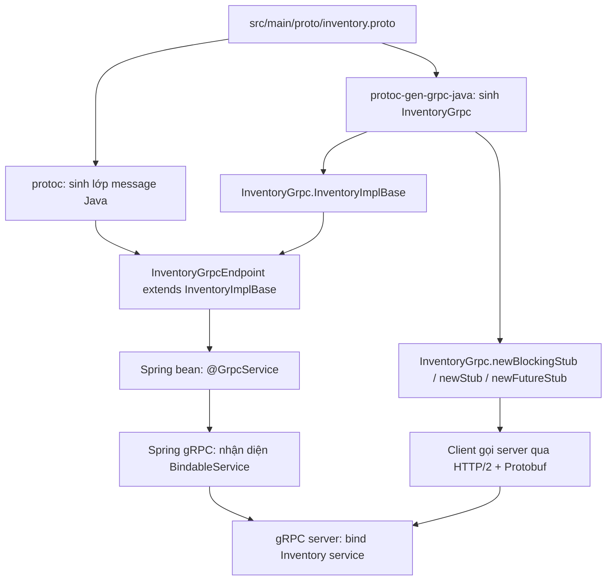

# Kế thừa generated service base

## Mục tiêu bài học

Trong module **SPRING_GRPC**, hợp đồng Protocol Buffers là nguồn sự thật cho tên service, các RPC và message. Từ hợp đồng đó, công cụ sinh mã tạo ra các lớp Java để phía server triển khai RPC và phía client gọi RPC. Bài học này tập trung vào công việc quan trọng ở phía server: **kế thừa lớp service base đã được sinh, override đúng phương thức RPC và cung cấp implementation dưới dạng Spring bean**.

Sau bài học, bạn có thể:

1. Phân biệt mã message do `protoc` sinh và mã gRPC service/stub do `protoc-gen-grpc-java` sinh.
2. Xác định lớp `XxxGrpc.XxxImplBase` và chữ ký phương thức cần override từ một hợp đồng `.proto`.
3. Triển khai unary, server streaming, client streaming và bidirectional streaming trên cùng một service base.
4. Hoàn tất `StreamObserver` theo đúng quy tắc thành công hoặc lỗi; ánh xạ lỗi sang `Status` phù hợp.
5. Đưa implementation thành Spring bean và xác minh descriptor được công bố qua gRPC server.
6. Nhận diện rủi ro khi thay đổi `.proto`, sửa mã generated, dùng sai stub, chặn thread hoặc xử lý streaming thiếu an toàn.

> **Ngữ cảnh:** Ví dụ sử dụng gRPC Java và Spring gRPC chính thức với `org.springframework.grpc.server.service.GrpcService`. Mã trong thư mục generated được tạo bởi build, có thể khác đôi chút theo phiên bản `grpc-java`, nhưng quy tắc kế thừa `*ImplBase`, triển khai RPC và dùng `StreamObserver` vẫn là phần cốt lõi.

## 1. Generated service base là gì?

Giả sử hợp đồng định nghĩa `service Inventory` và RPC `GetStock`. Trong quá trình build, hai nhóm mã Java được sinh:

- **Protocol Buffers Java**: các lớp message như `StockQuery`, `StockReply`, builder, parser và serialization.
- **gRPC Java**: lớp `InventoryGrpc` chứa service descriptor, phương thức tạo client stub và lớp server base `InventoryGrpc.InventoryImplBase`.

`InventoryImplBase` cung cấp một khung triển khai service phía server và đáp ứng `io.grpc.BindableService`, cho phép gRPC lấy `ServerServiceDefinition` qua `bindService()`. Lớp đó không mang logic nghiệp vụ của bạn. Các phương thức RPC mặc định thường trả `UNIMPLEMENTED` cho tới khi bạn override.



| Thành phần | Nằm ở đâu? | Ai sử dụng? |
| --- | --- | --- |
| `StockQuery`, `StockReply` | Sinh từ `message` trong `.proto` | Cả client và server |
| `InventoryGrpc.InventoryImplBase` | Sinh bởi gRPC Java plugin | **Server** kế thừa để override RPC |
| `InventoryGrpc.newBlockingStub(channel)` | Phương thức sinh trong `InventoryGrpc` | **Client** gọi các kiểu RPC hỗ trợ dạng blocking |
| `InventoryGrpc.newStub(channel)` | Phương thức sinh trong `InventoryGrpc` | **Client** gọi RPC bất đồng bộ, bao gồm streaming |
| `InventoryGrpc.newFutureStub(channel)` | Phương thức sinh trong `InventoryGrpc` | **Client** gọi unary RPC theo dạng future |
| `InventoryGrpcEndpoint` | Mã ứng dụng do bạn viết | Spring quản lý và gRPC server thực thi |

Một số phiên bản `grpc-java` mới còn tạo giao diện `AsyncService` và phương thức hỗ trợ bind service thông qua giao diện đó. **Không nên phụ thuộc vào cấu trúc nội bộ của lớp generated**: hãy kiểm tra đúng API sinh trong phiên bản dự án và kế thừa `InventoryImplBase` như hướng dẫn gRPC Java.

## 2. Hợp đồng `.proto` minh họa bốn loại RPC

Tạo tệp `src/main/proto/inventory.proto`:

```proto
syntax = "proto3";

package inventory.v1;

option java_package = "com.example.inventory.proto";
option java_multiple_files = true;

service Inventory {
  // Unary: một request -> một response.
  rpc GetStock(StockQuery) returns (StockReply);

  // Server streaming: một request -> nhiều response.
  rpc SubscribeStock(StockSubscription) returns (stream StockReply);

  // Client streaming: nhiều request -> một response.
  rpc CountQueries(stream StockQuery) returns (CountReply);

  // Bidirectional streaming: nhiều request <-> nhiều response.
  rpc DuplexLookup(stream StockQuery) returns (stream StockReply);
}

message StockQuery {
  string sku = 1;
}

message StockSubscription {
  string sku = 1;
  int32 samples = 2;
}

message StockReply {
  string sku = 1;
  int32 quantity = 2;
}

message CountReply {
  int32 accepted = 1;
}
```

Ở đây, **gRPC service name** là `inventory.v1.Inventory` vì `package inventory.v1` xác định namespace trên giao thức. `java_package` chỉ quyết định package của các lớp Java được sinh. Hai giá trị này có thể khác nhau và không được nhầm khi gọi bằng `grpcurl`.

### Điều kiện sinh mã

Dự án cần compiler Protocol Buffers (`protoc`) và plugin gRPC Java (`protoc-gen-grpc-java`), với phiên bản tương thích thư viện `protobuf-java` và `grpc-java`. Maven và Gradle có cơ chế cấu hình khác nhau; trong dự án Spring Boot, nên sử dụng build và dependency management do dự án khởi tạo từ Spring Initializr cung cấp. Để chạy server trong Spring Boot phiên bản có starter gRPC chính thức, cấu hình dependency server tương ứng, ví dụ:

```xml
<!-- Một dependency của pom.xml; không thay thế cấu hình plugin sinh mã. -->
<dependency>
    <groupId>org.springframework.boot</groupId>
    <artifactId>spring-boot-starter-grpc-server</artifactId>
</dependency>
```

Sau một lượt compile có cấu hình code generation đúng, dự án sẽ có các class generated như:

```text
com.example.inventory.proto.StockQuery
com.example.inventory.proto.StockSubscription
com.example.inventory.proto.StockReply
com.example.inventory.proto.CountReply
com.example.inventory.proto.InventoryGrpc
com.example.inventory.proto.InventoryGrpc.InventoryImplBase
```

**Không chỉnh sửa trực tiếp mã generated**: khi build sinh lại từ `.proto`, các thay đổi thủ công sẽ mất. Nếu cần bổ sung hành vi, tạo lớp implementation riêng rồi kế thừa lớp base.

## 3. Đọc đúng chữ ký phương thức trong generated base

Đối với hợp đồng trên, những phương thức cần override có dạng tương đương sau (tên tham số có thể khác theo phiên bản plugin):

```java
// Unary
public void getStock(
        StockQuery request,
        StreamObserver<StockReply> responseObserver);

// Server streaming
public void subscribeStock(
        StockSubscription request,
        StreamObserver<StockReply> responseObserver);

// Client streaming
public StreamObserver<StockQuery> countQueries(
        StreamObserver<CountReply> responseObserver);

// Bidirectional streaming
public StreamObserver<StockQuery> duplexLookup(
        StreamObserver<StockReply> responseObserver);
```

Đây là **chữ ký minh họa** để đọc, không phải bốn phương thức Java độc lập có thể đặt bên ngoài một lớp. Trong implementation, bạn dùng `@Override` và giữ đúng kiểu tham số/giá trị trả về.

| Dạng RPC | Giá trị trả về của method Java phía server | Cách nhận request | Cách gửi response |
| --- | --- | --- | --- |
| Unary | `void` | Tham số `request` | Gửi một message qua `responseObserver` |
| Server streaming | `void` | Tham số `request` | Gửi nhiều message qua `responseObserver` |
| Client streaming | `StreamObserver<Request>` | Các lần gọi `onNext` trên observer bạn trả về | Gửi response qua `responseObserver` khi stream kết thúc |
| Bidirectional streaming | `StreamObserver<Request>` | Các lần gọi `onNext` trên observer bạn trả về | Có thể gửi response dần qua `responseObserver` |

Lưu ý `StreamObserver<T>` thuộc package `io.grpc.stub`. Với unary, không trả `StockReply` trực tiếp từ method `getStock`: gRPC runtime mong đợi bạn chuyển response tới observer. Với client/bidirectional streaming, đối tượng trả về là **observer nhận request**; còn observer truyền vào là kênh **gửi response**.

## 4. Tách xử lý nghiệp vụ khỏi lớp gRPC endpoint

Ví dụ dùng dữ liệu tồn kho cố định để tập trung vào cách kế thừa. Tạo `src/main/java/com/example/inventory/StockReader.java`:

```java
package com.example.inventory;

import java.util.Map;
import java.util.OptionalInt;
import org.springframework.stereotype.Service;

@Service
public class StockReader {

    private final Map<String, Integer> quantities = Map.of(
            "sku-100", 24,
            "sku-200", 7);

    public OptionalInt findQuantity(String sku) {
        Integer quantity = quantities.get(sku);
        return quantity == null
                ? OptionalInt.empty()
                : OptionalInt.of(quantity);
    }
}
```

Đây là bean Spring chứa dữ liệu đọc thuần túy và không thay đổi. Trong hệ thống thật, lớp tương đương thường gọi repository, cache hoặc service khác; với số lượng RPC đồng thời lớn, cần đặc biệt chú ý thread safety, timeout và sử dụng API bất đồng bộ khi phù hợp.

## 5. Kế thừa `InventoryImplBase` và triển khai RPC

Tạo `src/main/java/com/example/inventory/grpc/InventoryGrpcEndpoint.java`:

```java
package com.example.inventory.grpc;

import com.example.inventory.StockReader;
import com.example.inventory.proto.CountReply;
import com.example.inventory.proto.InventoryGrpc;
import com.example.inventory.proto.StockQuery;
import com.example.inventory.proto.StockReply;
import com.example.inventory.proto.StockSubscription;
import io.grpc.Context;
import io.grpc.Status;
import io.grpc.StatusRuntimeException;
import io.grpc.stub.StreamObserver;
import org.springframework.grpc.server.service.GrpcService;

@GrpcService
public class InventoryGrpcEndpoint
        extends InventoryGrpc.InventoryImplBase {

    private final StockReader stockReader;

    public InventoryGrpcEndpoint(StockReader stockReader) {
        this.stockReader = stockReader;
    }

    // 1. Unary RPC
    @Override
    public void getStock(StockQuery request,
                         StreamObserver<StockReply> responseObserver) {
        try {
            StockReply reply = snapshot(request.getSku());
            responseObserver.onNext(reply);
            responseObserver.onCompleted();
        } catch (StatusRuntimeException ex) {
            responseObserver.onError(ex);
        }
    }

    // 2. Server streaming RPC
    @Override
    public void subscribeStock(
            StockSubscription request,
            StreamObserver<StockReply> responseObserver) {
        int samples = request.getSamples();
        if (samples < 1 || samples > 5) {
            responseObserver.onError(Status.INVALID_ARGUMENT
                    .withDescription("samples phải từ 1 đến 5")
                    .asRuntimeException());
            return;
        }

        final StockReply reply;
        try {
            reply = snapshot(request.getSku());
        } catch (StatusRuntimeException ex) {
            responseObserver.onError(ex);
            return;
        }

        // Demo gửi số bản ghi hữu hạn, không tạo subscription lâu dài.
        for (int i = 0; i < samples; i++) {
            if (Context.current().isCancelled()) {
                return;
            }
            responseObserver.onNext(reply);
        }
        if (!Context.current().isCancelled()) {
            responseObserver.onCompleted();
        }
    }

    // 3. Client streaming RPC
    @Override
    public StreamObserver<StockQuery> countQueries(
            StreamObserver<CountReply> responseObserver) {
        return new StreamObserver<>() {
            private int accepted;
            private boolean terminated;

            @Override
            public void onNext(StockQuery request) {
                if (terminated) {
                    return;
                }
                try {
                    snapshot(request.getSku()); // Chỉ kiểm tra SKU hợp lệ.
                    accepted++;
                } catch (StatusRuntimeException ex) {
                    terminated = true;
                    responseObserver.onError(ex);
                }
            }

            @Override
            public void onError(Throwable cause) {
                // Client hoặc transport đã kết thúc stream lỗi.
                terminated = true;
            }

            @Override
            public void onCompleted() {
                if (terminated) {
                    return;
                }
                terminated = true;
                responseObserver.onNext(CountReply.newBuilder()
                        .setAccepted(accepted)
                        .build());
                responseObserver.onCompleted();
            }
        };
    }

    // 4. Bidirectional streaming RPC
    @Override
    public StreamObserver<StockQuery> duplexLookup(
            StreamObserver<StockReply> responseObserver) {
        return new StreamObserver<>() {
            private boolean terminated;

            @Override
            public void onNext(StockQuery request) {
                if (terminated) {
                    return;
                }
                try {
                    responseObserver.onNext(snapshot(request.getSku()));
                } catch (StatusRuntimeException ex) {
                    terminated = true;
                    responseObserver.onError(ex);
                }
            }

            @Override
            public void onError(Throwable cause) {
                terminated = true;
            }

            @Override
            public void onCompleted() {
                if (terminated) {
                    return;
                }
                terminated = true;
                responseObserver.onCompleted();
            }
        };
    }

    // Helper chung cho cả bốn RPC; không sửa file generated.
    private StockReply snapshot(String sku) {
        if (sku == null || sku.isBlank()) {
            throw Status.INVALID_ARGUMENT
                    .withDescription("sku không được rỗng")
                    .asRuntimeException();
        }

        var quantity = stockReader.findQuantity(sku);
        if (quantity.isEmpty()) {
            throw Status.NOT_FOUND
                    .withDescription("Không tìm thấy SKU: " + sku)
                    .asRuntimeException();
        }

        return StockReply.newBuilder()
                .setSku(sku)
                .setQuantity(quantity.getAsInt())
                .build();
    }
}
```

Trong ví dụ, bốn RPC dùng cùng `StockReader`; điều này cho thấy một **generated service base có thể gom nhiều phương thức RPC với các hình thái truyền dữ liệu khác nhau**. `@GrpcService` tạo Spring bean cho implementation, Spring gRPC tìm bean triển khai `BindableService` và gắn service definition lên server. Với Spring gRPC chính thức, `@Service` hoặc một `@Bean` trả về `BindableService` cũng có thể dùng để đăng ký. Không đăng ký cùng endpoint bằng nhiều cơ chế song song vì dễ sinh hai bean cung cấp cùng gRPC service name.

### 5.1. Phân tích unary RPC

Phương thức `getStock` nhận **một** `StockQuery` và gửi **một** `StockReply`:

```text
Client -- StockQuery(sku="sku-100") --> Server
Client <-- StockReply(sku="sku-100", quantity=24) -- Server
                                  onCompleted()
```

- Thành công: `responseObserver.onNext(reply)` **một lần**, sau đó `responseObserver.onCompleted()`.
- Lỗi: `responseObserver.onError(status.asRuntimeException())`, rồi kết thúc đường xử lý.
- Không gọi `onCompleted()` hoặc gửi response khác sau `onError()`.

`Status.INVALID_ARGUMENT` dùng cho `sku` rỗng và `Status.NOT_FOUND` dùng cho SKU không tồn tại. `snapshot` phát ra exception có chủ đích, còn method gRPC **bắt và chuyển exception đó sang observer** để phía client nhận đúng gRPC status. Khi thêm truy cập database, cũng cần phân loại timeout, lỗi phụ thuộc và lỗi ngoài dự kiến; không trả exception nội bộ nguyên văn cho client.

### 5.2. Phân tích server streaming RPC

`subscribeStock` nhận `StockSubscription` chứa `sku` và số message `samples`. Server gửi nhiều bản ghi trước khi hoàn tất:

```text
Client -- StockSubscription(sku="sku-100", samples=3) --> Server
Client <-- StockReply(quantity=24) -- Server
Client <-- StockReply(quantity=24) -- Server
Client <-- StockReply(quantity=24) -- Server
Client <-- onCompleted() -- Server
```

Ví dụ phát ba snapshot giống nhau để kiểm tra **cấu trúc stream**, không phải cơ chế cập nhật tồn kho thời gian thực. Khi sản xuất, streaming dài hạn phải quan tâm flow control, backpressure, hủy request, deadline, khả năng ghi vào observer và giải phóng tài nguyên. Nếu client hủy, `Context.current().isCancelled()` cho phép dừng sớm; đây là kiểm tra đơn giản, chưa bao quát mọi tình huống bất đồng bộ.

### 5.3. Phân tích client streaming RPC

Đối với `countQueries`, khi client mở RPC, server trả về một **`StreamObserver<StockQuery>`** để nhận từng message:

```text
Client -- StockQuery(sku="sku-100") --> Server.onNext(...)
Client -- StockQuery(sku="sku-200") --> Server.onNext(...)
Client -- half-close -----------------> Server.onCompleted()
Client <-- CountReply(accepted=2) ---- Server.responseObserver.onNext(...)
Client <-- RPC completed ------------- Server.responseObserver.onCompleted()
```

Ở đây `CountQueries` **đếm số query có SKU tồn tại**, không ghi thay đổi vào kho. Trạng thái `accepted` và `terminated` được khai báo **bên trong observer của từng cuộc gọi**, tránh để các RPC đồng thời dùng chung bộ đếm. Nếu một request sai, ví dụ sẽ kết thúc toàn bộ RPC bằng một status lỗi. Đừng tiếp tục gửi `CountReply` sau khi đã gửi lỗi.

### 5.4. Phân tích bidirectional streaming RPC

Đối với `duplexLookup`, cả hai chiều đều là stream. Server trả về observer nhận `StockQuery` và có thể gửi `StockReply` ngay sau từng request:

```text
Client -- StockQuery("sku-100") --> Server
Client <-- StockReply(24) ----------- Server
Client -- StockQuery("sku-200") --> Server
Client <-- StockReply(7) ------------ Server
Client -- half-close ---------------> Server
Client <-- onCompleted() ----------- Server
```

Đây là ví dụ request-response theo cặp để dễ đọc; bidirectional streaming **không buộc** số response bằng số request, cũng không bắt buộc phản hồi ngay. Trong hệ thống thật, việc nhận và gửi ở hai chiều có thể diễn ra độc lập. Tránh giả định thread nào cũng có thể gọi `responseObserver.onNext` đồng thời: cần đồng bộ hóa hoặc cơ chế serialize khi ứng dụng có nhiều nguồn đẩy kết quả.

## 6. Kết nối implementation với ứng dụng Spring

Tạo lớp khởi động trong package cha `com.example.inventory` để component scan nhìn thấy `StockReader` và `InventoryGrpcEndpoint`:

```java
package com.example.inventory;

import org.springframework.boot.SpringApplication;
import org.springframework.boot.autoconfigure.SpringBootApplication;

@SpringBootApplication
public class InventoryApplication {
    public static void main(String[] args) {
        SpringApplication.run(InventoryApplication.class, args);
    }
}
```

Ví dụ cấu hình cổng gRPC native:

```yaml
spring:
  grpc:
    server:
      port: 9091
```

Tên property và loại transport cần phù hợp phiên bản starter đang dùng. Với gRPC server native như Netty, `spring.grpc.server.port` đặt cổng RPC. Nếu ứng dụng phục vụ gRPC bằng servlet server, cổng và HTTP/2 phụ thuộc cấu hình web server, không áp dụng suy luận cổng native một cách máy móc.

Quy trình từ lúc chạy Spring Boot:

1. Spring khởi tạo bean `StockReader`.
2. Component scan tạo bean `InventoryGrpcEndpoint` và tiêm `StockReader` qua constructor.
3. Spring gRPC phát hiện bean `InventoryGrpcEndpoint` dưới kiểu `BindableService`.
4. `bindService()` do mã generated cung cấp tạo descriptor và đăng ký bốn RPC handler đã override.
5. gRPC server factory gắn definition vào server; client có thể gọi `inventory.v1.Inventory/GetStock` khi cổng/transport sẵn sàng.

Lưu ý việc Spring **có bean** và việc client **gọi được qua mạng** là hai kết quả riêng. Nếu gRPC transport chưa chạy, cấu hình TLS không khớp hoặc service bị lọc bởi `ServerServiceDefinitionFilter`, bean vẫn có thể tồn tại nhưng endpoint không truy cập được trên server mong đợi.

## 7. Gọi thử RPC và kiểm tra descriptor

### 7.1. Unary bằng `grpcurl`

Với ví dụ cấu hình cổng `9091` và server không TLS trong môi trường phát triển, từ thư mục gốc dự án chạy:

```bash
grpcurl -plaintext \
  -import-path src/main/proto \
  -proto inventory.proto \
  -d '{"sku":"sku-100"}' \
  localhost:9091 inventory.v1.Inventory/GetStock
```

Kết quả dự kiến:

```json
{
  "sku": "sku-100",
  "quantity": 24
}
```

Lệnh cung cấp `.proto` trực tiếp để `grpcurl` biết message descriptor; không cần bật server reflection. Nếu gọi `grpcurl list` không kèm `.proto`, server phải bật reflection service riêng. Chỉ sử dụng `-plaintext` khi server thực sự không dùng TLS.

### 7.2. Server streaming bằng `grpcurl`

```bash
grpcurl -plaintext \
  -import-path src/main/proto \
  -proto inventory.proto \
  -d '{"sku":"sku-200","samples":3}' \
  localhost:9091 inventory.v1.Inventory/SubscribeStock
```

Client sẽ nhận ba message `StockReply` có `quantity: 7`, sau đó stream kết thúc bình thường. Nếu `samples` là `0` hoặc `6`, kết quả là gRPC status `INVALID_ARGUMENT`. Nếu `sku` không tồn tại, kết quả là `NOT_FOUND`.

### 7.3. Client streaming và bidirectional streaming bằng client Java

Hai loại RPC gửi nhiều request nên thuận tiện hơn với asynchronous stub:

```java
// channel là ManagedChannel đã cấu hình; snippet phía CLIENT.
InventoryGrpc.InventoryStub asyncStub = InventoryGrpc.newStub(channel);

StreamObserver<CountReply> responses = new StreamObserver<>() {
    @Override
    public void onNext(CountReply value) {
        System.out.println("Accepted: " + value.getAccepted());
    }

    @Override
    public void onError(Throwable error) {
        System.err.println("RPC lỗi: " + error.getMessage());
    }

    @Override
    public void onCompleted() {
        System.out.println("CountQueries hoàn tất");
    }
};

StreamObserver<StockQuery> requests = asyncStub.countQueries(responses);
requests.onNext(StockQuery.newBuilder().setSku("sku-100").build());
requests.onNext(StockQuery.newBuilder().setSku("sku-200").build());
requests.onCompleted();
```

Đây là một **đoạn trong client**, cần thêm import cho `InventoryGrpc`, `CountReply`, `StockQuery`, `StreamObserver`, cùng quá trình tạo và đóng `ManagedChannel`. Client không cần kế thừa `InventoryImplBase`; client dùng generated stub. Với `duplexLookup`, client cũng gọi `asyncStub.duplexLookup(responseObserver)` để nhận observer gửi request và đồng thời xử lý các callback trả về.

### 7.4. Kiểm tra bean trong Spring context

Bạn có thể viết kiểm thử để xác nhận giai đoạn **phát hiện service**:

```java
package com.example.inventory;

import io.grpc.BindableService;
import org.junit.jupiter.api.Test;
import org.springframework.beans.factory.annotation.Autowired;
import org.springframework.boot.test.context.SpringBootTest;
import org.springframework.context.ApplicationContext;

import static org.assertj.core.api.Assertions.assertThat;

@SpringBootTest(properties = "spring.grpc.server.port=0")
class InventoryServiceRegistrationTest {

    @Autowired
    ApplicationContext context;

    @Test
    void generatedServiceBaseIsBoundByBean() {
        var services = context.getBeansOfType(BindableService.class).values();
        assertThat(services).anySatisfy(service ->
                assertThat(service.bindService()
                        .getServiceDescriptor()
                        .getName())
                        .isEqualTo("inventory.v1.Inventory"));
    }
}
```

Kiểm thử xác nhận bean tồn tại và có descriptor đúng; `spring.grpc.server.port=0` yêu cầu chọn cổng ngẫu nhiên khi dùng native server hỗ trợ tùy chọn này. Kiểm thử này **không thay thế** kiểm thử gọi RPC qua server thực. Khi kiểm thử status, metadata, deadline, interceptor hoặc TLS, cần kiểm thử tích hợp qua stub với server native hoặc in-process phù hợp.

## 8. Các quy tắc quan trọng với `StreamObserver`

| Quy tắc | Vì sao cần tuân thủ? |
| --- | --- |
| Unary thành công gửi đúng một response, rồi `onCompleted()` | Đáp ứng hợp đồng `returns (Response)` của RPC |
| Khi có lỗi, gọi `onError(...)` và ngừng gửi dữ liệu | `onError` là sự kiện kết thúc terminal, không được gửi tiếp |
| Không gọi `onCompleted()` hai lần | Gửi terminal event nhiều lần gây sai vòng đời RPC |
| `onNext(...)` chỉ dùng trước terminal event | Client đã đóng stream không thể tiếp tục nhận message hợp lệ |
| Với client/bidi streaming, mỗi cuộc gọi tạo observer và state riêng | Tránh trộn dữ liệu giữa các request đồng thời |
| Không chặn lâu callback gRPC bằng thao tác I/O tốn thời gian | Tránh chiếm luồng xử lý RPC và làm giảm throughput |
| Với stream dài, quan sát hủy/deadline và backpressure | Tránh phát quá nhiều dữ liệu hoặc giữ tài nguyên sau khi client rời đi |
| Đừng chia sẻ `StreamObserver` giữa các RPC | Observer thuộc vòng đời và ngữ cảnh của một RPC |

**Deadline và cancellation:** Các RPC có thể hết hạn khi client đặt deadline, hoặc bị hủy trước khi hoàn tất. Khi triển khai stream bất đồng bộ, cần truyền thông tin cancellation vào luồng công việc nền và hủy tác vụ ngay khi client không còn nhận dữ liệu. Đối với kiểm soát luồng nâng cao, xem `ServerCallStreamObserver` và phương thức `isReady()`, `setOnReadyHandler(...)` theo hướng dẫn gRPC Java, thay vì gọi `onNext` liên tục trong một vòng lặp dài.

**Thread safety:** Một instance endpoint do Spring quản lý thường có scope singleton và xử lý nhiều RPC đồng thời. Không đặt biến `accepted`, `terminated`, `request` hay `responseObserver` trong trường mutable của singleton. Trong ví dụ, biến trạng thái streaming nằm bên trong anonymous observer, được tạo mới cho từng lần gọi. Nếu một stream có nhiều thread phát response, phải tuần tự hóa các lần ghi vào cùng observer.

## 9. Lỗi thường gặp khi kế thừa generated base

| Biểu hiện | Nguyên nhân thường gặp | Cách xử lý |
| --- | --- | --- |
| Không tìm thấy `InventoryGrpc` hoặc `StockReply` | Chưa cấu hình/chạy code generation; `java_package` khác package import | Kiểm tra `.proto`, plugin `protoc-gen-grpc-java`, generated sources và phiên bản dependency |
| `@Override` báo không tồn tại phương thức | Tên, chữ hoa/thường hoặc chữ ký khác file generated; `.proto` đã sửa nhưng chưa sinh mã | Mở API generated của dự án, đối chiếu tên từ `.proto`, sinh lại mã |
| Client nhận `UNIMPLEMENTED` | Chưa override method, bind sai implementation hoặc gọi sai service/method | Kiểm tra lớp `*ImplBase`, tên `package.Service/Method` và descriptor đã bind |
| Client nhận `UNKNOWN` thay vì status nghiệp vụ | Ném exception ngoài luồng xử lý mà không ánh xạ sang `Status` | Gọi `responseObserver.onError(Status...asRuntimeException())` và dừng xử lý |
| Client treo khi chờ unary/streaming | Quên `onCompleted()` hoặc không đóng stream sau khi hết dữ liệu | Đảm bảo thành công kết thúc bằng `onCompleted()`, lỗi bằng `onError()` |
| Exception sau khi gọi `onError()` | Method tiếp tục gửi `onNext` hoặc `onCompleted` | `return` ngay trong nhánh lỗi; lưu trạng thái terminal khi cần |
| Server không tìm thấy implementation | Không tạo Spring bean hoặc implementation nằm ngoài component scan | Gắn `@GrpcService`/`@Service`, cấu hình `@Bean` đúng và đặt package hợp lý |
| Khởi động lỗi trùng đăng ký service | Hai bean cùng cung cấp `inventory.v1.Inventory` | Chỉ dùng một cách đăng ký implementation, tránh khai báo stereotype kèm `@Bean` trùng |
| Code chạy nhưng throughput thấp | Tác vụ blocking lâu trong callback; stream gửi thiếu flow control | Tách xử lý tốn thời gian, áp dụng deadline, cancellation và backpressure |
| Build lại làm mất logic xử lý RPC | Sửa trực tiếp class generated | Để logic trong class kế thừa nằm dưới `src/main/java` |

Trình tự gỡ lỗi hiệu quả là: **kiểm tra `.proto` → sinh mã → xác minh method `@Override` → xác minh `BindableService` bean → kiểm tra service descriptor → gọi qua stub hoặc `grpcurl`**. Cách này giúp tách lỗi hợp đồng, lỗi implementation, lỗi Spring context và lỗi transport.

## 10. Bài tập thực hành

1. **Thêm unary RPC** `GetAllStocks(Empty) returns (StockList)` vào `Inventory`. Cập nhật `.proto`, sinh mã mới và override method tương ứng trong `InventoryGrpcEndpoint`. So sánh các class mới được sinh.
2. **Thử default implementation**: tạm thời bỏ `@Override` của `getStock` rồi gọi `GetStock`. Giải thích vì sao client nhận `UNIMPLEMENTED`, sau đó khôi phục method.
3. **Xử lý lỗi**: gửi `sku` rỗng và `sku` chưa có trong bản đồ; ghi lại khác biệt giữa `INVALID_ARGUMENT` và `NOT_FOUND`.
4. **Kiểm tra streaming**: gọi `SubscribeStock` với `samples=3`; sau đó thử `samples=0` và `samples=6`. Đảm bảo không có message nào được gửi sau terminal event.
5. **Tách trạng thái RPC**: chạy đồng thời hai client streaming `CountQueries` với số query khác nhau; giải thích vì sao hai bộ đếm không ảnh hưởng nhau.
6. **Thay đổi hợp đồng**: đổi `service Inventory` thành `WarehouseInventory`, sinh lại mã, xem tên lớp `*Grpc` thay đổi thế nào và điều chỉnh implementation/client. Không thực hiện đổi tên này trong hệ thống đang vận hành nếu chưa có kế hoạch tương thích API.
7. **Tích hợp Spring**: bỏ `@GrpcService`, đăng ký cùng implementation bằng `@Bean` kiểu `BindableService` và chạy lại kiểm thử descriptor. Đảm bảo chỉ một instance được đăng ký cho mỗi gRPC service name.

### Câu hỏi tự kiểm tra

- Vì sao không nên đặt logic nghiệp vụ trực tiếp vào `InventoryGrpc.java` được sinh?
- Phân biệt vai trò của `InventoryGrpc.InventoryImplBase` và `InventoryGrpc.InventoryStub`.
- Tại sao `getStock` trả về `void` dù hợp đồng `.proto` khai báo `returns (StockReply)`?
- Tại sao `countQueries` trả về `StreamObserver<StockQuery>` nhưng `getStock` thì không?
- Điều gì xảy ra nếu một method đã gửi `onError()` rồi lại gửi `onCompleted()`?
- Khi có nhiều RPC đồng thời vào cùng singleton endpoint, biến trạng thái của từng RPC nên đặt ở đâu?
- Vì sao kiểm thử `getBeansOfType(BindableService.class)` chưa đủ để bảo đảm client gọi RPC thành công?
- Sửa `package inventory.v1` so với sửa `java_package` có tác động khác nhau gì đến client và code Java?

## Tài liệu tham khảo

- [gRPC Java — Basics Tutorial](https://grpc.io/docs/languages/java/basics/): định nghĩa RPC, generated base và triển khai các kiểu streaming.
- [gRPC Java — Generated Code Reference](https://grpc.io/docs/languages/java/generated-code/): các class message, stub và API phía server được sinh.
- [gRPC Java — StreamObserver](https://grpc.github.io/grpc-java/javadoc/io/grpc/stub/StreamObserver.html): quy tắc vòng đời stream và các phương thức terminal.
- [gRPC Java — BindableService](https://grpc.github.io/grpc-java/javadoc/io/grpc/BindableService.html): cách một service cung cấp `ServerServiceDefinition`.
- [Spring gRPC — GRPC Server](https://docs.spring.io/spring-grpc/reference/server.html): Spring phát hiện `BindableService` bean và bind vào gRPC server.
- [Spring Boot — gRPC](https://docs.spring.io/spring-boot/reference/io/grpc.html): starter server, cấu hình transport, code generation và kiểm thử tích hợp.

**Kết quả mong đợi:** Từ hợp đồng `inventory.proto`, người học sinh được `InventoryGrpc.InventoryImplBase`, xây lớp `InventoryGrpcEndpoint extends InventoryGrpc.InventoryImplBase` có đủ bốn kiểu RPC, đăng ký lớp đó thành Spring bean, kiểm tra được service descriptor `inventory.v1.Inventory` và gọi được RPC với response/status đúng hợp đồng.
