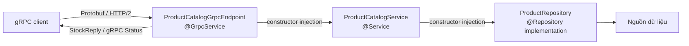

# Inject service dependency

## Mục tiêu bài học

Trong **SPRING_GRPC**, một gRPC endpoint thường chỉ chịu trách nhiệm nhận message Protocol Buffers, chuyển đổi dữ liệu, gọi logic nghiệp vụ và trả response hoặc gRPC status. Các thao tác tìm sản phẩm, truy cập cơ sở dữ liệu, gọi dịch vụ khác hay kiểm tra quyền truy cập nên được tách thành những dependency do Spring quản lý. Bài này hướng dẫn **dependency injection (DI)** khi xây dựng gRPC server trong hệ sinh thái Spring, từ một unary RPC đơn giản đến server streaming RPC.

Sau khi học, bạn có thể:

1. Giải thích Spring đưa các dependency vào một gRPC service bean như thế nào.
2. Dùng **constructor injection** để nối `@GrpcService` với lớp nghiệp vụ, repository và cấu hình.
3. Xác định trách nhiệm của gRPC endpoint, application service và persistence layer.
4. Chọn bean phù hợp khi có nhiều implementation cùng kiểu bằng `@Qualifier` hoặc `@Primary`.
5. Kiểm thử lớp gRPC với dependency giả lập và kiểm tra việc tạo bean trong Spring context.
6. Tránh các lỗi như tự khởi tạo dependency bằng `new`, thiếu component scan, vòng phụ thuộc, state dùng chung không an toàn và gọi hệ thống ngoài mà không đặt deadline.

> **Thư viện sử dụng:** Ví dụ áp dụng cho **Spring gRPC chính thức** với `org.springframework.grpc.server.service.GrpcService` và các lớp Java sinh bởi `protoc` cùng `protoc-gen-grpc-java`. Starter cộng đồng `net.devh` có annotation tên gần giống nhưng package và cách cấu hình có thể khác; cần dùng thống nhất một hệ thư viện.

## 1. Vì sao gRPC endpoint cần dependency injection?

Nếu tự tạo repository trong endpoint, mỗi lần thay cách lưu trữ hoặc kiểm thử, bạn phải sửa hoặc tái cấu trúc lớp xử lý RPC. Constructor injection cho phép endpoint chỉ phụ thuộc vào hành vi cần dùng; Spring chịu trách nhiệm tìm, tạo và cung cấp các bean phù hợp.



| Thành phần | Việc nên làm | Việc nên tránh |
| --- | --- | --- |
| `.proto` và mã generated | Định nghĩa hợp đồng RPC, message, lớp `*Grpc` | Chứa logic truy cập database hay nghiệp vụ |
| gRPC endpoint | Validate request, gọi application service, chuyển domain object sang Protobuf, kết thúc `StreamObserver` | Tự quản lý kết nối database hoặc giữ state mutable của mỗi RPC trong singleton |
| Application service | Điều phối nghiệp vụ, quy tắc kiểm tra, xử lý giao dịch | Phụ thuộc trực tiếp vào `StreamObserver` nếu nghiệp vụ không cần biết gRPC |
| Repository / gateway | Cung cấp truy cập dữ liệu hoặc tích hợp bên ngoài | Tự quyết định gRPC status cho mọi tình huống |
| Spring container | Tạo bean, resolve dependency, quản lý vòng đời và cấu hình | Tự động quản lý đối tượng do người dùng tự tạo bằng `new` ngoài container |

Trong ứng dụng Spring Boot, `@GrpcService` khiến endpoint được phát hiện như một Spring bean, còn generated base `XxxGrpc.XxxImplBase` triển khai `BindableService`, cho phép hạ tầng Spring gRPC gắn RPC vào server. **DI xảy ra khi Spring tạo bean**, trước khi có request; việc gọi RPC xảy ra sau đó, khi server đã hoạt động. Một instance endpoint singleton có thể xử lý nhiều RPC đồng thời, nên cách tổ chức dependency liên quan trực tiếp đến tính đúng đắn và độ tin cậy.

## 2. Chuẩn bị hợp đồng gRPC và mã generated

Xây dựng ví dụ quản lý danh mục sản phẩm. Client có hai thao tác: lấy một sản phẩm bằng **unary RPC** và đọc một danh sách hữu hạn qua **server streaming RPC**.

Đặt tệp `src/main/proto/catalog.proto`:

```proto
syntax = "proto3";

package catalog.v1;

option java_package = "com.example.catalog.proto";
option java_multiple_files = true;

service ProductCatalog {
  rpc GetProduct(GetProductRequest) returns (ProductReply);
  rpc ListProducts(ListProductsRequest) returns (stream ProductReply);
}

message GetProductRequest {
  string product_id = 1;
}

message ListProductsRequest {
  int32 limit = 1;
}

message ProductReply {
  string product_id = 1;
  string name = 2;
  int64 price_cents = 3;
}
```

Build phải được cấu hình compiler Protocol Buffers và gRPC Java plugin để sinh `ProductCatalogGrpc`, `GetProductRequest`, `ListProductsRequest` và `ProductReply`. Ví dụ Spring Boot dùng starter server chính thức có thể khai báo dependency sau nếu phiên bản Boot/BOM hỗ trợ:

```xml
<dependency>
    <groupId>org.springframework.boot</groupId>
    <artifactId>spring-boot-starter-grpc-server</artifactId>
</dependency>
```

Dependency server **không tự thay thế toàn bộ cấu hình code generation**; cần có plugin hoặc tính năng build tương ứng để xử lý `.proto`. Khi build thành công, server base là `ProductCatalogGrpc.ProductCatalogImplBase` trong Java package `com.example.catalog.proto`. Lớp này triển khai `BindableService` và chứa method cần override. Hãy đặt logic tự viết trong `src/main/java`, không sửa mã generated vì mã đó có thể được sinh lại mỗi lần build.

## 3. Thiết kế các dependency được Spring quản lý

Ta xây dựng chuỗi `ProductCatalogGrpcEndpoint → ProductCatalogService → ProductRepository`. Để ví dụ có thể chạy mà không cần cơ sở dữ liệu ngoài, repository được cài đặt bằng dữ liệu cố định.

### 3.1. Domain model: dữ liệu nghiệp vụ độc lập với Protobuf

Tệp `src/main/java/com/example/catalog/domain/Product.java`:

```java
package com.example.catalog.domain;

public record Product(String id, String name, long priceCents) {
}
```

`Product` là Java record đại diện dữ liệu nghiệp vụ. Nó không phụ thuộc vào gRPC hay `StreamObserver`, giúp lớp nghiệp vụ tái sử dụng được khi sau này bổ sung REST, batch job hoặc message consumer. Thuộc tính `priceCents` chỉ là đơn vị tiền nhỏ nhất minh họa; hệ thống thực cần xác định đơn vị tiền tệ và quy tắc làm tròn rõ ràng.

### 3.2. Repository interface

Tệp `src/main/java/com/example/catalog/repository/ProductRepository.java`:

```java
package com.example.catalog.repository;

import com.example.catalog.domain.Product;
import java.util.List;
import java.util.Optional;

public interface ProductRepository {
    Optional<Product> findById(String id);
    List<Product> findAll();
}
```

Việc phụ thuộc vào interface cho phép thay implementation `InMemoryProductRepository` bằng JPA repository, JDBC, hoặc một gateway từ hệ thống khác. Không cần làm cho interface kế thừa một type của gRPC.

### 3.3. Bean repository

Tệp `src/main/java/com/example/catalog/repository/InMemoryProductRepository.java`:

```java
package com.example.catalog.repository;

import com.example.catalog.domain.Product;
import java.util.List;
import java.util.Map;
import java.util.Optional;
import org.springframework.stereotype.Repository;

@Repository
public class InMemoryProductRepository implements ProductRepository {

    private final Map<String, Product> data = Map.of(
            "sku-101", new Product("sku-101", "Bàn phím", 890_000L),
            "sku-102", new Product("sku-102", "Chuột không dây", 420_000L),
            "sku-103", new Product("sku-103", "Tai nghe", 1_150_000L));

    @Override
    public Optional<Product> findById(String id) {
        return Optional.ofNullable(data.get(id));
    }

    @Override
    public List<Product> findAll() {
        return List.copyOf(data.values());
    }
}
```

Annotation `@Repository` là stereotype của Spring. Component scan sẽ tạo bean `InMemoryProductRepository`; bean đó có thể được tiêm vào nơi khai báo tham số constructor kiểu `ProductRepository`. Vì map được khởi tạo một lần và không bị sửa, ví dụ không có tranh chấp ghi dữ liệu giữa các RPC. Nếu đổi sang mutable map hoặc cache, bạn phải tự bảo đảm thread safety.

### 3.4. Application service nhận repository qua constructor

Tệp `src/main/java/com/example/catalog/application/ProductCatalogService.java`:

```java
package com.example.catalog.application;

import com.example.catalog.domain.Product;
import com.example.catalog.repository.ProductRepository;
import java.util.Comparator;
import java.util.List;
import java.util.Optional;
import org.springframework.stereotype.Service;

@Service
public class ProductCatalogService {

    private final ProductRepository repository;

    public ProductCatalogService(ProductRepository repository) {
        this.repository = repository;
    }

    public Optional<Product> findById(String productId) {
        return repository.findById(productId);
    }

    public List<Product> listFirst(int limit) {
        return repository.findAll().stream()
                .sorted(Comparator.comparing(Product::id))
                .limit(limit)
                .toList();
    }
}
```

Spring tự resolve `ProductRepository` khi tạo `ProductCatalogService`. Chỉ có **một public constructor**, nên trong Spring hiện đại không cần viết thêm `@Autowired`. Dependency được gán vào `final` field, rõ ràng khi đọc mã và dễ thay bằng fake/mock trong kiểm thử. `ProductCatalogService` không biết dữ liệu đến từ gRPC; vì thế có thể đưa các rule nghiệp vụ hay `@Transactional` vào service mà không đặt transaction boundary trong transport layer.

## 4. Inject application service vào gRPC endpoint

Tệp `src/main/java/com/example/catalog/grpc/ProductCatalogGrpcEndpoint.java`:

```java
package com.example.catalog.grpc;

import com.example.catalog.application.ProductCatalogService;
import com.example.catalog.domain.Product;
import com.example.catalog.proto.GetProductRequest;
import com.example.catalog.proto.ListProductsRequest;
import com.example.catalog.proto.ProductCatalogGrpc;
import com.example.catalog.proto.ProductReply;
import io.grpc.Context;
import io.grpc.Status;
import io.grpc.stub.StreamObserver;
import org.springframework.grpc.server.service.GrpcService;

@GrpcService
public class ProductCatalogGrpcEndpoint
        extends ProductCatalogGrpc.ProductCatalogImplBase {

    private final ProductCatalogService catalogService;

    public ProductCatalogGrpcEndpoint(ProductCatalogService catalogService) {
        this.catalogService = catalogService;
    }

    @Override
    public void getProduct(GetProductRequest request,
                           StreamObserver<ProductReply> responses) {
        String id = request.getProductId().trim();
        if (id.isEmpty()) {
            responses.onError(Status.INVALID_ARGUMENT
                    .withDescription("product_id không được rỗng")
                    .asRuntimeException());
            return;
        }

        var product = catalogService.findById(id);
        if (product.isEmpty()) {
            responses.onError(Status.NOT_FOUND
                    .withDescription("Không tìm thấy sản phẩm: " + id)
                    .asRuntimeException());
            return;
        }

        responses.onNext(toProto(product.get()));
        responses.onCompleted();
    }

    @Override
    public void listProducts(ListProductsRequest request,
                             StreamObserver<ProductReply> responses) {
        int limit = request.getLimit();
        if (limit < 1 || limit > 50) {
            responses.onError(Status.INVALID_ARGUMENT
                    .withDescription("limit phải từ 1 đến 50")
                    .asRuntimeException());
            return;
        }

        for (Product product : catalogService.listFirst(limit)) {
            if (Context.current().isCancelled()) {
                return;
            }
            responses.onNext(toProto(product));
        }
        if (!Context.current().isCancelled()) {
            responses.onCompleted();
        }
    }

    private ProductReply toProto(Product product) {
        return ProductReply.newBuilder()
                .setProductId(product.id())
                .setName(product.name())
                .setPriceCents(product.priceCents())
                .build();
    }
}
```

**Điểm inject nằm ở constructor `ProductCatalogGrpcEndpoint(ProductCatalogService catalogService)`.** Tại thời điểm Spring tạo bean endpoint, nó tìm bean có kiểu `ProductCatalogService` và truyền vào constructor. Nhờ đó endpoint không cần tự gọi `new ProductCatalogService(...)` và không cần biết repository thực tế là in-memory hay database.

Hai phương thức `getProduct` và `listProducts` cùng dùng một dependency; cơ chế injection không phụ thuộc RPC là unary hay streaming. Chỗ khác nhau nằm ở số message và vòng đời `StreamObserver`:

| Trường hợp | Quy tắc gửi kết quả |
| --- | --- |
| Unary thành công | `onNext(reply)` đúng một lần, rồi `onCompleted()` |
| Unary không tìm thấy | `onError(Status.NOT_FOUND...)`, không gửi `onCompleted()` |
| Request không hợp lệ | `onError(Status.INVALID_ARGUMENT...)`, kết thúc xử lý |
| Server streaming thành công | Nhiều `onNext(reply)`, rồi một `onCompleted()` |
| Client đã hủy stream | Dừng phát dữ liệu và giải phóng tài nguyên khi có tín hiệu hủy |

Trong ví dụ, danh sách sản phẩm rất nhỏ nên có thể phát liên tiếp. Với streaming lâu dài, phải xử lý backpressure, `ServerCallStreamObserver.isReady()`, cancellation, deadline và không chặn thread gRPC bằng thao tác I/O kéo dài. Nếu repository có thể ném lỗi hạ tầng, cần ánh xạ exception qua lớp xử lý gRPC phù hợp (chẳng hạn một cơ chế xử lý lỗi tập trung), tránh để server gửi chi tiết stack trace cho client. `Status.UNAVAILABLE` có thể phản ánh dependency tạm thời không sẵn sàng; `INTERNAL` dành cho lỗi server không mong đợi, sau khi đã log nội bộ.

## 5. Spring tạo dependency graph như thế nào?

Tạo lớp khởi động `src/main/java/com/example/catalog/CatalogApplication.java`:

```java
package com.example.catalog;

import org.springframework.boot.SpringApplication;
import org.springframework.boot.autoconfigure.SpringBootApplication;

@SpringBootApplication
public class CatalogApplication {
    public static void main(String[] args) {
        SpringApplication.run(CatalogApplication.class, args);
    }
}
```

Vì lớp khởi động nằm ở package `com.example.catalog`, component scan mặc định bao phủ các package con:

```text
com.example.catalog
├── CatalogApplication.java
├── domain/Product.java
├── repository/ProductRepository.java
├── repository/InMemoryProductRepository.java       (@Repository)
├── application/ProductCatalogService.java         (@Service)
└── grpc/ProductCatalogGrpcEndpoint.java           (@GrpcService)
```

Khi Spring Boot khởi động thành công, một trình tự hợp lý là:

1. Component scan xác định những class có stereotype và cấu hình bean.
2. Spring tạo `InMemoryProductRepository` rồi dùng bean đó khi tạo `ProductCatalogService`.
3. Spring tạo `ProductCatalogGrpcEndpoint`, truyền `ProductCatalogService` vào constructor.
4. Hạ tầng Spring gRPC nhận diện bean endpoint có kiểu `BindableService` và bind service descriptor `catalog.v1.ProductCatalog` vào server được cấu hình.
5. Khi client gọi RPC, handler sử dụng các dependency đã được tiêm từ trước.

Thứ tự khởi tạo chi tiết do Spring quyết định theo dependency graph; bạn không cần dùng `@DependsOn` để áp đặt thứ tự thủ công cho chuỗi constructor injection này. Nếu một dependency bắt buộc không có bean, thông thường Spring **báo lỗi khi khởi động**; đây là điểm có lợi vì lỗi cấu hình được phát hiện sớm.

### Bean scope và tính an toàn khi chạy đồng thời

Các bean Spring trên có scope singleton mặc định. Điều đó có nghĩa **nhiều cuộc gọi gRPC có thể dùng chung một instance của endpoint, service và repository**. `final` field tham chiếu dependency là bình thường; nhưng biến mutable như `currentRequest`, `StreamObserver`, `acceptedCount` hay `transactionId` không nên được đặt ở field dùng chung của singleton endpoint. Dùng biến cục bộ theo lời gọi hoặc tạo observer riêng cho mỗi stream.

Nếu một dependency thực sự cần dữ liệu riêng của từng request, hãy truyền dữ liệu qua tham số phương thức; đừng giả định Spring `@RequestScope` của ứng dụng servlet sẽ tự động áp dụng cho mọi gRPC call. Metadata, thông tin xác thực và deadline của RPC nên được xử lý theo cơ chế gRPC context/interceptor hoặc abstraction phù hợp, thay vì cất ở một field singleton.

## 6. Inject bằng constructor, field hay setter?

Spring hỗ trợ nhiều kiểu DI, nhưng trong gRPC endpoint nên ưu tiên **constructor injection**:

```java
@GrpcService
public class ProductCatalogGrpcEndpoint
        extends ProductCatalogGrpc.ProductCatalogImplBase {

    private final ProductCatalogService catalogService;

    public ProductCatalogGrpcEndpoint(ProductCatalogService catalogService) {
        this.catalogService = catalogService;
    }
}
```

| Cách inject | Ví dụ | Đánh giá |
| --- | --- | --- |
| Constructor | `ProductCatalogGrpcEndpoint(ProductCatalogService service)` | **Khuyên dùng** cho dependency bắt buộc: bất biến, dễ kiểm thử, lỗi thiếu bean xuất hiện sớm |
| Field | `@Autowired private ProductCatalogService service;` | Có thể chạy nhưng che giấu dependency, khó dùng `final` và khó khởi tạo trong unit test không có Spring |
| Setter | `@Autowired void setCatalogService(...)` | Hữu ích với cấu hình thay đổi hoặc dependency tùy chọn đặc biệt, nhưng object có trạng thái chưa hoàn chỉnh trước khi inject |

Không cần `@Autowired` trên constructor **duy nhất** của một Spring component. Nếu class có nhiều constructor, bạn phải chỉ rõ constructor cần inject hoặc thiết kế lại để không mơ hồ. Không nhầm `@GrpcService` với một annotation inject: `@GrpcService` khai báo bean/metadata service; constructor là nơi Spring resolve dependency.

## 7. Khi có nhiều bean cùng interface

Khi ứng dụng có hai repository hoặc nhiều chính sách giá, inject bằng interface có thể gây lỗi **`NoUniqueBeanDefinitionException`** vì Spring không biết chọn implementation nào.

Giả sử có interface độc lập:

```java
public interface PricePolicy {
    long calculate(long basePriceCents);
}
```

Và hai implementation:

```java
import org.springframework.stereotype.Component;

@Component("retailPricePolicy")
class RetailPricePolicy implements PricePolicy {
    @Override
    public long calculate(long basePriceCents) {
        return basePriceCents;
    }
}

@Component("partnerPricePolicy")
class PartnerPricePolicy implements PricePolicy {
    @Override
    public long calculate(long basePriceCents) {
        return basePriceCents * 9 / 10;
    }
}
```

Ở lớp cần chính sách, yêu cầu chính xác bean bằng `@Qualifier` trên **tham số constructor**:

```java
import org.springframework.beans.factory.annotation.Qualifier;

public PricingService(
        @Qualifier("retailPricePolicy") PricePolicy pricePolicy) {
    this.pricePolicy = pricePolicy;
}
```

Đây là một **trích đoạn constructor** của lớp `PricingService` có field `private final PricePolicy pricePolicy;`, không phải một class hoàn chỉnh. Trong code thật, đặt class này trong Spring context bằng `@Service` hoặc `@Bean` như các service trước. Có thể đặt `@Primary` trên một implementation khi muốn dùng nó làm lựa chọn mặc định cho mọi chỗ inject cùng interface; còn `@Qualifier` thích hợp khi một use case cần lựa chọn cụ thể.

**Quy tắc lựa chọn:** chỉ dùng `@Qualifier` khi thực sự có nhiều bean hoặc cần chỉ rõ chiến lược; nếu có thể thiết kế dependency một nghĩa, constructor ngắn gọn vẫn dễ đọc hơn. Đừng giải quyết tình trạng trùng bean bằng cách ngẫu nhiên đổi bean name.

### Khi muốn tạo dependency bằng `@Bean`

Không phải dependency nào cũng là class bạn có thể gắn `@Service` hoặc `@Repository`. Nếu dùng client thư viện bên ngoài, một factory hoặc một đối tượng cần cấu hình phức tạp, bạn có thể cung cấp bean bằng `@Configuration`:

```java
import org.springframework.context.annotation.Bean;
import org.springframework.context.annotation.Configuration;

@Configuration(proxyBeanMethods = false)
public class CatalogInfrastructureConfig {

    @Bean
    ProductRepository productRepository() {
        return new InMemoryProductRepository();
    }
}
```

**Đây là phương án thay thế** cho `@Repository` trên `InMemoryProductRepository`: khi dùng phương án này, cần **bỏ `@Repository`** khỏi implementation để tránh tạo hai bean cùng kiểu. Các dependency phía trên không đổi vì vẫn inject qua `ProductRepository`. Tương tự, có thể tạo `ProductCatalogService` hoặc endpoint qua `@Bean`, miễn Spring context chỉ có một gRPC service được bind cho cùng tên RPC.

### Tránh circular dependency

Ví dụ sai về thiết kế:

```text
ProductCatalogGrpcEndpoint  --> ProductCatalogService
          ^                            |
          |____________________________|
```

Nếu `ProductCatalogService` lại inject `ProductCatalogGrpcEndpoint`, hai constructor đòi hỏi nhau và Spring không thể tạo dependency graph bình thường. Cách sửa là tách một interface hoặc bean chung chứa logic cần chia sẻ, để dependency đi một chiều. Không nên dùng `@Lazy` chỉ để che vòng phụ thuộc do phân tầng sai.

## 8. Inject dependency khi gRPC service gọi một gRPC service khác

Một application service đôi khi phải gọi RPC tới inventory, payment hoặc identity service. Trong trường hợp này, đối tượng phụ thuộc có thể là **generated client stub** hoặc một gateway bao bọc stub.


Với Spring gRPC chính thức, nên để **Spring quản lý channel/stub hoặc gateway** theo API tương ứng của phiên bản thư viện. Hạn chế tạo `ManagedChannel` mới trong mỗi phương thức xử lý RPC: channel thường là tài nguyên được tái sử dụng, cần cấu hình TLS, interceptor và đóng đúng vòng đời. Một gateway bao bọc stub giữ logic gọi từ xa ra khỏi endpoint, thuận tiện cho unit test:

```java
// Phác thảo vai trò của gateway, không phải toàn bộ cấu hình channel.
public interface InventoryGateway {
    int availableQuantity(String sku);
}

@Service
public class OrderApplicationService {
    private final InventoryGateway inventory;

    public OrderApplicationService(InventoryGateway inventory) {
        this.inventory = inventory;
    }

    public boolean canReserve(String sku, int requested) {
        return inventory.availableQuantity(sku) >= requested;
    }
}
```

Một implementation `InventoryGateway` có thể inject client stub do cấu hình Spring cung cấp. **Deadline là yêu cầu của từng RPC**: khi dùng gRPC Java blocking stub, tạo một stub có deadline cho lời gọi bằng `stub.withDeadlineAfter(..., TimeUnit.MILLISECONDS)` rồi gọi method tương ứng; không biến timeout cho một request thành trạng thái mutable dùng chung. Cần phân biệt `DEADLINE_EXCEEDED`, `UNAVAILABLE`, `CANCELLED` và lỗi nghiệp vụ trước khi quyết định retry. Với streaming, cân nhắc cách propagate cancellation và quản lý backpressure. TLS, metadata xác thực và tracing thường được cấu hình ở channel/interceptor tương ứng.

Đường gọi từ xa có thể lỗi dù bean Spring vẫn được inject thành công. **DI chỉ bảo đảm cấu trúc phụ thuộc tại runtime của Spring**, không cam kết dịch vụ ở đầu kia đang online hoặc phản hồi trong deadline.

## 9. Kiểm thử dependency injection và hành vi RPC

### 9.1. Unit test endpoint bằng dependency giả

Unit test không cần khởi chạy server gRPC. Ta tạo mock `ProductCatalogService`, inject vào constructor của endpoint rồi xác nhận gRPC observer nhận đúng response. Ví dụ dùng JUnit 5, Mockito và `grpc-stub`:

```java
package com.example.catalog.grpc;

import com.example.catalog.application.ProductCatalogService;
import com.example.catalog.domain.Product;
import com.example.catalog.proto.GetProductRequest;
import com.example.catalog.proto.ProductReply;
import io.grpc.stub.StreamObserver;
import java.util.Optional;
import org.junit.jupiter.api.Test;
import org.junit.jupiter.api.extension.ExtendWith;
import org.mockito.InjectMocks;
import org.mockito.Mock;
import org.mockito.junit.jupiter.MockitoExtension;

import static org.mockito.ArgumentMatchers.argThat;
import static org.mockito.Mockito.never;
import static org.mockito.Mockito.verify;
import static org.mockito.Mockito.when;

@ExtendWith(MockitoExtension.class)
class ProductCatalogGrpcEndpointTest {

    @Mock
    ProductCatalogService catalogService;

    @Mock
    StreamObserver<ProductReply> responses;

    @InjectMocks
    ProductCatalogGrpcEndpoint endpoint;

    @Test
    void getProductUsesInjectedService() {
        when(catalogService.findById("sku-101"))
                .thenReturn(Optional.of(
                        new Product("sku-101", "Bàn phím", 890_000L)));

        var request = GetProductRequest.newBuilder()
                .setProductId("sku-101")
                .build();

        endpoint.getProduct(request, responses);

        verify(catalogService).findById("sku-101");
        verify(responses).onNext(argThat(reply ->
                reply.getProductId().equals("sku-101")
                        && reply.getPriceCents() == 890_000L));
        verify(responses).onCompleted();
        verify(responses, never()).onError(org.mockito.ArgumentMatchers.any());
    }
}
```

Trong ví dụ này, Mockito trực tiếp tạo endpoint và truyền mock vào constructor nên **không cần Spring context**. Nếu không có DI qua constructor, việc thay application service bằng mock sẽ bất tiện hơn. Để kiểm thử `NOT_FOUND` hoặc `INVALID_ARGUMENT`, tạo observer giả rồi xác nhận `onError` nhận `StatusRuntimeException` với status code mong đợi.

### 9.2. Kiểm tra Spring context có tạo đủ dependency

Unit test trên chưa xác nhận `@Repository`, `@Service`, `@GrpcService` và component scan. Một Spring Boot context test sẽ kiểm tra wiring thực:

```java
package com.example.catalog;

import com.example.catalog.application.ProductCatalogService;
import com.example.catalog.grpc.ProductCatalogGrpcEndpoint;
import io.grpc.BindableService;
import org.junit.jupiter.api.Test;
import org.springframework.beans.factory.annotation.Autowired;
import org.springframework.boot.test.context.SpringBootTest;
import org.springframework.context.ApplicationContext;

import static org.assertj.core.api.Assertions.assertThat;

@SpringBootTest(properties = "spring.grpc.server.port=0")
class CatalogWiringTest {

    @Autowired
    ApplicationContext context;

    @Test
    void createsGrpcEndpointWithItsDependencies() {
        assertThat(context.getBean(ProductCatalogService.class)).isNotNull();
        assertThat(context.getBean(ProductCatalogGrpcEndpoint.class)).isNotNull();

        assertThat(context.getBeansOfType(BindableService.class).values())
                .anySatisfy(service -> assertThat(
                        service.bindService().getServiceDescriptor().getName())
                        .isEqualTo("catalog.v1.ProductCatalog"));
    }
}
```

Với native gRPC server, `spring.grpc.server.port=0` giúp hệ điều hành chọn cổng động trong lúc kiểm thử, nếu transport tương ứng hỗ trợ. Test này xác nhận **bean graph và descriptor**, chưa chứng minh client gọi RPC qua mạng thành công. Khi cần kiểm tra deadline, metadata, interceptor, TLS hoặc lỗi mạng, viết integration test sử dụng generated stub với server native/in-process phù hợp.

### 9.3. Gọi thử bằng `grpcurl`

Giả sử ứng dụng dùng native Netty server ở cổng `9090` và chưa bật TLS trong môi trường phát triển. Có thể dùng file `.proto` trực tiếp để không phụ thuộc server reflection:

```bash
grpcurl -plaintext \
  -import-path src/main/proto \
  -proto catalog.proto \
  -d '{"productId":"sku-101"}' \
  localhost:9090 catalog.v1.ProductCatalog/GetProduct
```

Phản hồi ProtoJSON dự kiến:

```json
{
  "productId": "sku-101",
  "name": "Bàn phím",
  "priceCents": "890000"
}
```

Theo quy tắc ProtoJSON, `int64` thường được biểu diễn dưới dạng chuỗi trong JSON. Nếu thử `productId` rỗng, RPC trả `INVALID_ARGUMENT`; nếu nhập `sku-999`, RPC trả `NOT_FOUND`.

Kiểm tra streaming RPC:

```bash
grpcurl -plaintext \
  -import-path src/main/proto \
  -proto catalog.proto \
  -d '{"limit":2}' \
  localhost:9090 catalog.v1.ProductCatalog/ListProducts
```

Client nhận hai `ProductReply` rồi stream kết thúc; kết quả được sắp xếp theo ID bởi `ProductCatalogService`. Nếu thay cổng ở `spring.grpc.server.port`, hãy đổi địa chỉ trong lệnh. Khi dùng server TLS, không dùng `-plaintext`; cần cấu hình xác thực và chứng chỉ đúng.

## 10. Các lỗi thường gặp và cách xử lý

| Biểu hiện | Nguyên nhân | Cách xử lý |
| --- | --- | --- |
| `NoSuchBeanDefinitionException` hoặc `UnsatisfiedDependencyException` khi khởi động | Thiếu stereotype hoặc `@Bean`; implementation nằm ngoài component scan | Kiểm tra package lớp `@SpringBootApplication`, `@Service`, `@Repository`, `@GrpcService` và cấu hình bean |
| `NoUniqueBeanDefinitionException` | Có nhiều bean triển khai cùng interface | Dùng `@Qualifier`, `@Primary` hoặc tách interface chuyên biệt |
| Biến inject là `null` khi gọi method | Endpoint được tạo bằng `new` ngoài Spring, hoặc dùng field injection trong unit test không khởi chạy context | Để Spring quản lý endpoint; ưu tiên constructor injection |
| Khởi động lỗi vòng phụ thuộc | `Endpoint → Service → Endpoint` hoặc chu trình qua nhiều bean | Thiết kế dependency theo một chiều và tách logic dùng chung ra bean riêng |
| Có bean endpoint nhưng client nhận `UNIMPLEMENTED` | Method chưa override, service chưa được bind trên server hoặc gọi sai tên RPC | Kiểm tra generated base, descriptor `catalog.v1.ProductCatalog`, cấu hình factory/filter |
| Client nhận `UNAVAILABLE` | Không kết nối được server, sai port/host/TLS hoặc downstream ngắt kết nối | Kiểm tra transport, log startup, channel, TLS và trạng thái dependency từ xa |
| Startup báo trùng service definition | Đăng ký cùng `BindableService` bằng cả stereotype lẫn `@Bean` | Chỉ giữ một bean cho một implementation/service name trên server đó |
| Hai RPC gây lẫn dữ liệu nhau | Giữ request hoặc observer trong field mutable của singleton | Dùng biến cục bộ hoặc đối tượng state riêng cho mỗi RPC |
| Streaming xử lý chậm hoặc giữ tài nguyên lâu | Blocking I/O trong callback, bỏ qua deadline/cancellation và flow control | Phân tách tác vụ dài, áp dụng giới hạn và cơ chế cancellation/backpressure |
| Unit test khó chạy vì phải khởi động toàn bộ Spring | Endpoint tự tạo nhiều dependency hoặc chứa quá nhiều nghiệp vụ | Tách application service, repository/gateway; dùng constructor injection với mock |

### Quy trình chẩn đoán nhanh

1. Kiểm tra `ProductCatalogGrpc` và message đã được sinh từ `.proto` đúng chưa.
2. Xác minh `@GrpcService` endpoint nằm trong component scan và thực sự là `BindableService`.
3. Xem có đúng **một** bean của từng dependency được inject hay có nhiều implementation mơ hồ.
4. Kiểm tra method `getProduct` gọi đúng `ProductCatalogService`, và repository nhận được dữ liệu mong đợi.
5. Xác minh service descriptor và native/servlet server đã bind thành công; cuối cùng thử gọi RPC bằng stub hoặc `grpcurl`.

## 11. Bài tập thực hành

1. Thay `InMemoryProductRepository` bằng một `JdbcProductRepository` được khai báo `@Repository`. Bảo đảm `ProductCatalogService` không cần sửa chữ ký constructor. Nếu cả hai implementation vẫn được bật, thử giải quyết bằng `@Qualifier` hoặc profile.
2. Bổ sung `ProductPricingService`, rồi inject vào `ProductCatalogService` để tính giá cuối cùng. Giữ cho `ProductCatalogGrpcEndpoint` không chứa công thức giá.
3. Viết unit test kiểm tra `NOT_FOUND` khi mock `ProductCatalogService.findById()` trả `Optional.empty()`. Xác minh observer nhận đúng gRPC status và không nhận `onCompleted()`.
4. Thêm một filter cấu hình `catalog.max-list-size` vào application service hoặc endpoint qua `@ConfigurationProperties`. Cho các giá trị hợp lệ, giá trị vượt giới hạn, rồi kiểm tra `INVALID_ARGUMENT`.
5. Thêm `InventoryGateway` để `ProductCatalogService` gọi một gRPC service khác. Tạo fake gateway trong unit test để kiểm chứng không cần kết nối mạng; với triển khai thật, đặt deadline cho client stub.
6. Gửi đồng thời nhiều `GetProduct` và `ListProducts` để kiểm tra singleton endpoint không lưu dữ liệu tạm của request trong field dùng chung.

### Câu hỏi tự kiểm tra

- Vì sao constructor injection phù hợp hơn field injection với dependency bắt buộc của gRPC endpoint?
- Điều gì khác nhau giữa bean nghiệp vụ `ProductCatalogService` và generated `ProductCatalogGrpc.ProductCatalogImplBase`?
- Vì sao việc `ProductCatalogGrpcEndpoint` được tạo bằng `new` trong code bên ngoài Spring có thể dẫn đến thiếu dependency?
- Nếu có hai `ProductRepository` cùng tồn tại, cách nào giúp Spring chọn đúng implementation cho một use case cụ thể?
- Tại sao repository không nên ném trực tiếp `StatusRuntimeException` cho mọi lỗi truy cập dữ liệu?
- Vòng đời singleton của endpoint ảnh hưởng thế nào tới cách lưu `StreamObserver` và state của từng streaming RPC?
- Vì sao DI thành công chưa bảo đảm một remote gRPC dependency sẵn sàng hoặc đáp ứng deadline?
- Unit test dùng Mockito và integration test qua channel kiểm chứng hai điều khác nhau gì?

## Tài liệu tham khảo

- [Spring Framework — Dependency Injection](https://docs.spring.io/spring-framework/reference/core/beans/dependencies/factory-collaborators.html): constructor DI, setter DI và cách Spring resolve dependency.
- [Spring Framework — Autowired Collaborators](https://docs.spring.io/spring-framework/reference/core/beans/annotation-config/autowired.html): quy tắc constructor và nhiều dependency cùng kiểu.
- [Spring gRPC — GRPC Server](https://docs.spring.io/spring-grpc/reference/server.html): cơ chế phát hiện các bean `BindableService`, đăng ký service và interceptor.
- [Spring Boot — gRPC](https://docs.spring.io/spring-boot/reference/io/grpc.html): starter, server transport, code generation và kiểm thử.
- [gRPC Java — Basics Tutorial](https://grpc.io/docs/languages/java/basics/): generated base, triển khai server và các loại RPC.
- [gRPC Java — StreamObserver](https://grpc.github.io/grpc-java/javadoc/io/grpc/stub/StreamObserver.html): vòng đời response stream và terminal events.

**Kết quả mong đợi:** Một Spring gRPC endpoint kế thừa generated `ProductCatalogImplBase`, nhận `ProductCatalogService` bằng constructor injection, truy cập dữ liệu qua `ProductRepository` bean, trả `GetProduct`/`ListProducts` đúng hợp đồng Protocol Buffers và có thể được kiểm thử độc lập bằng mock cũng như trong Spring context. Đây là nền tảng để bổ sung metadata, deadline, status, interceptor, TLS, kiểm thử tích hợp và giám sát hiệu năng cho hệ thống gRPC đáng tin cậy.
