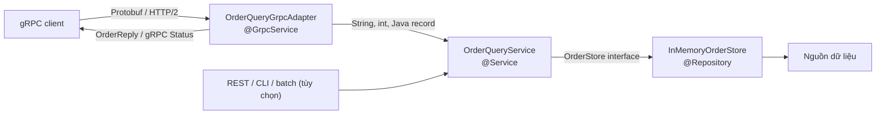

# Tách application service khỏi gRPC adapter

## Mục tiêu bài học

Khi phát triển **SPRING_GRPC**, chúng ta dùng Protocol Buffers để định nghĩa hợp đồng RPC, sinh mã Java và triển khai server hoặc client cho unary và streaming RPC. Trong hệ sinh thái Spring, lớp triển khai gRPC được Spring quản lý như một bean; tuy nhiên, **việc một lớp là Spring bean không có nghĩa mọi logic nghiệp vụ nên nằm trong lớp đó**.

Bài học này tập trung vào cách **tách application service khỏi gRPC adapter**: adapter tiếp nhận và trả dữ liệu theo hợp đồng gRPC, còn application service điều phối use case bằng các kiểu Java độc lập với gRPC. Sự phân chia này giúp tái sử dụng nghiệp vụ, kiểm thử nhanh, chuyển đổi transport dễ hơn và kiểm soát những vấn đề liên quan đến metadata, deadline, status, interceptor, TLS và độ tin cậy ở đúng tầng.

Sau bài này, bạn có thể:

1. Phân biệt nhiệm vụ của gRPC adapter, application service, domain và repository/gateway.
2. Thiết kế chiều phụ thuộc để application service **không import** lớp Protobuf, `StreamObserver` hay `io.grpc.Status`.
3. Triển khai một unary RPC và một server streaming RPC từ cùng một use case nghiệp vụ.
4. Chuyển đổi request/response tại biên giao tiếp và ánh xạ lỗi nghiệp vụ sang gRPC status.
5. Đưa dependency vào Spring bằng constructor injection và giữ trạng thái của mỗi RPC độc lập.
6. Kiểm thử application service không cần gRPC server; kiểm thử adapter mà không cần khởi động toàn bộ ứng dụng.

> **Phạm vi:** Ví dụ sử dụng **Spring gRPC chính thức** (`org.springframework.grpc.server.service.GrpcService`) và gRPC Java. Với starter cộng đồng có `net.devh.boot.grpc.server.service.GrpcService`, package và cấu hình khác; không trộn hai hướng dẫn.

## 1. Vì sao cần tách hai lớp?

Giả sử `OrderQuery` nhận mã đơn hàng, đọc dữ liệu từ kho lưu trữ và trả thông tin đơn. Nếu tất cả được viết trong phương thức `getOrder(...)` của lớp kế thừa `OrderQueryGrpc.OrderQueryImplBase`, mã đó sẽ phụ thuộc đồng thời vào:

- Giao thức gRPC: Protobuf message, `StreamObserver`, `Status`, metadata và deadline.
- Nghiệp vụ: kiểm tra đơn hàng, điều kiện tìm kiếm, chính sách hiển thị và quyền truy cập.
- Hạ tầng: database, cache, HTTP client hoặc một gRPC service khác.

Khi một thay đổi xảy ra ở bất kỳ nhóm nào, cùng một lớp phải sửa và kiểm thử lại. Ví dụ, thêm REST API cho tra cứu đơn hàng có thể khiến bạn sao chép toàn bộ logic đã viết trong gRPC endpoint. Tách lớp giải quyết vấn đề này bằng việc đặt mỗi trách nhiệm ở một nơi có thể kiểm soát.



**Chiều phụ thuộc:** transport adapter phụ thuộc vào application service; application service phụ thuộc vào interface lưu trữ hoặc gateway; implementation hạ tầng đáp ứng interface đó. Chiều import không đi ngược từ application service sang adapter.

| Tầng | Nhiệm vụ chính | Được phép biết gì? | Không nên chứa gì? |
| --- | --- | --- | --- |
| gRPC adapter | Nhận request, ánh xạ kiểu, gọi use case, trả message hoặc gRPC status | Protobuf, generated service base, `StreamObserver`, `Status` | SQL, giao dịch nghiệp vụ, chính sách giá phức tạp |
| Application service | Điều phối use case, kiểm tra điều kiện đầu vào nghiệp vụ, gọi repository/gateway | Domain model, Java record, interface ứng dụng | `io.grpc.*`, `GetOrderRequest`, `OrderReply` |
| Domain | Đại diện dữ liệu và quy tắc nghiệp vụ cốt lõi | Kiểu Java độc lập transport | HTTP/gRPC metadata, serialization |
| Repository/gateway | Truy cập nguồn dữ liệu hoặc dịch vụ ngoài | Công nghệ lưu trữ, client hạ tầng | Quyết định trực tiếp cách trả `StreamObserver` |

Spring vẫn quản lý bean của cả adapter, application service và repository. Annotation `@GrpcService` giúp đưa adapter vào context; khả năng server bind service đến từ lớp generated base triển khai `BindableService`. `@Service` và `@Repository` là stereotype Spring thông thường.

## 2. Nhận diện dấu hiệu trộn trách nhiệm

Đoạn sau thể hiện một **anti-pattern**. Nó chỉ nhằm minh họa vấn đề, không phải mã nên dùng:

```java
@GrpcService
public class OrderQueryGrpcAdapter extends OrderQueryGrpc.OrderQueryImplBase {
    @Override
    public void getOrder(GetOrderRequest request,
                         StreamObserver<OrderReply> responses) {
        // Trộn trong một method: parse input, truy vấn DB, logic nghiệp vụ,
        // Protobuf mapping, bảo mật và xử lý lỗi gRPC.
        var order = jdbcTemplate.queryForObject(
                "select * from orders where id = ?",
                rowMapper,
                request.getOrderId());
        if (!order.isVisible()) {
            responses.onError(Status.PERMISSION_DENIED.asRuntimeException());
            return;
        }
        responses.onNext(OrderReply.newBuilder() /* mapping */.build());
        responses.onCompleted();
    }
}
```

Với cấu trúc này, test nghiệp vụ phải biết gRPC và database; việc thay truy vấn hoặc đổi giao thức đều đụng vào endpoint. Mục tiêu của bài là chuyển các thao tác tìm kiếm và quy tắc use case sang lớp riêng, để adapter ngắn, dễ đọc và dễ kiểm tra ranh giới.

## 3. Hợp đồng Protobuf dùng trong ví dụ

Xây dịch vụ truy vấn đơn hàng với hai RPC:

- `GetOrder`: unary, lấy một đơn theo mã.
- `ListOrders`: server streaming, trả danh sách đơn thuộc một khách hàng với giới hạn số lượng.

Tệp `src/main/proto/order_query.proto`:

```proto
syntax = "proto3";

package orders.v1;

option java_package = "com.example.orders.proto";
option java_multiple_files = true;

service OrderQuery {
  rpc GetOrder(GetOrderRequest) returns (OrderReply);
  rpc ListOrders(ListOrdersRequest) returns (stream OrderReply);
}

message GetOrderRequest {
  string order_id = 1;
}

message ListOrdersRequest {
  string customer_id = 1;
  int32 limit = 2;
}

message OrderReply {
  string order_id = 1;
  string customer_id = 2;
  int64 total_cents = 3;
  string state = 4;
}
```

Build cần `protoc` và `protoc-gen-grpc-java` để tạo message Java cùng `OrderQueryGrpc.OrderQueryImplBase`. Khi dùng Spring Boot có starter gRPC server chính thức và BOM phù hợp, dependency server thường được khai báo như sau:

```xml
<dependency>
    <groupId>org.springframework.boot</groupId>
    <artifactId>spring-boot-starter-grpc-server</artifactId>
</dependency>
```

Dependency trên là phần **server runtime**; build vẫn cần cấu hình sinh mã Protobuf/gRPC Java cho `.proto` theo phiên bản của dự án. Không viết hoặc chỉnh sửa trực tiếp các lớp generated vì lần sinh mã tiếp theo có thể ghi đè chúng.

Lưu ý có hai namespace: `orders.v1.OrderQuery` là tên service trên giao thức, còn `com.example.orders.proto` là Java package của mã generated. Adapter cần import các lớp từ Java package; client dùng tên service trên giao thức khi gọi bằng công cụ như `grpcurl`.

## 4. Thiết kế model và cổng dữ liệu độc lập gRPC

### 4.1. Java record biểu diễn kết quả nghiệp vụ

Tệp `src/main/java/com/example/orders/domain/OrderSummary.java`:

```java
package com.example.orders.domain;

public record OrderSummary(
        String orderId,
        String customerId,
        long totalCents,
        String state) {
}
```

Record này không import Protobuf. Nếu thay đổi `OrderReply` ở phía transport, ta có thể chỉ cần sửa mapper ở adapter mà không bắt buộc sửa `OrderSummary`. Trong thực tế, domain có thể dùng enum, value object cho tiền và ID; ví dụ dùng kiểu đơn giản để tập trung vào phân tầng.

### 4.2. Interface truy cập đơn hàng

Tệp `src/main/java/com/example/orders/application/OrderStore.java`:

```java
package com.example.orders.application;

import com.example.orders.domain.OrderSummary;
import java.util.List;
import java.util.Optional;

public interface OrderStore {
    Optional<OrderSummary> findById(String orderId);
    List<OrderSummary> findByCustomerId(String customerId, int limit);
}
```

Application service phụ thuộc vào **hành vi** của `OrderStore`, không phụ thuộc vào SQL/JPA/gRPC stub. Phần implementation có thể nằm trong tầng persistence, được Spring cung cấp qua constructor injection.

### 4.3. Repository lưu dữ liệu giả để thực hành

Tệp `src/main/java/com/example/orders/infrastructure/InMemoryOrderStore.java`:

```java
package com.example.orders.infrastructure;

import com.example.orders.application.OrderStore;
import com.example.orders.domain.OrderSummary;
import java.util.Comparator;
import java.util.List;
import java.util.Map;
import java.util.Optional;
import org.springframework.stereotype.Repository;

@Repository
public class InMemoryOrderStore implements OrderStore {

    private final Map<String, OrderSummary> orders = Map.of(
            "ord-1001", new OrderSummary("ord-1001", "cus-1", 250_000L, "PAID"),
            "ord-1002", new OrderSummary("ord-1002", "cus-1", 510_000L, "NEW"),
            "ord-1003", new OrderSummary("ord-1003", "cus-2", 135_000L, "PAID"));

    @Override
    public Optional<OrderSummary> findById(String orderId) {
        return Optional.ofNullable(orders.get(orderId));
    }

    @Override
    public List<OrderSummary> findByCustomerId(String customerId, int limit) {
        return orders.values().stream()
                .filter(order -> order.customerId().equals(customerId))
                .sorted(Comparator.comparing(OrderSummary::orderId))
                .limit(limit)
                .toList();
    }
}
```

Map là dữ liệu bất biến dùng chung giữa các RPC, phù hợp cho demo. Khi dùng database, cần có lọc và giới hạn ngay ở câu truy vấn để tránh nạp toàn bộ dữ liệu vào bộ nhớ. Một truy vấn list trong production cũng cần cơ chế pagination hoặc cursor rõ ràng cho tập dữ liệu lớn.

## 5. Application service chỉ chứa logic use case

### 5.1. Một lỗi nghiệp vụ không phụ thuộc gRPC

Tệp `src/main/java/com/example/orders/application/OrderNotFoundException.java`:

```java
package com.example.orders.application;

public class OrderNotFoundException extends RuntimeException {
    public OrderNotFoundException(String orderId) {
        super("Không tìm thấy đơn hàng: " + orderId);
    }
}
```

`OrderNotFoundException` là lỗi của ứng dụng. Không cho exception này kế thừa `StatusRuntimeException`, vì như vậy application service sẽ phụ thuộc trực tiếp vào transport. Adapter sẽ quyết định lỗi nào tương ứng `NOT_FOUND` trên gRPC; một REST adapter khác có thể ánh xạ sang HTTP 404 mà vẫn dùng cùng application service.

### 5.2. Điều phối các thao tác truy vấn

Tệp `src/main/java/com/example/orders/application/OrderQueryService.java`:

```java
package com.example.orders.application;

import com.example.orders.domain.OrderSummary;
import java.util.List;
import org.springframework.stereotype.Service;

@Service
public class OrderQueryService {

    private static final int MAX_LIST_LIMIT = 50;

    private final OrderStore orderStore;

    public OrderQueryService(OrderStore orderStore) {
        this.orderStore = orderStore;
    }

    public OrderSummary getOrder(String orderId) {
        if (orderId == null || orderId.isBlank()) {
            throw new IllegalArgumentException("orderId không được rỗng");
        }

        return orderStore.findById(orderId)
                .orElseThrow(() -> new OrderNotFoundException(orderId));
    }

    public List<OrderSummary> listOrders(String customerId, int limit) {
        if (customerId == null || customerId.isBlank()) {
            throw new IllegalArgumentException("customerId không được rỗng");
        }
        if (limit < 1 || limit > MAX_LIST_LIMIT) {
            throw new IllegalArgumentException("limit phải từ 1 đến 50");
        }

        return orderStore.findByCustomerId(customerId, limit);
    }
}
```

Đây là **application service độc lập với Protobuf và gRPC**: không có `GetOrderRequest`, `OrderReply`, `StreamObserver`, `Status`, `ServerCall` hay metadata. Nó nhận các kiểu Java đơn giản, gọi `OrderStore` và trả domain record hoặc collection. Validation đối với dữ liệu use case nằm trong service để mọi adapter sử dụng chung quy tắc, không chỉ gRPC.

Trong ví dụ, `limit=0` được xem là không hợp lệ. Nếu API muốn dùng `0` để biểu thị “dùng mặc định”, cần định nghĩa quy ước trong hợp đồng và xử lý nhất quán. Proto3 không phân biệt một scalar `int32` vắng mặt với giá trị mặc định `0` trừ khi thiết kế field có presence phù hợp; vì vậy đừng vô tình áp đặt một mặc định không được quy định.

> **Lưu ý bảo mật của ví dụ:** Các `orderId` và `customerId` được client cung cấp chỉ nhằm thực hành cách tách lớp. API cung cấp dữ liệu đơn hàng thật phải lấy identity đã xác thực từ cơ chế bảo mật và kiểm tra quyền sở hữu/quyền truy cập trong application service hoặc policy được gọi từ đó. Không cho phép truy vấn đơn hàng bất kỳ chỉ vì client biết ID; để tránh rò rỉ tồn tại của dữ liệu, đôi khi nên trả cùng một lỗi cho tài nguyên không tồn tại và không có quyền xem.

## 6. gRPC adapter chuyển đổi dữ liệu và lỗi ở biên

Đặt tệp `src/main/java/com/example/orders/grpc/OrderQueryGrpcAdapter.java`:

```java
package com.example.orders.grpc;

import com.example.orders.application.OrderNotFoundException;
import com.example.orders.application.OrderQueryService;
import com.example.orders.domain.OrderSummary;
import com.example.orders.proto.GetOrderRequest;
import com.example.orders.proto.ListOrdersRequest;
import com.example.orders.proto.OrderQueryGrpc;
import com.example.orders.proto.OrderReply;
import io.grpc.Context;
import io.grpc.Status;
import io.grpc.stub.StreamObserver;
import java.util.List;
import org.slf4j.Logger;
import org.slf4j.LoggerFactory;
import org.springframework.grpc.server.service.GrpcService;

@GrpcService
public class OrderQueryGrpcAdapter
        extends OrderQueryGrpc.OrderQueryImplBase {

    private static final Logger log =
            LoggerFactory.getLogger(OrderQueryGrpcAdapter.class);

    private final OrderQueryService application;

    public OrderQueryGrpcAdapter(OrderQueryService application) {
        this.application = application;
    }

    @Override
    public void getOrder(GetOrderRequest request,
                         StreamObserver<OrderReply> responses) {
        final OrderReply reply;
        try {
            OrderSummary order = application.getOrder(request.getOrderId());
            reply = toProto(order);
        } catch (IllegalArgumentException ex) {
            responses.onError(Status.INVALID_ARGUMENT
                    .withDescription(ex.getMessage())
                    .asRuntimeException());
            return;
        } catch (OrderNotFoundException ex) {
            responses.onError(Status.NOT_FOUND
                    .withDescription(ex.getMessage())
                    .asRuntimeException());
            return;
        } catch (RuntimeException ex) {
            log.error("GetOrder thất bại", ex);
            responses.onError(Status.INTERNAL
                    .withDescription("Không thể xử lý yêu cầu")
                    .asRuntimeException());
            return;
        }

        responses.onNext(reply);
        responses.onCompleted();
    }

    @Override
    public void listOrders(ListOrdersRequest request,
                           StreamObserver<OrderReply> responses) {
        final List<OrderReply> replies;
        try {
            replies = application.listOrders(
                            request.getCustomerId(), request.getLimit())
                    .stream()
                    .map(this::toProto)
                    .toList();
        } catch (IllegalArgumentException ex) {
            responses.onError(Status.INVALID_ARGUMENT
                    .withDescription(ex.getMessage())
                    .asRuntimeException());
            return;
        } catch (RuntimeException ex) {
            log.error("ListOrders thất bại", ex);
            responses.onError(Status.INTERNAL
                    .withDescription("Không thể xử lý yêu cầu")
                    .asRuntimeException());
            return;
        }

        // Ví dụ danh sách hữu hạn; streaming sản xuất cần flow control.
        for (OrderReply reply : replies) {
            if (Context.current().isCancelled()) {
                return;
            }
            responses.onNext(reply);
        }
        if (!Context.current().isCancelled()) {
            responses.onCompleted();
        }
    }

    private OrderReply toProto(OrderSummary order) {
        return OrderReply.newBuilder()
                .setOrderId(order.orderId())
                .setCustomerId(order.customerId())
                .setTotalCents(order.totalCents())
                .setState(order.state())
                .build();
    }
}
```

Adapter thực hiện các thao tác liên quan đến transport: trích dữ liệu từ Protobuf request, gọi application service, chuyển `OrderSummary` thành Protobuf response và quyết định gRPC status tương ứng với kết quả/lỗi. Application service không biết nó đang được gọi qua unary RPC hay một luồng gRPC.

Trong `getOrder`, adapter **chuẩn bị response trước khi gửi `onNext`**. Do đó lỗi từ ứng dụng hoặc mapper được xử lý trước khi phát message. Sau khi phát response thành công, method gọi `onCompleted()`. Không gửi tiếp bất kỳ `onNext` hay `onCompleted` nào sau `onError`.

Trong `listOrders`, ứng dụng trả danh sách hữu hạn; adapter chuyển thành danh sách protobuf trước khi bắt đầu streaming. Điều này phù hợp demo nhỏ. Với stream dữ liệu lớn, không nên gom tất cả vào RAM; thiết kế ứng dụng để duyệt theo trang/chunk hoặc trả abstraction luồng phù hợp và xây adapter xử lý flow control, cancellation và deadline.

### Bảng ánh xạ lỗi giữa các tầng

| Ở application service | Ở gRPC adapter | Ý nghĩa phía client |
| --- | --- | --- |
| Trả `OrderSummary` hợp lệ | `onNext(reply)` rồi `onCompleted()` | Unary thành công |
| Trả `List<OrderSummary>` hợp lệ | Nhiều `onNext(reply)` rồi `onCompleted()` | Server streaming thành công |
| `IllegalArgumentException` từ validation có chủ đích | `Status.INVALID_ARGUMENT` | Dữ liệu request không hợp lệ |
| `OrderNotFoundException` | `Status.NOT_FOUND` | Không tìm thấy tài nguyên cần truy vấn |
| Lỗi bất ngờ chưa được phân loại | Log phía server, trả `Status.INTERNAL` với thông báo an toàn | Server xử lý thất bại |
| Lỗi dependency từ xa có phân loại | Ánh xạ theo chính sách rõ ràng, ví dụ `UNAVAILABLE` | Lỗi hạ tầng tạm thời; không đồng nghĩa mọi trường hợp đều retry được |

Đừng mặc định mọi `RuntimeException` là lỗi đầu vào. Chỉ map những exception **được application contract định nghĩa**; lỗi lập trình hoặc lỗi hệ thống không nên bị biến thành `INVALID_ARGUMENT`. Cũng không truyền stack trace, SQL, token hoặc thông tin nội bộ cho client qua `Status.withDescription(...)`.

Ví dụ dùng `IllegalArgumentException` để đơn giản hóa. Ở dự án lớn, nên tạo lỗi use case riêng như `InvalidOrderQueryException` để không vô tình phân loại sai lỗi `IllegalArgumentException` phát sinh từ thư viện hoặc bug. Khi áp dụng chính sách lỗi tập trung, vẫn giữ mapping trong adapter/interceptor ở tầng gRPC, không đưa `Status` vào application service.

## 7. Đăng ký Spring bean và chạy server

Đặt lớp `@SpringBootApplication` trong package cha để component scan bao phủ `application`, `infrastructure` và `grpc`:

```java
package com.example.orders;

import org.springframework.boot.SpringApplication;
import org.springframework.boot.autoconfigure.SpringBootApplication;

@SpringBootApplication
public class OrderApplication {
    public static void main(String[] args) {
        SpringApplication.run(OrderApplication.class, args);
    }
}
```

Cấu trúc tệp minh họa:

```text
src/main/
├── proto/order_query.proto
└── java/com/example/orders/
    ├── OrderApplication.java
    ├── domain/OrderSummary.java
    ├── application/OrderStore.java
    ├── application/OrderNotFoundException.java
    ├── application/OrderQueryService.java
    ├── infrastructure/InMemoryOrderStore.java
    └── grpc/OrderQueryGrpcAdapter.java
```

Spring tạo `InMemoryOrderStore` từ `@Repository`, inject vào `OrderQueryService` từ `@Service`, rồi inject service vào `OrderQueryGrpcAdapter` từ `@GrpcService`. Khi server factory hoạt động, Spring gRPC phát hiện adapter dưới kiểu `BindableService` và bind service descriptor `orders.v1.OrderQuery`.

Nếu dùng Netty/native gRPC server từ starter tương ứng, có thể đặt cổng, ví dụ:

```yaml
spring:
  grpc:
    server:
      port: 9091
```

Khi phục vụ gRPC qua servlet/HTTP server, cổng và HTTP/2 phụ thuộc `server.port` cùng cấu hình web transport; không suy ra cổng native ở mọi môi trường. Spring bean được tạo thành công mới chỉ cho biết dependency graph hợp lệ, chưa chứng minh client đã gọi được server hoặc TLS khớp cấu hình.

## 8. Những quy tắc cần giữ đúng khi triển khai thực tế

### 8.1. Không để application service phụ thuộc vào gRPC Context

Khi client truyền metadata (token, locale, correlation ID) qua gRPC, việc **đọc metadata** nên diễn ra tại interceptor hoặc adapter, sau đó chỉ đưa dữ liệu thực sự cần thiết vào use case qua kiểu Java độc lập. Ví dụ:

```java
// Kiểu thuần Java ở tầng application.
public record CallerIdentity(String subjectId, String tenantId) {
}

// API của application service sau khi mở rộng:
public OrderSummary getOrder(String orderId, CallerIdentity caller) {
    // Kiểm tra caller có quyền truy cập đơn hàng trước khi trả dữ liệu.
    // Phụ thuộc vào policy / repository, không import io.grpc.Metadata.
}
```

Đoạn trên chỉ minh họa **chữ ký mở rộng**, không phải method đầy đủ để chép vào class đang có mà không bổ sung phần thân và dependency. `CallerIdentity` phải lấy từ danh tính **đã được xác minh**, không sao chép nguyên `customerId` chưa xác thực từ request rồi tin là có quyền. Interceptor có thể xác thực metadata và tạo đối tượng context, nhưng quyết định quyền xem đơn hàng thường cần kiểm tra thêm trong use case hoặc policy. Không lưu identity trong field mutable dùng chung của singleton `@GrpcService`.

### 8.2. Deadline và cancellation cần được truyền theo ý nghĩa nghiệp vụ

`Context.current()` và `Deadline` thuộc gRPC. Adapter có thể theo dõi hủy cuộc gọi, song application service không nên buộc phải import `io.grpc.Context` nếu muốn tái sử dụng use case từ REST/CLI. Có thể đưa một abstraction nhỏ như thời điểm kết thúc hoặc cancellation signal do ứng dụng định nghĩa khi thật sự cần.

```text
gRPC call deadline
        |
        v
Adapter quan sát deadline / cancellation
        |
        v
Application service nhận timeout budget hoặc deadline thuần Java
        |
        v
Repository / remote gateway áp dụng timeout phù hợp
```

Không chỉ đặt deadline ở client mà bỏ mặc những lời gọi từ application service tới database hoặc downstream gRPC client chạy vô thời hạn. Khi downstream có nguy cơ bị chậm, hãy thiết lập timeout cho repository/client, truyền cancellation hợp lý và ngừng công việc không cần thiết khi cuộc gọi đã bị hủy. Nếu sử dụng generated client stub trong gateway, có thể thiết lập deadline trên stub của từng lời gọi qua `withDeadlineAfter(...)`, không chỉnh một trạng thái dùng chung giữa các request.

### 8.3. Giao dịch và streaming là hai vòng đời khác nhau

Nếu cần truy vấn dữ liệu trong transaction, application service có thể dùng `@Transactional(readOnly = true)` cho phương thức lấy snapshot. Tuy nhiên, **không giữ transaction hoặc kết nối database mở suốt một streaming RPC dài**. Với stream lớn, hãy thiết kế cách lấy trang dữ liệu, snapshot nhất quán hoặc luồng bất đồng bộ có vòng đời tài nguyên rõ ràng.

Trong demo, `listOrders(...)` lấy tối đa 50 phần tử rồi đóng scope nghiệp vụ trước khi adapter bắt đầu phát các message. Với production, lựa chọn `List` hay iterator/publisher cần dựa trên kích thước dữ liệu, backpressure và cách xử lý cancellation.

### 8.4. Một bean singleton phục vụ nhiều RPC đồng thời

`OrderQueryGrpcAdapter` và `OrderQueryService` mặc định là singleton Spring bean. Từng RPC có `request` và `StreamObserver` riêng; **không** đặt chúng vào field mutable của singleton. `final OrderQueryService application` là dependency dùng chung bình thường. Repository cần thread-safe hoặc được framework quản lý đúng cách. Nếu có nhiều thread cùng gọi `onNext` lên cùng observer, phải tuần tự hóa các lệnh gửi; không mặc định `StreamObserver` là thread-safe.

### 8.5. Interceptor, TLS và quan sát hiệu năng thuộc tầng phù hợp

Interceptor gRPC có thể kiểm tra metadata, xác thực kết nối, gắn correlation ID và ghi metric trước/sau RPC. TLS được cấu hình ở transport/channel, không phải ở application service. Observability nên phân biệt tổng thời lượng RPC với thời gian xử lý use case và truy vấn repository; nhờ đó khi gRPC chậm có thể tìm nguyên nhân ở serialization, mạng, database hoặc downstream.

Mục tiêu của kiến trúc là giữ application service dễ hiểu mà vẫn cho phép adapter triển khai chính sách gRPC như status, metadata, deadline và kiểm soát luồng. Không cần chuyển mọi class thành interface; chỉ tạo abstraction ở những nơi có hợp đồng rõ ràng hoặc phụ thuộc hạ tầng cần thay thế.

## 9. Kiểm thử từng tầng độc lập

### 9.1. Kiểm thử application service không cần gRPC

Vì `OrderQueryService` không import Protobuf hay gRPC, có thể tạo repository giả bằng implementation in-memory và kiểm tra nghiệp vụ bằng JUnit/AssertJ:

```java
package com.example.orders.application;

import com.example.orders.infrastructure.InMemoryOrderStore;
import org.junit.jupiter.api.Test;

import static org.assertj.core.api.Assertions.assertThat;
import static org.assertj.core.api.Assertions.assertThatThrownBy;

class OrderQueryServiceTest {

    private final OrderQueryService service =
            new OrderQueryService(new InMemoryOrderStore());

    @Test
    void getExistingOrder() {
        var order = service.getOrder("ord-1001");
        assertThat(order.customerId()).isEqualTo("cus-1");
        assertThat(order.totalCents()).isEqualTo(250_000L);
    }

    @Test
    void rejectOutOfRangeLimit() {
        assertThatThrownBy(() -> service.listOrders("cus-1", 100))
                .isInstanceOf(IllegalArgumentException.class);
    }

    @Test
    void missingOrderHasDomainError() {
        assertThatThrownBy(() -> service.getOrder("ord-9999"))
                .isInstanceOf(OrderNotFoundException.class);
    }
}
```

Đây là unit test thuần Java: không khởi động Spring, không mở port, không tạo channel. Nó xác minh validation, dữ liệu truy vấn và lỗi ứng dụng; thay đổi schema Protobuf không bắt buộc làm test này thay đổi.

### 9.2. Kiểm thử gRPC adapter bằng application service mock

Adapter cần chứng minh `OrderSummary` được map thành `OrderReply` và lỗi nghiệp vụ thành status thích hợp. Mockito/JUnit cho phép dựng adapter với mock `OrderQueryService` mà không mở server:

```java
package com.example.orders.grpc;

import com.example.orders.application.OrderNotFoundException;
import com.example.orders.application.OrderQueryService;
import com.example.orders.domain.OrderSummary;
import com.example.orders.proto.GetOrderRequest;
import com.example.orders.proto.OrderReply;
import io.grpc.Status;
import io.grpc.stub.StreamObserver;
import org.junit.jupiter.api.Test;
import org.mockito.ArgumentCaptor;

import static org.assertj.core.api.Assertions.assertThat;
import static org.mockito.ArgumentMatchers.any;
import static org.mockito.ArgumentMatchers.argThat;
import static org.mockito.Mockito.mock;
import static org.mockito.Mockito.never;
import static org.mockito.Mockito.verify;
import static org.mockito.Mockito.when;

class OrderQueryGrpcAdapterTest {

    private final OrderQueryService application = mock(OrderQueryService.class);
    private final OrderQueryGrpcAdapter adapter =
            new OrderQueryGrpcAdapter(application);

    @SuppressWarnings("unchecked")
    private StreamObserver<OrderReply> observer() {
        return (StreamObserver<OrderReply>) mock(StreamObserver.class);
    }

    @Test
    void mapsSuccessToProtobuf() {
        var responses = observer();
        when(application.getOrder("ord-1001")).thenReturn(
                new OrderSummary("ord-1001", "cus-1", 250_000L, "PAID"));

        adapter.getOrder(GetOrderRequest.newBuilder()
                .setOrderId("ord-1001").build(), responses);

        verify(responses).onNext(argThat(reply ->
                reply.getOrderId().equals("ord-1001")
                        && reply.getTotalCents() == 250_000L));
        verify(responses).onCompleted();
        verify(responses, never()).onError(any());
    }

    @Test
    void mapsNotFoundToGrpcStatus() {
        var responses = observer();
        when(application.getOrder("ord-9999"))
                .thenThrow(new OrderNotFoundException("ord-9999"));

        adapter.getOrder(GetOrderRequest.newBuilder()
                .setOrderId("ord-9999").build(), responses);

        var error = ArgumentCaptor.forClass(Throwable.class);
        verify(responses).onError(error.capture());
        assertThat(Status.fromThrowable(error.getValue()).getCode())
                .isEqualTo(Status.Code.NOT_FOUND);
        verify(responses, never()).onNext(any());
        verify(responses, never()).onCompleted();
    }
}
```

Test này tập trung vào gRPC boundary; nó không kiểm chứng SQL, transaction, TLS hay server đang thực sự lắng nghe. Khi cần kiểm tra interceptor, deadline, metadata và network, bổ sung integration test với generated stub cùng server in-process hoặc native.

### 9.3. Kiểm tra Spring wiring và service descriptor

Có thể dùng Spring Boot context test để xác minh Spring đã tạo đủ bean và gRPC service được nhận diện:

```java
package com.example.orders;

import com.example.orders.application.OrderQueryService;
import com.example.orders.grpc.OrderQueryGrpcAdapter;
import io.grpc.BindableService;
import org.junit.jupiter.api.Test;
import org.springframework.beans.factory.annotation.Autowired;
import org.springframework.boot.test.context.SpringBootTest;
import org.springframework.context.ApplicationContext;

import static org.assertj.core.api.Assertions.assertThat;

@SpringBootTest(properties = "spring.grpc.server.port=0")
class OrderGrpcWiringTest {

    @Autowired
    ApplicationContext context;

    @Test
    void createsAdapterAndApplicationService() {
        assertThat(context.getBean(OrderQueryService.class)).isNotNull();
        assertThat(context.getBean(OrderQueryGrpcAdapter.class)).isNotNull();

        assertThat(context.getBeansOfType(BindableService.class).values())
                .anySatisfy(service -> assertThat(
                        service.bindService().getServiceDescriptor().getName())
                        .isEqualTo("orders.v1.OrderQuery"));
    }
}
```

Với native gRPC server hỗ trợ cổng động, `spring.grpc.server.port=0` tránh xung đột cổng khi test. Test này xác nhận bean và descriptor; để chứng minh transport thực hoạt động, phải gọi RPC bằng generated client stub hoặc `grpcurl`. Nếu có nhiều server factory hoặc service filter, cần kiểm tra service được bind đúng vào server mục tiêu.

## 10. Kiểm tra RPC từ bên ngoài bằng `grpcurl`

Sau khi chạy ứng dụng với cấu hình native server ở cổng `9091` và **không bật TLS** trong môi trường phát triển, từ thư mục dự án có `src/main/proto/order_query.proto`:

```bash
grpcurl -plaintext \
  -import-path src/main/proto \
  -proto order_query.proto \
  -d '{"orderId":"ord-1001"}' \
  localhost:9091 orders.v1.OrderQuery/GetOrder
```

Phản hồi ProtoJSON dự kiến:

```json
{
  "orderId": "ord-1001",
  "customerId": "cus-1",
  "totalCents": "250000",
  "state": "PAID"
}
```

Field `int64` theo ProtoJSON được biểu diễn thành **chuỗi JSON**, dù trong Java là `long`. Thử `orderId` rỗng sẽ trả `INVALID_ARGUMENT`; `ord-9999` trả `NOT_FOUND`.

Gọi server streaming:

```bash
grpcurl -plaintext \
  -import-path src/main/proto \
  -proto order_query.proto \
  -d '{"customerId":"cus-1","limit":2}' \
  localhost:9091 orders.v1.OrderQuery/ListOrders
```

Client nhận lần lượt hai `OrderReply` của `ord-1001` và `ord-1002`, sau đó stream kết thúc. `grpcurl` dùng file `.proto` trực tiếp nên không cần server reflection. Để dùng `grpcurl list` mà không truyền `.proto`, phải bổ sung và bật Reflection service phù hợp. Với TLS, không dùng `-plaintext`; phải cấu hình trust và certificate theo server.

## 11. Các quyết định kiến trúc và lỗi thường gặp

| Tình huống | Nguyên nhân/rủi ro | Hướng xử lý |
| --- | --- | --- |
| Application service nhận `GetOrderRequest` làm tham số | Use case phụ thuộc message generated và schema transport | Chuyển đổi tại adapter; use case nhận kiểu Java/domain hoặc command riêng |
| Application service gọi `responseObserver.onError(...)` | Nghiệp vụ biết trực tiếp vòng đời gRPC | Ném exception ứng dụng có chủ đích; adapter ánh xạ sang `Status` |
| Adapter tự truy vấn SQL hoặc gọi nhiều downstream | Trộn transport và xử lý nghiệp vụ; khó kiểm thử | Chuyển điều phối sang application service, chi tiết lưu trữ sang repository/gateway |
| Endpoint tự `new OrderQueryService(...)` | Bỏ qua Spring DI, khó thay dependency để test | Dùng constructor injection và Spring quản lý bean |
| Không tìm thấy bean tại startup | Component nằm ngoài scan hoặc thiếu stereotype/cấu hình | Đặt lớp khởi động ở package cha, kiểm tra `@Service`, `@Repository`, `@GrpcService` |
| Có nhiều `OrderStore` bean cùng kiểu | Spring không biết inject implementation nào | Chọn `@Qualifier`, `@Primary` hoặc cấu hình theo profile/condition |
| Client nhận `UNIMPLEMENTED` | Sai service/method, chưa override hoặc chưa bind adapter | Kiểm tra generated base, `bindService()` và server factory/filter |
| Client nhận `INTERNAL` khi backend gặp lỗi | Lỗi backend chưa được phân loại | Log nội bộ và quyết định mapping có chủ đích; không trả stack trace cho client |
| Lộ dữ liệu khách hàng khi biết `orderId` | Thiếu kiểm tra quyền truy cập trong use case | Truyền identity tin cậy và kiểm tra quyền theo resource |
| Streaming tốn RAM hoặc chặn luồng | Adapter gom dataset lớn, không có backpressure | Phân trang, xử lý flow control, cancellation/deadline và nguồn bất đồng bộ |
| RPC chậm mặc dù adapter ngắn | Repository hoặc remote gateway có độ trễ | Đặt timeout, truyền deadline, ghi metric cho từng tầng |
| Kiểm thử dùng duy nhất `@SpringBootTest` | Mọi lỗi đều cần khởi động server đầy đủ để tái hiện | Test application service bằng Java thuần, adapter bằng mock, tích hợp bằng stub |

### Những ranh giới nên giữ ổn định

Khi phát triển thêm RPC `CreateOrder`, `CancelOrder`, client streaming hoặc bidirectional streaming, nguyên tắc phân tầng vẫn như cũ. Adapter nhận chuỗi message và chuyển chúng thành dữ liệu của use case; application service xác định hành vi nghiệp vụ; repository/gateway thực hiện I/O; adapter xử lý giao thức trả lời. Đối với stream dài, có thể cần một abstraction bất đồng bộ hoặc cơ chế callback do ứng dụng sở hữu, nhưng không vì vậy mà đưa `StreamObserver` thành kiểu dữ liệu trung tâm của domain.

Đừng tạo thêm quá nhiều lớp hoặc interface chỉ vì muốn đạt một mô hình kiến trúc hình thức. Một service nhỏ có thể bắt đầu với adapter → application service → repository; chỉ tách mapper, policy hoặc gateway riêng khi có lý do như phức tạp, nhiều call site hoặc cần test/thay thế độc lập.

## 12. Bài tập thực hành

1. **Tách code:** Viết một phiên bản `OrderQueryGrpcAdapter` có logic tìm dữ liệu trực tiếp. Sau đó chuyển toàn bộ truy vấn và validation use case vào `OrderQueryService`; so sánh số import gRPC ở application layer trước và sau.
2. **Thêm trạng thái:** Bổ sung quy tắc `listOrders` chỉ trả đơn có state `PAID`. Kiểm tra quy tắc bằng unit test **không** khởi chạy Spring/gRPC; adapter giữ nguyên phần ánh xạ Protobuf.
3. **Thử REST adapter:** Tạo một REST controller dùng lại `OrderQueryService.getOrder` và tự ánh xạ `OrderNotFoundException` sang HTTP 404. Bảo đảm application service vẫn không import HTTP hoặc gRPC.
4. **Ánh xạ lỗi:** Bổ sung exception `InvalidOrderQueryException`, thay `IllegalArgumentException` cho các lỗi validation do use case chủ động phát ra, rồi cập nhật mapping sang `INVALID_ARGUMENT` tại adapter.
5. **Kiểm tra bảo mật:** Thiết kế `CallerIdentity` và thêm điều kiện chỉ chủ đơn hoặc vai trò được cấp quyền mới xem được đơn. Nguồn identity phải từ xác thực, không dựa vào `customerId` tự khai báo trong request.
6. **Tăng độ lớn dữ liệu:** Thay `InMemoryOrderStore` bằng repository trả hàng nghìn đơn. Thiết kế pagination, flow control và cancellation để không giữ toàn bộ kết quả trong RAM suốt stream.
7. **Kiểm thử toàn đường đi:** Tạo integration test với server in-process hoặc native, gọi `GetOrder` bằng generated stub; kiểm tra cả `NOT_FOUND`, deadline và interceptor gắn metadata correlation ID.

### Câu hỏi tự kiểm tra

- Tại sao application service nên trả `OrderSummary` thay vì `OrderReply` Protobuf?
- Lớp nào quyết định trả gRPC `NOT_FOUND`, lớp nào ném `OrderNotFoundException` và vì sao?
- Khi thêm HTTP REST endpoint, phần logic nào có thể dùng lại nguyên vẹn?
- Nên đặt `@Transactional` ở đâu và vì sao cần thận trọng với transaction kéo dài qua streaming?
- Nếu gRPC client hủy cuộc gọi giữa chừng, tầng nào trực tiếp nhận biết gRPC cancellation và làm sao truyền tác động tới nghiệp vụ?
- Vì sao một Spring bean được inject thành công không chứng minh downstream RPC sẽ phản hồi đúng deadline?
- Khác biệt giữa unit test application service, unit test adapter và integration test có gRPC server là gì?
- Khi nào việc dùng interface riêng cho repository/gateway có giá trị thực tế, và khi nào chỉ tạo thêm sự phức tạp?

## Tài liệu tham khảo

- [Spring gRPC — GRPC Server](https://docs.spring.io/spring-grpc/reference/server.html): Spring phát hiện các bean `BindableService` và gắn vào gRPC server.
- [Spring Framework — Dependency Injection](https://docs.spring.io/spring-framework/reference/core/beans/dependencies/factory-collaborators.html): constructor injection và tổ chức dependency giữa bean.
- [Spring Framework — Transaction Management](https://docs.spring.io/spring-framework/reference/data-access/transaction.html): ranh giới giao dịch trong tầng ứng dụng.
- [gRPC Java — Basics Tutorial](https://grpc.io/docs/languages/java/basics/): triển khai unary/server streaming RPC và generated base.
- [gRPC Java — StreamObserver](https://grpc.github.io/grpc-java/javadoc/io/grpc/stub/StreamObserver.html): gửi response và các sự kiện kết thúc stream.
- [gRPC — Deadlines](https://grpc.io/docs/guides/deadlines/): ngân sách thời gian và propagation giữa các RPC.
- [Protocol Buffers — ProtoJSON](https://protobuf.dev/programming-guides/json/): ánh xạ `int64` và các kiểu dữ liệu Protobuf sang JSON.

**Kết quả mong đợi:** Người học xây được `OrderQueryGrpcAdapter` chỉ làm nhiệm vụ giao tiếp gRPC, `OrderQueryService` chứa use case không phụ thuộc transport, `OrderStore` cung cấp truy cập dữ liệu, đồng thời kiểm thử được từng tầng và gọi được `orders.v1.OrderQuery/GetOrder` hoặc `/ListOrders` với gRPC status phù hợp. Cấu trúc này tạo nền tảng cho streaming, metadata, deadline, interceptor, TLS, kiểm thử tích hợp và giám sát hệ thống ổn định.
