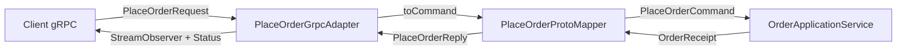

# Mapping protobuf DTO sang domain command

## Mục tiêu bài học

Trong module **SPRING_GRPC**, Protocol Buffers mô tả hợp đồng trao đổi dữ liệu và gRPC sinh mã Java để client/server gọi unary hoặc streaming RPC. Đối tượng request được sinh từ `.proto` là **DTO ở ranh giới giao tiếp**; đối tượng đầu vào của nghiệp vụ nên là **domain/application command** có ý nghĩa rõ ràng, độc lập với transport.

Bài học này hướng dẫn thiết kế ranh giới đó trong một ứng dụng Spring gRPC: nhận `PlaceOrderRequest`, kiểm tra cấu trúc dữ liệu, chuyển sang `PlaceOrderCommand` bất biến, gọi application service rồi chuyển kết quả về Protobuf. Những nguyên tắc này cũng áp dụng khi xử lý metadata, deadline, status, interceptor, TLS, kiểm thử tích hợp và quan sát độ tin cậy của RPC.

Sau bài học, bạn có thể:

1. Phân biệt **Protobuf DTO**, **application command**, **domain model** và **response DTO**.
2. Viết mapper xử lý đúng `repeated`, `optional`, `oneof`, các giá trị mặc định proto3 và `google.protobuf.Timestamp`.
3. Bảo vệ application layer khỏi phụ thuộc vào `com.google.protobuf.*` và `io.grpc.*`.
4. Xác định validation thuộc ranh giới giao tiếp và validation thuộc quy tắc nghiệp vụ.
5. Ánh xạ lỗi domain/validation sang gRPC status mà không làm application service biết `StreamObserver`.
6. Viết unit test mapper, adapter và kiểm thử Spring wiring/đường đi RPC.

> **Phạm vi công nghệ:** Ví dụ dùng Spring gRPC chính thức (`org.springframework.grpc.server.service.GrpcService`), gRPC Java và Java 17 trở lên (record, sealed interface, switch expression). Các package và cấu hình của starter cộng đồng `net.devh` có thể khác.

## 1. Protobuf DTO và domain command phục vụ hai mục đích

Protobuf DTO được sinh từ hợp đồng bên ngoài. Nó tối ưu cho **wire format**, tương thích schema, mã hóa/giải mã, định nghĩa field number và hỗ trợ nhiều ngôn ngữ. Command mô tả **một hành động mà ứng dụng phải thực hiện**, với các kiểu dữ liệu và bất biến phù hợp cho nghiệp vụ.

Ví dụ người dùng đặt hàng qua RPC. `PlaceOrderRequest` mang thông tin khách hàng, các dòng sản phẩm và lựa chọn giao hàng. `PlaceOrderCommand` diễn đạt ý định “đặt đơn hàng” dưới dạng Java mà không phải biết thông tin đó đến từ gRPC, REST hay job nội bộ.



| Khía cạnh | Protobuf DTO | Application command |
| --- | --- | --- |
| Nguồn gốc | Sinh từ `.proto` | Java type do ứng dụng định nghĩa |
| Tên trường | Phù hợp schema public và tương thích wire | Phù hợp ngữ nghĩa use case |
| Sự hiện diện | `hasXxx()` cho message/`optional`/`oneof`; scalar proto3 thông thường có default | Có thể dùng `Optional`, kiểu riêng hoặc bất biến của ứng dụng |
| Collection | `ProtocolStringList` / `List` từ generated API | `List.copyOf(...)`, value object bất biến |
| Thời gian | `google.protobuf.Timestamp` | `java.time.Instant` |
| Lỗi | gRPC status tại adapter | Exception/result của application |
| Mức độ phụ thuộc | Biết gRPC/Protobuf | Không import gRPC/Protobuf |

**Luồng phụ thuộc nên đi từ adapter vào application service.** Application service có thể nhận command từ nhiều adapter khác nhau; domain command không phải “đối tượng Protobuf đổi tên” và không nên chứa `StreamObserver`, `Metadata` hoặc `StatusRuntimeException`.

## 2. Hợp đồng `.proto` cho ví dụ PlaceOrder

Tạo `src/main/proto/checkout.proto`:

```proto
syntax = "proto3";

package checkout.v1;

import "google/protobuf/timestamp.proto";

option java_package = "com.example.checkout.proto";
option java_multiple_files = true;

service Checkout {
  rpc PlaceOrder(PlaceOrderRequest) returns (PlaceOrderReply);
}

message PlaceOrderRequest {
  string customer_id = 1;
  repeated OrderLineMessage lines = 2;

  // Có thể phân biệt "không gửi" với "gửi chuỗi rỗng".
  optional string coupon_code = 3;

  // Chỉ một trong hai cách nhận hàng được chọn.
  oneof fulfillment {
    string shipping_address = 4;
    string pickup_store_id = 5;
  }

  // Message field có presence dù không khai báo optional.
  google.protobuf.Timestamp requested_at = 6;
}

message OrderLineMessage {
  string sku = 1;
  int32 quantity = 2;
}

enum OrderState {
  ORDER_STATE_UNSPECIFIED = 0;
  ORDER_STATE_ACCEPTED = 1;
}

message PlaceOrderReply {
  string order_id = 1;
  OrderState state = 2;
  google.protobuf.Timestamp accepted_at = 3;
}
```

Các lớp dự kiến được sinh trong `com.example.checkout.proto`: `CheckoutGrpc`, `PlaceOrderRequest`, `PlaceOrderReply`, `OrderLineMessage` và `OrderState`. Mã gRPC Java còn cung cấp `CheckoutGrpc.CheckoutImplBase` cho phía server và các stub cho client.

Cần cấu hình `protoc`, plugin `protoc-gen-grpc-java` và dependency runtime phù hợp phiên bản project. Với Spring Boot có starter gRPC chính thức, phần dependency server có dạng:

```xml
<dependency>
    <groupId>org.springframework.boot</groupId>
    <artifactId>spring-boot-starter-grpc-server</artifactId>
</dependency>
```

Đây chỉ là dependency phía server. **Việc sinh mã từ `.proto` vẫn cần plugin/build setup tương ứng**. Không chỉnh sửa các lớp generated để thêm business logic hoặc validation vì mã đó được tạo lại khi build.

### Ý nghĩa của các field

| Field | Dạng Protobuf | Điều mapper phải quyết định |
| --- | --- | --- |
| `customer_id` | `string` không có presence tường minh | Chuỗi rỗng có hợp lệ không; chuẩn hóa và giới hạn độ dài |
| `lines` | `repeated OrderLineMessage` | Danh sách có phần tử không, giới hạn số dòng, `sku`/`quantity` hợp lệ |
| `coupon_code` | `optional string` | Vắng mặt khác với có mặt nhưng rỗng |
| `fulfillment` | `oneof` | Bắt buộc đúng một lựa chọn; kiểm tra giá trị của lựa chọn |
| `requested_at` | Message `Timestamp` | Vắng mặt hoặc mốc thời gian hợp lệ; chuyển sang `Instant` |
| `state` ở response | Enum | Ánh xạ từ trạng thái domain sang enum schema; không lấy giá trị số tùy tiện |

Trong proto3, `getCustomerId()` trả `""` nếu không được gửi, và `getQuantity()` trả `0` nếu không được gửi. **Không thể suy ra client đã gửi các scalar đó chỉ bằng getter.** Nếu nghiệp vụ cần phân biệt trường vắng mặt và trường có giá trị mặc định, hãy thiết kế hợp đồng dùng `optional`, message wrapper hoặc `oneof` ngay từ đầu.

## 3. Định nghĩa command và kết quả độc lập Protobuf

Một cách gọn cho Java 17+ là dùng `record`, collection bất biến và kiểu riêng cho các biến thể nhận hàng.

Tệp `src/main/java/com/example/checkout/application/PlaceOrderCommand.java`:

```java
package com.example.checkout.application;

import java.time.Instant;
import java.util.List;
import java.util.Objects;
import java.util.Optional;

public record PlaceOrderCommand(
        String customerId,
        List<Line> lines,
        Optional<String> couponCode,
        Fulfillment fulfillment,
        Optional<Instant> requestedAt) {

    public PlaceOrderCommand {
        Objects.requireNonNull(customerId, "customerId");
        lines = List.copyOf(lines);
        Objects.requireNonNull(couponCode, "couponCode");
        Objects.requireNonNull(fulfillment, "fulfillment");
        Objects.requireNonNull(requestedAt, "requestedAt");
    }

    public record Line(String sku, int quantity) {
    }

    public sealed interface Fulfillment permits Shipping, Pickup {
    }

    public record Shipping(String address) implements Fulfillment {
    }

    public record Pickup(String storeId) implements Fulfillment {
    }
}
```

Các kiểu nằm trong command là Java thuần: không import `com.google.protobuf.*` và không import `io.grpc.*`. `List.copyOf(lines)` tạo bản sao bất biến để bên gọi không thể thay đổi danh sách sau khi command đã được tạo.

Tệp `src/main/java/com/example/checkout/application/OrderReceipt.java`:

```java
package com.example.checkout.application;

import java.time.Instant;

public record OrderReceipt(
        String orderId,
        State state,
        Instant acceptedAt) {

    public enum State {
        ACCEPTED
    }
}
```

`OrderReceipt` đại diện kết quả use case. Adapter quyết định biểu diễn nó thành `PlaceOrderReply`, một REST response hoặc một sự kiện trên message broker; application service không quyết định wire format.

### Command có phải domain entity không?

Không nhất thiết. `PlaceOrderCommand` diễn tả **đầu vào của một use case**, còn `Order` (nếu có) sẽ là domain entity/aggregate lưu trạng thái lâu dài. Trong một ứng dụng lớn, application service chuyển command thành hành động trên domain aggregate. Cấu trúc record ở đây vừa đủ cho ví dụ, không ép mọi entity phải là immutable record.

## 4. Lỗi validation tại ranh giới

Tạo exception nhỏ để mapper thông báo lỗi request có cấu trúc không hợp lệ.

Tệp `src/main/java/com/example/checkout/grpc/InvalidOrderRequestException.java`:

```java
package com.example.checkout.grpc;

public class InvalidOrderRequestException extends RuntimeException {
    public InvalidOrderRequestException(String message) {
        super(message);
    }
}
```

Exception nằm ở package adapter vì nó được dùng cho **validation DTO ngay tại ranh giới**. Application service không cần phụ thuộc vào kiểu lỗi này. Trong ví dụ, adapter sẽ chuyển nó thành `Status.INVALID_ARGUMENT`. Không ném `StatusRuntimeException` trực tiếp từ domain command.

Phân chia validation nên có chủ đích:

- **Ranh giới giao tiếp:** chuỗi bắt buộc, định dạng và kích thước request, số lượng phần tử, chuyển kiểu, nhánh `oneof` và cấu trúc `Timestamp`.
- **Application/domain:** điều kiện tồn kho, hạn mức đặt hàng, quyền xem/đặt hàng, trạng thái khách hàng, giao dịch và quy tắc nghiệp vụ.
- **Hạ tầng:** tính sẵn sàng của database hoặc downstream RPC, timeout và lỗi mạng.

Một quy tắc như “`quantity > 0`” thường có thể được kiểm tra ngay ở adapter để từ chối request sai sớm; application/domain vẫn phải bảo vệ bất biến quan trọng nếu có adapter khác gọi cùng use case.

## 5. Viết Protobuf mapper ở phía gRPC

Tệp `src/main/java/com/example/checkout/grpc/PlaceOrderProtoMapper.java`:

```java
package com.example.checkout.grpc;

import com.example.checkout.application.OrderReceipt;
import com.example.checkout.application.PlaceOrderCommand;
import com.example.checkout.proto.OrderLineMessage;
import com.example.checkout.proto.OrderState;
import com.example.checkout.proto.PlaceOrderReply;
import com.example.checkout.proto.PlaceOrderRequest;
import com.google.protobuf.Timestamp;
import java.time.DateTimeException;
import java.time.Instant;
import java.util.ArrayList;
import java.util.List;
import java.util.Optional;
import org.springframework.stereotype.Component;

@Component
public class PlaceOrderProtoMapper {

    public PlaceOrderCommand toCommand(PlaceOrderRequest request) {
        String customerId = requiredText(
                request.getCustomerId(), "customer_id", 80);

        if (request.getLinesCount() < 1 || request.getLinesCount() > 100) {
            throw invalid("lines phải có từ 1 đến 100 phần tử");
        }

        List<PlaceOrderCommand.Line> lines =
                new ArrayList<>(request.getLinesCount());

        for (int i = 0; i < request.getLinesCount(); i++) {
            OrderLineMessage line = request.getLines(i);
            String sku = requiredText(
                    line.getSku(), "lines[" + i + "].sku", 80);

            if (line.getQuantity() < 1 || line.getQuantity() > 1000) {
                throw invalid("lines[" + i
                        + "].quantity phải từ 1 đến 1000");
            }
            lines.add(new PlaceOrderCommand.Line(
                    sku, line.getQuantity()));
        }

        Optional<String> couponCode = Optional.empty();
        if (request.hasCouponCode()) {
            couponCode = Optional.of(requiredText(
                    request.getCouponCode(), "coupon_code", 40));
        }

        PlaceOrderCommand.Fulfillment fulfillment =
                switch (request.getFulfillmentCase()) {
                    case SHIPPING_ADDRESS ->
                            new PlaceOrderCommand.Shipping(
                                    requiredText(request.getShippingAddress(),
                                            "shipping_address", 300));
                    case PICKUP_STORE_ID ->
                            new PlaceOrderCommand.Pickup(
                                    requiredText(request.getPickupStoreId(),
                                            "pickup_store_id", 80));
                    case FULFILLMENT_NOT_SET ->
                            throw invalid("Phải chọn cách nhận hàng");
                };

        Optional<Instant> requestedAt = request.hasRequestedAt()
                ? Optional.of(toInstant(request.getRequestedAt()))
                : Optional.empty();

        return new PlaceOrderCommand(
                customerId, lines, couponCode, fulfillment, requestedAt);
    }

    public PlaceOrderReply toReply(OrderReceipt receipt) {
        OrderState state = switch (receipt.state()) {
            case ACCEPTED -> OrderState.ORDER_STATE_ACCEPTED;
        };

        return PlaceOrderReply.newBuilder()
                .setOrderId(receipt.orderId())
                .setState(state)
                .setAcceptedAt(toTimestamp(receipt.acceptedAt()))
                .build();
    }

    private static String requiredText(
            String raw, String name, int maxLength) {
        String value = raw.trim();
        if (value.isEmpty() || value.length() > maxLength) {
            throw invalid(name + " phải có từ 1 đến "
                    + maxLength + " ký tự");
        }
        return value;
    }

    private static Instant toInstant(Timestamp timestamp) {
        if (timestamp.getNanos() < 0
                || timestamp.getNanos() > 999_999_999) {
            throw invalid("requested_at có nanos không hợp lệ");
        }

        try {
            return Instant.ofEpochSecond(
                    timestamp.getSeconds(), timestamp.getNanos());
        } catch (DateTimeException | ArithmeticException ex) {
            throw invalid("requested_at nằm ngoài khoảng thời gian hỗ trợ");
        }
    }

    private static Timestamp toTimestamp(Instant instant) {
        return Timestamp.newBuilder()
                .setSeconds(instant.getEpochSecond())
                .setNanos(instant.getNano())
                .build();
    }

    private static InvalidOrderRequestException invalid(String message) {
        return new InvalidOrderRequestException(message);
    }
}
```

Mapper là bean Spring không giữ trạng thái mutable của từng request. Các biến `lines`, `couponCode` và `requestedAt` được tạo trong mỗi lần gọi `toCommand`, phù hợp với nhiều RPC đồng thời.

### 5.1. Vì sao cần `hasCouponCode()`?

Với `optional string coupon_code`:

| Client gửi | `request.hasCouponCode()` | `request.getCouponCode()` | Ý nghĩa domain |
| --- | --- | --- | --- |
| Không gửi `coupon_code` | `false` | `""` | `Optional.empty()` |
| Gửi `coupon_code: ""` | `true` | `""` | Request không hợp lệ theo quy tắc ví dụ |
| Gửi `coupon_code: "WELCOME"` | `true` | `"WELCOME"` | `Optional.of("WELCOME")` |

Nếu mapper chỉ kiểm tra `getCouponCode().isBlank()` rồi bỏ qua, nó sẽ gộp hai tình huống “không áp dụng mã” và “cố tình gửi mã rỗng”. Với hệ thống khác, hai tình huống có thể được xử lý giống nhau; tuy nhiên **đó là quyết định nghiệp vụ có chủ đích**, không phải hệ quả vô tình của proto3 default.

### 5.2. Vì sao phải switch trên `oneof`?

`getFulfillmentCase()` cho biết chính xác lựa chọn nào được gửi. Nếu gọi `getShippingAddress()` khi phía client chọn `pickup_store_id`, getter của nhánh còn lại vẫn trả chuỗi mặc định. Việc “đoán nhánh nào được chọn” bằng getter không đáng tin cậy.

Dùng `oneof` đảm bảo message biểu diễn tối đa một lựa chọn; mapper trong ví dụ còn yêu cầu có **ít nhất một** lựa chọn và kiểm tra chuỗi có ý nghĩa. Command chuyển lựa chọn đó thành `Shipping` hoặc `Pickup`, giúp application service không phải kiểm tra hai field nullable không nhất quán.

### 5.3. Map `repeated` có kiểm tra giới hạn

Danh sách `repeated` trong generated API có các phương thức như `getLinesCount()` và `getLines(i)`. Không trực tiếp chuyển `OrderLineMessage` vào application service vì sẽ làm domain phụ thuộc vào generated code. Mapper tạo từng `Line(sku, quantity)` sau validation.

Giới hạn 100 dòng và 1.000 đơn vị/dòng chỉ là **chính sách minh họa**. Hệ thống production cần giới hạn request size ở transport, giới hạn nghiệp vụ ở use case và tránh thuật toán/collection không kiểm soát với request rất lớn. Nếu sau này có client streaming, hãy map từng message hoặc từng chunk và giữ giới hạn tổng tài nguyên, thay vì gom stream không giới hạn trong bộ nhớ.

### 5.4. `Timestamp` và múi giờ

`google.protobuf.Timestamp` biểu diễn một thời điểm tuyệt đối bằng giây và nano tính từ Unix epoch. `Instant` là kiểu Java phù hợp cho một thời điểm như vậy:

```java
Instant instant = Instant.ofEpochSecond(
        protoTimestamp.getSeconds(),
        protoTimestamp.getNanos());

Timestamp protoTimestamp = Timestamp.newBuilder()
        .setSeconds(instant.getEpochSecond())
        .setNanos(instant.getNano())
        .build();
```

Không ánh xạ trực tiếp sang `LocalDateTime` khi chưa có timezone, vì `LocalDateTime` không xác định một thời điểm duy nhất trên toàn cầu. Nếu hợp đồng cần “giờ hẹn theo múi giờ địa phương”, hãy xác định thêm timezone và quy tắc DST.

Trong mã minh họa, mapper kiểm tra nanoseconds và giá trị mà Java `Instant` có thể biểu diễn. **Nếu cần tuân thủ nghiêm ngặt phạm vi Timestamp được Protobuf quy định (năm 0001–9999), bổ sung validation theo đặc tả hoặc dùng tiện ích kiểm tra hợp lệ của protobuf-java-util**. Validation này khác với quy tắc nghiệp vụ “thời điểm đặt hàng không được quá xa tương lai”.

### 5.5. Ánh xạ enum hai chiều

Enum ở `PlaceOrderReply` là một phần hợp đồng public; enum trong `OrderReceipt` phản ánh trạng thái ứng dụng. Map tường minh bằng `switch` giúp compiler nhắc cập nhật khi domain bổ sung trạng thái mới.

Nếu RPC nhận **enum từ request**, đừng tin số thứ tự hoặc gọi `Enum.valueOf` theo tên rồi mặc nhiên chấp nhận. Trong proto3, enum có giá trị không được khai báo có thể được biểu diễn là `UNRECOGNIZED` trong Java, hoặc có giá trị `..._UNSPECIFIED = 0`. Mapper cần quyết định rõ cách xử lý: từ chối bằng `INVALID_ARGUMENT`, đặt mặc định có chủ đích hoặc hỗ trợ giá trị mới khi triển khai tương thích tiến/lùi.

## 6. Application service chỉ làm công việc nghiệp vụ

Để ví dụ chạy độc lập với database, tạo một service sinh biên nhận tạm trong bộ nhớ. Mục đích là chứng minh application service chỉ nhận command Java và trả kết quả Java; **đây chưa phải cơ chế ghi đơn hàng bền vững hoặc idempotency của production**.

Tệp `src/main/java/com/example/checkout/application/OrderApplicationService.java`:

```java
package com.example.checkout.application;

import java.time.Clock;
import java.util.concurrent.atomic.AtomicLong;
import org.springframework.stereotype.Service;

@Service
public class OrderApplicationService {

    private final Clock clock;
    private final AtomicLong sequence = new AtomicLong(1000);

    public OrderApplicationService(Clock clock) {
        this.clock = clock;
    }

    public OrderReceipt place(PlaceOrderCommand command) {
        // Quy tắc demo: tổng số lượng trong đơn tối đa 20.
        long totalUnits = command.lines().stream()
                .mapToLong(PlaceOrderCommand.Line::quantity)
                .sum();

        if (totalUnits > 20) {
            throw new OrderLimitExceededException(
                    "Tổng số lượng vượt giới hạn 20");
        }

        return new OrderReceipt(
                "ord-" + sequence.incrementAndGet(),
                OrderReceipt.State.ACCEPTED,
                clock.instant());
    }
}
```

Tệp `src/main/java/com/example/checkout/application/OrderLimitExceededException.java`:

```java
package com.example.checkout.application;

public class OrderLimitExceededException extends RuntimeException {
    public OrderLimitExceededException(String message) {
        super(message);
    }
}
```

Đặt `Clock` thành bean để có thể cố định thời gian trong test. Tệp `src/main/java/com/example/checkout/config/TimeConfiguration.java`:

```java
package com.example.checkout.config;

import java.time.Clock;
import org.springframework.context.annotation.Bean;
import org.springframework.context.annotation.Configuration;

@Configuration(proxyBeanMethods = false)
public class TimeConfiguration {

    @Bean
    Clock applicationClock() {
        return Clock.systemUTC();
    }
}
```

Application service không gọi `request.getLinesList()`, không khởi tạo `PlaceOrderReply` và không biết về `StreamObserver`. Quy tắc “tổng số lượng tối đa 20” nằm ở application layer vì phải đúng cả khi khách đặt hàng từ REST, batch job hoặc gRPC.

Trong dự án thật, service có thể inject `OrderRepository`, policy, inventory gateway và transaction boundary; nếu cần lưu đơn, hãy bảo đảm thao tác tạo đơn có tính nhất quán, idempotency key và retry policy phù hợp. `AtomicLong` ở đây chỉ phục vụ trình diễn đơn giản và không giữ được ID ổn định qua nhiều instance/server restart.

## 7. gRPC adapter điều phối mapper và application service

Tệp `src/main/java/com/example/checkout/grpc/PlaceOrderGrpcAdapter.java`:

```java
package com.example.checkout.grpc;

import com.example.checkout.application.OrderApplicationService;
import com.example.checkout.application.OrderLimitExceededException;
import com.example.checkout.application.OrderReceipt;
import com.example.checkout.application.PlaceOrderCommand;
import com.example.checkout.proto.CheckoutGrpc;
import com.example.checkout.proto.PlaceOrderReply;
import com.example.checkout.proto.PlaceOrderRequest;
import io.grpc.Status;
import io.grpc.stub.StreamObserver;
import org.slf4j.Logger;
import org.slf4j.LoggerFactory;
import org.springframework.grpc.server.service.GrpcService;

@GrpcService
public class PlaceOrderGrpcAdapter
        extends CheckoutGrpc.CheckoutImplBase {

    private static final Logger log =
            LoggerFactory.getLogger(PlaceOrderGrpcAdapter.class);

    private final PlaceOrderProtoMapper mapper;
    private final OrderApplicationService application;

    public PlaceOrderGrpcAdapter(
            PlaceOrderProtoMapper mapper,
            OrderApplicationService application) {
        this.mapper = mapper;
        this.application = application;
    }

    @Override
    public void placeOrder(PlaceOrderRequest request,
                           StreamObserver<PlaceOrderReply> responses) {
        final PlaceOrderReply reply;
        try {
            PlaceOrderCommand command = mapper.toCommand(request);
            OrderReceipt receipt = application.place(command);
            reply = mapper.toReply(receipt);
        } catch (InvalidOrderRequestException ex) {
            responses.onError(Status.INVALID_ARGUMENT
                    .withDescription(ex.getMessage())
                    .asRuntimeException());
            return;
        } catch (OrderLimitExceededException ex) {
            responses.onError(Status.FAILED_PRECONDITION
                    .withDescription(ex.getMessage())
                    .asRuntimeException());
            return;
        } catch (RuntimeException ex) {
            log.error("PlaceOrder xử lý thất bại", ex);
            responses.onError(Status.INTERNAL
                    .withDescription("Không thể xử lý đơn hàng")
                    .asRuntimeException());
            return;
        }

        responses.onNext(reply);
        responses.onCompleted();
    }
}
```

Đường xử lý unary là:

1. Runtime gRPC chuyển bytes sang `PlaceOrderRequest`, gọi `placeOrder(...)`.
2. Mapper kiểm tra cấu trúc DTO và tạo `PlaceOrderCommand`.
3. Application service thực hiện use case, trả `OrderReceipt` hoặc lỗi ứng dụng.
4. Mapper tạo `PlaceOrderReply` theo schema public.
5. Adapter phát một response rồi `onCompleted()`, hoặc một `onError(...)` với gRPC status thích hợp.

Adapter đóng vai trò **anti-corruption boundary** giữa hợp đồng transport và mô hình ứng dụng. Việc mapping có thể nằm trong helper nhỏ hoặc component độc lập; dùng component riêng khi logic mapping đã đủ phức tạp như `oneof`, thời gian, collection hoặc dùng lại giữa nhiều method RPC.

### Mapping lỗi và hành vi terminal của `StreamObserver`

| Lỗi hoặc kết quả | Nguồn | Hành vi adapter |
| --- | --- | --- |
| DTO hợp lệ, use case thành công | Mapper + application service | Một `onNext(reply)` rồi `onCompleted()` |
| Trường bắt buộc rỗng, quantity sai, thiếu fulfillment | Mapper | `INVALID_ARGUMENT` |
| Vi phạm giới hạn số lượng theo use case | Application service | `FAILED_PRECONDITION` trong chính sách demo |
| Lỗi server ngoài dự kiến | Repository, mapper hoặc bug | Log phía server, trả `INTERNAL` với thông báo an toàn |
| Client hủy/hết deadline | gRPC runtime/context | Dừng công việc, giải phóng tài nguyên; không cố gửi thêm response |
| Downstream RPC không sẵn sàng | Gateway/hạ tầng | Phân loại có chủ đích; có thể `UNAVAILABLE`, không tự động retry mọi lỗi |

`onError(...)` và `onCompleted()` là terminal events; sau một trong hai, không tiếp tục phát `onNext(...)`. Không để chi tiết SQL, access token, stack trace hoặc dữ liệu nhạy cảm xuất hiện trong `Status.withDescription(...)`.

Trong production, các lỗi validation và business thường dùng exception hierarchy, error code hoặc result type có cấu trúc. Điều quan trọng là **quyết định status thuộc adapter**; application service vẫn độc lập với `io.grpc.Status`.

## 8. Spring tạo các bean và bind gRPC service

Đặt lớp khởi động tại package cha `com.example.checkout`:

```java
package com.example.checkout;

import org.springframework.boot.SpringApplication;
import org.springframework.boot.autoconfigure.SpringBootApplication;

@SpringBootApplication
public class CheckoutApplication {
    public static void main(String[] args) {
        SpringApplication.run(CheckoutApplication.class, args);
    }
}
```

Cấu trúc mã minh họa:

```text
src/main/
├── proto/checkout.proto
└── java/com/example/checkout/
    ├── CheckoutApplication.java
    ├── application/PlaceOrderCommand.java
    ├── application/OrderReceipt.java
    ├── application/OrderApplicationService.java
    ├── application/OrderLimitExceededException.java
    ├── config/TimeConfiguration.java
    └── grpc/
        ├── InvalidOrderRequestException.java
        ├── PlaceOrderProtoMapper.java
        └── PlaceOrderGrpcAdapter.java
```

Spring phát hiện `@Component` mapper, `@Service` application, `@Configuration` cấu hình `Clock` và `@GrpcService` adapter. Constructor injection bảo đảm adapter dùng đúng mapper và application bean. Vì `CheckoutGrpc.CheckoutImplBase` triển khai `BindableService`, hạ tầng Spring gRPC có thể bind endpoint vào server.

Đừng vừa gắn `@GrpcService` trên adapter vừa tạo thêm `@Bean` trả về cùng implementation, vì hai instance cùng công bố `checkout.v1.Checkout` có thể gây lỗi trùng đăng ký. Nếu dùng `@Bean` để tạo adapter có điều kiện, bỏ stereotype tạo bean trên lớp.

Với native gRPC server, cấu hình một cổng thực hành:

```yaml
spring:
  grpc:
    server:
      port: 9091
```

Giá trị này dùng cho server native và phiên bản starter tương ứng. Khi sử dụng gRPC trên servlet transport, cổng và HTTP/2 thuộc web server (`server.port`), cần cấu hình đúng loại transport. Có bean `BindableService` chưa tự chứng minh client có thể kết nối mạng.

## 9. Metadata, danh tính và deadline đi vào command ra sao?

Mapper không nên sao chép mù quáng mọi field/request metadata vào command. Chỉ dữ liệu có ý nghĩa nghiệp vụ mới trở thành một phần command.

- **Metadata xác thực:** interceptor hoặc adapter lấy identity từ token đã xác minh, chuyển sang một kiểu Java như `CallerIdentity`. Không tin `customer_id` do client tự khai báo là bằng chứng quyền truy cập.
- **Deadline:** gRPC `Context`/`Deadline` nằm ở adapter. Nếu use case cần ngân sách thời gian, chuyển sang một abstraction Java như `Instant deadline` hoặc `Duration remainingBudget` rồi cấu hình timeout cho repository/gateway. Không giữ deadline trên field singleton.
- **Correlation ID và trace:** chuyển qua cơ chế context/tracing thích hợp; chỉ gắn vào command nếu là dữ liệu nghiệp vụ cần lưu.
- **TLS:** bảo vệ transport/channel, không phải field domain command; mapper không được giả định request đáng tin chỉ vì protobuf decode thành công.
- **Status:** trả qua adapter. Domain command không mang `Status.Code`.
- **Streaming RPC:** mapper có thể tạo command theo từng message hoặc lô dữ liệu; ứng dụng quyết định có cần tích lũy, thực thi từng bước hay commit cuối stream. Không tích lũy dữ liệu vô hạn vào một command.

Một cách mở rộng use case khi cần quyền truy cập:

```java
// Ví dụ model thuần Java, dùng khi có authentication thực sự.
public record CallerIdentity(String subjectId, String tenantId) {}

// API có thể thiết kế thành:
// OrderReceipt place(PlaceOrderCommand command, CallerIdentity caller)
```

`CallerIdentity` phải được xây dựng từ một principal đã được xác minh, không lấy `subjectId` trực tiếp từ metadata chưa kiểm tra chữ ký hoặc từ một trường mà client tự ý điền. Nếu cần xác thực quyền trên từng khách hàng/tài nguyên, application service hoặc domain policy phải kiểm tra điều đó bằng thông tin đáng tin cậy.

## 10. Kiểm thử mapper: các ranh giới hay sai nhất

### 10.1. Test mapping thành công với `optional`, `oneof` và `Timestamp`

Tệp `src/test/java/com/example/checkout/grpc/PlaceOrderProtoMapperTest.java`:

```java
package com.example.checkout.grpc;

import com.example.checkout.application.PlaceOrderCommand;
import com.example.checkout.proto.OrderLineMessage;
import com.example.checkout.proto.PlaceOrderRequest;
import com.google.protobuf.Timestamp;
import java.time.Instant;
import org.junit.jupiter.api.Test;

import static org.assertj.core.api.Assertions.assertThat;
import static org.assertj.core.api.Assertions.assertThatThrownBy;

class PlaceOrderProtoMapperTest {

    private final PlaceOrderProtoMapper mapper = new PlaceOrderProtoMapper();

    @Test
    void mapsOptionalOneofAndTimestamp() {
        var request = PlaceOrderRequest.newBuilder()
                .setCustomerId("cus-10")
                .addLines(OrderLineMessage.newBuilder()
                        .setSku("sku-1")
                        .setQuantity(2))
                .setCouponCode("WELCOME")
                .setPickupStoreId("store-hcm")
                .setRequestedAt(Timestamp.newBuilder()
                        .setSeconds(1_700_000_000L)
                        .setNanos(123_000_000))
                .build();

        var command = mapper.toCommand(request);

        assertThat(command.customerId()).isEqualTo("cus-10");
        assertThat(command.lines())
                .containsExactly(new PlaceOrderCommand.Line("sku-1", 2));
        assertThat(command.couponCode()).contains("WELCOME");
        assertThat(command.fulfillment())
                .isEqualTo(new PlaceOrderCommand.Pickup("store-hcm"));
        assertThat(command.requestedAt())
                .contains(Instant.ofEpochSecond(
                        1_700_000_000L, 123_000_000));
    }

    @Test
    void absentOptionalRemainsAbsent() {
        var request = PlaceOrderRequest.newBuilder()
                .setCustomerId("cus-10")
                .addLines(OrderLineMessage.newBuilder()
                        .setSku("sku-1")
                        .setQuantity(1))
                .setShippingAddress("123 Main Street")
                .build();

        assertThat(mapper.toCommand(request).couponCode()).isEmpty();
        assertThat(mapper.toCommand(request).requestedAt()).isEmpty();
    }

    @Test
    void explicitlyEmptyCouponIsRejected() {
        var request = PlaceOrderRequest.newBuilder()
                .setCustomerId("cus-10")
                .addLines(OrderLineMessage.newBuilder()
                        .setSku("sku-1")
                        .setQuantity(1))
                .setShippingAddress("123 Main Street")
                .setCouponCode("")
                .build();

        assertThatThrownBy(() -> mapper.toCommand(request))
                .isInstanceOf(InvalidOrderRequestException.class)
                .hasMessageContaining("coupon_code");
    }
}
```

Các test trên không cần Spring context, gRPC server hay database. Mapper phải trả giá trị xác định cho cùng một request; việc không giữ state mutable khiến unit test đơn giản và an toàn trong môi trường concurrent.

### 10.2. Bảng tình huống bổ sung cần test

| Đầu vào | Kết quả mong đợi |
| --- | --- |
| `customer_id` rỗng hoặc toàn khoảng trắng | `InvalidOrderRequestException` |
| `lines` rỗng hoặc hơn 100 dòng | Lỗi validation trước khi gọi application |
| `quantity = 0`, âm hoặc hơn 1000 | Lỗi tại vị trí dòng tương ứng |
| Không chọn trường nào trong `fulfillment` | Lỗi thiếu cách nhận hàng |
| Chọn `pickup_store_id` nhưng rỗng | Lỗi validation, không chấp nhận chỉ vì `oneof` được set |
| Không gửi `coupon_code` | `Optional.empty()` |
| Gửi `coupon_code = ""` | Lỗi theo chính sách ví dụ |
| Không gửi `requested_at` | `Optional.empty()` |
| `requested_at.nanos` ngoài 0–999.999.999 | Lỗi validation |
| Mapping response với trạng thái ACCEPTED | `ORDER_STATE_ACCEPTED` và đúng timestamp |

**Lưu ý về giới hạn:** Các kiểm tra độ dài ở trên dùng `String.length()`, tính theo UTF-16 code units trong Java. Nếu public contract yêu cầu giới hạn theo **số byte UTF-8** hoặc Unicode code points, phải dùng cách đo tương ứng và thống nhất giữa client/server. Với trường như SKU hoặc ID, còn cần quy tắc định dạng/normalization phù hợp nghiệp vụ.

### 10.3. Unit test adapter ánh xạ lỗi sang status

Không cần khởi động server để kiểm tra adapter gọi mapper và trả lỗi. Ví dụ dưới dùng Mockito:

```java
package com.example.checkout.grpc;

import com.example.checkout.application.OrderApplicationService;
import com.example.checkout.proto.PlaceOrderReply;
import com.example.checkout.proto.PlaceOrderRequest;
import io.grpc.Status;
import io.grpc.stub.StreamObserver;
import org.junit.jupiter.api.Test;
import org.mockito.ArgumentCaptor;

import static org.assertj.core.api.Assertions.assertThat;
import static org.mockito.Mockito.*;

class PlaceOrderGrpcAdapterTest {

    @Test
    @SuppressWarnings("unchecked")
    void invalidRequestBecomesInvalidArgument() {
        var application = mock(OrderApplicationService.class);
        var adapter = new PlaceOrderGrpcAdapter(
                new PlaceOrderProtoMapper(), application);
        var responses = (StreamObserver<PlaceOrderReply>)
                mock(StreamObserver.class);

        adapter.placeOrder(PlaceOrderRequest.getDefaultInstance(), responses);

        var errors = ArgumentCaptor.forClass(Throwable.class);
        verify(responses).onError(errors.capture());
        assertThat(Status.fromThrowable(errors.getValue()).getCode())
                .isEqualTo(Status.Code.INVALID_ARGUMENT);
        verify(responses, never()).onNext(any());
        verify(responses, never()).onCompleted();
        verifyNoInteractions(application);
    }
}
```

Test này xác minh ranh giới giao tiếp, còn test `OrderApplicationService` bằng `Clock.fixed(...)` có thể kiểm tra business rule tối đa 20 đơn vị và timestamp được lấy từ clock. Kiểm thử Spring context xác minh có đủ bean `Clock`, mapper, service và adapter; kiểm thử tích hợp qua generated stub mới xác minh được server bind RPC, transport, metadata và deadline.

## 11. Gọi thử từ `grpcurl`

Sau khi chạy ứng dụng native gRPC không TLS ở `localhost:9091`, gọi unary RPC từ thư mục dự án:

```bash
grpcurl -plaintext \
  -import-path src/main/proto \
  -proto checkout.proto \
  -d '{"customerId":"cus-10","lines":[{"sku":"sku-1","quantity":2}],"couponCode":"WELCOME","pickupStoreId":"store-hcm"}' \
  localhost:9091 checkout.v1.Checkout/PlaceOrder
```

Ví dụ phản hồi (ID và thời điểm thay đổi theo mỗi lời gọi):

```json
{
  "orderId": "ord-1001",
  "state": "ORDER_STATE_ACCEPTED",
  "acceptedAt": "2026-11-19T01:00:00Z"
}
```

Đây là dạng **ProtoJSON** của `Timestamp` (chuỗi RFC 3339). Con số `orderId` và `acceptedAt` chỉ minh họa hình dạng response; không khẳng định thời điểm thực lúc chạy. Vì dùng `-proto checkout.proto`, lệnh không cần server bật Reflection.

Nếu bỏ `fulfillment` hoặc gửi `quantity:0`, RPC trả `INVALID_ARGUMENT`. Nếu gửi một dòng `quantity:21` (vẫn vượt quy tắc tối đa 20 của use case nhưng hợp lệ với mapper), RPC trả `FAILED_PRECONDITION`. Khi bật TLS, bỏ `-plaintext` và cấu hình trust/chứng chỉ phù hợp; không đưa thông tin nhạy cảm vào payload hay log để kiểm thử tùy tiện.

## 12. Các lỗi thiết kế thường gặp

| Dấu hiệu | Vì sao có vấn đề? | Cách sửa |
| --- | --- | --- |
| Application service nhận trực tiếp `PlaceOrderRequest` | Tầng nghiệp vụ phụ thuộc schema và generated code | Adapter map request thành `PlaceOrderCommand` |
| Domain command chứa `Timestamp`/`ByteString`/`Status` | Làm domain phụ thuộc protobuf/gRPC | Chuyển sang `Instant`, `byte[]`/value object và lỗi ứng dụng |
| Không kiểm tra `hasCouponCode()` | Mất phân biệt “vắng mặt” và “hiện diện nhưng rỗng” | Dùng presence API của generated code |
| Đọc `oneof` bằng các getter rời rạc | Có thể hiểu nhầm nhánh chưa set là chuỗi rỗng | Switch theo `getFulfillmentCase()` |
| Truyền thẳng `getLinesList()` vào service | Rò rỉ message type và có thể thiếu validation | Map từng dòng sang record/value object |
| Dùng `LocalDateTime` cho `Timestamp` | Mất ngữ nghĩa thời điểm UTC | Dùng `Instant`, chỉ gắn timezone khi hiển thị |
| Dùng `Enum.ordinal()`/field number để map enum | Dễ sai khi enum schema thay đổi | Map tường minh theo tên/ý nghĩa |
| Mapper trả `INVALID_ARGUMENT` trực tiếp cho mọi business failure | Trộn giao thức với policy | Mapper trả exception cấu trúc, adapter map status, service xử lý business |
| Mapper hoặc adapter lưu request trong field singleton | RPC đồng thời có thể ghi đè trạng thái | Dùng biến cục bộ và command immutable |
| Gom toàn bộ client stream thành một danh sách không giới hạn | Tốn bộ nhớ, khó kiểm soát deadline/cancellation | Map theo message/chunk, giới hạn tài nguyên và xử lý backpressure |
| Sao chép identity từ client request mà không xác minh | Có thể truy cập dữ liệu trái phép | Lấy danh tính từ cơ chế xác thực đáng tin và kiểm tra authorization |
| Chỉnh file Java generated để thêm mapping | Mất code khi build sinh lại | Viết mapper ở package adapter riêng |

### Lưu ý về tính tương thích khi phát triển schema

- Giữ nguyên ý nghĩa **field number** sau khi public schema đã được sử dụng. Khi bỏ một field, cân nhắc `reserved` cho số và tên để tránh tái sử dụng sai.
- Thêm field mới nên có cách hiểu phù hợp với client/server cũ. Với proto3 scalar không có presence, giá trị mặc định có thể làm mơ hồ “không gửi” và “gửi 0”.
- Khi thêm nhánh vào `oneof` hoặc thêm enum value, cập nhật mapper và thiết kế fallback. Không mặc nhiên coi mọi giá trị chưa biết là lỗi hạ tầng.
- Không gộp thay đổi schema public và thay đổi business invariant một cách vô thức; kiểm tra tương thích cả client cũ và client mới.
- Khi triển khai nhiều phiên bản đồng thời, cân nhắc ánh xạ vào command ổn định rồi xử lý thay đổi transport tại adapter.

## 13. Bài tập thực hành

1. Thêm `optional string promotion_channel = 7;` vào `PlaceOrderRequest`. Tạo field mới trong command và viết test phân biệt không gửi với gửi chuỗi rỗng.
2. Bổ sung lựa chọn `oneof fulfillment` mới, chẳng hạn điểm nhận hàng tự động, rồi cập nhật sealed interface và switch mapper. Giải thích vì sao application service không cần biết tên field Protobuf.
3. Thay `Instant` của `requestedAt` bằng value object domain nếu nghiệp vụ cần xác định khoảng thời gian hợp lệ; kiểm tra thời điểm quá xa tương lai.
4. Cho client gửi `lines` với SKU trùng lặp. Quyết định rõ là từ chối, gộp số lượng hay giữ nguyên; đặt logic ở tầng phù hợp và viết test.
5. Tạo một REST controller nhận JSON request khác schema Protobuf và chuyển sang **cùng** `PlaceOrderCommand` để tái sử dụng `OrderApplicationService`.
6. Bổ sung `CallerIdentity` từ metadata đã xác thực. Thêm test cho trường hợp client giả mạo `customerId` nhưng không có quyền đặt hàng.
7. Viết test kiểm tra `OrderLimitExceededException` được adapter ánh xạ sang `FAILED_PRECONDITION`, không lộ exception Java tới client.
8. Nếu bổ sung client streaming nhập nhiều order line, giới hạn tổng số dòng/byte và giải phóng tài nguyên khi deadline hết; giải thích cách map request stream sang command theo lô.

### Câu hỏi tự kiểm tra

- Vì sao generated Protobuf message nên dừng lại ở ranh giới transport thay vì truyền sâu vào domain?
- Sự khác nhau giữa `getCouponCode()` và `hasCouponCode()` là gì?
- Vì sao `getFulfillmentCase()` tin cậy hơn việc kiểm tra từng getter string trong `oneof`?
- Với `google.protobuf.Timestamp`, khi nào chọn `Instant` và khi nào cần thêm `ZoneId`?
- Vì sao nên dùng `List.copyOf(...)` khi tạo command có collection?
- Mapper nên phát hiện lỗi gì, còn application service phải bảo vệ quy tắc gì?
- Khi command đến từ HTTP hoặc batch thay vì gRPC, phần mã nào có thể dùng lại?
- Client gửi một giá trị enum chưa biết thì mapper nên xử lý ra sao?
- Vì sao validation thành công không có nghĩa cuộc gọi downstream chắc chắn hoàn tất trước deadline?

## Tài liệu tham khảo

- [Protocol Buffers — Proto3 Language Guide](https://protobuf.dev/programming-guides/proto3/): field presence, `optional`, `oneof`, enum, repeated và quy tắc tương thích schema.
- [Protocol Buffers — Field Presence](https://protobuf.dev/programming-guides/field_presence/): phân biệt implicit và explicit presence.
- [Protocol Buffers — Well-Known Types: Timestamp](https://protobuf.dev/reference/protobuf/google.protobuf/#timestamp): định nghĩa thời điểm và phạm vi hợp lệ.
- [Protocol Buffers — ProtoJSON](https://protobuf.dev/programming-guides/json/): tên field JSON, enum, timestamp và biểu diễn scalar.
- [gRPC Java — Generated Code Reference](https://grpc.io/docs/languages/java/generated-code/): lớp generated, service base và các kiểu stub.
- [Spring gRPC — GRPC Server](https://docs.spring.io/spring-grpc/reference/server.html): Spring nhận diện bean `BindableService` và bind endpoint.
- [Spring Framework — Dependency Injection](https://docs.spring.io/spring-framework/reference/core/beans/dependencies/factory-collaborators.html): constructor injection, phân chia bean và hợp đồng dependency.
- [gRPC — Deadlines](https://grpc.io/docs/guides/deadlines/): deadline và cancellation khi gọi RPC.

**Kết quả mong đợi:** Người học có thể chuyển một `PlaceOrderRequest` được sinh từ Protocol Buffers thành `PlaceOrderCommand` Java bất biến, xử lý chính xác `repeated`, `optional`, `oneof` và `Timestamp`; application service nhận command mà không phụ thuộc gRPC; adapter ánh xạ `OrderReceipt` thành response và lỗi thành gRPC status. Thiết kế này tạo nền tảng sạch để phát triển thêm streaming, xác thực metadata, deadline, kiểm thử tích hợp và quan sát hiệu năng/độ tin cậy trong Spring gRPC.
