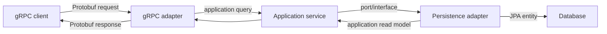

# Không đưa entity persistence vào proto contract

## Mục tiêu bài học

Trong **SPRING_GRPC**, hợp đồng Protocol Buffers mô tả dữ liệu mà client và server trao đổi qua RPC. Ở phía Spring, dữ liệu được chuyển thành kiểu Java để xử lý nghiệp vụ và truy cập persistence. Một quyết định thiết kế quan trọng là **không lấy cấu trúc entity persistence làm hợp đồng Protobuf**.

Bài học tập trung vào ranh giới giữa schema công khai, mô hình ứng dụng và cấu trúc lưu trữ. Qua ví dụ truy vấn đơn hàng, bạn sẽ thiết kế Protobuf response độc lập với JPA entity, ánh xạ entity sang application read model, rồi chuyển read model sang message được sinh từ .proto.

Sau bài này, bạn có thể:

1. Giải thích vì sao JPA entity và Protobuf message phục vụ hai mục đích khác nhau.
2. Nhận diện rủi ro khi sao chép cấu trúc bảng và quan hệ persistence thành proto contract.
3. Thiết kế response message chỉ chứa dữ liệu cần thiết và được phép công bố.
4. Ánh xạ JPA entity sang application read model trong persistence adapter.
5. Ánh xạ read model sang Protobuf DTO trong gRPC adapter.
6. Xử lý lazy relationship, fetch plan, dữ liệu nhạy cảm và thay đổi schema tương thích.
7. Kiểm thử mapping và xác minh contract không phụ thuộc persistence.

> **Phạm vi:** Ví dụ dùng Spring gRPC chính thức, gRPC Java và Spring Data JPA. Annotation GrpcService trong ví dụ thuộc package org.springframework.grpc.server.service. Starter cộng đồng có package và cấu hình khác.

## 1. Persistence entity không phải public API

Một **persistence entity** mô tả cách ứng dụng lưu và đọc dữ liệu. Với JPA, entity thường mang annotation như `@Entity`, `@Id`, `@Column`, `@ManyToOne`, `@OneToMany` và `@Version`; nó có thể chứa quan hệ lazy, trường audit hoặc dữ liệu nội bộ.

Một **Protobuf message** mô tả dữ liệu truyền qua wire contract. Field number, field type, presence, enum và quy tắc tương thích ảnh hưởng trực tiếp tới client đã triển khai. Schema cần ổn định theo vòng đời API, kể cả khi backend thay database hoặc cấu trúc bảng.

Vì gRPC method khai báo kiểu Protobuf, Java entity không được tham chiếu trực tiếp trong chữ ký RPC. Rủi ro thực tế là thiết kế message thành bản sao 1:1 của entity, dùng entity làm nguồn serialization không có mapping rõ ràng, hoặc để adapter/application layer phụ thuộc vào entity và quan hệ ORM.

| Persistence entity | Protobuf contract |
| --- | --- |
| Phục vụ ORM và lưu trữ | Phục vụ giao tiếp giữa các hệ thống |
| Có khóa nội bộ, version, audit và quan hệ | Chỉ có field cần cho use case và được phép công bố |
| Có thể có proxy và lazy association | Là message dữ liệu độc lập, không có vòng đời ORM |
| Thay đổi theo schema database và mô hình lưu trữ | Thay đổi theo quy tắc tương thích API |
| Có thể chứa dữ liệu riêng tư/nội bộ | Chỉ chứa dữ liệu đã được duyệt để chia sẻ |
| Có thể có quan hệ hai chiều hoặc graph lớn | Nên có cấu trúc message hữu hạn, rõ ràng |
| Có thể phụ thuộc JPA/Hibernate | Không phụ thuộc persistence framework |

**Nguyên tắc:** persistence adapter chuyển entity thành application model; gRPC adapter chuyển application model thành Protobuf message. Không để entity vượt qua ranh giới persistence.



## 2. Điều gì xảy ra khi sao chép entity thành proto contract?

Giả sử bảng đơn hàng có entity với khóa database, khách hàng, dòng hàng, ghi chú nội bộ và thông tin audit. Nếu response được thiết kế theo từng cột entity, các vấn đề sau dễ xuất hiện.

### 2.1. Thay đổi database làm thay đổi API

Database có thể đổi khóa từ số nguyên sang UUID, tách bảng địa chỉ hoặc lưu trạng thái bằng mã khác. Nếu public proto contract phản chiếu các trường đó, thay đổi persistence sẽ gây áp lực thay đổi API và client dù ý nghĩa nghiệp vụ không đổi.

API có thể công bố order_number ổn định trong khi backend dùng khóa số, UUID hoặc khóa ghép. Client không cần biết chiến lược khóa nội bộ.

### 2.2. Rò rỉ dữ liệu nội bộ

Entity có thể chứa email, số điện thoại, ghi chú nhân viên, cờ kiểm duyệt, internal risk score, version hoặc audit information. Việc đưa tất cả trường entity vào response có thể tiết lộ dữ liệu mà client không có quyền xem.

Contract phải là **danh sách cho phép (allowlist)**: mỗi field được đưa ra cần có lý do nghiệp vụ và chính sách truy cập. Không dùng quy tắc “entity có gì thì API trả hết”.

### 2.3. Quan hệ ORM không tương đương cấu trúc message

Một entity có thể tham chiếu CustomerEntity, còn customer lại tham chiếu danh sách đơn hàng. Nếu chuyển graph này thành message lồng nhau, cấu trúc có thể đệ quy, lặp dữ liệu hoặc quá lớn. JPA proxy và lazy collection còn có thể phát sinh truy vấn khi được truy cập trong lúc mapping.

Protobuf message nên thể hiện dữ liệu client cần, ví dụ customer_display_name và danh sách OrderLineReply giới hạn. Không nhất thiết phải trả toàn bộ customer profile hoặc mọi quan hệ liên quan.

### 2.4. Serialization có thể kích hoạt lỗi hoặc truy vấn ngoài dự kiến

Nếu mapper hoặc serializer truy cập một lazy association sau khi persistence context đã đóng, ứng dụng có thể gặp LazyInitializationException. Nếu persistence context vẫn mở, việc duyệt collection có thể kích hoạt N+1 queries hoặc tải quá nhiều dữ liệu. Một entity graph lớn cũng có thể làm tăng payload và độ trễ RPC.

Persistence adapter nên xác định fetch plan và chuyển sang read model trong phạm vi transaction phù hợp. Gửi read model ra application layer giúp entity/proxy không thoát khỏi persistence boundary.

## 3. Thiết kế Protobuf contract theo use case

Giả sử client chỉ cần tra cứu một đơn hàng và hiển thị thông tin khách hàng, tổng tiền, trạng thái và các dòng hàng. Hợp đồng không cần phơi bày id nội bộ, @Version, ghi chú nội bộ hay toàn bộ entity khách hàng.

Tệp `src/main/proto/order_query.proto`:

```proto
syntax = "proto3";

package orders.v1;

option java_package = "com.example.orders.proto";
option java_multiple_files = true;

service OrderQuery {
  rpc GetOrder(GetOrderRequest) returns (OrderReply);
}

message GetOrderRequest {
  string order_number = 1;
}

message OrderReply {
  string order_number = 1;
  string customer_display_name = 2;
  repeated OrderLineReply lines = 3;
  int64 total_cents = 4;
  OrderState state = 5;
}

message OrderLineReply {
  string sku = 1;
  string display_name = 2;
  int32 quantity = 3;
  int64 unit_price_cents = 4;
}

enum OrderState {
  ORDER_STATE_UNSPECIFIED = 0;
  ORDER_STATE_NEW = 1;
  ORDER_STATE_PAID = 2;
  ORDER_STATE_CANCELLED = 3;
}
```

Contract trên biểu diễn **một use case đọc đơn hàng**. Nó chỉ công bố mã đơn hàng công khai, tên hiển thị khách hàng, các dòng hàng được phép xem, tổng tiền và trạng thái đã định nghĩa cho API.

| Protobuf field | Lý do có mặt | Không lấy trực tiếp từ |
| --- | --- | --- |
| order_number | Định danh đơn hàng dùng trong API | Khóa database nội bộ nếu không phải public identifier |
| customer_display_name | Thông tin hiển thị client cần | Toàn bộ CustomerEntity |
| lines | Danh sách dòng hàng của đơn | Toàn bộ ORM association graph |
| total_cents | Tổng tiền theo đơn vị nhỏ nhất đã thống nhất | Công thức/kiểu lưu trữ nội bộ chưa được chuẩn hóa |
| state | Trạng thái public của đơn | Giá trị enum persistence không được kiểm soát |
| Không có internal_note, version, created_by | Không cần cho use case này | Các trường nội bộ hoặc nhạy cảm |

### Field number là một phần của contract

Một khi client đã sử dụng schema, không được tùy tiện đổi field number hoặc tái sử dụng số của field đã xóa. Khi loại bỏ field, khai báo reserved cho cả số và tên. Thêm field mới cần có ngữ nghĩa mặc định phù hợp để client cũ vẫn hoạt động.

Không đánh số field theo vị trí cột database. Field number là định danh wire-level lâu dài, không phải thứ tự property trong entity.

## 4. Entity persistence có thể chứa những gì?

Để thấy rõ ranh giới, xem mô hình JPA rút gọn. Các class sau là ví dụ persistence nội bộ; chúng **không được dùng làm kiểu field trong proto contract**.

Tệp OrderEntity.java:

```java
@Entity
@Table(name = "orders")
public class OrderEntity {

    @Id
    private Long id;                       // Khóa nội bộ

    @Column(name = "order_number", nullable = false, unique = true)
    private String orderNumber;            // Public identifier

    @ManyToOne(fetch = FetchType.LAZY)
    @JoinColumn(name = "customer_id")
    private CustomerEntity customer;       // Quan hệ ORM

    @OneToMany(mappedBy = "order", fetch = FetchType.LAZY)
    private List<OrderLineEntity> lines = new ArrayList<>();

    @Enumerated(EnumType.STRING)
    private PersistenceOrderState state;

    private long totalCents;

    @Version
    private long version;                  // Optimistic locking

    private String internalNote;           // Nội bộ

    private String createdBy;              // Audit
    private Instant createdAt;

    protected OrderEntity() {
    }

    // Getter và constructor phục vụ persistence được lược bỏ.
}
```

CustomerEntity có thể có email, địa chỉ, số điện thoại và các đơn hàng khác; OrderLineEntity có thể tham chiếu ngược về đơn hàng. Những field này có thể cần cho persistence nhưng không có lý do tự động xuất hiện trong response. Các quan hệ lazy còn khiến việc đọc entity không tương đương một lần truy vấn đơn giản.

Không nên dùng Lombok @Data một cách vô điều kiện trên entity có quan hệ hai chiều: toString, equals hoặc hashCode có thể duyệt association, tạo vòng lặp hoặc kích hoạt lazy loading. Đây là vấn đề persistence model, không nên giải quyết bằng cách phơi bày graph đó qua API.

## 5. Tạo application read model không phụ thuộc JPA

Application layer cần dữ liệu vừa đủ để thực hiện use case và dựng response. Có thể định nghĩa các record Java thuần:

Tệp OrderView.java:

```java
public record OrderView(
        String orderNumber,
        String customerDisplayName,
        List<OrderLineView> lines,
        long totalCents,
        OrderStatus status) {

    public OrderView {
        lines = List.copyOf(lines);
    }
}

public record OrderLineView(
        String sku,
        String displayName,
        int quantity,
        long unitPriceCents) {
}

public enum OrderStatus {
    NEW,
    PAID,
    CANCELLED
}
```

Read model này là dữ liệu phục vụ truy vấn, không nhất thiết là domain aggregate. Nó không chứa OrderEntity, CustomerEntity, PersistentCollection, Hibernate proxy hoặc annotation JPA. Nếu use case chỉ cần một số field, read model cũng chỉ nên chứa những field đó.

Định nghĩa port ở application layer:

Tệp OrderQueryPort.java:

```java
public interface OrderQueryPort {
    Optional<OrderView> findByOrderNumber(String orderNumber);
}
```

Application service dùng port và trả read model:

Tệp OrderQueryService.java:

```java
@Service
public class OrderQueryService {

    private final OrderQueryPort orderQueryPort;

    public OrderQueryService(OrderQueryPort orderQueryPort) {
        this.orderQueryPort = orderQueryPort;
    }

    public OrderView getOrder(String orderNumber) {
        if (orderNumber == null || orderNumber.isBlank()) {
            throw new IllegalArgumentException("order_number không được rỗng");
        }

        return orderQueryPort.findByOrderNumber(orderNumber.trim())
                .orElseThrow(() ->
                        new OrderNotFoundException(orderNumber));
    }
}
```

OrderQueryService không biết OrderEntity, JpaRepository, Protobuf message hoặc gRPC status. Nó nhận một public identifier, gọi port và trả OrderView. Khi thay database hoặc thêm một adapter khác, use case không cần thay đổi nếu port giữ nguyên ngữ nghĩa.

## 6. Map entity sang read model bên trong persistence adapter

Persistence adapter là nơi duy nhất trong ví dụ biết JPA entity. Với Spring Data JPA, có thể dùng @EntityGraph để tải quan hệ cần thiết cho truy vấn này.

Tệp repository Spring Data:

```java
public interface SpringDataOrderRepository
        extends JpaRepository<OrderEntity, Long> {

    @EntityGraph(attributePaths = {"customer", "lines"})
    Optional<OrderEntity> findByOrderNumber(String orderNumber);
}
```

Tệp JpaOrderQueryAdapter.java:

```java
@Repository
public class JpaOrderQueryAdapter implements OrderQueryPort {

    private final SpringDataOrderRepository repository;

    public JpaOrderQueryAdapter(SpringDataOrderRepository repository) {
        this.repository = repository;
    }

    @Override
    @Transactional(readOnly = true)
    public Optional<OrderView> findByOrderNumber(String orderNumber) {
        return repository.findByOrderNumber(orderNumber)
                .map(this::toView);
    }

    private OrderView toView(OrderEntity entity) {
        List<OrderLineView> lines = entity.getLines().stream()
                .map(line -> new OrderLineView(
                        line.getSku(),
                        line.getDisplayName(),
                        line.getQuantity(),
                        line.getUnitPriceCents()))
                .toList();

        return new OrderView(
                entity.getOrderNumber(),
                entity.getCustomer().getDisplayName(),
                lines,
                entity.getTotalCents(),
                mapStatus(entity.getState()));
    }

    private OrderStatus mapStatus(PersistenceOrderState state) {
        return switch (state) {
            case NEW -> OrderStatus.NEW;
            case PAID -> OrderStatus.PAID;
            case CANCELLED -> OrderStatus.CANCELLED;
        };
    }
}
```

Đây là điểm quan trọng của bài: toView(...) đọc các field cần thiết và tạo một object Java mới **trước khi rời persistence boundary**. OrderView không giữ tham chiếu đến OrderEntity hoặc collection do Hibernate quản lý.

@EntityGraph ở ví dụ yêu cầu Spring Data tải customer và lines cho truy vấn; cách triển khai SQL thực tế phụ thuộc provider và mapping. Nếu dữ liệu lớn, cần xem query plan, số câu SQL, kích thước join và pagination. Có thể thay bằng JPQL projection hoặc DTO projection để chỉ chọn cột cần thiết. Không dùng EAGER toàn cục chỉ để né lỗi lazy loading.

@Transactional(readOnly = true) giữ persistence context trong lúc mapping. Khi method trả về, application chỉ nhận Optional<OrderView>. Không trả OrderEntity rồi hy vọng gRPC adapter truy cập association sau đó; việc đó có thể lỗi lazy loading hoặc kích hoạt truy vấn ngoài dự kiến.

## 7. Map read model sang Protobuf ở gRPC adapter

Persistence adapter đã tạo OrderView. Adapter gRPC tiếp tục chuyển read model thành message theo public contract.

Tệp OrderProtoMapper.java:

```java
@Component
public class OrderProtoMapper {

    public OrderReply toProto(OrderView view) {
        return OrderReply.newBuilder()
                .setOrderNumber(view.orderNumber())
                .setCustomerDisplayName(view.customerDisplayName())
                .addAllLines(view.lines().stream()
                        .map(this::toProto)
                        .toList())
                .setTotalCents(view.totalCents())
                .setState(toProto(view.status()))
                .build();
    }

    private OrderLineReply toProto(OrderLineView line) {
        return OrderLineReply.newBuilder()
                .setSku(line.sku())
                .setDisplayName(line.displayName())
                .setQuantity(line.quantity())
                .setUnitPriceCents(line.unitPriceCents())
                .build();
    }

    private OrderState toProto(OrderStatus status) {
        return switch (status) {
            case NEW -> OrderState.ORDER_STATE_NEW;
            case PAID -> OrderState.ORDER_STATE_PAID;
            case CANCELLED -> OrderState.ORDER_STATE_CANCELLED;
        };
    }
}
```

Mapper này không nhận entity. Nhờ vậy, nếu persistence đổi PersistenceOrderState.PAID thành một mã số hoặc database lưu "P", chỉ persistence adapter cần xử lý thay đổi đó. Nếu public API cần thêm trạng thái mới, mapper buộc phải được xem xét cùng thay đổi schema.

gRPC endpoint rút gọn:

Tệp OrderQueryGrpcAdapter.java:

```java
@GrpcService
public class OrderQueryGrpcAdapter
        extends OrderQueryGrpc.OrderQueryImplBase {

    private final OrderQueryService service;
    private final OrderProtoMapper mapper;

    public OrderQueryGrpcAdapter(
            OrderQueryService service,
            OrderProtoMapper mapper) {
        this.service = service;
        this.mapper = mapper;
    }

    @Override
    public void getOrder(
            GetOrderRequest request,
            StreamObserver<OrderReply> responses) {
        try {
            OrderView view = service.getOrder(request.getOrderNumber());
            responses.onNext(mapper.toProto(view));
            responses.onCompleted();
        } catch (OrderNotFoundException ex) {
            responses.onError(Status.NOT_FOUND
                    .withDescription("Không tìm thấy đơn hàng")
                    .asRuntimeException());
        } catch (IllegalArgumentException ex) {
            responses.onError(Status.INVALID_ARGUMENT
                    .withDescription(ex.getMessage())
                    .asRuntimeException());
        } catch (RuntimeException ex) {
            responses.onError(Status.INTERNAL
                    .withDescription("Không thể truy vấn đơn hàng")
                    .asRuntimeException());
        }
    }
}
```

Đoạn này minh họa ranh giới mapping, không phải một error handler tổng quát hoàn chỉnh. Ở production, cần log exception bất ngờ với correlation ID ở phía server, không trả chi tiết nội bộ cho client; cần tránh bắt lỗi quá rộng nếu nó che giấu lỗi lập trình. Có thể đưa mapping lỗi sang interceptor hoặc exception mapper dùng chung khi nhiều service cần cùng chính sách.

**Luồng dữ liệu cuối cùng:**

1. Protobuf request được gRPC runtime giải mã.
2. Adapter gọi OrderQueryService bằng orderNumber.
3. Application service gọi OrderQueryPort.
4. Persistence adapter truy vấn entity và map thành OrderView.
5. Application service trả OrderView.
6. gRPC mapper tạo OrderReply.
7. Adapter gửi response và kết thúc RPC.

Không có bước nào cần đưa OrderEntity vào .proto hoặc application service.

## 8. Những quy tắc cần giữ khi contract và persistence cùng thay đổi

| Thay đổi | Nơi nên xử lý | Ảnh hưởng đến Protobuf |
| --- | --- | --- |
| Đổi khóa database từ Long sang UUID | Entity/repository/persistence adapter | Không đổi nếu order_number public vẫn giữ ngữ nghĩa |
| Tách bảng khách hàng hoặc địa chỉ | Persistence adapter và read model | Chỉ đổi nếu dữ liệu public mà client nhận thay đổi |
| Thêm internal_note hoặc created_by | Persistence entity | Không thêm vào response nếu client không được phép biết |
| Đổi enum persistence từ string sang integer | Persistence adapter | Mapper tiếp tục map sang enum public có ý nghĩa |
| Thêm field public cần cho client | .proto, mapper và kiểm thử contract | Thêm field number mới, tương thích với client cũ |
| Xóa field public đã phát hành | Schema contract/versioning | Reserve field number và tên; không tái sử dụng |
| Thêm quan hệ lazy mới | Persistence fetch plan | Không tự động thêm nested message vào API |

### Không đồng nhất tên và kiểu field

Ví dụ entity có id: Long, còn API có order_number: string. Mapper là nơi chuyển từ khóa nội bộ sang identifier công khai. Đừng đổi API thành int64 id chỉ vì entity đang dùng Long; cũng đừng để client phụ thuộc vào cách database cấp khóa.

### Không xuất toàn bộ quan hệ

Nếu OrderEntity liên kết CustomerEntity, contract có thể chỉ cần customer_display_name. Nếu client cần xem hồ sơ khách hàng, cân nhắc một use case/API riêng có authorization rõ ràng, thay vì nhúng toàn bộ customer graph vào mọi response đơn hàng.

### Không dựa vào enum ordinal

Không dùng enum.ordinal() để tạo giá trị enum Protobuf hoặc lưu mapping theo vị trí. Thứ tự enum Java có thể thay đổi; Protobuf field number cũng là contract lâu dài. Dùng switch tường minh theo ý nghĩa trạng thái.

### Kiểm soát field nhạy cảm

Mỗi response field cần trả lời ba câu hỏi: client nào cần nó, client đó có quyền xem nó không, và field có cần ổn định lâu dài trong API không? Các field như email, địa chỉ, thông tin thanh toán, internal note và audit identity cần chính sách riêng. DTO/mapper tường minh giúp review allowlist dễ hơn.

## 9. Kiểm thử để chứng minh ranh giới không bị phá vỡ

### 9.1. Unit test Protobuf mapper

Tạo entity-free OrderView, sau đó kiểm tra mapping:

```java
class OrderProtoMapperTest {

    private final OrderProtoMapper mapper = new OrderProtoMapper();

    @Test
    void mapsOnlyPublicOrderFields() {
        var view = new OrderView(
                "ORD-2026-001",
                "Nguyen Van A",
                List.of(new OrderLineView(
                        "SKU-1", "Keyboard", 2, 450_000L)),
                900_000L,
                OrderStatus.PAID);

        OrderReply reply = mapper.toProto(view);

        assertThat(reply.getOrderNumber()).isEqualTo("ORD-2026-001");
        assertThat(reply.getCustomerDisplayName()).isEqualTo("Nguyen Van A");
        assertThat(reply.getLinesCount()).isEqualTo(1);
        assertThat(reply.getTotalCents()).isEqualTo(900_000L);
        assertThat(reply.getState()).isEqualTo(OrderState.ORDER_STATE_PAID);
    }
}
```

Test này không cần Spring context, database hay gRPC server. Nó kiểm tra mapping giữa application read model và public contract.

### 9.2. Test persistence adapter

Test persistence adapter bằng database test (ví dụ Testcontainers hoặc H2 nếu phù hợp) để xác minh:

- Query theo orderNumber trả đúng entity.
- customer và lines được tải theo fetch plan dự kiến.
- Adapter tạo OrderView với đúng field.
- OrderView không chứa entity/proxy hoặc collection ORM.
- Không phát sinh N+1 query ngoài dự kiến khi tải nhiều đơn.

Không nên chỉ dùng mock repository để kết luận fetch plan JPA đúng; lazy loading và SQL thực tế cần kiểm thử ở persistence layer.

### 9.3. Kiểm tra gRPC contract và wiring

Integration test có thể khởi động Spring gRPC server native ở cổng động hoặc server in-process, gọi bằng generated stub và kiểm tra OrderReply. Test này chứng minh đường đi transport thực tế; nó bổ sung cho unit test mapper và persistence adapter chứ không thay thế chúng.

Có thể xác minh service descriptor là orders.v1.OrderQuery và contract chỉ chứa field được thiết kế. Khi thay đổi .proto, review descriptor/field number để tránh vô tình xóa hoặc tái sử dụng số.

### 9.4. Những điều không nên chỉ test bằng snapshot

Một snapshot của response có thể cho thấy field hiện tại, nhưng chưa chắc phát hiện field nội bộ mới bị thêm vào sau này. Hãy review .proto như public API, kiểm tra authorization và thêm test cụ thể cho field nhạy cảm không được trả ra. Mapping tường minh giúp thay đổi persistence không tự động xuất hiện trong response.

## 10. Lỗi thường gặp và cách xử lý

| Triệu chứng | Nguyên nhân | Cách xử lý |
| --- | --- | --- |
| Client nhận field nội bộ không cần thiết | Proto schema sao chép toàn bộ entity | Thiết kế message theo use case và allowlist |
| LazyInitializationException | Mapper truy cập association sau khi persistence context đóng | Map entity sang read model trong transaction với fetch plan rõ ràng |
| Nhiều query bất ngờ | Duyệt lazy collection/customer từng entity gây N+1 | @EntityGraph, projection hoặc query tối ưu có chủ đích |
| Payload quá lớn hoặc đệ quy | Phản chiếu graph quan hệ hai chiều thành message nested | Chỉ trả dữ liệu cần thiết, giới hạn collection và dùng API riêng cho tài nguyên khác |
| Đổi schema DB buộc sửa client | Contract phụ thuộc trực tiếp field/ID persistence | Giữ public identifier và Protobuf schema độc lập |
| Enum sai khi thứ tự thay đổi | Dùng ordinal hoặc số nội bộ làm enum public | Mapping tường minh theo ý nghĩa |
| Field mặc định bị hiểu nhầm là không gửi | Dùng scalar proto3 không có explicit presence | Dùng optional/message/oneof khi cần phân biệt presence |
| Thông tin riêng tư xuất hiện trong response | Mapper tự động copy tất cả thuộc tính | Mapping tường minh và review quyền truy cập |
| Test mapper phải khởi động database | Mapper nhận entity hoặc repository | Mapper gRPC nhận application read model; persistence mapping test riêng |
| Client cũ lỗi sau khi đổi field number | Tái sử dụng số hoặc đổi ý nghĩa field đã phát hành | Giữ field number; reserve số/tên khi xóa; áp dụng schema evolution |

## 11. Bài tập thực hành

1. **Kiểm tra rò rỉ:** Thêm internalNote, createdBy và version vào OrderEntity. Chứng minh các field này không xuất hiện trong OrderView hoặc OrderReply.
2. **Thay persistence:** Chuyển khóa chính entity từ Long sang UUID nhưng giữ nguyên order_number. Chỉ cập nhật persistence adapter và test; client contract không đổi.
3. **Lazy loading:** Bỏ @EntityGraph, chạy integration test và quan sát truy vấn hoặc lỗi khi map. Khôi phục fetch plan có chủ đích hoặc dùng projection.
4. **Thêm field public:** Bổ sung delivery_estimate vào proto. Chọn field number mới, cập nhật read model/mapper và kiểm tra client cũ vẫn đọc được các field cũ.
5. **Authorization:** Thêm thông tin identity đã xác thực và chỉ trả đơn hàng thuộc tenant/khách hàng được phép. Không dùng customer_id trong request làm bằng chứng xác thực.
6. **Enum mapping:** Thêm trạng thái persistence mới. Xác định trạng thái đó có nên xuất hiện trong public enum hay được ánh xạ về trạng thái tổng quát; không dùng ordinal.
7. **Projection:** Thay entity fetch bằng một JPQL/DTO projection chỉ lấy các cột cần cho OrderView; so sánh số query và payload dữ liệu được đọc.
8. **Streaming:** Thêm RPC liệt kê đơn hàng theo khách hàng. Thiết kế giới hạn, pagination và response DTO mà không trả OrderEntity hoặc giữ transaction mở trong suốt stream.

### Câu hỏi tự kiểm tra

- Vì sao Protobuf message không nên được tạo bằng cách sao chép từng field của JPA entity?
- Khác nhau giữa OrderEntity, OrderView và OrderReply là gì?
- Vì sao cần map entity sang read model trước khi rời transaction?
- @EntityGraph giải quyết vấn đề gì và có thể gây chi phí nào?
- Vì sao order_number có thể là public identifier ổn định hơn khóa database?
- Khi xóa field khỏi .proto, vì sao cần reserved field number và tên?
- Ai chịu trách nhiệm quyết định field nào được phép trả cho client?
- Nếu thêm một cột nội bộ vào entity, vì sao response gRPC không nên tự thay đổi?
- Làm thế nào để test riêng mapping persistence và mapping Protobuf?

## Tài liệu tham khảo

- [Protocol Buffers — Proto3 Language Guide](https://protobuf.dev/programming-guides/proto3/): message, field number, enum và quy tắc tương thích schema.
- [Protocol Buffers — Updating A Message Type](https://protobuf.dev/programming-guides/proto3/#updating): thêm/xóa field và reserved field number.
- [Spring Data JPA — EntityGraph](https://docs.spring.io/spring-data/jpa/reference/jpa/query-methods.html): xác định fetch plan cho association trong truy vấn.
- [Hibernate ORM — Fetching](https://docs.jboss.org/hibernate/orm/current/userguide/html_single/Hibernate_User_Guide.html#fetching): lazy/eager fetching và chi phí truy vấn quan hệ.
- [Spring gRPC — GRPC Server](https://docs.spring.io/spring-grpc/reference/server.html): Spring phát hiện bean BindableService và bind service vào server.
- [gRPC Java — Generated Code Reference](https://grpc.io/docs/languages/java/generated-code/): generated service base, message và client stub.

**Kết quả mong đợi:** Public Protobuf contract được thiết kế theo use case, persistence entity chỉ tồn tại trong persistence layer, adapter persistence chuyển entity thành application read model, và gRPC adapter chuyển read model thành Protobuf response. Nhờ vậy, thay đổi database, ORM association hoặc trường nội bộ không tự động làm thay đổi API hay tiết lộ dữ liệu cho client.
