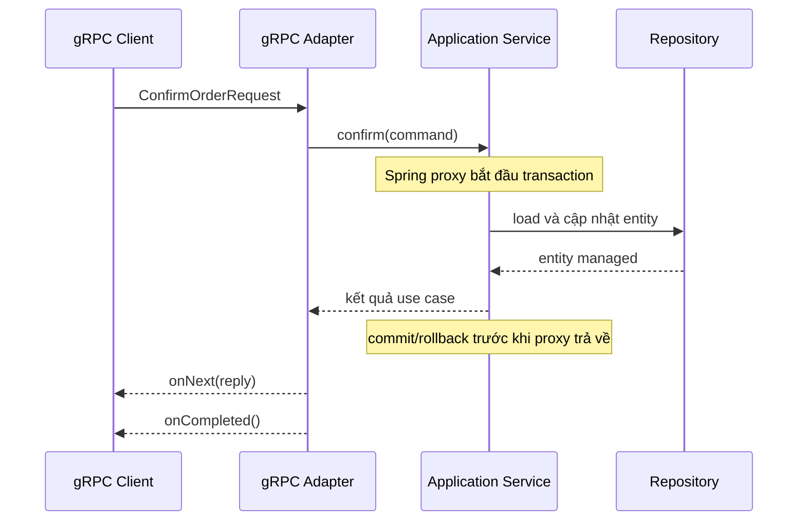

# Xử lý transaction trong RPC handler

## Mục tiêu bài học

Trong **SPRING_GRPC**, gRPC handler tiếp nhận Protobuf request, gọi nghiệp vụ và gửi response qua `StreamObserver`. Khi nghiệp vụ đọc hoặc thay đổi dữ liệu bằng Spring Data JPA, một câu hỏi quan trọng xuất hiện: **transaction bắt đầu và kết thúc ở đâu so với vòng đời RPC?**

Bài này tập trung vào cách đặt transaction boundary đúng cho RPC handler: transaction thuộc use case/application service, commit hoặc rollback trước khi adapter gửi kết quả thành công, và không giữ transaction database mở trong suốt một streaming RPC dài.

Sau bài học, bạn có thể:

1. Đặt `@Transactional` ở application service được gọi từ gRPC adapter.
2. Giải thích thời điểm transaction commit/rollback so với `onNext` và `onCompleted`.
3. Ánh xạ lỗi nghiệp vụ, lỗi persistence và xung đột đồng thời sang gRPC status phù hợp.
4. Thiết kế transaction ngắn cho unary, server streaming, client streaming và bidirectional streaming.
5. Tránh lỗi do bắt exception quá sớm, self-invocation, lazy entity và transaction không truyền qua thread.
6. Kiểm thử hành vi commit/rollback ở service và qua gRPC server.

> **Phạm vi:** Ví dụ dùng Spring gRPC chính thức, Spring transaction management và Spring Data JPA. Annotation `@GrpcService` là `org.springframework.grpc.server.service.GrpcService`. Với starter khác, package annotation và cấu hình server có thể khác.

## 1. Transaction boundary nằm ở use case

Một RPC thường đi qua các bước: gRPC runtime giải mã request, adapter kiểm tra dữ liệu giao tiếp, application service thực hiện use case, persistence layer đọc/ghi, rồi adapter chuyển kết quả thành Protobuf response.

Transaction nên bao quanh **một đơn vị công việc nghiệp vụ nhất quán**. Với RPC ghi dữ liệu, application service là nơi phù hợp để mở transaction: nó biết các thao tác database nào phải cùng thành công hoặc cùng rollback. Adapter chỉ điều phối giao thức và chuyển lỗi sang gRPC status.



Điểm mấu chốt là application service được gọi thông qua Spring transactional proxy. Khi lời gọi phương thức được proxy xử lý, Spring bắt đầu transaction, chạy phương thức, sau đó commit nếu thành công hoặc rollback theo quy tắc. Chỉ sau khi proxy hoàn tất commit thì lời gọi mới trả kết quả về adapter.

| Tầng | Trách nhiệm transaction |
| --- | --- |
| gRPC adapter | Không giữ transaction cho toàn bộ vòng đời transport; gọi use case và map kết quả/lỗi |
| Application service | Xác định ranh giới nghiệp vụ cần atomic; khai báo `@Transactional` |
| Repository | Thực thi thao tác dữ liệu trong transaction hiện hành |
| Database/transaction manager | Commit hoặc rollback thay đổi theo cấu hình persistence |

Một RPC không tự động là một transaction. Nếu handler gọi nhiều application service, mỗi service có thể tạo transaction riêng tùy propagation. Khi nhiều thao tác phải atomic cùng nhau, hãy đặt một phương thức use case điều phối chúng trong **một transaction**.

## 2. Ví dụ unary RPC ghi dữ liệu

Ta xây use case xác nhận đơn hàng đang ở trạng thái chờ. Khi xác nhận thành công, trạng thái đơn được cập nhật. Nếu điều kiện nghiệp vụ không đạt hoặc ghi dữ liệu thất bại, client nhận gRPC status thay vì một response thành công giả.

### 2.1. Hợp đồng Protobuf

Tệp `src/main/proto/order_command.proto`:

```proto
syntax = "proto3";

package orders.v1;

option java_package = "com.example.orders.proto";
option java_multiple_files = true;

service OrderCommand {
  rpc ConfirmOrder(ConfirmOrderRequest) returns (ConfirmOrderReply);
}

message ConfirmOrderRequest {
  string order_number = 1;
}

message ConfirmOrderReply {
  string order_number = 1;
  string state = 2;
}
```

Build phải sinh message Java và `OrderCommandGrpc.OrderCommandImplBase` bằng `protoc` cùng `protoc-gen-grpc-java`. Ví dụ chỉ tập trung vào transaction nên không lặp lại cấu hình build. Server dùng starter Spring gRPC tương ứng và một transport đã được cấu hình.

### 2.2. Entity và repository

Entity có trạng thái và optimistic lock version:

```java
@Entity
@Table(name = "orders")
public class OrderEntity {

    @Id
    private Long id;

    @Column(name = "order_number", nullable = false, unique = true)
    private String orderNumber;

    @Enumerated(EnumType.STRING)
    private OrderState state;

    @Version
    private long version;

    protected OrderEntity() {
    }

    public String getOrderNumber() {
        return orderNumber;
    }

    public OrderState getState() {
        return state;
    }

    public void confirm() {
        if (state != OrderState.PENDING) {
            throw new OrderNotConfirmableException(orderNumber);
        }
        state = OrderState.CONFIRMED;
    }
}
```

`@Version` cho phép JPA phát hiện một số xung đột cập nhật đồng thời. Nếu hai transaction cùng đọc một phiên bản rồi cùng cập nhật, transaction commit không còn phù hợp có thể thất bại với optimistic locking exception. Entity được lược gọn cho bài học; constructor, enum và getter/setter persistence cần hoàn thiện theo dự án thực tế.

Repository:

```java
public interface OrderRepository
        extends JpaRepository<OrderEntity, Long> {

    Optional<OrderEntity> findByOrderNumber(String orderNumber);
}
```

### 2.3. Application service sở hữu transaction

Tệp `ConfirmOrderCommand.java` là command thuần Java:

```java
public record ConfirmOrderCommand(String orderNumber) {
}
```

Tệp `OrderCommandService.java`:

```java
@Service
public class OrderCommandService {

    private final OrderRepository repository;

    public OrderCommandService(OrderRepository repository) {
        this.repository = repository;
    }

    @Transactional
    public ConfirmOrderResult confirm(ConfirmOrderCommand command) {
        if (command.orderNumber() == null
                || command.orderNumber().isBlank()) {
            throw new IllegalArgumentException("orderNumber không được rỗng");
        }

        OrderEntity order = repository
                .findByOrderNumber(command.orderNumber().trim())
                .orElseThrow(() ->
                        new OrderNotFoundException(command.orderNumber()));

        order.confirm();

        // Entity đang managed; JPA dirty checking ghi thay đổi khi commit.
        return new ConfirmOrderResult(
                order.getOrderNumber(),
                order.getState().name());
    }
}
```

Khi Spring gọi `confirm` qua bean proxy:

1. Transaction manager bắt đầu transaction.
2. Repository đọc entity; entity được quản lý trong persistence context.
3. `order.confirm()` thay đổi trạng thái trên entity managed.
4. Phương thức trả về kết quả Java.
5. Spring flush và commit transaction trước khi lời gọi qua proxy trả kết quả về caller.

Không cần gọi `repository.save(order)` cho entity đã được load và vẫn managed trong cùng transaction JPA; dirty checking sẽ phát hiện thay đổi. Có thể gọi `save` theo convention của dự án, nhưng cần hiểu transaction và trạng thái managed, tránh thêm thao tác không cần thiết.

`ConfirmOrderResult` và exception là kiểu ứng dụng, không phụ thuộc Protobuf hay gRPC:

```java
public record ConfirmOrderResult(String orderNumber, String state) {
}

public class OrderNotFoundException extends RuntimeException {
    public OrderNotFoundException(String orderNumber) {
        super("Không tìm thấy đơn hàng: " + orderNumber);
    }
}

public class OrderNotConfirmableException extends RuntimeException {
    public OrderNotConfirmableException(String orderNumber) {
        super("Đơn hàng không ở trạng thái có thể xác nhận: " + orderNumber);
    }
}
```

### 2.4. Adapter gửi response sau khi transaction hoàn tất

`@GrpcService` adapter không cần tự mở transaction:

```java
@GrpcService
public class OrderCommandGrpcAdapter
        extends OrderCommandGrpc.OrderCommandImplBase {

    private final OrderCommandService service;

    public OrderCommandGrpcAdapter(OrderCommandService service) {
        this.service = service;
    }

    @Override
    public void confirmOrder(
            ConfirmOrderRequest request,
            StreamObserver<ConfirmOrderReply> responses) {

        final ConfirmOrderResult result;
        try {
            // Lời gọi qua Spring proxy; commit xong mới trả về đây.
            result = service.confirm(
                    new ConfirmOrderCommand(request.getOrderNumber()));
        } catch (IllegalArgumentException ex) {
            responses.onError(Status.INVALID_ARGUMENT
                    .withDescription(ex.getMessage())
                    .asRuntimeException());
            return;
        } catch (OrderNotFoundException ex) {
            responses.onError(Status.NOT_FOUND
                    .withDescription("Không tìm thấy đơn hàng")
                    .asRuntimeException());
            return;
        } catch (OrderNotConfirmableException ex) {
            responses.onError(Status.FAILED_PRECONDITION
                    .withDescription("Đơn hàng không thể xác nhận ở trạng thái hiện tại")
                    .asRuntimeException());
            return;
        } catch (ObjectOptimisticLockingFailureException ex) {
            responses.onError(Status.ABORTED
                    .withDescription("Đơn hàng vừa được cập nhật bởi yêu cầu khác")
                    .asRuntimeException());
            return;
        } catch (RuntimeException ex) {
            responses.onError(Status.INTERNAL
                    .withDescription("Không thể xác nhận đơn hàng")
                    .asRuntimeException());
            return;
        }

        // Chỉ gửi thành công sau khi transaction trong service đã commit.
        responses.onNext(ConfirmOrderReply.newBuilder()
                .setOrderNumber(result.orderNumber())
                .setState(result.state())
                .build());
        responses.onCompleted();
    }
}
```

Ví dụ cần import `io.grpc.Status`, `io.grpc.stub.StreamObserver` và `org.springframework.orm.ObjectOptimisticLockingFailureException`. Log lỗi bất ngờ ở server với correlation ID; không gửi SQL, stack trace hoặc chi tiết nội bộ qua status description.

### 2.5. Vì sao không đặt transaction trên handler?

Không nên viết theo kiểu:

```java
// Không dùng cách này cho unary write handler.
@Transactional
public void confirmOrder(
        ConfirmOrderRequest request,
        StreamObserver<ConfirmOrderReply> responses) {
    // Gọi repository, rồi onNext/onCompleted ngay tại đây.
}
```

Nếu transaction bao quanh chính method handler, `onNext` và `onCompleted` có thể được gọi **trước khi method trả về**. Transaction interceptor chỉ commit sau khi target method hoàn tất. Nếu commit thất bại sau khi client đã nhận response thành công, client tin rằng đơn đã được xác nhận trong khi database có thể rollback.

Đặt transaction trong application service giải quyết thứ tự này: service proxy chỉ trả về sau commit; adapter mới phát response thành công. Nếu commit thất bại, lỗi ném ra từ proxy được adapter bắt và ánh xạ thành gRPC status.

## 3. Quy tắc rollback và ánh xạ lỗi

Với Spring transaction declarative mặc định:

- `RuntimeException` và `Error` làm transaction rollback.
- Checked exception không mặc định rollback; cần khai báo `rollbackFor` nếu đó là lỗi phải rollback.
- Nếu bắt exception bên trong transactional method rồi trả về một giá trị “thất bại”, Spring có thể coi method đã hoàn thành bình thường và commit.
- Nếu một lỗi được xử lý nhưng vẫn phải rollback, cần để exception đi ra khỏi transaction boundary hoặc chủ động đánh dấu rollback-only theo thiết kế.

Ví dụ với checked exception:

```java
@Transactional(rollbackFor = PaymentRejectedException.class)
public PaymentResult capturePayment(CapturePaymentCommand command)
        throws PaymentRejectedException {
    // Cập nhật dữ liệu và gọi các bước nghiệp vụ trong transaction.
}
```

Không nên bắt tất cả exception trong application service, log rồi trả kết quả rỗng. Cách đó che giấu thất bại và có thể commit một phần thay đổi. Hãy để exception có ý nghĩa thoát khỏi phương thức transactional để transaction manager quyết định rollback; adapter xử lý việc chuyển exception thành gRPC status.

| Tình huống | gRPC status thường phù hợp | Ghi chú |
| --- | --- | --- |
| Request sai định dạng/thiếu field bắt buộc | `INVALID_ARGUMENT` | Lỗi đầu vào ở adapter hoặc validation |
| Không tìm thấy đơn | `NOT_FOUND` | Không tiết lộ dữ liệu nhạy cảm trong description |
| Đơn đang ở trạng thái không cho phép xác nhận | `FAILED_PRECONDITION` | Cần thay đổi trạng thái trước khi thử lại |
| Optimistic lock conflict | `ABORTED` | Có thể đọc lại trạng thái và retry use case theo chính sách |
| Database/downstream tạm thời không sẵn sàng | `UNAVAILABLE` | Retry chỉ khi thao tác và idempotency cho phép |
| Lỗi không dự kiến | `INTERNAL` | Log chi tiết ở server, trả thông báo an toàn |

Một exception có thể được Spring bọc trong exception persistence khác tùy provider và thời điểm flush/commit. Cần kiểm tra cause chain hoặc dùng exception handler chung phù hợp; không giả định mọi lỗi commit đều có đúng một class cụ thể.

## 4. Transaction propagation và các lỗi Spring thường gặp

### 4.1. Nhiều bước nghiệp vụ cần một transaction

Nếu xác nhận đơn hàng cần cập nhật order, ghi payment record và giảm tồn kho trong cùng database, hãy điều phối chúng trong một phương thức application service có transaction:

```java
@Service
public class ConfirmOrderUseCase {

    private final OrderRepository orders;
    private final PaymentRepository payments;
    private final InventoryRepository inventory;

    public ConfirmOrderUseCase(
            OrderRepository orders,
            PaymentRepository payments,
            InventoryRepository inventory) {
        this.orders = orders;
        this.payments = payments;
        this.inventory = inventory;
    }

    @Transactional
    public ConfirmOrderResult execute(ConfirmOrderCommand command) {
        OrderEntity order = orders.findByOrderNumber(command.orderNumber())
                .orElseThrow(() ->
                        new OrderNotFoundException(command.orderNumber()));

        inventory.reserve(order.getSku(), order.getQuantity());
        payments.record(order.getOrderNumber(), command.paymentReference());
        order.confirm();

        return new ConfirmOrderResult(
                order.getOrderNumber(), order.getState().name());
    }
}
```

Các repository tham gia cùng transaction manager và cùng transaction mặc định theo propagation `REQUIRED`. Nếu một bước ném runtime exception trước commit, các thay đổi database trong transaction sẽ rollback cùng nhau. Các repository/service được gọi phải dùng đúng datasource/transaction manager; nếu có nhiều database hoặc transaction manager, cần cấu hình propagation và consistency rõ ràng.

### 4.2. `REQUIRED` là mặc định, không phải luôn tạo transaction mới

`@Transactional` mặc định dùng propagation `REQUIRED`: tham gia transaction đang tồn tại nếu có, nếu không thì tạo transaction mới. Do đó, khi adapter gọi một application service transaction, repository thường tham gia transaction đó.

Không dùng `REQUIRES_NEW` chỉ để “chắc chắn có transaction”. Nó tạo transaction độc lập và có thể commit một phần dù transaction ngoài rollback. Chỉ dùng khi yêu cầu nghiệp vụ thực sự cần một commit độc lập, ví dụ ghi audit có chủ đích và đã hiểu hệ quả.

### 4.3. Self-invocation không đi qua proxy

Trong proxy mode mặc định, gọi một phương thức `@Transactional` từ một phương thức khác **trên cùng instance** không đi qua proxy:

```java
@Service
public class OrderService {

    public void handle() {
        updateOrder(); // self-invocation: không kích hoạt transaction proxy
    }

    @Transactional
    public void updateOrder() {
        // ...
    }
}
```

Cách đơn giản là đặt transaction trên phương thức public của bean được gọi từ bean khác, hoặc tổ chức use case thành một service riêng. Không dựa vào annotation nếu lời gọi thực tế không qua proxy.

### 4.4. Đừng để exception bị nuốt trước transaction interceptor

Transaction interceptor cần thấy exception để áp dụng rollback rule. Nếu application service bắt lỗi, log rồi return bình thường, transaction có thể commit. Nếu adapter bắt exception **sau khi lời gọi proxy kết thúc**, đó là vị trí phù hợp để chuyển thành gRPC status.

### 4.5. Gọi remote service trong transaction database

Một transaction JPA không thể tự động rollback một gRPC call, HTTP request hoặc email đã thành công. Giữ transaction database mở trong khi chờ downstream còn làm lock và connection tồn tại lâu hơn.

Nếu cần phối hợp database với message/event bên ngoài, cân nhắc **transactional outbox**: ghi thay đổi nghiệp vụ và outbox record trong cùng transaction, sau commit một publisher riêng gửi event và xử lý retry/idempotency. Đừng gọi dịch vụ ngoài trong transaction rồi giả định rollback database sẽ hoàn tác side effect từ hệ thống kia.

## 5. Transaction với các kiểu streaming RPC

Một unary RPC có request/response hữu hạn nên thường tương ứng với một transaction ngắn. Streaming có vòng đời dài và nhiều message, vì vậy không nên mặc định “một stream = một transaction”.

### 5.1. Server streaming: đọc theo page/chunk

Với server streaming, application service có thể đọc một page trong transaction read-only, trả DTO đã materialize, sau đó adapter phát các message **ngoài transaction**:

```java
@Service
public class OrderReadService {

    private final OrderRepository repository;

    public OrderReadService(OrderRepository repository) {
        this.repository = repository;
    }

    @Transactional(readOnly = true)
    public List<OrderSummary> fetchPage(String customerId, int page, int size) {
        return repository.findSummaries(customerId,
                PageRequest.of(page, size)).getContent();
    }
}
```

Adapter lặp từng page:

```java
int page = 0;
while (!Context.current().isCancelled()) {
    List<OrderSummary> batch =
            readService.fetchPage(customerId, page, 100);

    if (batch.isEmpty()) {
        break;
    }

    for (OrderSummary order : batch) {
        if (Context.current().isCancelled()) {
            return;
        }
        responses.onNext(mapper.toProto(order));
    }

    page++;
}
if (!Context.current().isCancelled()) {
    responses.onCompleted();
}
```

Mỗi lời gọi `fetchPage` đi qua Spring proxy và kết thúc transaction read-only trước khi adapter gửi batch. Với dữ liệu lớn, page size cần giới hạn hợp lý; cursor/keyset pagination thường phù hợp hơn offset pagination khi dữ liệu thay đổi nhiều. Read model trả về phải được materialize trong transaction, không trả JPA entity hoặc lazy stream để adapter truy cập sau khi transaction đóng.

### 5.2. Client streaming: chọn rõ all-or-nothing hay từng phần

Với client streaming, server nhận nhiều message rồi mới biết stream đã hoàn tất. Có hai mô hình nghiệp vụ khác nhau:

| Mô hình | Transaction | Hệ quả |
| --- | --- | --- |
| **All-or-nothing** cho một batch nhỏ có giới hạn | Buffer số message có giới hạn; khi client half-close, gọi một application service transactional xử lý cả batch | Một lỗi nghiệp vụ có thể rollback toàn bộ batch; cần giới hạn số phần tử và kích thước |
| **Commit từng message/chunk** | Mỗi message hoặc chunk gọi một phương thức transactional riêng | Có thể đã commit một phần trước khi stream lỗi; response/protocol phải thể hiện kết quả từng phần và hỗ trợ idempotency |

Không giữ một transaction mở trong lúc chờ client gửi message tiếp theo. Client có thể gửi chậm, mất kết nối hoặc không bao giờ half-close; transaction dài sẽ giữ connection và lock không cần thiết. Nếu yêu cầu all-or-nothing cho dữ liệu lớn, dùng staging/batch workflow có trạng thái và bước finalize thay vì buffer vô hạn trong RAM hoặc giữ transaction mở suốt stream.

### 5.3. Bidirectional streaming: transaction ngắn theo command

Với bidirectional streaming, request và response có thể đan xen không đồng bộ. Một mô hình thường dùng là mỗi command hợp lệ gọi application service riêng với transaction ngắn, sau đó trả acknowledgment tương ứng. Điều này tạo ra nhiều commit độc lập, không phải một transaction duy nhất cho toàn bộ stream.

Nếu client cần “tất cả command cùng thành công hoặc cùng thất bại”, phải định nghĩa giao thức batch/finalize, giới hạn kích thước, idempotency và cách báo kết quả. Đừng ngầm hứa atomicity toàn stream khi server thực tế đã commit từng message.

### 5.4. Transaction không tự truyền qua thread

Spring transaction truyền thống gắn với thread hiện tại. Nếu handler đẩy công việc sang executor, scheduler hoặc callback khác, đừng giả định transaction từ thread gRPC ban đầu tự động xuất hiện ở thread mới. Hãy gọi một **Spring bean transactional** trên thread thực thi để mở transaction tại đó; truyền dữ liệu/command cần thiết, không truyền JPA entity managed qua thread.

## 6. Những lưu ý về read-only, flush và optimistic locking

- `@Transactional(readOnly = true)` thể hiện ý định đọc và có thể giúp persistence provider tối ưu; nó không thay thế authorization và không phải hàng rào bảo mật tuyệt đối ngăn mọi câu lệnh ghi.
- JPA thường flush thay đổi trước commit theo flush mode. Lỗi constraint hoặc optimistic locking có thể chỉ xuất hiện ở flush/commit, tức là sau khi thân phương thức application service đã trả kết quả nội bộ.
- Vì proxy commit trước khi trả kết quả về adapter, lỗi commit vẫn có thể được adapter bắt và chuyển thành status; adapter không nên phát response thành công trước khi lời gọi proxy hoàn tất.
- `@Version` hỗ trợ phát hiện cập nhật đồng thời, nhưng không tự giải quyết mọi race condition. Với nghiệp vụ cần khóa hoặc cập nhật có điều kiện, dùng query/update strategy thích hợp và retry có giới hạn.
- Retry một lệnh ghi chỉ an toàn khi thiết kế idempotency. Nếu client timeout sau khi server đã commit nhưng response bị mất, client có thể gửi lại cùng RPC. Dùng request/idempotency key và lưu kết quả để tránh tạo tác động trùng.

## 7. Kiểm thử transaction đúng thời điểm

### 7.1. Test precondition và rollback

Một integration test với Spring context và database test nên kiểm tra cả việc từ chối trạng thái không hợp lệ lẫn rollback khi lỗi xảy ra **sau khi entity đã thay đổi**. Ví dụ fixture `ORD-1001` đã ở trạng thái `CONFIRMED`, còn `ORD-1002` đang `PENDING`:

```java
import org.springframework.transaction.PlatformTransactionManager;
import org.springframework.transaction.support.TransactionTemplate;

@SpringBootTest
class OrderCommandServiceTransactionTest {

    @Autowired
    OrderCommandService service;

    @Autowired
    OrderRepository repository;

    @Autowired
    PlatformTransactionManager transactionManager;

    @Test
    void rejectsOrderThatIsAlreadyConfirmed() {
        // Fixture ORD-1001 đã CONFIRMED và được commit trước test.
        assertThat(repository.findByOrderNumber("ORD-1001"))
                .get()
                .extracting(OrderEntity::getState)
                .isEqualTo(OrderState.CONFIRMED);

        assertThatThrownBy(() -> service.confirm(
                new ConfirmOrderCommand("ORD-1001")))
                .isInstanceOf(OrderNotConfirmableException.class);

        assertThat(repository.findByOrderNumber("ORD-1001"))
                .get()
                .extracting(OrderEntity::getState)
                .isEqualTo(OrderState.CONFIRMED);
    }

    @Test
    void rollsBackWhenFailureOccursAfterEntityWasChanged() {
        TransactionTemplate tx = new TransactionTemplate(transactionManager);

        assertThatThrownBy(() -> tx.executeWithoutResult(status -> {
            OrderEntity order = repository.findByOrderNumber("ORD-1002")
                    .orElseThrow();
            order.confirm();
            // Mô phỏng một bước ghi tiếp theo thất bại trong cùng transaction.
            throw new IllegalStateException("simulated later-step failure");
        })).isInstanceOf(IllegalStateException.class);

        assertThat(repository.findByOrderNumber("ORD-1002"))
                .get()
                .extracting(OrderEntity::getState)
                .isEqualTo(OrderState.PENDING);
    }
}
```

Đoạn test dùng `TransactionTemplate` để làm rõ rollback của transaction manager sau khi entity managed đã đổi trạng thái. Trong test kiểm chứng trực tiếp `@Transactional` trên application service, hãy gọi bean qua Spring proxy và không đặt `@Transactional` trên chính test nếu transaction ngoài sẽ làm mờ thời điểm commit/rollback; dùng fixture đã commit và đọc lại sau khi lời gọi service kết thúc.

### 7.2. Test commit failure trước khi adapter gửi response

Integration test gRPC nên gọi server qua generated stub, tạo tình huống commit thất bại (ví dụ optimistic lock conflict hoặc constraint violation) và xác minh client nhận status lỗi, không nhận response thành công. Unit test adapter chỉ mock service sẽ không chứng minh commit timing vì mock không chạy Spring transaction interceptor.

Một test hữu ích khác là xác minh một request retry với cùng idempotency key không tạo đơn hoặc thanh toán hai lần.

### 7.3. Test streaming không giữ transaction xuyên suốt

Có thể instrument transaction manager hoặc repository để xác minh mỗi page/chunk được đọc trong transaction riêng, và transaction đã kết thúc trước khi adapter phát batch. Với client streaming, test cả trường hợp client gửi lỗi trước half-close để đảm bảo batch chưa được commit trong mô hình all-or-nothing.

## 8. Lỗi thường gặp

| Triệu chứng | Nguyên nhân | Cách xử lý |
| --- | --- | --- |
| Client nhận success nhưng database rollback | Adapter phát response trước khi transaction của handler commit | Đặt transaction trong application service; gửi response sau khi lời gọi proxy hoàn tất |
| Database đã thay đổi dù RPC trả lỗi | Exception bị bắt và nuốt trong transactional method | Để lỗi đi ra ngoài transaction hoặc đánh dấu rollback-only có chủ đích |
| `@Transactional` không có tác dụng | Self-invocation, method không đi qua Spring proxy hoặc bean tự tạo bằng `new` | Gọi qua bean Spring proxy; kiểm tra public method và cấu hình proxy |
| Transaction mất khi chạy async | Transaction thread-bound không tự truyền sang thread khác | Mở transaction trong bean được gọi trên worker thread |
| RPC streaming giữ connection/lock lâu | Một transaction bao trọn stream | Transaction ngắn theo page/chunk hoặc command |
| `LazyInitializationException` khi gửi response | Trả entity/proxy ra ngoài transaction rồi mới map | Map thành DTO/read model trước khi transaction kết thúc |
| Lỗi chỉ xuất hiện khi commit | Flush/constraint/optimistic lock xảy ra cuối transaction | Bắt lỗi quanh lời gọi transactional proxy ở adapter; log cause |
| Retry tạo thay đổi trùng | Client timeout sau commit rồi gửi lại request ghi | Thiết kế idempotency key và lưu kết quả |
| Remote service đã xử lý nhưng DB rollback | Database transaction không bao trùm side effect hệ thống ngoài | Dùng outbox/saga hoặc workflow bù trừ phù hợp |
| Test không quan sát được commit thực | Test tự mở transaction bao ngoài | Điều khiển transaction fixture/test riêng và gọi qua Spring proxy |

## 9. Bài tập thực hành

1. Thêm RPC `CancelOrder` và một application service `@Transactional`. Xác định trạng thái nào cho phép hủy, trạng thái nào trả `FAILED_PRECONDITION`.
2. Thêm `@Version` cho entity, mô phỏng hai request cập nhật cùng đơn và ánh xạ xung đột sang `ABORTED`.
3. Tạo integration test khiến constraint database thất bại khi commit. Xác minh client không nhận response thành công trước lỗi commit.
4. Chuyển `ListOrders` sang server streaming theo page. Kiểm tra transaction read-only kết thúc sau mỗi page, trước khi adapter phát các message.
5. Xây client streaming import tối đa 500 dòng theo mô hình all-or-nothing. Từ chối batch vượt giới hạn và chỉ gọi application service transactional khi client half-close.
6. Thử mô hình commit từng chunk, sau đó làm client mất kết nối giữa stream. Ghi rõ chunk nào đã commit và thiết kế idempotency để client có thể tiếp tục.
7. Thêm một downstream gRPC call vào use case. Đo thời gian transaction và chuyển side effect sang outbox nếu không cần kết quả đồng bộ trong transaction.

### Câu hỏi tự kiểm tra

- Vì sao transaction nên kết thúc trước khi adapter gọi `onNext` và `onCompleted`?
- Nếu commit thất bại sau khi thân application service đã trả kết quả, exception xuất hiện ở đâu?
- Spring rollback mặc định với checked exception hay unchecked exception?
- Vì sao bắt exception rồi trả một kết quả lỗi bình thường có thể làm transaction commit?
- `REQUIRED` khác `REQUIRES_NEW` như thế nào?
- Vì sao self-invocation có thể làm `@Transactional` không được áp dụng?
- Tại sao không nên giữ một transaction JPA mở trong lúc chờ client streaming gửi message?
- Làm thế nào để xử lý retry khi client timeout sau khi server đã commit?
- Transaction database có thể rollback một gRPC call tới hệ thống khác không?

## Tài liệu tham khảo

- [Spring Framework — Declarative Transaction Management](https://docs.spring.io/spring-framework/reference/data-access/transaction/declarative.html): proxy, `@Transactional` và transaction boundary.
- [Spring Framework — Transaction Propagation](https://docs.spring.io/spring-framework/reference/data-access/transaction/declarative/tx-propagation.html): `REQUIRED`, `REQUIRES_NEW` và propagation.
- [Spring Data JPA — Transactionality](https://docs.spring.io/spring-data/jpa/reference/jpa/transactions.html): transaction ở repository và service/facade.
- [Spring Framework — Transaction-bound Events](https://docs.spring.io/spring-framework/reference/data-access/transaction/event.html): xử lý sự kiện theo transaction phase.
- [gRPC — Deadlines](https://grpc.io/docs/guides/deadlines/): deadline, timeout và cancellation.
- [gRPC Java — StreamObserver](https://grpc.github.io/grpc-java/javadoc/io/grpc/stub/StreamObserver.html): vòng đời response stream và terminal events.

**Kết quả mong đợi:** Unary write RPC gọi một application service transactional; Spring commit hoặc rollback trước khi adapter gửi response; lỗi được ánh xạ sang gRPC status đúng ngữ nghĩa. Với streaming, transaction được giới hạn theo page/chunk/command và có quy tắc atomicity, idempotency, cancellation rõ ràng, tránh giữ database transaction mở trong suốt vòng đời stream.
