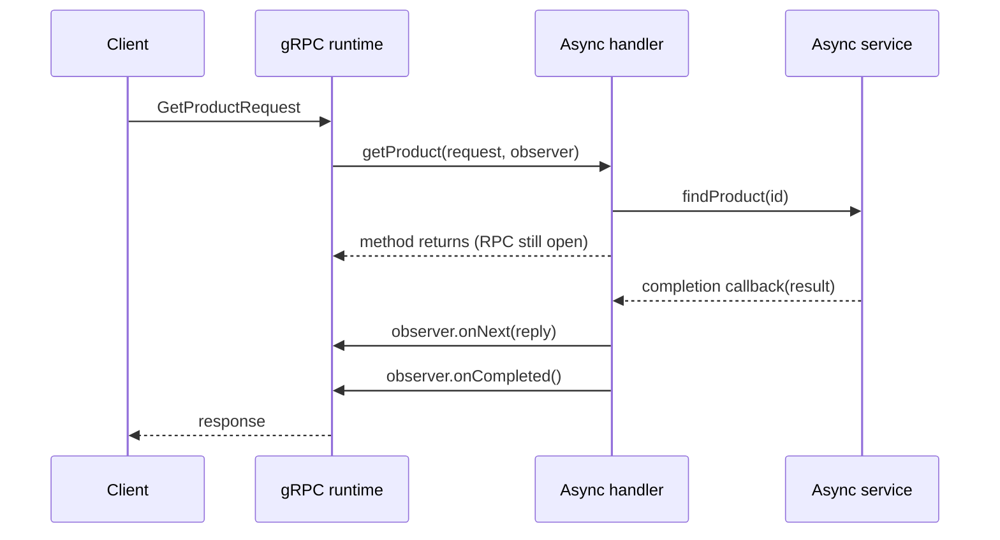

# Async handler và callback

## Mục tiêu bài học

Trong **SPRING_GRPC**, một server handler có thể phải chờ database, HTTP client hoặc một gRPC service khác. Nếu handler gọi API blocking, application worker bị giữ trong lúc chờ. Với **async handler**, method gRPC tiếp nhận request, khởi chạy hoặc kết nối với tác vụ bất đồng bộ, rồi hoàn tất RPC qua callback khi kết quả sẵn sàng.

Bài học tập trung vào cách triển khai handler bất đồng bộ trong gRPC Java và Spring: dùng `CompletionStage`/`CompletableFuture`, xử lý callback, bảo toàn gRPC Context, ánh xạ lỗi, cancellation và vòng đời `StreamObserver`.

Sau bài này, bạn có thể:

1. Phân biệt method signature của generated service base với thời điểm RPC thực sự hoàn tất.
2. Viết unary handler trả về ngay và gửi response trong callback.
3. Xử lý cả lỗi đồng bộ lúc khởi tạo tác vụ lẫn lỗi bất đồng bộ khi tác vụ hoàn thành.
4. Chọn executor cho callback và công việc blocking; tránh dùng common pool tùy tiện.
5. Truyền gRPC Context, deadline và cancellation qua ranh giới thread.
6. Đảm bảo mỗi RPC chỉ có một terminal event và không ghi đồng thời vào observer.
7. Áp dụng callback cho server streaming, hiểu giới hạn của client/bidirectional streaming và kiểm thử các đường hoàn tất.

> **Phạm vi:** Ví dụ dùng gRPC Java với Spring gRPC chính thức và `org.springframework.grpc.server.service.GrpcService`. Chi tiết server executor phụ thuộc server factory/transport; bài không giả định một property Spring dùng chung cho mọi phiên bản.

## 1. Async handler không có nghĩa method trả về response

Generated service base của gRPC Java thường định nghĩa unary method như sau:

```java
@Override
public void getProduct(
        GetProductRequest request,
        StreamObserver<ProductReply> responseObserver) {
    // Xử lý request và gửi kết quả qua responseObserver.
}
```

Method trả về `void` vì response được gửi qua `StreamObserver`. Khi handler chạy bất đồng bộ, nó có thể trả khỏi method Java trước khi RPC hoàn tất. gRPC call vẫn còn mở cho tới khi server gửi một terminal event:

- Thành công: một hoặc nhiều `onNext(response)`, sau đó `onCompleted()`.
- Thất bại: `onError(error)`.
- Client hủy hoặc deadline hết: gRPC runtime kết thúc call; server phải dừng công việc khi có thể và không gửi response tiếp.



**Điểm khác biệt:** trả khỏi method handler không đồng nghĩa trả response rỗng hoặc kết thúc RPC. Nếu quên gọi `onCompleted`/`onError`, client có thể chờ đến khi deadline hết.

## 2. Chọn API bất đồng bộ ở application boundary

Một application service có thể trả `CompletionStage<ProductView>` thay vì `ProductView`. Interface này cho biết kết quả sẽ sẵn sàng sau, mà không buộc adapter phải biết cách service thực hiện công việc.

```java
public interface ProductQuery {
    CompletionStage<ProductView> findProduct(String productId);
}
```

`ProductView` là kiểu Java của ứng dụng, không phải Protobuf message. `ProductQuery` không phụ thuộc `StreamObserver` hay `io.grpc.Status`.

Cần phân biệt hai trường hợp:

| Cách triển khai | Có thực sự non-blocking không? |
| --- | --- |
| Trả `CompletionStage` hoàn tất từ một async HTTP/gRPC client | Thường là bất đồng bộ; thread gọi không phải chờ response mạng |
| Dùng `CompletableFuture.supplyAsync(...)` với bounded executor để chạy JDBC/JPA blocking | Handler không giữ worker gRPC, nhưng một worker khác vẫn bị giữ khi chờ DB |
| Trả `CompletableFuture.completedFuture(blockingCall())` | **Không**; repository đã blocking trước khi future được tạo |
| Gọi `future.get()` hoặc `join()` trong handler | **Không**; handler lại chờ kết quả và mất lợi ích async |
| Trả `Mono`/`Flux` từ reactive pipeline | Có thể non-blocking nếu toàn bộ nguồn và operator tương thích reactive; không tự động biến JDBC thành non-blocking |

Async API không tự làm công việc blocking biến mất. Nếu dùng JPA/JDBC, phải offload thao tác đó sang executor có giới hạn hoặc dùng kiến trúc persistence reactive phù hợp. Không dùng `ForkJoinPool.commonPool()` làm nơi mặc định cho I/O blocking.

## 3. Ví dụ: async unary handler

### 3.1. Kiểu kết quả và application service

Giả sử application service tìm sản phẩm và trả view. Lỗi nghiệp vụ được biểu diễn bằng exception Java:

```java
public record ProductView(
        String productId,
        String name,
        long priceCents) {
}

public class ProductNotFoundException extends RuntimeException {
    public ProductNotFoundException(String productId) {
        super("Không tìm thấy sản phẩm: " + productId);
    }
}
```

Interface application:

```java
public interface ProductQuery {
    CompletionStage<ProductView> findProduct(String productId);
}
```

`ProductView` là kiểu ứng dụng thuần Java. Adapter không cần biết service gọi database, async HTTP client hay downstream gRPC stub.

### 3.2. Offload JPA blocking mà transaction vẫn đúng

Ví dụ sau bọc truy vấn JPA đồng bộ bằng bounded executor. Transaction nằm trên bean worker riêng; phương thức được gọi qua Spring proxy **trên worker thread**, nên transaction bao quanh truy vấn và việc map entity thành view.

```java
@Service
public class ProductQueryWorker {

    private final ProductRepository repository;

    public ProductQueryWorker(ProductRepository repository) {
        this.repository = repository;
    }

    @Transactional(readOnly = true)
    public ProductView load(String productId) {
        ProductEntity entity = repository.findByProductId(productId)
                .orElseThrow(() -> new ProductNotFoundException(productId));

        // Materialize dữ liệu trước khi transaction kết thúc.
        return new ProductView(
                entity.getProductId(),
                entity.getName(),
                entity.getPriceCents());
    }
}
```

Application service thực thi công việc trên pool có giới hạn:

```java
@Service
public class AsyncProductQuery implements ProductQuery {

    private final ProductQueryWorker worker;
    private final Executor productIoExecutor;

    public AsyncProductQuery(
            ProductQueryWorker worker,
            @Qualifier("productIoExecutor") Executor productIoExecutor) {
        this.worker = worker;
        this.productIoExecutor = productIoExecutor;
    }

    @Override
    public CompletionStage<ProductView> findProduct(String productId) {
        return CompletableFuture.supplyAsync(
                () -> worker.load(productId),
                productIoExecutor);
    }
}
```

Ví dụ này **offload blocking I/O**, không phải reactive database access. `ProductQueryWorker` là bean khác, vì vậy `worker.load(...)` đi qua Spring proxy và `@Transactional` được áp dụng trên thread thực thi. Không đặt `@Transactional` trên `findProduct` rồi nghĩ transaction sẽ tự truyền sang thread do `supplyAsync` tạo ra: transaction Spring truyền thống gắn với thread.

Pool `productIoExecutor` phải có giới hạn số worker và queue, tên thread rõ ràng, metric và rejection policy. Sizing cần phù hợp với connection pool database; tăng worker quá giới hạn DB chỉ tạo thêm thread chờ connection.

### 3.3. Spring gRPC adapter hoàn tất response trong callback

```java
@GrpcService
public class ProductGrpcEndpoint
        extends ProductGrpc.ProductImplBase {

    private static final Logger log =
            LoggerFactory.getLogger(ProductGrpcEndpoint.class);

    private final ProductQuery productQuery;
    private final ProductProtoMapper mapper;

    public ProductGrpcEndpoint(
            ProductQuery productQuery,
            ProductProtoMapper mapper) {
        this.productQuery = productQuery;
        this.mapper = mapper;
    }

    @Override
    public void getProduct(
            GetProductRequest request,
            StreamObserver<ProductReply> responses) {

        Context rpcContext = Context.current();
        final CompletionStage<ProductView> operation;

        try {
            // Có thể ném lỗi đồng bộ trước khi trả CompletionStage.
            operation = Objects.requireNonNull(
                    productQuery.findProduct(request.getProductId()));
        } catch (RuntimeException ex) {
            responses.onError(toStatus(ex));
            return;
        }

        operation.whenComplete((product, failure) ->
                rpcContext.wrap(() -> {
                    if (rpcContext.isCancelled()) {
                        return;
                    }

                    if (failure != null) {
                        responses.onError(toStatus(unwrap(failure)));
                        return;
                    }

                    if (product == null) {
                        responses.onError(Status.INTERNAL
                                .withDescription("Application service trả kết quả rỗng")
                                .asRuntimeException());
                        return;
                    }

                    final ProductReply reply;
                    try {
                        reply = mapper.toProto(product);
                    } catch (RuntimeException mappingFailure) {
                        log.error("Không thể map ProductView thành Protobuf",
                                mappingFailure);
                        responses.onError(Status.INTERNAL
                                .withDescription("Không thể tạo response")
                                .asRuntimeException());
                        return;
                    }

                    responses.onNext(reply);
                    responses.onCompleted();
                }).run());
    }

    private Throwable unwrap(Throwable failure) {
        Throwable current = failure;
        while ((current instanceof CompletionException
                || current instanceof ExecutionException)
                && current.getCause() != null) {
            current = current.getCause();
        }
        return current;
    }

    private Throwable toStatus(Throwable failure) {
        if (failure instanceof ProductNotFoundException) {
            return Status.NOT_FOUND
                    .withDescription("Không tìm thấy sản phẩm")
                    .asRuntimeException();
        }
        if (failure instanceof IllegalArgumentException) {
            return Status.INVALID_ARGUMENT
                    .withDescription("Yêu cầu không hợp lệ")
                    .asRuntimeException();
        }

        log.error("getProduct thất bại", failure);
        return Status.INTERNAL
                .withDescription("Không thể xử lý yêu cầu")
                .asRuntimeException();
    }
}
```

Ví dụ cần import generated types, `Objects`, `CompletionStage`, `CompletionException`, `ExecutionException`, logger, `Context`, `Status` và `StreamObserver`. `Objects.requireNonNull` làm rõ hợp đồng: application service phải trả một stage, không trả `null`.

Khi `whenComplete` được đăng ký, handler có thể trả về ngay. Callback dùng context đã capture để kiểm tra cancellation và gửi response. Callback không gọi thêm database hay HTTP blocking; việc map một message nhỏ và gọi observer là phần xử lý ngắn.

### 3.4. Xử lý hai kiểu lỗi khác nhau

Có hai thời điểm có thể phát sinh lỗi:

1. **Lỗi đồng bộ khi khởi chạy:** `productQuery.findProduct(...)` ném exception trước khi trả stage. Adapter phải bắt ngay; nếu không, handler có thể thoát mà không gửi terminal event.
2. **Lỗi bất đồng bộ:** stage hoàn tất exceptionally sau khi handler đã trả về. Adapter xử lý trong callback và gọi `onError`.

Với `CompletableFuture`, lỗi thường được bọc trong `CompletionException` hoặc `ExecutionException`. Gỡ lớp bọc để ánh xạ exception gốc. Không ánh xạ mọi lỗi thành `NOT_FOUND`; chỉ lỗi nghiệp vụ đã định nghĩa mới dùng status đó.

## 4. Callback chạy trên thread nào?

`CompletionStage.whenComplete` không bảo đảm callback chạy trên một executor cụ thể. Callback thường chạy trên thread hoàn tất stage; nếu stage đã hoàn tất trước lúc đăng ký callback, callback có thể chạy ngay trên thread đăng ký.

Điều này có các hệ quả:

- Callback chỉ nên làm việc nhẹ: kiểm tra context, map một response nhỏ và gửi observer.
- Không gọi blocking API trong callback nếu thread hoàn tất thuộc event loop hoặc executor dùng chung.
- Nếu cần executor riêng cho callback, dùng `whenCompleteAsync(..., callbackExecutor)`, nhưng phải có cách xử lý trường hợp executor từ chối task để RPC không bị treo.
- Không dùng common pool vô thức; mọi queue và pool đều cần giới hạn và metric.

Ví dụ callback async có executor:

```java
operation.whenCompleteAsync((product, failure) -> {
    rpcContext.wrap(() -> completeRpc(product, failure, responses)).run();
}, callbackExecutor);
```

`completeRpc` cần bảo đảm mọi nhánh kết thúc bằng đúng một `onError` hoặc `onCompleted`. Nếu `callbackExecutor` có thể từ chối task, phải xử lý rejection ngay tại điểm dispatch hoặc dùng một cơ chế fallback an toàn; chỉ gắn `exceptionally` sau một callback có thể không đủ nếu callback chưa từng được chạy.

**Không mặc định callback executor và blocking executor là cùng một pool.** Blocking task có thể chiếm toàn bộ worker, khiến callback hoàn tất không có thread để gửi response. Tách pool khi tải và thời gian xử lý cho thấy cần thiết; mỗi pool cần bounded queue và chính sách quá tải.

## 5. Context, deadline và cancellation

### 5.1. Capture gRPC Context trước khi offload

`Context.current()` phản ánh context của thread hiện tại. Khi callback chạy ở thread khác, context không tự động được khôi phục. Chụp context trước khi đăng ký callback và dùng `rpcContext.wrap(...)`:

```java
Context rpcContext = Context.current();

operation.whenComplete((value, error) ->
        rpcContext.wrap(() -> {
            if (rpcContext.isCancelled()) {
                return;
            }
            // Xử lý callback trong đúng RPC context.
        }).run());
```

gRPC Context có thể mang deadline, cancellation và dữ liệu được interceptor gắn vào. Context này khác với ThreadLocal của logging, tracing hoặc Spring Security; các cơ chế đó cần propagation riêng.

### 5.2. Deadline không tự dừng mọi tác vụ

Khi client deadline hết, server RPC bị hủy, nhưng một tác vụ JDBC hoặc HTTP đang chạy không nhất thiết dừng ngay. Cần kết hợp:

- RPC deadline ở client/server.
- Query timeout và connection timeout cho database.
- Connect/read/call timeout cho HTTP hoặc downstream gRPC.
- Cancellation signal cho nguồn async hỗ trợ hủy.
- Kiểm tra context trước khi phát response hoặc tiếp tục xử lý.

Không đặt timeout downstream dài hơn ngân sách còn lại của RPC. Nếu thao tác ghi đã commit trước lúc cancellation được xử lý, client có thể không nhận response dù dữ liệu đã thay đổi. Lệnh ghi cần idempotency key nếu client có thể retry sau timeout.

### 5.3. Hủy upstream operation khi RPC bị hủy

Nếu API trả về một `CompletableFuture` có khả năng hủy, có thể đăng ký cancellation listener của gRPC context để yêu cầu hủy future:

```java
Context rpcContext = Context.current();
CompletableFuture<ProductView> operation = productQuery.findProductFuture(id);

rpcContext.addListener(
        ignored -> operation.cancel(true),
        cancellationExecutor);
```

`cancellationExecutor` phải được cấu hình phù hợp và listener phải nhẹ. `cancel(true)` chỉ là yêu cầu hủy; nó không bảo đảm driver JDBC, thư viện native hoặc remote server dừng ngay. Tác vụ nền vẫn cần timeout và cancellation support ở chính dependency. Nếu API chỉ trả `CompletionStage`, không giả định có thể ép hủy stage đó; có thể cần một cancellation handle riêng trong application contract.

## 6. Vòng đời StreamObserver và tính an toàn đồng thời

`StreamObserver` là kênh gửi message của một RPC. Với unary handler có một completion callback, chỉ callback đó ghi response thì thứ tự thường rõ ràng:

```text
onNext(reply)
onCompleted()
```

Không được:

- Gọi `onNext` sau `onCompleted` hoặc `onError`.
- Gọi nhiều terminal event cho cùng RPC.
- Gọi đồng thời `onNext` từ nhiều thread mà không serialize.
- Gửi response sau khi client đã hủy hoặc deadline đã hết.
- Giữ `StreamObserver` trong field mutable của singleton `@GrpcService` để dùng cho RPC khác.

Nếu có nhiều callback hoặc nguồn dữ liệu cạnh tranh, cần một luồng ghi duy nhất hoặc một hàng đợi tuần tự hóa message. `AtomicBoolean` có thể giúp bảo vệ terminal state, nhưng không tự bảo đảm thứ tự các lần `onNext`; serialization vẫn phải được thiết kế.

## 7. Async server streaming

Với server streaming, handler nhận một request nhưng gửi nhiều response. Nếu kết quả là danh sách nhỏ đã được tải bất đồng bộ, callback có thể phát từng message rồi kết thúc:

```java
CompletionStage<List<ProductView>> operation =
        productQuery.listProductsAsync(limit);

Context rpcContext = Context.current();

operation.whenComplete((products, failure) ->
        rpcContext.wrap(() -> {
            if (rpcContext.isCancelled()) {
                return;
            }
            if (failure != null) {
                responses.onError(toStatus(unwrap(failure)));
                return;
            }

            for (ProductView product : products) {
                if (rpcContext.isCancelled()) {
                    return;
                }
                responses.onNext(mapper.toProto(product));
            }
            if (!rpcContext.isCancelled()) {
                responses.onCompleted();
            }
        }).run());
```

Mẫu này phù hợp với tập kết quả **nhỏ và có giới hạn**. Không tải hàng triệu bản ghi thành một `List` chỉ để gọi `onNext` trong callback.

Với stream dài hoặc dữ liệu đến dần, dùng `ServerCallStreamObserver` để kiểm soát readiness và cancellation:

- `isReady()` cho biết transport có khả năng nhận thêm message tại thời điểm kiểm tra.
- `setOnReadyHandler(...)` đăng ký callback khi stream có thể nhận thêm dữ liệu.
- `setOnCancelHandler(...)` cho phép dừng nguồn dữ liệu khi client hủy.

Khi dùng onReady callback và nguồn async, mọi lần ghi observer phải được serialize. Không để callback onReady và worker đọc page cùng phát onNext đồng thời.

## 8. Client streaming và bidirectional streaming

Với client streaming hoặc bidirectional streaming, generated server method thường trả về `StreamObserver<Request>` để nhận message từ client. Mỗi callback `onNext` có thể kích hoạt công việc async.

Một mẫu khái niệm:

```java
@Override
public StreamObserver<UploadChunk> upload(
        StreamObserver<UploadResult> responses) {

    return new StreamObserver<>() {
        @Override
        public void onNext(UploadChunk chunk) {
            // Validate nhanh; chuyển xử lý I/O sang pipeline có giới hạn.
            // Cần giữ thứ tự hoặc sequence number nếu giao thức yêu cầu.
        }

        @Override
        public void onError(Throwable error) {
            // Hủy pipeline và giải phóng tài nguyên.
        }

        @Override
        public void onCompleted() {
            // Finalize khi client half-close; gửi terminal response đúng một lần.
        }
    };
}
```

Không tạo một future không giới hạn cho mỗi message. Nếu client gửi nhanh hơn khả năng xử lý, số task đang chờ và bộ nhớ sẽ tăng. Cần giới hạn số chunk in-flight, xác định thứ tự, backpressure, timeout và chính sách partial commit/all-or-nothing.

Bidirectional streaming cho phép hai chiều tiến triển độc lập. Nếu xử lý request song song, response có thể về khác thứ tự; hãy gắn sequence ID hoặc serialize xử lý nếu thứ tự là một phần contract.

## 9. Ánh xạ lỗi trong callback

| Nguyên nhân | Status thường phù hợp | Lưu ý |
| --- | --- | --- |
| Request sai định dạng/thiếu dữ liệu | `INVALID_ARGUMENT` | Phát hiện trước hoặc trong bước validation |
| Không tìm thấy tài nguyên | `NOT_FOUND` | Không tiết lộ thông tin không được phép |
| Vi phạm trạng thái nghiệp vụ | `FAILED_PRECONDITION` | Không nhất thiết retry ngay |
| Downstream tạm thời không sẵn sàng | `UNAVAILABLE` | Retry cần backoff và idempotency |
| Deadline của RPC hết | `DEADLINE_EXCEEDED` | Không biến mọi timeout nội bộ thành cùng một lỗi nếu nguyên nhân khác nhau |
| Pool/executor quá tải | `RESOURCE_EXHAUSTED` | Có thể báo hiệu client giảm tải |
| Lỗi ngoài dự kiến | `INTERNAL` | Log chi tiết ở server, message an toàn cho client |

Đừng gửi exception message nguyên văn nếu có thể chứa SQL, token, hostname nội bộ hoặc dữ liệu cá nhân. Gắn correlation ID vào log/trace để tra cứu. Nếu callback bắt lỗi và không gọi terminal event, RPC sẽ treo đến deadline; mỗi nhánh phải kết thúc rõ ràng.

## 10. Kiểm thử async handler và callback

Các test quan trọng nhất là kiểm tra thời điểm hoàn tất, không chỉ response cuối cùng.

### 10.1. Callback chưa chạy khi future chưa hoàn tất

Tạo `CompletableFuture` chưa hoàn tất, gọi handler rồi xác minh observer chưa nhận response. Sau đó complete future và xác minh response cùng `onCompleted` được gửi đúng thứ tự.

```java
@Test
void sendsResponseOnlyAfterFutureCompletes() {
    CompletableFuture<ProductView> future = new CompletableFuture<>();
    when(productQuery.findProduct("sku-1")).thenReturn(future);

    endpoint.getProduct(request("sku-1"), observer);

    verify(observer, never()).onNext(any());
    verify(observer, never()).onCompleted();

    future.complete(new ProductView("sku-1", "Keyboard", 500_000L));

    verify(observer).onNext(any(ProductReply.class));
    verify(observer).onCompleted();
    verify(observer, never()).onError(any());
}
```

### 10.2. Test lỗi bất đồng bộ

Hoàn tất future bằng exception và kiểm tra observer nhận đúng status, không nhận `onNext` hoặc `onCompleted`. Cũng test trường hợp application method ném exception đồng bộ trước khi trả future.

### 10.3. Test cancellation và Context

Đặt một gRPC Context có cancellation, gọi handler trong context đó rồi hủy trước khi future hoàn tất. Khi future hoàn tất, xác minh callback không phát response. Nếu có cancellation listener, xác minh future/handle được yêu cầu hủy. Không coi test này là bằng chứng JDBC chắc chắn dừng; cần test timeout/cancel riêng cho driver hoặc downstream client.

### 10.4. Test saturation và callback executor

Cấu hình executor nhỏ trong test, giữ worker bằng latch rồi submit thêm task để kiểm tra rejection. Xác minh RPC bị từ chối có status rõ ràng, không bị bỏ quên. Test callback executor bị từ chối đặc biệt quan trọng nếu dùng `whenCompleteAsync`, vì callback không chạy đồng nghĩa observer có thể không được kết thúc.

## 11. Lỗi thường gặp

| Triệu chứng | Nguyên nhân | Cách xử lý |
| --- | --- | --- |
| Client chờ đến deadline dù handler đã return | Không gọi `onCompleted` hoặc `onError` trong callback | Bảo đảm mọi đường hoàn tất đều có terminal event |
| Handler vẫn blocking | Gọi `get()`/`join()` hoặc tạo future sau khi đã chạy blocking call | Trả stage từ API async thật hoặc offload blocking trước khi thực thi |
| Callback chạy trên thread không mong muốn | Dùng `whenComplete` mà không xét thread hoàn tất | Callback nhẹ; chọn executor rõ ràng khi cần |
| Callback không thấy metadata/deadline | gRPC Context không được truyền qua thread | Capture context và dùng `Context.wrap` |
| Client hủy nhưng công việc vẫn chạy | Future cancellation không truyền tới dependency | Timeout/cancellation ở DB/HTTP/downstream và kiểm tra context |
| Response stream lỗi ngẫu nhiên | Nhiều thread gọi cùng observer hoặc terminal event nhiều lần | Serialize writes, một owner cho observer, kiểm soát trạng thái terminal |
| Executor quá tải làm RPC treo | Callback async bị rejection nhưng không xử lý | Bounded queue, rejection mapping và fallback hoàn tất RPC |
| Database transaction không bao quanh async query | Transaction mở ở thread gọi trước khi task chuyển thread | Gọi bean transactional trên worker thread |
| Stream làm tăng RAM | Buffer toàn bộ kết quả hoặc tạo future không giới hạn | Paging, bounded in-flight và flow control |

## 12. Bài tập thực hành

1. Viết unary handler dùng `CompletableFuture` chưa hoàn tất; xác minh client chỉ nhận response sau khi future complete.
2. Tạo hai đường lỗi: exception đồng bộ khi tạo stage và exception bất đồng bộ khi stage complete exceptionally. Ánh xạ cả hai sang gRPC status phù hợp.
3. Offload một truy vấn JPA sang bounded executor; đặt transaction trên worker bean và xác minh transaction kết thúc trước callback gửi response.
4. Capture gRPC Context, hủy RPC trước khi future hoàn tất và kiểm tra callback không gửi message.
5. Thử `whenComplete` và `whenCompleteAsync` với các executor khác nhau; quan sát thread name và queue delay.
6. Xây server streaming phát theo page; dùng `ServerCallStreamObserver.isReady()` và cancellation để kiểm soát nguồn dữ liệu.
7. Mô phỏng callback executor rejection và bảo đảm client nhận terminal status thay vì chờ vô hạn.
8. Với client streaming, giới hạn số message in-flight và kiểm tra thứ tự response khi xử lý song song.

### Câu hỏi tự kiểm tra

- Vì sao method unary gRPC có thể return mà RPC vẫn chưa hoàn tất?
- `whenComplete` chạy trên thread nào? Khác gì `whenCompleteAsync`?
- Vì sao `CompletableFuture.completedFuture(blockingCall())` không làm lời gọi trở nên async?
- Khi chuyển công việc JPA sang worker thread, transaction cần được mở ở đâu?
- `Context.wrap` bảo toàn những gì và không bảo toàn những gì?
- Deadline gRPC có bảo đảm dừng một câu SQL đang chạy không?
- Vì sao cần xử lý cả lỗi đồng bộ lẫn lỗi bất đồng bộ?
- Điều gì xảy ra nếu callback executor từ chối task trước khi observer nhận terminal event?
- Vì sao không thể để nhiều thread gọi `onNext` đồng thời?
- Với server streaming dài, readiness và cancellation giúp kiểm soát tài nguyên thế nào?

## Tài liệu tham khảo

- [gRPC Java — Basics Tutorial](https://grpc.io/docs/languages/java/basics/): triển khai server method và sử dụng `StreamObserver`.
- [gRPC Java — StreamObserver](https://grpc.github.io/grpc-java/javadoc/io/grpc/stub/StreamObserver.html): vòng đời message và terminal event.
- [gRPC Java — Context](https://grpc.github.io/grpc-java/javadoc/io/grpc/Context.html): context propagation, cancellation và deadline.
- [gRPC Java — ServerCallStreamObserver](https://grpc.github.io/grpc-java/javadoc/io/grpc/stub/ServerCallStreamObserver.html): readiness và cancellation cho server streaming.
- [Java — CompletionStage](https://docs.oracle.com/en/java/javase/17/docs/api/java.base/java/util/concurrent/CompletionStage.html): composition và callback bất đồng bộ.
- [Java — CompletableFuture](https://docs.oracle.com/en/java/javase/17/docs/api/java.base/java/util/concurrent/CompletableFuture.html): executor, completion và cancellation.
- [Spring Framework — Task Execution and Scheduling](https://docs.spring.io/spring-framework/reference/integration/scheduling.html): executor và task execution trong Spring.

**Kết quả mong đợi:** Người học xây được async unary handler dùng callback để hoàn tất RPC sau khi application operation hoàn thành; phân biệt lỗi khởi chạy và lỗi bất đồng bộ; giữ đúng Context, deadline, cancellation và terminal event; đồng thời biết kiểm soát executor, flow control và callback cho streaming RPC mà không làm cạn worker hoặc để RPC treo.
