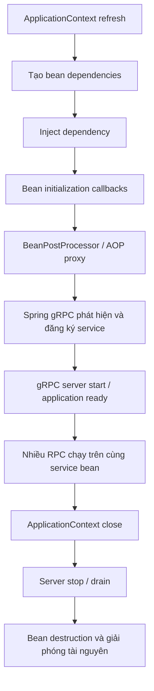
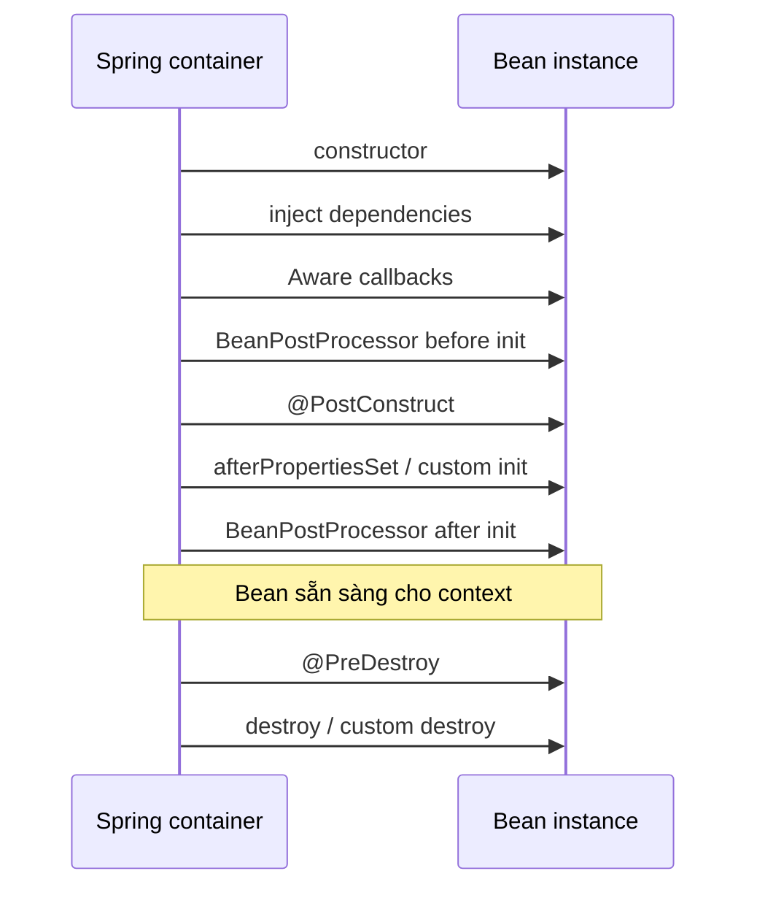

# Service lifecycle trong ApplicationContext

## Mục tiêu bài học

Trong **SPRING_GRPC**, gRPC service thường được Spring quản lý như một bean trong `ApplicationContext`. Bean được tạo, inject dependency, khởi tạo, tham gia đăng ký với gRPC server, phục vụ nhiều RPC đồng thời và được dọn dẹp khi ứng dụng đóng.

Bài học tập trung vào **service lifecycle trong ApplicationContext**: hiểu các giai đoạn vòng đời bean, dùng đúng callback khởi tạo/hủy, phân biệt vòng đời bean với vòng đời server và từng RPC, đồng thời quản lý tài nguyên phụ thuộc như executor hoặc client channel.

Sau bài này, bạn có thể:

1. Mô tả thứ tự chính của Spring bean lifecycle và vị trí của `@PostConstruct`/`@PreDestroy`.
2. Phân biệt bean creation, gRPC service registration, server startup và RPC execution.
3. Thiết kế `@GrpcService` singleton an toàn khi nhiều RPC chạy đồng thời.
4. Tránh gọi transactional/AOP method sai thời điểm trong lifecycle callback.
5. Quản lý tài nguyên do ứng dụng sở hữu và đóng chúng đúng lúc khi context dừng.
6. Xử lý startup failure, graceful shutdown và kiểm thử lifecycle của Spring gRPC service.

> **Phạm vi:** Ví dụ dùng Spring gRPC chính thức với `org.springframework.grpc.server.service.GrpcService`, Spring Boot và gRPC Java. Chi tiết nội bộ về server factory và thời điểm bind service có thể thay đổi theo phiên bản/transport; bài phân biệt các mốc lifecycle mà ứng dụng cần hiểu, không giả định một callback nội bộ cố định.

## 1. Ba vòng đời khác nhau

Trong một ứng dụng Spring gRPC, cần phân biệt ba vòng đời:

| Vòng đời | Bắt đầu/kết thúc | Phạm vi |
| --- | --- | --- |
| **Spring bean lifecycle** | Spring tạo bean trong quá trình refresh context; destroy khi context đóng | Một instance bean theo scope, thường là singleton |
| **gRPC server lifecycle** | Server được tạo/start khi ứng dụng khởi động; stop khi ứng dụng đóng | Listener, transport, executor và các service được bind |
| **RPC lifecycle** | Bắt đầu khi client gọi method; kết thúc bằng completion, error hoặc cancellation | Một cuộc gọi, có thể là unary hoặc stream |



Sơ đồ biểu diễn quan hệ khái niệm. Thứ tự chính xác giữa server stop, lifecycle processor và destroy callback do server factory cùng Spring quản lý; không nên dựa vào giả định rằng mọi phiên bản đều gọi một method nội bộ giống nhau. Điều ứng dụng cần bảo đảm là server ngừng nhận công việc mới, các RPC đang chạy được drain theo chính sách, rồi tài nguyên do ứng dụng sở hữu được đóng.

Một gRPC service bean tồn tại lâu hơn rất nhiều so với một RPC. Với singleton mặc định, một instance endpoint có thể xử lý nhiều RPC theo thời gian. Vì vậy không lưu request, response observer hay state tạm của một stream trong field mutable của service singleton.

## 2. Các giai đoạn chính của Spring bean lifecycle

Với một bean thông thường được tạo bởi Spring, luồng xử lý khái quát như sau:

1. **Instantiate:** Spring tạo instance bean.
2. **Populate properties / dependency injection:** inject constructor dependency, field/setter nếu có và các dependency đã resolve.
3. **Aware callbacks:** nếu bean triển khai interface như `BeanNameAware` hoặc `ApplicationContextAware`, Spring cung cấp thông tin tương ứng.
4. **BeanPostProcessor trước initialization:** các processor có thể xử lý bean trước init callback.
5. **Initialization callbacks:** `@PostConstruct`, `InitializingBean.afterPropertiesSet()` và custom init method nếu được cấu hình.
6. **BeanPostProcessor sau initialization:** processor có thể bọc bean bằng proxy, ví dụ proxy phục vụ AOP.
7. **Ready for use:** bean được đưa vào context để các thành phần khác sử dụng.

Khi context đóng, Spring thực hiện destruction cho các singleton bean được quản lý, gồm các callback hủy tương ứng.



Đây là thứ tự tổng quát cho bean do container quản lý; các chi tiết như proxy, scoped bean, circular reference hoặc factory bean có quy tắc riêng. Với gRPC service, nên dùng constructor injection và tránh tự tạo endpoint bằng `new` để Spring có thể quản lý lifecycle.

## 3. Dùng initialization callback đúng mục đích

`@PostConstruct` được gọi sau khi dependency injection hoàn tất và trước khi bean được công bố hoàn toàn qua các bước hậu xử lý. Nó phù hợp với việc kiểm tra cấu hình cục bộ hoặc chuẩn bị trạng thái nội bộ nhẹ.

Ví dụ:

```java
@Component
public class CatalogPolicy {

    private final CatalogProperties properties;

    public CatalogPolicy(CatalogProperties properties) {
        this.properties = properties;
    }

    @PostConstruct
    void validateConfiguration() {
        if (properties.maxPageSize() < 1
                || properties.maxPageSize() > 500) {
            throw new IllegalStateException(
                    "catalog.max-page-size phải từ 1 đến 500");
        }
    }

    public int maxPageSize() {
        return properties.maxPageSize();
    }
}
```

Nếu cấu hình không hợp lệ, callback ném exception khiến quá trình tạo bean/context thất bại. Đây là hành vi phù hợp khi ứng dụng không thể hoạt động an toàn với cấu hình đó.

### Không biến @PostConstruct thành nơi chạy nghiệp vụ

Tránh các việc sau trong init callback:

- Chạy một RPC hoặc gọi downstream đồng bộ không có timeout.
- Đọc toàn bộ database để warm up mà không có giới hạn.
- Giữ transaction dài hoặc thực hiện side effect không idempotent.
- Khởi tạo tác vụ nền không có cơ chế dừng.
- Gọi method transactional/AOP trên chính bean và giả định lời gọi đã qua proxy.

Trong proxy-based AOP, `@PostConstruct` chạy trên target trong giai đoạn initialization, trước khi proxy cuối cùng được trả ra cho caller. Self-invocation cũng không đi qua proxy. Vì vậy, đừng đặt logic cần transaction, security advice hoặc retry advice trong callback rồi gọi một method khác của cùng instance để mong advice được áp dụng.

Nếu cần warm-up bất đồng bộ, hãy dùng lifecycle component hoặc startup runner phù hợp, có timeout, trạng thái readiness và cơ chế cleanup. Đừng làm callback init treo vô hạn khiến ApplicationContext không thể hoàn tất startup.

## 4. Dùng destruction callback và quản lý tài nguyên

`@PreDestroy` được gọi khi Spring hủy bean singleton trong lúc context đóng. Nó phù hợp để dừng tác vụ do bean sở hữu, đóng resource tự tạo hoặc giải phóng handle mà container không quản lý thay.

Ví dụ một component sở hữu scheduler riêng:

```java
@Component
public class CatalogRefreshWorker {

    private final ScheduledExecutorService scheduler =
            Executors.newSingleThreadScheduledExecutor();

    public void start() {
        scheduler.scheduleWithFixedDelay(
                this::refreshSafely,
                10, 60, TimeUnit.SECONDS);
    }

    private void refreshSafely() {
        // Công việc có giới hạn thời gian và xử lý lỗi.
    }

    @PreDestroy
    void stop() {
        scheduler.shutdown();
        try {
            if (!scheduler.awaitTermination(5, TimeUnit.SECONDS)) {
                scheduler.shutdownNow();
            }
        } catch (InterruptedException ex) {
            scheduler.shutdownNow();
            Thread.currentThread().interrupt();
        }
    }
}
```

Ví dụ chỉ đúng nếu component thực sự sở hữu scheduler này. Trong ứng dụng thực, có thể để Spring quản lý `ThreadPoolTaskExecutor`/`TaskScheduler` qua bean lifecycle; không tự đóng một executor dùng chung do bean khác sở hữu.

Spring hỗ trợ các cơ chế hủy như `@PreDestroy`, triển khai `DisposableBean.destroy()` hoặc khai báo custom destroy method trong `@Bean(destroyMethod = "...")`. Thông thường chọn một cơ chế rõ ràng, tránh đặt cùng một hành động cleanup ở nhiều callback khiến nó chạy hai lần.

### Đóng gRPC client channel

Nếu ứng dụng tự tạo `ManagedChannel` và sở hữu vòng đời của nó, cần đóng channel khi context dừng. Không tạo channel mới cho từng RPC và không đóng channel dùng chung sau mỗi call.

Một bean factory có thể khai báo destroy method:

```java
@Configuration(proxyBeanMethods = false)
public class InventoryClientConfiguration {

    @Bean(destroyMethod = "shutdown")
    ManagedChannel inventoryChannel() {
        return ManagedChannelBuilder
                .forAddress("inventory.internal", 9090)
                .useTransportSecurity()
                .build();
    }
}
```

Ví dụ dùng TLS transport và địa chỉ minh họa; chứng chỉ/trust cần được cấu hình theo môi trường. `shutdown()` bắt đầu graceful shutdown channel nhưng nếu ứng dụng cần chờ kết thúc trong một khoảng thời gian rồi mới gọi `shutdownNow()`, hãy tạo một lifecycle owner có logic await rõ ràng. Đừng mặc định `destroyMethod="shutdown"` tự chờ mọi RPC hoàn tất trong mọi cấu hình.

Với channel/client do starter hoặc factory Spring quản lý, hãy theo đúng cơ chế shutdown của starter; không tự đóng resource mà bean khác sở hữu.

## 5. Lifecycle của Spring gRPC service

Một service phía server thường kế thừa generated base và được đánh dấu bằng `@GrpcService`:

```java
@GrpcService
public class InventoryGrpcEndpoint
        extends InventoryGrpc.InventoryImplBase {

    private final InventoryApplicationService application;

    public InventoryGrpcEndpoint(
            InventoryApplicationService application) {
        this.application = application;
    }

    @Override
    public void getInventory(
            InventoryRequest request,
            StreamObserver<InventoryReply> responses) {
        // Gọi use case, map response và kết thúc observer.
    }
}
```

Các điểm cần hiểu:

- **Bean creation:** Spring tạo endpoint và inject `InventoryApplicationService`.
- **Service discovery/registration:** Spring gRPC phát hiện service bean có generated base triển khai `BindableService` và dùng service definition để bind vào server.
- **Server start:** transport bắt đầu lắng nghe theo cấu hình server factory.
- **RPC execution:** nhiều request có thể gọi cùng instance endpoint; mỗi RPC có observer/context riêng.
- **Shutdown:** server được dừng theo lifecycle của server factory khi context đóng.

`@GrpcService` đánh dấu service cho tích hợp Spring gRPC; nó không có nghĩa mỗi RPC tạo một bean mới. Không tự gọi `bindService()` rồi tạo một server thứ hai nếu server factory đã quản lý service đó. Việc đăng ký trùng cùng service name có thể gây lỗi khi server build.

### Không đặt trạng thái của một RPC trên service singleton

Không nên viết:

```java
@GrpcService
public class BadInventoryEndpoint
        extends InventoryGrpc.InventoryImplBase {

    private String currentRequestId; // Sai: dùng chung giữa RPC

    private StreamObserver<InventoryReply> currentObserver; // Sai

    // ...
}
```

Hai RPC đồng thời có thể ghi đè các field này. Hãy giữ request, observer, completion state và dữ liệu riêng của stream trong biến cục bộ hoặc object session được tạo cho từng RPC. Field của singleton chỉ nên chứa dependency bất biến hoặc thành phần có thread safety được bảo đảm.

## 6. Bean lifecycle và AOP proxy

Spring có thể tạo proxy cho bean để áp dụng transaction, security, caching, retry hoặc các advice khác. Điều này có ý nghĩa với Spring gRPC vì endpoint thường gọi application service qua proxy.

Thiết kế nên đặt cross-cutting concern ở application service:

```java
@Service
public class InventoryApplicationService {

    private final InventoryRepository repository;

    public InventoryApplicationService(InventoryRepository repository) {
        this.repository = repository;
    }

    @Transactional(readOnly = true)
    public InventoryView getInventory(String sku) {
        return repository.findViewBySku(sku)
                .orElseThrow(() -> new InventoryNotFoundException(sku));
    }
}
```

Endpoint inject bean service do Spring quản lý và gọi qua proxy. Transaction mở/kết thúc tại application method; adapter gửi response sau khi method transactional trả về.

Không nên tự gọi `new InventoryApplicationService(...)`, vì instance đó không đi qua Spring proxy. Cũng không gọi method transactional của chính bean từ `@PostConstruct` để kỳ vọng transaction advice được áp dụng. Với lifecycle callback, mục tiêu là validate/prepare/cleanup resource, không phải thay thế application use case.

## 7. ApplicationContext refresh, readiness và shutdown

Tạo bean thành công chưa đồng nghĩa gRPC server đã sẵn sàng nhận traffic. Có thể phân biệt:

1. **Bean initialized:** dependency graph và init callback hoàn tất.
2. **Service registered:** server factory đã nhận service definition.
3. **Server started:** transport đã bind/listen.
4. **Application ready:** ứng dụng đã hoàn tất các bước startup cần thiết và có thể nhận traffic theo readiness policy.

Với Spring Boot, readiness nên phản ánh khả năng phục vụ thật của ứng dụng, không chỉ việc một endpoint bean tồn tại. Nếu cần kiểm tra downstream hoặc warm-up, dùng cơ chế readiness/health phù hợp và timeout hữu hạn. Không chạy probe blocking vô hạn trong `@PostConstruct`.

Khi shutdown, cần tính đến các RPC đang chạy:

- Ngừng nhận call mới theo cơ chế graceful shutdown của server.
- Cho RPC đang xử lý một khoảng thời gian hoàn tất.
- Hủy hoặc từ chối phần công việc còn lại khi hết grace period.
- Đóng client channel, executor và resource do ứng dụng sở hữu theo thứ tự phù hợp.
- Ghi log/metric cho số RPC đang in-flight, số call bị cancel và thời gian shutdown.

Không tự giả định thứ tự nội bộ giữa server factory và từng bean destroy callback. Nếu ứng dụng có resource cần tồn tại trong lúc server drain, hãy dùng lifecycle abstraction/phase mà phiên bản Spring gRPC hỗ trợ hoặc một owner component có thứ tự dừng được xác định.

## 8. Kiểm thử lifecycle

### 8.1. Kiểm tra init và destroy callback

Có thể dùng một bean đơn giản để xác minh callback chạy khi context được mở và đóng:

```java
@Component
public class LifecycleProbe {

    private final AtomicBoolean initialized = new AtomicBoolean();
    private final AtomicBoolean destroyed = new AtomicBoolean();

    @PostConstruct
    void initialize() {
        initialized.set(true);
    }

    @PreDestroy
    void destroy() {
        destroyed.set(true);
    }

    boolean isInitialized() {
        return initialized.get();
    }

    boolean isDestroyed() {
        return destroyed.get();
    }
}
```

Test với context đóng tường minh:

```java
@Test
void invokesLifecycleCallbacks() {
    AnnotationConfigApplicationContext context =
            new AnnotationConfigApplicationContext(TestConfiguration.class);

    LifecycleProbe probe = context.getBean(LifecycleProbe.class);
    assertThat(probe.isInitialized()).isTrue();

    context.close();

    assertThat(probe.isDestroyed()).isTrue();
}
```

Test thực tế có thể dùng bean test configuration riêng. Không dùng field test làm bằng chứng duy nhất cho thứ tự shutdown của server gRPC; callback này chỉ kiểm chứng lifecycle của bean.

### 8.2. Kiểm tra service registration và server

Với Spring gRPC integration test, khởi động context/server theo cấu hình test và gọi service bằng generated stub. Xác minh:

- Service descriptor đúng tên package/service.
- Server nhận được RPC sau khi startup hoàn tất.
- Dependency được inject từ Spring context.
- Context close làm server ngừng nhận call mới và giải phóng resource.
- RPC đang chạy được drain/cancel theo grace period đã cấu hình.

### 8.3. Kiểm tra resource cleanup

Với executor/channel do ứng dụng sở hữu, inject một spy/fake owner hoặc dùng resource test có thể quan sát trạng thái shutdown. Xác minh cleanup chỉ chạy một lần, có timeout và không chặn shutdown vô hạn.

Không dựa vào `Thread.sleep()` để đoán lifecycle timing. Dùng latch, future, event hoặc điều kiện trạng thái có timeout để test ổn định.

## 9. Lỗi thường gặp

| Triệu chứng | Nguyên nhân | Cách xử lý |
| --- | --- | --- |
| Service bean tồn tại nhưng client không kết nối được | Server chưa start, sai port/transport hoặc service chưa bind | Kiểm tra server factory, startup log, service descriptor và readiness |
| Init callback treo startup | Gọi downstream/database blocking không timeout | Giữ callback nhẹ; warm-up có timeout và readiness riêng |
| `@Transactional` không chạy trong init | Gọi method trên target trước khi AOP proxy sẵn sàng hoặc self-invocation | Đặt transaction trên application service được gọi qua proxy |
| Service singleton lẫn dữ liệu giữa hai RPC | Lưu request/observer/state vào field mutable | Dùng state riêng cho mỗi call; field singleton chỉ chứa dependency an toàn |
| Bean không được destroy như mong đợi | Bean không do Spring quản lý hoặc scope/lifecycle khác | Để container tạo bean và kiểm tra scope; prototype cần tự quản lý cleanup |
| Channel vẫn giữ thread/socket sau shutdown | Không đóng channel do ứng dụng tạo | Khai báo destroy method hoặc lifecycle owner có graceful shutdown |
| Shutdown treo | Cleanup chờ vô hạn hoặc worker không có timeout | Dùng grace period hữu hạn, timeout dependency và forced shutdown có kiểm soát |
| Hai service cùng tên gây lỗi đăng ký | Đăng ký cùng implementation bằng nhiều cơ chế | Chỉ có một bean/service definition cho service name trên server |
| RPC đang chạy bị cắt đột ngột | Shutdown không drain hoặc grace period quá ngắn | Cấu hình graceful shutdown, theo dõi in-flight call và xử lý cancellation |

## 10. Bài tập thực hành

1. Thêm `@PostConstruct` vào một policy bean để kiểm tra cấu hình page size. Xác minh cấu hình sai làm context startup thất bại với thông báo rõ ràng.
2. Tạo một executor do ứng dụng sở hữu; đóng nó bằng `@PreDestroy` và kiểm thử rằng context close kết thúc worker trong thời hạn.
3. Đăng ký một generated `BindableService` bằng Spring gRPC, gọi RPC sau khi context ready và kiểm tra service descriptor.
4. Mô phỏng hai RPC đồng thời trên cùng endpoint; chứng minh request và `StreamObserver` không được lưu trong field singleton.
5. Tạo downstream `ManagedChannel` bean, cấu hình TLS phù hợp và xác minh channel được shutdown khi context đóng.
6. Thử gọi một method `@Transactional` từ `@PostConstruct` trên cùng bean. Giải thích vì sao không nên dựa vào proxy ở giai đoạn này; chuyển logic sang application service riêng.
7. Kiểm thử graceful shutdown khi một RPC đang chạy: đo thời gian drain, hành vi cancellation và trạng thái resource sau khi context đóng.

### Câu hỏi tự kiểm tra

- `@PostConstruct` chạy ở giai đoạn nào so với dependency injection và AOP proxy?
- `@PreDestroy` khác RPC `onCompleted()` như thế nào?
- Vì sao một `@GrpcService` singleton có thể phục vụ nhiều RPC đồng thời?
- Service bean được tạo có đồng nghĩa gRPC server đã sẵn sàng không?
- Vì sao không nên thực hiện network warm-up không giới hạn trong init callback?
- Ai chịu trách nhiệm đóng một `ManagedChannel` do ứng dụng tự tạo?
- Vì sao method `@Transactional` tự gọi từ cùng instance có thể không qua proxy?
- Graceful shutdown cần xử lý những RPC đang in-flight như thế nào?
- Khi nào nên dùng `SmartLifecycle` hoặc lifecycle owner thay vì chỉ dùng `@PreDestroy`?

## Tài liệu tham khảo

- [Spring Framework — Bean Lifecycle](https://docs.spring.io/spring-framework/reference/core/beans/factory-nature.html): initialization callback, destruction callback và lifecycle của bean.
- [Spring Framework — Container Extension Points](https://docs.spring.io/spring-framework/reference/core/beans/factory-extension.html): `BeanPostProcessor` và các điểm mở rộng container.
- [Spring Framework — Task Execution and Scheduling](https://docs.spring.io/spring-framework/reference/integration/scheduling.html): quản lý executor và task lifecycle.
- [Spring Boot — Application Availability](https://docs.spring.io/spring-boot/reference/actuator/endpoints.html): health và availability của ứng dụng.
- [Spring gRPC — GRPC Server](https://docs.spring.io/spring-grpc/reference/server.html): đăng ký `BindableService` bean và server integration.
- [gRPC Java — ManagedChannel](https://grpc.github.io/grpc-java/javadoc/io/grpc/ManagedChannel.html): shutdown và trạng thái channel.
- [gRPC — Graceful Server Shutdown](https://grpc.io/docs/guides/server-graceful-stop/): ngừng nhận RPC mới và drain các call đang chạy.

**Kết quả mong đợi:** Người học hiểu vòng đời Spring bean từ khởi tạo đến hủy, phân biệt bean lifecycle với gRPC server và RPC lifecycle, đăng ký `@GrpcService` đúng cách, giữ singleton endpoint an toàn khi concurrent, và giải phóng executor/channel có kiểm soát khi ApplicationContext đóng.
