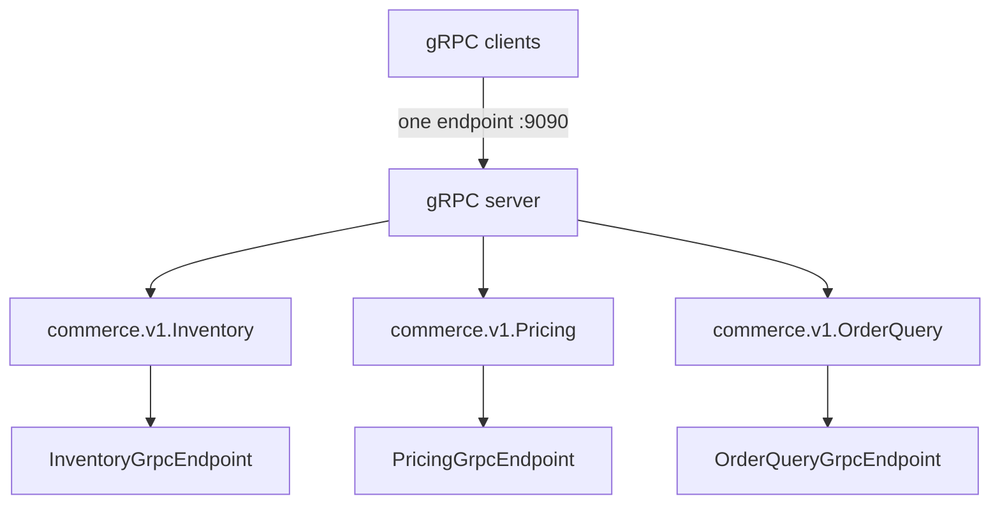

# Nhiều service trong một server

## Mục tiêu bài học

Một gRPC server có thể công bố nhiều service cùng lúc. Trong Spring gRPC, mỗi service thường là một Spring bean triển khai generated base tương ứng; server factory tập hợp các service definition và bind chúng vào cùng một server/transport.

Bài học tập trung vào **đăng ký và vận hành nhiều gRPC service trong một server**: thiết kế service name không trùng, triển khai nhiều `@GrpcService` bean, dùng chung server và channel, tổ chức interceptor/chính sách dùng chung, đồng thời kiểm thử rằng tất cả service được bind đúng.

Sau bài này, bạn có thể:

1. Giải thích quan hệ giữa một gRPC server, nhiều service definition và nhiều RPC method.
2. Định nghĩa nhiều service trong Protobuf và nhận diện full service name.
3. Triển khai mỗi service bằng một Spring `@GrpcService` bean riêng.
4. Tránh đăng ký trùng service name hoặc vô tình tạo nhiều server.
5. Gọi nhiều service qua cùng một `ManagedChannel` và quản lý channel theo vòng đời ứng dụng.
6. Tổ chức interceptor, authorization, reflection/health và integration test cho server nhiều service.

> **Phạm vi:** Ví dụ dùng Spring gRPC chính thức, gRPC Java và `org.springframework.grpc.server.service.GrpcService`. Chi tiết cấu hình server factory phụ thuộc phiên bản và transport; bài không giả định property dùng chung cho mọi loại server.

## 1. Một server có thể phục vụ nhiều service

Trong gRPC, server lắng nghe trên một endpoint mạng và công bố một tập các service definition. Mỗi service có tên đầy đủ và một hoặc nhiều RPC method. Client định tuyến request theo service name và method name trong HTTP/2 path.

Ví dụ một server commerce công bố:

- `commerce.v1.Inventory` với RPC `GetStock`.
- `commerce.v1.Pricing` với RPC `GetPrice`.
- Có thể bổ sung `commerce.v1.OrderQuery` hoặc health/reflection service khi cần.



**Một server không có nghĩa chỉ có một service.** Server quản lý transport, listener và tập service definition; từng service xử lý một nhóm RPC theo hợp đồng riêng. Mỗi service có generated base, descriptor và method handler riêng.

| Thành phần | Số lượng trong ví dụ | Trách nhiệm |
| --- | ---: | --- |
| Server/transport endpoint | 1 | Lắng nghe kết nối và dispatch RPC |
| Service definition | 2 hoặc nhiều hơn | Công bố nhóm RPC có full name riêng |
| Generated service base | Một loại cho mỗi service | Cung cấp method signature và bind service definition |
| Spring service bean | Một bean cho mỗi implementation | Chứa handler và dependency của service |
| Client channel | Thường một channel cho một server endpoint | Tái sử dụng kết nối để gọi nhiều service |
| Stub | Một loại cho mỗi service và kiểu gọi | Cung cấp API client cho RPC của service đó |

Một RPC path có dạng `/package.Service/Method`. Ví dụ `/commerce.v1.Inventory/GetStock` và `/commerce.v1.Pricing/GetPrice`. Full service name là định danh quan trọng; hai service có cùng short name nhưng khác Protobuf package vẫn là hai tên khác nhau.

## 2. Định nghĩa hai service trong Protobuf

Có thể đặt nhiều khai báo `service` trong một file .proto, hoặc chia mỗi service thành file riêng rồi dùng chung package. Cách tổ chức file không quyết định số server; chính server registration mới quyết định những service nào cùng được bind.

Tệp `src/main/proto/commerce.proto`:

```proto
syntax = "proto3";

package commerce.v1;

option java_package = "com.example.commerce.proto";
option java_multiple_files = true;

service Inventory {
  rpc GetStock(GetStockRequest) returns (StockReply);
}

service Pricing {
  rpc GetPrice(GetPriceRequest) returns (PriceReply);
}

message GetStockRequest {
  string sku = 1;
}

message StockReply {
  string sku = 1;
  int32 available_quantity = 2;
}

message GetPriceRequest {
  string sku = 1;
  string currency = 2;
}

message PriceReply {
  string sku = 1;
  string currency = 2;
  int64 amount_minor_units = 3;
}
```

Sau khi chạy `protoc` và `protoc-gen-grpc-java`, Java package `com.example.commerce.proto` có các lớp chính:

- `InventoryGrpc.InventoryImplBase` và các stub của Inventory.
- `PricingGrpc.PricingImplBase` và các stub của Pricing.
- Message request/response như `GetStockRequest`, `StockReply`, `GetPriceRequest` và `PriceReply`.

Cả hai service thuộc package Protobuf `commerce.v1`, nên full name lần lượt là `commerce.v1.Inventory` và `commerce.v1.Pricing`. Không suy ra full name từ Java package; Java package chỉ điều khiển nơi mã generated được sinh ra.

### Tách file .proto khi hợp đồng lớn

Khi service có vòng đời phát hành hoặc quyền sở hữu khác nhau, có thể đặt `inventory.proto` và `pricing.proto` riêng, nhưng giữ package và import rõ ràng. Dù nằm chung hay khác file, chúng vẫn có thể được đăng ký trên cùng server nếu ứng dụng đưa cả hai service bean vào cùng server factory.

## 3. Triển khai mỗi service thành một Spring bean

Trong Spring gRPC, đánh dấu mỗi implementation bằng `@GrpcService`. Spring quản lý bean, inject dependency và tích hợp service definition vào server.

### 3.1. Inventory service

```java
package com.example.commerce.grpc;

import com.example.commerce.application.InventoryApplicationService;
import com.example.commerce.proto.GetStockRequest;
import com.example.commerce.proto.InventoryGrpc;
import com.example.commerce.proto.StockReply;
import io.grpc.Status;
import io.grpc.stub.StreamObserver;
import org.springframework.grpc.server.service.GrpcService;

@GrpcService
public class InventoryGrpcEndpoint
        extends InventoryGrpc.InventoryImplBase {

    private final InventoryApplicationService application;

    public InventoryGrpcEndpoint(
            InventoryApplicationService application) {
        this.application = application;
    }

    @Override
    public void getStock(
            GetStockRequest request,
            StreamObserver<StockReply> responses) {
        try {
            var stock = application.getStock(request.getSku());

            responses.onNext(StockReply.newBuilder()
                    .setSku(stock.sku())
                    .setAvailableQuantity(stock.availableQuantity())
                    .build());
            responses.onCompleted();
        } catch (IllegalArgumentException ex) {
            responses.onError(Status.INVALID_ARGUMENT
                    .withDescription("SKU không hợp lệ")
                    .asRuntimeException());
        } catch (RuntimeException ex) {
            responses.onError(Status.INTERNAL
                    .withDescription("Không thể truy vấn tồn kho")
                    .asRuntimeException());
        }
    }
}
```

`InventoryGrpcEndpoint` chỉ triển khai RPC thuộc Inventory và phụ thuộc vào application service của use case tồn kho. Không cần tự tạo `Server` hoặc gọi `bindService()` để đăng ký riêng endpoint này.

### 3.2. Pricing service

```java
package com.example.commerce.grpc;

import com.example.commerce.application.PricingApplicationService;
import com.example.commerce.proto.GetPriceRequest;
import com.example.commerce.proto.PriceReply;
import com.example.commerce.proto.PricingGrpc;
import io.grpc.Status;
import io.grpc.stub.StreamObserver;
import org.springframework.grpc.server.service.GrpcService;

@GrpcService
public class PricingGrpcEndpoint
        extends PricingGrpc.PricingImplBase {

    private final PricingApplicationService application;

    public PricingGrpcEndpoint(PricingApplicationService application) {
        this.application = application;
    }

    @Override
    public void getPrice(
            GetPriceRequest request,
            StreamObserver<PriceReply> responses) {
        try {
            var price = application.getPrice(
                    request.getSku(), request.getCurrency());

            responses.onNext(PriceReply.newBuilder()
                    .setSku(price.sku())
                    .setCurrency(price.currency())
                    .setAmountMinorUnits(price.amountMinorUnits())
                    .build());
            responses.onCompleted();
        } catch (IllegalArgumentException ex) {
            responses.onError(Status.INVALID_ARGUMENT
                    .withDescription("SKU hoặc currency không hợp lệ")
                    .asRuntimeException());
        } catch (RuntimeException ex) {
            responses.onError(Status.INTERNAL
                    .withDescription("Không thể truy vấn giá")
                    .asRuntimeException());
        }
    }
}
```

Hai bean có thể được tạo trong cùng `ApplicationContext`. Khi Spring gRPC cấu hình server, các service bean phù hợp được phát hiện và bind vào server. Client có thể gọi cả hai qua cùng host/port; không cần một port riêng cho từng service.

> Ví dụ tập trung vào registration và routing. Trong ứng dụng thật, dùng exception mapping chung, log correlation ID và thông báo status an toàn; không lặp lại hoặc bỏ qua chính sách lỗi của module.

## 4. Cấu hình một server và tránh đăng ký trùng

Với native gRPC server, một cấu hình port minh họa của Spring gRPC có thể là:

```yaml
spring:
  grpc:
    server:
      port: 9090
```

Cấu hình thực tế phụ thuộc starter, phiên bản Spring Boot và transport. Nếu chạy gRPC qua servlet/HTTP server, port thuộc web server và cấu hình HTTP/2 tương ứng; không áp dụng máy móc cấu hình native server cho servlet transport.

Điều cần kiểm tra là cả `InventoryGrpcEndpoint` và `PricingGrpcEndpoint` được đăng ký với **cùng server factory/transport instance**. Một Spring context có thể chứa nhiều server factory hoặc nhiều server nếu ứng dụng chủ động cấu hình; chỉ nhìn thấy hai bean không đủ chứng minh chúng cùng một server.

### 4.1. Không đăng ký cùng service hai lần

Các lỗi phổ biến:

- Một class vừa được đánh dấu `@GrpcService` vừa được tạo lại bằng `@Bean`.
- Cùng một service implementation được thêm thủ công vào server builder trong khi Spring gRPC đã tự phát hiện.
- Hai bean cùng triển khai service descriptor có cùng full service name trên cùng server.
- Một cấu hình test tạo server thứ hai nhưng test lại gọi nhầm port.

Mỗi full service name trên một server cần một service definition duy nhất. Nếu muốn thay implementation theo profile, hãy bảo đảm chỉ một bean hoạt động trong profile đó. Nếu cần nhiều phiên bản API, dùng package/version name khác như `commerce.v1.Inventory` và `commerce.v2.Inventory` khi hợp đồng thực sự khác nhau.

### 4.2. Chia sẻ logic không đồng nghĩa gộp service

Inventory và Pricing có thể dùng chung một repository hoặc application component nếu trách nhiệm nghiệp vụ phù hợp. Tuy nhiên, không nên gộp mọi method vào một service lớn chỉ vì chúng chạy cùng server. Service boundary nên dựa trên nhóm hành vi và hợp đồng client cần, còn server boundary chủ yếu là quyết định triển khai/vận hành.

## 5. Client gọi nhiều service qua cùng một channel

Client tạo một `ManagedChannel` đến server endpoint và tạo stub cho từng generated service. Channel có thể được tái sử dụng cho nhiều RPC và nhiều service cùng host.

```java
ManagedChannel channel = ManagedChannelBuilder
        .forAddress("localhost", 9090)
        .usePlaintext() // Chỉ dùng trong môi trường local/dev.
        .build();

try {
    InventoryGrpc.InventoryBlockingStub inventory =
            InventoryGrpc.newBlockingStub(channel);

    PricingGrpc.PricingBlockingStub pricing =
            PricingGrpc.newBlockingStub(channel);

    StockReply stock = inventory
            .withDeadlineAfter(500, TimeUnit.MILLISECONDS)
            .getStock(GetStockRequest.newBuilder()
                    .setSku("SKU-100")
                    .build());

    PriceReply price = pricing
            .withDeadlineAfter(500, TimeUnit.MILLISECONDS)
            .getPrice(GetPriceRequest.newBuilder()
                    .setSku("SKU-100")
                    .setCurrency("VND")
                    .build());

    System.out.println(stock.getAvailableQuantity());
    System.out.println(price.getAmountMinorUnits());
} finally {
    channel.shutdown();
    if (!channel.awaitTermination(5, TimeUnit.SECONDS)) {
        channel.shutdownNow();
    }
}
```

Ví dụ dùng blocking stub để dễ quan sát. Trong ứng dụng Spring, không tạo channel cho từng request; nên quản lý channel như bean dùng chung, cấu hình TLS/credentials/interceptor và đóng channel theo lifecycle của context. Với client async hoặc future stub, cách tạo stub tương tự nhưng kết quả được nhận qua callback.

`withDeadlineAfter` tạo stub cấu hình deadline cho call; deadline của một call không phải deadline cố định cho toàn channel. Mỗi RPC nên có ngân sách phù hợp với use case.

### Một channel không có nghĩa một stub cho mọi service

Stub gắn với generated service descriptor cụ thể. Vì vậy cần:

- Một channel cho endpoint.
- `InventoryBlockingStub` cho RPC của Inventory.
- `PricingBlockingStub` cho RPC của Pricing.

Các stub có thể cùng dùng channel; chúng không thay thế nhau vì mỗi stub biết method descriptor của service tương ứng.

## 6. Interceptor và chính sách dùng chung

Khi có nhiều service trên cùng server, một số chính sách có thể áp dụng toàn server:

- Xác thực metadata và tạo caller identity.
- Correlation ID và tracing.
- Metric/log cho tên service, method, status và latency.
- Giới hạn hoặc kiểm soát request theo chính sách chung.

Server interceptor thường được đăng ký ở cấp server/factory theo cơ chế mà phiên bản Spring gRPC hỗ trợ. Nếu một interceptor áp dụng cho mọi service, cần bảo đảm nó không vô tình áp cùng authorization rule cho những method có yêu cầu khác nhau.

Ví dụ, cả Inventory và Pricing có thể yêu cầu authentication, nhưng quyền `inventory:read` và `pricing:read` có thể khác nhau. Authorization nên xét full method name hoặc policy gắn với service/method. Đừng chỉ kiểm tra một role chung rồi cho phép mọi RPC.

Nếu có chính sách chỉ áp dụng một service, dùng cơ chế interceptor/service customization riêng được hỗ trợ bởi phiên bản đang dùng, hoặc đặt authorization trong application use case. Tránh tự tạo một server phụ chỉ để gắn interceptor khác nếu chưa có lý do triển khai rõ ràng.

### Metadata không thay thế service identity

Client có thể gửi token trong metadata, nhưng tên service/method vẫn do gRPC method descriptor xác định. Interceptor có thể lấy method name và principal đã xác thực để quyết định policy. Không tin một metadata tùy ý như `x-service-name` do client tự khai báo để quyết định quyền.

## 7. Health, reflection và kiểm tra nhiều service

Một server nhiều service cần được vận hành như một đơn vị, nhưng health của server và health của từng dependency có thể khác nhau.

- **Server health:** server có đang phục vụ RPC không?
- **Service health:** một service cụ thể có thể nhận request theo hợp đồng hay đang bị disable/unavailable?
- **Dependency health:** database, cache hoặc downstream mà service sử dụng có sẵn sàng không?

Nếu triển khai gRPC Health Checking Protocol, health service là một service bổ sung trên cùng server. Có thể báo health tổng thể hoặc theo từng service name, ví dụ `commerce.v1.Inventory` và `commerce.v1.Pricing`. Client/load balancer cần dùng đúng service name trong health check; trạng thái health không tự động suy ra chỉ từ việc bean tồn tại.

Server reflection cho phép công cụ như grpcurl khám phá service descriptor mà không phải cung cấp file .proto. Nếu reflection được bật, kiểm tra danh sách service có cả Inventory và Pricing. Trong production, quyết định bật reflection cần theo chính sách bảo mật và môi trường; không công bố schema nội bộ ra ngoài nếu không cần.

## 8. Kiểm thử registration của nhiều service

### 8.1. Kiểm tra Spring context có hai BindableService

Có thể kiểm tra service bean và descriptor bằng context test:

```java
@SpringBootTest
class CommerceGrpcRegistrationTest {

    @Autowired
    ApplicationContext context;

    @Test
    void registersInventoryAndPricingServices() {
        Map<String, BindableService> services =
                context.getBeansOfType(BindableService.class);

        Set<String> serviceNames = services.values().stream()
                .map(service -> service.bindService()
                        .getServiceDescriptor().getName())
                .collect(Collectors.toSet());

        assertThat(serviceNames)
                .contains("commerce.v1.Inventory", "commerce.v1.Pricing");
    }
}
```

Test này xác minh context có các bean bindable với descriptor mong đợi. Nếu ứng dụng có nhiều server factory, cần kiểm tra thêm service nào được gắn vào từng server; chỉ kiểm tra toàn context không chứng minh chúng cùng một transport.

### 8.2. Integration test gọi cả hai RPC

Integration test nên khởi động đúng server factory dùng trong môi trường triển khai, lấy port test được cấp và tạo một channel tới server đó. Sau đó gọi `GetStock` và `GetPrice` qua hai stub trên **cùng channel**, xác minh cả hai RPC đều thành công.

Khi test dùng port động, lấy port từ cơ chế test/server factory được phiên bản Spring gRPC hỗ trợ; không giả định giá trị `0` hay một property cụ thể có cùng ý nghĩa ở mọi transport. Đóng channel trong `finally` hoặc để Spring quản lý test client bean.

### 8.3. Test collision và lỗi registration

Nên có test cấu hình sai hoặc kiểm tra startup failure cho trường hợp hai service definition có cùng full name. Lỗi trùng service cần được phát hiện khi server build/start, không đợi đến lúc client gọi mới chẩn đoán.

Có thể bổ sung test interceptor để xác minh:

- Cả hai service đều có correlation ID/tracing.
- Authorization khác nhau theo method khi cần.
- Lỗi một dependency không làm service khác bị đánh dấu unhealthy nếu kiến trúc cho phép phục vụ độc lập.
- Health status của từng service phản ánh dependency thực tế.

## 9. Lỗi thường gặp

| Triệu chứng | Nguyên nhân | Cách xử lý |
| --- | --- | --- |
| Chỉ một service xuất hiện trong reflection | Chỉ một bean được phát hiện hoặc service còn lại không được bind vào server factory | Kiểm tra `@GrpcService`, generated base, component scan và server registration |
| Server khởi động lỗi duplicate service | Hai bean/registration có cùng full service name | Chỉ đăng ký một implementation cho mỗi tên trên server |
| Hai service lắng nghe ở hai port ngoài dự kiến | Tạo nhiều server factory hoặc server builder | Xác định rõ server instance và gắn cả hai service vào cùng factory |
| Client gọi sai service | Dùng short name hoặc nhầm Java package với Protobuf package | Dùng full name `package.Service/Method` từ descriptor |
| Stub Inventory gọi method Pricing | Dùng nhầm generated stub | Tạo stub từ đúng generated service class |
| Client mở channel mới cho từng RPC | Không tái sử dụng transport resource | Dùng channel dùng chung theo endpoint và đóng theo lifecycle |
| Một interceptor làm hỏng service khác | Policy global giả định mọi service giống nhau | Phân biệt authentication chung với authorization theo method |
| Health tổng thể xanh nhưng một service không dùng được | Chỉ kiểm tra server listener, không kiểm tra dependency/service | Health check theo service và dependency cần thiết |
| Test thấy đủ bean nhưng RPC không hoạt động | Bean tồn tại nhưng server/transport chưa bind hoặc chưa start | Integration test gọi từng RPC qua channel thật của test server |

## 10. Bài tập thực hành

1. Thêm `OrderQuery` vào `commerce.v1` và triển khai thành bean thứ ba trên cùng server. Xác minh service descriptor có đủ ba tên.
2. Viết client tạo một channel duy nhất và gọi cả Inventory, Pricing, OrderQuery. Đặt deadline riêng cho từng call.
3. Tạo hai service cùng short name nhưng khác package/version; giải thích vì sao full service name không trùng và cách client chọn version.
4. Cố ý tạo hai implementation cùng service descriptor trên một server test. Quan sát lỗi startup và sửa bằng profile/condition để chỉ một bean được đăng ký.
5. Gắn correlation ID interceptor dùng chung, sau đó áp dụng authorization khác nhau cho `Inventory/GetStock` và `Pricing/GetPrice`.
6. Bật reflection trong môi trường test, dùng `grpcurl list` để xác minh các service được công bố; xác định chính sách bật/tắt reflection trong production.
7. Thêm gRPC health service và kiểm tra health riêng cho Inventory và Pricing khi một dependency bị dừng.
8. Viết integration test chứng minh hai RPC thuộc hai service khác nhau cùng hoạt động trên một server và một channel.

### Câu hỏi tự kiểm tra

- Một gRPC server khác gì một gRPC service definition?
- Vì sao một server có thể bind nhiều generated `BindableService`?
- Full service name được hình thành từ những thành phần nào?
- Vì sao hai bean cùng triển khai một service descriptor có thể gây lỗi registration?
- Một channel có thể được dùng với nhiều generated stub như thế nào?
- Khi nào interceptor nên áp dụng toàn server và khi nào cần policy theo method?
- Health của server có đủ để kết luận mọi service đều sẵn sàng không?
- Test có đủ bean trong Spring context đã chứng minh service được bind vào cùng server chưa?
- Khi nào nên tách service thành server/endpoint riêng thay vì cùng server?

## Tài liệu tham khảo

- [gRPC — Core Concepts](https://grpc.io/docs/what-is-grpc/core-concepts/): server, service, RPC method và channel.
- [gRPC Java — Generated Code Reference](https://grpc.io/docs/languages/java/generated-code/): generated service base và client stub.
- [gRPC Java — ServerBuilder](https://grpc.github.io/grpc-java/javadoc/io/grpc/ServerBuilder.html): đăng ký nhiều service definition trên server.
- [Spring gRPC — GRPC Server](https://docs.spring.io/spring-grpc/reference/server.html): Spring phát hiện và đăng ký bean `BindableService`.
- [gRPC — Health Checking](https://grpc.io/docs/guides/health-checking/): health service và trạng thái theo service.
- [gRPC — Reflection](https://grpc.io/docs/guides/reflection/): khám phá service descriptor qua server reflection.
- [gRPC — Interceptors](https://grpc.io/docs/guides/interceptors/): chính sách dùng chung ở ranh giới RPC.

**Kết quả mong đợi:** Người học triển khai được nhiều `@GrpcService` bean với full service name riêng, để Spring gRPC bind chúng vào cùng một server, gọi từng service bằng stub tương ứng trên một channel dùng chung, đồng thời kiểm thử registration, interceptor, health và tránh lỗi duplicate service.
