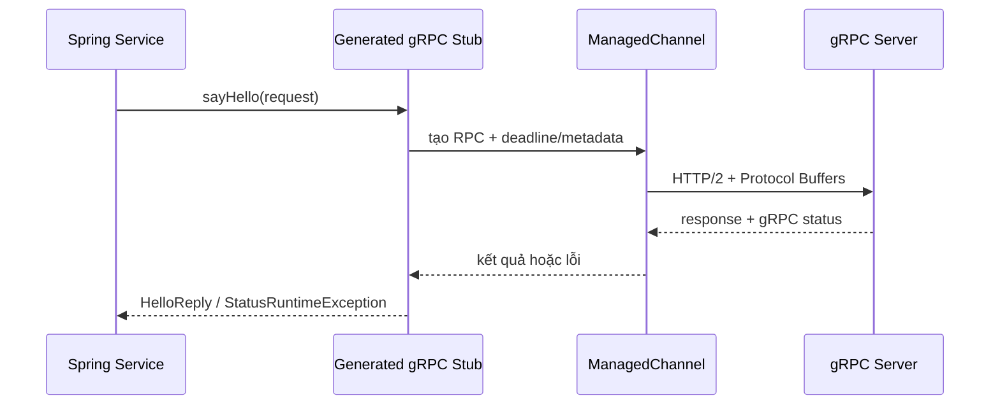

# Tạo gRPC client channel trong Spring

Trong ứng dụng Spring, gRPC client gọi phương thức trên dịch vụ từ xa thông qua một **channel**. Hiểu cách tạo, cấu hình và quản lý vòng đời channel là nền tảng để gọi unary RPC, mở luồng streaming, gắn metadata, đặt deadline, bảo mật kết nối và theo dõi lỗi. Bài này xây dựng một client gRPC bằng **gRPC Java** và quản lý nó như một bean của **Spring Boot**. Cách làm này minh họa rõ các thành phần cốt lõi, kể cả khi dự án sau đó dùng starter Spring gRPC để tự động cấu hình.

## 1. Channel nằm ở đâu trong một lời gọi RPC?

Một gRPC client Java thường có ba lớp trách nhiệm:

| Thành phần | Vai trò | Phạm vi sử dụng |
| --- | --- | --- |
| `ManagedChannel` | Quản lý kết nối, phân giải địa chỉ, vận chuyển HTTP/2 và trạng thái kết nối đến một đích dịch vụ. | Tạo một lần và tái sử dụng cho nhiều lời gọi. |
| Stub do Protocol Buffers sinh ra | Cung cấp các phương thức Java tương ứng với RPC khai báo trong tệp `.proto`. | Tạo từ channel; có blocking, async hoặc future stub tùy loại RPC. |
| Lời gọi RPC | Mang request, metadata, deadline và kết quả/trạng thái riêng. | Mỗi lần gọi có ngữ cảnh độc lập. |

Luồng xử lý điển hình:



`ManagedChannel` **không đồng nghĩa với một socket duy nhất**: gRPC có thể thiết lập kết nối khi có nhu cầu, khôi phục sau lỗi và quản lý nhiều kết nối tùy cơ chế phân giải địa chỉ, transport và chính sách cân bằng tải. Channel và các stub thông thường có thể dùng lại an toàn giữa nhiều luồng; không cần tạo channel cho mỗi HTTP request đi vào ứng dụng Spring.

## 2. Chuẩn bị hợp đồng Protocol Buffers và thư viện

Giả sử hệ thống có dịch vụ `Greeter` với unary RPC `SayHello`:

```protobuf
syntax = "proto3";

package greeting;

option java_package = "com.example.grpc";
option java_multiple_files = true;

service Greeter {
  rpc SayHello (HelloRequest) returns (HelloReply);
}

message HelloRequest {
  string name = 1;
}

message HelloReply {
  string message = 1;
}
```

Sau khi chạy bước sinh mã `protoc` cùng plugin `protoc-gen-grpc-java`, client cần nhìn thấy các lớp `GreeterGrpc`, `HelloRequest` và `HelloReply` thuộc package `com.example.grpc`. Việc sinh mã thường được cấu hình trong Maven hoặc Gradle; **chỉ thêm `.proto` vào dự án mà chưa sinh mã sẽ chưa đủ để biên dịch ví dụ Java**.

Ở mức phụ thuộc, ứng dụng cần Spring Boot, `grpc-protobuf`, `grpc-stub` và một transport gRPC Java như `grpc-netty-shaded`. Hãy dùng các phiên bản gRPC đồng bộ thông qua BOM hoặc cơ chế quản lý phiên bản của dự án; tránh trộn các bản `grpc-api`, `grpc-stub` và transport khác nhau. Bản mẫu bên dưới minh họa cách tạo channel trực tiếp, không giả định dự án đã bật một starter gRPC riêng.

## 3. Đưa cấu hình đích đến vào Spring Boot

Đặt thông số kết nối trong `application.yml` để có thể thay đổi theo môi trường:

```yaml
app:
  grpc:
    greeter:
      host: localhost
      port: 9090
      plaintext: true
      timeout: 2s
```

`plaintext: true` **chỉ phù hợp cho môi trường phát triển hoặc thử nghiệm được kiểm soát**. Khi gọi server thật qua mạng, dùng TLS và thay bằng `plaintext: false`. Giá trị `timeout` thể hiện thời hạn tối đa cho một lần RPC trong ví dụ; đây không phải là thời gian tạo channel.

Khai báo cấu hình kiểu dữ liệu rõ ràng:

```java
package com.example.client;

import java.time.Duration;
import org.springframework.boot.context.properties.ConfigurationProperties;

@ConfigurationProperties(prefix = "app.grpc.greeter")
public record GreeterChannelProperties(
        String host,
        int port,
        boolean plaintext,
        Duration timeout) {
}
```

Spring Boot sẽ ánh xạ `2s` sang `Duration`. Trong dự án thực tế, nên xác thực `host` không rỗng, `port` nằm trong khoảng `1..65535` và `timeout` lớn hơn `Duration.ZERO` để ứng dụng báo lỗi cấu hình ngay khi khởi động.

## 4. Khởi tạo `ManagedChannel` như một Spring bean

Định nghĩa channel một lần trong lớp `@Configuration`, rồi tạo stub từ channel ấy:

```java
package com.example.client;

import com.example.grpc.GreeterGrpc;
import io.grpc.ManagedChannel;
import io.grpc.ManagedChannelBuilder;
import org.springframework.beans.factory.annotation.Qualifier;
import org.springframework.boot.context.properties.EnableConfigurationProperties;
import org.springframework.context.annotation.Bean;
import org.springframework.context.annotation.Configuration;

@Configuration
@EnableConfigurationProperties(GreeterChannelProperties.class)
public class GreeterGrpcClientConfiguration {

    @Bean(name = "greeterChannel", destroyMethod = "shutdown")
    ManagedChannel greeterChannel(GreeterChannelProperties settings) {
        ManagedChannelBuilder<?> builder = ManagedChannelBuilder
                .forAddress(settings.host(), settings.port());

        if (settings.plaintext()) {
            builder.usePlaintext();
        } else {
            builder.useTransportSecurity();
        }

        return builder.build();
    }

    @Bean
    GreeterGrpc.GreeterBlockingStub greeterBlockingStub(
            @Qualifier("greeterChannel") ManagedChannel channel) {
        return GreeterGrpc.newBlockingStub(channel);
    }
}
```

Đoạn mã giải quyết bốn việc:

1. `ManagedChannelBuilder.forAddress(host, port)` cấu hình đích server. Transport thực tế được cung cấp bởi thư viện gRPC có trên classpath.
2. `usePlaintext()` bỏ TLS; `useTransportSecurity()` bật TLS và sử dụng cơ chế tin cậy mặc định của transport.
3. Spring giữ `ManagedChannel` trong container và gọi `shutdown()` khi hủy bean, thay vì tạo lại kết nối cho mỗi lời gọi.
4. Stub được tạo từ cùng channel và được tiêm vào các Spring service cần gọi server.

Với nhiều server, có thể tạo nhiều channel có tên khác nhau rồi tiêm bằng `@Qualifier`. Đừng tiêm một `ManagedChannel` theo kiểu đơn thuần khi container có nhiều bean cùng loại mà chưa chỉ rõ bean cần dùng.

**Lưu ý về vòng đời:** `shutdown()` yêu cầu dừng channel một cách trật tự, nhưng không tự chờ mọi RPC hoàn tất. Nếu hệ thống cần thời gian cho các RPC đang chạy kết thúc, thành phần chịu trách nhiệm shutdown có thể gọi `awaitTermination(timeout, unit)` sau `shutdown()`, rồi `shutdownNow()` khi quá hạn. Khi đã giao vòng đời cho Spring, không tự đóng channel sau mỗi lời gọi.

## 5. Dùng stub để gọi RPC từ Spring service

Stub blocking phù hợp với luồng xử lý đồng bộ, ví dụ một Spring MVC service thực hiện unary RPC:

```java
package com.example.client;

import com.example.grpc.GreeterGrpc;
import com.example.grpc.HelloReply;
import com.example.grpc.HelloRequest;
import java.util.concurrent.TimeUnit;
import org.springframework.stereotype.Service;

@Service
public class GreetingGateway {

    private final GreeterGrpc.GreeterBlockingStub stub;
    private final GreeterChannelProperties settings;

    public GreetingGateway(
            GreeterGrpc.GreeterBlockingStub stub,
            GreeterChannelProperties settings) {
        this.stub = stub;
        this.settings = settings;
    }

    public String greet(String name) {
        HelloRequest request = HelloRequest.newBuilder()
                .setName(name)
                .build();

        HelloReply reply = stub
                .withDeadlineAfter(settings.timeout().toMillis(), TimeUnit.MILLISECONDS)
                .sayHello(request);

        return reply.getMessage();
    }
}
```

`withDeadlineAfter(...)` trả về **stub mới với cấu hình deadline**, không chỉnh sửa stub gốc. Vì vậy nhiều lời gọi có thể đặt deadline khác nhau mà vẫn chia sẻ channel. `sayHello(...)` là phương thức do gRPC Java sinh từ RPC `SayHello` trong hợp đồng `.proto`.

Các loại stub thường gặp:

| Stub | Cách gọi | Phù hợp |
| --- | --- | --- |
| `GreeterGrpc.newBlockingStub(channel)` | Chặn luồng gọi đến khi unary RPC hoàn tất hoặc lỗi. | Xử lý đồng bộ, tác vụ blocking có kiểm soát. |
| `GreeterGrpc.newFutureStub(channel)` | Trả về future cho unary RPC. | Cần tích hợp kết quả bất đồng bộ. |
| `GreeterGrpc.newStub(channel)` | Dùng callback `StreamObserver`; hỗ trợ streaming RPC. | Server streaming, client streaming, bidirectional streaming. |

Cả ba đều dùng cùng cơ sở hạ tầng channel. Chỉ thay kiểu stub khi cần thay đổi mô hình xử lý RPC; không phải tạo thêm channel vì chuyển từ unary sang streaming.

## 6. Những cấu hình thực tế thường đi cùng channel

### 6.1. Địa chỉ đích, DNS và cân bằng tải

`forAddress("localhost", 9090)` tiện cho một host và port đã biết. Khi dịch vụ cần phân giải tên hoặc lấy danh sách endpoint, gRPC còn có API `ManagedChannelBuilder.forTarget(target)` với cú pháp target được `NameResolver` hỗ trợ. Ví dụ, target kiểu `dns:///greeter.internal:9090` cho phép gRPC sử dụng bộ phân giải DNS. Cú pháp, khả năng phân giải và cân bằng tải thực tế còn phụ thuộc transport, resolver và chính sách cấu hình.

Không nên giả định chỉ vì một tên DNS trả về nhiều IP thì client chắc chắn chia đều lưu lượng. Hãy kiểm tra chính sách load balancing được dùng, cách cập nhật endpoint, cơ chế health checking và hành vi khi một endpoint ngừng hoạt động.

### 6.2. TLS và xác thực server

Trên môi trường triển khai thật, `useTransportSecurity()` cần đi kèm endpoint hỗ trợ TLS, chứng chỉ hợp lệ và hostname khớp với tên trong chứng chỉ. Nếu server dùng CA nội bộ, cấu hình trust store hoặc `SslContext` của transport tương ứng để tin cậy đúng CA đó. Với mutual TLS, client còn phải trình chứng chỉ và private key của mình theo chính sách server.

Không dùng `usePlaintext()` để né lỗi chứng chỉ khi đưa ứng dụng vào môi trường production. Đây là lỗi cấu hình bảo mật cần xử lý tại nguồn. Trong mạng có proxy hoặc ingress, bảo đảm đường truyền đến gRPC server hỗ trợ HTTP/2 và cấu hình TLS phù hợp.

### 6.3. Metadata và interceptor

Metadata mang thông tin đi kèm RPC, chẳng hạn `authorization`, `x-request-id` hoặc mã correlation. Metadata thuộc **ngữ cảnh lời gọi**, còn channel thường được tái sử dụng cho nhiều người dùng. Vì thế không gắn một token của người dùng vào channel dùng chung.

Ví dụ gắn header cho một lời gọi thông qua interceptor của stub:

```java
import io.grpc.Metadata;
import io.grpc.stub.MetadataUtils;

Metadata headers = new Metadata();
Metadata.Key<String> requestIdKey = Metadata.Key.of(
        "x-request-id", Metadata.ASCII_STRING_MARSHALLER);
headers.put(requestIdKey, "request-123");

var requestStub = stub.withInterceptors(
        MetadataUtils.newAttachHeadersInterceptor(headers));
var response = requestStub.sayHello(
        HelloRequest.newBuilder().setName("Lan").build());
```

Trong ví dụ này, `stub` là `GreeterBlockingStub` đã được tạo trước đó. Hãy tạo metadata riêng cho từng request khi giá trị thay đổi; interceptor chứa header tĩnh chỉ phù hợp với dữ liệu không đổi. Với token xác thực cần làm mới, cân nhắc `CallCredentials` hoặc interceptor lấy token theo từng RPC. Không ghi access token hoặc metadata nhạy cảm vào log.

### 6.4. Deadline, timeout và retry

Một channel còn sống không có nghĩa là RPC sẽ trả lời đúng hạn. Mỗi lời gọi nên có deadline phù hợp với nghiệp vụ; nếu hết thời gian, gRPC trả trạng thái `DEADLINE_EXCEEDED`. Nếu HTTP request phía trước có thời hạn ngắn hơn, cần dành đủ ngân sách cho các bước xử lý và truyền deadline xuống gRPC hợp lý.

Retry chỉ nên bật khi nắm rõ tính idempotent của RPC và đã kiểm soát backoff, số lần thử, deadline tổng. Một lệnh chuyển tiền hoặc tạo tài nguyên không có khóa chống trùng không thể mặc nhiên retry an toàn. Các yêu cầu `waitForReady` cũng không thay thế deadline.

## 7. Nhận biết trạng thái và lỗi kết nối

Với blocking stub, lỗi RPC thường được ném dưới dạng `StatusRuntimeException`. Có thể đọc mã trạng thái để phân loại sự cố:

```java
import io.grpc.Status;
import io.grpc.StatusRuntimeException;

try {
    return greetingGateway.greet("Lan");
} catch (StatusRuntimeException ex) {
    Status.Code code = ex.getStatus().getCode();
    // Ghi log mã trạng thái và request-id; ánh xạ sang lỗi nghiệp vụ phù hợp.
    throw ex;
}
```

| Status / dấu hiệu | Nguyên nhân cần kiểm tra |
| --- | --- |
| `UNAVAILABLE` | Server ngừng hoạt động, DNS/port sai, vấn đề mạng, proxy hoặc TLS handshake. |
| `DEADLINE_EXCEEDED` | Server chậm, mạng chậm hoặc deadline đặt quá ngắn. |
| `UNAUTHENTICATED` / `PERMISSION_DENIED` | Thiếu, sai hoặc không đủ quyền với thông tin xác thực. |
| `UNIMPLEMENTED` | Gọi nhầm dịch vụ/phương thức hoặc server chưa triển khai RPC. |
| `INVALID_ARGUMENT` | Request không đáp ứng quy tắc kiểm tra dữ liệu phía server. |

Đừng biến mọi `StatusRuntimeException` thành “mất kết nối”: nhiều status là kết quả có chủ đích từ server. Với lỗi `UNAVAILABLE`, cần kiểm tra cả việc client có dùng `plaintext` trong khi server yêu cầu TLS (hoặc ngược lại), cổng đang nghe và hỗ trợ HTTP/2. Có thể quan sát trạng thái kết nối của `ManagedChannel` thông qua API connectivity state khi chẩn đoán, nhưng trạng thái channel không thay thế được kết quả thực tế của từng RPC.

## 8. Kiểm thử channel và quan sát vận hành

Nên kiểm tra theo hai lớp:

1. **Kiểm thử hành vi client:** dùng server gRPC in-process với transport `grpc-inprocess`, hoặc server thử nghiệm điều khiển được. Gọi stub qua channel thử nghiệm, xác minh protobuf response, status, metadata, deadline và cách tài nguyên được đóng.
2. **Kiểm thử tích hợp môi trường:** gọi một server chạy trên port thật qua TLS, kiểm tra chứng chỉ, DNS, ingress/proxy, timeout và việc kết nối lại sau sự cố. In-process test không phát hiện được mọi lỗi mạng hoặc cấu hình TLS.

Ở production, nên theo dõi số RPC, độ trễ từng phương thức, tỷ lệ status `UNAVAILABLE`/`DEADLINE_EXCEEDED`, số lần retry và tài nguyên của transport. Client interceptor hoặc các tích hợp metrics/tracing tương thích OpenTelemetry có thể ghi nhận thời lượng và trace của từng RPC. Channel được tạo thành công lúc Spring khởi động **không bảo đảm server đang reachable**: nhiều transport chỉ thiết lập kết nối thực sự khi phát sinh lời gọi.

## 9. Lỗi triển khai thường gặp

| Hiện tượng | Cách xử lý |
| --- | --- |
| Mỗi request tạo `ManagedChannelBuilder...build()` | Đưa channel vào bean sống cùng ứng dụng, chia sẻ cho các stub. |
| Gọi được ở local nhưng lỗi trên server | Đối chiếu host/port, DNS, TLS, chứng chỉ và đường đi qua proxy HTTP/2. |
| Request treo quá lâu | Đặt deadline cho từng RPC và đo latency thật. |
| Ứng dụng không thoát gọn | Bảo đảm channel được shutdown trong vòng đời Spring; nếu cần thì chờ kết thúc có giới hạn. |
| Nhiều channel bean bị tiêm nhầm | Đặt tên bean và sử dụng `@Qualifier` rõ ràng. |
| Token người dùng bị lẫn giữa request | Đưa metadata/credentials vào từng lời gọi thay vì lưu trong bean channel dùng chung. |
| Blocking stub làm cạn thread | Giới hạn concurrency hoặc dùng async stub và mô hình xử lý thích hợp. |

## 10. Khi dự án đã dùng Spring gRPC starter

Một số phiên bản Spring gRPC cung cấp cơ chế tự cấu hình channel và factory để tạo channel theo tên từ cấu hình Spring. Khi dự án dùng starter đó, cần đối chiếu API, property prefix, cách khai báo interceptor và quản lý vòng đời đúng với **phiên bản Spring gRPC hiện có**. Tránh vừa bật auto-configuration vừa khai báo thủ công thêm một channel trùng đích nếu không có chủ đích. Dù tạo channel qua factory hay `ManagedChannelBuilder`, các nguyên tắc vẫn giữ nguyên: **dùng lại channel, tạo stub từ channel, đặt deadline theo RPC, bảo vệ metadata và đóng channel khi ứng dụng kết thúc**.

## 11. Tự thực hành

1. Tạo server triển khai `Greeter/SayHello` lắng nghe trên cổng `9090`, sinh Java code từ `.proto`, rồi cấu hình ứng dụng Spring ở trên gọi thành công `greet("Lan")`.
2. Dừng server và quan sát status. Khởi động lại server, gọi lại bằng **chính channel cũ** để xem hành vi tái kết nối.
3. Thay deadline từ `2s` xuống một giá trị nhỏ hơn thời gian server trả lời để quan sát `DEADLINE_EXCEEDED`. Sau đó thử nâng deadline hợp lý.
4. Thêm `x-request-id` qua interceptor, đọc metadata trên server; xác minh hai request nhận hai ID khác nhau.
5. Chuyển server sang TLS, đổi `plaintext` thành `false`, kiểm tra kết nối với chứng chỉ hợp lệ và cách ứng dụng phản ứng khi hostname chứng chỉ không khớp.

Hoàn thành bài học nghĩa là bạn có thể giải thích khác biệt giữa channel và stub, đăng ký `ManagedChannel` trong Spring, gọi unary RPC với deadline, chọn cách truyền metadata và biết nơi kiểm tra khi gặp lỗi kết nối. Những năng lực đó cũng là nền tảng để xây dựng client streaming, interceptor nâng cao và cơ chế giám sát gRPC trong hệ sinh thái Spring.
