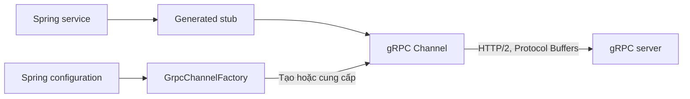
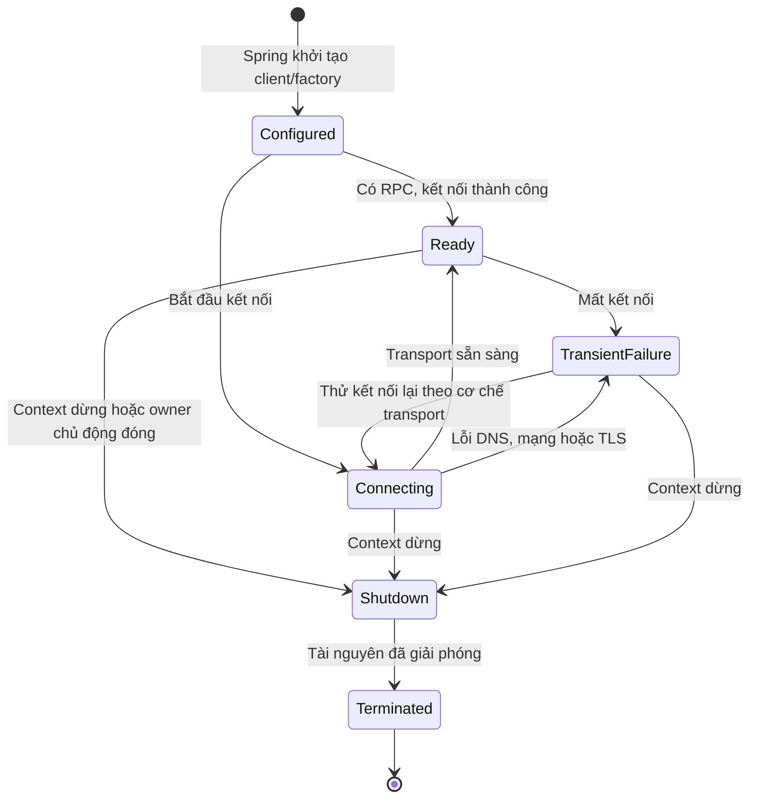

# GrpcChannelFactory và channel lifecycle

Trong hệ sinh thái **Spring gRPC**, client có thể lấy một `Channel` qua `GrpcChannelFactory`, tạo stub từ channel và sử dụng stub để gọi dịch vụ gRPC được mô tả bằng Protocol Buffers. Cách này giúp đưa địa chỉ server, transport, bảo mật và vòng đời kết nối vào cơ chế cấu hình của Spring. Đây là một phần quan trọng khi xây dựng client/server cho unary RPC hoặc streaming RPC, nhất là khi ứng dụng cần kiểm soát deadline, metadata, lỗi, TLS và độ tin cậy.

Bài học tập trung vào hai câu hỏi: **`GrpcChannelFactory` chịu trách nhiệm gì?** và **channel sống, được tái sử dụng, gặp lỗi rồi kết thúc như thế nào trong ứng dụng Spring?**

## 1. Phân biệt factory, channel, stub và RPC

Giả sử một ứng dụng Spring cần gọi dịch vụ `Greeting` ở một tiến trình khác. Hành trình của một lời gọi gồm các thành phần sau:



| Thành phần | Bản chất và trách nhiệm | Khi nào sử dụng? |
| --- | --- | --- |
| `GrpcChannelFactory` | Abstraction của **Spring gRPC** để tạo hoặc lấy channel theo tên cấu hình. | Khi muốn client được cấu hình và quản lý theo cơ chế của Spring. |
| `io.grpc.Channel` | Abstraction của **gRPC Java** mà stub sử dụng để thực hiện RPC. | Truyền vào `newBlockingStub`, `newStub` hoặc `newFutureStub`. |
| `io.grpc.ManagedChannel` | Một triển khai `Channel` có thêm API quản lý trạng thái và đóng tài nguyên: `shutdown`, `shutdownNow`, `awaitTermination`. | Khi chính ứng dụng sở hữu và phải đóng channel. |
| Generated stub | Lớp Java sinh từ `.proto`; ánh xạ phương thức Java sang RPC. | Gọi unary/streaming theo kiểu blocking, async hoặc future. |
| RPC invocation | Một lần gọi cụ thể với request, metadata, deadline và status. | Mỗi thao tác nghiệp vụ, có thể có chính sách deadline riêng. |

`GrpcChannelFactory` **không phải API cốt lõi của gRPC Java**: nó thuộc tầng tích hợp Spring gRPC. Ngược lại, `Channel`, `ManagedChannel`, generated stub, `Metadata` và `Status` đến từ thư viện gRPC Java. Do đó, một chương trình Java thuần có thể tạo channel bằng `ManagedChannelBuilder`, còn một ứng dụng dùng Spring gRPC thường lấy channel thông qua factory được cung cấp bởi Spring.

Điểm quan trọng: **channel không tương đương một socket duy nhất**, và một RPC cũng không tương đương một channel. Một channel có thể phục vụ nhiều lời gọi đồng thời, xử lý phân giải địa chỉ và tái kết nối khi transport thay đổi. Số kết nối thực sự, thời điểm tạo kết nối và cách cân bằng tải tùy thuộc implementation cùng cấu hình resolver/load balancer.

## 2. Vì sao dùng `GrpcChannelFactory`?

Không dùng factory, ứng dụng có thể tự tạo `ManagedChannel`:

```java
ManagedChannel channel = ManagedChannelBuilder
        .forAddress("localhost", 9090)
        .usePlaintext()
        .build();
```

Cách này hợp lý cho một ví dụ gRPC Java nhỏ. Tuy nhiên khi tích hợp vào Spring, ứng dụng còn cần tập trung cấu hình môi trường, chọn đích cho từng backend, áp dụng interceptor, bảo mật transport và đóng tài nguyên khi `ApplicationContext` kết thúc. `GrpcChannelFactory` tách những việc đó khỏi mã nghiệp vụ:

```java
Channel channel = grpcChannelFactory.createChannel("greeter");
```

Tên `greeter` đại diện cho **logical client/channel name**. Factory sẽ tra cấu hình của tên này theo cơ chế do phiên bản Spring gRPC và implementation đang sử dụng quy định. Nó không tự suy ra địa chỉ server chỉ dựa vào tên của service trong `.proto`.

Lợi ích chính của factory:

1. **Tập trung cấu hình:** tên channel có thể ứng với host, port, target URI, TLS và các thiết lập vận chuyển của môi trường.
2. **Giảm phụ thuộc của service vào transport:** service chỉ cần stub, không cần biết cách tạo Netty channel.
3. **Hỗ trợ nhiều backend:** một ứng dụng có thể yêu cầu channel `greeter`, `billing`, `notification` với các cấu hình độc lập.
4. **Hòa vào vòng đời Spring:** implementation của factory và các tài nguyên do Spring tạo ra có thể tham gia quá trình khởi tạo, quản lý và hủy `ApplicationContext`.
5. **Thuận lợi cho kiểm thử:** có thể cấu hình đích khác hoặc thay thế nguồn cung cấp channel bằng implementation thử nghiệm.

**Không nên giả định** mọi lời gọi `createChannel("greeter")` luôn trả về cùng một object hoặc luôn mở socket mới. Chính sách cache, wrapper/interceptor và sở hữu channel phụ thuộc vào implementation cụ thể; hãy quản lý channel theo hợp đồng của factory đang dùng.

## 3. Ví dụ hợp đồng Protocol Buffers và mã được sinh

Giả sử ứng dụng Spring đóng vai trò client của unary RPC `Greet`:

```protobuf
syntax = "proto3";

package greeting;

option java_package = "com.example.contract";
option java_multiple_files = true;

service Greeting {
  rpc Greet (GreetRequest) returns (GreetReply);
}

message GreetRequest {
  string name = 1;
}

message GreetReply {
  string message = 1;
}
```

Sau bước sinh mã bằng `protoc` và plugin `protoc-gen-grpc-java`, module client có các kiểu `GreetingGrpc`, `GreetRequest`, `GreetReply` trong package `com.example.contract`. Client cần phụ thuộc vào mã sinh từ hợp đồng, thư viện gRPC Java tương thích và thành phần Spring gRPC client có chứa `GrpcChannelFactory`.

Ví dụ Java dưới đây giả định dự án đã cấu hình **Spring Boot + Spring gRPC client** và đã sinh/nhập các lớp từ `.proto`. Những starter gRPC bên thứ ba có thể có tên annotation, tên property và cơ chế tạo client khác; không nên trộn cấu hình của chúng với Spring gRPC đang học.

## 4. Cấu hình named channel trong Spring

Thay vì đặt `host`/`port` trong service, ta tạo một channel logic tên `greeter`. Một dạng cấu hình thường gặp với Spring gRPC client là:

```yaml
spring:
  grpc:
    client:
      channels:
        greeter:
          address: static://localhost:9090
```

Trong ví dụ, `greeter` là tên mà mã Java sẽ yêu cầu từ factory, còn `static://localhost:9090` là địa chỉ đích. **Cú pháp target, cách khai báo TLS/plaintext và các property bổ sung phụ thuộc phiên bản Spring gRPC đang dùng**; cần đối chiếu tài liệu cấu hình đúng phiên bản của dự án và resolver được hỗ trợ. Không suy rằng việc đặt `address` đã tự động bật plaintext hoặc đã cấu hình đầy đủ chứng chỉ.

Khi đưa ứng dụng vào môi trường thực, có thể thay đích qua cấu hình được nạp từ profile hoặc biến môi trường, thay vì biên dịch lại service. Với server cung cấp TLS, cần cấu hình client dùng TLS và tin cậy đúng chứng chỉ. Với nhiều backend, nên đặt tên channel theo vai trò dịch vụ và tránh dùng chung một cấu hình cho những đích có yêu cầu bảo mật khác nhau.

### Tạo stub bằng `GrpcChannelFactory`

```java
package com.example.client;

import com.example.contract.GreetingGrpc;
import io.grpc.Channel;
import org.springframework.context.annotation.Bean;
import org.springframework.context.annotation.Configuration;
import org.springframework.grpc.client.GrpcChannelFactory;

@Configuration(proxyBeanMethods = false)
public class GreetingClientConfiguration {

    @Bean
    GreetingGrpc.GreetingBlockingStub greetingBlockingStub(
            GrpcChannelFactory channelFactory) {

        Channel channel = channelFactory.createChannel("greeter");
        return GreetingGrpc.newBlockingStub(channel);
    }
}
```

Ở đây:

- Spring tiêm implementation `GrpcChannelFactory` đã cấu hình sẵn.
- `createChannel("greeter")` yêu cầu channel tương ứng với tên logic `greeter`.
- `GreetingGrpc.newBlockingStub(channel)` tạo stub để gọi unary RPC đồng bộ.
- Stub được khai báo thành Spring bean, giúp service nghiệp vụ chỉ cần dependency injection.

Đây là cách dùng **`io.grpc.Channel`**, vì API tạo stub chỉ yêu cầu lớp cơ sở đó. Không ép kiểu kết quả của `createChannel` sang `ManagedChannel` để tự gọi `shutdown()`: factory có thể trả về một channel đã được bọc bởi interceptor hoặc một implementation không mang hợp đồng sở hữu tương tự `ManagedChannel` do ta tự tạo.

Một service sử dụng stub:

```java
package com.example.client;

import com.example.contract.GreetReply;
import com.example.contract.GreetRequest;
import com.example.contract.GreetingGrpc;
import java.util.concurrent.TimeUnit;
import org.springframework.stereotype.Service;

@Service
public class GreetingGateway {

    private final GreetingGrpc.GreetingBlockingStub stub;

    public GreetingGateway(GreetingGrpc.GreetingBlockingStub stub) {
        this.stub = stub;
    }

    public String greet(String name) {
        GreetRequest request = GreetRequest.newBuilder()
                .setName(name)
                .build();

        GreetReply reply = stub
                .withDeadlineAfter(1500, TimeUnit.MILLISECONDS)
                .greet(request);

        return reply.getMessage();
    }
}
```

`withDeadlineAfter(...)` tạo **một bản stub đã bổ sung thời hạn** cho lời gọi; nó không sửa stub gốc trong singleton bean. Stub của gRPC Java thông thường là immutable và có thể chia sẻ giữa nhiều luồng. Vì vậy có thể tạo stub một lần và thay đổi các call option theo từng RPC.

## 5. Vòng đời channel: từ khởi tạo đến giải phóng

Vòng đời của channel khác vòng đời của một lời gọi RPC. Trong Spring, cần nhìn rõ ai tạo, ai dùng, ai đóng và trường hợp nào kết nối được mở lại.



Sơ đồ mang tính khái niệm. gRPC Java có các trạng thái connectivity như `IDLE`, `CONNECTING`, `READY`, `TRANSIENT_FAILURE`, `SHUTDOWN`; **không đồng nhất** việc khởi tạo object channel với trạng thái `READY`. Nhiều triển khai chỉ bắt đầu kết nối khi có yêu cầu gọi hoặc khi có cơ chế kích hoạt kết nối.

### Giai đoạn A — khởi tạo context và factory

Spring Boot khởi tạo các bean cấu hình, cấu trúc client và factory. Khi một bean stub yêu cầu `createChannel("greeter")`, factory có đủ thông tin để cung cấp channel. Hành vi chính xác của factory về khởi tạo sớm/muộn và cache là chi tiết implementation.

**Hệ quả:** ứng dụng khởi động được và stub được tạo thành công **chưa chứng minh server đang trực tuyến**. Readiness check nếu bắt buộc cần kiểm tra ở tầng phù hợp, chẳng hạn gRPC health check trên server và giới hạn thời gian cụ thể, thay vì chỉ kiểm tra bean có tồn tại.

### Giai đoạn B — phục vụ nhiều RPC

Một channel có thể xử lý nhiều RPC trên các luồng khác nhau và thường nên tái sử dụng. Tạo channel mới ở mỗi request HTTP dẫn đến lãng phí thiết lập kết nối, bộ đệm và tài nguyên transport; đồng thời làm việc quản lý đóng kết nối khó hơn. Spring bean giữ generated stub là mẫu thiết kế phù hợp khi stub được tái sử dụng.

Các RPC đồng thời có deadline và metadata riêng. Hai request đến cùng channel có thể hết hạn hoặc thất bại khác nhau; không nên dùng trạng thái channel để suy ra kết quả của từng RPC.

### Giai đoạn C — lỗi tạm thời và khôi phục

Khi server ngừng hoạt động hoặc mạng gián đoạn, channel có thể chuyển sang trạng thái lỗi tạm thời rồi thử thiết lập lại kết nối. Từ góc nhìn người gọi, RPC có thể thất bại với `UNAVAILABLE`, `DEADLINE_EXCEEDED` hoặc một status khác.

Không cần tự hủy rồi tạo lại channel ngay khi **một** RPC lỗi. Cần phân loại lỗi và đánh giá chính sách retry/backoff, resolver, load balancing và trạng thái server. Việc channel có thể kết nối lại **không có nghĩa** RPC đã thất bại sẽ được tự động gửi lại an toàn; retry tùy cấu hình và tính idempotent của nghiệp vụ.

### Giai đoạn D — Spring shutdown và graceful termination

Khi Spring `ApplicationContext` đóng, những tài nguyên do framework/bean sở hữu phải được giải phóng theo hợp đồng vòng đời của implementation. Với channel lấy từ `GrpcChannelFactory`, **hãy để factory hoặc thành phần sở hữu channel của Spring thực hiện phần dọn dẹp theo phiên bản sử dụng**, tránh tự `shutdown()` channel dùng chung ở cuối một phương thức nghiệp vụ.

Một RPC streaming có thể tồn tại lâu hơn unary RPC, nên hệ thống thực tế thường cần chiến lược dừng có thứ tự: ngừng nhận công việc mới, để các RPC quan trọng hoàn tất trong một khoảng thời gian giới hạn, sau đó đóng transport. Nếu đóng kết nối ngay khi vẫn còn request đang chạy, client có thể nhận `CANCELLED` hoặc `UNAVAILABLE` tùy thời điểm và hoàn cảnh.

## 6. Khi ứng dụng tự sở hữu `ManagedChannel`

Đôi khi cần tạo channel bằng `ManagedChannelBuilder` để dùng một transport hoặc cơ chế cấu hình riêng. Trường hợp này khác với channel lấy từ factory: **chính thành phần tạo channel phải chịu trách nhiệm đóng nó**.

Ví dụ logic đóng một `ManagedChannel` do ứng dụng tự tạo:

```java
import io.grpc.ManagedChannel;
import java.util.concurrent.TimeUnit;

static void stopChannel(ManagedChannel channel)
        throws InterruptedException {
    channel.shutdown();
    if (!channel.awaitTermination(5, TimeUnit.SECONDS)) {
        channel.shutdownNow();
        channel.awaitTermination(2, TimeUnit.SECONDS);
    }
}
```

`shutdown()` yêu cầu ngừng channel một cách trật tự, ngăn lời gọi mới và để các RPC đang chạy có cơ hội hoàn thành. `awaitTermination(...)` chờ quá trình đóng hoàn tất trong thời hạn nhất định; `shutdownNow()` thúc đẩy hủy lời gọi còn lại nếu vượt ngân sách. Mã thực tế cần gắn việc gọi hàm này vào lifecycle của bean sở hữu channel, chẳng hạn hook destroy rõ ràng, và xử lý interruption theo quy định của ứng dụng.

**Không dùng đoạn đóng channel này cho `Channel` được Spring factory chia sẻ nếu không có bằng chứng bạn là owner.** Đóng nhầm channel dùng chung có thể làm nhiều service hoặc luồng RPC khác thất bại.

| Trường hợp | Ai chịu trách nhiệm đóng? | Điều cần tránh |
| --- | --- | --- |
| Stub do Spring tạo từ `GrpcChannelFactory` | Implementation/factory hoặc lifecycle manager sở hữu channel theo hợp đồng Spring gRPC. | Tự `shutdown` channel sau mỗi RPC. |
| `ManagedChannel` tự tạo và đưa vào bean riêng | Bean/ứng dụng tạo channel, với destroy hook cụ thể. | Quên close hoặc vừa đăng ký destroy hook vừa đóng ở nhiều nơi. |
| Channel được cung cấp bởi môi trường kiểm thử | Test fixture/extension đã tạo channel, hoặc bean test đã được giao ownership. | Để tài nguyên test rò rỉ qua nhiều test case. |

## 7. Một factory, nhiều backend và nhiều loại stub

Ví dụ ứng dụng gọi hai dịch vụ khác nhau:

```java
@Bean
GreetingGrpc.GreetingBlockingStub greetingStub(GrpcChannelFactory factory) {
    return GreetingGrpc.newBlockingStub(factory.createChannel("greeter"));
}

@Bean
PaymentGrpc.PaymentFutureStub paymentStub(GrpcChannelFactory factory) {
    return PaymentGrpc.newFutureStub(factory.createChannel("payment"));
}
```

`PaymentGrpc` trong đoạn này giả định là lớp **đã được sinh từ một `.proto` khác** có khai báo service `Payment`. Cần cấu hình kênh `payment` riêng trong ứng dụng. Nếu có nhiều bean cùng kiểu stub (ví dụ hai `GreetingBlockingStub` đến hai vùng), hãy đặt tên bean và dùng `@Qualifier` khi inject.

Đối với một backend, có thể tạo các stub khác nhau từ cùng một channel:

```java
Channel channel = factory.createChannel("greeter");

GreetingGrpc.GreetingBlockingStub blocking =
        GreetingGrpc.newBlockingStub(channel);

GreetingGrpc.GreetingStub async =
        GreetingGrpc.newStub(channel);

GreetingGrpc.GreetingFutureStub future =
        GreetingGrpc.newFutureStub(channel);
```

Các stub ở đây chỉ khác cách tương tác với RPC. Chuyển sang async hoặc streaming **không đòi hỏi tạo channel mới cho mỗi loại stub**. Tuy nhiên, hợp đồng `.proto` phải khai báo phương thức streaming mới có thể sử dụng được API stream do generated stub sinh ra.

## 8. Deadline, metadata và interceptor gắn ở đâu?

Để tránh thiết kế lifecycle sai, cần phân biệt cấu hình lâu dài với dữ liệu của từng RPC.

| Phạm vi | Ví dụ | Cách áp dụng |
| --- | --- | --- |
| Channel/factory | Tên backend, target, TLS, trust material, chính sách transport. | Cấu hình Spring gRPC client/implementation của factory. |
| Stub | Kiểu blocking/async, interceptor dùng chung, call option mặc định. | Tạo stub từ channel, giữ dạng singleton khi phù hợp. |
| RPC | Deadline cụ thể, `x-request-id`, token người dùng, metadata liên quan request. | Tạo stub biến thể hoặc thêm call credentials/metadata cho từng lời gọi. |

Ví dụ metadata dành cho một RPC:

```java
import io.grpc.Metadata;
import io.grpc.stub.MetadataUtils;

Metadata headers = new Metadata();
Metadata.Key<String> requestIdKey = Metadata.Key.of(
        "x-request-id", Metadata.ASCII_STRING_MARSHALLER);
headers.put(requestIdKey, "req-4782");

GreetingGrpc.GreetingBlockingStub requestStub = stub.withInterceptors(
        MetadataUtils.newAttachHeadersInterceptor(headers));

GreetReply reply = requestStub
        .withDeadlineAfter(1, TimeUnit.SECONDS)
        .greet(GreetRequest.newBuilder().setName("Mai").build());
```

Các biến `stub`, `GreetingGrpc`, `GreetRequest`, `GreetReply` lấy từ cấu hình và hợp đồng của những phần trên. Đoạn ví dụ được đặt trong ngữ cảnh xử lý **một request**, không nên đặt `headers` chứa request ID hoặc token người dùng vào Spring singleton dùng chung cho mọi người dùng. Với xác thực động, có thể dùng cơ chế `CallCredentials` hoặc interceptor lấy thông tin theo từng RPC; cần bảo vệ dữ liệu nhạy cảm khi ghi log.

Deadline cũng nằm ở tầng RPC. Khi thời hạn hết, client có thể nhận `DEADLINE_EXCEEDED` ngay cả khi channel vẫn `READY`. Với streaming lâu dài, cần cân nhắc thời hạn toàn stream và cách hủy stream; không tự sao chép timeout ngắn của unary RPC sang một stream dự kiến kéo dài nhiều phút.

## 9. TLS, tên server và target resolution

Một channel có thể liên lạc với server qua plaintext hoặc TLS tùy cấu hình. Khi gọi qua mạng, nên dùng TLS, kiểm tra chứng chỉ máy chủ và tên máy chủ, cấu hình CA tin cậy; mutual TLS yêu cầu thêm chứng chỉ và khóa phía client. Mã nghiệp vụ chỉ gọi stub và không cần biết từng bước bắt tay TLS, nhưng cấu hình sai sẽ thể hiện bằng lỗi kết nối/RPC.

Địa chỉ đích của named channel có thể được xử lý bởi một cơ chế `NameResolver` hoặc scheme riêng do integration cung cấp. Vì vậy, việc chuyển từ `localhost` sang service discovery cần kiểm tra:

- Resolver có hỗ trợ cú pháp target đang cấu hình không.
- Tên server dùng để xác thực TLS có khớp chứng chỉ không.
- Load balancing policy có đúng với danh sách endpoint được phân giải không.
- Kết nối qua ingress/proxy có duy trì HTTP/2 cần thiết cho gRPC không.

Không mặc nhiên coi nhiều địa chỉ IP từ DNS là bảo đảm client cân bằng tải như mong đợi. Các yếu tố trên ảnh hưởng trực tiếp đến thời gian `CONNECTING`, khả năng khôi phục sau `TRANSIENT_FAILURE` và tỷ lệ lỗi RPC.

## 10. Quan sát trạng thái và xử lý sự cố

Với blocking stub, lỗi RPC thường xuất hiện dưới dạng `StatusRuntimeException`:

```java
import io.grpc.Status;
import io.grpc.StatusRuntimeException;

try {
    greetingGateway.greet("Mai");
} catch (StatusRuntimeException ex) {
    Status.Code code = ex.getStatus().getCode();
    // Ghi log mã lỗi, RPC method, latency và correlation ID.
    // Không log token hoặc nội dung nhạy cảm từ metadata.
    throw ex;
}
```

| Trạng thái / dấu hiệu | Cách diễn giải và kiểm tra |
| --- | --- |
| `UNAVAILABLE` | Có thể do server không sẵn sàng, sai endpoint, DNS, mạng, TLS hoặc proxy. Kiểm tra cả transport và log server. |
| `DEADLINE_EXCEEDED` | RPC vượt ngân sách thời gian; kiểm tra độ trễ server, mạng và deadline phía client. |
| `UNAUTHENTICATED` / `PERMISSION_DENIED` | Xem lại credential, chính sách xác thực và phân quyền ở server. |
| `RESOURCE_EXHAUSTED` | Kiểm tra quota, giới hạn concurrency, kích thước thông điệp và tài nguyên. |
| `UNIMPLEMENTED` | Phương thức/service chưa có trên server hoặc đang gọi nhầm backend. |
| `CANCELLED` | Lời gọi bị hủy bởi client hoặc cơ chế vòng đời ở một trong các tầng. |

Nếu tự sở hữu `ManagedChannel`, gRPC Java cung cấp API connectivity state như `getState(...)` và `notifyWhenStateChanged(...)` phục vụ chẩn đoán. Nhưng các API này **không thay thế kiểm tra kết quả RPC** và không bảo đảm một lời gọi sẽ thành công. Nếu chỉ nhận `io.grpc.Channel` từ factory, không nên ép kiểu để truy cập API quản lý riêng của `ManagedChannel`.

Khi vận hành, nên theo dõi số RPC theo service/method, latency, deadline exceeded, unavailable, tỷ lệ retry, số stream đang hoạt động và dấu hiệu nghẽn tài nguyên. Client interceptor hoặc tích hợp OpenTelemetry/metrics có thể bổ sung trace/correlation ID và đo thời gian từng RPC; cấu hình metric cần hạn chế nhãn có cardinality cao như request ID.

## 11. Kiểm thử factory và vòng đời channel

Một bộ kiểm thử hữu ích nên có cả kiểm thử logic và kiểm thử kết nối thực:

| Loại kiểm thử | Mục tiêu | Ví dụ tình huống |
| --- | --- | --- |
| Unit test của gateway | Xác minh request được tạo đúng và cách gateway xử lý response/lỗi. | Dùng stub giả hoặc tách tầng gọi RPC để mô phỏng status. |
| In-process gRPC test | Xác minh lời gọi gRPC thật không qua socket TCP, bao gồm serializer và interceptor. | Tạo server/channel in-process, inject stub thử nghiệm; đóng fixture sau test. |
| Spring integration test | Xác minh `GrpcChannelFactory` resolve đúng tên và Spring inject đúng stub. | Cấu hình backend thử nghiệm riêng, khởi động context rồi gọi `GreetingGateway`. |
| Network/TLS integration test | Kiểm tra transport, chứng chỉ, proxy, deadline và phục hồi lỗi. | Gọi server trên cổng thật; dừng rồi khởi động lại server và gọi lại qua cùng client. |
| Shutdown test | Kiểm tra dọn dẹp tài nguyên khi đóng context. | Mở RPC/stream, yêu cầu shutdown và quan sát việc kết thúc trong thời hạn cho phép. |

Test in-process rất nhanh nhưng không mô phỏng đầy đủ DNS, TCP hay TLS. Với bài toán lifecycle, integration test dùng transport thật sẽ giúp phát hiện lỗi chỉ xuất hiện khi start/stop server, khi channel được chia sẻ và khi Spring context đóng. Tất cả server/channel tự tạo trong fixture cũng cần được giải phóng sau khi test.

### Kịch bản thử nghiệm thực hành

1. Tạo server hỗ trợ `Greeting/Greet`, chạy trên `localhost:9090`; sinh mã từ `.proto` và cấu hình channel tên `greeter`.
2. Inject `GrpcChannelFactory`, gọi `createChannel("greeter")`, tạo blocking stub, gọi `Greet` với deadline rõ ràng và xác minh response.
3. Dừng server, gọi lại để quan sát `UNAVAILABLE` hoặc `DEADLINE_EXCEEDED` theo tình huống. Khởi động lại server và thử gọi bằng client đã tạo trước đó.
4. Thực hiện nhiều RPC qua cùng stub/channel; so sánh với cách tạo channel mới cho mỗi request về độ trễ và số tài nguyên phải quản lý.
5. Thêm metadata `x-request-id` theo từng RPC, đọc ở server và kiểm tra không bị chia sẻ nhầm giữa hai người dùng.
6. Chuyển backend sang TLS, cấu hình client tương ứng và kiểm tra cả chứng chỉ hợp lệ lẫn trường hợp hostname không khớp.
7. Đóng Spring context khi có RPC/stream đang chạy, ghi nhận hành vi kết thúc và điều chỉnh chính sách dừng nếu có yêu cầu bảo toàn giao dịch.

## 12. Những lỗi thiết kế cần nhận ra

| Lỗi | Hậu quả | Cách khắc phục |
| --- | --- | --- |
| Gọi `ManagedChannelBuilder.build()` trong mỗi phương thức service | Tạo nhiều tài nguyên transport, tăng chi phí kết nối và dễ quên shutdown. | Dùng factory và stub được tái sử dụng hoặc channel bean có owner rõ ràng. |
| Tự ép `Channel` trả về từ factory thành `ManagedChannel` | Có thể sai kiểu hoặc đóng nhầm tài nguyên thuộc framework. | Lập trình với `Channel`; để owner đóng theo lifecycle đã định. |
| Tạo stub singleton kèm token cố định của request đầu tiên | Lẫn credential/metadata giữa người dùng. | Gắn credential/metadata theo RPC, không giữ request state trong singleton. |
| Xem bean được tạo là bằng chứng backend `READY` | Không phát hiện lỗi đến khi RPC đầu tiên chạy. | Dùng kiểm tra sẵn sàng thực chất và deadline thích hợp. |
| Bỏ deadline vì tin channel tự tái kết nối | RPC có thể chờ quá lâu, cạn thread hoặc ngân sách xử lý. | Đặt deadline phù hợp cho từng nghiệp vụ, theo dõi lỗi và latency. |
| Đóng channel khi một RPC lỗi | Ảnh hưởng mọi lời gọi khác đang dùng channel đó. | Phân loại status; để transport khôi phục, chỉ thay channel khi có lý do cụ thể. |
| Dùng cấu hình plaintext trong môi trường cần bảo mật | Dữ liệu và credential có thể đi qua mạng không mã hóa. | Cấu hình TLS, xác thực server và quản lý chứng chỉ đúng cách. |

## 13. Ghi nhớ và câu hỏi tự kiểm tra

`GrpcChannelFactory` là cổng tích hợp của Spring gRPC để cung cấp channel theo cấu hình; `Channel` là abstraction mà generated stub dùng để truyền RPC; còn `ManagedChannel` có thêm API shutdown dành cho **thành phần sở hữu tài nguyên**. Việc khai báo stub thành Spring bean giúp một channel phục vụ nhiều RPC, trong khi deadline và metadata vẫn có thể tùy biến theo từng request.

Trước khi kết thúc bài, hãy tự trả lời:

1. Vì sao `GrpcChannelFactory.createChannel("greeter")` nhận tên logic chứ không nhất thiết nhận trực tiếp `host:port`?
2. Vì sao `Channel` lấy từ factory không nên bị tự động ép kiểu rồi `shutdown()` ở cuối một RPC?
3. Channel đã được tạo nhưng server chưa chạy thì ứng dụng có nhất thiết thất bại ngay khi khởi động không?
4. Với 100 RPC đồng thời, nên tạo 100 channel hay tái sử dụng channel hiện có? Deadline và metadata của từng RPC nằm ở đâu?
5. Khi server tạm mất kết nối, khác biệt giữa *channel có thể tái kết nối* và *RPC cũ chắc chắn được retry thành công* là gì?
6. Trong hệ thống có streaming RPC kéo dài, phải xem xét điều gì trước khi đóng Spring context?

Nắm vững những điểm trên giúp bạn xây dựng gRPC client trong Spring có cấu hình rõ ràng, tận dụng khả năng tái sử dụng kết nối, tách biệt trách nhiệm quản lý tài nguyên và sẵn sàng mở rộng sang interceptor, bảo mật TLS, kiểm thử tích hợp và giám sát hiệu năng, độ tin cậy.
