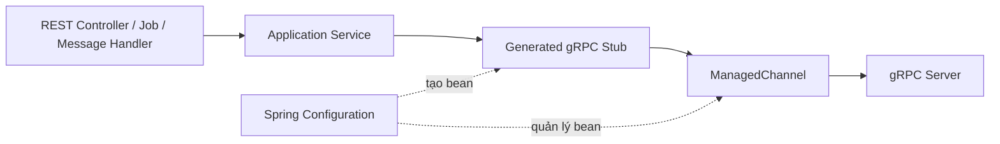

# Inject stub vào application service

Trong ứng dụng Spring gọi gRPC, **stub** là đối tượng Java cung cấp các phương thức RPC đã được sinh từ hợp đồng Protocol Buffers. Thay vì để mỗi controller tự mở kết nối và tạo stub, ta đăng ký stub thành **Spring bean**, sau đó **inject qua constructor** vào application service. Service tập trung xử lý nghiệp vụ, còn bean cấu hình chịu trách nhiệm tạo client và quản lý vòng đời `ManagedChannel`.

Bài học này thuộc phần **Spring client** của mô-đun **SPRING_GRPC**: phát triển dịch vụ gRPC trong hệ sinh thái Spring từ hợp đồng Protocol Buffers đến client/server unary và streaming, có xử lý metadata, deadline, status, interceptor, TLS và kiểm thử. Trọng tâm ở đây là cách đưa client được sinh mã vào tầng application service một cách rõ ràng, dễ kiểm thử và an toàn khi nhiều yêu cầu chạy đồng thời.

## 1. Vì sao inject stub thay vì khởi tạo trong mỗi phương thức?

Khi client đã có hợp đồng `.proto` và mã Java tương ứng, một lời gọi đi theo luồng:



`ManagedChannel` quản lý kết nối và transport HTTP/2. Stub chỉ là một đối tượng client được **gắn với channel** và mang cấu hình cho lời gọi; stub không tự sở hữu một kết nối TCP riêng. Các stub của gRPC Java được thiết kế để có thể tái sử dụng giữa nhiều luồng và các phương thức cấu hình như `withDeadlineAfter(...)` trả về **stub mới** thay vì sửa trực tiếp stub dùng chung.

Nếu tạo channel trong mỗi lần gọi, ứng dụng sẽ tốn tài nguyên thiết lập kết nối, khó kiểm soát đóng tài nguyên và khó thay thế client khi kiểm thử. Nếu khởi tạo stub trực tiếp trong controller, cách tạo client và xử lý lỗi remote dễ bị lặp lại ở nhiều endpoint.

Phân chia trách nhiệm phù hợp:

| Thành phần | Trách nhiệm |
| --- | --- |
| `@Configuration` | Đọc cấu hình đích đến, tạo `ManagedChannel` và generated stub thành bean. |
| Application service | Quyết định thời điểm gọi remote, kiểm tra input, chuyển dữ liệu, áp dụng deadline và diễn giải kết quả/lỗi. |
| Controller hoặc consumer | Nhận yêu cầu từ bên ngoài và gọi application service; không cần biết cách tạo channel. |
| Spring container | Resolve dependency khi tạo bean và điều phối vòng đời. |

## 2. Hợp đồng gRPC và lớp stub được sinh

Xét dịch vụ trả lời lời chào, với một unary RPC:

```protobuf
syntax = "proto3";

package greeting;

option java_package = "com.example.contract.grpc";
option java_multiple_files = true;

service Greeter {
  rpc SayHello (HelloRequest) returns (HelloReply);
}

message HelloRequest {
  string name = 1;
}

message HelloReply {
  string message = 1;
}
```

Sau khi chạy `protoc` và plugin Java gRPC, phần code sinh ra có `com.example.contract.grpc.GreeterGrpc` cùng `HelloRequest`, `HelloReply`. Tên phương thức Java trong `GreeterBlockingStub` là `sayHello(...)`, tương ứng RPC `SayHello`.

Các phụ thuộc cần có gồm Spring Boot, mã Java/Protobuf sinh từ hợp đồng, `grpc-protobuf`, `grpc-stub` và một transport gRPC Java như `grpc-netty-shaded`. Với test in-process ở phần sau, thêm `grpc-inprocess` trong phạm vi test. Hãy để build quản lý các module gRPC cùng phiên bản tương thích; bài này không ràng buộc một phiên bản Spring Boot hay starter gRPC cụ thể.

## 3. Đăng ký channel và stub trong Spring

Đầu tiên, cấu hình đích gọi trong `application.yml`:

```yaml
app:
  grpc:
    greeter:
      host: localhost
      port: 9090
      plaintext: true
```

Đây là cấu hình phát triển với server chạy ở máy local. Đối với môi trường thật, nên dùng TLS và thay `plaintext: false`; server, DNS và chứng chỉ phải được cấu hình tương ứng.

Tạo lớp cấu hình Spring:

```java
package com.example.client;

import com.example.contract.grpc.GreeterGrpc;
import io.grpc.ManagedChannel;
import io.grpc.ManagedChannelBuilder;
import org.springframework.beans.factory.annotation.Qualifier;
import org.springframework.beans.factory.annotation.Value;
import org.springframework.context.annotation.Bean;
import org.springframework.context.annotation.Configuration;

@Configuration(proxyBeanMethods = false)
public class GreeterClientConfiguration {

    @Bean(name = "greeterChannel", destroyMethod = "shutdown")
    ManagedChannel greeterChannel(
            @Value("${app.grpc.greeter.host}") String host,
            @Value("${app.grpc.greeter.port}") int port,
            @Value("${app.grpc.greeter.plaintext:false}") boolean plaintext) {

        ManagedChannelBuilder<?> builder =
                ManagedChannelBuilder.forAddress(host, port);

        if (plaintext) {
            builder.usePlaintext();
        } else {
            builder.useTransportSecurity();
        }

        return builder.build();
    }

    @Bean
    GreeterGrpc.GreeterBlockingStub greeterBlockingStub(
            @Qualifier("greeterChannel") ManagedChannel channel) {
        return GreeterGrpc.newBlockingStub(channel);
    }
}
```

Điểm cần nhận ra:

1. Spring tạo bean `greeterChannel` một lần theo singleton scope mặc định. Channel được chia sẻ cho các RPC khác nhau.
2. `greeterBlockingStub(...)` nhận channel đã được tạo thông qua constructor-like dependency injection ở tham số `@Bean`. Vì vậy tất cả lời gọi qua stub này dùng cùng channel.
3. Bean stub có **kiểu cụ thể** `GreeterGrpc.GreeterBlockingStub`; Spring tìm bean theo kiểu khi inject vào service.
4. `destroyMethod = "shutdown"` yêu cầu đóng channel khi Spring hủy bean. Nếu cần chờ các RPC đang xử lý kết thúc, hãy bổ sung quy trình shutdown có `awaitTermination(...)` và timeout phù hợp ở thành phần quản lý vòng đời. Không đóng channel sau từng RPC.

**Phân biệt khởi tạo bean và kết nối thành công:** tạo `ManagedChannel` không chứng minh gRPC server đang sẵn sàng. Tùy transport, kết nối thực có thể chỉ hình thành khi phát sinh lời gọi.

## 4. Constructor injection vào application service

Giả sử ứng dụng cần trả thông điệp chào mừng cho người dùng. Tầng application service không cần trả thẳng Protobuf message cho controller; một kiểu kết quả riêng giúp giới hạn sự phụ thuộc vào contract gRPC.

`GreetingResult.java`:

```java
package com.example.application;

public record GreetingResult(String message) {
}
```

`GreetingRemoteUnavailableException.java`:

```java
package com.example.application;

public class GreetingRemoteUnavailableException extends RuntimeException {
    public GreetingRemoteUnavailableException(String message, Throwable cause) {
        super(message, cause);
    }
}
```

`GreetingApplicationService.java`:

```java
package com.example.application;

import com.example.contract.grpc.GreeterGrpc;
import com.example.contract.grpc.HelloReply;
import com.example.contract.grpc.HelloRequest;
import io.grpc.Status;
import io.grpc.StatusRuntimeException;
import java.util.concurrent.TimeUnit;
import org.springframework.stereotype.Service;

@Service
public class GreetingApplicationService {

    private final GreeterGrpc.GreeterBlockingStub greeterStub;

    public GreetingApplicationService(
            GreeterGrpc.GreeterBlockingStub greeterStub) {
        this.greeterStub = greeterStub;
    }

    public GreetingResult greet(String rawName) {
        if (rawName == null || rawName.isBlank()) {
            throw new IllegalArgumentException("Tên không được rỗng");
        }

        HelloRequest request = HelloRequest.newBuilder()
                .setName(rawName.trim())
                .build();

        try {
            HelloReply reply = greeterStub
                    .withDeadlineAfter(2, TimeUnit.SECONDS)
                    .sayHello(request);
            return new GreetingResult(reply.getMessage());
        } catch (StatusRuntimeException exception) {
            Status.Code code = exception.getStatus().getCode();
            if (code == Status.Code.UNAVAILABLE
                    || code == Status.Code.DEADLINE_EXCEEDED) {
                throw new GreetingRemoteUnavailableException(
                        "Không thể lấy lời chào từ dịch vụ gRPC", exception);
            }
            throw exception;
        }
    }
}
```

Với một constructor duy nhất, Spring **không yêu cầu `@Autowired`** trên constructor. Dependency `GreeterBlockingStub` được cung cấp tự động bởi bean trong `GreeterClientConfiguration`. Thuộc tính `private final` cho thấy service không thay thế stub trong lúc xử lý request.

Ở lời gọi trên, `withDeadlineAfter(...)` tạo một bản stub được cấu hình riêng cho RPC đó. Deadline thuộc về lời gọi, còn bean stub gốc vẫn có thể được tái sử dụng an toàn. Hai status `UNAVAILABLE` và `DEADLINE_EXCEEDED` được ánh xạ sang lỗi có ý nghĩa ở tầng ứng dụng; các status khác vẫn được chuyển tiếp để chính sách xử lý cấp trên quyết định. Trong sản phẩm thực tế, nên định nghĩa bản đồ lỗi đầy đủ theo hợp đồng nghiệp vụ; đặc biệt, `INVALID_ARGUMENT`, `UNAUTHENTICATED`, `PERMISSION_DENIED` hay `NOT_FOUND` không có cùng ý nghĩa với lỗi kết nối.

Với API HTTP, lớp controller có thể sử dụng service như một dependency thông thường:

```java
package com.example.api;

import com.example.application.GreetingApplicationService;
import com.example.application.GreetingResult;
import org.springframework.web.bind.annotation.GetMapping;
import org.springframework.web.bind.annotation.RequestMapping;
import org.springframework.web.bind.annotation.RequestParam;
import org.springframework.web.bind.annotation.RestController;

@RestController
@RequestMapping("/greetings")
public class GreetingController {

    private final GreetingApplicationService greetings;

    public GreetingController(GreetingApplicationService greetings) {
        this.greetings = greetings;
    }

    @GetMapping
    public GreetingResult greet(@RequestParam String name) {
        return greetings.greet(name);
    }
}
```

Ví dụ `GET /greetings?name=Lan` gọi `GreetingApplicationService`, service gọi `Greeter/SayHello`, sau đó Spring trả JSON của `GreetingResult`. Khi kết nối từ xa không khả dụng, có thể bổ sung `@RestControllerAdvice` để ánh xạ `GreetingRemoteUnavailableException` sang HTTP `503 Service Unavailable` thay vì trả stack trace cho người dùng. Controller không cần biết đến `ManagedChannel`, `HelloRequest` hay `StatusRuntimeException`.

## 5. Có nhiều stub thì Spring inject như thế nào?

Spring ưu tiên tra cứu theo kiểu. Nếu application context có **một** bean `GreeterBlockingStub`, constructor như trên đủ rõ. Khi hệ thống có **hai** Greeter client cùng kiểu nhưng kết nối tới các cụm server khác nhau, cần chỉ rõ tên bean:

```java
@Bean("mainGreeterStub")
GreeterGrpc.GreeterBlockingStub mainGreeterStub(
        @Qualifier("mainGreeterChannel") ManagedChannel channel) {
    return GreeterGrpc.newBlockingStub(channel);
}

@Bean("backupGreeterStub")
GreeterGrpc.GreeterBlockingStub backupGreeterStub(
        @Qualifier("backupGreeterChannel") ManagedChannel channel) {
    return GreeterGrpc.newBlockingStub(channel);
}
```

Hai bean channel `mainGreeterChannel` và `backupGreeterChannel` trong đoạn này phải được khai báo riêng với các đích kết nối tương ứng. Constructor của service chọn client cần dùng:

```java
public GreetingApplicationService(
        @Qualifier("mainGreeterStub")
        GreeterGrpc.GreeterBlockingStub greeterStub) {
    this.greeterStub = greeterStub;
}
```

Đây là phần thay thế constructor trong ví dụ trước, dùng khi có nhiều bean cùng kiểu. Không cần tạo hai channel nếu chỉ có hai service ứng dụng dùng chung **một** remote gRPC service và cùng chính sách kết nối. Có thể dùng `@Primary` khi một bean là lựa chọn mặc định có chủ đích, nhưng `@Qualifier` giúp phụ thuộc của từng service hiện rõ hơn khi đọc mã.

## 6. Chọn blocking stub, future stub hay async stub

Mỗi loại stub được tạo từ cùng một channel; **chọn kiểu phù hợp với cách xử lý của application service**:

| Kiểu được inject | Cách tạo | Dùng khi |
| --- | --- | --- |
| `GreeterGrpc.GreeterBlockingStub` | `GreeterGrpc.newBlockingStub(channel)` | Xử lý unary RPC đồng bộ, chấp nhận block thread gọi. |
| `GreeterGrpc.GreeterFutureStub` | `GreeterGrpc.newFutureStub(channel)` | Unary RPC trả `ListenableFuture`, cần ghép với luồng xử lý bất đồng bộ. |
| `GreeterGrpc.GreeterStub` | `GreeterGrpc.newStub(channel)` | Callback `StreamObserver`, phù hợp unary async và streaming RPC. |

Khai báo bean cho async stub cũng giống blocking stub:

```java
@Bean
GreeterGrpc.GreeterStub greeterAsyncStub(
        @Qualifier("greeterChannel") ManagedChannel channel) {
    return GreeterGrpc.newStub(channel);
}
```

Tại application service dùng async stub, kết quả đến qua `StreamObserver`, nên phải quản lý callback `onNext`, `onError`, `onCompleted` và ranh giới vòng đời request. Với Spring MVC đồng bộ, blocking stub có thể là lựa chọn đơn giản; với streaming hoặc luồng phản ứng (reactive), **không gọi blocking stub trên event-loop thread**. Nếu tích hợp Reactor, cần thiết kế cầu nối giữa observer gRPC và `Mono`/`Flux`, có xử lý cancel và backpressure phù hợp; việc inject stub đơn thuần không tự tạo ra cơ chế đó.

## 7. Metadata, deadline và an toàn khi bean được chia sẻ

`@Service` và stub thường là singleton. Điều này hợp lý vì cấu hình client có thể chia sẻ, nhưng **metadata gắn với một request hoặc một người dùng phải được dựng riêng cho lời gọi đó**. Ví dụ application service cần truyền correlation ID:

```java
import io.grpc.Metadata;
import io.grpc.stub.MetadataUtils;

Metadata headers = new Metadata();
Metadata.Key<String> requestIdKey = Metadata.Key.of(
        "x-request-id", Metadata.ASCII_STRING_MARSHALLER);
headers.put(requestIdKey, requestId);

HelloReply reply = greeterStub
        .withInterceptors(MetadataUtils.newAttachHeadersInterceptor(headers))
        .withDeadlineAfter(2, TimeUnit.SECONDS)
        .sayHello(request);
```

Ở đây, `requestId` là giá trị của **lời gọi hiện tại** và `request` là `HelloRequest` đã tạo trước đó. Đoạn mã đặt trong phương thức xử lý từng request. Không dùng một đối tượng `Metadata` có thể sửa đổi toàn cục rồi gán giá trị mới theo từng request: dữ liệu của các request đồng thời có nguy cơ lẫn nhau.

Đối với token xác thực thay đổi theo người dùng, cân nhắc `CallCredentials` hoặc client interceptor lấy token trong ngữ cảnh lời gọi. Không hard-code token vào bean singleton hoặc in token ra log. Deadline cần được ấn định cho từng RPC theo ngân sách thời gian của nghiệp vụ; khi request gốc có thời hạn, phần xử lý phải bảo đảm lời gọi gRPC không tiếp tục vô hạn sau khi người dùng đã ngừng chờ.

## 8. Test application service mà không cần mở cổng mạng

Constructor injection cho phép dựng service trực tiếp trong test. Để kiểm tra logic mapping Protobuf và lời gọi unary một cách thực tế mà không phụ thuộc server thật, dùng **gRPC in-process server**. Ví dụ dưới đây dùng JUnit 5 và API `grpc-inprocess`:

```java
package com.example.application;

import static org.junit.jupiter.api.Assertions.assertEquals;

import com.example.contract.grpc.GreeterGrpc;
import com.example.contract.grpc.HelloReply;
import com.example.contract.grpc.HelloRequest;
import io.grpc.ManagedChannel;
import io.grpc.Server;
import io.grpc.inprocess.InProcessChannelBuilder;
import io.grpc.inprocess.InProcessServerBuilder;
import io.grpc.stub.StreamObserver;
import org.junit.jupiter.api.Test;

class GreetingApplicationServiceTest {

    @Test
    void returnsGreetingFromGrpcService() throws Exception {
        String serverName = InProcessServerBuilder.generateName();

        Server server = InProcessServerBuilder.forName(serverName)
                .directExecutor()
                .addService(new GreeterGrpc.GreeterImplBase() {
                    @Override
                    public void sayHello(
                            HelloRequest request,
                            StreamObserver<HelloReply> observer) {
                        observer.onNext(HelloReply.newBuilder()
                                .setMessage("Xin chào, " + request.getName())
                                .build());
                        observer.onCompleted();
                    }
                })
                .build()
                .start();

        ManagedChannel channel = InProcessChannelBuilder
                .forName(serverName)
                .directExecutor()
                .build();

        try {
            GreetingApplicationService app = new GreetingApplicationService(
                    GreeterGrpc.newBlockingStub(channel));

            assertEquals("Xin chào, Lan", app.greet(" Lan ").message());
        } finally {
            channel.shutdownNow();
            server.shutdownNow();
        }
    }
}
```

Test này xác minh rằng application service chuẩn hóa tên, chuyển sang `HelloRequest`, gọi generated stub và chuyển `HelloReply` thành `GreetingResult`. Vì được inject bằng constructor, logic service không cần khởi tạo Spring context mới kiểm tra được. Đây là **test giao tiếp gRPC**, nhưng không kiểm tra cấu hình TLS, DNS, ingress hay đường truyền HTTP/2 thực; các hành vi đó cần integration test với server qua cổng mạng thật. Nếu muốn kiểm chứng cả wiring Spring, bổ sung test khởi động `ApplicationContext` và xác minh `GreetingApplicationService` nhận đúng bean stub, dùng cấu hình test tách biệt khỏi production.

## 9. Lỗi thường gặp khi inject stub

| Hiện tượng | Nguyên nhân / cách khắc phục |
| --- | --- |
| `NoSuchBeanDefinitionException` cho `GreeterBlockingStub` | Chưa khai báo bean, `@Configuration` nằm ngoài component scan hoặc mã sinh không được đưa vào classpath. |
| `NoUniqueBeanDefinitionException` | Có nhiều stub cùng kiểu; dùng `@Qualifier` với tên bean chính xác. |
| Code biên dịch nhưng RPC trả `UNIMPLEMENTED` | Phương thức hoặc service trên server không khớp hợp đồng đang sinh mã; kiểm tra package/service và phiên bản proto. |
| Service tạo stub từ `ManagedChannelBuilder` ngay trong `greet()` | Chuyển cấu hình channel và stub về bean, tái sử dụng tài nguyên. |
| Dùng `@Autowired` trên field mutable | Ưu tiên constructor injection và `final` để dependency rõ ràng, dễ test. |
| Một request thay deadline/metadata của request khác | Gọi `withDeadlineAfter`/`withInterceptors` tạo stub riêng cho từng lời gọi; không giữ metadata thay đổi trong singleton. |
| Gọi blocking stub từ luồng phản ứng | Thay bằng async stub hoặc chủ động chuyển công việc blocking sang scheduler thích hợp. |
| Gọi RPC lần đầu báo `UNAVAILABLE` | Kiểm tra server, host/port, TLS, chứng chỉ và mạng; Spring tạo bean thành công không bảo đảm server sẵn sàng. |

Nếu dự án dùng Spring gRPC starter có sẵn cơ chế khai báo/factory tạo client, hãy dùng cách đăng ký stub tương ứng với phiên bản starter đó. Application service vẫn nhận **generated stub hoặc một adapter của nó qua constructor**, nhưng tránh tạo thêm channel thủ công trùng với channel do starter quản lý. Cần kiểm tra chính sách đóng channel, interceptor và TLS của cấu hình được chọn.

## 10. Khi nào nên inject adapter thay vì generated stub trực tiếp?

Inject generated stub trực tiếp thích hợp khi ứng dụng nhỏ, tầng application service là nơi duy nhất gọi API remote và việc phụ thuộc vào Protobuf được chấp nhận. Khi nhiều nghiệp vụ cùng gọi một dịch vụ, muốn đổi transport hoặc cô lập cấu trúc Protobuf khỏi tầng ứng dụng, đặt một **gateway/adapter** trước stub:


Khi đó `GrpcGreetingGateway` nhận stub bằng constructor và chuyển `HelloRequest`/`HelloReply` sang kiểu dữ liệu nghiệp vụ; application service chỉ phụ thuộc `GreetingGateway`. Đây là lựa chọn thiết kế theo mức độ phức tạp, không phải yêu cầu bắt buộc để sử dụng Spring gRPC client. Dù chọn cách nào, trách nhiệm tạo channel và quản lý vòng đời vẫn nằm trong cấu hình client.

## 11. Bài tập thực hành

1. Sinh mã Java từ hợp đồng `Greeter`, cấu hình `greeterChannel` và `greeterBlockingStub` trong Spring, sau đó thêm `GreetingApplicationService` bằng constructor injection.
2. Gọi `GET /greetings?name=Lan`; xác minh lời chào đến từ gRPC server, không phải chuỗi hard-code trong controller.
3. Tạo hai bean `GreeterBlockingStub` trỏ tới hai server và quan sát lỗi inject khi thiếu `@Qualifier`; bổ sung qualifier để chọn đúng server.
4. Viết in-process test cho trường hợp thành công và trường hợp server trả status `UNAVAILABLE`. Xác minh ngoại lệ nghiệp vụ tương ứng và bảo đảm đóng cả server lẫn channel sau test.
5. Thêm metadata `x-request-id` riêng cho mỗi lời gọi, dùng deadline và xác minh hai lời gọi đồng thời không dùng chung metadata có thể sửa đổi.

Sau bài này, bạn cần tự giải thích được vì sao Spring quản lý channel và stub dưới dạng bean, vì sao constructor injection giúp application service dễ kiểm thử, khi nào dùng `@Qualifier`, và cách áp dụng deadline/metadata riêng mà không thay đổi stub dùng chung. Đây là nền tảng để ứng dụng Spring tích hợp các unary RPC, streaming RPC, interceptor và cơ chế giám sát gRPC đáng tin cậy.
