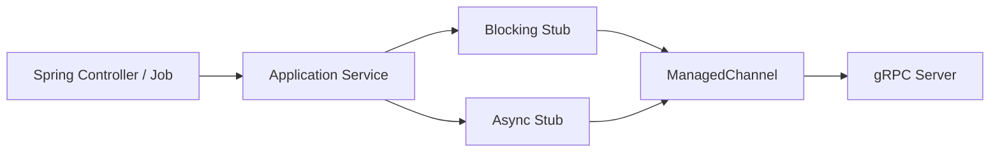

# Blocking stub và async stub trong Spring

Khi ứng dụng Spring gọi một gRPC server, mã Java được sinh từ hợp đồng Protocol Buffers cung cấp nhiều loại **stub**. Hai loại quan trọng nhất là **blocking stub** (gọi đồng bộ) và **async stub** (gọi qua callback). Chúng sử dụng cùng một `ManagedChannel` nhưng khác nhau ở cách trả kết quả, quản lý luồng và xử lý lỗi. Việc chọn đúng stub tác động trực tiếp đến cách application service xử lý unary RPC, server streaming, client streaming và bidirectional streaming.

Bài học thuộc chương **Spring client** trong mô-đun **SPRING_GRPC**. Chúng ta sẽ tạo cả hai loại stub dưới dạng Spring bean, gọi chúng từ application service, so sánh cách xử lý `deadline`, `status`, metadata và kiểm thử tích hợp. Các ví dụ sử dụng API gRPC Java trực tiếp để làm rõ cơ chế; nếu dự án sử dụng Spring gRPC starter, cách khai báo bean có thể được thay bằng factory hoặc auto-configuration tương ứng với phiên bản starter.

## 1. Stub là gì và điểm chung giữa các loại stub

Quy trình một lời gọi gRPC trong ứng dụng Spring:



- **`ManagedChannel`** quản lý hạ tầng kết nối, phân giải địa chỉ, transport HTTP/2 và cân bằng tải theo cấu hình.
- **Generated stub** chuyển lời gọi Java thành RPC với kiểu request/response được xác định trong `.proto`.
- **Application service** quyết định cách sử dụng stub, chuyển dữ liệu nghiệp vụ và xử lý kết quả/lỗi.

Channel thường được tạo một lần và tái sử dụng; mỗi lời gọi RPC mang metadata và deadline riêng. Stub gRPC Java có thể được chia sẻ giữa nhiều luồng, và các phương thức `withDeadlineAfter(...)`, `withInterceptors(...)` tạo một stub được cấu hình mới thay vì sửa đối tượng gốc. Do đó, **có thể đăng ký các stub làm singleton Spring bean** và tạo bản cấu hình riêng khi thực hiện từng RPC.

## 2. Blocking stub và async stub khác nhau thế nào?

| Tiêu chí | Blocking stub | Async stub |
| --- | --- | --- |
| Cách tạo | `GreeterGrpc.newBlockingStub(channel)` | `GreeterGrpc.newStub(channel)` |
| Unary RPC | Phương thức trả response hoặc ném `StatusRuntimeException`; luồng gọi phải chờ. | Phương thức nhận `StreamObserver<Response>`; kết quả tới qua callback. |
| Server streaming | Phương thức thường trả `Iterator<Response>`; `hasNext()`/`next()` có thể chờ dữ liệu. | Server đẩy từng message qua `onNext()`, kết thúc bằng `onCompleted()` hoặc `onError()`. |
| Client/bidirectional streaming | Không có API blocking tương ứng trong generated blocking stub kiểu truyền thống. | Sử dụng `StreamObserver` để gửi request và nhận response. |
| Sử dụng luồng | Thường chiếm luồng gọi trong lúc chờ RPC. | Luồng khởi phát không cần đứng chờ response; callback chạy trên executor do gRPC điều phối. |
| Dùng phù hợp | Luồng xử lý đồng bộ, khối lượng RPC đang chờ có giới hạn. | Xử lý bất đồng bộ, streaming và các luồng cần tiếp tục làm việc khi RPC đang chạy. |
| Cách bắt lỗi | `try/catch` quanh lời gọi hoặc thao tác trên iterator. | `onError(Throwable)` của response observer. |

Ngoài hai loại trên, gRPC Java còn sinh **future stub** bằng `GreeterGrpc.newFutureStub(channel)`, thường dùng cho unary RPC để nhận `ListenableFuture<Response>`. Future stub khác async stub kiểu observer; nó thuận tiện khi cần chờ hoặc kết hợp kết quả unary theo API future, nhưng không thay thế async stub trong client streaming và bidirectional streaming.

**Không nên hiểu “async” là “server nhanh hơn”.** Thời gian xử lý ở server và độ trễ mạng có thể giống nhau; khác biệt chủ yếu là cách client sử dụng luồng chờ và nhận phản hồi. Blocking stub thường đơn giản hơn khi viết và đọc mã, còn async stub giúp tổ chức concurrency và streaming mà không giữ một luồng đứng chờ cho mỗi lời gọi.

## 3. Chuẩn bị hợp đồng Protocol Buffers

Xét dịch vụ `Greeter` có cả unary RPC và server-streaming RPC:

```protobuf
syntax = "proto3";

package greeting.v1;

option java_package = "com.example.contract.grpc";
option java_multiple_files = true;

service Greeter {
  rpc SayHello (HelloRequest) returns (HelloReply);
  rpc WatchGreetings (WatchRequest) returns (stream HelloReply);
}

message HelloRequest {
  string name = 1;
}

message WatchRequest {
  string name = 1;
  int32 count = 2;
}

message HelloReply {
  string message = 1;
}
```

Sau khi sinh mã với `protoc` và plugin `protoc-gen-grpc-java`, client có các kiểu `GreeterGrpc`, `HelloRequest`, `WatchRequest`, `HelloReply` thuộc package `com.example.contract.grpc`. Bài học giả định mã sinh đã được đưa vào classpath. Về phụ thuộc, ứng dụng cần `grpc-stub`, `grpc-protobuf` và transport như `grpc-netty-shaded` cùng một nhóm phiên bản gRPC tương thích; đồng thời có các thành phần Spring Boot cần thiết để chạy application service và controller.

Từ hợp đồng trên, các phương thức unary có hình dạng điển hình:

```java
// Blocking: lời gọi trả trực tiếp một response.
HelloReply reply = blockingStub.sayHello(request);

// Async: lời gọi nhận observer để báo response hoặc lỗi.
asyncStub.sayHello(request, responseObserver);
```

Đoạn mã này chỉ minh họa chữ ký; phần sau cung cấp cách đăng ký và sử dụng các biến trong ứng dụng Spring hoàn chỉnh hơn.

## 4. Tạo hai stub thành Spring bean dùng chung channel

Trong `application.yml`, cấu hình đích đến:

```yaml
app:
  grpc:
    greeter:
      host: localhost
      port: 9090
      plaintext: true
```

`plaintext: true` chỉ thích hợp với môi trường phát triển hoặc thử nghiệm có kiểm soát. Khi giao tiếp qua mạng thực tế, cấu hình TLS, chứng chỉ tin cậy và hostname tương ứng; không bật plaintext chỉ để bỏ qua lỗi chứng chỉ.

Tạo `GrpcClientConfiguration.java`:

```java
package com.example.client;

import com.example.contract.grpc.GreeterGrpc;
import io.grpc.ManagedChannel;
import io.grpc.ManagedChannelBuilder;
import org.springframework.beans.factory.annotation.Qualifier;
import org.springframework.beans.factory.annotation.Value;
import org.springframework.context.annotation.Bean;
import org.springframework.context.annotation.Configuration;

@Configuration(proxyBeanMethods = false)
public class GrpcClientConfiguration {

    @Bean(name = "greeterChannel", destroyMethod = "shutdown")
    ManagedChannel greeterChannel(
            @Value("${app.grpc.greeter.host}") String host,
            @Value("${app.grpc.greeter.port}") int port,
            @Value("${app.grpc.greeter.plaintext:false}") boolean plaintext) {

        ManagedChannelBuilder<?> builder =
                ManagedChannelBuilder.forAddress(host, port);

        if (plaintext) {
            builder.usePlaintext();
        } else {
            builder.useTransportSecurity();
        }
        return builder.build();
    }

    @Bean
    GreeterGrpc.GreeterBlockingStub greeterBlockingStub(
            @Qualifier("greeterChannel") ManagedChannel channel) {
        return GreeterGrpc.newBlockingStub(channel);
    }

    @Bean
    GreeterGrpc.GreeterStub greeterAsyncStub(
            @Qualifier("greeterChannel") ManagedChannel channel) {
        return GreeterGrpc.newStub(channel);
    }

    @Bean
    GreeterGrpc.GreeterFutureStub greeterFutureStub(
            @Qualifier("greeterChannel") ManagedChannel channel) {
        return GreeterGrpc.newFutureStub(channel);
    }
}
```

Ba stub khác kiểu dùng chung bean `greeterChannel`. Spring chọn stub bằng **kiểu dữ liệu** khi constructor injection. `destroyMethod = "shutdown"` yêu cầu đóng channel khi container hủy bean. `shutdown()` không đồng nghĩa với chờ tất cả RPC kết thúc; nếu cần graceful shutdown có thời hạn, bổ sung cơ chế `awaitTermination(...)`, sau đó xử lý RPC còn tồn đọng theo chính sách ứng dụng.

**Chú ý:** việc tạo được bean `ManagedChannel` chưa chứng minh server đang chạy hay chấp nhận kết nối. Nhiều transport chỉ bắt đầu kết nối khi có RPC thực tế.

## 5. Dùng blocking stub trong application service

Một service đồng bộ có thể nhận `GreeterBlockingStub` qua constructor và gọi unary RPC trực tiếp:

```java
package com.example.application;

import com.example.contract.grpc.GreeterGrpc;
import com.example.contract.grpc.HelloReply;
import com.example.contract.grpc.HelloRequest;
import java.util.concurrent.TimeUnit;
import org.springframework.stereotype.Service;

@Service
public class BlockingGreetingService {

    private final GreeterGrpc.GreeterBlockingStub stub;

    public BlockingGreetingService(GreeterGrpc.GreeterBlockingStub stub) {
        this.stub = stub;
    }

    public String greet(String name) {
        if (name == null || name.isBlank()) {
            throw new IllegalArgumentException("Tên không được rỗng");
        }

        HelloRequest request = HelloRequest.newBuilder()
                .setName(name.trim())
                .build();

        HelloReply reply = stub
                .withDeadlineAfter(2, TimeUnit.SECONDS)
                .sayHello(request);

        return reply.getMessage();
    }
}
```

Khi `greet()` chạy, luồng của lời gọi chờ đến khi `sayHello(...)` có response, hết deadline hoặc kết thúc vì lỗi. Generated blocking stub không tự chuyển lỗi RPC thành `Optional.empty()`: các trạng thái lỗi thông thường được báo bằng `StatusRuntimeException`. Trong Spring MVC dùng mô hình servlet, cách này thường dễ hiểu với một số lượng yêu cầu đồng thời được kiểm soát, nhưng mỗi request có thể giữ một thread trong khi chờ server.

### Blocking server streaming

Với `WatchGreetings`, generated blocking stub cung cấp `Iterator<HelloReply>`. Ví dụ đọc tối đa 3 thông điệp rồi trả về danh sách:

```java
import com.example.contract.grpc.HelloReply;
import com.example.contract.grpc.WatchRequest;
import java.util.ArrayList;
import java.util.Iterator;
import java.util.List;
import java.util.concurrent.TimeUnit;

WatchRequest request = WatchRequest.newBuilder()
        .setName("Lan")
        .setCount(3)
        .build();

Iterator<HelloReply> responses = stub
        .withDeadlineAfter(5, TimeUnit.SECONDS)
        .watchGreetings(request);

List<String> messages = new ArrayList<>();
while (responses.hasNext()) {
    messages.add(responses.next().getMessage());
}
```

Trong đoạn này, `stub` là `GreeterBlockingStub` đã được inject vào service. `hasNext()` hoặc `next()` có thể chặn luồng cho đến khi message tiếp theo đến; nếu stream lỗi, thao tác trên iterator có thể ném `StatusRuntimeException`. Việc gom toàn bộ stream vào danh sách chỉ hợp lý khi server **giới hạn số message rõ ràng**; với stream dài hoặc không kết thúc, cần xử lý từng message, đặt giới hạn tài nguyên và có cơ chế hủy RPC.

## 6. Dùng async stub và `StreamObserver`

Async stub dùng `StreamObserver<T>` để xử lý kết quả theo sự kiện:

| Callback | Thời điểm | Trách nhiệm thường gặp |
| --- | --- | --- |
| `onNext(T response)` | Mỗi khi có một message mới. | Nhận/ánh xạ dữ liệu; giữ xử lý ngắn gọn. |
| `onError(Throwable error)` | RPC thất bại; đây là sự kiện kết thúc. | Đánh dấu tác vụ thất bại, ghi nhận status và hoàn tất tài nguyên liên quan. |
| `onCompleted()` | RPC kết thúc thành công; đây là sự kiện kết thúc. | Đánh dấu đã nhận hết message và hoàn thành kết quả tổng hợp. |

Đối với unary RPC, server trả **một** response trước khi hoàn tất; `onNext` nhận response và `onCompleted` thông báo hoàn thành. Async stub không tự động biến callback thành một giá trị trả về của service. Ta có thể dùng `CompletableFuture` làm cầu nối sang API bất đồng bộ trong Spring.

`AsyncGreetingService.java`:

```java
package com.example.application;

import com.example.contract.grpc.GreeterGrpc;
import com.example.contract.grpc.HelloReply;
import com.example.contract.grpc.HelloRequest;
import io.grpc.stub.StreamObserver;
import java.util.concurrent.CompletableFuture;
import java.util.concurrent.TimeUnit;
import java.util.concurrent.atomic.AtomicReference;
import org.springframework.stereotype.Service;

@Service
public class AsyncGreetingService {

    private final GreeterGrpc.GreeterStub stub;

    public AsyncGreetingService(GreeterGrpc.GreeterStub stub) {
        this.stub = stub;
    }

    public CompletableFuture<String> greet(String name) {
        if (name == null || name.isBlank()) {
            throw new IllegalArgumentException("Tên không được rỗng");
        }

        HelloRequest request = HelloRequest.newBuilder()
                .setName(name.trim())
                .build();

        CompletableFuture<String> result = new CompletableFuture<>();
        AtomicReference<HelloReply> response = new AtomicReference<>();

        stub.withDeadlineAfter(2, TimeUnit.SECONDS)
                .sayHello(request, new StreamObserver<HelloReply>() {
                    @Override
                    public void onNext(HelloReply value) {
                        response.set(value);
                    }

                    @Override
                    public void onError(Throwable error) {
                        result.completeExceptionally(error);
                    }

                    @Override
                    public void onCompleted() {
                        HelloReply value = response.get();
                        if (value == null) {
                            result.completeExceptionally(
                                    new IllegalStateException("RPC không có response"));
                        } else {
                            result.complete(value.getMessage());
                        }
                    }
                });

        return result;
    }
}
```

`AtomicReference` giữ response vừa nhận; trong ví dụ unary, chỉ nên có một `onNext`. Việc hoàn thành `CompletableFuture` ở `onCompleted()` bảo đảm RPC đã báo hoàn tất thành công. Nếu RPC gọi `onError(...)`, future hoàn thành theo nhánh thất bại. Ngoại lệ phát sinh khi khởi tạo lời gọi ngay tại client (chẳng hạn lỗi lập trình hoặc đối số không hợp lệ) vẫn có thể được ném đồng bộ; ví dụ trên không bắt mọi ngoại lệ kiểu đó để che lỗi.

`CompletableFuture` giúp tầng gọi tiếp tục công việc khác trong khi gRPC chờ response. Tuy nhiên, **`future.cancel(true)` trong cách bọc đơn giản này không mặc nhiên hủy RPC đang chạy**. Để hỗ trợ client ngắt kết nối hoặc nghiệp vụ chủ động hủy, hãy nối hành vi hủy với cơ chế cancel của gRPC như `ClientCallStreamObserver` qua `ClientResponseObserver`, hoặc một `Context.CancellableContext` được quản lý đúng vòng đời. Deadline vẫn cần thiết để giới hạn thời gian xử lý ngay cả khi phía gọi bỏ chờ.

### Async server streaming

Với server-streaming RPC, cùng `GreeterStub` nhận từng message mà không phải gọi `Iterator.hasNext()`:

```java
import com.example.contract.grpc.HelloReply;
import com.example.contract.grpc.WatchRequest;
import io.grpc.stub.StreamObserver;
import java.util.concurrent.TimeUnit;

WatchRequest request = WatchRequest.newBuilder()
        .setName("Lan")
        .setCount(3)
        .build();

stub.withDeadlineAfter(5, TimeUnit.SECONDS)
        .watchGreetings(request, new StreamObserver<HelloReply>() {
            @Override
            public void onNext(HelloReply value) {
                handleMessage(value.getMessage());
            }

            @Override
            public void onError(Throwable error) {
                handleFailure(error);
            }

            @Override
            public void onCompleted() {
                handleFinished();
            }
        });
```

Ở ví dụ này, `stub` là `GreeterStub` đã được inject; `handleMessage`, `handleFailure`, `handleFinished` đại diện cho các hàm xử lý do ứng dụng định nghĩa. Callback nên xử lý nhanh hoặc chuyển việc nặng sang executor được kiểm soát. Với stream dài, cần giới hạn số message tồn đọng, quan tâm backpressure và hủy stream khi consumer không còn cần dữ liệu. Không giả định mọi stream đều kết thúc sau vài giây như bài minh họa.

## 7. Spring MVC, WebFlux và luồng thực thi

Chọn stub phù hợp với mô hình thực thi của endpoint nhận yêu cầu:

| Bối cảnh | Lựa chọn thường phù hợp | Điểm cần kiểm soát |
| --- | --- | --- |
| Spring MVC endpoint đồng bộ | Blocking stub | Thread bị giữ khi RPC đang chờ; đặt deadline và giới hạn concurrency. |
| Spring MVC endpoint bất đồng bộ | Async stub trả `CompletableFuture`/`CompletionStage` | Xử lý kết thúc hoặc lỗi ở future; không chặn luồng trong callback. |
| Spring WebFlux trên event loop | Async stub, cầu nối `Mono`/`Flux` | Không chặn event loop; truyền cancellation và điều tiết message. |
| Job chạy trong thread pool riêng | Tùy tải và cách phối hợp kết quả | Kiểm soát kích thước pool, timeout và tài nguyên đồng thời. |

Ví dụ Spring MVC controller gọi cả hai service:

```java
package com.example.api;

import com.example.application.AsyncGreetingService;
import com.example.application.BlockingGreetingService;
import java.util.concurrent.CompletableFuture;
import org.springframework.web.bind.annotation.GetMapping;
import org.springframework.web.bind.annotation.RequestMapping;
import org.springframework.web.bind.annotation.RequestParam;
import org.springframework.web.bind.annotation.RestController;

@RestController
@RequestMapping("/greetings")
public class GreetingController {

    private final BlockingGreetingService blocking;
    private final AsyncGreetingService async;

    public GreetingController(
            BlockingGreetingService blocking,
            AsyncGreetingService async) {
        this.blocking = blocking;
        this.async = async;
    }

    @GetMapping("/blocking")
    public String blocking(@RequestParam String name) {
        return blocking.greet(name);
    }

    @GetMapping("/async")
    public CompletableFuture<String> async(@RequestParam String name) {
        return async.greet(name);
    }
}
```

Endpoint `/greetings/async` sử dụng khả năng xử lý kết quả bất đồng bộ của Spring MVC; servlet thread không cần đứng chờ RPC bằng lệnh `.get()`. Cách này không tự bảo đảm hủy gRPC call khi HTTP client bỏ kết nối, nên cần cơ chế hủy bổ sung nếu ứng dụng yêu cầu. Đối với WebFlux, có thể dùng `Mono.fromFuture(...)` cho unary RPC, nhưng vẫn cần xử lý cancellation và không thực hiện tác vụ blocking trên callback của gRPC.

Với Spring WebFlux, chuyển blocking RPC sang `boundedElastic` có thể giúp không khóa event loop, song vẫn sử dụng thread đang chờ và có giới hạn tài nguyên. Nếu triển khai streaming hoặc mức đồng thời cao, hãy đánh giá cách dùng async stub và cơ chế điều tiết tải thực tế.

## 8. Deadline, metadata, status và cancellation theo từng RPC

### Deadline không thuộc vòng đời singleton bean

Deadline được gắn vào bản stub cấu hình cho **một RPC**:

```java
var callStub = blockingStub.withDeadlineAfter(2, TimeUnit.SECONDS);
HelloReply reply = callStub.sayHello(request);
```

`blockingStub` ở đây là `GreeterBlockingStub` do Spring inject; bản `callStub` không thay đổi bean gốc. Tương tự, async stub có thể gọi `asyncStub.withDeadlineAfter(...)` trước khi mở RPC hoặc stream. Khi hết thời gian, client thường nhận gRPC status `DEADLINE_EXCEEDED`; không giả định server đã dừng mọi công việc ngay thời điểm đó.

### Metadata của từng người dùng/request

Ví dụ gắn `x-request-id` cho một lời gọi:

```java
import io.grpc.Metadata;
import io.grpc.stub.MetadataUtils;

Metadata headers = new Metadata();
Metadata.Key<String> requestIdKey = Metadata.Key.of(
        "x-request-id", Metadata.ASCII_STRING_MARSHALLER);
headers.put(requestIdKey, requestId);

var callStub = asyncStub
        .withInterceptors(MetadataUtils.newAttachHeadersInterceptor(headers))
        .withDeadlineAfter(2, TimeUnit.SECONDS);

callStub.sayHello(request, responseObserver);
```

Đoạn này là phần nằm trong một lời gọi, với `requestId`, `request` và `responseObserver` do ngữ cảnh lời gọi cung cấp. Không lưu một `Metadata` mutable mang token hoặc ID theo người dùng trong singleton stub hoặc singleton service. Với thông tin xác thực, cân nhắc `CallCredentials`/interceptor lấy credential tại thời điểm thực hiện RPC; không ghi token nhạy cảm vào log.

### Phân loại status theo cách gọi

Blocking stub ném `StatusRuntimeException`; async stub thông báo lỗi qua `onError(Throwable)` (thông thường có thể chuyển sang `Status` bằng `Status.fromThrowable(error)`). Ví dụ:

```java
import io.grpc.Status;

Status.Code code = Status.fromThrowable(error).getCode();
switch (code) {
    case UNAVAILABLE -> markRemoteTemporarilyUnavailable();
    case DEADLINE_EXCEEDED -> markTimeout();
    case INVALID_ARGUMENT -> markInvalidRequest();
    default -> markUnexpectedGrpcFailure();
}
```

Các hàm `mark...()` tượng trưng cho cơ chế ghi nhận lỗi của ứng dụng; mã trên minh họa cách phân loại, không phải một hàm độc lập có thể biên dịch mà không định nghĩa các hàm đó. `UNAVAILABLE` có thể do server hoặc transport không sẵn sàng, `DEADLINE_EXCEEDED` là vượt hạn thời gian, còn `INVALID_ARGUMENT` cho biết request không hợp lệ theo server. Không retry mọi status một cách tự động. Với RPC làm thay đổi trạng thái, retry cần xét tính idempotent, chính sách backoff và deadline tổng.

### Cancellation và stream dài

Khi một người dùng hủy yêu cầu, stream mất consumer hoặc ứng dụng shutdown, cần hủy RPC còn hoạt động để tránh lãng phí tài nguyên. `ClientResponseObserver` cho phép lấy `ClientCallStreamObserver` trước khi gRPC bắt đầu gửi lời gọi; từ đó ứng dụng có thể gọi `cancel(...)` và dùng API flow-control phù hợp. Không gọi các phương thức trên request observer tùy tiện từ nhiều thread; bảo đảm quy tắc đồng bộ hóa và lifecycle của gRPC Java.

## 9. Kiểm thử blocking và async trên cùng gRPC server

Test in-process là cách xác minh hai stub cùng giao tiếp đúng hợp đồng Protobuf mà không cần chiếm cổng TCP. Dưới đây là JUnit 5 test với `grpc-inprocess` trên test classpath:

```java
package com.example.application;

import static org.junit.jupiter.api.Assertions.assertEquals;

import com.example.contract.grpc.GreeterGrpc;
import com.example.contract.grpc.HelloReply;
import com.example.contract.grpc.HelloRequest;
import io.grpc.ManagedChannel;
import io.grpc.Server;
import io.grpc.inprocess.InProcessChannelBuilder;
import io.grpc.inprocess.InProcessServerBuilder;
import io.grpc.stub.StreamObserver;
import java.util.concurrent.TimeUnit;
import org.junit.jupiter.api.Test;

class GreetingStubsTest {

    @Test
    void blockingAndAsyncReturnTheSameGreeting() throws Exception {
        String serverName = InProcessServerBuilder.generateName();
        Server server = InProcessServerBuilder.forName(serverName)
                .directExecutor()
                .addService(new GreeterGrpc.GreeterImplBase() {
                    @Override
                    public void sayHello(
                            HelloRequest request,
                            StreamObserver<HelloReply> responseObserver) {
                        responseObserver.onNext(HelloReply.newBuilder()
                                .setMessage("Xin chào, " + request.getName())
                                .build());
                        responseObserver.onCompleted();
                    }
                })
                .build()
                .start();

        ManagedChannel channel = InProcessChannelBuilder.forName(serverName)
                .directExecutor()
                .build();

        try {
            var blocking = new BlockingGreetingService(
                    GreeterGrpc.newBlockingStub(channel));
            var async = new AsyncGreetingService(
                    GreeterGrpc.newStub(channel));

            assertEquals("Xin chào, Lan", blocking.greet("Lan"));
            assertEquals("Xin chào, Lan",
                    async.greet("Lan").get(3, TimeUnit.SECONDS));
        } finally {
            channel.shutdownNow();
            server.shutdownNow();
        }
    }
}
```

`get(3, TimeUnit.SECONDS)` được dùng **trong test** để chờ kết quả có giới hạn, không phải cách khuyên dùng trong event-loop code production. `directExecutor()` giúp test gọn và dễ hiểu; nó khiến callback có thể thực thi ngay trên thread liên quan đến lời gọi, nên không suy rộng đặc điểm executor này sang transport gRPC mạng thật.

Test trên xác nhận kết quả của hai service, nhưng chưa xác minh TLS, DNS, proxy hay HTTP/2. Cần integration test với một server dùng network transport thật để kiểm tra những phần đó. Nên thêm các ca test cho `UNAVAILABLE`, `DEADLINE_EXCEEDED`, callback `onError`, kết thúc stream, hủy lời gọi và nhiều request đồng thời nếu yêu cầu hệ thống có các tình huống này.

## 10. Các lỗi thường gặp khi chọn và inject stub

| Tình huống | Vấn đề | Hướng xử lý |
| --- | --- | --- |
| Dùng blocking stub trong Netty event loop | Chặn luồng xử lý I/O, làm giảm khả năng phục vụ các request khác. | Dùng async stub hoặc bố trí công việc blocking trên executor thích hợp. |
| Gọi `.get()` ngay sau async RPC | Biến lời gọi bất đồng bộ thành chờ đồng bộ; có thể làm nghẽn thread pool. | Trả future/compose kết quả bất đồng bộ khi có thể. |
| Cho rằng `CompletableFuture.cancel()` tự hủy gRPC call | Lời gọi có thể vẫn chạy trên server hoặc transport. | Nối hủy future với gRPC cancellation, luôn đặt deadline phù hợp. |
| Ghi metadata người dùng vào singleton stub | Có thể rò rỉ hoặc trộn token/request-id giữa các lời gọi. | Tạo metadata cho từng RPC hoặc dùng credentials phù hợp. |
| `NoSuchBeanDefinitionException` | Spring chưa đăng ký bean stub đúng kiểu hoặc config nằm ngoài component scan. | Kiểm tra `@Configuration`, `@Bean`, package scan và mã Java sinh. |
| `NoUniqueBeanDefinitionException` | Có nhiều stub cùng kiểu hướng tới nhiều server. | Đặt tên bean và inject bằng `@Qualifier`. |
| Không xử lý `onError` hoặc `onCompleted` | Future, stream hoặc tài nguyên có thể không được kết thúc đúng. | Thiết kế từng nhánh kết thúc và bổ sung test lỗi. |
| Không có deadline | RPC có thể chờ quá lâu trước sự cố mạng/server. | Đặt deadline theo nhu cầu nghiệp vụ, không dùng một giá trị tùy tiện cho mọi RPC. |
| Tạo channel mỗi lần gọi | Tăng chi phí kết nối và khó kiểm soát tài nguyên. | Tạo `ManagedChannel` dưới dạng bean và tái sử dụng cho các stub. |

Ngoài lỗi kỹ thuật, cần cân nhắc tính dễ đọc và khả năng bảo trì. Nếu application service trực tiếp thao tác nhiều kiểu message Protobuf, một adapter/gateway bọc generated stub có thể giúp cô lập hợp đồng gRPC khỏi logic nghiệp vụ. Adapter vẫn có thể inject blocking hoặc async stub theo nhu cầu; không làm thay đổi nguyên tắc quản lý channel chung.

## 11. Thực hành và câu hỏi tự kiểm tra

1. Tạo `Greeter` server triển khai `SayHello` và `WatchGreetings`; sinh mã Java từ `.proto` và đăng ký `GreeterBlockingStub`, `GreeterStub` vào Spring.
2. Viết hai application service gọi cùng unary RPC: một phương thức trả `String`, phương thức kia trả `CompletableFuture<String>`. Giải thích luồng nào phải chờ và callback nào quyết định thành công/thất bại.
3. Cho server trì hoãn 3 giây rồi đặt deadline client là 1 giây. Quan sát `StatusRuntimeException` ở blocking stub và `onError` ở async stub.
4. Gọi `WatchGreetings` với hai stub. Với blocking stub, đọc `Iterator`; với async stub, ghi nhận thứ tự các `onNext` trước `onCompleted`. Kiểm tra cách xử lý khi server kết thúc sớm vì lỗi.
5. Gắn `x-request-id` khác nhau cho hai RPC chạy đồng thời. Đảm bảo hai RPC chia sẻ channel nhưng metadata và deadline độc lập.
6. Viết test cho việc HTTP client ngắt kết nối trước khi unary RPC hoàn thành, sau đó bổ sung cơ chế cancellation thực sự ở tầng gRPC. Quan sát tác động lên tài nguyên phía server.

Khi hoàn thành, bạn cần chọn được blocking stub cho các luồng xử lý đồng bộ phù hợp, async stub cho ứng dụng bất đồng bộ/streaming, biết cách inject chúng như Spring bean dùng chung `ManagedChannel`, và xử lý response, status, deadline, metadata, cancellation một cách nhất quán. Đó là nền tảng để xây dựng Spring gRPC client vừa dễ bảo trì vừa có khả năng phục vụ nhiều lời gọi đáng tin cậy.
