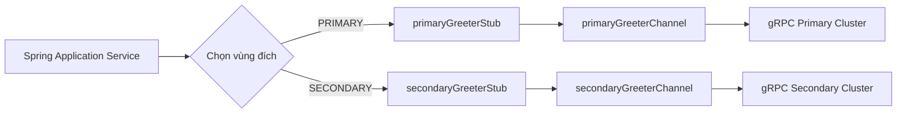

# Cấu hình nhiều channel đích

Một ứng dụng Spring có thể cần gọi nhiều dịch vụ gRPC: `Catalog` để tra cứu sản phẩm, `Payment` để xử lý thanh toán, hoặc cùng một dịch vụ được triển khai tại nhiều cụm/miền khác nhau. Mỗi đích có thể có hostname, cổng, TLS, deadline và chính sách kết nối riêng. Vì vậy, client phải **quản lý nhiều `ManagedChannel`** một cách rõ ràng, tiêm đúng stub đến đúng application service và đóng các channel khi ứng dụng kết thúc.

Bài này thuộc chương **Spring client** của mô-đun **SPRING_GRPC**, trong đó người học phát triển dịch vụ gRPC bằng hợp đồng Protocol Buffers, mã Java được sinh, unary/streaming RPC và các cơ chế metadata, deadline, status, interceptor, TLS, kiểm thử tích hợp và giám sát. Trọng tâm là **cấu hình nhiều channel đích trong ứng dụng Spring Boot**. Ví dụ dùng gRPC Java thuần với Spring bean để dễ thấy cơ chế. Với dự án có Spring gRPC starter, cần dùng factory/cấu hình tương ứng phiên bản đang triển khai để tránh tạo channel trùng lặp.

## 1. Phân biệt nhiều đích với nhiều kết nối

`ManagedChannel` là đại diện logic của một cấu hình giao tiếp gRPC: nó chịu trách nhiệm phân giải đích, quản lý transport HTTP/2, trạng thái kết nối và áp dụng chính sách client tương ứng. **Channel không nhất thiết tương ứng với một TCP socket duy nhất.** Một channel có thể quản lý kết nối tới nhiều địa chỉ do resolver hoặc load balancer trả về.

Hai tình huống dễ nhầm:

| Tình huống | Cách tiếp cận thường dùng | Lý do |
| --- | --- | --- |
| Một ứng dụng gọi **hai dịch vụ hoặc hai cụm có chính sách tách biệt** | Tạo hai named channel, mỗi channel có đích và cấu hình riêng. | Tách endpoint, TLS, xác thực và vòng đời theo nhu cầu. |
| Một **dịch vụ logic** gồm nhiều replica tương đương phía sau DNS hoặc service discovery | Thường dùng một channel tới target dịch vụ và cấu hình resolver/load balancing phù hợp. | gRPC chọn endpoint theo chính sách, ứng dụng không cần tự chia replica. |
| Hai application service cùng gọi **một đích** với cùng transport/config | Tái sử dụng một channel, có thể tạo nhiều generated stub từ nó. | Tránh thiết lập tài nguyên trùng lặp. |
| Hai môi trường hoặc tenant yêu cầu chứng chỉ hay thông tin định danh khác nhau | Dùng channel tách biệt khi cấu hình bảo mật thực sự khác nhau. | Bảo đảm ranh giới cấu hình và thông tin xác thực. |

Một ví dụ phân tuyến rõ ràng:



Sơ đồ trên mô tả **định tuyến tường minh** tới hai cụm. Nó không tự động cung cấp failover, load balancing hoặc retry. Nếu nghiệp vụ chỉ yêu cầu gọi một dịch vụ có nhiều replica, hãy ưu tiên xem xét một logical target với resolver và chính sách cân bằng tải trước khi tự viết bộ chọn kênh trong application service.

## 2. Hợp đồng Protocol Buffers dùng trong ví dụ

Để tập trung vào cách cấu hình nhiều channel, cả hai cụm trong bài triển khai cùng hợp đồng `Greeter`:

```protobuf
syntax = "proto3";

package greeting.v1;

option java_package = "com.example.contract.grpc";
option java_multiple_files = true;

service Greeter {
  rpc SayHello (HelloRequest) returns (HelloReply);
}

message HelloRequest {
  string name = 1;
}

message HelloReply {
  string message = 1;
}
```

Sau khi sinh Java bằng `protoc` và `protoc-gen-grpc-java`, client có `GreeterGrpc`, `HelloRequest` và `HelloReply` thuộc `com.example.contract.grpc`. Các ví dụ giả định mã sinh nằm trên classpath và ứng dụng có Spring Boot, `grpc-protobuf`, `grpc-stub` cùng transport gRPC Java như `grpc-netty-shaded` với những phiên bản tương thích.

Hai cụm cùng triển khai `Greeter/SayHello`, vì vậy cả hai stub có kiểu `GreeterGrpc.GreeterBlockingStub`. Chính trường hợp **nhiều bean có cùng kiểu** này cho thấy vì sao cần `@Qualifier` rõ ràng khi inject.

## 3. Khai báo nhiều target trong `application.yml`

Đặt cấu hình kết nối của mỗi đích dưới một khóa riêng. Ví dụ phát triển trên máy local, hai server lắng nghe hai cổng khác nhau:

```yaml
app:
  grpc:
    greeter:
      primary:
        target: localhost:9091
        plaintext: true
        timeout: 2s
      secondary:
        target: localhost:9092
        plaintext: true
        timeout: 3s
```

`target` là chuỗi đích chuyển cho `ManagedChannelBuilder.forTarget(...)`. Nó có thể là `host:port` hoặc một URI theo scheme được `NameResolver` hỗ trợ, chẳng hạn `dns:///greeter-primary.internal:9443`. `timeout` ở đây dành cho **deadline mỗi RPC** do application service áp dụng, không phải timeout thiết lập bean hay bảo đảm server đã sẵn sàng.

Trên môi trường triển khai dùng TLS, có thể ghi đè các giá trị theo profile hoặc biến môi trường:

```yaml
# application-prod.yml - ví dụ các target đã có TLS đúng tên máy chủ
app:
  grpc:
    greeter:
      primary:
        target: dns:///greeter-primary.internal:9443
        plaintext: false
        timeout: 2s
      secondary:
        target: dns:///greeter-secondary.internal:9443
        plaintext: false
        timeout: 3s
```

Không nên cố định IP khi chứng chỉ TLS được cấp theo DNS hostname. Nếu hệ thống dùng CA riêng, cần cấu hình trust material thích hợp của transport; đặt `plaintext: false` không tự động khiến client tin cậy chứng chỉ do CA nội bộ cấp.

### Bind cấu hình sang kiểu dữ liệu rõ ràng

Với Spring Boot 3, record kết hợp `@ConfigurationProperties` cung cấp kiểu cấu hình dễ đọc, tránh rải `@Value` qua nhiều bean:

```java
package com.example.client;

import java.time.Duration;
import org.springframework.boot.context.properties.ConfigurationProperties;

@ConfigurationProperties(prefix = "app.grpc.greeter")
public record GreeterTargets(Endpoint primary, Endpoint secondary) {

    public record Endpoint(String target, boolean plaintext, Duration timeout) {
    }
}
```

Spring ánh xạ `2s` thành `Duration.ofSeconds(2)`. Ở dự án thật, cần kiểm tra `primary`/`secondary` không null, `target` không rỗng, deadline dương và độ dài timeout hợp lệ. Ví dụ ở phần tiếp theo có kiểm tra đầu vào cơ bản khi tạo bean. Nếu thêm/đổi target thường xuyên, có thể chuyển từ hai field sang `Map<String, Endpoint>` trong configuration properties; khi đó vẫn phải xác định tên bean/qualifier và cách quản lý vòng đời rõ ràng.

## 4. Tạo hai `ManagedChannel` thành các Spring bean có tên

Định nghĩa `@Configuration` tạo hai channel từ hai cấu hình, rồi tạo hai stub tương ứng:

```java
package com.example.client;

import com.example.contract.grpc.GreeterGrpc;
import io.grpc.ManagedChannel;
import io.grpc.ManagedChannelBuilder;
import org.springframework.beans.factory.annotation.Qualifier;
import org.springframework.boot.context.properties.EnableConfigurationProperties;
import org.springframework.context.annotation.Bean;
import org.springframework.context.annotation.Configuration;

@Configuration(proxyBeanMethods = false)
@EnableConfigurationProperties(GreeterTargets.class)
public class GreeterMultiChannelConfiguration {

    @Bean(name = "primaryGreeterChannel", destroyMethod = "shutdown")
    ManagedChannel primaryGreeterChannel(GreeterTargets targets) {
        return createChannel(targets.primary());
    }

    @Bean(name = "secondaryGreeterChannel", destroyMethod = "shutdown")
    ManagedChannel secondaryGreeterChannel(GreeterTargets targets) {
        return createChannel(targets.secondary());
    }

    @Bean("primaryGreeterStub")
    GreeterGrpc.GreeterBlockingStub primaryGreeterStub(
            @Qualifier("primaryGreeterChannel") ManagedChannel channel) {
        return GreeterGrpc.newBlockingStub(channel);
    }

    @Bean("secondaryGreeterStub")
    GreeterGrpc.GreeterBlockingStub secondaryGreeterStub(
            @Qualifier("secondaryGreeterChannel") ManagedChannel channel) {
        return GreeterGrpc.newBlockingStub(channel);
    }

    private ManagedChannel createChannel(GreeterTargets.Endpoint endpoint) {
        if (endpoint == null || endpoint.target() == null
                || endpoint.target().isBlank()) {
            throw new IllegalArgumentException("gRPC target phải có giá trị");
        }
        if (endpoint.timeout() == null
                || endpoint.timeout().toMillis() <= 0) {
            throw new IllegalArgumentException(
                    "gRPC timeout phải từ 1 ms trở lên");
        }

        ManagedChannelBuilder<?> builder =
                ManagedChannelBuilder.forTarget(endpoint.target());

        if (endpoint.plaintext()) {
            builder.usePlaintext();
        } else {
            builder.useTransportSecurity();
        }

        return builder.build();
    }
}
```

Đây là cấu hình thủ công bằng gRPC Java. Điểm mấu chốt:

1. `primaryGreeterChannel` và `secondaryGreeterChannel` là **hai bean có tên khác nhau**, mặc dù cùng kiểu `ManagedChannel`.
2. Mỗi `GreeterBlockingStub` nhận chính xác một channel qua `@Qualifier`, tránh lỗi `NoUniqueBeanDefinitionException`.
3. `destroyMethod = "shutdown"` giúp Spring yêu cầu đóng từng channel khi hủy bean. Hai channel có tài nguyên và trạng thái kết nối độc lập.
4. `createChannel(...)` dùng lại logic tạo transport mà không tạo một channel cho mỗi lời gọi.
5. Các stub đều có thể dùng lại giữa nhiều luồng; chính sách gắn theo từng RPC như deadline, metadata nên tạo trên bản stub mới lúc gọi.

Chú ý lỗi thường gặp khi dùng `@Configuration(proxyBeanMethods = false)`: **không gọi trực tiếp `primaryGreeterChannel(targets)` từ phương thức tạo stub**. Cách gọi phương thức Java đó có thể tạo một channel khác ngoài bean đã đăng ký. Hãy nhận channel qua tham số `@Bean` như ví dụ để Spring resolve đúng bean và quản lý vòng đời duy nhất.

## 5. Inject đúng stub vào application service

Vì cả hai stub có cùng kiểu, một constructor chỉ khai báo `GreeterBlockingStub stub` sẽ mơ hồ. Dùng `@Qualifier` để thể hiện lựa chọn nghiệp vụ:

```java
package com.example.application;

import com.example.client.GreeterTargets;
import com.example.contract.grpc.GreeterGrpc;
import com.example.contract.grpc.HelloRequest;
import java.time.Duration;
import java.util.Objects;
import java.util.concurrent.TimeUnit;
import org.springframework.beans.factory.annotation.Qualifier;
import org.springframework.stereotype.Service;

@Service
public class GreetingRouter {

    public enum Destination { PRIMARY, SECONDARY }

    private final GreeterGrpc.GreeterBlockingStub primary;
    private final GreeterGrpc.GreeterBlockingStub secondary;
    private final GreeterTargets targets;

    public GreetingRouter(
            @Qualifier("primaryGreeterStub")
            GreeterGrpc.GreeterBlockingStub primary,
            @Qualifier("secondaryGreeterStub")
            GreeterGrpc.GreeterBlockingStub secondary,
            GreeterTargets targets) {
        this.primary = primary;
        this.secondary = secondary;
        this.targets = targets;
    }

    public String greet(Destination destination, String rawName) {
        Objects.requireNonNull(destination, "destination");
        if (rawName == null || rawName.isBlank()) {
            throw new IllegalArgumentException("Tên không được rỗng");
        }

        GreeterGrpc.GreeterBlockingStub chosen =
                destination == Destination.PRIMARY ? primary : secondary;
        Duration timeout = destination == Destination.PRIMARY
                ? targets.primary().timeout()
                : targets.secondary().timeout();

        HelloRequest request = HelloRequest.newBuilder()
                .setName(rawName.trim())
                .build();

        return chosen
                .withDeadlineAfter(timeout.toMillis(), TimeUnit.MILLISECONDS)
                .sayHello(request)
                .getMessage();
    }
}
```

`GreetingRouter` nhận hai generated stub như dependency và giữ ở các field `final`. Lựa chọn channel thông qua stub diễn ra theo biến `Destination`, còn timeout được chọn theo đích. Việc gọi `withDeadlineAfter(...)` tạo một stub tạm cho **lần RPC hiện tại**, không sửa bean singleton.

Một Spring MVC controller có thể truyền tham số định tuyến vào service:

```java
package com.example.api;

import com.example.application.GreetingRouter;
import com.example.application.GreetingRouter.Destination;
import org.springframework.web.bind.annotation.GetMapping;
import org.springframework.web.bind.annotation.RequestMapping;
import org.springframework.web.bind.annotation.RequestParam;
import org.springframework.web.bind.annotation.RestController;

@RestController
@RequestMapping("/greetings")
public class GreetingController {

    private final GreetingRouter router;

    public GreetingController(GreetingRouter router) {
        this.router = router;
    }

    @GetMapping
    public String greet(
            @RequestParam Destination destination,
            @RequestParam String name) {
        return router.greet(destination, name);
    }
}
```

Ví dụ `GET /greetings?destination=PRIMARY&name=Lan` đi qua channel primary, còn `destination=SECONDARY` đi qua secondary. Trong hệ thống thật, **không nên cho client bên ngoài tùy ý chọn endpoint nhạy cảm** nếu chính sách định tuyến thuộc về server; thay vào đó, application service xác định đích từ dữ liệu nghiệp vụ, tenant được phép hoặc cấu hình quản trị.

### Nhiều dịch vụ gRPC khác kiểu

Nếu ứng dụng có `CatalogGrpc.CatalogBlockingStub` và `PaymentGrpc.PaymentBlockingStub`, hai stub đã khác kiểu nên constructor injection thường không cần qualifier **cho stub**, miễn mỗi kiểu chỉ có một bean. Tuy nhiên, những channel cùng kiểu `ManagedChannel` vẫn cần qualifier khi tạo stub. Không nên dùng một channel của Catalog để tạo Payment stub chỉ vì cùng kiểu `Channel`: target và chính sách kết nối phải phù hợp với dịch vụ đích.

## 6. Nhiều đích, failover và load balancing

### Định tuyến tường minh không phải load balancing

Trong ví dụ `GreetingRouter`, một request chọn `PRIMARY` thì gọi một lần đến primary; một request chọn `SECONDARY` thì gọi một lần đến secondary. Hệ thống **không tự chuyển** từ primary sang secondary khi primary trả `UNAVAILABLE`.

Nếu business yêu cầu failover, cần nêu rõ các điều kiện:

- **Đích thứ cấp có tương đương ngữ nghĩa không?** Hai vùng có cùng dữ liệu và bảo đảm nhất quán không?
- **Có được retry cùng RPC không?** Chỉ retry khi biết thao tác idempotent hoặc có idempotency key phía server.
- **Ngân sách thời gian tổng là bao nhiêu?** Deadline không nên được khởi tạo lại vô hạn qua nhiều lần thử.
- **Có bảo vệ tải khi lỗi lan rộng không?** Cần kiểm soát backoff, số lần thử, circuit breaking hoặc rate limit khi phù hợp.

Với ví dụ `SayHello`, retry có thể ít rủi ro vì chỉ đọc; nhưng một RPC thanh toán hoặc tạo đơn hàng có thể đã thành công ở server dù client nhận `UNAVAILABLE`. Tự động gọi lại sang cluster khác có thể tạo tác dụng phụ trùng lặp nếu không có khóa chống trùng và quy tắc đồng bộ dữ liệu.

### Một logical target với nhiều replica

Với DNS hoặc service discovery, một logical target có thể cung cấp nhiều địa chỉ. Ví dụ:

```java
ManagedChannel channel = ManagedChannelBuilder
        .forTarget("dns:///greeter.internal:9443")
        .useTransportSecurity()
        .defaultLoadBalancingPolicy("round_robin")
        .build();
```

Đoạn này minh họa cách chọn chính sách `round_robin` khi resolver hỗ trợ trả danh sách endpoint và transport/các dependency có chính sách tương ứng. `defaultLoadBalancingPolicy(...)` đặt **chính sách mặc định**; service config do resolver cung cấp có thể ảnh hưởng chính sách thực tế. Mặc định gRPC có thể dùng `pick_first`, nên **DNS trả nhiều IP không mặc nhiên chứng minh lưu lượng được chia đều**. Với gateway hoặc Kubernetes Service, còn phải hiểu nơi quyết định cân bằng tải: client, proxy hay hạ tầng mạng.

Nếu một request cần gọi đúng cụm primary hay secondary vì phân vùng dữ liệu, lựa chọn nhiều named channel như bài này phù hợp hơn một target chung và random load balancing.

## 7. TLS, interceptor và metadata theo từng đích

Mỗi channel có thể có **cấu hình transport riêng**, chẳng hạn primary dùng TLS tới hostname A và secondary dùng TLS tới hostname B. Các điểm cần kiểm tra:

| Khía cạnh | Câu hỏi khi có nhiều channel |
| --- | --- |
| TLS / chứng chỉ | Hostname của mỗi target có khớp SAN chứng chỉ? Root CA tin cậy có đúng cho từng cluster? |
| Mutual TLS | Channel nào cần chứng chỉ client và private key riêng? Cơ chế xoay vòng chứng chỉ là gì? |
| Authentication | Metadata/token cấp cho dịch vụ nào? Có được gửi cùng credential sang cụm khác không? |
| Interceptor | Logging, tracing, metrics hay retry interceptor được gắn cho cả hai channel hay theo từng đích? |
| Deadline | Ngân sách RPC cho primary và secondary có khác nhau vì khoảng cách mạng hoặc nghiệp vụ? |

`ManagedChannelBuilder.useTransportSecurity()` sử dụng TLS với cấu hình tin cậy mặc định của transport. Nếu cần CA nội bộ hoặc mTLS, cần sử dụng API TLS của transport (ví dụ Netty `SslContext`) và cấp đúng material cho từng channel; không sửa trust manager toàn cục để bỏ xác minh chứng chỉ.

**Metadata có phạm vi từng RPC.** Ví dụ gửi request ID vào primary:

```java
import io.grpc.Metadata;
import io.grpc.stub.MetadataUtils;

Metadata.Key<String> requestIdKey = Metadata.Key.of(
        "x-request-id", Metadata.ASCII_STRING_MARSHALLER);
Metadata headers = new Metadata();
headers.put(requestIdKey, requestId);

var callStub = primary
        .withInterceptors(MetadataUtils.newAttachHeadersInterceptor(headers))
        .withDeadlineAfter(2, TimeUnit.SECONDS);

var reply = callStub.sayHello(request);
```

Đây là đoạn đặt **bên trong phương thức gọi** sau khi đã nhận `requestId` và tạo `request`; `primary` là stub được inject. Với request khác, tạo metadata và bản stub cấu hình mới. Không giữ một đối tượng `Metadata` mutable chứa `Authorization` hoặc request ID trong singleton application service rồi thay giá trị theo từng người dùng; làm vậy có thể làm lẫn dữ liệu giữa các RPC đồng thời.

Nếu mỗi target dùng credential khác nhau, nên cấu hình `CallCredentials` theo lời gọi hoặc interceptor được thiết kế cho target cụ thể. Không vô tình tái dùng token dành cho Payment trên channel Catalog, hoặc chuyển token của vùng primary sang secondary nếu chính sách không cho phép.

## 8. Trạng thái, lỗi và vòng đời từng channel

Các channel hoạt động độc lập. Một lỗi từ primary không chứng minh secondary bị lỗi và ngược lại. Trong application service, với blocking stub, lỗi thường biểu hiện qua `StatusRuntimeException`:

```java
import io.grpc.Status;
import io.grpc.StatusRuntimeException;

try {
    String message = router.greet(GreetingRouter.Destination.PRIMARY, "Lan");
    return message;
} catch (StatusRuntimeException ex) {
    Status.Code code = ex.getStatus().getCode();
    // Ghi nhận target=primary, gRPC status và correlation ID.
    // Chỉ chuyển sang secondary nếu chính sách nghiệp vụ cho phép.
    throw ex;
}
```

Mã trên là một **đoạn minh họa bên trong phương thức trả `String`**, với biến `router` có sẵn. Khi phân tích lỗi, cần phân biệt:

| Tín hiệu | Ý nghĩa có thể xảy ra | Hướng kiểm tra |
| --- | --- | --- |
| `UNAVAILABLE` riêng primary | Server primary, DNS, mạng, proxy hoặc TLS của primary gặp sự cố. | Kiểm tra target, cổng, TLS handshake, resolver và log theo target. |
| `DEADLINE_EXCEEDED` | Lời gọi quá deadline do mạng, server hoặc ngân sách quá ngắn. | So sánh thời gian server xử lý và deadline của đích tương ứng. |
| `UNAUTHENTICATED` / `PERMISSION_DENIED` | Sai credential hoặc không đủ quyền trên một target. | Kiểm tra quyền và token cấp cho đúng dịch vụ, tránh log bí mật. |
| `UNIMPLEMENTED` | Đích nhận RPC không có phương thức/hợp đồng tương ứng. | Đối chiếu `.proto`, version và tuyến tới đúng server. |
| `INVALID_ARGUMENT` | Request bị server từ chối về mặt dữ liệu. | Kiểm tra validation; thường không khắc phục bằng chuyển channel. |

**Kết nối có thể được tạo khi gọi RPC đầu tiên**, không nhất thiết khi Spring khởi tạo bean. Do đó `ApplicationContext` startup thành công không đảm bảo primary/secondary đang reachable. Health check cần dựa trên hành vi được server hỗ trợ, ví dụ gRPC Health Checking Protocol hoặc một RPC an toàn được dành riêng cho kiểm tra, với tần suất và deadline hợp lý.

`destroyMethod = "shutdown"` ở mỗi channel yêu cầu giải phóng tài nguyên khi Spring context đóng. Nó **không tự đợi** cho mọi RPC hoàn thành. Trong hệ thống có streaming lâu dài, cần có quy trình graceful shutdown: dừng nhận công việc mới, cho RPC đang chạy thời gian kết thúc, gọi `shutdown()`, chờ bằng `awaitTermination(timeout, unit)` rồi cân nhắc `shutdownNow()` khi hết hạn. Không gọi `shutdown()` mỗi khi service trả response; ứng dụng sẽ làm mất khả năng tái sử dụng channel và gây lỗi cho các RPC tiếp theo.

## 9. Kiểm thử hai channel và xác minh định tuyến

Trước tiên cần phân biệt **test logic routing** và **test cấu hình kết nối thật**. Test routing có thể dùng hai server in-process để bảo đảm lời gọi `PRIMARY` tới đúng server A, `SECONDARY` tới server B mà không chiếm cổng TCP.

Ví dụ JUnit 5 dùng phụ thuộc `grpc-inprocess` trong test scope:

```java
package com.example.application;

import static org.junit.jupiter.api.Assertions.assertEquals;

import com.example.client.GreeterTargets;
import com.example.contract.grpc.GreeterGrpc;
import com.example.contract.grpc.HelloReply;
import com.example.contract.grpc.HelloRequest;
import io.grpc.ManagedChannel;
import io.grpc.Server;
import io.grpc.inprocess.InProcessChannelBuilder;
import io.grpc.inprocess.InProcessServerBuilder;
import io.grpc.stub.StreamObserver;
import java.time.Duration;
import org.junit.jupiter.api.Test;

class GreetingRouterTest {

    private static Server buildServer(String name, String prefix) {
        return InProcessServerBuilder.forName(name)
                .directExecutor()
                .addService(new GreeterGrpc.GreeterImplBase() {
                    @Override
                    public void sayHello(
                            HelloRequest request,
                            StreamObserver<HelloReply> observer) {
                        observer.onNext(HelloReply.newBuilder()
                                .setMessage(prefix + request.getName())
                                .build());
                        observer.onCompleted();
                    }
                })
                .build();
    }

    @Test
    void selectsTheExpectedChannel() throws Exception {
        String primaryName = InProcessServerBuilder.generateName();
        String secondaryName = InProcessServerBuilder.generateName();
        Server primaryServer = buildServer(primaryName, "P:").start();
        Server secondaryServer = null;
        ManagedChannel primaryChannel = null;
        ManagedChannel secondaryChannel = null;

        try {
            secondaryServer = buildServer(secondaryName, "S:").start();
            primaryChannel = InProcessChannelBuilder.forName(primaryName)
                    .directExecutor().build();
            secondaryChannel = InProcessChannelBuilder.forName(secondaryName)
                    .directExecutor().build();

            GreeterTargets settings = new GreeterTargets(
                    new GreeterTargets.Endpoint("primary-test", true,
                            Duration.ofSeconds(2)),
                    new GreeterTargets.Endpoint("secondary-test", true,
                            Duration.ofSeconds(2)));

            GreetingRouter router = new GreetingRouter(
                    GreeterGrpc.newBlockingStub(primaryChannel),
                    GreeterGrpc.newBlockingStub(secondaryChannel),
                    settings);

            assertEquals("P:Lan",
                    router.greet(GreetingRouter.Destination.PRIMARY, "Lan"));
            assertEquals("S:Lan",
                    router.greet(GreetingRouter.Destination.SECONDARY, "Lan"));
        } finally {
            if (primaryChannel != null) primaryChannel.shutdownNow();
            if (secondaryChannel != null) secondaryChannel.shutdownNow();
            primaryServer.shutdownNow();
            if (secondaryServer != null) secondaryServer.shutdownNow();
        }
    }
}
```

`primary-test`/`secondary-test` trong `GreeterTargets` là **tên mô phỏng** chỉ dùng để cung cấp timeout cho `GreetingRouter`; kết nối test thực được tạo bằng `InProcessChannelBuilder`. Bài test xác minh routing và việc tái sử dụng generated stub, nhưng **không kiểm tra** Spring đã bind chính xác YAML hay tạo đúng bean channel.

Để kiểm tra cấu hình Spring, bổ sung test chạy application context với profile test và xác nhận có đúng bean `primaryGreeterChannel`, `secondaryGreeterChannel`, `primaryGreeterStub`, `secondaryGreeterStub`. Sau đó dùng integration test với hai server qua TCP/TLS để xác minh resolver, hostname, chứng chỉ và lỗi network. Việc đặt `@Qualifier` sai tên thường được phát hiện khi Spring tạo context; nếu cả hai stub bị gắn nhầm channel mà vẫn có bean hợp lệ, test gọi tới hai server trả response khác nhau như trên sẽ cho thấy sai lệch.

## 10. Quan sát và vận hành nhiều channel

Khi có nhiều đích, đo đạc theo từng target có ích hơn việc chỉ cộng tổng số RPC của ứng dụng. Ít nhất nên quan sát **số lần gọi, latency, gRPC status, deadline exceeded, retry và tình trạng kết nối** cho mỗi dịch vụ/cụm. Dùng client interceptor, tích hợp Micrometer hoặc OpenTelemetry tùy nền tảng Spring và gRPC của dự án.

Trong metric/log nên sử dụng tên target ổn định như `primary` và `secondary`. Tránh dùng trực tiếp thông tin có cardinality cao như request ID, user ID hay hostname được sinh động làm nhãn metric. Request ID có thể đặt ở tracing hoặc structured log, nhưng không log `Authorization`/private key.

Một số lỗi triển khai phổ biến:

| Triệu chứng | Nguyên nhân có thể | Cách xử lý |
| --- | --- | --- |
| `NoUniqueBeanDefinitionException` khi inject `ManagedChannel` | Có nhiều bean cùng kiểu. | Sử dụng `@Qualifier` cho các tham số `@Bean` hoặc constructor tương ứng. |
| Hai stub gọi cùng một cluster dù YAML khai báo khác nhau | Nối nhầm qualifier hoặc tái sử dụng channel sai. | Test hai server trả prefix khác nhau; kiểm tra wiring. |
| Mất kết nối chỉ ở secondary | DNS, port, cert, ingress hoặc firewall của secondary khác primary. | Chẩn đoán riêng từng target, không suy kết quả từ primary. |
| Một request làm thay đổi metadata của request khác | Lưu metadata mutable vào singleton bean. | Tạo metadata và stub tùy biến theo từng RPC. |
| Tạo nhiều channel trong `@Bean` vì gọi trực tiếp phương thức factory | Tạo instance ngoài Spring-managed dependency. | Tiêm bean qua tham số với qualifier chính xác. |
| Retry liên tục khi mất primary | Không giới hạn số lần thử hoặc thiếu deadline tổng. | Thiết kế failover/retry theo idempotence, backoff và ngân sách thời gian. |
| Channel không đóng khi shutdown | Tài nguyên không được container quản lý hoặc thiếu lifecycle. | Đăng ký bean và cơ chế shutdown có thời hạn. |
| Chỉ số metric không phân biệt cụm | Thiếu nhãn target logic. | Gắn tên cụm ổn định vào metrics/traces. |

## 11. Bài tập thực hành

1. Chạy hai gRPC server `Greeter` trên `localhost:9091` và `localhost:9092`, trả về prefix khác nhau cho `SayHello`. Đăng ký hai channel và hai stub trong Spring.
2. Thử bỏ `@Qualifier` ở tham số `ManagedChannel` của `secondaryGreeterStub`, quan sát lỗi Spring khi có hai bean cùng kiểu, rồi sửa lại.
3. Viết một REST endpoint chọn `PRIMARY` hoặc `SECONDARY` theo cấu hình nghiệp vụ; kiểm tra đúng response của từng cụm và deadline khác nhau.
4. Giả lập primary mất kết nối. Ghi nhận `UNAVAILABLE`, độ trễ, retry count. Chỉ bổ sung failover nếu hợp đồng RPC và dữ liệu cho phép; lý giải tại sao thao tác không idempotent nguy hiểm khi retry.
5. Chuyển cả hai đích sang TLS trên môi trường thử nghiệm; xác minh mỗi channel tin cậy đúng CA và hostname. Thêm metadata `x-request-id` theo từng lời gọi mà không chia sẻ đối tượng mutable.
6. Viết test in-process cho routing, test Spring context để kiểm tra qualifier và integration test qua TCP/TLS. Đảm bảo shutdown cả hai channel khi kết thúc ứng dụng.

Sau bài học, bạn cần phân biệt được **nhiều named channel** với **một channel dùng nhiều replica**, mô tả cách khai báo cấu hình target riêng trong Spring Boot, tiêm đúng generated stub bằng `@Qualifier`, áp dụng deadline/metadata theo RPC, và kiểm soát TLS, lỗi, kiểm thử và vòng đời ở từng đích. Đây là nền tảng để ứng dụng Spring kết nối nhiều dịch vụ gRPC một cách có chủ đích, an toàn và dễ quan sát.
