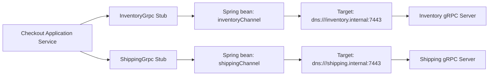

# Channel theo tên hoặc theo target

Trong ứng dụng Spring dùng gRPC, một client cần biết **đang gọi dịch vụ nào** và **dịch vụ đó ở đâu**. Hai khái niệm thường xuất hiện cùng nhau nhưng có vai trò khác nhau:

- **Tên channel** là tên logic do ứng dụng hoặc cơ chế cấu hình Spring quản lý, ví dụ `inventory` hoặc `shipping`. Mã nghiệp vụ dùng tên ổn định để chọn đúng client.
- **Target gRPC** là chuỗi địa chỉ mà `ManagedChannelBuilder` chuyển cho cơ chế phân giải tên (*name resolver*), ví dụ `dns:///inventory.internal:7443` hoặc `localhost:9091`.

Bài thuộc chương **Spring client** của mô-đun **SPRING_GRPC**. Người học đã làm việc với hợp đồng Protocol Buffers, mã Java sinh ra và các kiểu RPC; ở đây ta tập trung vào cách trỏ Spring client tới dịch vụ đích. Cách đặt tên và target có ảnh hưởng đến việc inject stub, cấu hình TLS, metadata, deadline, xử lý status, kiểm thử tích hợp và khả năng quan sát hệ thống.

## 1. Tên logic và target không phải cùng một thứ

Hình dung một ứng dụng Spring gọi dịch vụ tồn kho và giao hàng:



Các tên `inventoryChannel` và `shippingChannel` thuộc về **Spring bean registry**. Ngược lại, `dns:///inventory.internal:7443` được **gRPC Java** dùng để tìm endpoint. Spring có thể đổi target theo profile phát triển, kiểm thử, production mà mã inject bean `inventoryChannel` vẫn giữ nguyên.

| Thuộc tính | Channel theo tên | Channel theo target |
| --- | --- | --- |
| Giá trị điển hình | `inventory`, `shipping`, `primary` | `localhost:9091`, `dns:///inventory.internal:7443` |
| Ai diễn giải? | Container Spring, cấu hình hoặc channel factory do ứng dụng/starter cung cấp. | `NameResolver` và transport gRPC Java. |
| Mục đích | Định danh dependency/cấu hình trong ứng dụng. | Tìm đúng đích mạng hoặc dịch vụ logic cần gọi. |
| Mức ổn định | Thường cố định theo vai trò nghiệp vụ. | Có thể khác nhau giữa local, test, staging và production. |
| Có tự tạo kết nối không? | Không. Tên chỉ có ý nghĩa nếu được ánh xạ tới channel thực. | `forTarget(...)` tạo cấu hình channel; kết nối có thể thiết lập khi có RPC đầu tiên. |
| Ví dụ khi thay môi trường | Vẫn dùng tên `inventory`. | Đổi từ `dns:///localhost:9091` sang `dns:///inventory.internal:7443`. |

**Điểm dễ nhầm:** `ManagedChannelBuilder.forTarget("inventory")` không có nghĩa là gRPC tra bean Spring tên `inventory`. Chuỗi `inventory` lúc này được gRPC xem như một target cần phân giải theo resolver mặc định; nó không tự tra cấu hình `app.grpc.channels.inventory` hay `@Bean("inventory")`. Nếu muốn dùng tên ứng dụng, phải có lớp cấu hình hoặc factory ánh xạ tên đó tới một target cụ thể.

## 2. Hai cách tạo channel cơ bản trong gRPC Java

`ManagedChannelBuilder` có hai API thường gặp:

```java
import io.grpc.ManagedChannel;
import io.grpc.ManagedChannelBuilder;

// Cách A: truyền host và port tách biệt.
ManagedChannel local = ManagedChannelBuilder
        .forAddress("localhost", 9091)
        .usePlaintext()
        .build();

// Cách B: truyền target có scheme phân giải rõ ràng.
ManagedChannel remote = ManagedChannelBuilder
        .forTarget("dns:///inventory.internal:7443")
        .useTransportSecurity()
        .build();
```

Đây là hai biến channel minh họa; nếu chạy đoạn mã ở ngoài Spring, bên sở hữu phải đóng chúng bằng `shutdown()` và chờ hoàn tất có giới hạn khi cần. Trong ứng dụng Spring chạy lâu dài, nên đặt channel dưới sự quản lý của container và **tái sử dụng** giữa nhiều RPC.

`forAddress(host, port)` thuận tiện khi đã có host và port riêng. `forTarget(target)` phù hợp khi địa chỉ được cung cấp dưới dạng một chuỗi cấu hình và có thể dùng scheme như `dns:///`. Cả hai cuối cùng đều tạo `ManagedChannel`; **stub có thể được tạo bằng `GreeterGrpc.newBlockingStub(channel)` hoặc kiểu stub khác** bất kể channel được xây dựng theo cách nào.

### Hiểu chuỗi target `dns:///host:port`

Trong `dns:///inventory.internal:7443`:

- `dns` là scheme chọn bộ phân giải DNS của gRPC.
- `///` thể hiện URI với phần authority trống và phần path bắt đầu bằng `/`.
- `inventory.internal:7443` là tên dịch vụ và cổng mà resolver sẽ xử lý.

Resolver trả về địa chỉ endpoint; gRPC sau đó chọn kết nối dựa trên cấu hình balancer/transport. Một DNS record có nhiều IP **không tự chứng minh client đang chia đều RPC**: chính sách `pick_first`, `round_robin`, service config và resolver mới quyết định hành vi thực tế. Khi gRPC nằm sau ingress hoặc proxy, cũng cần biết cân bằng tải diễn ra ở client hay tại hạ tầng.

Không hard-code IP cho một dịch vụ sử dụng TLS nếu chứng chỉ chỉ hợp lệ với DNS hostname. Target và tên xác minh chứng chỉ phải phù hợp; dùng `usePlaintext()` chỉ cho môi trường được phép truyền dữ liệu không mã hóa.

## 3. Hợp đồng Protocol Buffers trong ví dụ Spring

Giả sử client gọi hai dịch vụ gRPC riêng biệt để chuẩn bị thông tin đơn hàng:

```protobuf
syntax = "proto3";

package checkout.v1;

option java_package = "com.example.contract.grpc";
option java_multiple_files = true;

service Inventory {
  rpc GetStock (StockRequest) returns (StockReply);
}

service Shipping {
  rpc EstimateDelivery (DeliveryRequest) returns (DeliveryReply);
}

message StockRequest {
  string sku = 1;
}

message StockReply {
  int32 available_units = 1;
}

message DeliveryRequest {
  string postal_code = 1;
}

message DeliveryReply {
  int32 estimated_days = 1;
}
```

Sau khi dùng `protoc` cùng plugin `protoc-gen-grpc-java`, Java client có `InventoryGrpc`, `ShippingGrpc` và các message `StockRequest`, `StockReply`, `DeliveryRequest`, `DeliveryReply`. Ví dụ tiếp theo giả định mã sinh có mặt trên classpath, ứng dụng có Spring Boot, `grpc-stub`, `grpc-protobuf` và một transport như `grpc-netty-shaded` với phiên bản tương thích.

Hai generated stub khác kiểu, nhưng cả hai cần được tạo từ **đúng channel đã cấu hình cho dịch vụ của mình**. Spring không thể suy ra target của `InventoryGrpc` chỉ từ tên lớp được sinh.

## 4. Đặt tên channel ổn định và tách target ra cấu hình

Đầu tiên, định nghĩa hai tên logic trong `application.yml`:

```yaml
app:
  grpc:
    outbound:
      inventory:
        target: dns:///localhost:9091
        plaintext: true
        deadline: 2s
      shipping:
        target: dns:///localhost:9092
        plaintext: true
        deadline: 3s
```

`inventory` và `shipping` là **khóa logic do ứng dụng chọn**, không phải tên được đăng ký với DNS. Hai target địa chỉ local dùng trong ví dụ development. Trong production, cần đổi target đến hostname/cổng thật và bật TLS:

```yaml
# application-prod.yml - ví dụ khi server và chứng chỉ TLS đã sẵn sàng
app:
  grpc:
    outbound:
      inventory:
        target: dns:///inventory.internal:7443
        plaintext: false
        deadline: 2s
      shipping:
        target: dns:///shipping.internal:7443
        plaintext: false
        deadline: 3s
```

**Deadline là giới hạn cho một RPC**, không phải giới hạn tạo channel. Nó nằm cùng cấu hình đích để service dễ chọn ngân sách thời gian thích hợp. Không đồng nhất deadline với thời gian `connect timeout` hoặc vòng đời `ManagedChannel`.

Khai báo cấu hình kiểu mạnh cho Spring Boot:

```java
package com.example.client;

import java.time.Duration;
import java.util.Map;
import org.springframework.boot.context.properties.ConfigurationProperties;

@ConfigurationProperties(prefix = "app.grpc")
public record GrpcClientProperties(Map<String, Endpoint> outbound) {

    public Endpoint require(String name) {
        Endpoint endpoint = outbound == null ? null : outbound.get(name);
        if (endpoint == null || endpoint.target() == null
                || endpoint.target().isBlank()) {
            throw new IllegalArgumentException(
                    "Thiếu gRPC target cho channel: " + name);
        }
        if (endpoint.deadline() == null
                || endpoint.deadline().toMillis() <= 0) {
            throw new IllegalArgumentException(
                    "Deadline phải từ 1 ms trở lên: " + name);
        }
        return endpoint;
    }

    public record Endpoint(String target, boolean plaintext, Duration deadline) {
    }
}
```

Spring Boot bind các trường dưới `app.grpc.outbound` thành `Map<String, Endpoint>`; ví dụ `2s` được chuyển thành `Duration.ofSeconds(2)`. `require(name)` kiểm tra tên tồn tại và các giá trị tối thiểu cần có, giúp ứng dụng báo lỗi cấu hình khi tạo bean. Trong hệ thống thật, nên bổ sung validation cho target, scheme hỗ trợ, TLS policy và giới hạn thời gian tối đa.

### Tạo bean channel từ tên logic

```java
package com.example.client;

import com.example.contract.grpc.InventoryGrpc;
import com.example.contract.grpc.ShippingGrpc;
import io.grpc.ManagedChannel;
import io.grpc.ManagedChannelBuilder;
import org.springframework.beans.factory.annotation.Qualifier;
import org.springframework.boot.context.properties.EnableConfigurationProperties;
import org.springframework.context.annotation.Bean;
import org.springframework.context.annotation.Configuration;

@Configuration(proxyBeanMethods = false)
@EnableConfigurationProperties(GrpcClientProperties.class)
public class OutboundGrpcConfiguration {

    @Bean(name = "inventoryChannel", destroyMethod = "shutdown")
    ManagedChannel inventoryChannel(GrpcClientProperties properties) {
        return build(properties.require("inventory"));
    }

    @Bean(name = "shippingChannel", destroyMethod = "shutdown")
    ManagedChannel shippingChannel(GrpcClientProperties properties) {
        return build(properties.require("shipping"));
    }

    @Bean
    InventoryGrpc.InventoryBlockingStub inventoryStub(
            @Qualifier("inventoryChannel") ManagedChannel channel) {
        return InventoryGrpc.newBlockingStub(channel);
    }

    @Bean
    ShippingGrpc.ShippingBlockingStub shippingStub(
            @Qualifier("shippingChannel") ManagedChannel channel) {
        return ShippingGrpc.newBlockingStub(channel);
    }

    private ManagedChannel build(GrpcClientProperties.Endpoint options) {
        ManagedChannelBuilder<?> builder =
                ManagedChannelBuilder.forTarget(options.target());

        if (options.plaintext()) {
            builder.usePlaintext();
        } else {
            builder.useTransportSecurity();
        }
        return builder.build();
    }
}
```

Ở đây, Spring nhận **tên bean** `inventoryChannel` và `shippingChannel`, còn gRPC nhận **target** từ `options.target()`. Nếu môi trường đổi địa chỉ Inventory, chỉ thay cấu hình `app.grpc.outbound.inventory.target`; application service vẫn inject đúng bean/stub cũ.

`@Qualifier` cần thiết tại phương thức tạo stub vì Spring đang có **hai bean cùng kiểu `ManagedChannel`**. Hai stub được sinh từ hai service khác nhau (`InventoryBlockingStub` và `ShippingBlockingStub`) nên có thể inject theo kiểu riêng trong application service. Nếu có nhiều bean cùng kiểu stub, cũng phải dùng qualifier tương ứng.

`destroyMethod = "shutdown"` giúp Spring gọi `shutdown()` khi dừng ứng dụng. Phương thức này yêu cầu đóng channel một cách trật tự nhưng không tự đợi các RPC hoàn tất; nếu cần xử lý stream dài và graceful shutdown, phải có thêm bước chờ có thời hạn (`awaitTermination`) và phương án hủy khi quá hạn.

## 5. Inject stub theo tên đích vào application service

Một ứng dụng không cần truyền chuỗi target đi khắp các lớp nghiệp vụ. Service chỉ nhận stub đúng kiểu và lấy deadline gắn với tên logic của đích:

```java
package com.example.application;

import com.example.client.GrpcClientProperties;
import com.example.contract.grpc.DeliveryRequest;
import com.example.contract.grpc.InventoryGrpc;
import com.example.contract.grpc.ShippingGrpc;
import com.example.contract.grpc.StockRequest;
import java.util.concurrent.TimeUnit;
import org.springframework.stereotype.Service;

@Service
public class CheckoutEnrichmentService {

    private final InventoryGrpc.InventoryBlockingStub inventory;
    private final ShippingGrpc.ShippingBlockingStub shipping;
    private final GrpcClientProperties properties;

    public CheckoutEnrichmentService(
            InventoryGrpc.InventoryBlockingStub inventory,
            ShippingGrpc.ShippingBlockingStub shipping,
            GrpcClientProperties properties) {
        this.inventory = inventory;
        this.shipping = shipping;
        this.properties = properties;
    }

    public CheckoutDetails inspect(String sku, String postalCode) {
        if (sku == null || sku.isBlank()
                || postalCode == null || postalCode.isBlank()) {
            throw new IllegalArgumentException("Thiếu SKU hoặc mã bưu chính");
        }

        long inventoryMs = properties.require("inventory")
                .deadline().toMillis();
        long shippingMs = properties.require("shipping")
                .deadline().toMillis();

        int available = inventory
                .withDeadlineAfter(inventoryMs, TimeUnit.MILLISECONDS)
                .getStock(StockRequest.newBuilder()
                        .setSku(sku.trim())
                        .build())
                .getAvailableUnits();

        int days = shipping
                .withDeadlineAfter(shippingMs, TimeUnit.MILLISECONDS)
                .estimateDelivery(DeliveryRequest.newBuilder()
                        .setPostalCode(postalCode.trim())
                        .build())
                .getEstimatedDays();

        return new CheckoutDetails(available, days);
    }

    public record CheckoutDetails(int availableUnits, int estimatedDays) {
    }
}
```

Code này gọi **hai unary RPC tuần tự**. Mỗi lời gọi đặt deadline theo target của mình; tổng thời gian xử lý có thể lớn hơn từng deadline riêng lẻ. Khi có ngân sách thời gian chung cho request HTTP, cần tính thời gian còn lại trước mỗi RPC hoặc sử dụng deadline được truyền xuyên suốt, tránh dồn hai deadline độc lập mà làm quá thời gian người dùng chờ.

`withDeadlineAfter(...)` tạo **bản stub có cấu hình riêng**, không sửa singleton stub đã inject. Khi lượng request đồng thời cao hoặc cần streaming, application service có thể inject async stub tạo từ **cùng named channel**, sau đó tổ chức `StreamObserver` và cancellation thích hợp. Tên channel không quyết định unary, client streaming hay bidirectional streaming; đó là đặc tính của RPC trong hợp đồng Protobuf và kiểu stub được chọn.

## 6. Khi nào dùng target trực tiếp?

Nếu ứng dụng chỉ cần một dịch vụ và muốn cấu hình tối giản, có thể tạo một channel từ target rõ ràng mà không lập thêm bảng tên logic:

```java
// Một phương án cấu hình độc lập với ví dụ hai named channel phía trên.
@Bean(name = "inventoryChannel", destroyMethod = "shutdown")
ManagedChannel inventoryChannel() {
    return ManagedChannelBuilder
            .forTarget("dns:///inventory.internal:7443")
            .useTransportSecurity()
            .build();
}
```

Đây là ví dụ **phương án thay thế**, không đặt trùng bean `inventoryChannel` vào cùng ứng dụng có cấu hình ở phần 4. Trong sản phẩm thực tế nên đưa target ra biến môi trường hoặc `application.yml` để thuận tiện chuyển môi trường. Khi có nhiều đích hoặc nhiều môi trường, đặt tên logic trong Spring thường giúp người đọc hiểu một channel đại diện cho dependency nào mà không phải dựa vào địa chỉ DNS trong mã.

| Nhu cầu | Gợi ý |
| --- | --- |
| Ứng dụng nhỏ, gọi một endpoint cố định | Dùng một bean `ManagedChannel` được tạo bằng `forTarget(...)`/`forAddress(...)`. |
| Nhiều dịch vụ hoặc nhiều cụm tách biệt | Đặt tên channel theo chức năng, ánh xạ tên tới target ở cấu hình. |
| Nhiều replica của **một** dịch vụ logic | Dùng một logical target với resolver và load balancing phù hợp; không nhất thiết mỗi replica là một named channel. |
| Cần chọn tenant hoặc vùng theo request | Chỉ cho phép những tên đã được khai báo và kiểm soát quyền; không tạo channel vô hạn từ chuỗi người dùng nhập. |
| Đang dùng Spring gRPC starter | Kiểm tra API channel factory, tên cấu hình và vòng đời theo **phiên bản starter** để chọn cách tạo client thống nhất. |

## 7. Ánh xạ tên động có gì khác với `@Qualifier` tĩnh?

`@Qualifier("inventoryChannel")` chọn dependency **khi Spring tạo bean**. Một service đã được inject channel hoặc stub này sẽ tiếp tục dùng dependency đó trừ khi ứng dụng chủ động triển khai logic thay đổi cấu hình.

Nếu một request cần chọn một trong nhiều dịch vụ theo tên, có thể xây dựng một registry chứa các channel hoặc stub được khởi tạo từ cấu hình, rồi lấy bằng tên logic. Chẳng hạn API của registry có thể là:

```java
// Interface minh họa; cần có implementation và quản lý vòng đời riêng.
public interface NamedGrpcChannels {
    io.grpc.ManagedChannel require(String logicalName);
}
```

Đây là **abstraction do ứng dụng định nghĩa**, không phải lớp có sẵn của gRPC Java. Registry cần xác minh tên trong whitelist cấu hình, tạo channel một lần, trả cùng instance cho các lần truy cập cùng tên và đóng tất cả channel lúc Spring shutdown. Khi một tên không tồn tại, nên báo lỗi rõ ràng thay vì âm thầm gọi đến target mặc định. Với nhiều generated stub khác kiểu, thường thuận tiện hơn nếu registry cung cấp **stub được gắn đúng channel** hoặc có adapter typed cho từng dịch vụ.

Không nên thực hiện kiểu `ManagedChannelBuilder.forTarget(userSuppliedUrl).build()` trong mỗi HTTP request: cách này gây phát sinh kết nối khó kiểm soát, có thể khiến ứng dụng truy cập endpoint ngoài dự kiến, tăng chi phí TLS và dễ rò tài nguyên. Trong ứng dụng có hàng nghìn tenant, việc tạo channel riêng cho từng tenant còn cần giới hạn số lượng, cơ chế thu hồi và chính sách auth riêng.

### Tên từ starter Spring gRPC có giống tên bean không?

Một số starter hoặc phiên bản Spring gRPC cung cấp **channel factory** cho phép yêu cầu channel theo tên đã khai báo trong cấu hình. Cách đặt tên property, API factory và cơ chế cache/lifecycle tùy phiên bản. Tên factory dùng để tra channel trong Spring **vẫn khác** chuỗi target mà gRPC phải phân giải. Khi dùng cơ chế đó, cần đối chiếu tài liệu của phiên bản thực tế và tránh song song tạo thêm `ManagedChannelBuilder` thủ công cho cùng dependency nếu không có chủ đích.

## 8. TLS, metadata, interceptor và deadline khi đổi target

Đổi `inventory` sang target mới là một thay đổi vận hành quan trọng. Mỗi target có thể có hostname, CA tin cậy, mTLS, chính sách auth và độ trễ khác nhau:

| Thành phần | Cần giữ nhất quán |
| --- | --- |
| TLS | Server đích hỗ trợ TLS; hostname khớp SAN trong chứng chỉ; CA và client cert được cấu hình đúng. |
| Authorization | Credential dành cho dịch vụ Inventory không bị gửi nhầm sang Shipping hoặc một vùng không có quyền. |
| Metadata | Request ID, trace context và token động được tạo/gắn theo từng RPC. |
| Deadline | Có giới hạn thời gian cho mỗi lời gọi và tính đến ngân sách tổng của request. |
| Interceptor | Logging, metrics, tracing và chính sách xác thực được áp dụng đúng đối tượng channel/stub. |
| Retry | Cân nhắc idempotency, số lần thử và backoff; không tự động retry các thao tác có tác dụng phụ. |

Ví dụ gắn metadata vào một unary RPC qua bản stub tạm:

```java
import io.grpc.Metadata;
import io.grpc.stub.MetadataUtils;

Metadata.Key<String> requestIdKey = Metadata.Key.of(
        "x-request-id", Metadata.ASCII_STRING_MARSHALLER);
Metadata headers = new Metadata();
headers.put(requestIdKey, requestId);

var callStub = inventory
        .withInterceptors(MetadataUtils.newAttachHeadersInterceptor(headers))
        .withDeadlineAfter(2, TimeUnit.SECONDS);

var reply = callStub.getStock(request);
```

Đoạn này thuộc phạm vi một phương thức đã có `requestId`, `inventory` là `InventoryBlockingStub` và `request` là `StockRequest`. Tạo `Metadata` **mới cho mỗi request**; không giữ một object mutable chứa token/người dùng trên singleton service. Nếu token cần làm mới, cân nhắc `CallCredentials` hoặc interceptor lấy credential theo từng RPC. Không log raw access token hoặc private key.

Nếu cần mTLS hoặc tin cậy CA nội bộ, sử dụng API TLS của transport phù hợp, chẳng hạn cấu hình Netty SSL context riêng cho từng channel. `useTransportSecurity()` chỉ bật chế độ TLS với cơ chế trust mặc định; nó không tự động tin mọi CA riêng hoặc tự cung cấp chứng chỉ client.

## 9. Name resolution, load balancing và lỗi kết nối

Việc chọn target không giống kiểm tra sẵn sàng của server. `ManagedChannelBuilder.build()` thường **chưa xác nhận có thể gọi RPC**. Với blocking stub, lỗi RPC có thể xuất hiện dưới dạng `StatusRuntimeException`:

```java
import io.grpc.Status;
import io.grpc.StatusRuntimeException;

try {
    return inventory.getStock(request);
} catch (StatusRuntimeException exception) {
    Status.Code code = exception.getStatus().getCode();
    // Ghi nhận logical_channel=inventory, status và trace ID.
    throw exception;
}
```

Đoạn trên minh họa một nhánh trong phương thức trả `StockReply`, với `inventory` và `request` đã được khai báo trước. Trong code thật nên thêm deadline và ánh xạ lỗi phù hợp với application service.

| Status hoặc dấu hiệu | Có thể liên quan đến | Kiểm tra gì? |
| --- | --- | --- |
| `UNAVAILABLE` | DNS không phân giải, target/cổng sai, lỗi mạng, proxy, TLS handshake hoặc server dừng. | Xác minh target thực từ cấu hình, kết nối, log và chứng chỉ. |
| `DEADLINE_EXCEEDED` | Không tìm được server kịp thời, thời gian xử lý dài, deadline quá ngắn. | Đo latency theo từng tên logic và giới hạn thời gian. |
| `UNIMPLEMENTED` | RPC không có trên server/route hiện tại. | Đối chiếu service/method trong `.proto`, phiên bản và đích đang gọi. |
| `UNAUTHENTICATED` / `PERMISSION_DENIED` | Credential thiếu, sai hoặc không đủ quyền trên target. | Kiểm tra cơ chế auth và chính sách dịch vụ. |
| `INVALID_ARGUMENT` | Dữ liệu request không hợp lệ. | Sửa input/validation; đổi target chưa chắc khắc phục. |

Nếu DNS target trả nhiều endpoint, policy cân bằng tải quyết định cách chọn. Có thể dùng `defaultLoadBalancingPolicy("round_robin")` khi transport và thư viện hỗ trợ chính sách này, nhưng không nên suy rằng mọi cụm DNS đều đang dùng round-robin. Khi có service config do resolver trả về, chính sách thực tế có thể khác cấu hình mặc định. Hãy phân biệt gRPC client-side balancing với cân bằng tải tại reverse proxy hoặc Kubernetes Service.

Metrics nên gắn nhãn **tên logic ổn định** như `inventory`, `shipping`, cùng service, method, status và latency. Tránh dùng request ID hoặc raw target thay đổi liên tục làm metric label gây cardinality cao. Có thể ghi target cụ thể ở log chẩn đoán được kiểm soát, và dùng tracing để liên hệ một request qua nhiều RPC.

## 10. Kiểm thử cấu hình theo tên và theo target

Nên kiểm thử ở hai mức khác nhau: kiểm tra **Spring wiring** và kiểm tra **kết nối gRPC thực**.

### 10.1. Kiểm tra bean được tạo theo đúng tên

Một bài test Spring Boot có thể kiểm tra rằng hai tên map tới hai bean channel khác nhau:

```java
package com.example.client;

import static org.junit.jupiter.api.Assertions.assertNotSame;
import io.grpc.ManagedChannel;
import org.junit.jupiter.api.Test;
import org.springframework.beans.factory.annotation.Autowired;
import org.springframework.beans.factory.annotation.Qualifier;
import org.springframework.boot.test.context.SpringBootTest;

@SpringBootTest
class GrpcChannelWiringTest {

    @Autowired
    @Qualifier("inventoryChannel")
    private ManagedChannel inventory;

    @Autowired
    @Qualifier("shippingChannel")
    private ManagedChannel shipping;

    @Test
    void createsDistinctNamedChannels() {
        assertNotSame(inventory, shipping);
    }
}
```

Vì channel có thể kết nối lười (*lazy*), test này xác minh **bean và qualifier** nhưng **không chứng minh target thực sự reachable**. Khi dùng `@SpringBootTest`, cần có cấu hình test chứa `app.grpc.outbound.inventory` và `shipping`; có thể khai báo trong profile test.

### 10.2. Kiểm thử target thực bằng server kiểm soát được

Chạy hai gRPC server thử nghiệm trên hai cổng khác nhau, mỗi server trả response phân biệt, chẳng hạn `available_units=11` từ Inventory và `estimated_days=2` từ Shipping. Cấu hình target trỏ tới các cổng đó rồi gọi qua application service. Test này phát hiện được nhầm địa chỉ, port và stub route khi chỉ kiểm tra hai bean khác instance chưa đủ.

Để kiểm tra TLS, hostname certificate, trust store, ingress và HTTP/2, phải dùng server có **network transport** thật với cấu hình bảo mật tương đương môi trường triển khai. Test in-process rất hữu ích để xác minh stub và nghiệp vụ, nhưng không đi qua TCP/TLS hay DNS.

Các trường hợp cần kiểm tra tiếp gồm: target chưa được cấu hình, DNS không tìm được endpoint, server dừng, timeout/deadline, chứng chỉ không hợp lệ, metadata và trạng thái sau khi server khởi động lại. Cũng nên kiểm tra Spring shutdown đóng hết channel, đặc biệt khi có streaming RPC lâu dài.

## 11. Sai lầm thường gặp

| Hiện tượng | Nguyên nhân | Cách xử lý |
| --- | --- | --- |
| Gọi `forTarget("inventory")` nhưng không đến host mong muốn | Nhầm tên logic Spring với target gRPC. | Tra `inventory` qua cấu hình/factory, rồi dùng chuỗi target thực. |
| `NoUniqueBeanDefinitionException` cho `ManagedChannel` | Có nhiều bean cùng kiểu nhưng thiếu `@Qualifier`. | Inject bằng tên bean rõ ràng. |
| Đổi địa chỉ production phải sửa code Java | Target bị hard-code vào business service. | Đưa target ra `application.yml`/environment, giữ tên logic ổn định. |
| Lấy `ManagedChannelBuilder.build()` làm health check | Build không bảo đảm kết nối đến server thành công. | Dùng health RPC hoặc một RPC kiểm tra có deadline. |
| Một server gọi sai service/method | Stub được gắn channel trỏ nhầm target. | Test actual RPC tới server trả dữ liệu nhận biết được. |
| Channel được tạo trong mỗi request | Tài nguyên kết nối và TLS tăng, khó đóng đúng cách. | Spring quản lý channel singleton và tái sử dụng stub. |
| Gắn thông tin xác thực theo người dùng vào bean singleton | Credential/metadata có thể bị chia sẻ sai giữa RPC. | Áp dụng metadata, credentials cho từng RPC. |
| Nhiều IP DNS nhưng tải chỉ vào một backend | Resolver/policy khác với giả định về load balancing. | Kiểm tra resolver, service config và chính sách balancer thực tế. |
| Thêm channel qua starter lẫn config thủ công gây trùng kết nối | Hai cơ chế cùng tạo client cho một dependency. | Thống nhất cơ chế tạo channel và quản lý vòng đời. |

## 12. Bài tập thực hành

1. Chạy hai server gRPC cục bộ, triển khai `Inventory/GetStock` và `Shipping/EstimateDelivery`, sinh Java từ `.proto`, cấu hình hai named channel `inventory` và `shipping` với target khác nhau.
2. Viết `CheckoutEnrichmentService` inject hai generated stub, gọi mỗi RPC với deadline tương ứng và trả `CheckoutDetails`.
3. Đổi `inventory.target` sang một server thử nghiệm khác mà không sửa mã service. Quan sát response và giải thích vì sao tên logic vẫn giữ nguyên.
4. Thử thay `ManagedChannelBuilder.forTarget(properties.require("inventory").target())` thành `forTarget("inventory")`; quan sát behavior và giải thích vì sao tên đó không được Spring tự phân giải.
5. Kiểm thử `@Qualifier` bằng cách tạo hai channel cùng kiểu, cố tình bỏ qualifier để nhận lỗi inject và bổ sung lại cho đúng.
6. Chuyển một target sang TLS; kiểm tra hostname/chứng chỉ CA, thêm metadata request ID riêng cho hai lời gọi đồng thời, đo latency và các status theo từng tên logic.
7. Khi nhiều replica phục vụ cùng một dịch vụ, thử target DNS và so sánh hành vi `pick_first` với cấu hình `round_robin` trong môi trường có resolver hỗ trợ, thay vì tự tạo channel cho mỗi replica.

Sau bài này, người học cần phân biệt rõ **channel name do Spring/application quản lý** với **target URI do gRPC resolver xử lý**; biết chọn `forAddress(...)` hoặc `forTarget(...)`, cấu hình channel theo tên, inject stub đúng đích và xác minh target thực qua kiểm thử. Điều này giúp ứng dụng Spring gRPC dễ thay đổi môi trường, quản lý TLS/deadline/status đúng phạm vi và duy trì kết nối đáng tin cậy khi số dịch vụ tăng lên.
