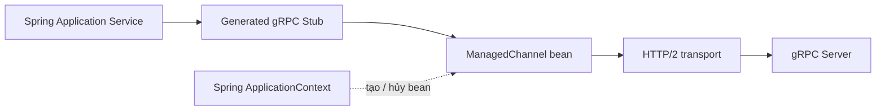
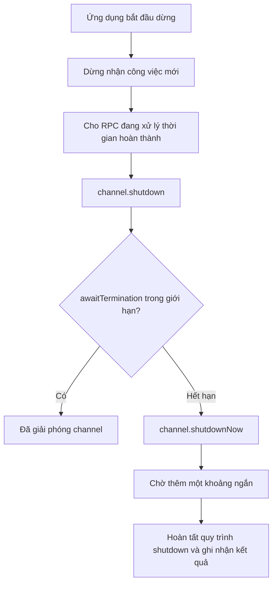
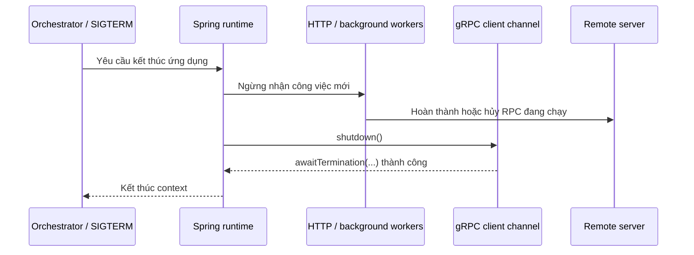

# Đóng channel khi context dừng

Trong ứng dụng Spring, gRPC client thường giữ một `ManagedChannel` để gọi các dịch vụ từ xa qua HTTP/2. Channel quản lý transport, kết nối và tài nguyên thực thi; vì thế nó cần được **đóng khi Spring `ApplicationContext` dừng**. Một lời gọi RPC kết thúc không đồng nghĩa channel hết vai trò: cùng channel có thể đang phục vụ các RPC khác hoặc một luồng streaming kéo dài.

Bài học thuộc chương **Spring client** của mô-đun **SPRING_GRPC**. Mô-đun bao quát phát triển dịch vụ gRPC với Protocol Buffers, sinh mã Java, client/server cho unary và streaming RPC, metadata, deadline, status, interceptor, TLS, kiểm thử tích hợp và giám sát độ tin cậy. Ở đây, trọng tâm là **quyền sở hữu và vòng đời của channel bên client**: giao cho Spring quản lý, hiểu khác biệt giữa dừng nhẹ nhàng và buộc dừng, phối hợp những RPC còn hoạt động, kiểm chứng việc giải phóng tài nguyên.

## 1. Vì sao cần quản lý vòng đời `ManagedChannel`?

Một gRPC client thường có cấu trúc:



**Stub** được sinh từ hợp đồng `.proto` và cung cấp các phương thức như `sayHello(...)`; **channel** là tài nguyên dùng chung đứng sau stub. Một channel có thể được nhiều blocking, async hoặc future stub sử dụng. Channel cũng không đồng nghĩa với một socket TCP duy nhất: gRPC có thể quản lý nhiều kết nối, phân giải đích và tái kết nối theo transport/chính sách cấu hình.

Nếu khởi tạo `ManagedChannel` ở mỗi phương thức gọi RPC, ứng dụng lặp lại chi phí kết nối, khó theo dõi tài nguyên và dễ quên đóng. Nếu đóng channel ngay sau unary RPC, những lời gọi khác đang dùng cùng channel có thể bị ảnh hưởng. Cách quản lý thông thường trong Spring là **khởi tạo channel theo bean singleton, tái sử dụng cho các stub và yêu cầu đóng khi context kết thúc**.

| Đối tượng | Ai sở hữu vòng đời? | Khi nào kết thúc? |
| --- | --- | --- |
| `ManagedChannel` do ứng dụng tạo | Spring container hoặc một thành phần chuyên quản lý channel. | Khi ứng dụng không còn tiếp nhận công việc cần channel, thường lúc đóng context. |
| Generated stub | Được tạo từ channel; không cần `shutdown()` riêng. | Không còn được tham chiếu; tài nguyên mạng do channel sở hữu. |
| Unary RPC | Ngữ cảnh từng lời gọi, có deadline/status riêng. | Sau response, lỗi hoặc cancellation. |
| Streaming RPC | Ngữ cảnh từng luồng, có thể kéo dài. | Sau `onCompleted`, `onError`, cancellation hoặc deadline. |

Nguyên tắc quan trọng: **thành phần tạo/được giao quyền sở hữu channel chịu trách nhiệm đóng channel**. Một application service chỉ sử dụng stub đã inject không nên tự gọi `channel.shutdown()` sau mỗi phương thức nghiệp vụ.

## 2. Phân biệt `shutdown`, `shutdownNow` và `awaitTermination`

`ManagedChannel` của gRPC Java có các API vòng đời:

| API | Ý nghĩa | Khi dùng |
| --- | --- | --- |
| `shutdown()` | Yêu cầu ngừng nhận các RPC mới và bắt đầu shutdown trật tự. Các RPC đã bắt đầu được phép tiếp tục theo chính sách transport. | Bước đầu tiên khi application context dừng. |
| `shutdownNow()` | Yêu cầu dừng nhanh và hủy các lời gọi đang tồn tại nếu có thể. | Sau thời hạn chờ mà channel chưa kết thúc; cần tránh treo quá lâu. |
| `awaitTermination(timeout, unit)` | Chờ channel chấm dứt tối đa khoảng thời gian chỉ định; trả `true` nếu đã kết thúc, `false` nếu hết thời gian. | Khi cần chứng minh tài nguyên đã đóng trước khi hoàn tất shutdown. |
| `isShutdown()` | Cho biết đã có yêu cầu shutdown. | Quan sát trạng thái sau khi yêu cầu dừng. |
| `isTerminated()` | Cho biết channel đã kết thúc hoàn toàn. | Xác minh giải phóng tài nguyên; mạnh hơn `isShutdown()`. |

Các bước khác nhau ở chỗ **gửi yêu cầu dừng** và **đợi việc dừng hoàn tất**:



`shutdown()` **không chặn cho tới khi các RPC kết thúc**. Sau khi gọi, `isShutdown()` có thể là `true` nhưng `isTerminated()` vẫn là `false`. Vì vậy, nếu hệ thống yêu cầu shutdown có giới hạn thời gian và xác minh hoàn tất, cần dùng `awaitTermination(...)` với timeout rõ ràng. Không chờ vô hạn: một stream kéo dài hoặc callback không kết thúc có thể ngăn channel chấm dứt.

`shutdownNow()` có thể gây lỗi/cancellation cho các lời gọi còn hoạt động. Nó không bảo đảm server ngay lập tức ngừng tác dụng phụ đã thực hiện; với RPC ghi dữ liệu, phía client nhận lỗi **không chứng minh thao tác chưa xảy ra**. Cần kết hợp idempotency, deadline và xử lý trạng thái theo nghiệp vụ.

## 3. Spring tự gọi `shutdown()` bằng `@Bean(destroyMethod = "shutdown")`

Giả sử client gọi unary RPC `Greeter/SayHello` từ hợp đồng sau:

```protobuf
syntax = "proto3";

package greeting.v1;

option java_package = "com.example.contract.grpc";
option java_multiple_files = true;

service Greeter {
  rpc SayHello (HelloRequest) returns (HelloReply);
}

message HelloRequest { string name = 1; }
message HelloReply { string message = 1; }
```

Sau khi sinh mã bằng `protoc` và plugin `protoc-gen-grpc-java`, ứng dụng có `GreeterGrpc`, `HelloRequest`, `HelloReply`. Các ví dụ cần Spring Boot, các thư viện `grpc-stub`, `grpc-protobuf` và một transport như `grpc-netty-shaded` cùng phiên bản tương thích.

Đưa đích server vào `application.yml`:

```yaml
app:
  grpc:
    greeter:
      target: dns:///localhost:9090
      plaintext: true
```

Đây là cấu hình chạy local. Ở production phải chọn hostname/chứng chỉ TLS phù hợp và thường chuyển sang `plaintext: false`. Cấu hình một channel bằng Spring:

```java
package com.example.client;

import com.example.contract.grpc.GreeterGrpc;
import io.grpc.ManagedChannel;
import io.grpc.ManagedChannelBuilder;
import org.springframework.beans.factory.annotation.Qualifier;
import org.springframework.beans.factory.annotation.Value;
import org.springframework.context.annotation.Bean;
import org.springframework.context.annotation.Configuration;

@Configuration(proxyBeanMethods = false)
public class GreeterClientConfiguration {

    @Bean(name = "greeterChannel", destroyMethod = "shutdown")
    ManagedChannel greeterChannel(
            @Value("${app.grpc.greeter.target}") String target,
            @Value("${app.grpc.greeter.plaintext:false}") boolean plaintext) {

        ManagedChannelBuilder<?> builder =
                ManagedChannelBuilder.forTarget(target);

        if (plaintext) {
            builder.usePlaintext();
        } else {
            builder.useTransportSecurity();
        }
        return builder.build();
    }

    @Bean
    GreeterGrpc.GreeterBlockingStub greeterBlockingStub(
            @Qualifier("greeterChannel") ManagedChannel channel) {
        return GreeterGrpc.newBlockingStub(channel);
    }
}
```

Spring tạo bean `greeterChannel` theo singleton scope mặc định. Stub nhận **chính bean đó**, nên các application service có thể dùng lại channel. Khi Spring hủy bean, `destroyMethod = "shutdown"` yêu cầu gọi `ManagedChannel.shutdown()` trên instance này. Không cần chủ động đóng trong controller hoặc một hàm `finally` quanh mỗi RPC.

Nếu ứng dụng chỉ cần yêu cầu dừng trật tự và không cần chờ chắc chắn tới khi chấm dứt, đây là cấu hình đơn giản, dễ kiểm soát. Tuy nhiên, **chỉ khai báo `destroyMethod = "shutdown"` không đồng nghĩa với graceful shutdown có chờ**. Nó không tự thực hiện `awaitTermination(...)` hay `shutdownNow()` nếu chờ quá lâu.

Khi đã chọn Spring làm chủ sở hữu, tránh những hành động sau:

- Tự gọi `shutdown()` trong phương thức xử lý mỗi request.
- Tạo channel mới bằng `ManagedChannelBuilder.build()` trong một service rồi quên đăng ký hủy.
- Dùng một cơ chế đóng ở `@PreDestroy` và một cơ chế khác ở `destroyMethod` cho cùng instance mà không xác định rõ quyền sở hữu.
- Xem việc context khởi động thành công là bằng chứng server reachable: channel có thể kết nối khi RPC đầu tiên bắt đầu.

## 4. Khi cần chờ RPC hoàn tất rồi mới buộc dừng

Ứng dụng có server-streaming hoặc bidirectional-streaming RPC lâu dài thường cần một quy trình có giới hạn thời gian. Có thể sử dụng bean chuyên quản lý việc đóng channel và đăng ký nó với Spring.

Ở phương án **thay thế** này, cấu hình `ManagedChannel` dùng `destroyMethod = ""` để tắt cơ chế suy luận phương thức hủy mặc định, bởi quyền gọi `shutdown()` được chuyển cho một bean khác. **Không dùng đồng thời phiên bản `destroyMethod = "shutdown"` ở phần 3 trong cùng cấu hình**.

`GracefulGreeterClientConfiguration.java`:

```java
package com.example.client;

import io.grpc.ManagedChannel;
import io.grpc.ManagedChannelBuilder;
import org.springframework.beans.factory.annotation.Qualifier;
import org.springframework.context.annotation.Bean;
import org.springframework.context.annotation.Configuration;

@Configuration(proxyBeanMethods = false)
public class GracefulGreeterClientConfiguration {

    @Bean(name = "greeterChannel", destroyMethod = "")
    ManagedChannel greeterChannel() {
        return ManagedChannelBuilder.forTarget("dns:///localhost:9090")
                .usePlaintext()
                .build();
    }

    @Bean
    GreeterChannelCloser greeterChannelCloser(
            @Qualifier("greeterChannel") ManagedChannel channel) {
        return new GreeterChannelCloser(channel);
    }
}
```

Target và plaintext chỉ dành cho chạy local; với production, lấy cấu hình từ properties và bật TLS phù hợp. Bean `GreeterChannelCloser` **phụ thuộc** bean `greeterChannel`, vì vậy Spring biết thứ tự hủy các bean phụ thuộc. Nó đóng channel ở phương thức `destroy()`:

```java
package com.example.client;

import io.grpc.ManagedChannel;
import java.util.concurrent.TimeUnit;
import org.slf4j.Logger;
import org.slf4j.LoggerFactory;
import org.springframework.beans.factory.DisposableBean;

public final class GreeterChannelCloser implements DisposableBean {

    private static final Logger log =
            LoggerFactory.getLogger(GreeterChannelCloser.class);

    private final ManagedChannel channel;

    public GreeterChannelCloser(ManagedChannel channel) {
        this.channel = channel;
    }

    @Override
    public void destroy() {
        channel.shutdown();

        try {
            if (!channel.awaitTermination(10, TimeUnit.SECONDS)) {
                log.warn("gRPC channel chưa kết thúc; buộc hủy RPC còn lại");
                channel.shutdownNow();

                if (!channel.awaitTermination(3, TimeUnit.SECONDS)) {
                    log.warn("gRPC channel vẫn chưa terminated sau shutdownNow");
                }
            }
        } catch (InterruptedException interrupted) {
            channel.shutdownNow();
            Thread.currentThread().interrupt();
        }
    }
}
```

Quy trình này thực hiện lần lượt: (1) từ chối các lời gọi mới qua `shutdown()`, (2) chờ tối đa 10 giây, (3) buộc hủy những RPC còn lại nếu cần, (4) chờ thêm tối đa 3 giây và ghi nhận nếu vẫn chưa kết thúc. Đây chỉ là **giới hạn cho bước chờ channel**, không phải bảo đảm toàn bộ quá trình dừng ứng dụng kéo dài chính xác 13 giây. Timeout thực tế phải tương thích ngân sách shutdown của ứng dụng, Kubernetes termination grace period hoặc hệ thống điều phối triển khai.

Vì `GreeterChannelCloser` là bean có dependency đến `greeterChannel`, Spring sẽ hủy bean phụ thuộc trước bean mà nó sử dụng. Việc này giúp closer xử lý channel khi bean channel còn tồn tại. Tuy nhiên, **thứ tự dừng công việc nghiệp vụ và các background worker phải được thiết kế riêng**: dependency giữa closer và channel tự nó không bảo đảm mọi service khác đã ngừng phát RPC. Nếu hệ thống có các worker chủ động gửi gRPC lúc shutdown, chúng cần ngừng nhận tác vụ trước khi closer bắt đầu đóng channel.

Khi dùng một Spring gRPC starter cung cấp factory và quản lý vòng đời sẵn, hãy kiểm tra chính sách hủy của phiên bản starter đó. Không gắn thêm một closer vào channel do starter sở hữu nếu chưa xác định rõ trách nhiệm đóng và thứ tự shutdown.

## 5. Điều phối thứ tự dừng của ứng dụng Spring

Một ứng dụng thực tế có nhiều thành phần cần dừng theo thứ tự, đặc biệt nếu nó vừa nhận HTTP request vừa gọi gRPC:



Spring phát các sự kiện đóng context và hủy singleton beans trong vòng đời ứng dụng. Spring Boot còn có cơ chế **graceful shutdown** cho web server khi được cấu hình phù hợp; cơ chế này cho các HTTP request đang xử lý một khoảng thời gian kết thúc. Tuy nhiên, nó không tự quản lý toàn bộ gRPC RPC do scheduled jobs, message consumers hoặc streaming workers riêng phát sinh. Các thành phần đó phải có cơ chế dừng của riêng mình.

Một quy tắc thực tế là: **ngăn nguồn tạo request mới trước, kết thúc hoặc hủy RPC đang chạy sau, cuối cùng mới đóng channel**. Đối với công việc chủ động có vòng đời độc lập, có thể dùng `SmartLifecycle` với các phase thích hợp để điều phối dừng, hoặc điều phối hủy tác vụ trong thành phần sở hữu worker. Không dựa vào thứ tự ngẫu nhiên của `@PreDestroy` giữa các bean không có dependency xác định.

Các tình huống cần phân biệt:

| Tình huống | Điều gì cần làm? |
| --- | --- |
| Spring context được đóng bình thường | Gọi `shutdown()` theo owner; chờ và buộc dừng nếu chính sách yêu cầu. |
| Application service đang xử lý unary RPC | Để request kết thúc trong deadline hoặc hủy theo ngân sách shutdown. |
| Client đang giữ stream dài | Phát tín hiệu kết thúc/hủy luồng trước hạn; đừng mặc định chờ stream vô hạn. |
| Background job còn đang gọi RPC | Ngừng nhận công việc mới và phối hợp completion/cancellation trước khi đóng channel. |
| Container nhận `SIGTERM` | Bảo đảm tổng thời gian graceful shutdown nằm trong giới hạn do nền tảng triển khai cấp. |
| Tiến trình bị dừng cưỡng bức, ví dụ `SIGKILL` | Không có bảo đảm các callback/bean destroy sẽ được chạy; thiết kế server chịu được kết nối mất đột ngột. |

Đừng tự gọi `System.exit()` ở code nghiệp vụ chỉ để đóng gRPC client. Trong ứng dụng Spring Boot chuẩn, đóng `ApplicationContext` theo lifecycle của framework để các thành phần khác có cơ hội giải phóng tài nguyên tương ứng.

## 6. RPC đang chạy sẽ thế nào khi channel dừng?

Với unary RPC, sau `shutdown()`, các lời gọi mới dùng channel có thể thất bại vì channel đang dừng; các lời gọi đã bắt đầu có thể hoàn thành theo cơ chế shutdown trật tự. Với một streaming RPC, việc server chưa phát `onCompleted()` đồng nghĩa client có thể còn một tác vụ sống. Nếu sau thời hạn cần chuyển sang `shutdownNow()`, các callback đang chờ có thể nhận lỗi do cancellation hoặc transport.

Ứng dụng không nên diễn giải mọi lỗi cuối đời là server bị hỏng. `StatusRuntimeException` ở blocking stub hay `onError(Throwable)` của async stub có thể do:

| Status thường gặp | Diễn giải có thể | Hành động hợp lý |
| --- | --- | --- |
| `CANCELLED` | Client hoặc hạ tầng đã hủy lời gọi, ví dụ do shutdown. | Ghi nhận lý do hủy, ngừng công việc liên quan; tránh retry khi ứng dụng đang dừng. |
| `UNAVAILABLE` | Channel/transport không sẵn sàng, server hoặc mạng gặp sự cố. | Phân biệt lỗi thực với thời điểm ứng dụng đang shutdown. |
| `DEADLINE_EXCEEDED` | Lời gọi vượt ngân sách thời gian được cấp. | Kiểm tra deadline, độ trễ và tình trạng quá tải. |
| `UNKNOWN` hoặc status khác | Lỗi được chuyển đổi từ callback/transport hoặc lỗi phía server. | Giữ lại mã status, thông tin chẩn đoán và phân loại theo nghiệp vụ. |

Trạng thái cụ thể phụ thuộc loại RPC, transport và thời điểm kết thúc; **không mặc định `shutdownNow()` luôn tạo đúng một status cụ thể cho mọi RPC**. Với server, cancellation có thể đến sau khi công việc đã bắt đầu hoặc đã commit một phần. Nếu RPC có tác dụng phụ, cần idempotency key và quy tắc xử lý kết quả không chắc chắn.

### Cancellation của một RPC khác shutdown toàn channel

Nếu người dùng đóng trang web hoặc một công việc streaming không còn consumer, thông thường nên **hủy đúng lời gọi**, không đóng channel đang phục vụ các request khác. Với async/streaming RPC, ứng dụng có thể dùng `ClientCallStreamObserver.cancel(...)` thông qua `ClientResponseObserver` hoặc cơ chế `Context.CancellableContext` quản lý đúng phạm vi. Với blocking RPC, deadline giúp giới hạn thời gian chờ; khi cần hủy chủ động, chọn API có hỗ trợ cancellation và thiết kế rõ vòng đời lời gọi.

Đối với streaming, đồng thời cần xử lý `onNext`, `onError`, `onCompleted`, giới hạn bộ đệm và backpressure để tránh tài nguyên không được giải phóng khi consumer chậm. **Shutdown channel là cơ chế cuối đời ứng dụng**, không phải công cụ thay thế cancellation per-RPC.

## 7. Deadline, metadata, TLS và interceptor trong quá trình shutdown

**Deadline** rất quan trọng vì một RPC không có giới hạn chờ có thể kéo dài quá thời gian ứng dụng còn được phép chạy. Ví dụ blocking stub được inject dùng chung channel:

```java
import com.example.contract.grpc.HelloRequest;
import java.util.concurrent.TimeUnit;

HelloRequest request = HelloRequest.newBuilder()
        .setName("Lan")
        .build();

String message = greeterStub
        .withDeadlineAfter(2, TimeUnit.SECONDS)
        .sayHello(request)
        .getMessage();
```

Ở đây `greeterStub` là `GreeterBlockingStub` đã được Spring inject. `withDeadlineAfter(...)` tạo bản stub cấu hình mới, không sửa bean singleton. Deadline của RPC và timeout khi **chờ channel terminated** là hai đại lượng khác nhau: deadline giới hạn lời gọi; `awaitTermination(...)` giới hạn bước shutdown.

**Metadata** như `authorization`, `x-request-id` và trace context có phạm vi từng RPC. Khi application context đang dừng, không tạo thêm lời gọi mang token chỉ để kiểm tra trạng thái channel. Trong log shutdown, ghi mã status, logical channel name, số RPC đang hoạt động hoặc thời gian chờ; không log token, secret hoặc private key.

**TLS** cần được cấu hình khi channel được tạo; `shutdown()` không thay thế quy trình xoay vòng chứng chỉ/secret và không buộc đóng toàn bộ hệ thống từ xa. Với nhiều channel đích, mỗi channel có thể dùng CA/chứng chỉ client khác nhau, nên mỗi bean cần owner/lifecycle rõ ràng.

**Client interceptors** có thể ghi nhận số RPC hoàn thành/lỗi và trạng thái cancellation để phân biệt shutdown bình thường với sự cố kết nối. Tuy nhiên, không làm callback interceptor chặn lâu trong quá trình dừng; nếu exporter metrics/tracing cũng sắp đóng, cần thiết kế thứ tự flush/close phù hợp.

## 8. Kiểm thử Spring thật sự đóng channel

Một bài test vòng đời có thể khởi tạo `AnnotationConfigApplicationContext`, lấy `ManagedChannel` bean, rồi đóng context và xác minh trạng thái. Dùng in-process transport để test không cần server mạng. Thêm `grpc-inprocess` trong test dependencies.

```java
package com.example.client;

import static org.junit.jupiter.api.Assertions.assertFalse;
import static org.junit.jupiter.api.Assertions.assertTrue;

import io.grpc.ManagedChannel;
import io.grpc.inprocess.InProcessChannelBuilder;
import io.grpc.inprocess.InProcessServerBuilder;
import java.util.concurrent.TimeUnit;
import org.junit.jupiter.api.Test;
import org.springframework.context.annotation.AnnotationConfigApplicationContext;
import org.springframework.context.annotation.Bean;
import org.springframework.context.annotation.Configuration;

class GrpcChannelLifecycleTest {

    @Configuration(proxyBeanMethods = false)
    static class TestConfig {
        @Bean(name = "testChannel", destroyMethod = "shutdown")
        ManagedChannel testChannel() {
            String name = InProcessServerBuilder.generateName();
            return InProcessChannelBuilder.forName(name)
                    .directExecutor()
                    .build();
        }
    }

    @Test
    void closesChannelWhenContextCloses() throws Exception {
        var context = new AnnotationConfigApplicationContext(TestConfig.class);
        ManagedChannel channel = context.getBean("testChannel", ManagedChannel.class);

        try {
            assertFalse(channel.isShutdown());
        } finally {
            context.close();
        }

        assertTrue(channel.isShutdown());
        assertTrue(channel.awaitTermination(3, TimeUnit.SECONDS));
        assertTrue(channel.isTerminated());
    }
}
```

Test không gọi RPC nên không cần start server in-process; tên do `generateName()` tạo chỉ cung cấp target thử nghiệm cho channel. Nó kiểm tra **Spring chạy destroy method** và channel thực sự terminated khi không có công việc đang chạy. Không nên suy từ test này rằng mọi stream hoặc RPC thật đều hoàn tất khi shutdown. Để kiểm tra graceful shutdown có tải, cần tạo RPC bị trì hoãn, gọi `shutdown()`, đo hành vi lời gọi đang chạy, rồi thử timeout và `shutdownNow()` trong test có điều khiển.

Kiểm thử trên không đi qua TLS, DNS hay HTTP/2 của transport mạng. Một integration test qua TCP/TLS nên xác minh đóng kết nối đúng lúc, xử lý các request chưa hoàn tất, trạng thái trên server và giới hạn tổng thời gian dừng của ứng dụng. Với Spring Boot, cũng cần test shutdown khi có HTTP requests và background consumers nếu chúng cùng sử dụng channel.

## 9. Đóng nhiều channel trong cùng một ứng dụng

Ứng dụng có thể gọi `Inventory`, `Payment` và `Shipping` qua ba target khác nhau. Mỗi channel nên có **tên bean, owner và chính sách hủy** xác định. Ví dụ:

```java
@Bean(name = "inventoryChannel", destroyMethod = "shutdown")
ManagedChannel inventoryChannel() {
    return ManagedChannelBuilder.forTarget("dns:///inventory.internal:7443")
            .useTransportSecurity()
            .build();
}

@Bean(name = "shippingChannel", destroyMethod = "shutdown")
ManagedChannel shippingChannel() {
    return ManagedChannelBuilder.forTarget("dns:///shipping.internal:7443")
            .useTransportSecurity()
            .build();
}
```

Đoạn này chỉ minh họa hai bean trong một `@Configuration` có đủ imports; target thực nên lấy từ cấu hình theo môi trường. Spring sẽ gọi destroy method cho **cả hai bean** khi context dừng. Nếu cần chờ có giới hạn hoặc buộc hủy, dùng một cơ chế quản lý tập trung có danh sách channel tường minh, hoặc nhiều owner có thứ tự shutdown được thiết kế. Tránh đóng một channel hai lần từ các owner khác nhau, đặc biệt khi nó được chia sẻ cho nhiều generated stub.

Nếu Spring gRPC starter tạo channel theo tên từ `ChannelFactory` hay auto-configuration, cần xác định **starter sở hữu việc shutdown** hay ứng dụng sở hữu. Cấu hình API và lifecycle phụ thuộc phiên bản starter. Không tự thêm `ManagedChannelBuilder` tạo target trùng hoặc gọi `shutdown()` trên channel do factory dùng chung nếu contract của factory quy định việc đóng tập trung.

Khi theo dõi, nên đặt nhãn metric ổn định như `client=inventory`, `client=shipping` và ghi `shutdown_duration`, số RPC bị hủy, kết quả termination theo từng channel. Không dùng user ID, token hay request ID làm metric label có cardinality cao. Việc kết thúc channel trật tự giúp giảm lỗi khi rollout và hạn chế kết nối bị cắt đột ngột.

## 10. Những lỗi phổ biến trong shutdown lifecycle

| Triệu chứng | Nguyên nhân có thể | Cách xử lý |
| --- | --- | --- |
| Ứng dụng thoát nhưng còn luồng/transport chạy trong test | Tạo channel bên ngoài Spring mà không đóng, hoặc quên đóng context. | Đặt channel dưới lifecycle rõ ràng; dùng `try/finally` cho test tự tạo channel. |
| RPC sau một lần gọi bị `UNAVAILABLE` | Service đã gọi `shutdown()` sau từng request trong khi channel được chia sẻ. | Chỉ đóng channel khi owner không còn cần nó, thường lúc context dừng. |
| Context dừng nhưng channel vẫn chưa terminated | Chỉ gọi `shutdown()` mà chưa chờ, hoặc stream đang sống. | Dùng `awaitTermination` có giới hạn; cân nhắc hủy RPC quá hạn. |
| Shutdown treo vì stream vô hạn | Không có chiến lược ngừng consumer/producer hoặc deadline/cancellation. | Đóng luồng trước, giới hạn thời gian, rồi mới đóng channel. |
| Hai bean cùng đóng một channel | Quyền sở hữu không rõ, `destroyMethod` và `@PreDestroy` chồng nhau. | Chọn một owner và một cơ chế hủy nhất quán. |
| Background job gặp lỗi khi context đang dừng | Job còn phát RPC mới sau `channel.shutdown()`. | Dừng job/consumer trước bằng lifecycle điều phối. |
| `awaitTermination` bị interrupt | Thread đang chờ bị gián đoạn, có nguy cơ không hoàn tất cleanup. | Gọi `shutdownNow()` khi thích hợp, khôi phục cờ interrupt. |
| Lẫn lộn `isShutdown()` và `isTerminated()` | Chỉ kiểm tra đã ra lệnh dừng, chưa kiểm tra tài nguyên kết thúc. | Test cả trạng thái và `awaitTermination`. |
| Dùng `shutdownNow()` ngay cho mọi lần dừng | Hủy cả RPC đang có thể hoàn thành bình thường. | Ưu tiên `shutdown()` và chờ trong ngân sách trước khi buộc dừng. |
| Đóng channel do starter sở hữu | Tranh chấp quyền sở hữu, ảnh hưởng tới stub khác dùng chung factory. | Xác nhận lifecycle contract của starter/factory. |

## 11. Bài tập thực hành

1. Tạo Spring Boot client từ hợp đồng `Greeter`, đăng ký `ManagedChannel` bằng `@Bean(destroyMethod = "shutdown")`, inject generated blocking stub và gọi unary RPC thành công.
2. Viết JUnit test tạo và đóng `ApplicationContext`. Kiểm tra `isShutdown()` trước/sau khi đóng và `isTerminated()` sau `awaitTermination(...)`.
3. Dùng gRPC server thử nghiệm trì hoãn response. Bắt đầu một RPC, gọi `shutdown()` trên channel, quan sát sự khác biệt giữa lời gọi đã bắt đầu và lời gọi mới.
4. Mở một server-streaming RPC dài. Dừng ứng dụng với deadline shutdown ngắn; bổ sung cancellation per-RPC để stream được đóng trước khi channel cần `shutdownNow()`.
5. Thay `destroyMethod = "shutdown"` bằng phương án owner `DisposableBean` có chờ tối đa 10 giây, buộc hủy khi quá hạn; kiểm tra log, thời gian kết thúc và cờ interrupt trong test phù hợp.
6. Tạo hai channel bean tới hai dịch vụ khác nhau, dừng Spring context và xác minh cả hai được đóng. Thử một background worker còn phát RPC khi shutdown để thiết kế thứ tự dừng hợp lý.
7. Thử graceful shutdown khi dùng TLS và một interceptor ghi metrics/tracing. Đảm bảo token không xuất hiện trong log và phân biệt các lỗi RPC lúc dừng với lỗi mạng trước đó.

Sau bài này, bạn cần giải thích được vì sao channel phải có **một owner rõ ràng**, khi nào Spring tự gọi `shutdown()`, vì sao `shutdown()` khác `awaitTermination()`, lúc nào cần `shutdownNow()` và cách phối hợp RPC đang chạy với quá trình đóng `ApplicationContext`. Những nguyên tắc này giúp Spring gRPC client kết thúc có kiểm soát, giữ độ tin cậy cho unary/streaming RPC và hạn chế rò rỉ tài nguyên khi triển khai, kiểm thử hoặc dừng dịch vụ.
