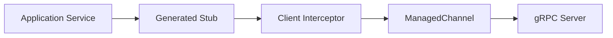

# Interceptor dùng chung cho client

Một ứng dụng Spring thường có nhiều application service cùng gọi gRPC. Nếu mỗi service tự thêm request ID, ghi log method, đo thời gian hoặc phân loại status, phần xử lý lặp lại sẽ nhanh chóng không đồng nhất. **Client interceptor** giải quyết nhóm công việc xuyên suốt này tại ranh giới giữa generated stub và channel: một interceptor có thể áp dụng cho nhiều RPC, nhiều stub và nhiều dịch vụ đích.

Bài thuộc chương **Spring client** của mô-đun **SPRING_GRPC**. Trọng tâm là thiết kế interceptor dùng chung, đăng ký nó với channel do Spring quản lý, hiểu phạm vi áp dụng, xử lý metadata và lifecycle của lời gọi. Interceptor giúp thống nhất logging, tracing, metrics hoặc header chung; nó không thay thế application service trong việc xử lý nghiệp vụ, cũng không thay thế `CallCredentials` khi cần cung cấp thông tin xác thực động.

## 1. Client interceptor nằm ở đâu?

Một lời gọi client đi qua các thành phần sau:



`ClientInterceptor` là một điểm mở rộng của gRPC Java. Nó nhận thông tin method, `CallOptions` và channel tiếp theo, sau đó tạo hoặc bọc `ClientCall`. Nhờ vậy, interceptor có thể quan sát hoặc bổ sung hành vi trước khi RPC bắt đầu và khi RPC kết thúc.

Các công việc phù hợp với interceptor dùng chung:

- Gắn metadata ổn định của client, ví dụ `x-client-name` hoặc correlation metadata được tạo cho từng RPC.
- Ghi nhận full method name, gRPC status và thời gian thực thi.
- Kết nối với tracing/metrics instrumentation.
- Áp dụng một chính sách client chung như deadline mặc định, nếu chính sách đó được thiết kế rõ ràng.

Các công việc không nên đặt tùy tiện vào interceptor: quyết định nghiệp vụ, chuyển đổi dữ liệu theo use case, retry một thao tác có tác dụng phụ mà không xét idempotency, hoặc lưu token của người dùng vào field singleton. Interceptor nên **nhẹ, có thể dùng đồng thời và không giữ trạng thái thay đổi theo request ở field dùng chung**.

## 2. Phạm vi: channel-wide hay stub-specific?

Có hai cách phổ biến để gắn interceptor:

| Cách gắn | Phạm vi | Khi phù hợp |
| --- | --- | --- |
| `ManagedChannelBuilder.intercept(...)` | Tất cả RPC được tạo qua channel đó, bao gồm nhiều stub từ channel. | Logging, metrics, tracing hoặc metadata chung cho một client/đích. |
| `stub.withInterceptors(...)` | Stub mới được cấu hình và những lời gọi đi qua stub đó. | Chính sách riêng cho một nhóm method hoặc một adapter cụ thể. |

Một interceptor được khai báo thành Spring bean **không tự động áp dụng cho mọi channel**. Cấu hình phải gắn nó vào từng channel cần dùng. Nếu ứng dụng có `inventoryChannel` và `shippingChannel`, có thể inject cùng một interceptor bean vào cả hai builder. Khi một channel dùng credential hoặc chính sách khác, hãy phân tách interceptor theo channel thay vì mặc định dùng chung tất cả hành vi.

Không nhầm `ClientInterceptor` với `ServerInterceptor`: client interceptor chạy trong tiến trình gọi RPC; server interceptor chạy tại server để quan sát/kiểm tra lời gọi đến. Hai phía có thể cùng dùng metadata contract nhưng có vòng đời và quyền truy cập khác nhau.

## 3. Viết một interceptor quan sát RPC

Ví dụ sau gắn tên ứng dụng vào metadata của mỗi RPC và ghi nhận method, status cùng thời gian từ lúc client bắt đầu gọi tới lúc RPC đóng. Nó không ghi payload, token hay metadata nhạy cảm.

```java
package com.example.client;

import io.grpc.CallOptions;
import io.grpc.Channel;
import io.grpc.ClientCall;
import io.grpc.ClientInterceptor;
import io.grpc.ForwardingClientCall;
import io.grpc.ForwardingClientCallListener;
import io.grpc.Metadata;
import io.grpc.MethodDescriptor;
import io.grpc.Status;
import java.util.concurrent.TimeUnit;
import org.slf4j.Logger;
import org.slf4j.LoggerFactory;

public final class ClientObservabilityInterceptor implements ClientInterceptor {

    private static final Logger log =
            LoggerFactory.getLogger(ClientObservabilityInterceptor.class);

    private static final Metadata.Key<String> CLIENT_NAME = Metadata.Key.of(
            "x-client-name", Metadata.ASCII_STRING_MARSHALLER);

    private final String clientName;

    public ClientObservabilityInterceptor(String clientName) {
        if (clientName == null || clientName.isBlank()) {
            throw new IllegalArgumentException("clientName không được rỗng");
        }
        this.clientName = clientName;
    }

    @Override
    public <RequestT, ResponseT> ClientCall<RequestT, ResponseT> interceptCall(
            MethodDescriptor<RequestT, ResponseT> method,
            CallOptions callOptions,
            Channel next) {

        ClientCall<RequestT, ResponseT> delegate =
                next.newCall(method, callOptions);

        return new ForwardingClientCall.SimpleForwardingClientCall<>(delegate) {
            @Override
            public void start(Listener<ResponseT> responseListener, Metadata headers) {
                headers.discardAll(CLIENT_NAME);
                headers.put(CLIENT_NAME, clientName);
                long startedAt = System.nanoTime();

                Listener<ResponseT> observingListener =
                        new ForwardingClientCallListener
                                .SimpleForwardingClientCallListener<>(responseListener) {
                            @Override
                            public void onClose(Status status, Metadata trailers) {
                                long elapsedMillis = TimeUnit.NANOSECONDS.toMillis(
                                        System.nanoTime() - startedAt);
                                log.info(
                                        "gRPC client call closed: client={}, method={}, status={}, elapsedMs={}",
                                        clientName,
                                        method.getFullMethodName(),
                                        status.getCode(),
                                        elapsedMillis);
                                super.onClose(status, trailers);
                            }
                        };

                super.start(observingListener, headers);
            }
        };
    }
}
```

Một vài chi tiết quan trọng:

- `interceptCall(...)` được gọi khi gRPC tạo một call. `next.newCall(...)` chuyển việc tạo call tới channel/interceptor tiếp theo.
- `start(...)` nhận metadata của **lần gọi hiện tại**. Ví dụ xóa giá trị `x-client-name` cũ rồi thêm giá trị của ứng dụng để header có một giá trị xác định.
- `startedAt` là biến cục bộ bên trong `start`, nên mỗi call có mốc thời gian riêng. Không lưu mốc thời gian vào field của interceptor singleton.
- `ForwardingClientCallListener` chuyển tiếp các callback còn lại tới listener gốc; ta chỉ bổ sung logic tại `onClose(...)`.
- `onClose(...)` báo kết thúc RPC với `Status`, gồm cả thành công và lỗi. Đo thời gian tại đây bao gồm thời gian chờ và truyền dữ liệu của RPC, không chỉ thời gian xử lý bên server.

Interceptor này có thể được dùng đồng thời bởi nhiều RPC vì trạng thái theo call nằm trong closure của `start`. Field `clientName` và metadata key là cấu hình bất biến sau khi khởi tạo. Nếu mở rộng interceptor, tránh đưa `Metadata`, response hoặc request hiện tại vào field dùng chung.

## 4. Đăng ký interceptor một lần trong Spring và gắn vào channel

Đưa tên client và target vào `application.yml`:

```yaml
spring:
  application:
    name: checkout-api

app:
  grpc:
    greeter:
      target: dns:///greeter.internal:7443
      plaintext: false
```

Khai báo interceptor thành bean và gắn nó vào channel:

```java
package com.example.client;

import com.example.contract.grpc.GreeterGrpc;
import io.grpc.ClientInterceptor;
import io.grpc.ManagedChannel;
import io.grpc.ManagedChannelBuilder;
import org.springframework.beans.factory.annotation.Qualifier;
import org.springframework.beans.factory.annotation.Value;
import org.springframework.context.annotation.Bean;
import org.springframework.context.annotation.Configuration;

@Configuration(proxyBeanMethods = false)
public class GreeterClientConfiguration {

    @Bean
    ClientInterceptor clientObservabilityInterceptor(
            @Value("${spring.application.name:application}") String clientName) {
        return new ClientObservabilityInterceptor(clientName);
    }

    @Bean(name = "greeterChannel", destroyMethod = "shutdown")
    ManagedChannel greeterChannel(
            @Value("${app.grpc.greeter.target}") String target,
            @Value("${app.grpc.greeter.plaintext:false}") boolean plaintext,
            ClientInterceptor clientObservabilityInterceptor) {

        ManagedChannelBuilder<?> builder =
                ManagedChannelBuilder.forTarget(target)
                        .intercept(clientObservabilityInterceptor);

        if (plaintext) {
            builder.usePlaintext();
        } else {
            builder.useTransportSecurity();
        }
        return builder.build();
    }

    @Bean
    GreeterGrpc.GreeterBlockingStub greeterBlockingStub(
            @Qualifier("greeterChannel") ManagedChannel channel) {
        return GreeterGrpc.newBlockingStub(channel);
    }
}
```

Bean `clientObservabilityInterceptor` được tạo một lần và gắn vào `greeterChannel`. Mọi stub được tạo từ channel đó đều đi qua interceptor. `destroyMethod = "shutdown"` quản lý vòng đời channel; interceptor không cần tự đóng channel vì nó không sở hữu transport.

Nếu ứng dụng có nhiều channel, inject cùng interceptor bean vào từng phương thức tạo channel cần quan sát. Nếu mỗi channel cần một `clientName` khác nhau, có thể tạo các bean interceptor riêng có qualifier hoặc dùng một interceptor bất biến nhận cấu hình theo client. Không tạo một interceptor singleton rồi thay đổi field `clientName` theo request.

## 5. Metadata chung và metadata riêng từng RPC

Header `x-client-name` trong ví dụ là metadata ổn định của ứng dụng. Nó phù hợp để server biết logical client nào đang gọi. Một số metadata khác lại thuộc về từng request:

| Metadata | Phạm vi phù hợp | Cách cung cấp |
| --- | --- | --- |
| `x-client-name` | Ổn định cho mọi RPC từ một ứng dụng/channel. | Có thể gắn trong interceptor dùng chung. |
| `x-request-id` | Khác nhau theo request để liên kết log. | Tạo hoặc lấy theo context của từng RPC, không giữ mutable value trong field singleton. |
| `traceparent` / tracing context | Từng trace/span. | Dùng OpenTelemetry gRPC instrumentation hoặc cơ chế propagation tương thích. |
| `authorization` | Theo danh tính/quyền của từng lời gọi. | Ưu tiên `CallCredentials` hoặc interceptor lấy credential theo call; không hard-code token toàn cục. |

`Metadata` là đối tượng mutable. Mỗi lần `ClientCall.start(...)` nhận một metadata object thuộc call đó; có thể thêm header vào object này. Tuyệt đối không giữ một object `Metadata` dùng chung rồi thay request ID hoặc token trước mỗi lần gọi, vì nhiều RPC có thể chạy đồng thời và dữ liệu có thể bị trộn.

Với authentication, `CallCredentials` thường là lựa chọn phù hợp hơn để cung cấp credential theo từng RPC và phối hợp với cơ chế bảo mật của gRPC. Interceptor vẫn có thể quan sát method/status hoặc thêm metadata không nhạy cảm. Không log giá trị `authorization`, cookie, private key hay payload có dữ liệu cá nhân.

## 6. Dùng interceptor chung cho nhiều channel và stub

Một interceptor stateless có thể gắn vào nhiều channel:

```java
@Bean(name = "inventoryChannel", destroyMethod = "shutdown")
ManagedChannel inventoryChannel(
        @Value("${app.grpc.inventory.target}") String target,
        ClientInterceptor clientObservabilityInterceptor) {
    return ManagedChannelBuilder.forTarget(target)
            .useTransportSecurity()
            .intercept(clientObservabilityInterceptor)
            .build();
}

@Bean(name = "shippingChannel", destroyMethod = "shutdown")
ManagedChannel shippingChannel(
        @Value("${app.grpc.shipping.target}") String target,
        ClientInterceptor clientObservabilityInterceptor) {
    return ManagedChannelBuilder.forTarget(target)
            .useTransportSecurity()
            .intercept(clientObservabilityInterceptor)
            .build();
}
```

Đây là hai phương thức `@Bean` bổ sung trong cùng lớp cấu hình; mỗi channel có target và vòng đời riêng nhưng cùng áp dụng hành vi quan sát. Khi Spring có nhiều bean `ClientInterceptor`, tham số inject cần được xác định bằng `@Qualifier`, `@Primary` hoặc danh sách interceptor theo chủ đích. Không dựa vào thứ tự không rõ ràng khi nhiều bean cùng kiểu.

Nếu chỉ một stub cần interceptor đặc biệt, có thể tạo stub dẫn xuất:

```java
GreeterGrpc.GreeterBlockingStub auditedStub =
        greeterStub.withInterceptors(auditInterceptor);
```

Stub `auditedStub` áp dụng interceptor riêng cho những lời gọi qua stub này; stub gốc vẫn giữ cấu hình ban đầu. Dù gắn ở channel hay stub, interceptor cần tuân thủ thread-safety và không được đóng channel.

## 7. Kết hợp nhiều interceptor và thứ tự thực thi

Một client có thể dùng nhiều interceptor, ví dụ:

| Interceptor | Vai trò |
| --- | --- |
| Tracing | Tạo/propagate trace context và span. |
| Metrics | Đếm RPC, ghi latency và status theo method. |
| Default deadline | Gắn deadline khi caller chưa chỉ định. |
| Client metadata | Gắn logical client name hoặc header không nhạy cảm. |
| Audit | Ghi sự kiện cần thiết theo chính sách bảo mật. |

Có thể đăng ký nhiều interceptor trên builder bằng các lời gọi `.intercept(...)`. Thứ tự đăng ký có ảnh hưởng tới thứ tự bọc `ClientCall` và listener; interceptor bên ngoài có thể quan sát call trước/sau interceptor bên trong. Do đó, hãy đặt thứ tự một cách có chủ đích và kiểm thử tương tác, nhất là khi tracing, deadline hoặc metadata phụ thuộc vào nhau. Không giả định mọi thư viện instrumentation đều dùng cùng quy ước thứ tự nếu chúng bọc channel theo các cách khác nhau.

Không nên tự viết lại một hệ thống tracing hoàn chỉnh nếu dự án đã có OpenTelemetry gRPC instrumentation hoặc Spring observability integration. Hãy dùng thư viện instrumentation tương thích để propagation, span lifecycle và metrics được xử lý đúng; interceptor tự viết nên bổ sung hành vi đặc thù của ứng dụng, chẳng hạn logical client name.

## 8. Những điều interceptor không nên làm

- **Không giữ dữ liệu theo request ở field singleton.** Một interceptor bean có thể xử lý nhiều call đồng thời.
- **Không log payload hoặc secret.** Ghi method, status, thời gian và tên logical client thường đủ cho chẩn đoán ban đầu.
- **Không tự retry mọi lỗi.** Retry phụ thuộc status, idempotency, deadline tổng và chính sách backoff; interceptor không có đủ ngữ cảnh nghiệp vụ để quyết định mọi trường hợp.
- **Không chặn callback lâu.** Công việc log/metrics/tracing nên nhẹ hoặc chuyển sang executor phù hợp; callback chậm có thể ảnh hưởng xử lý RPC.
- **Không nuốt callback.** Khi bọc listener, phải chuyển tiếp `onHeaders`, `onMessage`, `onReady`, `onClose` và các callback còn lại thông qua forwarding listener.
- **Không đóng channel.** Channel thuộc bean cấu hình hoặc factory quản lý; interceptor chỉ quan sát và bổ sung hành vi cho call.
- **Không giả định mọi RPC có response.** Unary lỗi hoặc stream bị hủy có thể kết thúc bằng `onClose` với status khác `OK` mà không có message.

Đối với metrics, nên dùng các nhãn có cardinality giới hạn như service, method, status và logical client. Không dùng request ID, user ID hoặc target chứa định danh động làm nhãn metric. Request ID phù hợp hơn với structured log hoặc trace.

## 9. Kiểm thử interceptor

Kiểm thử nên chứng minh interceptor thực sự được gọi, metadata tới được server và trạng thái kết thúc được quan sát ở client. Có thể dùng gRPC in-process server:

1. Tạo server có `ServerInterceptor` đọc metadata key `x-client-name`.
2. Tạo `ManagedChannel` với `ClientObservabilityInterceptor("checkout-api")`.
3. Tạo generated stub từ channel và gọi một unary RPC thành công.
4. Xác minh server nhận đúng `x-client-name`.
5. Thực hiện một RPC server trả lỗi, rồi một RPC bị deadline/cancel; xác minh interceptor ghi nhận status và callback kết thúc.
6. Đóng channel và server trong `finally` hoặc qua test lifecycle để không rò tài nguyên.

Ngoài in-process test, integration test qua transport mạng thật giúp xác minh interceptor phối hợp đúng với TLS, resolver, proxy và instrumentation thực tế. Nếu dùng nhiều channel, cần test cả hai đều được gắn interceptor; việc Spring tạo interceptor bean thành công không tự động chứng minh mọi channel đã dùng nó.

## 10. Lỗi thường gặp

| Hiện tượng | Nguyên nhân | Cách xử lý |
| --- | --- | --- |
| Đã khai báo interceptor bean nhưng không thấy log | Bean chưa được gắn vào channel hoặc stub. | Gọi `.intercept(...)` khi tạo channel hoặc `.withInterceptors(...)` trên stub. |
| Một channel có log, channel khác không | Chỉ một builder được cấu hình interceptor. | Inject interceptor vào từng channel cần áp dụng. |
| Request ID bị lẫn giữa các call | Dùng `Metadata` mutable hoặc field thay đổi chung. | Tạo metadata và trạng thái riêng trong từng call. |
| Log chỉ ghi thành công | Chỉ xử lý `onMessage`/`onCompleted`, bỏ qua `onClose`/`onError`. | Quan sát `onClose(Status, trailers)` để nhận cả status lỗi. |
| Callback gRPC chậm bất thường | Interceptor thực hiện I/O hoặc xử lý nặng đồng bộ. | Giữ callback nhẹ, chuyển việc nặng sang executor có giới hạn. |
| Metrics có cardinality quá lớn | Dùng request ID/user ID làm label. | Dùng label ổn định theo service, method, status, client. |
| Token xuất hiện trong log | Ghi toàn bộ metadata hoặc header. | Allowlist các field được phép log; che hoặc bỏ dữ liệu nhạy cảm. |
| Interceptor làm mất callback | Tự triển khai listener nhưng không forward đầy đủ. | Dùng `ForwardingClientCallListener` và gọi `super` tương ứng. |

## 11. Bài tập thực hành

1. Viết `ClientObservabilityInterceptor` thêm `x-client-name` và ghi method/status/latency cho mỗi RPC.
2. Đăng ký interceptor thành Spring bean, gắn vào hai channel khác nhau và xác minh stub từ cả hai channel đều đi qua interceptor.
3. Viết server interceptor trong test để xác minh metadata `x-client-name`; thêm ca server trả lỗi và ca deadline hết hạn.
4. Thêm `x-request-id` theo từng request. Gửi nhiều RPC đồng thời và xác minh request ID không bị trộn.
5. Thử gắn một interceptor riêng bằng `stub.withInterceptors(...)`; so sánh phạm vi với interceptor gắn trên channel.
6. Bật tracing/metrics instrumentation của dự án, kiểm tra thứ tự với interceptor tự viết và xác minh không ghi token hoặc payload nhạy cảm.

Sau bài này, bạn cần phân biệt được interceptor dùng chung ở channel với interceptor riêng ở stub, biết tạo `ClientInterceptor` an toàn khi chạy đồng thời, đăng ký nó như Spring bean và kiểm tra metadata/status/latency qua callback. Đây là cách tập trung các hành vi xuyên suốt của Spring gRPC client, giúp quan sát và vận hành các RPC nhất quán mà không làm application service chứa logic hạ tầng lặp lại.
