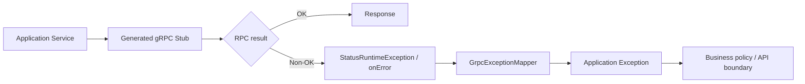

# Mapping lỗi gRPC sang exception ứng dụng

Khi một Spring service gọi gRPC, lỗi từ dịch vụ từ xa thường xuất hiện ở client dưới dạng `StatusRuntimeException` hoặc được chuyển tới callback `onError`. Nếu để exception này lan khắp application service và controller, logic nghiệp vụ sẽ phụ thuộc trực tiếp vào mã status của gRPC. **Mapping lỗi gRPC sang exception ứng dụng** tạo một ranh giới rõ ràng: tầng tích hợp hiểu gRPC status, còn tầng nghiệp vụ xử lý các tình huống như dữ liệu không hợp lệ, tài nguyên không tồn tại, xung đột, timeout hoặc dịch vụ phụ thuộc không sẵn sàng.

Bài học thuộc chương **Spring client** của mô-đun **SPRING_GRPC**. Mô-đun phát triển client/server từ hợp đồng Protocol Buffers và mã Java được sinh, hỗ trợ unary/streaming RPC, metadata, deadline, interceptor, TLS, kiểm thử tích hợp và giám sát. Trọng tâm ở đây là phân loại lỗi đúng ngữ nghĩa, giữ thông tin chẩn đoán cần thiết và không để chi tiết transport rò rỉ vào logic nghiệp vụ.

## 1. Hiểu lỗi gRPC trước khi ánh xạ

gRPC biểu diễn kết quả của một RPC bằng `Status`. Khi RPC thành công, status là `OK`; khi thất bại, status chứa mã như `NOT_FOUND`, `INVALID_ARGUMENT`, `UNAVAILABLE` hoặc `DEADLINE_EXCEEDED`. Ở client blocking, lời gọi thường ném `StatusRuntimeException`. Với async stub, lỗi thường đến qua `StreamObserver.onError(Throwable)`.



`Status` là kết quả ở ranh giới RPC. Nó không nhất thiết là exception phù hợp với nghiệp vụ. Ví dụ, `NOT_FOUND` có thể có nghĩa SKU không tồn tại, nhưng cũng có thể do client gọi nhầm service hoặc method. Chỉ operation biết ý nghĩa nghiệp vụ của lời gọi mới có đủ ngữ cảnh để quyết định có ánh xạ thành `ProductNotFoundException` hay một lỗi tích hợp khác.

Vì vậy, mapping có hai trách nhiệm:

- **Phân loại kỹ thuật:** đọc status code, giữ cause và thông tin chẩn đoán cần thiết.
- **Diễn giải theo use case:** quyết định status đó tương ứng với tình huống nghiệp vụ nào trong operation hiện tại.

Không nên coi mọi `StatusRuntimeException` là lỗi mất kết nối hoặc chuyển tất cả lỗi thành một exception chung không còn phân biệt được nguyên nhân.

## 2. Các status thường gặp và ý nghĩa ở application layer

| gRPC status | Ý nghĩa thường gặp | Nhóm exception ứng dụng có thể dùng |
| --- | --- | --- |
| `INVALID_ARGUMENT` | Request không hợp lệ theo hợp đồng hoặc validation phía server. | `InvalidRemoteRequestException` |
| `OUT_OF_RANGE` | Giá trị nằm ngoài miền cho phép, ví dụ cursor hoặc chỉ số vượt giới hạn. | `InvalidRemoteRequestException` hoặc exception chuyên biệt theo use case |
| `NOT_FOUND` | Tài nguyên được yêu cầu không tồn tại. | `RemoteResourceNotFoundException`, nếu ngữ nghĩa operation xác nhận điều đó |
| `ALREADY_EXISTS` | Tài nguyên đã tồn tại. | `RemoteConflictException` |
| `ABORTED` | Operation bị hủy do xung đột, thường liên quan tới concurrency/transaction. | `RemoteConflictException` hoặc exception yêu cầu thử lại ở tầng transaction |
| `FAILED_PRECONDITION` | Trạng thái hệ thống chưa đáp ứng điều kiện để thực hiện operation. | `RemotePreconditionException` |
| `UNAUTHENTICATED` | Thiếu hoặc sai thông tin xác thực. | `RemoteAuthenticationException` |
| `PERMISSION_DENIED` | Đã xác định danh tính nhưng không đủ quyền. | `RemoteAccessDeniedException` |
| `RESOURCE_EXHAUSTED` | Vượt quota, giới hạn tài nguyên hoặc rate limit. | `RemoteCapacityException` |
| `DEADLINE_EXCEEDED` | RPC không hoàn tất trước deadline. | `RemoteTimeoutException` |
| `UNAVAILABLE` | Service hoặc transport tạm thời không sẵn sàng. | `RemoteUnavailableException` |
| `CANCELLED` | RPC bị caller, context hoặc hệ thống hủy. | `RemoteCallCancelledException` hoặc xử lý cancellation riêng |
| `UNIMPLEMENTED`, `INTERNAL`, `DATA_LOSS`, `UNKNOWN` | Method chưa hỗ trợ hoặc lỗi nội bộ/không xác định. | `RemoteServiceException` |

Đây là gợi ý phân loại, không phải bảng ánh xạ bắt buộc cho mọi hệ thống. Ví dụ `NOT_FOUND` chỉ nên trở thành lỗi “không tìm thấy sản phẩm” khi hợp đồng của `GetProduct` xác định rõ ý nghĩa đó. Nếu `NOT_FOUND` phát sinh do route/service name sai, đó là lỗi tích hợp hoặc cấu hình cần điều tra.

## 3. Thiết kế exception ứng dụng giữ lại status và cause

Application exception nên cung cấp thông tin đủ để tầng trên đưa ra quyết định, nhưng không phơi bày nội dung nội bộ của remote server. Một kiểu exception có `kind` và `grpcCode` giúp tránh tạo quá nhiều lớp trùng lặp trong ví dụ nhỏ; hệ thống lớn có thể tách thành các subclass theo miền nghiệp vụ.

`GrpcApplicationException.java`:

```java
package com.example.application.error;

import io.grpc.Status;

public final class GrpcApplicationException extends RuntimeException {

    public enum Kind {
        INVALID_INPUT,
        NOT_FOUND,
        CONFLICT,
        PRECONDITION_FAILED,
        AUTHENTICATION_REQUIRED,
        ACCESS_DENIED,
        CAPACITY_EXCEEDED,
        TIMEOUT,
        DEPENDENCY_UNAVAILABLE,
        CANCELLED,
        REMOTE_FAILURE,
        CLIENT_FAILURE
    }

    private final Kind kind;
    private final Status.Code grpcCode;

    public GrpcApplicationException(
            Kind kind, Status.Code grpcCode, String message, Throwable cause) {
        super(message, cause);
        this.kind = kind;
        this.grpcCode = grpcCode;
    }

    public Kind kind() {
        return kind;
    }

    public Status.Code grpcCode() {
        return grpcCode;
    }
}
```

`grpcCode` có thể null khi lỗi không đến từ một gRPC status, chẳng hạn lỗi local lúc khởi tạo call. `cause` được giữ lại để log hoặc điều tra; không trả stack trace hay raw cause cho người gọi API. `Kind` là phân loại ổn định ở tầng ứng dụng, giúp controller, job hoặc message handler quyết định cách phản hồi mà không cần import `io.grpc.Status`.

## 4. Viết mapper từ `StatusRuntimeException` sang application exception

Mapper đặt tại tầng tích hợp gRPC. Nó chuyển status code thành `Kind`, dùng message an toàn do ứng dụng kiểm soát và giữ exception gốc làm cause:

`GrpcExceptionMapper.java`:

```java
package com.example.client;

import com.example.application.error.GrpcApplicationException;
import com.example.application.error.GrpcApplicationException.Kind;
import io.grpc.Status;
import io.grpc.StatusException;
import io.grpc.StatusRuntimeException;
import org.springframework.stereotype.Component;

@Component
public class GrpcExceptionMapper {

    public GrpcApplicationException map(Throwable failure) {
        if (!containsGrpcStatus(failure)) {
            return new GrpcApplicationException(
                    Kind.CLIENT_FAILURE,
                    null,
                    "Lỗi khi thực thi gRPC client",
                    failure);
        }

        Status status = Status.fromThrowable(failure);
        Status.Code code = status.getCode();

        Kind kind = switch (code) {
            case INVALID_ARGUMENT, OUT_OF_RANGE -> Kind.INVALID_INPUT;
            case NOT_FOUND -> Kind.NOT_FOUND;
            case ALREADY_EXISTS, ABORTED -> Kind.CONFLICT;
            case FAILED_PRECONDITION -> Kind.PRECONDITION_FAILED;
            case UNAUTHENTICATED -> Kind.AUTHENTICATION_REQUIRED;
            case PERMISSION_DENIED -> Kind.ACCESS_DENIED;
            case RESOURCE_EXHAUSTED -> Kind.CAPACITY_EXCEEDED;
            case DEADLINE_EXCEEDED -> Kind.TIMEOUT;
            case UNAVAILABLE -> Kind.DEPENDENCY_UNAVAILABLE;
            case CANCELLED -> Kind.CANCELLED;
            default -> Kind.REMOTE_FAILURE;
        };

        return new GrpcApplicationException(
                kind, code, safeMessage(kind), failure);
    }

    private boolean containsGrpcStatus(Throwable failure) {
        for (Throwable current = failure;
             current != null;
             current = current.getCause()) {
            if (current instanceof StatusRuntimeException
                    || current instanceof StatusException) {
                return true;
            }
        }
        return false;
    }

    private String safeMessage(Kind kind) {
        return switch (kind) {
            case INVALID_INPUT -> "Dữ liệu gửi tới dịch vụ phụ thuộc không hợp lệ";
            case NOT_FOUND -> "Không tìm thấy tài nguyên ở dịch vụ phụ thuộc";
            case CONFLICT -> "Yêu cầu xung đột với trạng thái hiện tại";
            case PRECONDITION_FAILED -> "Dịch vụ phụ thuộc chưa đáp ứng điều kiện xử lý";
            case AUTHENTICATION_REQUIRED -> "Dịch vụ phụ thuộc yêu cầu xác thực hợp lệ";
            case ACCESS_DENIED -> "Không đủ quyền thực hiện thao tác ở dịch vụ phụ thuộc";
            case CAPACITY_EXCEEDED -> "Dịch vụ phụ thuộc đang vượt giới hạn tài nguyên";
            case TIMEOUT -> "Dịch vụ phụ thuộc phản hồi quá thời hạn";
            case DEPENDENCY_UNAVAILABLE -> "Dịch vụ phụ thuộc hiện không sẵn sàng";
            case CANCELLED -> "Lời gọi tới dịch vụ phụ thuộc đã bị hủy";
            case CLIENT_FAILURE -> "Lỗi khi thực thi gRPC client";
            case REMOTE_FAILURE -> "Dịch vụ phụ thuộc gặp lỗi khi xử lý yêu cầu";
        };
    }
}
```

`Status.fromThrowable(...)` đọc status từ `StatusRuntimeException` hoặc `StatusException`, kể cả khi exception gRPC nằm trong cause chain. Mapper kiểm tra trước để tránh biến một lỗi local thông thường thành lỗi remote `UNKNOWN`. Với callback async, `onError(Throwable)` thường nhận exception mang gRPC status; mapper cũng có thể xử lý exception được bọc trong `CompletionException` nếu cause chain còn giữ status exception.

`safeMessage(...)` không dùng `status.getDescription()` làm message trả ra ngoài. Description và trailers từ remote có thể chứa hostname, tên lớp, câu truy vấn hoặc chi tiết nội bộ. Nếu cần chẩn đoán, log status code và thông tin đã allowlist; giữ exception gốc làm cause để log nội bộ có thể truy vết theo chính sách bảo mật.

Trong một hệ thống có nhiều service, có thể mở rộng mapper thành các mapper theo dependency hoặc truyền thêm operation context. Cùng status `NOT_FOUND` có thể mang ý nghĩa khác giữa `GetProduct`, `GetCustomer` và `ReserveStock`; không nên ép mọi operation vào một diễn giải duy nhất.

## 5. Áp dụng mapper trong blocking client

Với blocking stub, bắt `StatusRuntimeException` ngay tại adapter/gateway gọi gRPC rồi chuyển thành exception ứng dụng:

```java
package com.example.client;

import com.example.application.error.GrpcApplicationException;
import com.example.contract.grpc.InventoryGrpc;
import com.example.contract.grpc.StockReply;
import com.example.contract.grpc.StockRequest;
import io.grpc.StatusRuntimeException;
import java.util.concurrent.TimeUnit;
import org.springframework.stereotype.Component;

@Component
public class InventoryGateway {

    private final InventoryGrpc.InventoryBlockingStub stub;
    private final GrpcExceptionMapper exceptionMapper;

    public InventoryGateway(
            InventoryGrpc.InventoryBlockingStub stub,
            GrpcExceptionMapper exceptionMapper) {
        this.stub = stub;
        this.exceptionMapper = exceptionMapper;
    }

    public StockReply getStock(String sku) {
        StockRequest request = StockRequest.newBuilder()
                .setSku(sku)
                .build();

        try {
            return stub.withDeadlineAfter(800, TimeUnit.MILLISECONDS)
                    .getStock(request);
        } catch (StatusRuntimeException failure) {
            throw exceptionMapper.map(failure);
        }
    }
}
```

Từ đây, application service gọi `InventoryGateway.getStock(...)` và xử lý `GrpcApplicationException.Kind` hoặc các exception miền cụ thể do gateway ném ra. Nó không cần biết `StatusRuntimeException` hay `Status.Code`. Deadline được đặt trên RPC; nếu hết 800 ms, mapper chuyển `DEADLINE_EXCEEDED` thành `Kind.TIMEOUT`.

Không bắt `Exception` chung quanh toàn bộ phương thức rồi đổi mọi lỗi thành `DEPENDENCY_UNAVAILABLE`. Validation local, lỗi lập trình, lỗi serialization và gRPC status là những loại sự cố khác nhau; gom chúng lại sẽ làm sai quyết định retry và che khuất bug.

## 6. Áp dụng mapper trong async stub

Với async stub, mapping xảy ra trong `onError`:

```java
import io.grpc.stub.StreamObserver;
import java.util.concurrent.atomic.AtomicReference;

stub.getStock(request, new StreamObserver<StockReply>() {
    private final AtomicReference<StockReply> response = new AtomicReference<>();

    @Override
    public void onNext(StockReply reply) {
        response.set(reply);
    }

    @Override
    public void onError(Throwable failure) {
        result.completeExceptionally(exceptionMapper.map(failure));
    }

    @Override
    public void onCompleted() {
        StockReply reply = response.get();
        if (reply == null) {
            result.completeExceptionally(
                    new IllegalStateException("RPC hoàn tất nhưng không có response"));
        } else {
            result.complete(reply);
        }
    }
});
```

Đây là phần callback bên trong một phương thức đã có `stub`, `request`, `result` và `exceptionMapper`. Với unary RPC, server gửi một response qua `onNext` rồi gọi `onCompleted`; với streaming, có thể có nhiều `onNext`, vì vậy không nên hoàn tất future ở message đầu tiên nếu nghiệp vụ cần toàn bộ stream. `onError` là nhánh kết thúc lỗi. Mapper chỉ phân loại lỗi; nó không tự retry, không tự hủy stream khác và không thay thế logic backpressure.

Nếu callback có thể nhận lỗi local không phải gRPC status, mapper trả `Kind.CLIENT_FAILURE`. Trong code thực tế, cần xác định rõ lỗi nào thuộc adapter và lỗi nào thuộc application service để tránh chuyển sai lỗi nghiệp vụ sang lỗi remote.

## 7. Không nhầm status kỹ thuật với chính sách retry

Mapping exception giúp phân loại, nhưng **không có nghĩa mọi exception đều có thể retry**. Retry cần xét status, tính idempotent, ngân sách deadline và trạng thái dữ liệu:

| Kind / status | Khả năng retry | Điều kiện cần cân nhắc |
| --- | --- | --- |
| `TIMEOUT` / `DEADLINE_EXCEEDED` | Có thể, nhưng không mặc định. | Operation phải an toàn khi thực hiện lặp; còn deadline tổng và có thể đã commit ở server. |
| `DEPENDENCY_UNAVAILABLE` / `UNAVAILABLE` | Có thể với backoff giới hạn. | Dịch vụ có khả năng phục hồi; không tạo retry storm. |
| `CAPACITY_EXCEEDED` / `RESOURCE_EXHAUSTED` | Theo quota và chính sách server. | Có thể cần chờ hoặc giảm tải; retry ngay có thể làm tình trạng nặng hơn. |
| `CONFLICT` / `ABORTED` | Có thể thử lại ở tầng transaction. | Cần đọc lại trạng thái và thực hiện lại toàn bộ transaction phù hợp. |
| `INVALID_INPUT`, `NOT_FOUND`, `ACCESS_DENIED` | Thường không. | Cần sửa dữ liệu, thay đổi trạng thái hoặc quyền trước khi gọi lại. |
| `CANCELLED` | Không retry nếu caller chủ động hủy. | Tôn trọng cancellation của request hoặc shutdown. |
| `REMOTE_FAILURE` | Cần điều tra trước. | Xem log/trace và hợp đồng server; không coi `INTERNAL` là transient một cách tự động. |

Đặc biệt, `DEADLINE_EXCEEDED` không chứng minh server chưa thực hiện thao tác. Nếu RPC ghi dữ liệu, hãy dùng idempotency key hoặc API truy vấn trạng thái để xác định kết quả trước khi retry. `ABORTED` thường yêu cầu retry ở mức transaction cao hơn thay vì lặp riêng một RPC tùy tiện.

## 8. Ánh xạ exception ở biên HTTP của Spring

Nếu ứng dụng Spring đồng thời cung cấp REST API và gọi gRPC ở phía sau, controller không nên trả nguyên `StatusRuntimeException` cho client HTTP. Có thể dùng `@RestControllerAdvice` để chuyển exception ứng dụng thành HTTP response theo hợp đồng API:

| Exception kind | HTTP status thường phù hợp | Lưu ý |
| --- | --- | --- |
| `INVALID_INPUT` | `400 Bad Request` | Chỉ khi lỗi thực sự thuộc dữ liệu mà API caller gửi. |
| `NOT_FOUND` | `404 Not Found` | Chỉ khi operation định nghĩa resource đó là tài nguyên của API hiện tại. |
| `CONFLICT` | `409 Conflict` | Phù hợp với xung đột trạng thái/tài nguyên. |
| `AUTHENTICATION_REQUIRED` | `401 Unauthorized` | Theo cơ chế xác thực của API công khai, không sao chép nguyên header remote. |
| `ACCESS_DENIED` | `403 Forbidden` | Caller không được phép thực hiện operation. |
| `TIMEOUT` | `504 Gateway Timeout` | API gateway/service không nhận được kết quả đúng hạn từ dependency. |
| `DEPENDENCY_UNAVAILABLE`, `CAPACITY_EXCEEDED` | `503 Service Unavailable` | Có thể thêm retry guidance nếu API contract cho phép. |
| `REMOTE_FAILURE` | `502 Bad Gateway` hoặc `500` theo kiến trúc | Không đưa chi tiết nội bộ remote vào response. |

`CANCELLED` cần xử lý riêng: nếu HTTP client đã ngắt kết nối, thường không còn nơi nhận response; nếu cancellation đến từ nghiệp vụ, tầng gọi nên dừng công việc thay vì chuyển thành lỗi server chung. Việc ánh xạ gRPC status sang HTTP không phải quan hệ một-một và cần dựa trên API contract của ứng dụng.

Một `@RestControllerAdvice` nên trả mã lỗi ổn định, message an toàn và correlation ID. Log nội bộ có thể chứa `grpcCode`, method và trace ID; tránh trả raw `status.description`, trailers hoặc stack trace cho client bên ngoài.

## 9. Kiểm thử mapping lỗi

Mapper cần được kiểm thử độc lập với các status quan trọng:

```java
package com.example.client;

import static org.junit.jupiter.api.Assertions.assertEquals;

import com.example.application.error.GrpcApplicationException;
import io.grpc.Status;
import org.junit.jupiter.api.Test;

class GrpcExceptionMapperTest {

    private final GrpcExceptionMapper mapper = new GrpcExceptionMapper();

    @Test
    void mapsDeadlineExceededToTimeout() {
        var failure = Status.DEADLINE_EXCEEDED
                .withDescription("upstream did not respond")
                .asRuntimeException();

        GrpcApplicationException mapped = mapper.map(failure);

        assertEquals(GrpcApplicationException.Kind.TIMEOUT, mapped.kind());
        assertEquals(Status.Code.DEADLINE_EXCEEDED, mapped.grpcCode());
        assertEquals(failure, mapped.getCause());
    }

    @Test
    void mapsNotFoundWithoutExposingRemoteDescription() {
        var failure = Status.NOT_FOUND
                .withDescription("internal resource key=secret-123")
                .asRuntimeException();

        GrpcApplicationException mapped = mapper.map(failure);

        assertEquals(GrpcApplicationException.Kind.NOT_FOUND, mapped.kind());
        assertEquals(Status.Code.NOT_FOUND, mapped.grpcCode());
        // Message ứng dụng do mapper kiểm soát, không chứa description remote.
        org.junit.jupiter.api.Assertions.assertFalse(
                mapped.getMessage().contains("secret-123"));
    }
}
```

Các test này xác minh phân loại, status gốc và cause được giữ lại, đồng thời message không phơi bày description từ server. Bổ sung test cho `UNAVAILABLE`, `INVALID_ARGUMENT`, `PERMISSION_DENIED`, `CANCELLED` và exception local không có gRPC status. Integration test với server gRPC in-process hoặc server qua TCP/TLS xác minh rằng status thực tế từ stub đi tới gateway rồi được chuyển đúng thành exception ứng dụng.

Khi test async stub, cần đợi callback hoàn tất bằng `CompletableFuture` hoặc latch có timeout; không dùng chờ vô hạn. Với streaming, kiểm tra `onError` và cancellation, đồng thời bảo đảm đóng channel/server trong `finally` hoặc lifecycle test.

## 10. Lỗi thường gặp

| Hiện tượng | Nguyên nhân | Cách xử lý |
| --- | --- | --- |
| Mọi lỗi đều thành `DependencyUnavailableException` | Mapper gom mọi status vào lỗi mạng. | Phân biệt validation, not found, conflict, auth, timeout và transport. |
| Trả `status.getDescription()` cho HTTP caller | Remote description có thể chứa chi tiết nội bộ. | Dùng message ứng dụng an toàn, giữ cause cho log nội bộ. |
| Retry mọi `UNAVAILABLE` hoặc `DEADLINE_EXCEEDED` | Không xét idempotency và kết quả có thể đã commit. | Xác định retry policy theo operation, deadline tổng và backoff. |
| `NOT_FOUND` luôn trả HTTP 404 | Status remote không tự xác định resource của API hiện tại. | Ánh xạ theo ngữ nghĩa từng use case. |
| Lỗi local bị đổi thành remote `UNKNOWN` | Mapper được gọi cho mọi Throwable. | Chỉ map lỗi gRPC hoặc phân loại riêng `CLIENT_FAILURE`. |
| Async callback trả raw gRPC exception | Chưa dùng mapper trong `onError`. | Chuyển lỗi ở adapter trước khi hoàn tất future. |
| Mất cause khi tạo exception mới | Chỉ truyền message vào constructor. | Luôn giữ exception gốc làm cause. |
| Log toàn bộ trailers/metadata | Có thể ghi lộ token hoặc dữ liệu nhạy cảm. | Chỉ allowlist field an toàn và che bí mật. |

## 11. Bài tập thực hành

1. Tạo `GrpcApplicationException` có `Kind` và `grpcCode`, cùng mapper xử lý `StatusRuntimeException`.
2. Gọi một unary RPC bằng blocking stub; ánh xạ `NOT_FOUND`, `INVALID_ARGUMENT`, `UNAVAILABLE` và `DEADLINE_EXCEEDED` thành exception ứng dụng tương ứng.
3. Dùng async stub, gọi mapper trong `onError` và xác minh `CompletableFuture` hoàn tất exceptional với exception ứng dụng.
4. Xây dựng `@RestControllerAdvice` chuyển các `Kind` thành HTTP response theo API contract; kiểm tra response không chứa raw remote description hoặc token.
5. Thử retry một RPC đọc idempotent và một RPC ghi có idempotency key; xác minh mapper không tự quyết định retry thay cho application policy.
6. Viết integration test với gRPC server trả các status khác nhau; xác minh status, cause, log và correlation ID được giữ đúng mà không làm lộ dữ liệu nhạy cảm.

Sau bài này, bạn cần biết chuyển lỗi từ gRPC status sang exception có ngữ nghĩa ở tầng ứng dụng, giữ lại cause/status để chẩn đoán, xử lý blocking và async nhất quán, và để tầng API quyết định HTTP response theo hợp đồng của chính nó. Ranh giới mapping rõ ràng giúp Spring gRPC client giảm phụ thuộc transport trong nghiệp vụ, đồng thời đưa ra quyết định retry, quan sát và phản hồi lỗi đáng tin cậy hơn.
