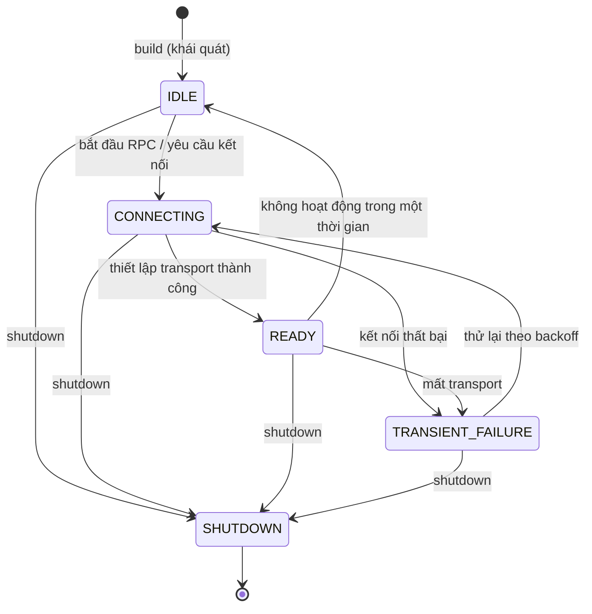
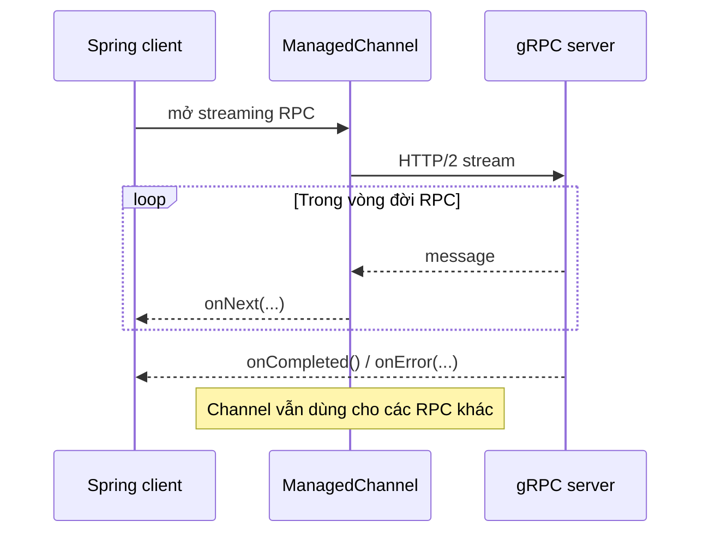

# ManagedChannel và vòng đời

## 1. Mục tiêu học tập

Trong gRPC Java, `ManagedChannel` là đầu mối mà client sử dụng để gọi một dịch vụ từ xa. Khi phát triển ứng dụng Spring, việc quản lý channel đúng cách ảnh hưởng trực tiếp đến độ trễ, số lượng kết nối, khả năng phục hồi sau lỗi và cách ứng dụng dừng an toàn.

Sau bài này, bạn có thể:

- Phân biệt `ManagedChannel`, kết nối mạng thực tế, generated stub và một lần gọi RPC.
- Thiết kế một channel dùng lại cho nhiều lời gọi unary hoặc streaming thay vì tạo channel cho từng request.
- Giải thích các trạng thái kết nối và giới hạn của việc quan sát chúng.
- Tạo, chia sẻ và đóng channel theo vòng đời bean trong Spring; xác định rõ thành phần nào chịu trách nhiệm đóng.
- Kết hợp deadline, TLS, interceptor, metadata và giám sát mà không trộn lẫn vòng đời RPC với vòng đời channel.
- Kiểm thử việc gọi RPC và thu hồi tài nguyên khi ứng dụng kết thúc.

**Bối cảnh:** Spring gRPC kết hợp hợp đồng Protocol Buffers, mã Java sinh từ `.proto`, client/server gRPC và quản lý thành phần theo Spring. Bài tập trung vào phía client. Các ví dụ tạo channel trực tiếp bằng API gRPC Java để làm rõ vòng đời; với channel do thư viện tích hợp Spring gRPC tạo sẵn, cần dùng cơ chế quản lý vòng đời của chính thư viện đó.

## 2. `ManagedChannel` là gì?

Một dịch vụ gRPC thường bắt đầu từ hợp đồng `.proto`. Công cụ sinh mã Java tạo ra message và lớp stub. Stub sử dụng một `Channel` để gửi RPC; `ManagedChannel` là một triển khai channel có thêm khả năng quản lý kết nối và đóng tài nguyên.

```mermaid
flowchart LR
    A[Spring service / Controller] --> B[Generated gRPC stub]
    B --> C[ManagedChannel]
    C --> D[Name resolver]
    C --> E[Load balancer]
    D --> E
    E --> F[HTTP/2 transport(s)]
    F --> G[gRPC server]
```

Sơ đồ mô tả quan hệ khái quát; resolver, load balancer và transport là các thành phần nội bộ của quá trình lựa chọn đầu cuối và gửi lời gọi.

Điểm quan trọng là **một `ManagedChannel` không đồng nghĩa với một TCP socket**. Channel là đối tượng logic lâu sống: tùy cấu hình và trạng thái, gRPC có thể chưa mở kết nối, mở lại kết nối, chọn nhiều địa chỉ hoặc sử dụng transport khác nhau. Một lời gọi RPC cũng không đồng nghĩa với một channel; nhiều RPC có thể chạy đồng thời trên cùng channel và HTTP/2 có thể ghép nhiều stream lên kết nối.

| Khái niệm | Vai trò | Vòng đời điển hình |
|---|---|---|
| `ManagedChannel` | Cung cấp đường đi tới một đích gRPC, điều phối kết nối và tài nguyên | Theo client/service hoặc theo ứng dụng |
| Generated stub, ví dụ `GreeterGrpc.GreeterBlockingStub` | API Java để gọi các phương thức trong `.proto` | Có thể giữ và tái sử dụng; cấu hình từng lời gọi bằng `with...()` |
| RPC unary | Một request, một response | Từ lúc bắt đầu gọi đến khi có kết quả hoặc lỗi |
| RPC streaming | Một hoặc hai luồng message trong một RPC | Có thể dài hơn unary rất nhiều; vẫn là một RPC riêng |
| HTTP/2 transport | Kết nối mạng được gRPC dùng để truyền tải | Do gRPC thiết lập, tái kết nối và thu hồi |

`ManagedChannel` và các stub sinh bởi gRPC Java được thiết kế để sử dụng đồng thời. Thông thường, một ứng dụng giữ **một channel cho một đích logic và cấu hình kết nối tương ứng**, rồi tạo hoặc tái sử dụng các stub trên channel đó. Không mở một channel mới trong mỗi HTTP request đi vào Spring controller: cách này gây thêm bắt tay kết nối, tăng socket/thread, tăng độ trễ và dễ rò rỉ tài nguyên.

Một channel có thể phục vụ nhiều stub của nhiều service cùng ở một đích phù hợp. Ngược lại, hai hệ thống có địa chỉ, chứng chỉ, chính sách xác thực hoặc cấu hình kết nối khác nhau thường cần channel tách biệt. Không có quy tắc cố định rằng toàn bộ ứng dụng chỉ được có đúng một channel.

## 3. Ví dụ hợp đồng và lời gọi đầu tiên

Giả sử server khai báo hợp đồng `greeter.proto`:

```proto
syntax = "proto3";

package tutorial.hello;
option java_package = "dev.example.hello";
option java_multiple_files = true;

service Greeter {
  rpc SayHello (HelloRequest) returns (HelloReply);
}

message HelloRequest {
  string name = 1;
}

message HelloReply {
  string message = 1;
}
```

Sau bước sinh mã Protocol Buffers/gRPC, phía Java có các kiểu như `HelloRequest`, `HelloReply` và `GreeterGrpc`. Ví dụ dưới đây gọi unary RPC bằng API gRPC Java. Server thử nghiệm ở `localhost:9090` được giả định đã chạy và có service `Greeter`.

```java
import dev.example.hello.GreeterGrpc;
import dev.example.hello.HelloReply;
import dev.example.hello.HelloRequest;
import io.grpc.Grpc;
import io.grpc.InsecureChannelCredentials;
import io.grpc.ManagedChannel;
import java.util.concurrent.TimeUnit;

public class GreeterDemo {
    public static void main(String[] args) throws InterruptedException {
        ManagedChannel channel = Grpc.newChannelBuilderForAddress(
                "localhost", 9090, InsecureChannelCredentials.create())
                .build();

        try {
            GreeterGrpc.GreeterBlockingStub stub =
                    GreeterGrpc.newBlockingStub(channel);
            HelloReply reply = stub.withDeadlineAfter(2, TimeUnit.SECONDS)
                    .sayHello(HelloRequest.newBuilder().setName("Lan").build());
            System.out.println(reply.getMessage());
        } finally {
            channel.shutdown();
            if (!channel.awaitTermination(5, TimeUnit.SECONDS)) {
                channel.shutdownNow();
                channel.awaitTermination(2, TimeUnit.SECONDS);
            }
        }
    }
}
```

`InsecureChannelCredentials` cho phép kết nối không TLS, chỉ phù hợp môi trường phát triển hoặc mạng thử nghiệm đã được kiểm soát. Khi kết nối tới hệ thống thực, sử dụng TLS và cấu hình chứng chỉ phù hợp (xem mục 8).

Quan sát ba điểm trong ví dụ:

1. `build()` tạo đối tượng channel nhưng **không bảo đảm server đã sẵn sàng**; việc thiết lập transport có thể diễn ra khi một RPC được gọi.
2. `withDeadlineAfter(...)` trả về **một stub mới** có deadline cho lời gọi, không sửa stub gốc hay đóng channel.
3. `shutdown()` là thao tác của *chủ sở hữu channel*. Nó không phải thao tác cần thực hiện sau mỗi RPC khi channel đang được chia sẻ.

Trong ứng dụng server Spring chạy dài hạn, chuyển quyền sở hữu channel sang bean hoặc cơ chế quản lý channel của framework thay vì sử dụng `try/finally` quanh từng request.

## 4. Các trạng thái của channel

gRPC Java cung cấp `ConnectivityState` để quan sát trạng thái kết nối tổng hợp của channel.

| Trạng thái | Ý nghĩa thực tế | Lưu ý khi xử lý |
|---|---|---|
| `IDLE` | Channel không chủ động kết nối ở thời điểm quan sát | Có thể là lúc mới tạo hoặc sau thời gian không sử dụng; RPC mới thường kích hoạt kết nối |
| `CONNECTING` | gRPC đang phân giải địa chỉ hoặc thiết lập kết nối/transport | Chưa đồng nghĩa RPC đã có thể thành công |
| `READY` | Channel đang có transport sẵn sàng phục vụ RPC | Không bảo đảm mọi RPC đều thành công; server vẫn có thể trả lỗi nghiệp vụ |
| `TRANSIENT_FAILURE` | Một lần hoặc một đợt thiết lập/sử dụng transport gặp lỗi; gRPC có thể thử lại sau backoff | Không nên lập tức hủy rồi tạo lại channel trong mỗi lần gặp trạng thái này |
| `SHUTDOWN` | Đã bắt đầu đóng channel; không tiếp nhận RPC mới | Trạng thái cuối của vòng đời channel |



Đây là **sơ đồ khái quát** để học cách suy luận, không phải cam kết rằng mọi cấu hình và mọi lần thay đổi trạng thái đều đi qua đúng các mũi tên trên. Trong thực tế, tên miền có thể phân giải ra nhiều địa chỉ và kết nối có thể thay đổi trong khi client tiếp tục gửi RPC.

### Đọc trạng thái và nhận thông báo

```java
ConnectivityState state = channel.getState(false);
System.out.println("Channel state: " + state);

ConnectivityState observed = channel.getState(true);
channel.notifyWhenStateChanged(observed, () -> {
    ConnectivityState current = channel.getState(false);
    System.out.println("State changed: " + observed + " -> " + current);
});
```

Các API trên thuộc `io.grpc.ManagedChannel` và `io.grpc.ConnectivityState`:

- `getState(false)` lấy **ảnh chụp** hiện tại và không yêu cầu kết nối mới.
- `getState(true)` có thể khiến channel rời `IDLE` để thử kết nối; nó không chờ tới khi `READY`.
- `notifyWhenStateChanged(source, callback)` chỉ đăng ký **một lần** cho tới khi trạng thái rời khỏi `source`. Muốn theo dõi liên tục phải đăng ký lại sau khi callback chạy.
- Callback nên ngắn, không blocking; không dùng nó để chạy tác vụ mạng nặng hoặc thay thế quy trình kiểm tra sức khỏe service.

Trạng thái `READY` chỉ mô tả một phần khả năng truyền tải. Nó không chứng minh rằng một phương thức nghiệp vụ cụ thể hoạt động, rằng xác thực hợp lệ, hoặc rằng hệ thống đang đáp ứng ngưỡng độ trễ. Để đánh giá sức khỏe thực tế, hãy quan sát kết quả RPC, deadline, gRPC Health Checking (nếu server triển khai) và các chỉ số thích hợp.

## 5. Vòng đời chuẩn: tạo, tái sử dụng, dừng

### Giai đoạn tạo và sử dụng

1. **Tạo channel:** chọn đích logic, thông tin bảo mật và các tùy chọn như resolver, cân bằng tải, kích thước message.
2. **Tạo stub:** `GreeterGrpc.newBlockingStub(channel)` hoặc các dạng async/future tùy API đã sinh.
3. **Gửi RPC:** đặt deadline và thông tin riêng cho lời gọi; sử dụng lại channel cho các RPC tiếp theo.
4. **Phục hồi kết nối:** để cơ chế reconnect/backoff của gRPC quản lý các lỗi transport thông thường; xử lý lỗi ở cấp RPC theo chính sách nghiệp vụ.
5. **Dừng ứng dụng:** ngừng nhận công việc mới, cho các RPC đang xử lý thời gian hoàn tất, đóng channel bằng thời hạn xác định, rồi buộc đóng nếu cần.

### Khác biệt giữa các thao tác dừng

| API | Tác động | Trường hợp sử dụng |
|---|---|---|
| `shutdown()` | Khởi động dừng có trật tự; RPC mới không được nhận, RPC đã bắt đầu có cơ hội hoàn tất | Dừng ứng dụng bình thường |
| `awaitTermination(timeout, unit)` | Chặn thread gọi trong tối đa một khoảng thời gian để đợi channel kết thúc hoàn toàn | Chờ thu hồi tài nguyên ở luồng shutdown |
| `shutdownNow()` | Yêu cầu dừng khẩn cấp và hủy các RPC còn lại | Hết ngân sách thời gian shutdown hoặc lỗi nghiêm trọng |
| `isShutdown()` | Cho biết quá trình shutdown đã được khởi động | Kiểm tra trạng thái, không đồng nghĩa mọi tài nguyên đã giải phóng |
| `isTerminated()` | Cho biết channel đã kết thúc hoàn toàn | Xác minh đóng xong |

Một trình tự thường dùng:

```java
channel.shutdown();
try {
    if (!channel.awaitTermination(5, TimeUnit.SECONDS)) {
        channel.shutdownNow();
        channel.awaitTermination(2, TimeUnit.SECONDS);
    }
} catch (InterruptedException e) {
    channel.shutdownNow();
    Thread.currentThread().interrupt();
}
```

Thời hạn `5 + 2` giây chỉ là ví dụ; chọn theo thời gian dừng cho phép của ứng dụng. `shutdownNow()` yêu cầu hủy công việc còn lại nhưng không bảo đảm giải phóng mọi tài nguyên ngay tức khắc. Không gọi `awaitTermination(...)` trên thread xử lý RPC hoặc event loop đang cần tiếp tục phục vụ tải. Sau `shutdown()`, không tái sử dụng channel để gửi RPC mới.

Các thao tác như `enterIdle()` và `resetConnectBackoff()` dành cho tình huống điều khiển kết nối đặc biệt. Chúng không thay thế `shutdown()` và hiếm khi cần trong logic nghiệp vụ thông thường.

## 6. Gắn quyền sở hữu channel với Spring

Trong Spring, một đối tượng `ManagedChannel` thường sống lâu hơn một lần xử lý request. Phạm vi singleton theo ứng dụng là điểm khởi đầu hợp lý nếu một client dùng chung đích và cấu hình.

Có hai cách quản lý phổ biến:

- **Framework tạo channel:** cấu hình qua cơ chế client/channel của phiên bản Spring gRPC đang dùng, rồi inject client hoặc channel theo API tương ứng. Framework là bên sở hữu vòng đời; không tự gọi `shutdown()` đối với channel mà một thành phần khác vẫn đang dùng.
- **Ứng dụng tự tạo channel:** khai báo singleton bean hoặc component và tự chịu trách nhiệm đóng khi Spring context kết thúc. Cách này hữu ích để hiểu vòng đời và khi cần tùy biến trực tiếp gRPC Java.

Ví dụ dưới đây cho thấy **một Spring component tự sở hữu channel**. Các kiểu `GreeterGrpc`, `HelloRequest`, `HelloReply` là mã đã sinh từ hợp đồng ở mục 3.

```java
package dev.example.client;

import dev.example.hello.GreeterGrpc;
import dev.example.hello.HelloReply;
import dev.example.hello.HelloRequest;
import io.grpc.Grpc;
import io.grpc.InsecureChannelCredentials;
import io.grpc.ManagedChannel;
import java.util.concurrent.TimeUnit;
import org.springframework.beans.factory.DisposableBean;
import org.springframework.beans.factory.annotation.Value;
import org.springframework.stereotype.Component;

@Component
public final class GreetingRpcClient implements DisposableBean {
    private final ManagedChannel channel;
    private final GreeterGrpc.GreeterBlockingStub stub;

    public GreetingRpcClient(
            @Value("${demo.grpc.greeter.host:localhost}") String host,
            @Value("${demo.grpc.greeter.port:9090}") int port) {
        this.channel = Grpc.newChannelBuilderForAddress(
                host, port, InsecureChannelCredentials.create()).build();
        this.stub = GreeterGrpc.newBlockingStub(channel);
    }

    public String greet(String name) {
        HelloRequest request = HelloRequest.newBuilder().setName(name).build();
        HelloReply reply = stub.withDeadlineAfter(2, TimeUnit.SECONDS)
                .sayHello(request);
        return reply.getMessage();
    }

    @Override
    public void destroy() {
        channel.shutdown();
        try {
            if (!channel.awaitTermination(5, TimeUnit.SECONDS)) {
                channel.shutdownNow();
                channel.awaitTermination(2, TimeUnit.SECONDS);
            }
        } catch (InterruptedException e) {
            channel.shutdownNow();
            Thread.currentThread().interrupt();
        }
    }
}
```

Cấu hình tối thiểu cho ví dụ:

```yaml
demo:
  grpc:
    greeter:
      host: localhost
      port: 9090
```

Giá trị mặc định và kết nối không TLS trong ví dụ phục vụ phát triển local. Khi triển khai thật, lấy đích và thông tin TLS từ cấu hình theo môi trường. Không đặt token hoặc khóa riêng trực tiếp trong mã.

Vì `GreetingRpcClient` sở hữu channel riêng, `DisposableBean.destroy()` là nơi đóng channel đúng thời điểm. Nếu tách riêng `ManagedChannel` thành một `@Bean`, có thể để container gọi `shutdown` bằng `@Bean(destroyMethod = "shutdown")`; khi cần chờ hoàn tất có thời hạn, nên dùng một thành phần quản lý shutdown có chủ sở hữu rõ ràng. Tránh cả bean lẫn client cùng cố đóng một channel.

Với server Spring, hãy cân nhắc thứ tự dừng: ngừng nhận HTTP/RPC mới và dừng các tác vụ phụ thuộc trước khi dừng channel dùng để gọi dịch vụ ngoài. Trường hợp phức tạp có thể điều phối bằng lifecycle của Spring (`SmartLifecycle` hoặc cơ chế shutdown phù hợp) để tránh bean còn gửi RPC sau khi channel đã đóng. Không lưu channel trong bean có scope request rồi tạo lại ở mỗi request.

## 7. Deadline, status và việc phục hồi lỗi

Deadline thuộc về **mỗi RPC**, không thuộc về vòng đời `ManagedChannel`. Khi một RPC hết thời gian, nó có thể kết thúc với `DEADLINE_EXCEEDED`; channel vẫn có thể `READY` và tiếp tục phục vụ các RPC khác.

```java
GreeterGrpc.GreeterBlockingStub fastStub =
        stub.withDeadlineAfter(300, TimeUnit.MILLISECONDS);

try {
    fastStub.sayHello(HelloRequest.newBuilder().setName("Lan").build());
} catch (io.grpc.StatusRuntimeException e) {
    switch (e.getStatus().getCode()) {
        case DEADLINE_EXCEEDED -> System.err.println("RPC quá thời hạn");
        case UNAVAILABLE -> System.err.println("Dịch vụ/transport chưa sẵn sàng");
        default -> System.err.println("RPC thất bại: " + e.getStatus());
    }
}
```

Ví dụ `switch` dùng cú pháp Java hiện đại. Khi dùng Java cũ hơn, thay bằng `switch` statement tương ứng.

Các lựa chọn cần hiểu:

| Tình huống | Hành vi phù hợp |
|---|---|
| RPC trả `DEADLINE_EXCEEDED` | Kiểm tra ngân sách thời gian, tải và độ trễ; không đóng channel chỉ vì một RPC hết hạn |
| RPC trả `UNAVAILABLE` | Kiểm tra địa chỉ, DNS, TLS, kết nối, server; gRPC có thể tự thử kết nối lại |
| Cần chờ server tạm thời chưa sẵn sàng | Cân nhắc `withWaitForReady()` **kèm deadline**, vì lời gọi có thể phải chờ kết nối trở lại |
| Muốn tự retry | Chỉ retry theo ngân sách và tính chất idempotent của nghiệp vụ; tránh nhân đôi tác vụ có tác dụng phụ |
| RPC bị hủy | Hủy lời gọi hoặc stream tương ứng; không hủy channel đang được các RPC khác dùng |

`withWaitForReady()` không có nghĩa mọi lỗi ứng dụng đều được thử lại. Nó chủ yếu thay đổi cách xử lý lời gọi khi chưa có transport sẵn sàng. Luôn dùng deadline để tránh chờ vô hạn về mặt nghiệp vụ.

Phân biệt `Status.Code.CANCELLED`, `DEADLINE_EXCEEDED`, `UNAVAILABLE`, `UNAUTHENTICATED`, `PERMISSION_DENIED` và `RESOURCE_EXHAUSTED` khi vận hành. Mỗi mã gợi ý nhóm nguyên nhân khác nhau. Ví dụ, lỗi xác thực thường cần sửa credential/metadata hoặc quyền truy cập; tạo channel mới lặp đi lặp lại không giải quyết được.

## 8. TLS, metadata và interceptor gắn ở đâu?

Một channel mang cấu hình **kết nối**: địa chỉ đích, transport security, đôi khi cân bằng tải và chính sách kết nối. Metadata và deadline thường mang phạm vi **RPC** hoặc phạm vi stub/interceptor.

### TLS cho kết nối thật

```java
import io.grpc.Grpc;
import io.grpc.ManagedChannel;
import io.grpc.TlsChannelCredentials;

ManagedChannel secureChannel = Grpc.newChannelBuilderForAddress(
        "grpc.example.com", 443, TlsChannelCredentials.create())
        .build();
```

Đoạn này dùng TLS và kho chứng chỉ tin cậy mặc định của môi trường. Trong hệ thống dùng CA nội bộ hoặc mTLS, cần cung cấp trust material và chứng chỉ/khóa client phù hợp với chính sách của server. Tên host dùng để kết nối phải phù hợp với danh tính được xác minh trong chứng chỉ; không được tắt xác minh TLS để “sửa nhanh” lỗi bắt tay ở production.

### Metadata và interceptor

Metadata có thể chuyển token xác thực, correlation ID hoặc thông tin định tuyến cho RPC. Trong gRPC Java, client interceptor có thể thêm metadata, log hoặc đo thời gian gọi. Ví dụ đơn giản gắn một header vào stub (giả sử đã có channel và token):

```java
import io.grpc.Metadata;
import io.grpc.stub.MetadataUtils;

Metadata headers = new Metadata();
Metadata.Key<String> requestIdKey =
        Metadata.Key.of("x-request-id", Metadata.ASCII_STRING_MARSHALLER);
headers.put(requestIdKey, "demo-request-001");

GreeterGrpc.GreeterBlockingStub tracedStub =
        GreeterGrpc.newBlockingStub(channel)
                .withInterceptors(MetadataUtils.newAttachHeadersInterceptor(headers));
```

Đây là minh họa metadata cố định. Request ID và token có thể đổi theo từng lời gọi; không gắn một request ID duy nhất lên singleton stub dùng cho mọi request, và không đưa token nhạy cảm vào log. Khi metadata thay đổi theo ngữ cảnh, dùng interceptor/credential provider thích hợp để lấy giá trị cho **từng RPC**. Cũng cần phân biệt `CallCredentials` (thông tin xác thực RPC) với `ChannelCredentials` (bảo mật transport).

Một interceptor được dùng xuyên suốt ứng dụng nên ít trạng thái thay đổi, thread-safe và có mục đích rõ ràng. Thêm interceptor chỉ cho một client cụ thể không có nghĩa phải tạo thêm kết nối mạng mới.

## 9. Streaming RPC có cần channel riêng không?

Không. Unary, server streaming, client streaming và bidirectional streaming đều dùng được channel chung. Điểm khác biệt là **thời gian tồn tại của một RPC stream** có thể rất dài, vì thế ảnh hưởng tới deadline, hủy, backpressure và quá trình shutdown.



Một số nguyên tắc thực hành:

- Đặt deadline hợp lý cho stream có thời lượng hữu hạn. Stream theo dõi liên tục cần chính sách riêng cho thời gian kết nối, heartbeat và tái đăng ký khi kết thúc.
- Nếu client không còn quan tâm kết quả, hủy **RPC đang chạy** theo API của stub/call/stream observer phù hợp; không gọi `shutdownNow()` cho channel chia sẻ.
- Với client/bidirectional streaming, tôn trọng cơ chế flow control/backpressure; không đẩy vô hạn message vào bộ đệm chỉ vì đã có kết nối.
- Khi dừng Spring context, các stream dài hạn có thể ngăn graceful shutdown hoàn tất. Chủ động đóng hoặc hủy chúng trong giai đoạn ngừng nhận công việc mới, sau đó mới đóng channel có giới hạn thời gian.

## 10. Khả năng phục hồi và vận hành

`ManagedChannel` xử lý nhiều việc ở tầng transport nhưng không thay thế thiết kế chịu lỗi ở tầng ứng dụng.

### Resolver, cân bằng tải và reconnect

Channel chọn đầu cuối dựa trên target, name resolver và chính sách load balancing được cấu hình. Với một tên dịch vụ có nhiều địa chỉ, chính sách chọn địa chỉ ảnh hưởng tới nơi RPC được gửi. Cần kiểm tra cách DNS/service discovery hoạt động trong môi trường chạy trước khi chọn cấu hình cân bằng tải. Một ví dụ của gRPC Java là chính sách `round_robin` khi môi trường hỗ trợ và resolver cung cấp nhiều địa chỉ phù hợp.

Các lỗi transport tạm thời thường được gRPC tự reconnect với backoff. Việc viết vòng lặp “gặp `UNAVAILABLE` → đóng channel → tạo channel mới” dễ làm tình hình tệ hơn vì mất trạng thái tái kết nối, tạo đợt tăng kết nối và có thể bỏ qua deadline của RPC. Nếu cần retry ở cấp ứng dụng, hãy đưa ra giới hạn số lần/giới hạn thời gian và chỉ retry thao tác an toàn.

### Keepalive và kích thước message

Keepalive có thể hỗ trợ phát hiện một số kết nối không còn hoạt động, nhưng ping quá dày có thể bị server hoặc proxy từ chối. Đặt keepalive theo chính sách hạ tầng, không xem nó là thay thế cho health checking hoặc deadline. Tương tự, giới hạn message phải được thống nhất giữa client/server; tăng vô hạn giới hạn nhận message có thể dẫn tới tiêu thụ bộ nhớ lớn.

### Nên quan sát những gì?

Để đánh giá hiệu năng và độ tin cậy của client Spring gRPC, ưu tiên đo:

| Nhóm chỉ số | Câu hỏi muốn trả lời |
|---|---|
| Số RPC, tỷ lệ thành công và mã `Status` | Phương thức nào đang lỗi? Lỗi do deadline, xác thực hay transport? |
| Độ trễ theo phương thức, P50/P95/P99 | Người dùng chịu độ trễ bao nhiêu và đuôi phân phối có tăng không? |
| RPC đang hoạt động và stream kéo dài | Có đang quá tải hoặc không kết thúc stream? |
| Kết nối/reconnect và trạng thái channel | Có flapping, vấn đề DNS, TLS hoặc cân bằng tải? |
| Tài nguyên process | Số thread, socket, CPU, bộ nhớ có tăng bất thường vì tạo channel liên tục? |

Có thể tích hợp logging, metrics và tracing bằng cơ chế quan sát phù hợp với phiên bản Spring gRPC/gRPC Java đang dùng, chẳng hạn các bộ đo tương thích OpenTelemetry. Không log metadata nhạy cảm. `getState(false)` chỉ nên là tín hiệu chẩn đoán bổ sung, không phải nguồn duy nhất để quyết định cho phép nghiệp vụ chạy.

## 11. Kiểm thử lifecycle

Để kiểm thử logic client mà không cần khởi động server mạng thật, gRPC Java cung cấp **in-process server/channel** qua module kiểm thử `grpc-inprocess`. Kiểm thử sau tập trung vào gọi unary và việc đóng tài nguyên, sử dụng chính các message/stub đã sinh từ `.proto`.

```java
import static org.junit.jupiter.api.Assertions.assertEquals;

import dev.example.hello.GreeterGrpc;
import dev.example.hello.HelloReply;
import dev.example.hello.HelloRequest;
import io.grpc.ManagedChannel;
import io.grpc.Server;
import io.grpc.inprocess.InProcessChannelBuilder;
import io.grpc.inprocess.InProcessServerBuilder;
import io.grpc.stub.StreamObserver;
import java.util.concurrent.TimeUnit;
import org.junit.jupiter.api.Test;

class GreeterChannelTest {
    @Test
    void reusesChannelAndClosesResources() throws Exception {
        String name = InProcessServerBuilder.generateName();
        Server server = InProcessServerBuilder.forName(name)
                .directExecutor()
                .addService(new GreeterGrpc.GreeterImplBase() {
                    @Override
                    public void sayHello(
                            HelloRequest request,
                            StreamObserver<HelloReply> responses) {
                        responses.onNext(HelloReply.newBuilder()
                                .setMessage("Chào " + request.getName())
                                .build());
                        responses.onCompleted();
                    }
                })
                .build()
                .start();
        ManagedChannel channel = InProcessChannelBuilder.forName(name)
                .directExecutor()
                .build();

        try {
            GreeterGrpc.GreeterBlockingStub stub =
                    GreeterGrpc.newBlockingStub(channel);
            for (String person : new String[] {"Lan", "Minh"}) {
                HelloReply reply = stub.withDeadlineAfter(1, TimeUnit.SECONDS)
                        .sayHello(HelloRequest.newBuilder()
                                .setName(person)
                                .build());
                assertEquals("Chào " + person, reply.getMessage());
            }
        } finally {
            channel.shutdownNow();
            channel.awaitTermination(2, TimeUnit.SECONDS);
            server.shutdownNow();
            server.awaitTermination(2, TimeUnit.SECONDS);
        }
    }
}
```

`directExecutor()` làm ví dụ đơn giản nhưng chỉ nên sử dụng trong kiểm thử ngắn và có kiểm soát. In-process test giúp kiểm tra xử lý RPC và lifecycle; nó **không kiểm chứng** DNS, TLS, HTTP/2 trên mạng thật hoặc tương tác với proxy. Với ứng dụng production, bổ sung integration test chạy qua cổng mạng thực, kiểm thử startup/shutdown của Spring context, lỗi mất kết nối và deadline dưới tải thích hợp.

Một kịch bản kiểm thử lifecycle có ích là: tạo client, gọi RPC thành công hai lần trên cùng channel, bắt đầu shutdown, xác nhận channel kết thúc trong ngân sách cho phép và xác nhận lời gọi mới sau khi shutdown thất bại theo mong đợi. Trong Spring, có thể chạy kiểm thử khởi động/đóng context để phát hiện channel không được thu hồi.

## 12. Lỗi thường gặp và cách xử lý

| Biểu hiện | Nguyên nhân cần kiểm tra | Hướng xử lý |
|---|---|---|
| Mỗi HTTP request tạo một `ManagedChannel` mới | Tạo channel trong method xử lý request | Chuyển channel về singleton bean/chủ sở hữu dài hạn |
| Thread/socket tăng dần sau nhiều lượt gọi | Bỏ qua shutdown của channel tự tạo | Đóng ở lifecycle của owner; quan sát `isTerminated()` khi shutdown |
| `UNAVAILABLE` lặp lại | Sai host/port, DNS, proxy, TLS, server chưa sẵn sàng | Kiểm tra kết nối và status/cause; không tái tạo channel vô hạn |
| Một RPC hết deadline làm những RPC khác bị hủy | Code gọi `shutdownNow()` khi một lời gọi timeout | Chỉ hủy RPC lỗi; giữ channel chung hoạt động |
| Startup kiểm tra `READY` rồi vẫn có RPC lỗi | Xem connectivity state là bảo đảm sức khỏe nghiệp vụ | Sử dụng health check và kết quả RPC thật; đặt deadline |
| Spring dừng nhưng vẫn thấy stream chưa kết thúc | Có stream dài hạn hoặc shutdown không giới hạn | Dừng nhận công việc, hủy/hoàn tất stream, đóng channel có timeout |
| `UNAUTHENTICATED` hoặc lỗi TLS | Sai credential, metadata hoặc chứng chỉ/hostname | Kiểm tra `CallCredentials`, trust chain, mTLS và quyền truy cập |
| Latency tăng và thấy ping bị từ chối | Keepalive quá dày so với server/proxy | Điều chỉnh theo chính sách hạ tầng, đo lại độ trễ và reconnect |

## 13. Bài tập thực hành

Bạn đang xây dựng một Spring service gọi `Greeter.SayHello`. Service phải chịu đồng thời nhiều HTTP request, trả lời trong tối đa hai giây mỗi RPC và kết thúc gọn khi Spring context đóng.

1. Dùng hợp đồng `.proto` ở mục 3 để sinh mã Java. Tạo một client bean giữ một `ManagedChannel` và một blocking stub, không tạo channel mỗi lần gọi.
2. Đặt deadline hai giây qua `withDeadlineAfter(...)`. Thử tắt server để quan sát `UNAVAILABLE` hoặc `DEADLINE_EXCEEDED`, tùy tình huống và thời điểm lỗi.
3. Ghi nhận `Status.Code`, thời lượng RPC và trạng thái channel ở thời điểm chẩn đoán. Giải thích tại sao `READY` không bảo đảm lời gọi thành công.
4. Thêm xử lý shutdown có timeout và kiểm tra không còn channel do ứng dụng tự tạo sau khi Spring context đóng.
5. Chuyển môi trường thử nghiệm sang TLS, cấu hình trust phù hợp và kiểm thử lỗi khi hostname không khớp chứng chỉ.

**Tiêu chí hoàn thành:** Có thể chỉ ra chính xác nơi channel được tạo, thành phần nào sử dụng nó, ai có quyền đóng nó, deadline nằm ở đâu và luồng thực hiện khi server tạm thời không sẵn sàng. Khi thay unary bằng streaming, giải thích được tại sao phải hủy một stream riêng lẻ trước khi cân nhắc đóng channel dùng chung.

## 14. Ghi nhớ khi thiết kế

Một `ManagedChannel` là tài nguyên logic **dài hạn**, còn mỗi RPC là công việc **ngắn hạn hoặc có vòng đời riêng**. Thiết kế Spring gRPC vững chắc bắt đầu bằng việc chọn đúng chủ sở hữu channel, dùng lại channel và stub, đặt deadline cho lời gọi, xử lý status ở đúng cấp và đóng tài nguyên có trật tự khi ứng dụng kết thúc. Các trạng thái kết nối hỗ trợ chẩn đoán; chúng không thay thế quan sát RPC, bảo mật TLS và kiểm thử tích hợp trên hạ tầng thật.
