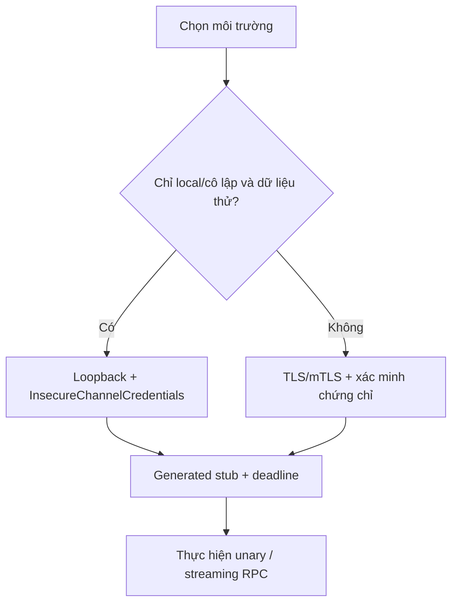

# Kết nối plaintext trong môi trường phát triển

## 1. Mục tiêu và phạm vi

Khi phát triển dịch vụ **Spring gRPC** trên máy cá nhân, nhóm thường muốn chạy client và server nhanh, quan sát request/response và kiểm thử hợp đồng Protocol Buffers trước khi cấu hình chứng chỉ TLS. **Kết nối plaintext** cho phép gRPC truyền dữ liệu qua HTTP/2 mà không mã hóa kênh truyền. Đây là lựa chọn hữu ích cho máy local hoặc môi trường kiểm thử cô lập, nhưng cần hiểu chính xác giới hạn bảo mật và cách chuyển sang TLS khi triển khai thật.

Sau bài này, bạn có thể:

- Giải thích plaintext trong gRPC khác gì TLS, HTTP/1.1 và REST/JSON.
- Tạo server và client gRPC Java truyền plaintext, dùng đúng mã sinh từ `.proto`.
- Giới hạn server thử nghiệm trên loopback và kiểm soát cổng lộ ra ngoài.
- Khai báo client plaintext dưới dạng bean Spring có vòng đời rõ ràng.
- Kiểm tra kết nối bằng `grpcurl`, deadline, status và log để tìm lỗi sai port hoặc không khớp TLS.
- Viết integration test qua HTTP/2 plaintext thực sự và nhận diện khi nào phải dùng TLS/mTLS.

**Vị trí trong chương “Channel và connection”:** bài này nghiên cứu **chế độ bảo mật của đường truyền** khi tạo channel và server ở môi trường phát triển. Một `ManagedChannel` có thể được dùng lại cho nhiều unary/streaming RPC và phải được đóng khi chủ sở hữu kết thúc; lựa chọn plaintext không thay đổi các nguyên tắc vòng đời đó.

## 2. Plaintext trong gRPC thực chất là gì?

gRPC Java thường sử dụng **HTTP/2** làm giao thức truyền tải và **Protocol Buffers** để mã hóa message. Cụm từ *plaintext connection* chỉ việc **không sử dụng TLS trên kết nối transport**; nó không có nghĩa payload được chuyển thành chuỗi dễ đọc.

| Đặc điểm | gRPC plaintext | gRPC qua TLS |
|---|---|---|
| Giao thức RPC | gRPC trên HTTP/2 | gRPC trên HTTP/2 |
| Payload | Thường là Protobuf nhị phân | Thường là Protobuf nhị phân |
| Mã hóa trên đường truyền | Không | Có, khi TLS được cấu hình và xác minh đúng |
| Xác minh danh tính đối tác bằng chứng chỉ TLS | Không | Có đối với server; mTLS còn xác minh client |
| Bảo vệ metadata và nội dung RPC khỏi nghe lén trên mạng | Không | Có trên đoạn kết nối được TLS bảo vệ |
| Nơi sử dụng phù hợp | Loopback, môi trường kiểm thử cô lập có kiểm soát | Môi trường thực, mạng không tin cậy, luồng dữ liệu nhạy cảm |

Trong giao tiếp plaintext, dữ liệu có thể nhìn thấy trên mạng dù thông điệp Protobuf không thuận tiện để đọc trực tiếp như JSON. Không được nhầm **mã hóa định dạng (serialization)** với **mã hóa bảo mật (encryption)**. Metadata như `authorization` cũng được truyền không có lớp bảo vệ TLS nếu cố gửi trên channel này.

Một số tài liệu dùng từ **h2c** để chỉ HTTP/2 không TLS. gRPC Java plaintext thông thường nói chuyện HTTP/2 trực tiếp (*prior knowledge*), không tự biến thành REST HTTP/1.1 hoặc tự nâng cấp mọi request HTTP/1.1 thành gRPC. Vì vậy, dùng `curl` thông thường gửi `GET /` vào cổng gRPC thường không phải phép thử đúng.


**Ranh giới tin cậy** là yếu tố quyết định. `localhost` có thể thích hợp để học, nhưng một cổng plaintext mở trên mọi giao diện mạng, một dịch vụ trong Kubernetes hoặc một kết nối đi qua proxy vẫn có thể bị thiết bị/người khác trên đường truyền quan sát. “Chỉ dùng nội bộ” không tự động đồng nghĩa với “đã bảo mật”.

## 3. Điều kiện trước khi chạy ví dụ

Các ví dụ sử dụng Java với gRPC Java transport và mã được sinh từ hợp đồng Protocol Buffers. Một dự án Spring gRPC thường có:

- Công cụ sinh Java message từ `.proto` (`protoc`) và sinh gRPC stub (`protoc-gen-grpc-java`).
- API gRPC cho stub, Protobuf và một HTTP/2 transport, chẳng hạn `grpc-netty-shaded`.
- Các thư viện Spring Framework/Spring Boot tương ứng nếu dùng phần tích hợp Spring.
- Một cổng local trống, ở đây chọn `127.0.0.1:9090`.

Phiên bản công cụ sinh mã và thư viện runtime phải tương thích. Bài dùng các API `Grpc`, `InsecureChannelCredentials` và `TlsChannelCredentials` của gRPC Java; với hệ thống dùng API đời cũ, tên builder có thể khác. Để làm rõ bản chất kết nối, phần đầu tạo client/server bằng API gRPC Java thuần; sau đó đưa client vào vòng đời Spring. Khi dùng **Spring gRPC starter** để framework tự tạo server/channel, cần cấu hình bảo mật bằng đúng cơ chế của phiên bản starter đang sử dụng, tránh đồng thời tạo thêm server trên cùng một cổng.

### Hợp đồng `greeter.proto`

Đặt một file ví dụ tại `src/main/proto/greeter.proto`:

```proto
syntax = "proto3";

package demo.greeter;

option java_package = "dev.example.hello";
option java_multiple_files = true;

service Greeter {
  rpc SayHello (HelloRequest) returns (HelloReply);
}

message HelloRequest {
  string name = 1;
}

message HelloReply {
  string message = 1;
}
```

Sau khi sinh mã, các class Java nằm trong package `dev.example.hello`, gồm `GreeterGrpc`, `HelloRequest` và `HelloReply`. **Tên service để gọi bằng công cụ gRPC** là `demo.greeter.Greeter`, theo `package` của `.proto`; không nhầm với Java package được tạo bởi `java_package`.

## 4. Dựng server gRPC plaintext trên máy local

Để giữ dịch vụ thử nghiệm khỏi các máy khác, ví dụ dùng **Netty transport** và bind trực tiếp địa chỉ loopback `127.0.0.1`.

```java
package dev.example.hello;

import io.grpc.Server;
import io.grpc.netty.shaded.io.grpc.netty.NettyServerBuilder;
import io.grpc.stub.StreamObserver;
import java.net.InetSocketAddress;
import java.util.concurrent.TimeUnit;

public final class LocalGreeterServer {
    public static final class GreeterService
            extends GreeterGrpc.GreeterImplBase {
        @Override
        public void sayHello(
                HelloRequest request,
                StreamObserver<HelloReply> responseObserver) {
            HelloReply reply = HelloReply.newBuilder()
                    .setMessage("Xin chào " + request.getName())
                    .build();
            responseObserver.onNext(reply);
            responseObserver.onCompleted();
        }
    }

    public static void main(String[] args) throws Exception {
        Server server = NettyServerBuilder
                .forAddress(new InetSocketAddress("127.0.0.1", 9090))
                .addService(new GreeterService())
                .build()
                .start();

        Runtime.getRuntime().addShutdownHook(new Thread(() -> {
            server.shutdown();
            try {
                if (!server.awaitTermination(5, TimeUnit.SECONDS)) {
                    server.shutdownNow();
                }
            } catch (InterruptedException e) {
                server.shutdownNow();
                Thread.currentThread().interrupt();
            }
        }));

        System.out.println("Plaintext gRPC at 127.0.0.1:9090");
        server.awaitTermination();
    }
}
```

Ở đây `NettyServerBuilder` không được cấu hình TLS/`sslContext`, nên server nhận kết nối gRPC plaintext. Dòng `forAddress` **giới hạn interface lắng nghe**. Server vẫn dùng Protocol Buffers và HTTP/2, không cần HTTP controller của Spring.

API gRPC Java còn cho phép khai báo plaintext tường minh bằng credentials:

```java
import io.grpc.Grpc;
import io.grpc.InsecureServerCredentials;

// Chỉ minh họa API tạo server không TLS.
// newServerBuilderForPort thường lắng nghe trên các interface mặc định;
// cần hạn chế truy cập trước khi dùng ngoài môi trường cô lập.
var builder = Grpc.newServerBuilderForPort(
        9090, InsecureServerCredentials.create());
```

Khi chạy local trên cùng máy, ưu tiên biến thể bind loopback ở trên. Server do Spring gRPC starter quản lý thường có cấu hình riêng về port, transport và security; đừng giả định tên property từ một bản hướng dẫn áp dụng cho mọi phiên bản.

## 5. Kết nối từ client Java bằng `InsecureChannelCredentials`

Client dùng cùng địa chỉ/port và đặt chế độ plaintext tường minh:

```java
package dev.example.hello;

import io.grpc.Grpc;
import io.grpc.InsecureChannelCredentials;
import io.grpc.ManagedChannel;
import io.grpc.StatusRuntimeException;
import java.util.concurrent.TimeUnit;

public final class LocalGreeterClient {
    public static void main(String[] args) throws InterruptedException {
        ManagedChannel channel = Grpc.newChannelBuilderForAddress(
                "127.0.0.1", 9090,
                InsecureChannelCredentials.create())
                .build();

        try {
            GreeterGrpc.GreeterBlockingStub stub =
                    GreeterGrpc.newBlockingStub(channel);
            HelloRequest request = HelloRequest.newBuilder()
                    .setName("Lan")
                    .build();

            HelloReply reply = stub
                    .withDeadlineAfter(2, TimeUnit.SECONDS)
                    .sayHello(request);
            System.out.println(reply.getMessage());
        } catch (StatusRuntimeException e) {
            System.err.println("RPC failed: " + e.getStatus());
        } finally {
            channel.shutdown();
            if (!channel.awaitTermination(5, TimeUnit.SECONDS)) {
                channel.shutdownNow();
                channel.awaitTermination(2, TimeUnit.SECONDS);
            }
        }
    }
}
```

Khi server ở mục 4 đang chạy, kết quả mong đợi:

```text
Xin chào Lan
```

Các điểm cần hiểu:

1. `InsecureChannelCredentials.create()` chỉ định rằng **không có TLS** cho channel này. Nó không tạo chứng chỉ giả và cũng không ngầm bật xác thực.
2. `.build()` tạo một đối tượng `ManagedChannel`. Lệnh này **không bảo đảm đã kết nối thành công**; lời gọi đầu tiên mới có thể kích hoạt việc thiết lập transport.
3. Deadline hai giây áp dụng **cho RPC**, không phải thời hạn tồn tại của channel. Nếu RPC timeout, channel vẫn có thể gọi tiếp.
4. Với chương trình demo ngắn, `finally` đóng channel. Trong ứng dụng Spring chạy dài, **không** đặt đoạn `shutdown()` sau mỗi HTTP request; chia sẻ channel và để chủ sở hữu đóng khi ứng dụng kết thúc.

Không sử dụng `ManagedChannelBuilder.forAddress(...).usePlaintext()` như một công thức chung cho mọi transport/version khi bạn đã có API credentials rõ ràng như trên; hai cách có thể cùng đạt mục tiêu plaintext trong các phiên bản hỗ trợ. Với code mới, nên chọn một cơ chế cấu hình nhất quán để người bảo trì hiểu rõ liệu channel có TLS hay không.

## 6. Đưa plaintext channel vào vòng đời Spring

Trong Spring, nhiều controller/service có thể gọi chung một backend gRPC. Khai báo channel dạng **singleton bean** tránh chi phí mở kết nối liên tục và cho phép Spring đóng nó khi context dừng.

Ví dụ chỉ kích hoạt bean này trong **profile `local`**, để cấu hình plaintext không bị đưa vào production do sơ suất:

```java
package dev.example.client;

import io.grpc.Grpc;
import io.grpc.InsecureChannelCredentials;
import io.grpc.ManagedChannel;
import org.springframework.beans.factory.annotation.Value;
import org.springframework.context.annotation.Bean;
import org.springframework.context.annotation.Configuration;
import org.springframework.context.annotation.Profile;

@Configuration(proxyBeanMethods = false)
@Profile("local")
public class LocalGrpcClientConfiguration {
    @Bean(destroyMethod = "shutdown")
    public ManagedChannel localGreeterChannel(
            @Value("${demo.grpc.greeter.host:127.0.0.1}") String host,
            @Value("${demo.grpc.greeter.port:9090}") int port) {
        return Grpc.newChannelBuilderForAddress(
                host, port, InsecureChannelCredentials.create())
                .build();
    }
}
```

Service sử dụng channel đã được inject:

```java
package dev.example.client;

import dev.example.hello.GreeterGrpc;
import dev.example.hello.HelloRequest;
import io.grpc.ManagedChannel;
import java.util.concurrent.TimeUnit;
import org.springframework.beans.factory.annotation.Qualifier;
import org.springframework.stereotype.Service;

@Service
public final class GreeterGateway {
    private final GreeterGrpc.GreeterBlockingStub stub;

    public GreeterGateway(
            @Qualifier("localGreeterChannel") ManagedChannel channel) {
        this.stub = GreeterGrpc.newBlockingStub(channel);
    }

    public String greet(String name) {
        return stub.withDeadlineAfter(2, TimeUnit.SECONDS)
                .sayHello(HelloRequest.newBuilder().setName(name).build())
                .getMessage();
    }
}
```

Trong `application-local.yml` của ví dụ:

```yaml
demo:
  grpc:
    greeter:
      host: 127.0.0.1
      port: 9090
```

Các property `demo.grpc.*` là **tên cấu hình tự đặt cho bài thực hành**, không phải property mặc định của Spring gRPC starter. Chạy ứng dụng với profile `local` chỉ ở môi trường phù hợp; môi trường khác phải cấp một `ManagedChannel` có TLS và cùng qualifier, hoặc dùng cơ chế client/channel được framework hỗ trợ. Nếu ứng dụng không cung cấp bean cần thiết, Spring sẽ phát hiện lỗi cấu hình khi tạo `GreeterGateway`, thay vì âm thầm dùng plaintext.

`@Bean(destroyMethod = "shutdown")` gọi lệnh dừng channel khi context đóng, nhưng lệnh đó **không chờ** tất cả RPC hoàn tất. Nếu ứng dụng cần graceful shutdown bảo đảm thời hạn, hãy dùng thành phần quản lý đóng có `awaitTermination()` và ngừng nhận công việc mới trước khi đóng channel; không để nhiều bean cùng sở hữu quyền `shutdown()` một channel.

Lưu ý khác: `GreeterGateway` dùng **blocking stub**. Đừng gọi phương thức blocking trên event-loop không được phép chặn; trong ứng dụng reactive hoặc tải cao, cân nhắc async stub và mô hình xử lý thread phù hợp.

### Còn server Spring gRPC thì sao?

Spring gRPC có thể tự phát hiện service đã đăng ký và khởi động server qua auto-configuration, tùy starter/phiên bản. Với mô hình đó, server và port/security phải được cấu hình thông qua tài liệu chính thức đúng phiên bản; **không** tạo thủ công một `Server` thứ hai dùng chung cổng. Ví dụ server thuần Java ở mục 4 được dùng để thực hành giao thức và giữ cho cấu hình security minh bạch. Nếu muốn tự quản lý hoàn toàn bằng Spring, có thể cung cấp bean `Server` được khởi động/dừng theo context, nhưng cần điều phối vòng đời và cổng thay vì chạy song song với auto-server.

## 7. Đảm bảo plaintext chỉ chạy trong vùng phát triển tin cậy

Trước khi bật plaintext, trả lời ba câu hỏi: **ai có thể kết nối**, **dữ liệu nào được gửi**, và **đường truyền đi qua những thiết bị nào**.

| Hoàn cảnh | Đánh giá và cách xử lý |
|---|---|
| Client/server cùng máy qua `127.0.0.1` | Phù hợp cho bài học; vẫn dùng dữ liệu giả và không để lộ bí mật trong log |
| Integration test trên runner cô lập | Có thể phù hợp nếu runner/port chỉ phục vụ bài test và bị thu hồi sau khi kết thúc |
| Container với `-p 9090:9090` | Cổng có thể được công bố trên các interface host; hạn chế mapping và firewall |
| Hai máy cùng LAN hoặc mạng Wi-Fi chia sẻ | Không coi là an toàn chỉ vì phục vụ phát triển; cân nhắc TLS |
| Kubernetes, cloud VM, load balancer hoặc ingress | Dùng TLS/mTLS theo chính sách; TLS tại ingress không tự bảo vệ đoạn backend plaintext |
| Payload có token thật, thông tin cá nhân hay dữ liệu sản xuất | Không truyền trên kết nối plaintext |

Ví dụ nếu server chạy **bên trong container** và lắng nghe `0.0.0.0:9090` trong container để nhận lưu lượng forwarded, có thể giới hạn cổng **host** về loopback:

```bash
docker run --rm -p 127.0.0.1:9090:9090 my-grpc-dev-image
```

Lệnh giả định image có sẵn và server trong container lắng nghe đúng cổng; nếu server chỉ bind `127.0.0.1` **bên trong container** như mục 4, port mapping từ host vào IP mạng container sẽ không đi đến socket đó. Khi cần port mapping, đổi bind address của server trong container cho phù hợp, đồng thời giữ mapping và chính sách firewall trên host. Không đưa cấu hình này ra môi trường công cộng.

Ngoài địa chỉ bind, nên dùng dữ liệu kiểm thử, token giả, cấu hình profile tách biệt và giới hạn quyền của môi trường. **Sự tiện lợi của plaintext không thay thế kiểm soát truy cập mạng**.

## 8. Kiểm tra bằng `grpcurl` thay vì HTTP request thông thường

`grpcurl` là công cụ dòng lệnh gửi RPC gRPC. Với kết nối không TLS, dùng cờ `-plaintext`:

```bash
grpcurl -plaintext \
  -import-path src/main/proto \
  -proto greeter.proto \
  -d '{"name":"Lan"}' \
  127.0.0.1:9090 demo.greeter.Greeter/SayHello
```

Kết quả ví dụ:

```json
{
  "message": "Xin chào Lan"
}
```

Cách gọi trên **không yêu cầu server bật reflection**, vì công cụ đã nhận hợp đồng `.proto` qua `-import-path` và `-proto`. Nếu server hỗ trợ *gRPC Server Reflection*, bạn có thể dùng `grpcurl -plaintext 127.0.0.1:9090 list`; nếu không bật reflection, lệnh `list` có thể báo lỗi dù RPC chính hoạt động bình thường.

Để so sánh, chạy cùng lời gọi nhưng **bỏ `-plaintext`** sẽ khiến nhiều cấu hình `grpcurl` mặc định thử TLS; server plaintext sẽ từ chối hoặc đóng kết nối. Thử nghiệm này giúp nhận diện lỗi **không khớp chế độ TLS**, không phải bằng chứng server không chạy.

Một phép thử kết nối TCP bằng `nc`/`Test-NetConnection` chỉ xác nhận cổng có thể tiếp cận. Nó không xác minh HTTP/2, hợp đồng gRPC, metadata hay nội dung RPC. `curl` HTTP/1.1 tới cổng gRPC plaintext cũng không thay thế `grpcurl`.

## 9. Phân biệt lỗi kết nối với lỗi RPC

Khi client gọi server plaintext, gRPC status giúp định hướng nguyên nhân, nhưng không phải lúc nào cũng chỉ ra chính xác một lỗi mạng.

```java
try {
    var response = stub.withDeadlineAfter(2, TimeUnit.SECONDS)
            .sayHello(HelloRequest.newBuilder().setName("Lan").build());
    System.out.println(response.getMessage());
} catch (io.grpc.StatusRuntimeException e) {
    switch (e.getStatus().getCode()) {
        case UNAVAILABLE -> System.err.println("Kiểm tra địa chỉ, cổng, TLS và server");
        case DEADLINE_EXCEEDED -> System.err.println("RPC vượt deadline");
        case UNIMPLEMENTED -> System.err.println("Sai tên service/method hoặc server chưa đăng ký");
        default -> System.err.println("RPC status: " + e.getStatus());
    }
}
```

Mã `switch` này yêu cầu cú pháp Java tương thích với *switch rule*. Trong Java cũ hơn, dùng `switch` statement truyền thống.

| Hiện tượng | Khả năng cần kiểm tra | Hành động chẩn đoán |
|---|---|---|
| `UNAVAILABLE: io exception` hoặc connection refused | Server chưa chạy, sai địa chỉ/port, cổng bị chặn | Kiểm tra bind address, cổng, firewall và process server |
| Thông báo liên quan TLS handshake/SSL hoặc HTTP/2 preface | Một đầu dùng TLS, đầu kia plaintext; proxy nói sai giao thức | Kiểm tra `InsecureChannelCredentials`, server TLS và cấu hình proxy |
| `DEADLINE_EXCEEDED` | Server chậm, resolver/transport chờ, lời gọi bị treo hoặc deadline quá ngắn | Kiểm tra log cả hai phía và thời lượng RPC; giữ deadline hữu hạn |
| `UNIMPLEMENTED` | Server chưa đăng ký phương thức hoặc gọi sai service full name | Kiểm tra hợp đồng `.proto`, generated code và danh sách service server |
| `UNKNOWN` hoặc `INTERNAL` | Lỗi xử lý server, vấn đề giao thức hoặc exception chưa được ánh xạ | Đối chiếu log server và status/cause client |
| `UNAUTHENTICATED` / `PERMISSION_DENIED` | Server có lớp xác thực/ủy quyền riêng hoặc yêu cầu credential | Kiểm tra interceptor, metadata và chính sách truy cập |

Không nên giải quyết mỗi lỗi bằng cách tạo `ManagedChannel` mới. gRPC Java có cơ chế thiết lập lại kết nối khi transport gặp lỗi; việc tạo channel liên tục làm tăng socket/thread và gây khó khăn khi chẩn đoán. Thử retry **RPC phù hợp** có giới hạn, dựa trên tính idempotent và deadline, không retry mù quáng các phương thức có tác dụng phụ.

## 10. Plaintext không làm mất metadata, deadline hoặc interceptor

Protocol Buffers và gRPC API vẫn hoạt động giống khi có TLS. Client có thể gửi metadata, đặt deadline, dùng interceptor cho tracing/metrics và nhận `Status`. Điểm khác biệt là **metadata trên dây không được TLS bảo vệ**.

```java
import io.grpc.Metadata;
import io.grpc.stub.MetadataUtils;

Metadata metadata = new Metadata();
Metadata.Key<String> correlationKey = Metadata.Key.of(
        "x-correlation-id", Metadata.ASCII_STRING_MARSHALLER);
metadata.put(correlationKey, "local-demo-001");

GreeterGrpc.GreeterBlockingStub tracedStub = stub.withInterceptors(
        MetadataUtils.newAttachHeadersInterceptor(metadata));

HelloReply reply = tracedStub
        .withDeadlineAfter(2, TimeUnit.SECONDS)
        .sayHello(HelloRequest.newBuilder().setName("Lan").build());
```

Đây là ví dụ metadata không nhạy cảm dùng cho một lượt thử. Với request ID thay đổi theo từng request, không gắn một giá trị cố định vào singleton stub phục vụ mọi request. Có thể dùng interceptor hoặc thành phần tạo metadata theo **mỗi RPC**. Không đặt JWT, API key, mật khẩu hoặc dữ liệu thật vào log, và không gửi credential sản xuất qua plaintext để “test nhanh”.

Mọi kiểu RPC đều có thể dùng plaintext channel:

| Kiểu RPC | Tác động của plaintext | Điểm cần kiểm soát |
|---|---|---|
| Unary | Một request và một response qua HTTP/2 không TLS | Deadline, timeout, status |
| Server streaming | Server gửi nhiều message trong một RPC | Hủy stream khi không cần, chọn thời hạn phù hợp |
| Client streaming | Client gửi dãy message trước khi nhận kết quả | Flow control/backpressure, xử lý lỗi giữa chừng |
| Bidirectional streaming | Hai phía có thể gửi message độc lập trong cùng một RPC | Bảo đảm vòng đời observer, hủy khi đóng ứng dụng |

Kết nối plaintext **không miễn trừ** backpressure, giới hạn message size, chính sách keepalive hoặc xử lý stream dài hạn. Một streaming RPC không yêu cầu channel riêng; khi stream hết hạn hoặc bị hủy, vẫn có thể dùng channel chung cho RPC khác.

## 11. Kiểm thử tích hợp thật qua loopback TCP

Kiểm thử *in-process* rất phù hợp để xác nhận logic handler nhưng không đi qua TCP/HTTP/2 thực. Muốn xác nhận cấu hình **plaintext connection**, hãy mở một server trên loopback với **cổng động** (`port = 0`) rồi kết nối bằng `InsecureChannelCredentials`.

Ví dụ JUnit 5 dưới đây sử dụng lại `LocalGreeterServer.GreeterService` ở mục 4:

```java
package dev.example.hello;

import static org.junit.jupiter.api.Assertions.assertEquals;
import static org.junit.jupiter.api.Assertions.assertTrue;

import io.grpc.Grpc;
import io.grpc.InsecureChannelCredentials;
import io.grpc.ManagedChannel;
import io.grpc.Server;
import io.grpc.netty.shaded.io.grpc.netty.NettyServerBuilder;
import java.net.InetSocketAddress;
import java.util.concurrent.TimeUnit;
import org.junit.jupiter.api.Test;

class PlaintextGrpcIntegrationTest {
    @Test
    void unaryRpcOverRealPlaintextTransport() throws Exception {
        Server server = NettyServerBuilder
                .forAddress(new InetSocketAddress("127.0.0.1", 0))
                .addService(new LocalGreeterServer.GreeterService())
                .build()
                .start();

        ManagedChannel channel = Grpc.newChannelBuilderForAddress(
                "127.0.0.1", server.getPort(),
                InsecureChannelCredentials.create())
                .build();

        try {
            var reply = GreeterGrpc.newBlockingStub(channel)
                    .withDeadlineAfter(2, TimeUnit.SECONDS)
                    .sayHello(HelloRequest.newBuilder()
                            .setName("Lan")
                            .build());
            assertEquals("Xin chào Lan", reply.getMessage());
        } finally {
            channel.shutdownNow();
            server.shutdownNow();
            assertTrue(channel.awaitTermination(3, TimeUnit.SECONDS));
            assertTrue(server.awaitTermination(3, TimeUnit.SECONDS));
        }
    }
}
```

Cổng 0 để hệ điều hành chọn một cổng trống, giúp các bài test tránh tranh chấp cổng 9090. `server.getPort()` trả về cổng đã bind. Test trên chứng minh client/server chạy được **gRPC qua TCP loopback không TLS**, bao gồm path và Protobuf handler. Nó **không** kiểm tra tính đúng đắn của TLS, xác thực, certificate chain, proxy hoặc mạng thực ngoài loopback.

Để tăng độ tin cậy, bổ sung các kiểm thử có chủ đích:

1. Tạm ngừng server hoặc gọi sai port, xác nhận client nhận `UNAVAILABLE`/deadline phù hợp thay vì treo vô hạn.
2. Gọi với deadline rất ngắn trên handler được tạo trễ có kiểm soát, xác nhận `DEADLINE_EXCEEDED` trong điều kiện phù hợp.
3. Thử client cấu hình TLS vào server plaintext để nhận diện handshake mismatch; không hard-code một message lỗi transport cụ thể vì phụ thuộc phiên bản và thời điểm.
4. Đóng Spring context, quan sát channel do ứng dụng sở hữu có được shutdown và không giữ process sống vô hạn.
5. Khi đưa TLS vào hệ thống, chạy một bộ integration test riêng xác minh chứng chỉ đúng/sai và mTLS nếu được yêu cầu.

## 12. Chuyển từ plaintext local sang TLS

Một thiết kế tốt giới hạn thay đổi bảo mật ở **cách xây dựng channel/server**, còn hợp đồng `.proto`, service handler và phần lớn logic stub giữ nguyên.



Đổi **client** sang TLS khi server tương ứng đã cấu hình TLS và chứng chỉ hợp lệ:

```java
import io.grpc.Grpc;
import io.grpc.ManagedChannel;
import io.grpc.TlsChannelCredentials;

ManagedChannel secureChannel = Grpc.newChannelBuilderForAddress(
        "grpc.example.com", 443,
        TlsChannelCredentials.create())
        .build();
```

`TlsChannelCredentials.create()` sử dụng cơ chế trust mặc định. Nếu server dùng CA nội bộ hoặc yêu cầu **mTLS**, phải cấu hình đúng trust certificate, client certificate và private key theo hệ thống đang vận hành. Server cũng phải có chứng chỉ TLS với danh tính phù hợp tên host; đổi phía client sang TLS mà server vẫn plaintext sẽ **không thành công**.

Ở môi trường thật, cần rà soát toàn tuyến: client → proxy/load balancer → server. Nếu TLS kết thúc tại proxy nhưng đoạn proxy → gRPC server là plaintext, nội dung RPC vẫn không được mã hóa trên đoạn đó. Chính sách bảo mật phải mô tả rõ đoạn nào được phép plaintext và cơ chế bảo vệ mạng liên quan. Với dữ liệu nhạy cảm, ưu tiên TLS/mTLS end-to-end hoặc kiến trúc bảo vệ tương đương đã được phê duyệt.

## 13. Checklist chẩn đoán thực hành

Trước khi nghi vấn `ManagedChannel` hoặc bản thân Protobuf, kiểm tra lần lượt:

1. **Server có thực sự chạy?** Nó đang bind `127.0.0.1:9090`, `0.0.0.0:9090`, hay địa chỉ trong container?
2. **Client có đúng đích?** `localhost` trong container không tự trỏ về máy host hay container khác; kiểm tra IP/DNS và port theo topology thực.
3. **Hai phía cùng chế độ TLS?** `InsecureChannelCredentials` chỉ hoạt động khi đường đi tới server chấp nhận plaintext; cổng TLS yêu cầu TLS client.
4. **Có nói đúng HTTP/2 gRPC?** HTTP/1.1 curl hoặc proxy chuyển sang HTTP/1.1 có thể làm lời gọi thất bại dù TCP mở.
5. **Hợp đồng khớp?** Tên đầy đủ `demo.greeter.Greeter/SayHello`, message schema và service registration đúng chưa?
6. **Có deadline?** RPC cần điểm kết thúc; tránh chờ vô hạn khi server mất kết nối.
7. **Lỗi xuất hiện ở đâu?** Đối chiếu `Status`, cause, log hai phía, tracing và số lượng kết nối; tuyệt đối không log credential thật.
8. **Ứng dụng đã đóng đúng cách?** Sau test hoặc khi Spring context kết thúc, gọi shutdown trên channel/server do chính thành phần đó sở hữu.

### Một số anti-pattern thường gặp

| Anti-pattern | Vì sao có vấn đề | Thay bằng |
|---|---|---|
| Mở cổng plaintext trên `0.0.0.0` ở laptop rồi gửi token thật | Máy khác có thể tiếp cận và nghe lén | Bind loopback; dùng dữ liệu giả; bật TLS khi kết nối qua mạng |
| Gắn `usePlaintext()` để “sửa” mọi lỗi TLS production | Bỏ xác minh chứng chỉ và mã hóa đường truyền | Sửa trust chain, hostname, cert hoặc cấu hình proxy |
| Chỉ thử bằng `curl http://localhost:9090/` | HTTP request thường không kiểm tra gRPC protocol | Dùng `grpcurl -plaintext` với `.proto` hoặc reflection |
| Mỗi request HTTP tạo một channel rồi bỏ quên | Tốn kết nối và rò rỉ tài nguyên | Chia sẻ channel Spring singleton và đóng ở lifecycle của owner |
| Coi `port open` là `RPC healthy` | TCP mở không chứng minh phương thức hoạt động | Gọi RPC thật có deadline và kiểm tra status |
| Dùng `-plaintext` với server bắt buộc TLS | Handshake/giao thức không khớp | Cấu hình TLS client cùng chứng chỉ tin cậy |
| Áp dụng property từ phiên bản Spring gRPC khác | Bản hiện tại có thể dùng API/tên property khác | Kiểm tra dependency và tài liệu đúng phiên bản |

## 14. Bài tập vận dụng

**Tình huống:** bạn phát triển một Spring service làm gateway HTTP, phía sau gọi `Greeter.SayHello` của gRPC server. Ban đầu cả hai chạy trên laptop để kiểm tra hợp đồng. Sau đó gateway chuyển sang container, và cuối cùng hệ thống triển khai sau ingress tại một môi trường dùng TLS.

**Yêu cầu:**

1. Sinh mã từ `greeter.proto`, chạy `LocalGreeterServer` trên loopback và dùng `LocalGreeterClient` gọi thành công. Kiểm tra response bằng `grpcurl -plaintext` có truyền `.proto`.
2. Khai báo một `ManagedChannel` dùng chung trong Spring với profile `local`, inject vào gateway và đặt deadline hai giây cho từng RPC. Đóng context và xác minh channel được đóng.
3. Cố tình đổi client từ plaintext sang TLS trong khi server vẫn plaintext. Ghi lại status và thông tin lỗi handshake; giải thích vì sao kết quả khác với lỗi tên method `UNIMPLEMENTED`.
4. Chạy test với cổng động và thêm một tình huống server không sẵn sàng. Phân biệt lỗi kết nối, lỗi deadline và lỗi service.
5. Thiết kế phương án chuyển gateway sang container: xác định chính xác địa chỉ `localhost` của mỗi tiến trình và cổng nào được expose. Không cho máy khác truy cập cổng plaintext.
6. Phác thảo cấu hình production: server TLS hoặc mTLS, trust chain, hostname và hành vi tại proxy/ingress. Cho biết phần nào của `.proto`/stub vẫn giữ nguyên.

**Tiêu chí hoàn thành:** người học có thể chứng minh lời gọi unary gRPC qua loopback plaintext, giải thích được vai trò của `InsecureChannelCredentials`, chỉ ra vì sao gRPC vẫn cần HTTP/2, tránh lộ port/token trong môi trường phát triển, và xác định rõ lúc nào đường truyền phải chuyển sang TLS.

## 15. Ghi nhớ

Plaintext là **gRPC qua HTTP/2 không có TLS**, phù hợp cho kiểm thử local có kiểm soát; nó không phải HTTP/1.1 và cũng không làm Protobuf thành văn bản có thể đọc. Trong Java, cấu hình qua `InsecureChannelCredentials` ở client và server transport không TLS; với Spring, giới hạn bằng profile môi trường và để bean/channel có chủ sở hữu vòng đời rõ ràng. Đo kết quả bằng RPC thật với deadline, `Status`, công cụ như `grpcurl` và integration test qua TCP. Khi dữ liệu hoặc mạng vượt khỏi vùng thử nghiệm tin cậy, chuyển sang TLS/mTLS đồng bộ ở các đầu kết nối và xác minh cả những đoạn đi qua proxy.
