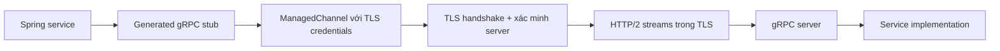
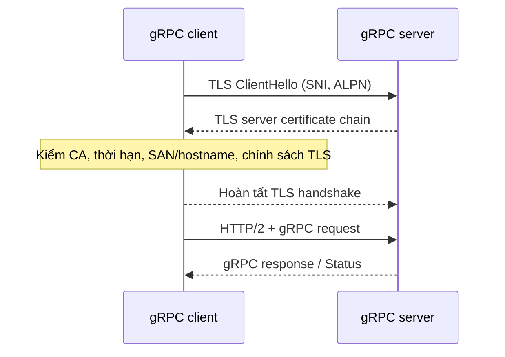
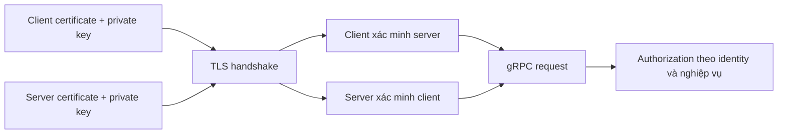
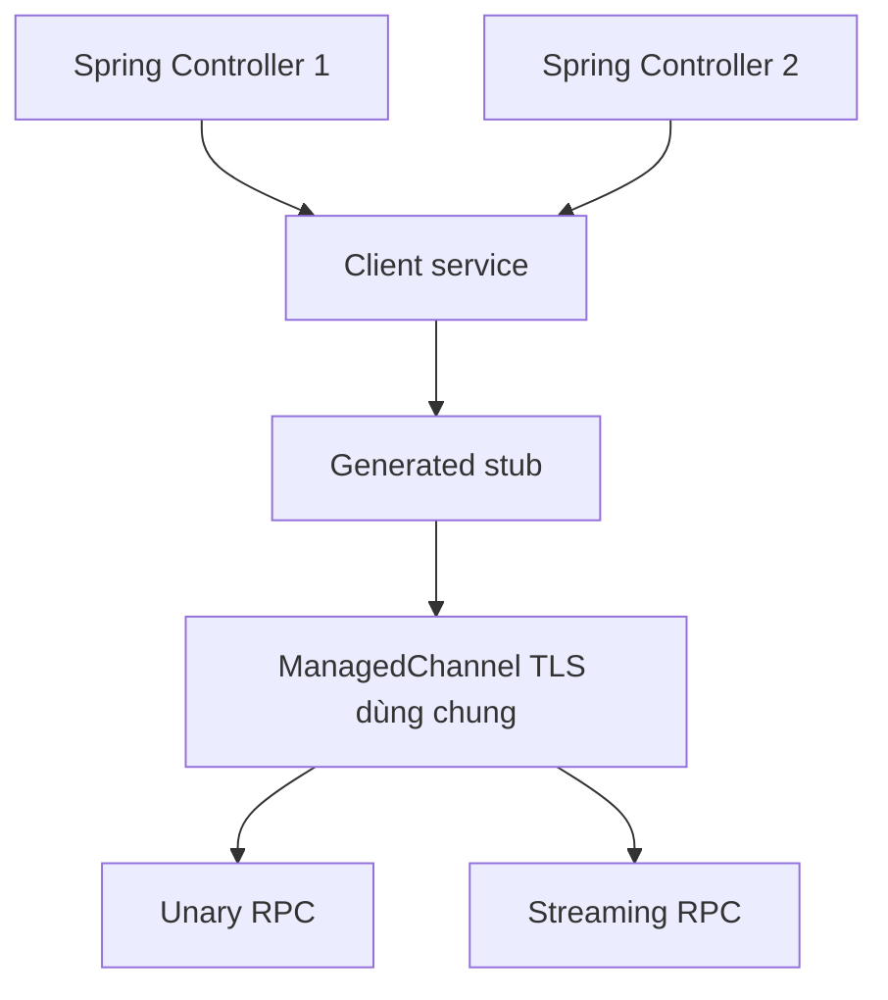
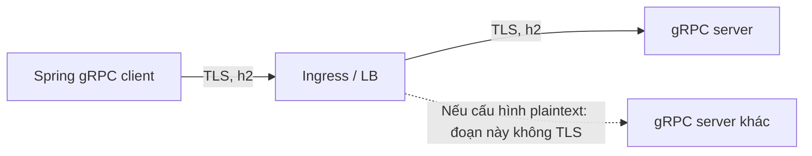

# Kết nối TLS trong production

## 1. Mục tiêu học tập

Trong hệ sinh thái **Spring gRPC**, ứng dụng client có thể gọi unary hoặc streaming RPC bằng các stub Java sinh từ hợp đồng Protocol Buffers. Khi triển khai production, một lời gọi đúng về mặt `.proto` vẫn có thể thất bại nếu kênh kết nối không xác thực được máy chủ, thiếu chứng chỉ tin cậy hoặc đi qua một proxy không hỗ trợ gRPC trên HTTP/2.

**TLS (Transport Layer Security)** bảo vệ kết nối giữa các thành phần gRPC. Bài này tập trung vào cách cấu hình TLS ở tầng **channel và connection**, từ một client Spring tới gRPC server; phân biệt TLS một chiều với mTLS, quản lý chứng chỉ, xử lý lỗi handshake và kiểm tra bảo mật của toàn bộ đường đi mạng.

Hoàn thành bài, người học có thể:

- Giải thích TLS bảo vệ những gì trong HTTP/2 gRPC và những giới hạn của nó.
- Phân biệt xác thực server bằng TLS với xác thực hai chiều bằng **mTLS** và phân quyền RPC ở tầng ứng dụng.
- Tạo `ManagedChannel` dùng `TlsChannelCredentials`, xác minh server certificate và gọi unary RPC có deadline.
- Cấu hình `TlsServerCredentials`, chuỗi chứng chỉ và trust CA phù hợp; bật xác thực client certificate khi cần mTLS.
- Quản lý TLS channel bằng Spring bean theo môi trường, dùng lại connection và đóng tài nguyên có trật tự.
- Đánh giá TLS termination tại ingress/load balancer, luân chuyển chứng chỉ, bảo mật metadata và khả năng quan sát lỗi.
- Kiểm tra handshake, HTTP/2, tên host, certificate chain và lời gọi gRPC bằng công cụ thực tế và integration test.

Phần thực hành dùng API **gRPC Java** để làm rõ cách bảo mật transport, kết hợp Spring để quản lý vòng đời client. Các starter Spring gRPC khác nhau có thể cung cấp cấu hình channel/server riêng; cần đối chiếu đúng phiên bản trước khi áp dụng property hoặc bean auto-configuration trong dự án.

## 2. TLS bảo vệ điều gì trong gRPC?

gRPC Java thường dùng **HTTP/2** làm giao thức truyền tải; request, response và metadata được chuyển qua các HTTP/2 stream. Protocol Buffers biến message thành dữ liệu nhị phân, nhưng **không tự mã hóa dữ liệu**. TLS bổ sung bảo vệ bí mật và toàn vẹn của dữ liệu trên một đoạn kết nối, đồng thời giúp client xác minh danh tính server qua chứng chỉ.



TLS **không** thay thế deadline, retry, load balancing, kiểm tra quyền truy cập, giới hạn kích thước message hay xử lý lỗi nghiệp vụ. TLS cũng không mã hóa dữ liệu tại các điểm kết thúc TLS: nội dung RPC vẫn có thể xuất hiện trong bộ nhớ chương trình, hệ thống log, các proxy giải mã hoặc các đoạn mạng khác chưa bật TLS.

| Khía cạnh | Plaintext gRPC | gRPC qua TLS |
|---|---|---|
| Vận chuyển RPC | HTTP/2 không mã hóa | HTTP/2 qua kết nối TLS |
| Payload Protobuf | Vẫn là nhị phân | Vẫn là nhị phân |
| Chống nghe lén và sửa nội dung trên đoạn mạng | Không | Có, khi handshake và xác minh chứng chỉ thành công |
| Xác thực danh tính server | Không dựa trên TLS | Dựa trên certificate chain, hostname và chính sách tin cậy |
| Xác thực client bằng chứng chỉ | Không | Có thể bật bằng mTLS |
| Nơi phù hợp | Local/test cô lập có kiểm soát | Production, mạng dùng chung, lưu lượng chứa dữ liệu nhạy cảm |

gRPC trên TLS cần kết nối có khả năng thương lượng **HTTP/2**, thông thường qua ALPN với giao thức `h2`. Việc TCP mở cổng hoặc bắt tay TLS thành công **chưa đủ** để kết luận một lời gọi gRPC sẽ chạy: proxy và server phải xử lý đúng HTTP/2/gRPC.

## 3. TLS một chiều, mTLS và quyền truy cập RPC

### TLS một chiều (server authentication)

Thông thường, client cần xác minh **server** đang kết nối có chứng chỉ hợp lệ cho tên miền đích và được ký bởi CA tin cậy. Server không bắt buộc yêu cầu client certificate. Nếu hệ thống dùng token/OAuth, metadata và `CallCredentials` có thể phục vụ xác thực ở cấp RPC trên kênh TLS đó.



Sơ đồ là mô hình học tập, không biểu diễn đầy đủ mọi thông điệp trong TLS 1.2/1.3. Không nên suy luận thứ tự byte trên mạng từ các nhãn khái quát này.

### mTLS (mutual TLS)

Với **mTLS**, ngoài xác thực server, server còn yêu cầu và xác minh **client certificate**. Trường hợp thường gặp là giao tiếp giữa các service nội bộ đòi hỏi danh tính máy/microservice.



**mTLS không tự quyết định client được gọi phương thức nào.** Chứng chỉ chứng minh một danh tính đã được cơ chế tin cậy chấp nhận; server vẫn cần kiểm tra **authorization** cho service, method hoặc tài nguyên cụ thể. Ví dụ, một workload có chứng chỉ hợp lệ không mặc nhiên có quyền đọc hồ sơ của mọi khách hàng.

| Câu hỏi | TLS một chiều | mTLS |
|---|---|---|
| Client xác minh server? | Có | Có |
| Server yêu cầu client certificate? | Thông thường không | Có |
| Server nhận diện client thế nào? | Token/credential ứng dụng hoặc cơ chế khác | Danh tính trong client certificate, có thể kết hợp token |
| Phân quyền nghiệp vụ có còn cần? | Có | Có |
| Quản lý vật liệu bí mật | Server có private key | Cả server và client có private key riêng |

## 4. Chứng chỉ, SAN, trust store và hostname verification

Để client tin tưởng một kết nối TLS, cần đáp ứng đồng thời nhiều điều kiện:

1. **Chuỗi chứng chỉ (certificate chain):** chứng chỉ của server liên kết hợp lệ qua intermediate CA đến root CA được client tin cậy. Server thường cung cấp leaf certificate và các intermediate cần thiết; root CA có thể nằm sẵn trong trust store của client.
2. **Tên host:** tên DNS hoặc IP mà client dùng để kết nối phải phù hợp với **Subject Alternative Name (SAN)** của server certificate. Chứng chỉ cấp cho `grpc.example.com` không mặc nhiên hợp lệ cho `10.0.0.5` hoặc `localhost`.
3. **Thời hạn:** chứng chỉ phải ở trong khoảng hiệu lực; thời gian hệ thống bị lệch cũng có thể làm handshake thất bại.
4. **Thuật toán và chính sách:** chứng chỉ, chữ ký, key usage và phiên bản TLS cần đáp ứng chính sách của thư viện và hạ tầng.
5. **Bằng chứng sở hữu khóa:** server phải có private key tương ứng với public key trong chứng chỉ.

**SAN mới là cơ sở quan trọng cho hostname verification.** Không nên dựa vào Common Name (CN) hoặc dùng cách tắt kiểm tra hostname khi gặp lỗi SAN. Nếu thật sự cần kết nối bằng địa chỉ IP, chứng chỉ phải có **IP SAN** đúng loại và giá trị.

### Bộ file thường gặp

| File minh họa | Nội dung | Nơi sử dụng |
|---|---|---|
| `server-chain.pem` | Chứng chỉ server kèm intermediate phù hợp | Server trình chứng chỉ trong handshake |
| `server-key.pem` | Private key tương ứng với server certificate | Chỉ server được phép đọc |
| `trusted-server-ca.pem` | Root/intermediate CA được client phê duyệt để tin server | Client trust configuration |
| `client-chain.pem` | Chứng chỉ client khi triển khai mTLS | Client trình chứng chỉ |
| `client-key.pem` | Private key của client | Chỉ workload client được phép đọc |
| `trusted-client-ca.pem` | CA mà server tin để xác minh client | Server mTLS trust configuration |

Tên file chỉ để minh họa. Trong production, tài liệu chứng chỉ thường được cấp bởi PKI của tổ chức hoặc giải pháp quản lý certificate/secret; key phải đặt ở nơi được bảo vệ bằng quyền truy cập, secret volume hoặc cơ chế quản lý khóa phù hợp. Không commit private key vào Git, không lưu nội dung key trong `application.yml`, không in private key/token ra log. Chọn chứng chỉ có đúng mục đích sử dụng (server/client authentication) và chính sách phát hành.

CA dùng xác minh server và CA dùng xác minh client **có thể khác nhau**. Việc cấu hình `trustManager` với CA của tổ chức cần được phê duyệt theo ranh giới tin cậy, tránh tin tất cả chứng chỉ không liên quan.

## 5. Hợp đồng gRPC mẫu và điều kiện triển khai

Giả sử Spring client gọi service `Greeter` với một unary RPC:

```proto
syntax = "proto3";

package demo.greeter;
option java_package = "dev.example.hello";
option java_multiple_files = true;

service Greeter {
  rpc SayHello (HelloRequest) returns (HelloReply);
}

message HelloRequest {
  string name = 1;
}

message HelloReply {
  string message = 1;
}
```

Công cụ `protoc` và plugin gRPC Java sinh các class `HelloRequest`, `HelloReply`, `GreeterGrpc` trong package `dev.example.hello`. Phần minh họa giả định dự án đã cấu hình dependency gRPC API, Protobuf, code generation và một HTTP/2 transport như `grpc-netty-shaded`. Cần dùng các phiên bản runtime/plugin tương thích với Java và Spring Boot của ứng dụng.

**Lưu ý triển khai:** ví dụ Java dùng `Grpc.newServerBuilderForPort` và `Grpc.newChannelBuilderForAddress`, cho phép runtime chọn provider được hỗ trợ. Trong ứng dụng Spring gRPC starter có auto-config server/channel, hãy chọn **một** cơ chế làm chủ server và kết nối; không khởi chạy thêm server thủ công trên cùng cổng. Property của starter thay đổi theo phiên bản, nên mã dưới đây dùng tên cấu hình **tự định nghĩa** để tránh nhầm lẫn với API mặc định.

## 6. Bật TLS trên gRPC server bằng `TlsServerCredentials`

Để server bắt tay TLS, nó cần certificate chain và private key tương ứng. Ví dụ chạy một server gRPC Java trên cổng `8443`, dùng đường dẫn file được cấp qua biến môi trường:

```java
package dev.example.hello;

import io.grpc.Grpc;
import io.grpc.Server;
import io.grpc.ServerCredentials;
import io.grpc.TlsServerCredentials;
import io.grpc.stub.StreamObserver;
import java.io.File;
import java.util.concurrent.TimeUnit;

public final class TlsGreeterServer {
    public static class GreeterService extends GreeterGrpc.GreeterImplBase {
        @Override
        public void sayHello(
                HelloRequest request,
                StreamObserver<HelloReply> observer) {
            observer.onNext(HelloReply.newBuilder()
                    .setMessage("Xin chào " + request.getName())
                    .build());
            observer.onCompleted();
        }
    }

    public static void main(String[] args) throws Exception {
        File certChain = new File(System.getenv("GRPC_SERVER_CERT_CHAIN"));
        File privateKey = new File(System.getenv("GRPC_SERVER_PRIVATE_KEY"));

        ServerCredentials credentials = TlsServerCredentials.newBuilder()
                .keyManager(certChain, privateKey)
                .build();

        Server server = Grpc.newServerBuilderForPort(8443, credentials)
                .addService(new GreeterService())
                .build()
                .start();

        Runtime.getRuntime().addShutdownHook(new Thread(() -> {
            server.shutdown();
            try {
                if (!server.awaitTermination(5, TimeUnit.SECONDS)) {
                    server.shutdownNow();
                }
            } catch (InterruptedException e) {
                server.shutdownNow();
                Thread.currentThread().interrupt();
            }
        }));

        System.out.println("TLS gRPC server listening on port 8443");
        server.awaitTermination();
    }
}
```

Đoạn code trên mô tả **TLS xác thực server**; nó chưa yêu cầu chứng chỉ của client. Các biến `GRPC_SERVER_CERT_CHAIN` và `GRPC_SERVER_PRIVATE_KEY` phải được cấu hình thành đường dẫn file thực trước khi chạy. Nếu thiếu biến hoặc file sai định dạng, quá trình khởi động có thể thất bại; production nên kiểm tra cấu hình và ghi lỗi rõ ràng mà **không in nội dung bí mật**.

`newServerBuilderForPort` dùng cơ chế bind theo provider, có thể lắng nghe nhiều interface. Hãy giới hạn firewall, network policy và cổng được công bố phù hợp kiến trúc. Nếu server do Spring starter quản lý, định nghĩa service như thành phần Spring và cấp TLS credentials thông qua cơ chế server factory/configuration tương ứng, thay vì copy nguyên `main()` vào ứng dụng đã có auto-server.

## 7. Client gRPC Java kết nối tới server TLS

Tạo channel bằng `TlsChannelCredentials`; **không** gọi `usePlaintext()` hoặc dùng `InsecureChannelCredentials` cho endpoint production yêu cầu TLS.

### Tin cậy CA mặc định của môi trường

Nếu certificate chain của server hợp lệ dưới các CA mà môi trường runtime tin cậy, có thể bắt đầu từ:

```java
import io.grpc.Grpc;
import io.grpc.ManagedChannel;
import io.grpc.TlsChannelCredentials;

ManagedChannel channel = Grpc.newChannelBuilderForAddress(
        "grpc.example.com", 443, TlsChannelCredentials.create())
        .build();
```

Việc trust mặc định phụ thuộc provider, nền tảng và cấu hình runtime. Không giả định CA nội bộ sẽ tự có trong môi trường container; kiểm tra trust configuration đã triển khai.

### Tin cậy CA cụ thể và gọi một RPC có deadline

Khi server sử dụng PKI nội bộ, client được cấp bundle CA tin cậy và sử dụng đúng tên DNS nằm trong SAN của server certificate:

```java
package dev.example.hello;

import io.grpc.Grpc;
import io.grpc.ManagedChannel;
import io.grpc.TlsChannelCredentials;
import io.grpc.StatusRuntimeException;
import java.io.File;
import java.util.concurrent.TimeUnit;

public final class TlsGreeterClient {
    public static void main(String[] args) throws Exception {
        File trustedCa = new File(System.getenv("GRPC_TRUSTED_SERVER_CA"));

        ManagedChannel channel = Grpc.newChannelBuilderForAddress(
                "grpc.example.com", 8443,
                TlsChannelCredentials.newBuilder()
                        .trustManager(trustedCa)
                        .build())
                .build();

        try {
            GreeterGrpc.GreeterBlockingStub stub =
                    GreeterGrpc.newBlockingStub(channel);

            HelloReply result = stub
                    .withDeadlineAfter(3, TimeUnit.SECONDS)
                    .sayHello(HelloRequest.newBuilder()
                            .setName("Lan")
                            .build());
            System.out.println(result.getMessage());
        } catch (StatusRuntimeException e) {
            System.err.println("RPC failed: " + e.getStatus());
            throw e;
        } finally {
            channel.shutdown();
            if (!channel.awaitTermination(5, TimeUnit.SECONDS)) {
                channel.shutdownNow();
                channel.awaitTermination(2, TimeUnit.SECONDS);
            }
        }
    }
}
```

Ví dụ giả định `GRPC_TRUSTED_SERVER_CA` trỏ tới một CA bundle có định dạng được provider chấp nhận, server lắng nghe `grpc.example.com:8443` và chứng chỉ khớp tên `grpc.example.com`. Nếu server chỉ có chứng chỉ cho tên khác, client phải dùng **tên đích hợp lệ** và cấu hình DNS/routing tương ứng; không bỏ qua hostname verification để chữa lỗi.

`withDeadlineAfter(...)` giới hạn thời gian một RPC; nó không phải TLS handshake timeout độc lập và không thay đổi trạng thái sống của `ManagedChannel`. Nên thiết lập deadline cho từng unary RPC, đồng thời chọn chính sách phù hợp với các streaming RPC có thời lượng dài.

### Có thể dùng một channel cho nhiều RPC không?

**Có.** TLS handshake phát sinh chi phí xác minh chứng chỉ và thiết lập khóa; tạo channel mới sau mỗi request thường làm tăng độ trễ và lượng kết nối. Một `ManagedChannel` lâu sống có thể truyền nhiều HTTP/2 stream và nhiều RPC, kể cả khi gRPC phải kết nối lại sau sự cố. Không tạo hoặc đóng channel trong mỗi method của Spring controller.



Channel và generated stub của gRPC Java có thể được dùng đồng thời. Các phương thức kiểu `withDeadlineAfter(...)`, `withInterceptors(...)` trả về stub cấu hình mới thay vì thay đổi stub gốc. Khi endpoint, trust CA hoặc client identity khác nhau, tạo các channel có cấu hình riêng và đặt tên bean/qualifier rõ ràng.

## 8. Tích hợp TLS channel trong Spring Boot

Nếu ứng dụng **tự quản lý channel**, có thể khai báo singleton bean cho môi trường `prod` để tránh trùng với cấu hình plaintext của môi trường local. Đường dẫn đến CA được cấp qua cấu hình deploy; không đưa PEM private key vào mã hoặc properties.

```java
package dev.example.client;

import io.grpc.Grpc;
import io.grpc.ManagedChannel;
import io.grpc.TlsChannelCredentials;
import java.io.File;
import org.springframework.beans.factory.annotation.Value;
import org.springframework.context.annotation.Bean;
import org.springframework.context.annotation.Configuration;
import org.springframework.context.annotation.Profile;

@Configuration(proxyBeanMethods = false)
@Profile("prod")
public class ProductionGrpcClientConfig {
    @Bean(name = "greeterChannel", destroyMethod = "shutdown")
    public ManagedChannel greeterChannel(
            @Value("${demo.grpc.greeter.host}") String host,
            @Value("${demo.grpc.greeter.port}") int port,
            @Value("${demo.grpc.greeter.trust-ca-file}") String trustCaPath)
            throws Exception {
        return Grpc.newChannelBuilderForAddress(
                host, port,
                TlsChannelCredentials.newBuilder()
                        .trustManager(new File(trustCaPath))
                        .build())
                .build();
    }
}
```

```java
package dev.example.client;

import dev.example.hello.GreeterGrpc;
import dev.example.hello.HelloRequest;
import io.grpc.ManagedChannel;
import java.util.concurrent.TimeUnit;
import org.springframework.beans.factory.annotation.Qualifier;
import org.springframework.stereotype.Service;

@Service
public final class GreeterGateway {
    private final GreeterGrpc.GreeterBlockingStub stub;

    public GreeterGateway(
            @Qualifier("greeterChannel") ManagedChannel channel) {
        this.stub = GreeterGrpc.newBlockingStub(channel);
    }

    public String sayHello(String name) {
        return stub.withDeadlineAfter(3, TimeUnit.SECONDS)
                .sayHello(HelloRequest.newBuilder()
                        .setName(name)
                        .build())
                .getMessage();
    }
}
```

Ví dụ `application-prod.yml` với **namespace tự đặt** `demo.grpc.*`:

```yaml
demo:
  grpc:
    greeter:
      host: grpc.example.com
      port: 8443
      trust-ca-file: /var/run/secrets/grpc/trusted-server-ca.pem
```

`@Profile("prod")` giúp giới hạn bean cấu hình TLS theo môi trường, nhưng chỉ một profile **không đủ** để đảm bảo chính sách security; pipeline triển khai cần kiểm soát secret, endpoint, network policy và xác minh cấu hình. Nếu cần client cũng trình chứng chỉ mTLS, thay `TlsChannelCredentials` bằng phiên bản có `.keyManager(...)` như mục tiếp theo.

`@Bean(destroyMethod = "shutdown")` gọi dừng channel khi Spring context kết thúc nhưng **không đợi** các RPC đang chạy hoàn tất. Với hệ thống có streaming dài hạn hoặc yêu cầu graceful shutdown, áp dụng một lifecycle owner để ngừng nhận công việc mới, hủy/hoàn tất stream, gọi `shutdown()`, chờ `awaitTermination(...)` trong ngân sách cho phép và sau đó dùng `shutdownNow()` khi cần. Chỉ **một chủ sở hữu** chịu trách nhiệm đóng mỗi channel.

Nếu dùng Spring gRPC starter tự quản lý channel, hãy sử dụng cơ chế cấp `ChannelCredentials` và lifecycle do starter hỗ trợ. Không đóng channel do framework sở hữu một cách tùy ý và không giả định property `demo.grpc.*` là property mặc định của starter.

## 9. Bật xác thực hai chiều mTLS

Trong các hệ thống service-to-service, server đôi khi yêu cầu client trình X.509 certificate. Bên server phải chỉ rõ CA nào được tin để xác minh client, cùng chính sách `REQUIRE`:

```java
import io.grpc.Grpc;
import io.grpc.Server;
import io.grpc.ServerCredentials;
import io.grpc.TlsServerCredentials;
import java.io.File;

ServerCredentials mtlsServerCredentials = TlsServerCredentials.newBuilder()
        .keyManager(
                new File("/var/run/secrets/grpc/server-chain.pem"),
                new File("/var/run/secrets/grpc/server-key.pem"))
        .trustManager(new File("/var/run/secrets/grpc/trusted-client-ca.pem"))
        .clientAuth(TlsServerCredentials.ClientAuth.REQUIRE)
        .build();

Server server = Grpc.newServerBuilderForPort(8443, mtlsServerCredentials)
        .addService(new TlsGreeterServer.GreeterService())
        .build();
// Đưa server vào vòng đời khởi động/dừng của ứng dụng trước khi sử dụng.
```

Bên client, ngoài CA để xác minh server, cung cấp **certificate chain và private key của chính client**:

```java
import io.grpc.Grpc;
import io.grpc.ManagedChannel;
import io.grpc.TlsChannelCredentials;
import java.io.File;

ManagedChannel channel = Grpc.newChannelBuilderForAddress(
        "grpc.example.com", 8443,
        TlsChannelCredentials.newBuilder()
                .trustManager(new File("/var/run/secrets/grpc/trusted-server-ca.pem"))
                .keyManager(
                        new File("/var/run/secrets/grpc/client-chain.pem"),
                        new File("/var/run/secrets/grpc/client-key.pem"))
                .build())
        .build();
```

Các file phải được cấp riêng cho đúng workload, với quyền đọc hạn chế. Mã minh họa dùng đường dẫn cố định để dễ đọc; production nên lấy đường dẫn từ cấu hình/secret mount hoặc identity provider được tổ chức quản lý. Đừng dùng một private key chung cho mọi client nếu mục tiêu là xác minh danh tính từng workload.

### Hệ quả vận hành của mTLS

- **Trust hai chiều:** client cần tin CA của server; server cần tin CA cấp certificate cho client. Hai CA có thể khác nhau.
- **Tên và identity:** client vẫn phải xác minh hostname/SAN của server; server cần đối chiếu danh tính client certificate với policy được phép gọi RPC.
- **Authorization:** một chứng chỉ client còn hạn và được tin tưởng chưa đồng nghĩa được phép thực hiện mọi thao tác. Server cần authorization theo service/method/tài nguyên.
- **Khả năng thu hồi:** kiểm tra chính sách vòng đời/thu hồi certificate của tổ chức. Thay chứng chỉ bị lộ hoặc hết hạn kịp thời; đừng trông chờ việc đóng một channel phía client sẽ thu hồi danh tính ở hệ thống khác.
- **Giới hạn phạm vi:** đặt `ClientAuth.REQUIRE` khi kiến trúc thực sự yêu cầu mTLS. Một server public cần hỗ trợ client không có chứng chỉ có thể dùng cách xác thực riêng; không bật chế độ bắt buộc rồi bỏ qua thiết kế client onboarding.

## 10. TLS termination và đường đi qua ingress/load balancer

Production thường có proxy, ingress controller, service mesh hoặc load balancer nằm giữa client và gRPC server. Cần xác định **mỗi đoạn kết nối** dùng TLS hay plaintext, nơi nào giữ private key và thành phần nào xác minh danh tính.



Sơ đồ biểu diễn **hai phương án backend khác nhau**, không phải một request đồng thời đi tới hai server. Khi proxy kết thúc TLS từ phía client, proxy có thể đọc metadata/payload để định tuyến và giám sát. Kết nối từ proxy tới backend chỉ an toàn khi được cấu hình bảo vệ riêng; đừng đồng nhất “TLS ở ingress” với “TLS end-to-end”.

| Kiến trúc | Điều phải xác minh |
|---|---|
| Client TLS → server TLS trực tiếp | DNS/SAN, CA, ALPN `h2`, giới hạn mạng và credential |
| Client TLS → ingress giải mã → backend plaintext | Có chấp nhận đoạn plaintext không, mạng có cô lập không, proxy có chuyển tiếp gRPC HTTP/2 đúng không |
| Client TLS → ingress → backend TLS | Proxy đóng vai client TLS của backend; xác minh certificate/hostname backend và trust CA ở proxy |
| mTLS ở service mesh | Mesh/proxy nào thực hiện handshake và cấp identity; ứng dụng có cần TLS bổ sung không, authorization diễn ra ở đâu |
| TCP/TLS passthrough | TLS kết thúc ở server phía sau; cấu hình SNI/routing và certificate phù hợp |

**Hostname, SNI và HTTP/2 `:authority`** rất dễ gây nhầm lẫn trong cấu hình qua proxy. Tên host dùng để xác minh chứng chỉ, tên dùng định tuyến và địa chỉ TCP thực tế phải được thiết kế nhất quán. Tránh tùy tiện sử dụng cơ chế override authority để né lỗi certificate; sửa DNS, certificate SAN hoặc cấu hình proxy mới là giải pháp đúng trong production.

Tải cân bằng nhiều backend cũng cần thống nhất identity và trust policy. Nếu các node server dùng các certificate/CA khác nhau, channel có thể hoạt động ở một lần kết nối rồi thất bại khi tái kết nối sang node khác.

## 11. Deadline, status, interceptor và streaming khi dùng TLS

TLS được xử lý ở tầng transport. Các khái niệm quan trọng của gRPC vẫn hoạt động bình thường:

- **Deadline:** đặt thời hạn cho từng unary RPC để kết nối chậm, lỗi handshake hoặc server chậm không khiến request chờ vô hạn. Với streaming dài hạn, chọn deadline và chiến lược reconnect phù hợp.
- **Status:** một handshake thất bại thường bộc lộ ở cấp client dưới dạng `UNAVAILABLE` (đôi khi deadline bị vượt). Không giả định một mã status duy nhất luôn chứng minh chính xác lỗi TLS.
- **Metadata/CallCredentials:** token xác thực và trace context được truyền qua RPC. TLS bảo vệ metadata trên đoạn kết nối TLS nhưng ứng dụng vẫn phải tránh ghi dữ liệu nhạy cảm vào log/tracing.
- **Interceptor:** dùng để đo latency, gắn request ID, chuyển authentication context hoặc thống kê status. Client interceptor không thay cho việc xác minh certificate.
- **Streaming:** unary, server streaming, client streaming và bidirectional streaming đều dùng TLS channel chung; stream còn sống có thể ảnh hưởng thời gian shutdown.

Ví dụ xử lý status của unary RPC:

```java
import io.grpc.Status;
import io.grpc.StatusRuntimeException;
import java.util.concurrent.TimeUnit;

try {
    stub.withDeadlineAfter(3, TimeUnit.SECONDS)
            .sayHello(HelloRequest.newBuilder().setName("Lan").build());
} catch (StatusRuntimeException ex) {
    Status.Code code = ex.getStatus().getCode();
    switch (code) {
        case UNAVAILABLE -> System.err.println("Kiểm tra DNS, TLS, trust CA, SAN hoặc transport");
        case DEADLINE_EXCEEDED -> System.err.println("RPC đã vượt deadline");
        case UNAUTHENTICATED -> System.err.println("Kiểm tra xác thực cấp ứng dụng");
        case PERMISSION_DENIED -> System.err.println("Kiểm tra quyền thực hiện RPC");
        default -> System.err.println("RPC status: " + ex.getStatus());
    }
}
```

Ví dụ dùng switch rule của Java hiện đại. `UNAUTHENTICATED` là gRPC status mà tầng ứng dụng có thể trả về; mTLS handshake bị từ chối thường khiến RPC thất bại từ transport trước khi logic service có cơ hội trả mã này.

Một số chính sách retry và wait-for-ready có thể giúp đối phó với lỗi mạng tạm thời, nhưng **không** chữa được certificate hết hạn, SAN không khớp hoặc CA thiếu tin cậy. Retry chỉ nên áp dụng theo ngân sách thời gian và tính chất idempotent của nghiệp vụ. Không tạo channel mới trong vòng lặp để “thử may” qua lỗi TLS.

## 12. Quản lý chứng chỉ và khả năng phục hồi production

### Hết hạn và luân chuyển certificate

Certificate có vòng đời hữu hạn; hệ thống cần theo dõi trước ngày hết hạn và có quy trình thay thế không làm đứt kết nối.

1. **Cấp phát:** PKI/secret manager phát hành server/client identity đúng SAN, key usage, CA và môi trường.
2. **Phân phối:** secret mount hoặc nền tảng identity cung cấp file/cert cho workload; hạn chế quyền đọc, audit việc truy cập và tránh commit vào repository.
3. **Giám sát:** theo dõi thời gian hết hạn, lỗi TLS handshake, lỗi xác minh chứng chỉ và bất thường trong số lần kết nối lại.
4. **Luân chuyển:** triển khai certificate mới, đảm bảo các đối tác đã tin CA thích hợp; với CA rotation cần có khoảng tin cậy chồng lấp khi phù hợp.
5. **Loại bỏ:** thu hồi hoặc ngừng tin certificate/CA cũ đúng quy trình, đồng thời phát hiện những client còn cấu hình lỗi thời.

**Cập nhật file PEM trên đĩa không bảo đảm mọi channel/server gRPC Java tự động nạp chứng chỉ mới.** Hành vi phụ thuộc transport, credential provider và cơ chế reload của phiên bản sử dụng. Cần kiểm thử cơ chế refresh thật sự: có thể phải tạo channel/credential mới theo cấu hình được cập nhật, chuyển lưu lượng sang channel mới và đóng channel cũ có kiểm soát. Tránh làm gián đoạn hàng loạt streaming RPC chỉ vì thay secret mà chưa lên kế hoạch drain.

### Vận hành kết nối dài hạn

| Rủi ro | Cách quan sát / xử lý |
|---|---|
| Channel liên tục tái kết nối | Xem DNS, cert, ALPN, proxy, keepalive và thông điệp handshake; theo dõi tỷ lệ lỗi RPC |
| Một node có chứng chỉ không hợp lệ | Kiểm tra SAN và chain ở từng replica; sửa quy trình phát hành/deploy |
| Cert gần hết hạn | Alert trước hạn, xác nhận kế hoạch rotation và thử nghiệm thay thế |
| Load balancer đóng kết nối idle | Đồng bộ timeout/keepalive phù hợp với server và proxy, tránh ping quá dày |
| Nhiều channel được tạo trên từng HTTP request | Dùng singleton channel/stub; kiểm soát thread, socket, connection pool |
| Stream không dừng khi deploy | Hoàn tất hoặc hủy RPC đang chạy, graceful shutdown channel với deadline tổng |
| Metadata/token xuất hiện trong log | Lọc/redact header nhạy cảm, dùng correlation ID an toàn |

Quan sát tối thiểu nên có số lượng RPC, tỷ lệ `Status.Code`, latency P50/P95/P99, deadline exceeded, số RPC đang hoạt động, tỷ lệ handshake/reconnect thất bại và ngày hết hạn certificate. `ManagedChannel.getState(false)` có thể hỗ trợ chẩn đoán nhưng không chứng minh chứng chỉ hoặc nghiệp vụ đang khỏe: `READY` chỉ là trạng thái kết nối tại thời điểm lấy mẫu.

## 13. Kiểm tra TLS bằng công cụ ngoài ứng dụng

### Kiểm tra handshake, hostname và ALPN

Khi cổng gRPC công bố qua TLS, có thể xem chain, kiểm tên host và kiểm tra ALPN:

```bash
openssl s_client \
  -connect grpc.example.com:8443 \
  -servername grpc.example.com \
  -verify_hostname grpc.example.com \
  -verify_return_error \
  -alpn h2 \
  -CAfile trusted-server-ca.pem \
  -showcerts </dev/null
```

Lệnh trên giả định OpenSSL có mặt trong môi trường shell và bundle CA phù hợp. Trên PowerShell có thể bỏ phần chuyển hướng stdin nếu không cần. Kiểm tra certificate chain, thời hạn, `Verify return code` và giao thức ALPN được chọn; server/proxy cần hỗ trợ `h2` để chạy gRPC chuẩn. **Chỉ có log `CONNECTED` không nghĩa đã xác minh được certificate.**

Nếu server yêu cầu mTLS, công cụ cần được cung cấp client certificate và private key, chẳng hạn thêm `-cert client-chain.pem -key client-key.pem` vào lệnh kiểm thử. Không lưu private key hoặc kết quả debug nhạy cảm trong hệ thống log công khai.

### Gọi gRPC thật bằng `grpcurl`

Nếu server không bật reflection, chỉ rõ hợp đồng `.proto`:

```bash
grpcurl \
  -cacert trusted-server-ca.pem \
  -import-path src/main/proto \
  -proto greeter.proto \
  -d '{"name":"Lan"}' \
  grpc.example.com:8443 demo.greeter.Greeter/SayHello
```

Với server yêu cầu mTLS, bổ sung `-cert client-chain.pem -key client-key.pem` vào lệnh; `-cacert` vẫn dùng xác minh server. Nếu chứng chỉ server được xác minh qua CA công khai tin cậy mặc định của hệ điều hành/runtime công cụ, có thể không cần chỉ rõ `-cacert`.

`grpcurl -plaintext` chỉ dùng khi server thực sự chạy không TLS. `grpcurl -insecure` **vẫn kết nối qua TLS nhưng bỏ qua xác minh chứng chỉ server**; đây chỉ là công cụ chẩn đoán trong môi trường có kiểm soát, không phải cách cấu hình production. Không sử dụng nó để che giấu lỗi hostname hoặc trust CA. Dùng `curl` HTTP/1.1 tới cổng gRPC cũng không phải kiểm thử RPC thay thế.

## 14. Lỗi TLS thường gặp và cách xử lý

| Biểu hiện | Nguyên nhân có thể | Cách khắc phục |
|---|---|---|
| `UNAVAILABLE` với lỗi certificate/trust | Client không tin root CA, chain thiếu intermediate | Phân phối đúng CA và intermediate, kiểm tra chain server |
| Lỗi hostname/SAN mismatch | Gọi qua IP, alias hoặc DNS khác tên trong chứng chỉ | Sửa DNS/target hoặc cấp chứng chỉ có SAN đúng |
| TLS handshake timeout/failure | Firewall, proxy, phiên bản TLS hoặc trust config không khớp | Kiểm tra TCP reachability, handshake, TLS policy và các bên trung gian |
| Lỗi HTTP/2 preface hoặc ALPN | Proxy/server dùng HTTP/1.1 hoặc client nói plaintext vào cổng TLS | Cấu hình HTTP/2 gRPC và thống nhất TLS hai đầu |
| Client bị từ chối khi server bật mTLS | Thiếu client certificate, sai key/chain hoặc server không tin client CA | Cấp cert client đúng identity, kiểm tra `ClientAuth.REQUIRE` và server trust |
| RPC trả `UNAUTHENTICATED` | Token/metadata xác thực cấp ứng dụng không hợp lệ | Kiểm tra token, CallCredentials và interceptor; phân biệt với TLS handshake |
| RPC trả `PERMISSION_DENIED` | Client đã được xác thực nhưng không có quyền | Xác minh policy/authorization theo service hoặc resource |
| RPC trả `DEADLINE_EXCEEDED` | Bắt tay/kết nối chậm, server chậm, deadline quá ngắn | Phân tích latency theo giai đoạn, DNS/proxy và ngân sách deadline |
| Chỉ một số replica lỗi | Cert/CA/SAN hoặc secret mount không đồng nhất | Kiểm tra cấu hình từng backend và quy trình rollout |
| Hoạt động trước khi rotate cert, lỗi sau rotate | CA trust chưa cập nhật hoặc runtime chưa nạp certificate mới | Kiểm tra kế hoạch rotation, thử nghiệm reload/recreate channel |

Khi phân tích lỗi, đừng chỉ dựa trên một thông điệp `UNAVAILABLE`: xem **cause chain**, log handshake ở transport, cấu hình cert/SAN, tracing đường đi và status từ server. Các message lỗi chi tiết có thể khác nhau giữa phiên bản gRPC Java, Netty và TLS provider; không viết logic nghiệp vụ phụ thuộc chuỗi lỗi nguyên văn.

## 15. Kiểm thử tích hợp TLS và mTLS

Một unit test mock stub hoặc in-process server có thể kiểm tra service logic nhưng **không chứng minh handshake TLS hoạt động trên mạng**. Kiểm thử bảo mật cần tạo server TCP với certificate fixture hợp lệ, kết nối qua `TlsChannelCredentials` và gọi RPC thật.

Để minh họa, chuẩn bị trước bộ chứng chỉ **chỉ dùng cho test**:

- `src/test/resources/tls/ca.pem`: CA tin cậy của test.
- `src/test/resources/tls/server-chain.pem` và `server-key.pem`: chứng chỉ/key server có SAN DNS `localhost` do CA test ký.
- Nếu kiểm thử mTLS: thêm `client-chain.pem`, `client-key.pem` và CA tương ứng, với mục đích client authentication.

Không dùng lại certificate/private key test trong production. Test dưới đây dùng gRPC Java với server lắng nghe cổng động để tránh xung đột các tiến trình kiểm thử:

```java
package dev.example.hello;

import static org.junit.jupiter.api.Assertions.assertEquals;
import static org.junit.jupiter.api.Assertions.assertTrue;

import io.grpc.Grpc;
import io.grpc.ManagedChannel;
import io.grpc.Server;
import io.grpc.TlsChannelCredentials;
import io.grpc.TlsServerCredentials;
import java.io.File;
import java.util.concurrent.TimeUnit;
import org.junit.jupiter.api.Test;

class GrpcTlsIntegrationTest {
    private static File fixture(String name) {
        return new File("src/test/resources/tls/" + name);
    }

    @Test
    void callsUnaryRpcWithVerifiedTls() throws Exception {
        Server server = Grpc.newServerBuilderForPort(
                0,
                TlsServerCredentials.newBuilder()
                        .keyManager(
                                fixture("server-chain.pem"),
                                fixture("server-key.pem"))
                        .build())
                .addService(new TlsGreeterServer.GreeterService())
                .build()
                .start();

        ManagedChannel channel = Grpc.newChannelBuilderForAddress(
                "localhost", server.getPort(),
                TlsChannelCredentials.newBuilder()
                        .trustManager(fixture("ca.pem"))
                        .build())
                .build();

        try {
            HelloReply reply = GreeterGrpc.newBlockingStub(channel)
                    .withDeadlineAfter(3, TimeUnit.SECONDS)
                    .sayHello(HelloRequest.newBuilder()
                            .setName("Lan")
                            .build());
            assertEquals("Xin chào Lan", reply.getMessage());
        } finally {
            channel.shutdownNow();
            server.shutdownNow();
            assertTrue(channel.awaitTermination(5, TimeUnit.SECONDS));
            assertTrue(server.awaitTermination(5, TimeUnit.SECONDS));
        }
    }
}
```

Ví dụ test giả định server certificate có SAN `DNS:localhost`; khi chạy với `127.0.0.1`, cần có IP SAN tương ứng hoặc dùng tên `localhost`. Test cần gRPC transport provider hỗ trợ TLS trong test runtime. `server.getPort()` trả về cổng động sau khi server khởi động.

Bộ test production nên gồm các trường hợp sau:

1. **Positive TLS:** trust CA đúng, hostname đúng, gọi unary RPC thành công; thử server streaming khi ứng dụng có stream.
2. **Wrong CA:** client không tin server certificate và RPC thất bại trước khi tới handler; không cần khẳng định một message lỗi transport cố định.
3. **Wrong hostname:** server dùng cert cho tên khác, client vẫn xác minh hostname và từ chối handshake.
4. **Expired certificate:** với fixture kiểm thử thích hợp, xác nhận hệ thống không chấp nhận chứng chỉ hết hạn.
5. **mTLS required:** client thiếu certificate bị từ chối; client có certificate đúng được chấp nhận; client sai CA bị từ chối.
6. **Authorization:** chứng chỉ client hợp lệ nhưng không có quyền gọi một method vẫn bị từ chối bởi tầng ứng dụng.
7. **Rotation và shutdown:** thay cert/CA theo kế hoạch, kiểm tra kết nối mới và stream đang chạy; đóng channel/server mà không rò rỉ tài nguyên.

Không nên tạo cert “hợp lệ” trong test bằng cách tắt xác minh hostname hoặc chấp nhận mọi server certificate: làm vậy sẽ bỏ qua đúng hành vi mà bài kiểm thử cần chứng minh.

## 16. Bài tập vận dụng: triển khai Spring gRPC qua ingress

**Tình huống:** một ứng dụng Spring Boot gọi `Greeter.SayHello` trên cụm production qua tên DNS `grpc.example.com`. Hệ thống yêu cầu mã hóa kết nối, deadline ba giây cho unary RPC, kiểm soát truy cập nội bộ bằng mTLS và có một ingress đứng giữa client và backend gRPC.

Hãy thực hiện:

1. Thiết kế certificate chain, SAN `grpc.example.com`, root CA mà client tin và client certificate/identity dùng cho mTLS. Ghi rõ thành phần nào giữ private key nào.
2. Tạo TLS `ManagedChannel` dùng lại trong Spring `@Profile("prod")` và gắn vào generated `GreeterBlockingStub`; minh họa deadline cho từng request.
3. Xác định ingress là **TLS passthrough**, **TLS termination + TLS re-encryption**, hay **TLS termination + plaintext backend**; vẽ các đoạn TLS và chỉ rõ nơi xác minh backend certificate.
4. Kiểm tra TLS handshake, ALPN `h2` và hostname bằng OpenSSL; gọi RPC bằng `grpcurl` dùng hợp đồng `.proto` và cert/CA phù hợp.
5. Cố tình dùng CA sai hoặc tên host không nằm trong SAN; quan sát lỗi. Giải thích vì sao không được chuyển sang `-insecure` hoặc plaintext để chữa lỗi production.
6. Thiết kế kế hoạch rotation: giám sát ngày hết hạn, cập nhật CA trust khi cần, nạp lại cert/channel theo transport hỗ trợ, cho stream cũ kết thúc và đóng channel cũ an toàn.
7. Thêm ít nhất một integration test TLS hợp lệ, một test sai CA và một test client certificate thiếu khi server bắt buộc mTLS. Phân biệt lỗi handshake với `UNAUTHENTICATED`/`PERMISSION_DENIED` do logic nghiệp vụ trả về.

**Tiêu chí hoàn thành:** giải thích được đường đi và ranh giới TLS của một lời gọi gRPC, xác minh được server theo CA và SAN, thiết lập được client/server credentials đúng vai trò, chỉ rõ danh tính và quyền được quyết định ở đâu, đồng thời có bằng chứng từ RPC thật và kiểm thử tích hợp chứ không chỉ kiểm tra cổng TCP.

## 17. Ghi nhớ

Trong production, một gRPC `ManagedChannel` nên xác minh **đúng server certificate, đúng hostname/SAN và đúng CA tin cậy**; đồng thời phải duy trì HTTP/2 cho RPC. `TlsChannelCredentials` bảo vệ kết nối phía client, `TlsServerCredentials` cấu hình TLS phía server, còn **mTLS** bổ sung chứng chỉ client khi cần danh tính workload. TLS không thay thế authorization, deadline, status, interceptor, giám sát hoặc vòng đời channel trong Spring. Khi có proxy/ingress, cần kiểm tra **từng đoạn kết nối** và vận hành quy trình certificate rotation, kiểm thử negative cases và graceful shutdown rõ ràng.
