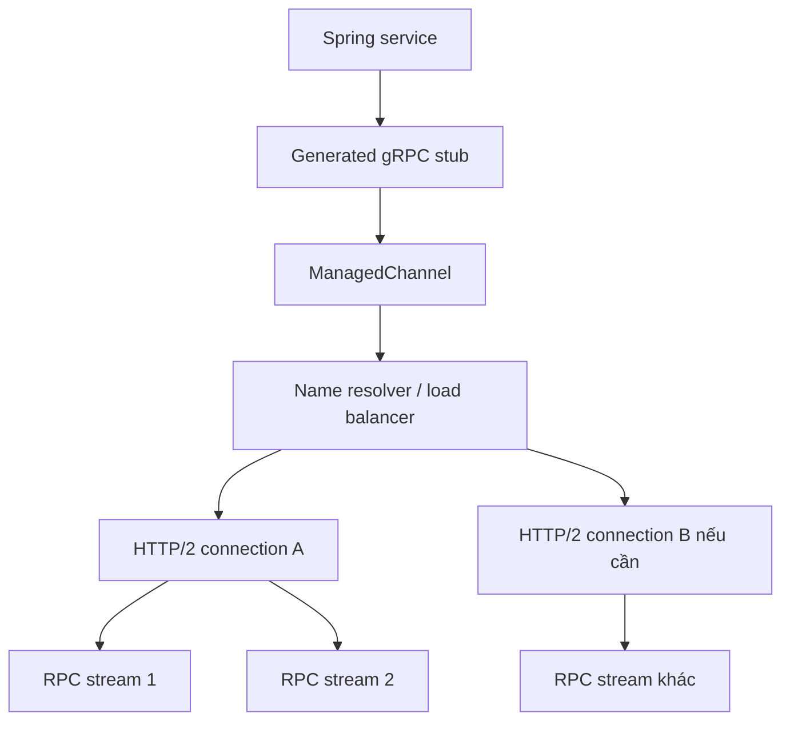
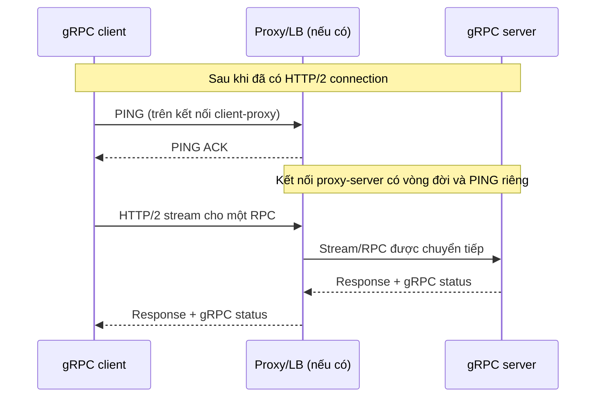
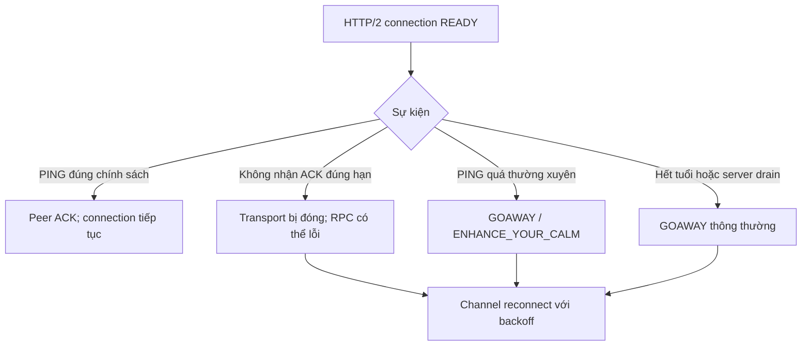
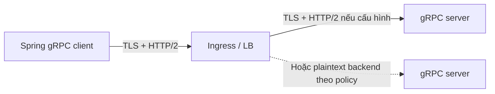

# Keepalive và HTTP/2 connection

## 1. Mục tiêu học tập

Trong **Spring gRPC**, client thường giữ một `ManagedChannel` để gọi nhiều unary hoặc streaming RPC tới cùng một dịch vụ. Channel có thể sử dụng một hoặc nhiều kết nối HTTP/2 phía dưới. Khi một kết nối đi qua load balancer, proxy hoặc thiết bị mạng có giới hạn thời gian chờ, các RPC có thể bị gián đoạn dù code nghiệp vụ và hợp đồng Protocol Buffers không thay đổi. **Keepalive** là một cơ chế ở tầng transport giúp phát hiện kết nối không còn phản hồi và, tùy chính sách, giữ kết nối hoạt động giữa các khoảng im lặng.

Sau bài học, bạn có thể:

- Phân biệt `ManagedChannel`, kết nối HTTP/2 và stream của một RPC.
- Giải thích frame `PING`, `ACK`, `GOAWAY`, `SETTINGS`, `WINDOW_UPDATE` và tác động tới gRPC.
- Phân biệt **keepalive**, deadline, health checking, TCP keepalive, application heartbeat và idle timeout.
- Cấu hình keepalive bằng gRPC Java/Netty cho client Spring và chính sách chấp nhận ping ở server.
- Xác định vì sao ping quá thường xuyên có thể dẫn tới `GOAWAY`, `ENHANCE_YOUR_CALM` hoặc `too_many_pings`.
- Lựa chọn khoảng thời gian phù hợp với HTTP/2 proxy, TLS, streaming và chính sách vận hành.
- Kiểm thử, quan sát, chẩn đoán vấn đề reconnect, gián đoạn stream và thu hồi tài nguyên.

**Phạm vi:** bài này đi sâu vào tầng channel/connection của dịch vụ `SPRING_GRPC`. Những khái niệm về Protocol Buffers, generated stub, metadata, status, deadline, interceptor, TLS, kiểm thử tích hợp và độ tin cậy được kết nối với cơ chế keepalive; chúng không bị thay thế bởi keepalive.

## 2. Một channel không nhất thiết là một TCP connection

Trong gRPC Java, ứng dụng tạo `ManagedChannel` rồi truyền nó cho generated stub (ví dụ `GreeterGrpc.newBlockingStub(channel)`). Một channel là **đầu mối logic lâu sống**, chịu trách nhiệm phân giải tên, chọn endpoint, tạo transport và gửi RPC. Nó không bảo đảm chỉ có đúng một socket TCP trong suốt vòng đời.



Sơ đồ là mô hình tổng quát. Tùy target, chính sách load balancing và transport, một channel có thể quản lý một hoặc nhiều subchannel/kết nối; nó cũng có thể tạm ở trạng thái `IDLE` mà chưa mở kết nối mạng.

| Thành phần | Phạm vi | Đặc điểm |
|---|---|---|
| `ManagedChannel` | Client tới một đích logic và cấu hình tương ứng | Được dùng lại cho nhiều RPC; có vòng đời `shutdown()` |
| HTTP/2 connection | Giữa hai đầu của **một chặng transport** | Chứa nhiều stream, chịu tác động của ping, flow control, `GOAWAY` |
| HTTP/2 stream | Một trao đổi request/response ở tầng HTTP/2 | gRPC thường ánh xạ mỗi RPC vào một stream |
| Unary RPC | Một request, một response | Có deadline, status và metadata riêng |
| Streaming RPC | Nhiều message trong một hoặc hai chiều | Có thể tồn tại lâu, vẫn sử dụng cùng một connection với RPC khác |
| TCP connection và TLS session | Đường truyền bên dưới HTTP/2 | Có thể bị đóng bởi mạng, proxy, server hoặc client |

**HTTP/2 multiplexing** cho phép nhiều RPC chạy đồng thời qua một kết nối. Đây là lý do không nên tạo `ManagedChannel` mới cho mỗi HTTP request đi vào Spring controller. Việc liên tục tạo kết nối gây thêm handshake TCP/TLS, socket, thread, tiêu thụ tài nguyên và biến động latency.

Mỗi HTTP/2 connection có giới hạn số stream đồng thời, **flow-control window** và những tham số do peer trao đổi. Khi các giới hạn bị chạm, RPC có thể phải chờ hoặc bị backpressure dù kết nối vẫn `READY`. Keepalive không tăng khả năng xử lý message, không tăng flow-control window và không giải quyết một server quá tải.

## 3. HTTP/2 PING hoạt động thế nào?

HTTP/2 định nghĩa frame **PING** để kiểm tra peer có còn phản hồi ở tầng connection. PING không gắn với stream cụ thể và mang payload cố định dài 8 byte. Peer phản hồi bằng **PING frame có cờ ACK**, phản ánh payload tương ứng.



Sơ đồ minh họa trường hợp **proxy kết thúc HTTP/2**: ACK xác minh peer trên *chặng client–proxy*, không chứng minh server cuối cùng còn khỏe. Nếu kết nối TLS/HTTP/2 đi xuyên qua proxy dạng passthrough, cơ chế PING và peer sẽ khác. Trong cấu trúc nhiều hop, phải đánh giá keepalive ở từng chặng.

### Chu kỳ keepalive của gRPC

Ở mức khái niệm:

1. Client hoặc server có cấu hình keepalive và duy trì một HTTP/2 connection.
2. Khi đủ điều kiện theo thời gian/chính sách, một bên gửi HTTP/2 `PING`.
3. Bên kia trả `PING ACK` nếu transport và peer vẫn có thể xử lý frame.
4. Nếu không nhận ACK trước `keepAliveTimeout`, phía gửi có thể coi connection không còn sử dụng được và đóng transport.
5. RPC đang chạy trên connection hỏng có thể thất bại, thường thể hiện qua trạng thái như `UNAVAILABLE`; channel có thể tìm cách kết nối lại theo cơ chế reconnect/backoff.

**Nhận được PING ACK chỉ cho thấy một HTTP/2 peer đã phản hồi.** Nó không bảo đảm một phương thức gRPC xử lý đúng nghiệp vụ, database hoạt động, token còn hợp lệ hoặc RPC tiếp theo sẽ có latency thấp.

PING cũng không nên bị hiểu là một message Protobuf hoặc lời gọi `Greeter.Ping()`. Ứng dụng thường không phải viết service method riêng để đáp lại HTTP/2 PING; transport gRPC xử lý frame này.

## 4. Các frame HTTP/2 liên quan đến vận hành gRPC

| Frame/cơ chế | Phạm vi và ý nghĩa | Liên hệ với gRPC |
|---|---|---|
| `HEADERS` | Header/trailer trên một stream | Mang metadata, HTTP status và gRPC status/trailer |
| `DATA` | Payload truyền trên stream | Chứa dữ liệu gRPC đã đóng khung, thường mã hóa Protobuf |
| `SETTINGS` | Thỏa thuận thông số HTTP/2 ở cấp connection | Ảnh hưởng giới hạn đồng thời và vận hành transport |
| `WINDOW_UPDATE` | Cập nhật flow control theo connection/stream | Quyết định lượng dữ liệu tiếp tục được gửi, đặc biệt với streaming |
| `PING` / `PING ACK` | Kiểm tra phản hồi ở cấp connection | Cơ chế nền của gRPC keepalive |
| `RST_STREAM` | Dừng/hủy một stream | Có thể ảnh hưởng một RPC mà không phải đóng cả channel |
| `GOAWAY` | Thông báo ngừng nhận stream mới trên connection | Dùng khi drain, hết tuổi connection hoặc vi phạm chính sách |

Một `GOAWAY` **không phải lúc nào cũng là lỗi**. Server hoặc proxy có thể gửi GOAWAY để dừng kết nối có trật tự, chuyển tải sang kết nối mới hoặc hết giới hạn tuổi kết nối. Các stream đã được chấp nhận có thể có cơ hội hoàn tất, tùy pha drain và timeout. Tuy nhiên, `GOAWAY` kèm lý do liên quan **`ENHANCE_YOUR_CALM`**, debug data **`too_many_pings`** thường là dấu hiệu client gửi PING vi phạm chính sách của peer.



Đừng đồng nhất **một connection bị đóng** với **`ManagedChannel` đã shutdown**. Nếu chủ sở hữu chưa gọi `shutdown()`, channel vẫn có thể tái thiết lập transport. Ngược lại, nếu đã gọi `shutdown()`, channel không tiếp nhận RPC mới.

## 5. Keepalive khác deadline, health check và TCP keepalive

Các cơ chế này giải quyết những câu hỏi khác nhau:

| Cơ chế | Câu hỏi cần trả lời | Đơn vị / giới hạn |
|---|---|---|
| gRPC keepalive (HTTP/2 PING) | Peer HTTP/2 trên connection còn phản hồi không? | Connection; không đo sức khỏe nghiệp vụ |
| RPC deadline | Lời gọi cụ thể được phép kéo dài bao lâu? | Một RPC; có thể trả `DEADLINE_EXCEEDED` |
| gRPC Health Checking | Service có báo sẵn sàng phục vụ hay không? | Service/application; cần server hỗ trợ health protocol |
| Application heartbeat | Luồng nghiệp vụ hoặc phiên làm việc còn tiến triển không? | Tùy hợp đồng `.proto` và logic ứng dụng |
| TCP keepalive | Peer TCP/đường mạng có còn đáp ứng ở tầng TCP không? | Socket; không hiểu HTTP/2 hay gRPC |
| Idle timeout | Bao lâu không có hoạt động phù hợp trước khi đóng tài nguyên? | Do server, proxy hoặc client quy định |

Ví dụ một server phản hồi PING bình thường nhưng thread pool phục vụ `SayHello` bị nghẽn. Keepalive vẫn có thể hoạt động trong khi unary RPC chậm đến mức vượt deadline. Để xác định service có phục vụ đúng chức năng, quan sát **kết quả RPC, status, latency, health service** và các chỉ số tải.

Với streaming, một dòng dữ liệu nghiệp vụ định kỳ có thể kiêm nhiệm dấu hiệu hoạt động ở tầng ứng dụng. Nhưng heartbeat ứng dụng và HTTP/2 keepalive có chính sách khác nhau: heartbeat phải được định nghĩa trong contract và xử lý bởi service, còn HTTP/2 PING do transport điều khiển.

## 6. Các tham số keepalive cần nắm

Trong các API gRPC Java/Netty thường gặp:

| Tham số | Phía cấu hình | Ý nghĩa |
|---|---|---|
| `keepAliveTime(t, unit)` | Client; có cả tùy chọn server chủ động ping | Khoảng thời gian cơ chế keepalive có thể phát PING khi điều kiện cho phép |
| `keepAliveTimeout(t, unit)` | Client hoặc server gửi ping | Thời gian chờ `PING ACK` trước khi xem transport không còn phản hồi |
| `keepAliveWithoutCalls(boolean)` | Client | Có cho phép gửi PING khi không có RPC đang hoạt động hay không |
| `permitKeepAliveTime(t, unit)` | Server | Khoảng cách tối thiểu server cho phép giữa các PING của client theo chính sách enforcement |
| `permitKeepAliveWithoutCalls(boolean)` | Server | Server có chấp nhận client PING khi không có RPC đang hoạt động không |
| `maxConnectionIdle(t, unit)` | Server | Thời gian connection không có RPC đang hoạt động trước khi server có thể đóng |
| `maxConnectionAge(t, unit)` | Server | Tuổi tối đa của một connection trước khi server bắt đầu drain |
| `maxConnectionAgeGrace(t, unit)` | Server | Khoảng thời gian grace sau khi đến giới hạn tuổi để RPC đang chạy có cơ hội kết thúc |

Các **giá trị mặc định, ngưỡng tối thiểu và hành vi ở ranh giới thời gian** có thể thay đổi theo phiên bản gRPC Java, transport, proxy và policy server. Không lấy giá trị của runtime khác (C++, Go, Node.js) làm mặc định cho ứng dụng Java. Khi cấu hình, xem tài liệu đúng phiên bản gRPC Java và các giới hạn do hạ tầng áp đặt.

Quan hệ quan trọng nhất: **client không thể tự quyết định gửi PING với tần suất tùy ý.** Nếu client cấu hình 30 giây nhưng server chỉ cho phép PING cách nhau ít nhất 5 phút, có thể bị GOAWAY. Ngay cả khi hai bên gRPC đồng ý, một ingress hoặc load balancer khác trên đường truyền vẫn có thể có policy riêng.

## 7. Cấu hình gRPC Java client cho production

Ví dụ dùng `grpc-netty-shaded` và một endpoint TLS có DNS/SAN hợp lệ. Để tránh ping quá dày, cấu hình minh họa chỉ gửi keepalive khi có RPC đang chạy:

```java
package dev.example.client;

import dev.example.hello.GreeterGrpc;
import dev.example.hello.HelloReply;
import dev.example.hello.HelloRequest;
import io.grpc.ManagedChannel;
import io.grpc.netty.shaded.io.grpc.netty.NettyChannelBuilder;
import java.util.concurrent.TimeUnit;

public final class GreeterKeepaliveDemo {
    public static void main(String[] args) throws InterruptedException {
        ManagedChannel channel = NettyChannelBuilder
                .forAddress("grpc.example.com", 443)
                .useTransportSecurity()
                .keepAliveTime(10, TimeUnit.MINUTES)
                .keepAliveTimeout(20, TimeUnit.SECONDS)
                .keepAliveWithoutCalls(false)
                .build();

        try {
            GreeterGrpc.GreeterBlockingStub stub =
                    GreeterGrpc.newBlockingStub(channel);

            HelloReply reply = stub
                    .withDeadlineAfter(3, TimeUnit.SECONDS)
                    .sayHello(HelloRequest.newBuilder()
                            .setName("Lan")
                            .build());
            System.out.println(reply.getMessage());
        } finally {
            channel.shutdown();
            if (!channel.awaitTermination(5, TimeUnit.SECONDS)) {
                channel.shutdownNow();
                channel.awaitTermination(2, TimeUnit.SECONDS);
            }
        }
    }
}
```

Ví dụ cần hợp đồng `.proto` và mã sinh `GreeterGrpc`, `HelloRequest`, `HelloReply`; server `Greeter` được giả định hoạt động tại `grpc.example.com:443`. Với TLS CA nội bộ, phải cấu hình trust material phù hợp transport, **không** tắt xác minh certificate/hostname để xử lý lỗi kết nối.

Các điểm cần đọc từ code:

1. `NettyChannelBuilder` cấu hình **transport HTTP/2** và keepalive, trong khi generated stub chỉ mô tả API RPC.
2. `keepAliveTime(10, MINUTES)` là **giá trị minh họa**, phải được so với timeout/policy thực tế; nó không cam kết “PING đúng mỗi 10 phút” bất kể trạng thái kết nối.
3. `keepAliveTimeout(20, SECONDS)` là thời gian đợi ACK sau PING, **không phải** deadline của `SayHello`.
4. `keepAliveWithoutCalls(false)` tránh gửi PING liên tục trên connection không có RPC hoạt động, giúp giảm tải và hạn chế xung đột policy.
5. `withDeadlineAfter(3, SECONDS)` giới hạn lời gọi unary; một timeout RPC không có nghĩa phải `shutdownNow()` channel chung.
6. `shutdown()` thuộc quyền sở hữu channel. Đoạn `finally` phù hợp chương trình console ngắn, **không** được đặt sau mỗi HTTP request trong ứng dụng Spring chạy liên tục.

**Có cần bật keepalive cho mọi client không?** Không. Nếu ứng dụng chỉ có unary RPC ngắn, lưu lượng thưa và reconnect không gây vấn đề, đôi khi để mặc định tốt hơn. Keepalive hữu ích hơn với stream dài hạn, connection đi qua thiết bị đóng kết nối im lặng, hoặc yêu cầu phát hiện kết nối chết trong một ngân sách đã xác định.

## 8. Đặt quyền sở hữu channel trong Spring

Ứng dụng Spring thường nhận nhiều HTTP request và chuyển một số request thành gRPC call. Thay vì tạo `ManagedChannel` cho từng request, ta đặt channel trong một singleton Spring component. Ví dụ dưới đây tự quản lý channel và toàn bộ shutdown; **không** đồng thời đăng ký một bean khác gọi `shutdown()` trên cùng channel.

```java
package dev.example.client;

import dev.example.hello.GreeterGrpc;
import dev.example.hello.HelloRequest;
import io.grpc.ManagedChannel;
import io.grpc.netty.shaded.io.grpc.netty.NettyChannelBuilder;
import java.util.concurrent.TimeUnit;
import org.springframework.beans.factory.DisposableBean;
import org.springframework.beans.factory.annotation.Value;
import org.springframework.context.annotation.Profile;
import org.springframework.stereotype.Component;

@Component
@Profile("prod")
public final class GreeterGateway implements DisposableBean {
    private final ManagedChannel channel;
    private final GreeterGrpc.GreeterBlockingStub stub;

    public GreeterGateway(
            @Value("${demo.grpc.greeter.host}") String host,
            @Value("${demo.grpc.greeter.port}") int port) {
        this.channel = NettyChannelBuilder.forAddress(host, port)
                .useTransportSecurity()
                .keepAliveTime(10, TimeUnit.MINUTES)
                .keepAliveTimeout(20, TimeUnit.SECONDS)
                .keepAliveWithoutCalls(false)
                .build();
        this.stub = GreeterGrpc.newBlockingStub(channel);
    }

    public String greet(String name) {
        return stub.withDeadlineAfter(3, TimeUnit.SECONDS)
                .sayHello(HelloRequest.newBuilder().setName(name).build())
                .getMessage();
    }

    @Override
    public void destroy() {
        channel.shutdown();
        try {
            if (!channel.awaitTermination(5, TimeUnit.SECONDS)) {
                channel.shutdownNow();
                channel.awaitTermination(2, TimeUnit.SECONDS);
            }
        } catch (InterruptedException e) {
            channel.shutdownNow();
            Thread.currentThread().interrupt();
        }
    }
}
```

```yaml
# application-prod.yml; namespace demo.grpc.* tự đặt cho ví dụ
demo:
  grpc:
    greeter:
      host: grpc.example.com
      port: 443
```

Các property `demo.grpc.*` **không phải** tên property mặc định được cam kết bởi mọi phiên bản Spring gRPC. Nếu dùng starter Spring gRPC để framework cấp sẵn channel/stub, hãy thiết lập keepalive qua API cấu hình được phiên bản đó hỗ trợ và để framework quản lý lifecycle; không tự đóng tài nguyên mà framework còn dùng.

Đối với ứng dụng có streaming RPC kéo dài, thứ tự dừng cần được điều phối: ngừng tiếp nhận công việc mới, hủy/hoàn tất stream đã đăng ký, sau đó đóng channel có deadline tổng. `shutdown()` cho phép RPC đã bắt đầu có cơ hội hoàn tất, còn `shutdownNow()` yêu cầu hủy các RPC còn lại. Một channel đã shutdown không nhận RPC mới, nhưng một connection bị đóng bởi keepalive timeout có thể được channel tái tạo.

Nếu dùng Spring WebFlux hoặc event loop, blocking stub phải chạy ở vùng xử lý phù hợp; không để `.sayHello()` blocking trực tiếp event-loop. Keepalive không làm một blocking RPC trở thành nonblocking.

## 9. Server: cho phép ping với tần suất nào?

Server gRPC không chỉ trả PING ACK; nó còn có thể **thực thi chính sách keepalive** nhằm tránh client tạo quá nhiều PING làm hao CPU/network. Với Netty transport, một server có thể đặt ngưỡng PING từ client, chấp nhận/không chấp nhận ping khi không có RPC, và giới hạn tuổi hoặc thời gian rảnh của connection.

Ví dụ triển khai một server TLS gRPC Java (đã có generated code từ `greeter.proto`):

```java
package dev.example.server;

import dev.example.hello.GreeterGrpc;
import dev.example.hello.HelloReply;
import dev.example.hello.HelloRequest;
import io.grpc.Server;
import io.grpc.netty.shaded.io.grpc.netty.GrpcSslContexts;
import io.grpc.netty.shaded.io.grpc.netty.NettyServerBuilder;
import io.grpc.stub.StreamObserver;
import java.io.File;
import java.util.concurrent.TimeUnit;

public final class GreeterServer {
    public static void main(String[] args) throws Exception {
        File certChain = new File(System.getenv("GRPC_SERVER_CERT_CHAIN"));
        File privateKey = new File(System.getenv("GRPC_SERVER_PRIVATE_KEY"));

        Server server = NettyServerBuilder.forPort(8443)
                .sslContext(GrpcSslContexts.forServer(certChain, privateKey).build())
                .permitKeepAliveTime(5, TimeUnit.MINUTES)
                .permitKeepAliveWithoutCalls(false)
                .maxConnectionIdle(30, TimeUnit.MINUTES)
                .maxConnectionAge(2, TimeUnit.HOURS)
                .maxConnectionAgeGrace(30, TimeUnit.SECONDS)
                .addService(new GreeterGrpc.GreeterImplBase() {
                    @Override
                    public void sayHello(
                            HelloRequest request,
                            StreamObserver<HelloReply> observer) {
                        observer.onNext(HelloReply.newBuilder()
                                .setMessage("Xin chào " + request.getName())
                                .build());
                        observer.onCompleted();
                    }
                })
                .build()
                .start();

        Runtime.getRuntime().addShutdownHook(new Thread(server::shutdown));
        server.awaitTermination();
    }
}
```

Đây là **ví dụ minh họa chính sách**, không phải bộ tham số production mặc định cho mọi hệ thống. Server giả định certificate/key file tồn tại và chứng chỉ hợp lệ; environment variables phải được cấp trước khi chạy. Trong ứng dụng do Spring gRPC starter sở hữu server, cấu hình qua đúng server factory/customizer của phiên bản đó, không chạy thêm `main()` tạo server trùng cổng.

**Phân biệt rõ:**

- `permitKeepAliveTime(5, MINUTES)` là **ngưỡng server chấp nhận từ client**, không phải lệnh để server tự gửi PING cứ 5 phút.
- `permitKeepAliveWithoutCalls(false)` đặt chính sách không chấp nhận client gửi PING khi không có RPC đang chạy. Client nên cấu hình `keepAliveWithoutCalls(false)` tương ứng.
- `maxConnectionIdle(30, MINUTES)` và `maxConnectionAge(2, HOURS)` là **chính sách đóng/drain connection** của server; chúng không tương đương keepalive PING.
- `maxConnectionAgeGrace(30, SECONDS)` có thể khiến stream dài hạn bị ngắt sau thời gian grace. Chọn giới hạn theo thời lượng các RPC streaming và cơ chế nối lại của client.
- Server có thể chủ động gửi PING bằng các API cấu hình keepalive tương ứng, nhưng chỉ bật khi đã có nhu cầu và hạ tầng đồng ý; **chấp nhận ping của client** không bắt buộc server phải tự phát ping.

Nếu `maxConnectionAge` được thiết lập, client cần sẵn sàng chuyển sang transport mới khi nhận GOAWAY. Chỉ tạo một channel lâu sống **không** nghĩa HTTP/2 connection bên dưới sẽ sống mãi. Khi các backend có tuổi connection khác nhau, quan sát reconnect và lỗi RPC để phát hiện điều phối drain sai.

## 10. Chọn tần suất phù hợp với proxy và load balancer

Hệ thống production thường gồm nhiều chặng:



**Timeout ở mỗi chặng có thể khác nhau.** Ví dụ proxy đóng connection im lặng sau 60 giây, trong khi client chỉ gửi PING sau 10 phút: cấu hình keepalive đó không thể ngăn proxy đóng kết nối trước. Ngược lại, đặt PING mỗi 10 giây để tránh idle timeout 60 giây có thể vi phạm chính sách server/proxy và gây `too_many_pings`. Cần phối hợp chỉnh timeout hoặc cấp phép khoảng keepalive với nhóm sở hữu hạ tầng.

Quy trình lựa chọn tham số:

1. **Xác định RPC thực tế:** chủ yếu unary ngắn hay có stream kéo dài? Một stream có thể im lặng nhiều phút trong khi vẫn được xem là đang hoạt động.
2. **Ghi nhận timeout ở tất cả chặng:** client, gateway, ingress, service mesh, LB, server, NAT; phân biệt idle timeout của TCP, HTTP/2 và RPC.
3. **Kiểm tra chính sách peer:** server cho phép PING tối thiểu cách nhau bao lâu và có cho phép PING khi không có RPC hay không?
4. **Chọn khoảng thời gian bảo thủ:** chỉ bật keepalive khi cần; khoảng PING phải phù hợp với idle timeout cần tránh và không vi phạm ngưỡng cho phép.
5. **Chọn timeout ACK hợp lý:** chừa đủ độ trễ mạng và tải; timeout quá ngắn có thể tạo false positive và reconnect hàng loạt.
6. **Thử nghiệm với tải và sự cố:** mô phỏng mất mạng, idle, proxy close, server restart, streaming kéo dài; đo tỷ lệ RPC lỗi và thời gian phục hồi.
7. **Triển khai từng bước:** theo dõi GOAWAY, reconnect, lưu lượng PING và độ trễ để điều chỉnh trước khi mở rộng.

Không có một cặp `keepAliveTime`/`keepAliveTimeout` tốt nhất cho mọi hệ thống. Cũng không nên thiết lập PING ở tần suất thấp hơn ngưỡng server chỉ vì muốn giữ TCP sống qua một LB có idle timeout quá ngắn; cần sửa policy đồng bộ hoặc thiết kế cơ chế ứng dụng chịu tái kết nối.

### Kịch bản so sánh

| Bối cảnh | Đánh giá | Hướng xử lý |
|---|---|---|
| Unary RPC nhanh, ít hoạt động | Keepalive có thể không cần | Đặt deadline, dùng lại channel, chấp nhận reconnect khi cần |
| Server streaming kéo dài, thường im lặng | Connection có thể bị hạ tầng coi là idle | Thống nhất keepalive cho **mỗi chặng** hoặc thay timeout/kiến trúc phù hợp |
| Client PING nhanh hơn server cho phép | Có nguy cơ `GOAWAY too_many_pings` | Tăng khoảng PING hoặc điều chỉnh chính sách server có kiểm soát |
| Server đặt `maxConnectionAge` ngắn | Các stream dài hạn có thể bị drain thường xuyên | Thiết kế reconnect/resubscribe, cân nhắc age/grace phù hợp |
| NAT/proxy âm thầm bỏ kết nối | Client phát hiện chậm nếu không có RPC | Cân nhắc keepalive được peer cho phép; kiểm tra đường mạng |
| Cấu hình `keepAliveWithoutCalls(true)` hàng loạt | Nhiều client gửi ping ngay cả khi rảnh | Giảm tần suất, cân nhắc `false`, đánh giá tài nguyên server |

## 11. Streaming, deadline, backpressure và reconnect

Keepalive thường được chú ý trong **server streaming** và **bidirectional streaming** vì một RPC có thể tồn tại rất lâu mà đôi lúc không truyền message nghiệp vụ. Khi một connection bị đóng, stream đang nằm trên connection đó có thể kết thúc với lỗi; `ManagedChannel` tái kết nối **không tự khôi phục trạng thái nghiệp vụ của stream đã mất**.

```mermaid
sequenceDiagram
    participant C as Streaming client
    participant CH as ManagedChannel
    participant S as gRPC server
    C->>CH: Mở streaming RPC
    CH->>S: HTTP/2 stream
    S-->>C: onNext(event 1)
    Note over CH,S: Khoảng im lặng; keepalive có thể PING
    S--xCH: Connection mất hoặc GOAWAY hết grace
    CH-->>C: onError(status)
    Note over CH: Channel có thể reconnect
    C->>CH: Tạo RPC mới + resume cursor nếu contract hỗ trợ
    CH->>S: Stream mới
```

Đối với stream có trạng thái nghiệp vụ, cần thiết kế **resume token/cursor, thứ tự event, deduplication** hoặc snapshot/reconciliation tùy yêu cầu. Nếu client gửi lại message sau lỗi, xử lý idempotency để tránh nhân đôi tác dụng phụ. Không mặc định gRPC sẽ tự phát lại mọi streaming RPC đã bị ngắt.

**Deadline** vẫn cần được cân nhắc riêng. Một unary RPC nên có deadline hữu hạn; stream được thiết kế chạy liên tục có thể dùng chiến lược thời lượng phiên, tái kết nối và heartbeat riêng. Đặt deadline quá ngắn sẽ làm stream kết thúc ngay cả khi PING vẫn trả lời bình thường.

**Flow control/backpressure** quyết định tốc độ xử lý message. PING ACK đúng hạn không chứng minh consumer đang tiêu thụ message đủ nhanh. Đối với client/bidirectional streaming, dùng API stream observer và chính sách điều tiết lưu lượng phù hợp, kiểm soát memory buffer và số RPC đang mở.

## 12. TLS, mTLS và metadata khi bật keepalive

Trong production, gRPC thường chạy HTTP/2 qua TLS; có thể dùng mTLS để hai phía xác minh certificate của nhau. Cấu hình keepalive **không đổi cơ chế mã hóa hay xác thực**: PING là một phần của kết nối HTTP/2 đã thiết lập, còn TLS bảo vệ lưu lượng trên chặng tương ứng.

- Client vẫn phải xác minh certificate chain và **hostname/SAN** của server; nếu dùng mTLS, server còn xác minh danh tính client certificate.
- Một PING ACK không xác nhận token của từng RPC còn hiệu lực. `UNAUTHENTICATED`/`PERMISSION_DENIED` là vấn đề xác thực/phân quyền ứng dụng, không được sửa bằng cách thay khoảng ping.
- Metadata như bearer token, correlation ID và deadline phải được xử lý trong phạm vi RPC; không log token trong interceptor/transport diagnostic.
- Nếu TLS kết thúc ở ingress, PING phía client phản ánh kết nối với ingress. Ingress phải có chính sách riêng cho chặng backend, dù backend dùng TLS hay plaintext.
- Keepalive không giải quyết sai DNS, certificate hết hạn, ALPN `h2` bị thiếu hay một proxy chuyển gRPC sang HTTP/1.1 sai cách.

Khi sự cố `UNAVAILABLE` xảy ra, kiểm tra cả nguyên nhân TLS/HTTP2, không chỉ tăng tần suất keepalive. Retry và reconnect không sửa được CA sai hoặc hostname không trùng certificate.

## 13. Quan sát và chẩn đoán trong thực tế

### Các tín hiệu cần thu thập

| Tín hiệu | Ý nghĩa vận hành |
|---|---|
| Số RPC đang chạy và số stream dài hạn | Có RPC treo hoặc stream không được đóng không? |
| Tỷ lệ `UNAVAILABLE`, `DEADLINE_EXCEEDED`, `CANCELLED` | Tác động của mất transport và timeout tới client |
| P50/P95/P99 latency theo service/method | Kết nối ổn định có thật sự giúp trải nghiệm RPC tốt hơn? |
| Reconnect, transport close và `GOAWAY` | Có drain bình thường hay ping vi phạm policy? |
| Lý do `ENHANCE_YOUR_CALM` / `too_many_pings` | Client ping có quá thường xuyên không? |
| Số connection, thread, socket, tài nguyên của server/proxy | Cấu hình keepalive hoặc việc tạo channel liên tục gây áp lực? |
| TLS handshake và lỗi certificate | Có vấn đề CA/SAN/ALPN trước khi RPC bắt đầu? |

Các API `ManagedChannel.getState(false)` và `notifyWhenStateChanged(...)` hữu ích để chẩn đoán **trạng thái tổng hợp** của channel (`IDLE`, `CONNECTING`, `READY`, `TRANSIENT_FAILURE`, `SHUTDOWN`), nhưng không trực tiếp cung cấp thống kê PING của từng HTTP/2 connection và không phải health check nghiệp vụ. Có thể kết hợp log transport được bật có kiểm soát, metrics/tracing OpenTelemetry hoặc hệ thống quan sát của stack Spring, cùng Channelz nếu phiên bản/triển khai hỗ trợ.

Không bật log frame/metadata mức chi tiết trên toàn production vô thời hạn. Thu thập ở phạm vi hẹp, có giới hạn, và bảo vệ dữ liệu nhạy cảm. Khi có proxy, cần ghép log theo chặng để biết connection nào thực sự bị đóng.

### Trình tự chẩn đoán khi một stream bị ngắt

1. Xác định **RPC status** và thời điểm lỗi tại client; ghi nhận deadline, stream duration và endpoint.
2. Xem `GOAWAY`, transport close, keepalive timeout hoặc dấu vết lỗi TLS/HTTP2 ở client và server.
3. Kiểm tra ingress/LB/service mesh có idle timeout hoặc `maxConnectionAge` riêng không.
4. So sánh `keepAliveTime`, `keepAliveWithoutCalls` của client với `permitKeepAliveTime`, `permitKeepAliveWithoutCalls` trên server.
5. Phân biệt lỗi ứng dụng (`UNAUTHENTICATED`, exception handler, server overloaded) với lỗi transport.
6. Tái hiện dưới tải kiểm soát, thử chu kỳ im lặng đủ dài, xác minh khả năng reconnect/resubscribe và tài nguyên sau shutdown.

### Dấu hiệu lỗi và hướng xử lý

| Triệu chứng | Nguyên nhân có thể | Cách xử lý |
|---|---|---|
| GOAWAY `ENHANCE_YOUR_CALM` / `too_many_pings` | Client gửi PING quá thường xuyên hoặc khi server không cho phép | Tăng khoảng ping, tắt ping không có RPC, thống nhất server policy |
| RPC lỗi sau một khoảng im lặng cố định | Idle timeout của proxy, NAT, server hoặc LB | Xác định chặng đóng kết nối; điều chỉnh timeout/keepalive đồng bộ |
| RPC treo dù channel `READY` | Service nghẽn, backpressure hoặc backend lỗi | Kiểm tra deadline, health, tải server, metrics theo method |
| Reconnect hàng loạt sau rollout | `maxConnectionAge`, server drain, deployment hoặc policy proxy | Làm mềm rollout, quan sát GOAWAY, điều chỉnh age/grace |
| CPU/network tăng sau khi bật keepalive | Quá nhiều channel/clients gửi PING thường xuyên | Dùng lại channel, tăng khoảng ping, kiểm soát idle channel |
| `UNAVAILABLE` kèm TLS/HTTP2 errors | DNS, cert/SAN, CA, ALPN, proxy sai protocol | Sửa cấu hình security/transport; không dùng plaintext để né lỗi |
| Stream mất event sau reconnect | Không có cơ chế khôi phục trạng thái stream | Thiết kế cursor/replay/deduplication và test fault injection |

Một phép thử `grpcurl` xác minh RPC hoạt động, chẳng hạn:

```bash
grpcurl \
  -cacert trusted-server-ca.pem \
  -import-path src/main/proto \
  -proto greeter.proto \
  -d '{"name":"Lan"}' \
  grpc.example.com:443 demo.greeter.Greeter/SayHello
```

Lệnh giả định `greeter.proto` có RPC `demo.greeter.Greeter/SayHello` và server dùng CA tin cậy đã cấp. Nó **không tự chứng minh keepalive đang gửi PING đúng chu kỳ**, vì một unary RPC ngắn có thể kết thúc trước thời điểm gửi ping. Muốn xác thực policy keepalive, phải quan sát transport trên kết nối đủ lâu và kết quả tại các thành phần mạng liên quan. Không dùng `grpcurl -insecure` để bỏ qua lỗi chứng chỉ ở production.

## 14. Kiểm thử tích hợp keepalive và lỗi connection

Kiểm thử in-process server thường hữu ích cho logic RPC, nhưng **không kiểm tra PING trên HTTP/2 TCP thực**. Để xác minh kết nối, cần integration test mở một server Netty qua loopback TCP và client Netty gọi RPC thật. Ví dụ kiểm tra đường truyền và việc dùng lại channel dưới đây sử dụng generated code `GreeterGrpc`/`HelloRequest`/`HelloReply`:

```java
package dev.example.hello;

import static org.junit.jupiter.api.Assertions.assertEquals;
import static org.junit.jupiter.api.Assertions.assertTrue;

import io.grpc.ManagedChannel;
import io.grpc.Server;
import io.grpc.netty.shaded.io.grpc.netty.NettyChannelBuilder;
import io.grpc.netty.shaded.io.grpc.netty.NettyServerBuilder;
import io.grpc.stub.StreamObserver;
import java.net.InetSocketAddress;
import java.util.concurrent.TimeUnit;
import org.junit.jupiter.api.Test;

class KeepaliveTransportIntegrationTest {
    @Test
    void callsTwiceThroughAReusableHttp2Channel() throws Exception {
        Server server = NettyServerBuilder
                .forAddress(new InetSocketAddress("127.0.0.1", 0))
                .permitKeepAliveTime(5, TimeUnit.MINUTES)
                .permitKeepAliveWithoutCalls(false)
                .addService(new GreeterGrpc.GreeterImplBase() {
                    @Override
                    public void sayHello(
                            HelloRequest request,
                            StreamObserver<HelloReply> responses) {
                        responses.onNext(HelloReply.newBuilder()
                                .setMessage("Xin chào " + request.getName())
                                .build());
                        responses.onCompleted();
                    }
                })
                .build()
                .start();

        ManagedChannel channel = NettyChannelBuilder
                .forAddress("127.0.0.1", server.getPort())
                .usePlaintext() // Chỉ dùng loopback test
                .keepAliveTime(10, TimeUnit.MINUTES)
                .keepAliveTimeout(20, TimeUnit.SECONDS)
                .keepAliveWithoutCalls(false)
                .build();

        try {
            var stub = GreeterGrpc.newBlockingStub(channel);
            for (String name : new String[] {"Lan", "Minh"}) {
                var response = stub.withDeadlineAfter(2, TimeUnit.SECONDS)
                        .sayHello(HelloRequest.newBuilder()
                                .setName(name)
                                .build());
                assertEquals("Xin chào " + name, response.getMessage());
            }
        } finally {
            channel.shutdownNow();
            server.shutdownNow();
            assertTrue(channel.awaitTermination(5, TimeUnit.SECONDS));
            assertTrue(server.awaitTermination(5, TimeUnit.SECONDS));
        }
    }
}
```

Test này xác minh **RPC đi qua HTTP/2 TCP thực và channel được dùng lại**, không xác nhận đã có PING nào được gửi (hai RPC quá ngắn, lịch ping có thể chưa đến hạn). Muốn kiểm thử keepalive chính xác hơn, cần một môi trường integration có khả năng quan sát HTTP/2 frame hoặc log transport và kiểm soát thời gian/kết nối. Không suy ra “keepalive PASS” chỉ từ test unary trên.

Các trường hợp bổ sung có giá trị:

1. **Idle giữa hai unary RPC:** để connection rảnh lâu hơn timeout của proxy, xác minh client có thể kết nối lại và lời gọi mới có deadline.
2. **Streaming im lặng:** giữ một server stream mở nhưng không gửi message một thời gian, đo liệu proxy đóng connection và stream có khôi phục đúng cách.
3. **Ping vi phạm policy:** trong môi trường thử riêng, cấu hình client PING thường xuyên hơn ngưỡng server cho phép; quan sát GOAWAY/`too_many_pings` khi implementation thực thi chính sách. Không áp dụng thử nghiệm gây tải này lên production.
4. **Mất mạng hoặc server restart:** ngắt TCP/đóng proxy khi có RPC; quan sát `UNAVAILABLE`, tốc độ phát hiện và chính sách backoff/resubscribe.
5. **Max connection age:** đặt age/grace ngắn trong môi trường test; xác minh client xử lý GOAWAY và stream dài hạn không mất dữ liệu không thể phục hồi.
6. **TLS/mTLS và ALPN:** chạy một bộ test riêng cho certificate chain, hostname và bảo mật của các chặng proxy; PING không thay thế xác minh TLS.
7. **Spring lifecycle:** đóng application context, xác nhận channel và các stream có chủ sở hữu rõ ràng, không giữ thread/socket lâu ngoài ngân sách shutdown.

Tránh cấu hình timeout cực ngắn trong test rồi giả định server/transport luôn cho phép: gRPC Java và proxy có thể giới hạn keepalive ở những giá trị tối thiểu. Test phải chạy với version và policy thực sự sử dụng.

## 15. Bài tập tình huống: stream thông báo qua ingress

**Bối cảnh:** Spring Boot service mở một server-streaming RPC tới dịch vụ thông báo. Stream thường không có message trong 3–5 phút, trong khi một ingress có idle timeout khoảng một phút. Khi connection bị cắt, client thấy `UNAVAILABLE`; người dùng đôi lúc bỏ lỡ các event xuất hiện trong lúc kết nối lại. Server gRPC được cấu hình không chấp nhận PING quá dày và không cho phép PING khi không có RPC đang hoạt động.

Yêu cầu thực hành:

1. Vẽ sơ đồ `ManagedChannel → ingress → gRPC server`, phân biệt connection/HTTP2 PING ở từng chặng và stream của RPC.
2. Xác định vì sao một stream đang mở nhưng **không gửi DATA** vẫn có thể bị mạng coi là không hoạt động, tùy cách thiết bị tính idle time.
3. Đề xuất hai hướng: (a) thống nhất idle timeout và keepalive policy ở các chặng; (b) chấp nhận reconnect và xây dựng resume cursor/đọc bù event. Nêu ưu nhược điểm theo yêu cầu vận hành.
4. Kiểm tra `keepAliveTime`, `keepAliveTimeout`, `keepAliveWithoutCalls` của client; đối chiếu `permitKeepAliveTime`/`permitKeepAliveWithoutCalls` của server. Giải thích tại sao không thể tự ý chọn PING mỗi 10 giây.
5. Thêm deadline phù hợp cho unary RPC, cancellation cho streaming RPC, log status có correlation ID và đo thời gian phục hồi sau lỗi.
6. Dùng integration test có proxy hoặc mô phỏng đóng connection để chứng minh giải pháp. Kiểm tra cả TLS/ALPN và việc đóng channel khi Spring context dừng.

**Tiêu chí hoàn thành:** bạn giải thích được tác dụng của HTTP/2 PING và `PING ACK`, phân biệt `GOAWAY` bình thường với `too_many_pings`, chọn keepalive theo policy của cả client/server/proxy, và chỉ ra cách đảm bảo độ tin cậy nghiệp vụ ngay cả khi connection phải được thay thế.

## 16. Tổng kết

`ManagedChannel` là tài nguyên client dùng lại lâu dài; HTTP/2 connection là transport bên dưới và mỗi RPC thường sử dụng một stream. **gRPC keepalive** dùng HTTP/2 `PING`/`ACK` để kiểm tra peer ở cấp connection, nhưng không đo sức khỏe service, không thay thế deadline và không bảo đảm stream tiếp tục sau khi mất kết nối. Cấu hình đúng cần phối hợp khoảng PING, thời gian chờ ACK, quyền ping khi không có RPC, idle timeout và giới hạn tuổi connection giữa client, server và từng proxy. Với Spring gRPC production, hãy ưu tiên chia sẻ channel, TLS phù hợp, quan sát status/GOAWAY/latency, kiểm thử lỗi transport và thiết kế reconnect/resume cho streaming dài hạn.
