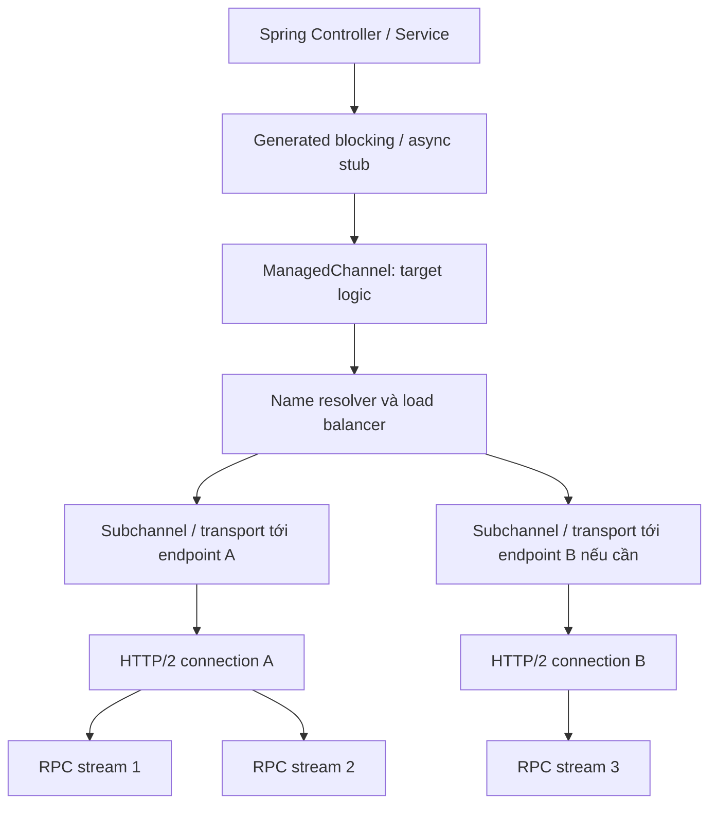
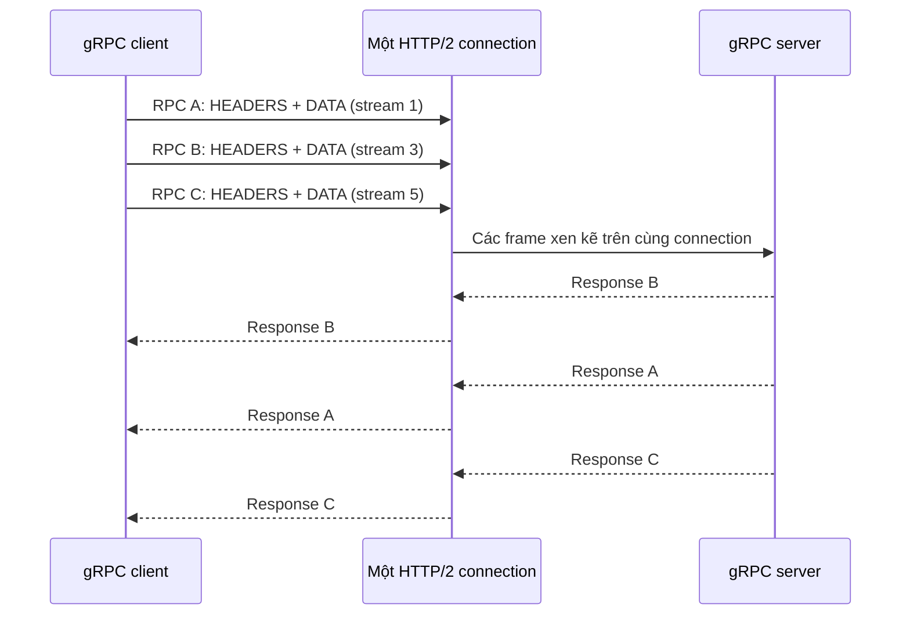
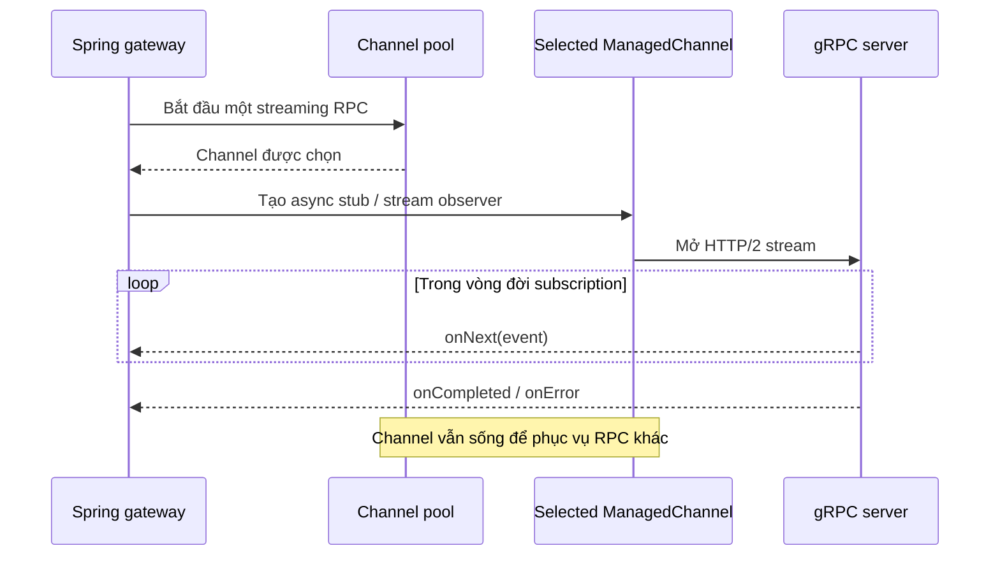
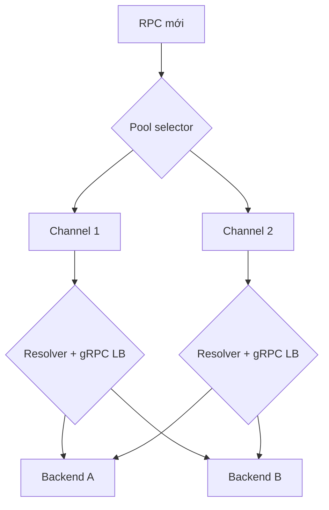

# Connection pooling và giới hạn channel

## 1. Mục tiêu và bối cảnh

Trong dịch vụ **Spring gRPC**, một client có thể gọi nhiều RPC unary hoặc streaming tới backend bằng mã Java sinh từ hợp đồng Protocol Buffers. Khi số request tăng, người phát triển thường đặt câu hỏi: *Có nên tạo nhiều `ManagedChannel` thành một connection pool không? Một channel phục vụ được bao nhiêu RPC đồng thời? Điều gì xảy ra khi HTTP/2 connection đã đạt giới hạn?*

Điều cần phân biệt đầu tiên: `ManagedChannel` là **đối tượng logic dùng để gửi RPC**, còn TCP/TLS connection và HTTP/2 stream do transport quản lý phía dưới. Khác với JDBC, gRPC Java thường **không yêu cầu một pool channel cho mỗi request**. HTTP/2 hỗ trợ nhiều RPC cùng tồn tại trên một connection; channel còn có thể quản lý nhiều subchannel/transport theo resolver và load balancer.

Sau bài này, bạn sẽ:

- Phân biệt channel, subchannel, HTTP/2 connection, stream và generated stub.
- Giải thích HTTP/2 multiplexing, `SETTINGS_MAX_CONCURRENT_STREAMS`, flow control và các điểm nghẽn khác.
- Chọn giữa **một channel dùng chung**, **nhiều channel tới cùng target** và **nhiều channel tới các target khác nhau**.
- Tổ chức vòng đời channel trong Spring, tránh tạo/đóng connection theo request.
- Thiết kế pool có kích thước giới hạn khi phép đo chứng minh cần thiết; không mặc định pool làm tăng throughput tuyến tính.
- Kiểm soát số RPC đang thực hiện bằng admission control riêng với số channel.
- Áp dụng deadline, status, interceptor, metadata, TLS, kiểm thử tích hợp và metrics khi đánh giá tải.

**Phạm vi chương “Channel và connection”:** bài tập trung vào quản lý tài nguyên kết nối phía client và giới hạn đồng thời. Các ví dụ sử dụng API gRPC Java rõ ràng để có thể áp dụng trong ứng dụng Spring hoặc đối chiếu với cơ chế channel factory của phiên bản Spring gRPC starter đang sử dụng.

## 2. Mô hình kết nối thực tế

Một lời gọi `GreeterGrpc.newBlockingStub(channel).sayHello(request)` đi qua nhiều tầng:



Sơ đồ mang tính khái quát. Số subchannel và connection thực sự tùy target, resolver, chính sách load balancing và transport; không được suy từ số stub hoặc số `ManagedChannel` theo tỷ lệ 1:1.

| Thành phần | Vai trò | Khả năng tái sử dụng |
|---|---|---|
| Generated stub | API Java của service sinh từ `.proto`, chứa cấu hình lời gọi | Thường có thể chia sẻ giữa nhiều luồng; `withDeadline...` trả về stub mới |
| `ManagedChannel` | Trừu tượng client kết nối tới một target logic | Dùng chung cho nhiều stub và RPC; thread-safe |
| Subchannel / load-balancer pick | Gắn target logic với endpoint/backend khả dụng | Do gRPC quản lý theo chính sách đang áp dụng |
| HTTP/2 connection | Transport giữa hai đầu của một chặng mạng | Có thể multiplex nhiều stream đồng thời |
| HTTP/2 stream | Luồng dữ liệu của một RPC | Được tạo cho từng RPC, không phải một đối tượng đem tái sử dụng |
| RPC | Đơn vị deadline, status, metadata, cancellation | Có vòng đời riêng; có thể là unary hoặc streaming |

Một channel lâu sống giúp **tận dụng kết nối đã thiết lập** và giảm số lần TCP/TLS handshake. Khi network transport bị đóng, channel còn sống có thể tái kết nối. Vì vậy, đóng một transport hoặc nhận `GOAWAY` không tương đương với `ManagedChannel.shutdown()`.

**Nguyên tắc mặc định:** tạo channel theo **đích logic và cấu hình bảo mật**, sử dụng lại cho các lời gọi, rồi đóng một lần khi chủ sở hữu kết thúc. Không mở một channel trong mỗi request HTTP đi vào Spring controller.

## 3. HTTP/2 multiplexing thay đổi nhu cầu pooling thế nào?

Với nhiều client HTTP/1.1 kiểu cũ, connection pool thường là cách giữ nhiều TCP connection để phục vụ các request đồng thời. HTTP/2 cho phép nhiều **stream độc lập** cùng tồn tại trên một connection. gRPC tận dụng đặc điểm này, khiến một channel/transport có thể xử lý số lượng lớn RPC cùng lúc.



Sơ đồ chỉ minh họa: các stream của một phía sử dụng ID theo quy tắc HTTP/2, nhưng ứng dụng thường không cần thao tác trực tiếp với stream ID.

### Giới hạn số stream đồng thời

HTTP/2 peer có thể công bố `SETTINGS_MAX_CONCURRENT_STREAMS`, giới hạn **số stream đang mở cùng lúc trên một connection**. Ví dụ nếu một kết nối chỉ cho phép tối đa 100 stream đồng thời, lời gọi thứ 101 có thể phải chờ slot tùy cách transport/client triển khai. Điều này có thể làm tăng độ trễ hoặc khiến RPC vượt deadline ngay cả khi code server của một lời gọi đã chạy rất nhanh.

**Không nhầm giới hạn này với:**

- Tổng số RPC tối đa của **toàn bộ `ManagedChannel`**: channel có thể dùng nhiều connection/subchannel.
- Số request tối đa của **toàn bộ ứng dụng Spring**: ứng dụng còn có thread pool, scheduler, semaphore và các tài nguyên khác.
- Tổng throughput của **server**: CPU, memory, database, thời gian xử lý nghiệp vụ và số replica có thể là điểm nghẽn sớm hơn.
- `maxInboundMessageSize` hoặc kích thước DATA frame: chúng là giới hạn kích thước, không phải số RPC đồng thời.

Nếu server hoặc proxy cấu hình số stream đồng thời thấp, client có thể quan sát **xếp hàng ở transport** hoặc độ trễ tăng theo bậc khi tải vượt ngưỡng. Chỉ nhìn `channel.getState(false) == READY` không đủ: `READY` không chứng minh vẫn còn stream slot rảnh hoặc backend có đủ tài nguyên.

### Flow control và head-of-line

HTTP/2 có **flow control theo stream và theo connection**. `WINDOW_UPDATE` cho phép bên gửi biết có thể truyền thêm dữ liệu. Một client/bidirectional streaming RPC không tiêu thụ message đủ nhanh có thể tạo backpressure mà keepalive PING vẫn phản hồi bình thường.

HTTP/2 tránh một số kiểu blocking của HTTP/1.1 ở tầng ứng dụng, nhưng các stream chung TCP connection vẫn chịu tác động khi TCP mất gói và cần truyền lại. Mở thêm connection đôi khi giúp cô lập một số loại ảnh hưởng, **không loại bỏ** băng thông mạng hữu hạn, nghẽn CPU hay các giới hạn server.

## 4. “Connection pool” có thể ám chỉ ba thiết kế khác nhau

| Cách tổ chức | Cấu trúc | Khi nào phù hợp | Giới hạn cần hiểu |
|---|---|---|---|
| **Một channel dùng chung** | Một `ManagedChannel` cho một target, nhiều stub/RPC | Mặc định cho đa số client Spring gRPC | Transport có thể có giới hạn stream và flow control |
| **Nhiều channel tới cùng target** | Pool hữu hạn các `ManagedChannel`, chọn một channel cho từng RPC/stream | Khi load test xác nhận một transport path là điểm nghẽn và backend chịu được tải | Không bảo đảm mỗi channel luôn tương ứng một socket hoặc endpoint khác |
| **Nhiều channel tới nhiều target** | Mỗi service/tenant/đích bảo mật có channel riêng | Dịch vụ khác nhau, CA/client identity khác nhau, cấu hình timeout hoặc policy khác nhau | Không nên gộp những đích khác nhau vào cùng pool để chọn ngẫu nhiên |

Nhiều stub sử dụng cùng channel **không** tạo pool kết nối mới. Ngược lại, nhiều channel cùng target không có nghĩa các RPC được trải đều qua các replica: mỗi channel vẫn áp dụng DNS, resolver và load-balancer policy riêng. Nếu cả bốn channel đều chọn cùng một backend, pool có thể dồn tải vào một node.

**Phân biệt pooling và load balancing:** pool chọn **channel nào** để ứng dụng gửi RPC; load balancing của gRPC chọn **subchannel/endpoint nào** trong một channel. Một số hệ thống sẽ có cả hai tầng lựa chọn; cần quan sát và đo đúng tầng để tránh chính sách chồng nhau.

## 5. Vì sao tạo channel theo request là lỗi thiết kế?

Ví dụ sau **không nên dùng** trong controller:

```java
// Anti-pattern: một channel mới cho mỗi HTTP request
public String greet(String name) {
    ManagedChannel channel = Grpc.newChannelBuilderForAddress(
            "grpc.example.com", 443, TlsChannelCredentials.create())
            .build();
    return GreeterGrpc.newBlockingStub(channel)
            .sayHello(HelloRequest.newBuilder().setName(name).build())
            .getMessage();
}
```

Code này có hai vấn đề: nó **không đóng** channel, và mỗi lần gọi lại tạo một đối tượng quản lý kết nối mới. Ngay cả khi bổ sung `finally { channel.shutdown(); }`, ứng dụng vẫn phải gánh thêm chi phí khởi tạo, DNS, TCP/TLS handshake và không tái sử dụng transport hiệu quả.

Khi lưu lượng tăng, hậu quả thường bao gồm:

- Nhiều socket, thread hoặc bộ đệm Netty hơn mức cần thiết.
- Tăng latency đặc biệt ở RPC ngắn do phải thiết lập kết nối.
- Khó giới hạn số connection tới một backend hay load balancer.
- Tăng áp lực CPU và network do handshake TLS lặp lại.
- Phức tạp khi graceful shutdown, certificate rotation và quan sát reconnect.

Giải pháp là **một chủ sở hữu có vòng đời rõ ràng**, thường là singleton bean Spring hoặc channel factory do framework quản lý. Mỗi RPC có deadline riêng nhưng channel tồn tại qua nhiều request.

## 6. Ví dụ hợp đồng và client Spring một channel

Giả sử server triển khai hợp đồng:

```proto
syntax = "proto3";
package demo.greeter;
option java_package = "dev.example.hello";
option java_multiple_files = true;

service Greeter {
  rpc SayHello (HelloRequest) returns (HelloReply);
}

message HelloRequest {
  string name = 1;
}

message HelloReply {
  string message = 1;
}
```

Sau khi `protoc` và plugin gRPC Java sinh mã, ta có `GreeterGrpc`, `HelloRequest` và `HelloReply` trong package `dev.example.hello`. Ví dụ sử dụng `TlsChannelCredentials` để xác minh chứng chỉ server trên endpoint production. Cần có runtime gRPC Java, Protobuf, gRPC stub và một transport HTTP/2 như Netty, cùng các dependency Spring tương ứng.

```java
package dev.example.client;

import io.grpc.Grpc;
import io.grpc.ManagedChannel;
import io.grpc.TlsChannelCredentials;
import org.springframework.beans.factory.annotation.Value;
import org.springframework.context.annotation.Bean;
import org.springframework.context.annotation.Configuration;
import org.springframework.context.annotation.Profile;

@Configuration(proxyBeanMethods = false)
@Profile("prod")
public class GreeterChannelConfig {
    @Bean(name = "greeterChannel", destroyMethod = "shutdown")
    public ManagedChannel greeterChannel(
            @Value("${demo.grpc.greeter.host}") String host,
            @Value("${demo.grpc.greeter.port}") int port) {
        return Grpc.newChannelBuilderForAddress(
                host, port, TlsChannelCredentials.create())
                .build();
    }
}
```

```java
package dev.example.client;

import dev.example.hello.GreeterGrpc;
import dev.example.hello.HelloRequest;
import io.grpc.ManagedChannel;
import java.util.concurrent.TimeUnit;
import org.springframework.beans.factory.annotation.Qualifier;
import org.springframework.stereotype.Service;

@Service
public final class GreeterGateway {
    private final GreeterGrpc.GreeterBlockingStub stub;

    public GreeterGateway(
            @Qualifier("greeterChannel") ManagedChannel channel) {
        this.stub = GreeterGrpc.newBlockingStub(channel);
    }

    public String greet(String name) {
        return stub.withDeadlineAfter(2, TimeUnit.SECONDS)
                .sayHello(HelloRequest.newBuilder()
                        .setName(name)
                        .build())
                .getMessage();
    }
}
```

```yaml
# application-prod.yml; demo.grpc.* là namespace tự đặt
demo:
  grpc:
    greeter:
      host: grpc.example.com
      port: 443
```

Ví dụ giả định certificate server hợp lệ với `grpc.example.com` và được runtime tin cậy. Nếu tổ chức dùng CA nội bộ hoặc mTLS, cần cấp trust CA và client certificate qua credential builder phù hợp; **không** dùng `usePlaintext()` để né lỗi chứng chỉ. Các property `demo.grpc.*` là cấu hình tự đặt, không phải tên cấu hình được bảo đảm bởi mọi phiên bản Spring gRPC starter.

Một singleton stub có thể được dùng từ nhiều thread. `withDeadlineAfter(...)` trả về stub mới mang deadline riêng. Không thay một stub singleton bằng đối tượng mutable chứa metadata của request hiện tại; request-specific metadata/call credentials nên được gắn cho từng RPC hoặc qua interceptor phù hợp.

**Giới hạn của `destroyMethod = "shutdown"`:** lệnh này yêu cầu đóng channel nhưng không chờ kết thúc. Với streaming dài hạn hoặc cần graceful shutdown có thời hạn, nên có lifecycle owner thực hiện `shutdown()`, `awaitTermination(...)`, sau đó `shutdownNow()` nếu hết ngân sách, và đảm bảo không có hai bean cùng đóng một channel.

## 7. Khi nào một channel có thể là điểm nghẽn?

Hãy đo trước khi tăng số channel. Những dấu hiệu đáng điều tra:

1. Độ trễ tail (P95/P99) tăng mạnh khi số RPC đang hoạt động tiến tới một ngưỡng ổn định.
2. Server CPU và thời gian xử lý handler còn thấp, nhưng latency tại client tăng do chờ transport.
3. Backend/proxy quảng bá `SETTINGS_MAX_CONCURRENT_STREAMS` thấp hơn mức concurrency mong muốn.
4. Streaming RPC giữ nhiều stream lâu sống và làm unary RPC phải đợi slot.
5. Flow control hoặc TCP congestion trên một đường kết nối làm giảm hiệu quả truyền payload lớn.

Tuy vậy, các triệu chứng tương tự còn có thể do thread pool, GC, database, giới hạn connection phía server, rate limit hoặc load balancer. Thêm channel khi server đã bão hòa chỉ chuyển chỗ xếp hàng và có thể làm quá tải backend nhanh hơn.

### Một phép tính minh họa, không phải cam kết hiệu năng

Giả sử *mỗi* transport đang có tối đa 100 stream hoạt động, và workload cần 240 streaming RPC dài hạn. Nếu tất cả 240 RPC thực sự đi qua **một HTTP/2 connection** và mỗi RPC chiếm một stream, hơn 100 stream không thể đồng thời hoạt động trên connection đó. Một pool có thể tạo thêm cơ hội sử dụng nhiều connection, nhưng số stream hữu dụng thực tế còn phụ thuộc số transport đã tạo, endpoint được chọn, giới hạn proxy/server, tài nguyên xử lý và retry.

Không nên kết luận “3 channel × 100 stream = 300 RPC chắc chắn chạy đồng thời”. Đây chỉ là mô hình giả định để nhận diện loại giới hạn; một `ManagedChannel` có thể có nhiều connection, và số connection chưa chắc bằng số channel.

## 8. Pool cố định nhiều `ManagedChannel` khi đã có bằng chứng

Khi load test cho thấy giới hạn stream/transport là điểm nghẽn và việc chia thêm connection giúp giảm tail latency **mà không làm backend quá tải**, có thể dùng pool **kích thước cố định**. Không tạo pool không giới hạn; cần giới hạn theo tài nguyên và chính sách phía server.

Ví dụ một lớp pool sở hữu toàn bộ channel, chọn channel theo round-robin cho **mỗi RPC mới**. Trường hợp streaming, chọn một channel lúc **bắt đầu** stream và tiếp tục dùng nó trong suốt vòng đời RPC đó.

```java
package dev.example.client;

import io.grpc.Grpc;
import io.grpc.ManagedChannel;
import io.grpc.TlsChannelCredentials;
import java.util.ArrayList;
import java.util.List;
import java.util.concurrent.TimeUnit;
import java.util.concurrent.atomic.AtomicBoolean;
import java.util.concurrent.atomic.AtomicInteger;

public final class FixedGrpcChannelPool implements AutoCloseable {
    private final List<ManagedChannel> channels;
    private final AtomicInteger cursor = new AtomicInteger();
    private final AtomicBoolean closing = new AtomicBoolean(false);

    public FixedGrpcChannelPool(String host, int port, int poolSize) {
        if (poolSize < 1 || poolSize > 8) {
            throw new IllegalArgumentException("poolSize must be in 1..8");
        }
        List<ManagedChannel> created = new ArrayList<>(poolSize);
        try {
            for (int i = 0; i < poolSize; i++) {
                created.add(Grpc.newChannelBuilderForAddress(
                        host, port, TlsChannelCredentials.create()).build());
            }
        } catch (RuntimeException e) {
            created.forEach(ManagedChannel::shutdownNow);
            throw e;
        }
        this.channels = List.copyOf(created);
    }

    public ManagedChannel nextChannel() {
        if (closing.get()) {
            throw new IllegalStateException("Channel pool is closing");
        }
        int index = Math.floorMod(
                cursor.getAndIncrement(), channels.size());
        return channels.get(index);
    }

    public int size() {
        return channels.size();
    }

    @Override
    public void close() {
        if (!closing.compareAndSet(false, true)) {
            return;
        }
        channels.forEach(ManagedChannel::shutdown);
        boolean interrupted = false;
        for (ManagedChannel channel : channels) {
            try {
                if (!channel.awaitTermination(5, TimeUnit.SECONDS)) {
                    channel.shutdownNow();
                }
            } catch (InterruptedException e) {
                interrupted = true;
                channel.shutdownNow();
            }
        }
        if (interrupted) {
            Thread.currentThread().interrupt();
        }
    }
}
```

Đây là **pool minh họa**, dùng giới hạn hard-code `1..8` để nhấn mạnh việc đặt trần cấu hình; con số này không phải khuyến nghị sizing cho mọi hệ thống. Mã chọn round-robin chỉ cân bằng **số lượt chọn channel**, không tự đo số RPC đang chạy, byte đang truyền, queue depth hoặc sức khỏe từng endpoint. `nextChannel()` cũng không thay thế admission control; một pool bốn channel vẫn có thể bị giao hàng nghìn RPC cùng lúc.

Lưu ý vòng đời khi triển khai thật: `close()` trong ví dụ chờ **tối đa 5 giây mỗi channel**, nên tổng thời gian có thể dài theo kích thước pool. Nếu có ngân sách shutdown tổng nghiêm ngặt, hãy tính deadline chung, ngừng nhận RPC mới và chờ các channel song song hoặc với thời gian còn lại. Việc request đang chạy đua với `close()` phải được giải quyết bằng cơ chế **drain** ở tầng ứng dụng trước khi đóng pool.

### Khai báo một pool được Spring sở hữu

```java
package dev.example.client;

import org.springframework.beans.factory.annotation.Value;
import org.springframework.context.annotation.Bean;
import org.springframework.context.annotation.Configuration;
import org.springframework.context.annotation.Profile;

@Configuration(proxyBeanMethods = false)
@Profile("prod")
public class GrpcPoolConfig {
    @Bean(destroyMethod = "close")
    public FixedGrpcChannelPool greeterPool(
            @Value("${demo.grpc.greeter.host}") String host,
            @Value("${demo.grpc.greeter.port}") int port,
            @Value("${demo.grpc.greeter.pool-size:2}") int size) {
        return new FixedGrpcChannelPool(host, port, size);
    }
}
```

```java
package dev.example.client;

import dev.example.hello.GreeterGrpc;
import dev.example.hello.HelloRequest;
import java.util.concurrent.TimeUnit;
import org.springframework.stereotype.Service;

@Service
public final class PooledGreeterGateway {
    private final FixedGrpcChannelPool pool;

    public PooledGreeterGateway(FixedGrpcChannelPool pool) {
        this.pool = pool;
    }

    public String greet(String name) {
        var stub = GreeterGrpc.newBlockingStub(pool.nextChannel())
                .withDeadlineAfter(2, TimeUnit.SECONDS);
        return stub.sayHello(HelloRequest.newBuilder()
                .setName(name).build()).getMessage();
    }
}
```

Pool có thể được inject vào nhiều gateway cùng một target/cấu hình. Trong Spring, **đừng đăng ký đồng thời** cấu hình `GreeterChannelConfig` của mục 6 và `GrpcPoolConfig` cho cùng một client nếu chúng khiến ứng dụng tạo các channel thừa hoặc phát sinh bean ambiguity. Chọn một phương án sau khi đánh giá workload. Tạo stub mới từ channel sẵn có tương đối rẻ; có thể giữ stub theo từng channel nếu muốn giảm thêm object allocation nhưng phải bảo đảm metadata của từng request độc lập.

`${demo.grpc.greeter.pool-size:2}` là **property tự đặt**. Pool không tự nhận biết server đang advertise bao nhiêu concurrent stream; đo và hiệu chỉnh kích thước bằng thử nghiệm thực tế.

## 9. Pool không thay cho giới hạn số RPC đang thực hiện

Một vấn đề khác là **application backpressure**. Nếu endpoint Spring nhận 2.000 request đồng thời, dù chỉ có hai channel, nó có thể gửi hoặc xếp hàng 2.000 RPC. Mở thêm channel không kiểm soát được áp lực CPU, memory và số database transaction của backend.

Ứng dụng nên có một **admission limit** độc lập, ví dụ giới hạn số RPC đang thực hiện và ngân sách chờ slot. Cách đơn giản cho **blocking RPC** là `Semaphore`:

```java
package dev.example.client;

import dev.example.hello.GreeterGrpc;
import dev.example.hello.HelloRequest;
import io.grpc.Deadline;
import io.grpc.Status;
import java.util.concurrent.Semaphore;
import java.util.concurrent.TimeUnit;

public final class BoundedGreeterClient {
    private final GreeterGrpc.GreeterBlockingStub stub;
    private final Semaphore inFlight = new Semaphore(64, true);

    public BoundedGreeterClient(
            GreeterGrpc.GreeterBlockingStub stub) {
        this.stub = stub;
    }

    public String greet(String name) {
        Deadline budget = Deadline.after(2, TimeUnit.SECONDS);
        boolean acquired;
        try {
            long remainingNanos = Math.max(
                    0, budget.timeRemaining(TimeUnit.NANOSECONDS));
            acquired = inFlight.tryAcquire(
                    remainingNanos, TimeUnit.NANOSECONDS);
        } catch (InterruptedException e) {
            Thread.currentThread().interrupt();
            throw Status.CANCELLED
                    .withDescription("Interrupted while waiting for capacity")
                    .withCause(e)
                    .asRuntimeException();
        }

        if (!acquired) {
            throw Status.RESOURCE_EXHAUSTED
                    .withDescription("Client concurrency limit reached")
                    .asRuntimeException();
        }

        try {
            return stub.withDeadline(budget)
                    .sayHello(HelloRequest.newBuilder()
                            .setName(name).build())
                    .getMessage();
        } finally {
            inFlight.release();
        }
    }
}
```

Ở đây ngân sách 2 giây được tạo **trước khi chờ semaphore**; gRPC stub nhận cùng `Deadline` để thời gian xếp hàng không làm ngân sách tổng bị kéo dài ngoài dự kiến. Một lượt gọi không lấy được slot trả `RESOURCE_EXHAUSTED` do **chính client ứng dụng quyết định**, không nên diễn giải thành lỗi từ server. Nếu `Deadline` đã hết khi được cấp slot, RPC có thể thất bại ngay; thiết kế production có thể phát hiện tình huống đó và trả mã deadline phù hợp mà vẫn giải phóng slot.

Lựa chọn `64` concurrent RPC chỉ để minh họa; hãy đo CPU, latency, memory và năng lực server để đặt giá trị thật. Với async/reactive RPC, không dùng đoạn `tryAcquire` blocking trên event loop; sử dụng limiter bất đồng bộ hoặc cơ chế queue/bulkhead không chặn. Khi dùng semaphore, tính cả request bị từ chối, thời gian chờ và số permit sử dụng.

**Pool channel và semaphore xử lý hai vấn đề khác nhau:** pool xác định **đường gửi**, semaphore xác định **có nhận thêm công việc hay không**. Không tăng số channel khi điều thực sự cần là giới hạn concurrency hoặc scale server.

## 10. Quản lý retry, wait-for-ready và deadline

Khi đạt giới hạn stream hoặc backend tạm thời không sẵn sàng, RPC có thể bị xếp hàng, hết deadline hoặc trả lỗi. Đọc `Status.Code` để phân biệt:

| Hiện tượng | Mã thường gặp | Hướng kiểm tra |
|---|---|---|
 RPC chờ quá lâu và hết ngân sách | `DEADLINE_EXCEEDED` | Admission wait, client queue, transport stream slot, latency backend |
 Backend/connection không khả dụng | `UNAVAILABLE` | DNS, TLS, proxy, backend, reconnect và GOAWAY |
 Server từ chối do quota hoặc tài nguyên | `RESOURCE_EXHAUSTED` | Quota/limit thực tế, memory, concurrency, rate limit |
 Client tự từ chối vì hết permit | `RESOURCE_EXHAUSTED` trong ví dụ | Client-side admission policy; không gán nhầm cho server |
 RPC bị hủy | `CANCELLED` | Caller cancellation, shutdown, stream lifecycle |
 Trình xử lý ứng dụng trả lỗi | `INTERNAL`, `INVALID_ARGUMENT`, v.v. | Xử lý nghiệp vụ, không kết luận là lỗi pool |

`withWaitForReady()` có thể khiến RPC chờ transport trở nên `READY` thay vì fail-fast ở một số tình huống kết nối, nhưng **không tăng giới hạn stream** hay tài nguyên backend. Luôn phối hợp với deadline; không để RPC chờ vô hạn khi load balancer mất endpoint.

**Retry và hedging có thể làm tăng số lần thực thi RPC**, dẫn đến thêm tải đúng lúc hệ thống đang quá tải. Retry chỉ khi nghiệp vụ chịu được gọi lại, với retry budget, backoff và deadline tổng. Với RPC gây tác dụng phụ, phải có idempotency key hoặc cơ chế chống trùng phù hợp.

## 11. Streaming và pool channel

Streaming RPC thường giữ HTTP/2 stream lâu hơn unary. Chẳng hạn 150 client mở server-streaming subscriptions, mỗi subscription im lặng nhiều phút nhưng chưa hoàn tất; các stream vẫn chiếm slot trên connection.



Quy tắc cần áp dụng:

1. **Chọn một channel khi tạo stream**; không đổi channel giữa chừng cho cùng RPC.
2. Stream bị lỗi hoặc connection mất không được tự động “dịch chuyển” sang channel khác kèm đầy đủ trạng thái nghiệp vụ. Client phải mở RPC mới và **resume/replay** nếu hợp đồng hỗ trợ.
3. Với server streaming hoặc bidirectional streaming dài hạn, cân nhắc cách chia tải giữa stream và unary; chỉ tách **channel class** sau khi có bằng chứng nghẽn và chính sách server cho phép.
4. **Backpressure** và giới hạn số message đang đệm quan trọng hơn số channel trong nhiều trường hợp. Không đẩy data vô hạn vào một stream chậm.
5. Khi shutdown, hoàn tất/hủy các stream đang mở trước khi đóng pool; ghi nhận reconnect và cancellation.

Một lựa chọn là giữ **một channel cho unary** và **một channel cho long-lived streaming** để tách chính sách keepalive/deadline hoặc giảm cạnh tranh stream nếu đo đạc xác nhận. Nhưng việc tách channel tăng số transport và có thể chọn cùng backend; không coi đây là quy tắc mặc định.

## 12. Tương tác với TLS, keepalive và connection age

Pool nhiều channel có thể tạo nhiều phiên TCP/TLS và nhiều kết nối tới proxy/server hơn. Trước khi tăng kích thước pool, cần đánh giá:

- **TLS/mTLS:** từng channel dùng đúng trust CA, hostname/SAN, client certificate và private key. Không chia sẻ nhầm identity giữa tenant hoặc workload; chứng chỉ có thể cần quay vòng.
- **Keepalive:** mỗi HTTP/2 connection có thể phát `PING` theo chính sách. Nhiều channel hoạt động đồng thời có thể tăng lưu lượng PING và dẫn đến `GOAWAY ENHANCE_YOUR_CALM` hoặc `too_many_pings` nếu vi phạm policy.
- **Max connection age:** server/proxy có thể gửi `GOAWAY` khi hết tuổi/đang drain connection. Các channel vẫn sống và có thể thiết lập transport mới; stream cũ cần được xử lý riêng.
- **Connection idle:** nhiều channel không có RPC không nhất thiết đồng nghĩa nhiều socket luôn mở; việc duy trì connection idle và keepalive phụ thuộc transport và cấu hình.
- **Certificate rotation:** thay secret trên đĩa không tự bảo đảm mọi transport đã nạp cert mới. Có thể cần tạo pool mới, chuyển lưu lượng và drain pool cũ.

Ví dụ một dịch vụ scale từ 10 lên 100 replica client, mỗi replica giữ pool 8 channel tới cùng backend: về mặt cấu hình có tới **800 channel logic**, chưa kể các subchannel/connection nội bộ. Cần theo dõi số transport thực tế, chi phí TLS handshake và giới hạn connection phía proxy trước khi áp dụng rộng.

## 13. Pool channel có phải là load balancing không?

Không. Có hai lựa chọn độc lập:



Nếu target là một DNS name có nhiều IP, mỗi channel có thể có cách phân giải/cân bằng tải theo cấu hình; không nên mặc định mỗi channel tự trỏ tới IP khác. Nếu muốn chia tải qua nhiều backend, hãy cấu hình name resolver và chính sách load balancing gRPC hoặc hệ thống service discovery tương ứng.

Ví dụ `round_robin` là chính sách load balancing của gRPC Java trong môi trường hỗ trợ, khác với round-robin chọn channel trong `FixedGrpcChannelPool`. Số channel pool không nên được dùng để “chữa” vấn đề resolver chỉ nhận diện một endpoint hoặc policy đang chọn backend không phù hợp.

Khi backend A quá tải mà B còn rảnh, ưu tiên đo distribution theo endpoint và xử lý vấn đề service discovery/LB. Việc nhân số channel có thể khiến cả pool tiếp tục dồn vào A nếu chính sách pick vẫn không thay đổi.

## 14. Đo lường trước khi tối ưu

### Các chỉ số cần xem cùng lúc

| Nhóm quan sát | Chỉ số ví dụ | Câu hỏi |
|---|---|---|
 Client RPC | `in_flight`, throughput, lỗi theo `Status.Code` | Tải thực tế và tỷ lệ thành công ra sao? |
 Latency | P50, P95, P99 theo method | Tail latency tăng ở tải nào? |
 Client admission | Permit sử dụng, queue wait, số request bị từ chối | Có quá nhiều lời gọi đi vào cùng lúc không? |
 Transport | Số connection/subchannel, reconnect, `GOAWAY` | Pool có thật sự tăng connection hữu ích? |
 HTTP/2 | Active streams, giới hạn stream, flow control nếu quan sát được | Có hàng đợi do stream slot/window không? |
 Backend | CPU, memory, thread, executor queue, DB pool | Nút nghẽn có nằm ở server không? |
 Network/security | TLS handshake latency/failures, proxy timeout | Có chi phí tạo connection hoặc lỗi chứng chỉ? |
 Streaming | Số stream sống lâu, tần suất reconnect/resume | Stream có giữ slot quá lâu hay mất dữ liệu? |

**Không đo số connection bằng số đối tượng `ManagedChannel`**. Hãy dùng metrics/log của transport, **Channelz** nếu triển khai/phiên bản hỗ trợ, socket inspection có kiểm soát, hoặc quan sát từ load balancer/server. Interceptor ở tầng RPC đo được trạng thái và thời lượng lời gọi nhưng thường không trực tiếp cho biết mỗi HTTP/2 connection có bao nhiêu stream slot.

Có thể dùng OpenTelemetry/Micrometer theo stack Spring để thu thập RPC metrics/tracing; bảo vệ metadata nhạy cảm trong log/tracing và tránh metrics label có cardinality quá cao như user ID hoặc request ID.

### Phép thử so sánh đúng cách

Hãy cố định **cùng backend, cùng deadline, cùng retry policy, cùng message size, cùng workload** rồi so sánh:

1. Một channel dùng chung và pool 2 channel.
2. Pool 4 channel nếu kết quả bước trước cho thấy lợi ích rõ ràng.
3. Tải unary thuần, streaming thuần và tải hỗn hợp.
4. Độ trễ và lỗi RPC **cùng với** CPU/memory/socket của client, server, proxy.
5. Thử khi server dừng/khởi động lại, một backend mất kết nối, cert rotation và shutdown.

Chỉ giữ pool lớn hơn khi lợi ích P95/P99 hoặc throughput **ổn định qua nhiều lượt đo**, không đổi lỗi sang một tầng khác và phù hợp giới hạn tài nguyên. Thực nghiệm cần warm up để không đánh đồng chi phí handshake lúc đầu với throughput bền vững.

## 15. Kiểm thử tích hợp: xác nhận concurrency mà không đánh tráo ý nghĩa

Một unit test với in-process channel hữu ích để xác minh logic service nhưng **không chứng minh số TCP/HTTP/2 connection thực**. Đối với kết nối, sử dụng Netty server/client thật qua loopback, đặt deadline, gọi nhiều RPC đồng thời và đóng toàn bộ tài nguyên.

Ví dụ JUnit 5 dùng server không TLS trên `127.0.0.1` **chỉ trong môi trường test cô lập**. Mục đích là chứng minh nhiều RPC chạy qua cùng channel, không phải khẳng định đã đo được một connection hay `SETTINGS_MAX_CONCURRENT_STREAMS` cụ thể.

```java
package dev.example.hello;

import static org.junit.jupiter.api.Assertions.assertEquals;
import static org.junit.jupiter.api.Assertions.assertTrue;

import io.grpc.Grpc;
import io.grpc.InsecureChannelCredentials;
import io.grpc.ManagedChannel;
import io.grpc.Server;
import io.grpc.netty.shaded.io.grpc.netty.NettyServerBuilder;
import io.grpc.stub.StreamObserver;
import java.net.InetSocketAddress;
import java.util.List;
import java.util.concurrent.CompletableFuture;
import java.util.concurrent.ExecutorService;
import java.util.concurrent.Executors;
import java.util.concurrent.TimeUnit;
import org.junit.jupiter.api.Test;

class SharedChannelConcurrencyTest {
    @Test
    void manyUnaryRpcsReuseOneChannel() throws Exception {
        Server server = NettyServerBuilder
                .forAddress(new InetSocketAddress("127.0.0.1", 0))
                .addService(new GreeterGrpc.GreeterImplBase() {
                    @Override
                    public void sayHello(
                            HelloRequest req,
                            StreamObserver<HelloReply> observer) {
                        observer.onNext(HelloReply.newBuilder()
                                .setMessage("Xin chào " + req.getName())
                                .build());
                        observer.onCompleted();
                    }
                })
                .build()
                .start();

        ManagedChannel channel = Grpc.newChannelBuilderForAddress(
                "127.0.0.1", server.getPort(),
                InsecureChannelCredentials.create()).build();
        ExecutorService callers = Executors.newFixedThreadPool(8);

        try {
            var stub = GreeterGrpc.newBlockingStub(channel);
            List<CompletableFuture<String>> tasks =
                    java.util.stream.IntStream.range(0, 32)
                            .mapToObj(i -> CompletableFuture.supplyAsync(
                                    () -> stub
                                            .withDeadlineAfter(3, TimeUnit.SECONDS)
                                            .sayHello(HelloRequest.newBuilder()
                                                    .setName("User" + i)
                                                    .build())
                                            .getMessage(), callers))
                            .toList();
            for (int i = 0; i < tasks.size(); i++) {
                assertEquals("Xin chào User" + i, tasks.get(i).join());
            }
        } finally {
            channel.shutdownNow();
            server.shutdownNow();
            callers.shutdownNow();
            assertTrue(channel.awaitTermination(5, TimeUnit.SECONDS));
            assertTrue(server.awaitTermination(5, TimeUnit.SECONDS));
            assertTrue(callers.awaitTermination(5, TimeUnit.SECONDS));
        }
    }
}
```

Test dùng Java có `Stream.toList()`; với Java cũ hơn có thể dùng `collect(Collectors.toList())`. Nếu test fail vì deadline rất ngắn trên máy CI chậm, cần chẩn đoán tải máy và thời gian chờ, không tự tăng số channel để che giấu flakiness.

**Điều test này chứng minh:** 32 RPC unary có thể được gọi từ nhiều thread bằng một stub/channel và server xử lý được kết quả. **Điều test không chứng minh:** số TCP connection, số stream đồng thời tối đa, chính sách pool nào tối ưu hoặc production TLS có hoạt động đúng. Cần công cụ quan sát transport và bài stress test riêng cho các mục tiêu đó.

### Các test có giá trị khác

- **Giới hạn admission:** tạo nhiều RPC chậm và kiểm tra không vượt số permit; yêu cầu bị từ chối trả lỗi có thể quan sát được.
- **Transport stream limit:** cấu hình server/proxy test giới hạn thấp nếu nền tảng hỗ trợ, tăng số RPC đồng thời và quan sát queue/deadline thay vì suy luận từ số stub.
- **Pool lifecycle:** khởi tạo pool kích thước cố định, đóng Spring context, xác nhận toàn bộ channel được shutdown và không rò rỉ thread/socket.
- **Lỗi một endpoint:** tắt một replica hoặc ngắt TCP; kiểm tra resolver/LB, retry budget và kết quả RPC khi mất backend.
- **Streaming:** mở nhiều stream dài hạn; xác minh cancel/resume khi server gửi `GOAWAY` hoặc kết nối bị đóng.
- **TLS/mTLS:** dùng certificate fixture đúng SAN/CA, thử sai hostname và sai CA, không thay bằng plaintext trong kiểm thử production security.

## 16. Sự cố thường gặp và hướng xử lý

| Hiện tượng | Nguyên nhân cần xem xét | Hành động |
|---|---|---|
 Mỗi request tạo channel mới | Xây channel trong controller/method | Dùng singleton bean hoặc framework-managed channel |
 P99 tăng khi có nhiều stream dài hạn | Hết HTTP/2 stream slot, flow control hoặc server bão hòa | Đo ở từng tầng; cân nhắc cách ly workload/pool nhỏ sau load test |
 Tăng pool nhưng throughput không tăng | Backend CPU/DB hoặc LB mới là điểm nghẽn | Giảm pool; scale/sửa backend hoặc LB |
 Socket/thread/handshake tăng đột biến | Pool quá lớn hoặc connection churn | Giới hạn pool, đo connection thực và TLS handshake |
 `RESOURCE_EXHAUSTED` | Server quota, tài nguyên hoặc client admission | Xác định mã phát sinh ở đâu, giảm tải và đặt limiter |
 `DEADLINE_EXCEEDED` dù server nhanh | Chờ slot/queue trước khi backend xử lý | Đo end-to-end latency và thời gian xếp hàng |
 Pool channel tập trung vào một replica | DNS/LB pick không phù hợp | Kiểm tra resolver/LB; đừng coi pool là cân bằng tải |
 `GOAWAY too_many_pings` | Nhiều connection ping quá dày so với policy | Đồng bộ keepalive với server/proxy |
 Stream mất sự kiện sau reconnect | Streaming RPC cũ đã kết thúc và không resume | Thiết kế replay cursor/deduplication |
 Shutdown treo hoặc còn thread | Có RPC dài hạn/channels không có owner rõ ràng | Drain stream, đóng từng channel có thời hạn và xác minh termination |

## 17. Bài tập vận dụng: gateway Spring chịu tải cao

**Tình huống:** một Spring Boot gateway gọi `Greeter.SayHello` và `Notification.Subscribe` (server streaming). Có 300 stream dài hạn, đồng thời khoảng 150 unary RPC/s. Backend là ba replica sau một DNS/load balancer; proxy có cấu hình giới hạn stream trên mỗi HTTP/2 connection. P95 unary tăng khi số stream đang mở cao. Nhóm đề xuất “cứ thêm 20 channel cho nhanh”.

Hãy thực hiện:

1. Vẽ đường đi `Spring gateway → ManagedChannel → subchannel/transport → proxy → server` và chỉ rõ nơi có `SETTINGS_MAX_CONCURRENT_STREAMS`.
2. Đo latency theo từng method, số RPC/stream đang mở, số transport thực, proxy queue, CPU server và tỷ lệ `Status.Code`. Chỉ ra bằng chứng cần có trước khi mở pool.
3. Chạy benchmark một channel và pool 2/4 channel cùng workload, giữ retry và deadline cố định. So sánh cả memory/socket và server load.
4. Đặt admission limit cho unary RPC, có ngân sách chờ và deadline tổng. Giải thích vì sao pool không giới hạn số request mà ứng dụng nhận.
5. Thiết kế policy cho streaming: chọn channel một lần, xử lý `onError`, resume cursor và hủy stream khi client ngừng quan tâm.
6. Đánh giá DNS/LB để xác nhận RPC được phân phối hợp lý qua ba replica; không kết luận từ số channel.
7. Xem lại TLS/mTLS, certificate rotation, keepalive và `GOAWAY` khi tăng số transport.
8. Kiểm thử đóng Spring context và chứng minh pool/channels không giữ thread/socket sau shutdown; chỉ ra giới hạn của một integration test in-process.

**Tiêu chí hoàn thành:** đề xuất được cấu hình dựa trên đo lường, không tạo channel theo request, phân biệt HTTP/2 stream limit với giới hạn concurrency ứng dụng, giải thích vai trò của admission control và có kế hoạch thử nghiệm để phát hiện cả hiệu năng lẫn rủi ro khi tăng số channel.

## 18. Ghi nhớ

Trong Spring gRPC, **một `ManagedChannel` dùng lại lâu dài là điểm khởi đầu phù hợp**. HTTP/2 multiplexing cho phép nhiều RPC cùng chia sẻ connection, nhưng số stream đồng thời, flow control, tài nguyên server và chính sách proxy vẫn là các giới hạn thực. Pool nhiều channel có thể hữu ích với workload đặc biệt khi **đo được** transport bottleneck; nó không đồng nghĩa load balancing và không tự hạn chế số RPC đang thực hiện. Hãy kết hợp channel ownership, admission control, deadline, TLS, metrics, streaming recovery và graceful shutdown để tối ưu độ trễ mà vẫn giữ độ tin cậy của hệ thống.
