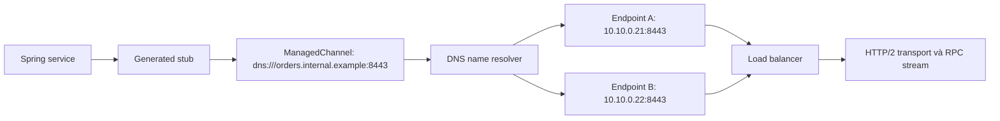
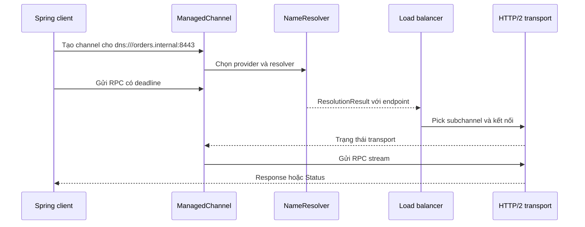
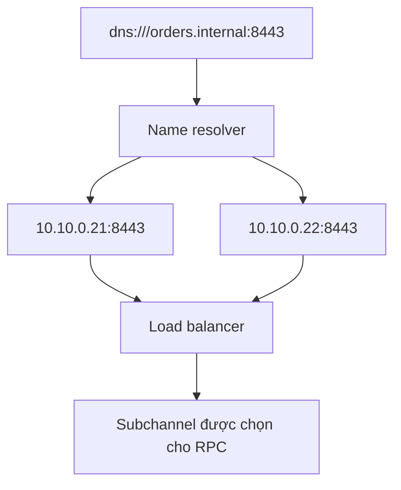

# Name resolver và target URI

## 1. Mục tiêu và bối cảnh

Trong **Spring gRPC**, generated stub biết tên phương thức RPC và kiểu message theo hợp đồng Protocol Buffers, nhưng không biết máy chủ hiện đang nằm ở IP nào. Khi ứng dụng gọi một dịch vụ như `OrderService.GetOrder`, đối tượng `ManagedChannel` phải tìm được endpoint phù hợp, sau đó chuyển RPC qua transport HTTP/2. **Name resolver** và **target URI** là hai thành phần quyết định cách tìm endpoint.

Một target có thể ổn định hàng tháng, trong khi địa chỉ IP của server thay đổi qua mỗi lần deploy, failover hoặc scale. Việc tách **định danh dịch vụ** khỏi **địa chỉ mạng cụ thể** giúp client không phải cập nhật code theo mỗi lần đổi máy chủ.

Sau bài học, bạn có thể:

- Phân tích scheme, URI authority và path của target như `dns:///orders.internal:8443`.
- Phân biệt tên service trong `.proto`, target URI, service authority và socket address.
- Giải thích quá trình `target → name resolver → endpoint → load balancer → transport`.
- Cấu hình target DNS tường minh qua gRPC Java và bean Spring.
- So sánh DNS, Kubernetes ClusterIP, headless Service và resolver chuyên biệt.
- Phân biệt chính sách `pick_first`, `round_robin` với bản thân quá trình phân giải tên.
- Nhận diện lỗi TLS hostname/SAN, DNS cache, cập nhật endpoint và streaming khi server đổi địa chỉ.
- Thiết kế custom `NameResolverProvider` cơ bản và kiểm thử đúng tầng phân giải.

Nội dung tập trung vào **name resolver và target URI** của chương “Channel và connection”. TLS, deadline, status, interceptor và quan sát hiệu năng được đưa vào khi chúng giúp kiểm tra hoặc vận hành đường kết nối.

## 2. Định danh service, target và endpoint là ba việc khác nhau

Giả sử có hợp đồng gRPC `demo.orders.OrderService/GetOrder`:

| Thành phần | Ví dụ | Ý nghĩa |
|---|---|---|
| Full method name | `demo.orders.OrderService/GetOrder` | Tên RPC sinh từ file `.proto` |
| Target URI | `dns:///orders.internal.example:8443` | Chỉ cách tìm đích kết nối và port |
| Địa chỉ endpoint | `10.10.0.21:8443`, `10.10.0.22:8443` | Những socket address có thể được chọn |
| `ManagedChannel` | Đối tượng Java do client sở hữu | Điều phối resolver, load balancer, transport và nhiều RPC |

Đổi địa chỉ IP của backend thường **không yêu cầu sửa file `.proto` hoặc sinh lại stub**. Ngược lại, đổi package/service/method trong `.proto` sẽ ảnh hưởng API RPC, dù DNS không đổi.



Đây là mô hình khái quát. Một channel có thể quản lý nhiều subchannel/transport; số socket không nhất thiết bằng số stub, số channel hay số địa chỉ trả về.

## 3. Cú pháp target URI

Target có dạng tổng quát:

```text
scheme://authority/path
```

**Scheme** chọn `NameResolverProvider`; phần còn lại do provider đó diễn giải. Target URI **không phải HTTP URL**. Chẳng hạn, dùng `https://...` không phải cách yêu cầu gRPC Java bật TLS. TLS được chọn bằng `ChannelCredentials` hoặc builder bảo mật phù hợp.

Target DNS quen thuộc là:

```text
dns:///orders.internal.example:8443
│     └─ Path chứa endpoint name và port
└─────── Scheme = dns
```

Ba dấu `/` sau `dns:` cho thấy phần **URI authority rỗng** và path bắt đầu bằng `/`. Kiểm tra với Java:

```java
import java.net.URI;

URI target = URI.create("dns:///orders.internal.example:8443");
System.out.println(target.getScheme());    // dns
System.out.println(target.getAuthority()); // null
System.out.println(target.getPath());      // /orders.internal.example:8443
```

| Target | Khi nào dùng | Điều cần chú ý |
|---|---|---|
| `dns:///localhost:9090` | Thực hành trên máy local | Đích cổng gRPC, không phải endpoint HTTP/1.1 |
| `dns:///orders.internal.example:8443` | DNS production | Cần cấu hình TLS đúng tên và CA |
| `dns:///orders.default.svc.cluster.local:8443` | Kubernetes Service | DNS có thể trả virtual IP hoặc Pod IP tùy loại Service |
| `orders.internal.example:8443` | Target không chỉ rõ scheme | gRPC sẽ dùng scheme mặc định của runtime, thường là `dns` |
| `xds:///orders-service` | Discovery qua xDS | Chỉ khi runtime có xDS provider và bootstrap/config hợp lệ |
| `localdemo:///greeter` | Ví dụ resolver tùy biến | Không phải scheme mặc định có sẵn |

Với target thiếu scheme, `ManagedChannelBuilder` có thể dùng resolver scheme mặc định. Trong production, **viết scheme tường minh** giúp người vận hành biết rõ client sẽ gọi provider nào và tránh phụ thuộc vào các resolver được đăng ký trong process.

Một số provider cho phép thành phần URI authority mang thông tin riêng. Không lấy quy tắc path/authority của `dns` áp vào mọi resolver khác: mỗi scheme là một hợp đồng phân giải riêng.

## 4. URI authority, service authority và socket address

Từ “authority” xuất hiện ở nhiều tầng nhưng ý nghĩa khác nhau:

| Khái niệm | Tầng | Ý nghĩa |
|---|---|---|
| **URI authority** | Cú pháp URI | Nằm giữa `//` và `/`; rỗng với `dns:///...` |
| **Service authority** | gRPC resolver/channel | Danh tính logic mà transport có thể dùng cho HTTP/2 `:authority` và xác minh server |
| **Socket address** | TCP/transport | IP và port thực sự được dùng để mở kết nối |

Ví dụ, channel mang target `dns:///orders.internal.example:8443`. DNS trả `10.10.0.21:8443`. TCP connection có thể mở tới `10.10.0.21`, nhưng certificate TLS vẫn thường cần hợp lệ với tên `orders.internal.example`. **Địa chỉ IP backend không tự trở thành tên phải nằm trong chứng chỉ**.

Một custom `NameResolver` cung cấp `getServiceAuthority()`. Tên này phải nhất quán với danh tính dịch vụ được phép xác minh. `ManagedChannel.authority()` hữu ích để quan sát authority mà channel công bố, nhưng không phải bằng chứng handshake TLS thành công.

Tránh dùng `overrideAuthority(...)` hoặc tắt hostname verification để chữa lỗi chứng chỉ. Với môi trường TLS/mTLS, cần sửa cấu hình DNS, service identity hoặc cấp certificate có **Subject Alternative Name (SAN)** phù hợp. Khi có ingress/xDS/service mesh, thiết kế SNI, HTTP/2 `:authority` và socket routing phải nhất quán với từng chặng kết nối.

## 5. Name resolver làm gì sau khi nhận target?

`ManagedChannel` sử dụng scheme để tìm `NameResolverProvider`, khởi tạo resolver và nhận kết quả địa chỉ. Load balancer mới quyết định subchannel/endpoint nào sẽ phục vụ RPC.



Các bước có thể diễn ra bất đồng bộ; `build()` tạo đối tượng channel nhưng **không bảo đảm DNS đã phân giải xong hoặc server đã sẵn sàng**.

### Resolver trả về dữ liệu gì?

Trong gRPC Java, kết quả có thể là `NameResolver.ResolutionResult` chứa:

- **Nhóm địa chỉ (`EquivalentAddressGroup`):** nhóm các socket address được xem là các lựa chọn tương đương cho một endpoint/subchannel theo API.
- **Attributes:** metadata nội bộ phục vụ cơ chế định tuyến, load balancing hoặc resolver; **không tự động** trở thành gRPC metadata gửi đi cùng RPC.
- **Service config:** trong các provider/runtime hỗ trợ, có thể ảnh hưởng chính sách LB, retry và các hành vi client phù hợp.

Không dồn nhiều backend độc lập vào **một** `EquivalentAddressGroup` rồi mặc định `round_robin` sẽ trải đều. Thông thường, mỗi nhóm đại diện một endpoint mà load balancer có thể chọn; nhiều địa chỉ trong cùng nhóm thường là các phương án thay thế cho endpoint đó.

### Resolver thay đổi kết quả khi nào?

Địa chỉ có thể đổi vì DNS cập nhật, instance bị thay thế, pod scale hoặc hệ thống discovery gửi sự kiện. Resolver có thể xử lý `refresh()` hay tự phát kết quả mới nếu tích hợp cơ chế watch. Tuy vậy:

1. Không có bảo đảm gRPC nhận thay đổi DNS ngay khi record được cập nhật. DNS/JVM/resolver/proxy có thể cache.
2. Connection cũ vẫn có thể phục vụ RPC dù record đã thay đổi, cho đến khi transport đóng hoặc LB chuyển trạng thái.
3. Khi resolver không còn endpoint khả dụng, RPC có thể lỗi `UNAVAILABLE`, hoặc vượt deadline khi chờ kết nối.
4. Cơ chế reconnect không bảo đảm một RPC streaming đã đứt được khôi phục trạng thái nghiệp vụ.

Một lỗi `UNAVAILABLE` **không đủ để kết luận DNS hỏng**; cần kiểm tra cả port, TCP/TLS, HTTP/2, proxy và tình trạng backend.

## 6. DNS resolver: A/AAAA và vấn đề cache

DNS resolver có thể tìm địa chỉ IPv4 (`A`) và IPv6 (`AAAA`) cho hostname, theo triển khai và môi trường; CNAME có thể tham gia vào chuỗi phân giải. Ví dụ:

```text
Target: dns:///orders.internal.example:8443
DNS:    orders.internal.example → 10.10.0.21, 10.10.0.22
Output: endpoint A (10.10.0.21:8443)
        endpoint B (10.10.0.22:8443)
```

Đây là trường hợp minh họa, **không phải mọi tên DNS đều trả nhiều IP backend**. DNS có thể chỉ trả virtual IP của proxy/load balancer.

Những điểm cần hiểu:

- DNS không cung cấp bảo đảm backend còn khỏe khi RPC đến.
- Nhiều IP **không tự động** đồng nghĩa với phân phối đều RPC; LB policy quyết định cách chọn.
- TTL không phải lời hứa rằng mọi HTTP/2 connection sẽ bị hủy khi TTL hết.
- Java, DNS proxy và resolver có thể cache theo quy tắc/phiên bản khác nhau.
- Một số hệ thống cần resolver đặc thù để có thông tin health, locality, trọng số hoặc địa chỉ từ registry riêng.

Khi chẩn đoán, hãy kiểm tra DNS **ngay tại môi trường client đang chạy**. `localhost` trong container là chính container đó; kết quả DNS trong pod Kubernetes có thể khác máy laptop.

## 7. Kubernetes: ClusterIP và headless Service

Target ví dụ:

```text
dns:///orders.default.svc.cluster.local:8443
```

Với **ClusterIP Service** thông thường, DNS trả về một virtual IP. gRPC client có thể chỉ nhìn thấy **một endpoint** và cơ chế chuyển lưu lượng tới Pod do Kubernetes dataplane thực hiện. Cấu hình `round_robin` trong client không tự thấy từng Pod nếu resolver chỉ nhận một ClusterIP.

Với **headless Service** (`clusterIP: None`), DNS có thể trả IP của nhiều Pod/endpoint. Khi đó, LB phía client có thể nhận nhiều địa chỉ để lựa chọn. Nhưng kết quả thực tế còn phụ thuộc readiness, cách Service publish địa chỉ, cache, refresh và kết nối HTTP/2 lâu sống.

| Câu hỏi | ClusterIP | Headless Service |
|---|---|---|
| DNS thường trả gì? | Virtual IP của Service | IP các endpoint/Pod thích hợp |
| gRPC client có thể thấy từng Pod? | Thường không | Có thể có |
| Ai chủ yếu phân phối tới Pod? | Kubernetes dataplane/proxy | Client-side LB hoặc thành phần discovery phù hợp |
| Cần theo dõi cache và kết nối cũ? | Có | Có |
| Có tự giải quyết TLS SAN và service identity? | Không | Không |

Không đổi mọi Service sang headless chỉ để sửa tải không đều: ingress, xDS, service mesh hoặc một LB có thể đang là tầng routing được thiết kế chính. Cần chọn mô hình dựa vào topology thực, health và certificate.

## 8. Resolver khác load balancer ở đâu?

| Thành phần | Trả lời câu hỏi | Kết quả |
|---|---|---|
| Resolver | “Dịch vụ có endpoint nào?” | Danh sách nhóm địa chỉ, attributes/config |
| Load balancer | “RPC này đi vào subchannel nào?” | Một endpoint/subchannel được pick |
| Transport | “Làm sao thiết lập HTTP/2 connection?” | TCP, TLS và stream |
| Deadline/retry | “Có thể chờ hoặc gọi lại trong bao lâu?” | Giới hạn thời gian và số lần thử |

**`pick_first`** thường chọn một địa chỉ/đường kết nối phù hợp rồi sử dụng khi còn khả dụng. Đây thường là chính sách mặc định nếu không bị config khác thay thế.

**`round_robin`** có thể pick lần lượt giữa các subchannel `READY`. Nếu có hai endpoint nhưng chỉ một kết nối đã sẵn sàng, phân phối không nhất thiết 50/50. Nếu DNS trả đúng một ClusterIP, `round_robin` cũng không tạo thêm Pod endpoint.



**Tăng số `ManagedChannel` không phải cách thay thế resolver đúng hoặc load balancing.** Một channel có thể quản lý nhiều endpoint; nhiều channel tới cùng target còn có thể dồn vào cùng backend. Khi phân phối tải không phù hợp, cần đo resolver output và LB policy trước khi thay đổi số channel.

## 9. Cấu hình target URI bằng gRPC Java

Để thử nghiệm, giả sử có service gRPC như sau:

```proto
syntax = "proto3";
package demo.greeter;
option java_package = "dev.example.hello";
option java_multiple_files = true;

service Greeter {
  rpc SayHello (HelloRequest) returns (HelloReply);
}
message HelloRequest { string name = 1; }
message HelloReply { string message = 1; }
```

Sau khi chạy công cụ sinh mã Protocol Buffers và gRPC Java, ứng dụng có `GreeterGrpc`, `HelloRequest`, `HelloReply`. Trong production, có thể tạo channel từ **target string** thay vì chỉ host và port:

```java
import dev.example.hello.GreeterGrpc;
import dev.example.hello.HelloReply;
import dev.example.hello.HelloRequest;
import io.grpc.Grpc;
import io.grpc.ManagedChannel;
import io.grpc.TlsChannelCredentials;
import java.util.concurrent.TimeUnit;

String target = "dns:///greeter.internal.example:8443";
ManagedChannel channel = Grpc.newChannelBuilder(
        target, TlsChannelCredentials.create())
        .defaultLoadBalancingPolicy("round_robin")
        .build();

try {
    var stub = GreeterGrpc.newBlockingStub(channel);
    HelloReply reply = stub.withDeadlineAfter(3, TimeUnit.SECONDS)
            .sayHello(HelloRequest.newBuilder()
                    .setName("Lan")
                    .build());
    System.out.println(reply.getMessage());
} finally {
    channel.shutdown();
    if (!channel.awaitTermination(5, TimeUnit.SECONDS)) {
        channel.shutdownNow();
        channel.awaitTermination(2, TimeUnit.SECONDS);
    }
}
```

Ví dụ yêu cầu phiên bản gRPC Java có `Grpc.newChannelBuilder` và `TlsChannelCredentials`, một transport HTTP/2 tương thích, và server chạy TLS với SAN khớp `greeter.internal.example`. Với CA riêng, cung cấp trust material qua `TlsChannelCredentials.newBuilder().trustManager(...)` thay vì tắt xác minh TLS.

Những điều cần chú ý:

1. `target` cho biết **resolver** cần dùng. `TlsChannelCredentials` quy định **cách bảo vệ transport**, hai cơ chế tách biệt.
2. `defaultLoadBalancingPolicy("round_robin")` là policy dự phòng; service config hợp lệ từ resolver có thể ghi đè, tùy runtime.
3. Khi DNS chỉ trả một VIP, `round_robin` không tự biến VIP thành từng Pod/backend.
4. `build()` không đồng bộ chờ DNS, TLS handshake hay RPC health check.
5. `withDeadlineAfter(...)` giới hạn **một RPC** kể cả thời gian chờ phân giải/kết nối; nó không phải thời gian sống của channel.
6. `shutdown()` thuộc quyền của chủ sở hữu channel; trong ứng dụng Spring chạy lâu dài, không đóng channel sau mỗi HTTP request.

Nếu client dùng `ManagedChannelBuilder.forTarget(...)` ở các phiên bản/API khác, nguyên tắc chọn target URI vẫn tương tự. Cần kiểm tra API thực tế của phiên bản gRPC Java đang dùng khi tích hợp với Spring gRPC starter.

## 10. Đưa target vào cấu hình Spring

Giữ tên logic trong cấu hình giúp chuyển môi trường mà không sửa code gọi RPC:

```yaml
# application-prod.yml, namespace app.grpc.* là tên tự định nghĩa
app:
  grpc:
    greeter:
      target: dns:///greeter.internal.example:8443
      lb-policy: round_robin
```

```java
package dev.example.client;

import io.grpc.Grpc;
import io.grpc.ManagedChannel;
import io.grpc.TlsChannelCredentials;
import org.springframework.beans.factory.annotation.Value;
import org.springframework.context.annotation.Bean;
import org.springframework.context.annotation.Configuration;
import org.springframework.context.annotation.Profile;

@Configuration(proxyBeanMethods = false)
@Profile("prod")
public class GreeterChannelConfiguration {
    @Bean(name = "greeterChannel", destroyMethod = "shutdown")
    public ManagedChannel greeterChannel(
            @Value("${app.grpc.greeter.target}") String target,
            @Value("${app.grpc.greeter.lb-policy:pick_first}") String policy) {
        return Grpc.newChannelBuilder(
                target, TlsChannelCredentials.create())
                .defaultLoadBalancingPolicy(policy)
                .build();
    }
}
```

Service gọi stub từ channel được inject:

```java
package dev.example.client;

import dev.example.hello.GreeterGrpc;
import dev.example.hello.HelloRequest;
import io.grpc.ManagedChannel;
import java.util.concurrent.TimeUnit;
import org.springframework.beans.factory.annotation.Qualifier;
import org.springframework.stereotype.Service;

@Service
public final class GreeterGateway {
    private final GreeterGrpc.GreeterBlockingStub stub;

    public GreeterGateway(
            @Qualifier("greeterChannel") ManagedChannel channel) {
        this.stub = GreeterGrpc.newBlockingStub(channel);
    }

    public String greet(String name) {
        return stub.withDeadlineAfter(3, TimeUnit.SECONDS)
                .sayHello(HelloRequest.newBuilder().setName(name).build())
                .getMessage();
    }
}
```

`app.grpc.*` trong ví dụ **không phải property mặc định được cam kết bởi mọi phiên bản Spring gRPC starter**. Nếu starter đã tự tạo và quản lý channel, dùng đúng API cấu hình target/channel customizer của phiên bản đó và tránh đăng ký bean trùng.

Bean `ManagedChannel` tồn tại lâu hơn các request. `destroyMethod = "shutdown"` chỉ yêu cầu đóng, không chờ các stream đã mở hoàn tất. Với streaming dài hạn, cần một lifecycle owner điều phối ngừng tạo RPC mới, drain/hủy stream, `shutdown()` và `awaitTermination(...)` có thời hạn; không để nhiều thành phần cùng quyết định đóng một channel.

Một cách tách biệt môi trường hợp lý là:

```text
Local:       dns:///localhost:9090 + plaintext credentials, chỉ để test
Staging:     dns:///greeter.staging.internal:8443 + TLS
Production:  dns:///greeter.internal.example:8443 + TLS/mTLS
```

Tên scheme `dns` **không** chứng minh kết nối được mã hóa. TLS/mTLS cần credentials, CA và certificate hợp lệ độc lập với target.

## 11. Khi nào nên viết custom NameResolver?

DNS phù hợp với phần lớn cấu hình đơn giản. Custom resolver hữu ích khi endpoint nằm trong một registry riêng, được cập nhật qua watch, hoặc cần bổ sung thông tin định tuyến cho chính sách load balancing. gRPC Java mở rộng qua `NameResolverProvider` và `NameResolver`.

Một resolver tự viết cần xử lý các trách nhiệm:

1. Xác định scheme của nó và đọc target URI đúng cú pháp.
2. Cung cấp `getServiceAuthority()` phù hợp với danh tính dịch vụ/TLS.
3. Phát kết quả `ResolutionResult` gồm các `EquivalentAddressGroup` hợp lệ.
4. Phát bản cập nhật khi địa chỉ đổi hoặc khi được yêu cầu `refresh()`.
5. Báo lỗi khi không thể phân giải thay vì tạo địa chỉ giả thành công.
6. Hủy watch/scheduler và các tài nguyên mình tạo khi `shutdown()`.

### Ví dụ provider tĩnh dành cho test

Hai server test được giả định lắng nghe `127.0.0.1:9090` và `127.0.0.1:9091`, cùng triển khai `Greeter`. Ví dụ chỉ minh họa API provider, không có cơ chế discovery động:

```java
package dev.example.resolver;

import io.grpc.EquivalentAddressGroup;
import io.grpc.NameResolver;
import io.grpc.NameResolverProvider;
import java.net.InetSocketAddress;
import java.net.URI;
import java.util.List;

public final class LocalDemoResolverProvider extends NameResolverProvider {
    @Override
    public NameResolver newNameResolver(URI uri, NameResolver.Args args) {
        if (!"localdemo".equals(uri.getScheme())
                || !"/greeter".equals(uri.getPath())) {
            return null;
        }
        return new NameResolver() {
            @Override
            public String getServiceAuthority() {
                return "localhost";
            }

            @Override
            public void start(Listener2 listener) {
                var endpoints = List.of(
                        new EquivalentAddressGroup(
                                new InetSocketAddress("127.0.0.1", 9090)),
                        new EquivalentAddressGroup(
                                new InetSocketAddress("127.0.0.1", 9091)));
                listener.onResult(ResolutionResult.newBuilder()
                        .setAddresses(endpoints)
                        .build());
            }

            @Override
            public void shutdown() {
                // Demo tĩnh không có scheduler/watch cần dừng.
            }
        };
    }

    @Override public String getDefaultScheme() { return "localdemo"; }
    @Override protected boolean isAvailable() { return true; }
    @Override protected int priority() { return 3; }
}
```

Đăng ký provider cho process thử nghiệm và dùng scheme `localdemo`:

```java
import dev.example.resolver.LocalDemoResolverProvider;
import io.grpc.Grpc;
import io.grpc.InsecureChannelCredentials;
import io.grpc.ManagedChannel;
import io.grpc.NameResolverRegistry;

NameResolverRegistry.getDefaultRegistry()
        .register(new LocalDemoResolverProvider());

ManagedChannel channel = Grpc.newChannelBuilder(
        "localdemo:///greeter",
        InsecureChannelCredentials.create())
        .defaultLoadBalancingPolicy("round_robin")
        .build();

// Thử gửi RPC tới hai server local, sau đó đóng channel.
```

Không nên assert kết quả bắt buộc luân phiên `9090, 9091, 9090, 9091`: `round_robin` chỉ pick trên các subchannel `READY`, và quá trình thiết lập connection là bất đồng bộ. Việc đăng ký provider tác động tới registry chung trong process; cần cô lập test hoặc quản lý đăng ký phù hợp. `InsecureChannelCredentials` chỉ dành cho môi trường local thử nghiệm có kiểm soát.

Với resolver production, không dùng mã tĩnh trên để thay thế service registry thật. Cần thêm xử lý lỗi registry, cập nhật địa chỉ theo sự kiện, thread safety, hủy subscription, backoff và quản lý kết quả cũ. Tránh blocking I/O hoặc retry vô hạn trên callback của gRPC. **Không được trả `localhost` làm service authority cho một dịch vụ production chỉ để vượt qua lỗi SAN.**

## 12. Lỗi resolver ảnh hưởng unary và streaming khác nhau

### Unary RPC và deadline

Một lời gọi unary có thể được khởi tạo khi resolver chưa có kết quả. Một số lỗi kết nối có thể được báo `UNAVAILABLE`; nếu RPC tiếp tục chờ nhưng không có endpoint trước deadline, nó có thể trả `DEADLINE_EXCEEDED`. `withWaitForReady()` giúp lời gọi chờ trong một số trạng thái chưa sẵn sàng, nhưng **không khắc phục** tên target sai, certificate sai hoặc registry không hoạt động.

```java
var reply = GreeterGrpc.newBlockingStub(channel)
        .withWaitForReady()
        .withDeadlineAfter(3, java.util.concurrent.TimeUnit.SECONDS)
        .sayHello(HelloRequest.newBuilder()
                .setName("Lan").build());
```

Không bật `waitForReady` vô hạn: deadline phải gắn với ngân sách thời gian của nghiệp vụ. Không tự động retry RPC gây tác dụng phụ nếu thiếu idempotency và retry budget.

### Streaming RPC khi endpoint thay đổi

Resolver có thể cập nhật địa chỉ trong khi một server-streaming hoặc bidirectional-streaming RPC đang chạy. gRPC **không di chuyển một HTTP/2 stream đang mở giữa chừng** sang socket của endpoint mới. Nếu connection cũ mất, stream có thể kết thúc lỗi; ứng dụng cần mở RPC mới và xử lý resume token, replay, deduplication hoặc reconciliation theo hợp đồng nghiệp vụ.

Name resolver không tự ghi nhớ message nào của stream đã được server xử lý. Vì thế, chỉ quan sát channel quay về `READY` không đủ để khẳng định không mất sự kiện.

### Metadata và interceptor

Metadata chứa token, correlation ID, deadline/tracing context được xử lý ở phạm vi RPC. Attributes của `ResolutionResult` **không tự biến thành RPC metadata**. Có thể dùng interceptor và metrics để quan sát target, method, status, latency nhưng không log bearer token, chứng chỉ bí mật hoặc dữ liệu nhạy cảm. Nếu target dùng xDS/custom discovery, TLS/mTLS và authorization vẫn cần chính sách rõ ràng.

## 13. Chẩn đoán target, DNS và lỗi kết nối

Một quy trình chẩn đoán có thứ tự sẽ tiết kiệm thời gian hơn việc tăng số channel hoặc retry liên tục:

1. **Kiểm tra target thực tế** sau khi Spring nạp cấu hình: scheme, dấu `/`, host, port và khoảng trắng có đúng không?
2. **Xác định resolver provider:** `dns` có sẵn không, scheme riêng đã đăng ký chưa, xDS có bootstrap và dependency tương ứng chưa?
3. **Phân giải tên ở đúng môi trường:** chạy DNS lookup trong container/pod đang chứa ứng dụng, không chỉ trên laptop.
4. **Quan sát endpoint và LB policy:** DNS trả virtual IP hay nhiều Pod IP? Policy hiện dùng `pick_first` hay `round_robin`? Các subchannel có `READY` không?
5. **Kiểm tra transport:** TCP tới đúng port, TLS trust CA/SAN/hostname, HTTP/2/ALPN `h2`, ingress/proxy có chuyển tiếp gRPC đúng không?
6. **Gọi RPC có deadline:** đối chiếu `Status.Code`, cause chain, latency, server log và phiên bản deployment.
7. **Thử endpoint thay đổi:** tắt một replica trong môi trường staging, theo dõi refresh/reconnect và sự phục hồi của unary hoặc streaming RPC.

Lệnh DNS thông thường:

```bash
nslookup greeter.internal.example
# Nếu có dig:
dig +short A greeter.internal.example
dig +short AAAA greeter.internal.example
```

`nslookup`/`dig` chỉ cho biết kết quả DNS từ môi trường chạy lệnh ở thời điểm đó. Chúng **không xác nhận** IP mà một `ManagedChannel` hiện đang sử dụng hoặc liệu gRPC đã refresh xong. Khi cần quan sát sâu, cân nhắc log resolver/transport ở phạm vi hẹp, Channelz (nếu runtime hỗ trợ), metrics/tracing phù hợp phiên bản Spring và số connection thực được proxy/backend ghi nhận.

Để kiểm tra RPC qua server TLS khi server chưa bật reflection:

```bash
grpcurl -cacert trusted-ca.pem \
  -import-path src/main/proto \
  -proto greeter.proto \
  -d '{"name":"Lan"}' \
  greeter.internal.example:8443 demo.greeter.Greeter/SayHello
```

`grpcurl` ở đây nhận hostname và port; nó **không mặc nhiên sử dụng custom `NameResolverProvider` của JVM**. Muốn kiểm tra chính xác `localdemo:///...` hay xDS trong gRPC Java, phải gọi RPC qua channel Java đã đăng ký resolver tương ứng. Không dùng `-insecure` trong production để né lỗi chứng chỉ.

### Bảng nguyên nhân thường gặp

| Triệu chứng | Nguyên nhân có thể | Cách xử lý |
|---|---|---|
 `build()` thành công nhưng RPC `UNAVAILABLE` | Resolver chưa có endpoint, sai port, backend down hoặc lỗi TLS/HTTP2 | Kiểm target, cause chain và transport |
 Không tìm thấy resolver cho scheme | Scheme sai hoặc thiếu provider/dependency | Dùng scheme hợp lệ; đăng ký custom provider |
 `localhost` chạy local nhưng không chạy trong container | `localhost` trỏ tới chính container | Dùng DNS Service hoặc địa chỉ mạng phù hợp |
 DNS trả nhiều IP nhưng traffic chỉ tới một backend | `pick_first`, VIP hoặc các subchannel khác chưa `READY` | Xác nhận resolver output, LB và backend health |
 Thay record DNS nhưng RPC vẫn đến IP cũ | Cache, refresh chưa diễn ra hoặc connection cũ còn sống | Quan sát TTL/cache, transport và kế hoạch drain |
 TLS thất bại sau khi đổi target | SAN/CA/SNI/service authority không khớp | Sửa identity, trust và certificate |
 `DEADLINE_EXCEEDED` ngay khi startup | DNS/kết nối/TLS chậm hơn ngân sách RPC | Phân tích thời gian theo chặng và deadline |
 xDS URI không kết nối | Thiếu bootstrap, control plane hoặc provider | Kiểm tra cấu hình xDS theo runtime |
 Stream mất event sau khi backend được thay thế | Stream cũ đã lỗi và không có resume | Thiết kế cursor/replay và khôi phục phía client |

Không viết logic ứng dụng phụ thuộc nguyên văn mô tả lỗi Netty/DNS, vì thông báo có thể đổi theo phiên bản và thời điểm. Phân loại bằng `Status.Code`, bổ sung cause/log/tracing khi điều tra.

## 14. Integration test cho target URI

Unit test mock stub không thực sự chạy `NameResolver`. Để kiểm tra cách target chuyển thành HTTP/2 transport, có thể mở server Netty trên loopback bằng cổng động, rồi dùng target `dns:///...` trong client.

```java
package dev.example.hello;

import static org.junit.jupiter.api.Assertions.assertEquals;
import static org.junit.jupiter.api.Assertions.assertTrue;

import io.grpc.Grpc;
import io.grpc.InsecureChannelCredentials;
import io.grpc.ManagedChannel;
import io.grpc.Server;
import io.grpc.netty.shaded.io.grpc.netty.NettyServerBuilder;
import io.grpc.stub.StreamObserver;
import java.net.InetSocketAddress;
import java.util.concurrent.TimeUnit;
import org.junit.jupiter.api.Test;

class DnsTargetIntegrationTest {
    @Test
    void callsGrpcThroughExplicitDnsTarget() throws Exception {
        Server server = NettyServerBuilder
                .forAddress(new InetSocketAddress("127.0.0.1", 0))
                .addService(new GreeterGrpc.GreeterImplBase() {
                    @Override
                    public void sayHello(
                            HelloRequest request,
                            StreamObserver<HelloReply> observer) {
                        observer.onNext(HelloReply.newBuilder()
                                .setMessage("Xin chào " + request.getName())
                                .build());
                        observer.onCompleted();
                    }
                })
                .build()
                .start();

        String target = "dns:///127.0.0.1:" + server.getPort();
        ManagedChannel channel = Grpc.newChannelBuilder(
                target, InsecureChannelCredentials.create())
                .build();

        try {
            HelloReply reply = GreeterGrpc.newBlockingStub(channel)
                    .withDeadlineAfter(3, TimeUnit.SECONDS)
                    .sayHello(HelloRequest.newBuilder()
                            .setName("Lan")
                            .build());
            assertEquals("Xin chào Lan", reply.getMessage());
        } finally {
            channel.shutdownNow();
            server.shutdownNow();
            assertTrue(channel.awaitTermination(5, TimeUnit.SECONDS));
            assertTrue(server.awaitTermination(5, TimeUnit.SECONDS));
        }
    }
}
```

Test này xác nhận **gRPC Java chấp nhận target scheme tường minh và gọi được qua TCP/HTTP/2 loopback**. Vì target chứa IP literal, nó **chưa** chứng minh DNS record thật được đọc, TTL được tôn trọng, nhiều endpoint được load-balance hoặc TLS hoạt động. `InsecureChannelCredentials` chỉ dùng cho test mạng loopback cô lập.

Để xác minh những đặc tính chuyên sâu, bổ sung các trường hợp:

1. **DNS record thay đổi:** dùng DNS test server hoặc resolver giả có khả năng cập nhật; xác minh client nhìn thấy endpoint mới theo điều kiện thử nghiệm.
2. **Custom provider:** chạy hai server test, đăng ký `LocalDemoResolverProvider` và gọi qua `localdemo:///greeter`. Xác nhận kết quả RPC và shutdown.
3. **LB policy:** chạy nhiều endpoint `READY`, đo phân bố lựa chọn. Tránh assert mỗi RPC bắt buộc luân phiên tuyệt đối trên số mẫu nhỏ.
4. **Resolver thất bại:** không trả được endpoint, xác nhận status/deadline thích hợp và không treo vô hạn.
5. **TLS:** dùng certificate fixture có SAN đúng, sau đó cố tình đổi hostname hoặc CA; xác minh client từ chối server không hợp lệ.
6. **Streaming failover:** ngắt kết nối giữa stream, rồi xác nhận logic client mở RPC mới và resume/replay theo contract.
7. **Spring context:** đóng ứng dụng, xác nhận channel/stream do ứng dụng sở hữu được thu hồi và không rò rỉ thread/socket.

Kiểm thử staging trên Kubernetes còn nên ghi nhận khác biệt giữa ClusterIP và headless Service, tốc độ phát hiện pod mới/mất, readiness và cơ chế proxy thực tế.

## 15. Bài tập vận dụng: triển khai OrderService trong Kubernetes

**Tình huống:** Spring Boot gọi `OrderService.GetOrder` qua `dns:///orders.default.svc.cluster.local:8443`. DNS chỉ trả một ClusterIP dù service có ba Pod. Khi một Pod được thay thế, có vài RPC bị `UNAVAILABLE`. Nhóm đề xuất chuyển sang headless Service và bật `round_robin` để giảm thời gian chuyển đổi.

Hãy làm lần lượt:

1. Tách URI thành scheme, URI authority và path. Cho biết service authority và hostname cần kiểm tra trên certificate có liên quan thế nào tới target.
2. Vẽ đường đi từ generated stub qua channel, resolver, LB, subchannel, HTTP/2 connection đến server.
3. Kiểm tra DNS trong Pod client, ghi nhận nó trả ClusterIP hay Pod IP. Giải thích tác động của từng loại tới `round_robin` phía gRPC.
4. So sánh giữ ClusterIP, dùng headless Service và dùng resolver/mesh/xDS. Nêu nơi thực hiện health checking, route và TLS verification.
5. Tạo cấu hình Spring chứa target và LB policy, tạo channel TLS dùng lại nhiều RPC, đặt deadline cho `GetOrder` và có chủ sở hữu shutdown.
6. Mô phỏng một Pod bị xóa trong staging. Đo `UNAVAILABLE`, `DEADLINE_EXCEEDED`, độ trễ phục hồi và RPC distribution.
7. Với một server-streaming RPC đang mở, giải thích vì sao resolver không thể tự chuyển stream cũ sang Pod khác; thiết kế cursor/resubscribe phù hợp.
8. Với registry riêng không có DNS, xác định scheme cho custom resolver, cách trả `EquivalentAddressGroup`, dịch vụ authority và chính sách refresh/error.

**Tiêu chí hoàn thành:** người học chỉ ra được **target được phân tích thế nào, resolver nào cung cấp địa chỉ, LB nào chọn endpoint và tên nào cần được TLS xác minh**. Giải pháp phải dựa trên kiểm thử/metrics thực tế, đồng thời phân biệt rõ lỗi name resolution với lỗi transport hoặc xử lý nghiệp vụ.

## 16. Ghi nhớ

Trong gRPC Java, **target URI chọn cách tìm dịch vụ**, thường qua scheme `dns:///host:port`; **name resolver cung cấp endpoint**, còn **load balancer chọn subchannel** và **transport mở HTTP/2/TLS connection**. URI authority không đồng nghĩa service authority hay socket IP. Một Spring client nên nhận target từ cấu hình, dùng lại `ManagedChannel`, đặt deadline và quan sát status khi endpoint thay đổi. Name resolver không tự bảo đảm backend khỏe, traffic được chia đều hay streaming RPC tự hồi phục sau khi mất kết nối.
