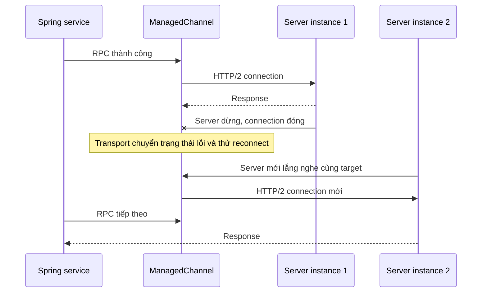
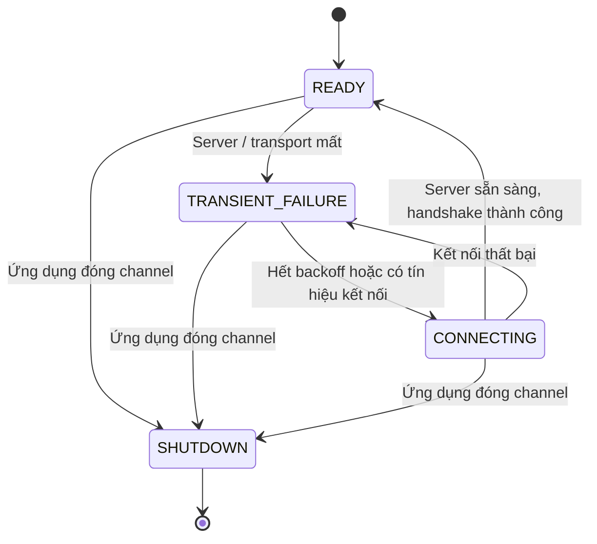

# Reconnection sau khi server khởi động lại

## 1. Mục tiêu

Một ứng dụng Spring gRPC thường giữ `ManagedChannel` lâu dài để gửi nhiều RPC tới một server. Khi server được deploy phiên bản mới, restart do sự cố hoặc bị thay thế bởi một replica khác, kết nối HTTP/2 hiện tại có thể bị đóng. Client cần khôi phục transport và tiếp tục phục vụ request mà không tạo channel mới cho mỗi lần lỗi.

Sau bài này, bạn có thể:

- Phân biệt vòng đời `ManagedChannel` với vòng đời một TCP/TLS/HTTP/2 connection.
- Giải thích trạng thái channel, reconnect và backoff khi server dừng rồi khởi động lại.
- Phân biệt fail-fast, `withWaitForReady()` và retry policy.
- Thiết kế server graceful shutdown để giảm lỗi cho RPC đang chạy.
- Xử lý riêng unary RPC và streaming RPC khi connection bị mất.
- Tổ chức channel singleton theo vòng đời Spring, quan sát lỗi và kiểm thử restart thật.

**Nguyên tắc chính:** gRPC Java quản lý việc tái kết nối transport bên dưới channel. Ứng dụng cần quyết định RPC nào có thể chờ hoặc retry, và cách khôi phục trạng thái nghiệp vụ của stream. Không nên phản ứng với mọi lỗi kết nối bằng cách đóng rồi tạo lại `ManagedChannel`.

## 2. Channel vẫn sống khi connection bị đóng

`ManagedChannel` là đối tượng logic đại diện cho một target. Phía dưới, nó sử dụng resolver, load balancer, subchannel và transport để mở kết nối. Khi server restart, connection có thể mất nhưng channel vẫn tồn tại và có thể thiết lập connection mới.



Sơ đồ giả định server mới dùng cùng target và có thể được resolver tìm thấy. Nếu địa chỉ hoặc DNS thay đổi, resolver cũng phải cập nhật endpoint. Nếu server mới dùng certificate khác, client vẫn phải xác minh CA và hostname/SAN hợp lệ.

| Thành phần | Khi server restart |
|---|---|
| `ManagedChannel` | Thường vẫn sống nếu ứng dụng chưa gọi `shutdown()` |
| HTTP/2 connection | Có thể bị đóng và được tạo lại |
| Generated stub | Có thể tiếp tục dùng cùng channel; không cần sinh lại |
| Unary RPC đang chạy | Có thể thành công, lỗi hoặc được retry nếu policy cho phép |
| Streaming RPC đang chạy | Có thể kết thúc lỗi; stream không tự chuyển sang connection mới |
| RPC mới | Có thể fail-fast, chờ channel sẵn sàng hoặc retry theo cấu hình |

Điều quan trọng là phân biệt **reconnect transport** với **replay RPC**. Channel có thể khôi phục kết nối cho request tiếp theo, nhưng không mặc nhiên chạy lại một thao tác nghiệp vụ đã bị ngắt.

## 3. Trạng thái kết nối và backoff

gRPC Java cung cấp `ConnectivityState` để quan sát trạng thái tổng hợp của channel:

| Trạng thái | Ý nghĩa trong tình huống restart |
|---|---|
| `IDLE` | Channel chưa cần duy trì kết nối tại thời điểm quan sát |
| `CONNECTING` | Đang phân giải target hoặc thiết lập transport |
| `READY` | Có transport sẵn sàng gửi RPC |
| `TRANSIENT_FAILURE` | Một lần kết nối thất bại; channel có thể thử lại sau backoff |
| `SHUTDOWN` | Ứng dụng đã bắt đầu đóng channel; channel không nhận RPC mới |

Một chu kỳ điển hình sau khi server mất kết nối:



Đây là mô hình khái quát. Trạng thái thực tế có thể thay đổi nhanh; không phải mọi lần restart đều quan sát được đầy đủ từng trạng thái qua polling.

### Vì sao có backoff?

Nếu hàng nghìn client cùng kết nối lại ngay khi server vừa restart, server mới có thể bị quá tải bởi DNS lookup, TCP/TLS handshake và request đồng loạt. **Connection backoff** làm giãn các lần thử lại, thường tăng khoảng chờ theo cấp số nhân có jitter và giới hạn tối đa theo thuật toán của gRPC.

- Khi kết nối thất bại liên tiếp, khoảng chờ thường tăng dần thay vì thử liên tục.
- Khi kết nối được thiết lập ổn định, trạng thái backoff có thể được reset theo cơ chế gRPC.
- Backoff của transport không phải retry policy của RPC; hai cơ chế có phạm vi và mục tiêu khác nhau.
- Không tự viết vòng lặp tạo channel mới để né backoff. Điều đó có thể tạo reconnect storm và làm mất quản lý tài nguyên tập trung.

API `ManagedChannel.resetConnectBackoff()` có thể yêu cầu channel đang gặp lỗi reset backoff và thử kết nối sớm hơn. Đây là công cụ điều khiển có chủ đích, không nên gọi liên tục theo timer hoặc mỗi khi một RPC thất bại.

## 4. RPC trong lúc server chưa sẵn sàng

Khi server restart, request mới có ba cách xử lý chính:

### Fail-fast

Mặc định, một RPC có thể kết thúc sớm với `UNAVAILABLE` nếu channel không có transport sẵn sàng. Cách này phù hợp khi caller muốn phản hồi nhanh, tự xử lý fallback hoặc trả lỗi cho người dùng.

### Wait-for-ready

`withWaitForReady()` cho phép RPC chờ channel trở nên sẵn sàng thay vì fail ngay trong một số trạng thái kết nối. RPC vẫn phải có deadline để thời gian chờ hữu hạn:

```java
GreeterGrpc.GreeterBlockingStub stub =
        GreeterGrpc.newBlockingStub(channel);

HelloReply reply = stub
        .withWaitForReady()
        .withDeadlineAfter(5, TimeUnit.SECONDS)
        .sayHello(HelloRequest.newBuilder()
                .setName("Lan")
                .build());
```

`withWaitForReady()` không làm server khởi động nhanh hơn, không kiểm tra sức khỏe nghiệp vụ và không bảo đảm request đang chạy trước khi connection mất sẽ được tiếp tục. Nếu server chưa sẵn sàng trước deadline, RPC vẫn thất bại.

### Retry policy

Retry có thể thực hiện một lần gọi RPC mới sau một số lỗi được chỉ định, trong giới hạn policy. Ví dụ service config:

```json
{
  "methodConfig": [{
    "name": [{
      "service": "demo.greeter.Greeter",
      "method": "SayHello"
    }],
    "retryPolicy": {
      "maxAttempts": 4,
      "initialBackoff": "0.2s",
      "maxBackoff": "2s",
      "backoffMultiplier": 2,
      "retryableStatusCodes": ["UNAVAILABLE"]
    }
  }]
}
```

Đây là ví dụ chính sách; cần kiểm tra runtime gRPC Java và cách service config được cung cấp qua resolver/channel. `maxAttempts` bao gồm lần gọi ban đầu. Policy trên chỉ retry phương thức `SayHello` khi status thuộc tập được chỉ định; không nên áp dụng chung cho mọi RPC.

**Retry an toàn phụ thuộc ngữ nghĩa nghiệp vụ.** Nếu server đã ghi dữ liệu nhưng connection mất trước khi client nhận response, retry có thể thực hiện thao tác lần thứ hai. Chỉ retry các thao tác idempotent hoặc có idempotency key/chống trùng ở server. Các quy tắc retry còn phụ thuộc trạng thái commitment của RPC; khi client đã nhận response headers hoặc retry buffer không còn cho phép, gRPC có thể không retry tiếp.

### So sánh nhanh

| Cơ chế | Khi nào quyết định | Có chạy lại RPC? | Giới hạn |
|---|---|---|---|
| Fail-fast | Khi RPC được bắt đầu | Không | Trả lỗi nếu không thể tiến hành |
| Wait-for-ready | Khi RPC cần chờ channel | Không tự chạy lại RPC đã kết thúc | Phải có deadline |
| Retry policy | Sau lỗi retryable và khi RPC còn đủ điều kiện retry | Có, tạo attempt mới | Cần idempotency, attempt limit và retry budget |
| Connection backoff | Ở tầng kết nối | Không | Điều tiết lần thử mở transport |

Không cộng dồn nhiều lớp retry mà không tính ngân sách. Nếu HTTP gateway retry ba lần và gRPC client retry bốn attempts, một thao tác có thể tạo nhiều lần gọi tới backend hơn dự kiến.

## 5. Server restart có trật tự

Một server được triển khai tốt nên **ngừng nhận công việc mới trước**, rồi cho RPC đang xử lý cơ hội hoàn tất trong thời hạn cho phép.

Trình tự khái quát:

1. Đánh dấu instance không còn nhận traffic mới qua readiness/health hoặc cơ chế điều phối của nền tảng.
2. Ngừng nhận RPC mới và bắt đầu graceful shutdown.
3. Cho các RPC đang chạy hoàn tất trong khoảng grace đã định.
4. Khi hết grace, yêu cầu hủy những RPC còn lại.
5. Dừng process và giải phóng tài nguyên.
6. Instance mới khởi động, đăng ký endpoint/readiness sau khi service thực sự sẵn sàng.

gRPC Java server có `shutdown()` để bắt đầu dừng có trật tự và `shutdownNow()` để yêu cầu dừng khẩn cấp. Ví dụ:

```java
server.shutdown();
try {
    if (!server.awaitTermination(20, TimeUnit.SECONDS)) {
        server.shutdownNow();
        server.awaitTermination(5, TimeUnit.SECONDS);
    }
} catch (InterruptedException e) {
    server.shutdownNow();
    Thread.currentThread().interrupt();
}
```

Các giá trị 20 và 5 giây chỉ là ví dụ. Grace period phải tương thích với thời gian dừng của Spring/container/orchestrator và deadline của RPC. Nếu platform giết process trước khi grace period kết thúc, graceful shutdown trong code không có cơ hội hoàn thành.

### Readiness khác liveness

- **Readiness:** instance có nên nhận traffic mới không?
- **Liveness:** process có cần được khởi động lại vì không còn hoạt động bình thường không?
- **gRPC Health Checking:** service có báo trạng thái phục vụ theo protocol health của gRPC không, nếu server đã triển khai health service?

Một server process đã mở port không đồng nghĩa service đã sẵn sàng. Khi khởi động lại, chỉ đưa endpoint vào discovery/load balancer sau khi dependency quan trọng và service handler sẵn sàng. Nếu dùng health checking, cấu hình client/LB hỗ trợ đúng cơ chế đó; không suy ra sức khỏe chỉ từ channel ở trạng thái `READY`.

## 6. Client Spring nên giữ channel qua lần restart

Channel nên được tạo một lần theo target và credentials, sau đó inject vào gateway/service. Ví dụ cấu hình bean:

```java
@Configuration(proxyBeanMethods = false)
public class GreeterClientConfig {
    @Bean(name = "greeterChannel", destroyMethod = "shutdown")
    ManagedChannel greeterChannel(
            @Value("${app.grpc.greeter.target}") String target) {
        return Grpc.newChannelBuilder(
                target, TlsChannelCredentials.create())
                .build();
    }
}
```

Service dùng channel đã inject:

```java
@Service
public class GreeterGateway {
    private final GreeterGrpc.GreeterBlockingStub stub;

    public GreeterGateway(
            @Qualifier("greeterChannel") ManagedChannel channel) {
        this.stub = GreeterGrpc.newBlockingStub(channel);
    }

    public String greet(String name) {
        return stub.withDeadlineAfter(3, TimeUnit.SECONDS)
                .sayHello(HelloRequest.newBuilder()
                        .setName(name)
                        .build())
                .getMessage();
    }
}
```

`app.grpc.greeter.target` là property tự định nghĩa; nếu Spring gRPC starter tự quản lý channel, dùng cấu hình target/credentials/lifecycle của đúng phiên bản starter thay vì tạo channel thứ hai.

**Không gọi `shutdown()` khi gặp `UNAVAILABLE`.** Channel còn sống là thành phần có trách nhiệm reconnect. Đóng rồi tạo channel mới trong mỗi lần lỗi sẽ phá vỡ backoff, tăng handshake và có thể tạo reconnect storm.

Bean `destroyMethod = "shutdown"` chỉ bắt đầu quá trình đóng khi Spring context kết thúc. Với ứng dụng có stream dài hạn, cần lifecycle owner để ngừng nhận request, hoàn tất/hủy stream, gọi `shutdown()`, chờ `awaitTermination(...)` và chỉ dùng `shutdownNow()` khi hết ngân sách shutdown.

## 7. Một lần restart ảnh hưởng unary RPC ra sao?

Giả sử client gửi `SayHello` đúng lúc server cũ dừng:

- Nếu RPC hoàn tất trước khi transport đóng, client nhận response bình thường.
- Nếu server đã xử lý nhưng response chưa tới client, kết quả có thể không xác định từ góc nhìn caller; status lỗi không chứng minh nghiệp vụ đã rollback.
- Nếu transport mất trước khi server xử lý, RPC có thể lỗi `UNAVAILABLE`.
- Nếu retry policy hợp lệ và RPC chưa committed, gRPC có thể tạo attempt mới khi server mới sẵn sàng.
- Nếu RPC chờ quá deadline, client nhận `DEADLINE_EXCEEDED` dù server có thể vừa khởi động lại xong.

Do đó, với thao tác ghi dữ liệu hoặc thanh toán, hãy thiết kế idempotency ở cấp nghiệp vụ. Ví dụ client gửi `request_id` duy nhất; server lưu kết quả theo khóa này để lần retry không tạo hai giao dịch.

Không nên chỉ dựa vào `Status.Code` để quyết định “server chưa nhận request”. `UNAVAILABLE` mô tả việc RPC không hoàn thành thành công, nhưng không phải bằng chứng giao dịch đã rollback.

## 8. Streaming RPC không tự tiếp tục sau reconnect

Đây là khác biệt quan trọng nhất so với một unary call ngắn. Server streaming, client streaming và bidirectional streaming đều có một HTTP/2 stream với vòng đời riêng. Khi connection bị đóng, stream có thể nhận `onError` hoặc cancellation. Channel có thể kết nối lại, nhưng **RPC stream cũ không tự chuyển sang transport mới**.

```mermaid
sequenceDiagram
    participant C as Spring client
    participant Ch as ManagedChannel
    participant S1 as Server cũ
    participant S2 as Server mới
    C->>Ch: Mở Subscribe(cursor=100)
    Ch->>S1: HTTP/2 stream
    S1-->>C: event 101, 102
    S1-xCh: Server restart, stream lỗi
    Ch->>S2: Reconnect transport
    Note over C: RPC cũ đã kết thúc; ứng dụng quyết định mở stream mới
    C->>Ch: Subscribe(cursor=102)
    Ch->>S2: HTTP/2 stream mới
    S2-->>C: event tiếp theo
```

Một contract có thể hỗ trợ resume bằng cursor/offset:

```proto
message SubscribeRequest {
  string consumer_id = 1;
  int64 after_event_id = 2;
}

message Event {
  int64 event_id = 1;
  bytes payload = 2;
}

service NotificationService {
  rpc Subscribe(SubscribeRequest) returns (stream Event);
}
```

Client lưu event ID đã xử lý bền vững. Khi stream kết thúc do transport lỗi, client mở RPC mới với `after_event_id` cuối cùng đã commit. Server gửi tiếp từ cursor đó.

Để tránh mất hoặc nhân đôi sự kiện:

- Chỉ cập nhật cursor sau khi event đã được xử lý/commit theo quy tắc nghiệp vụ.
- Server phải hỗ trợ replay từ cursor và định nghĩa rõ cursor hết hạn.
- Client nên deduplicate theo event ID nếu server có thể phát lại event đã nhận.
- Dùng backoff và giới hạn số lần resubscribe; không reconnect liên tục khi service đang bảo trì.
- Khi caller hủy subscription có chủ đích, không tự mở lại stream.

Với client streaming/bidirectional streaming, cần xác định message nào server đã nhận/commit trước khi connection mất. Nếu không có sequence number, acknowledgment hoặc idempotency key, client không thể biết chính xác message cuối cùng đã được xử lý.

## 9. Retry, reconnect và phục hồi không phải một việc

| Cơ chế | Tầng | Phục hồi điều gì? |
|---|---|---|
| Connection backoff/reconnect | Channel/transport | Tạo lại kết nối HTTP/2 tới endpoint |
| RPC retry | Một RPC | Thực hiện attempt mới theo policy |
| Wait-for-ready | Một RPC đang chờ bắt đầu | Chờ channel có transport phù hợp trong deadline |
| Streaming resubscribe | Logic ứng dụng | Mở stream mới và tiếp tục từ cursor/state |
| Readiness/health | Server/discovery | Hạn chế gửi RPC tới instance chưa sẵn sàng |

Các cơ chế có thể cùng tồn tại nhưng không thay thế nhau. Ví dụ, channel reconnect thành công không có nghĩa một streaming RPC đã mất được resume; server báo health SERVING cũng không đảm bảo một giao dịch retry là idempotent.

### Lựa chọn retry cho unary

Retry phù hợp khi:

- Status nằm trong nhóm lỗi tạm thời đã xác định, ví dụ `UNAVAILABLE`.
- Phương thức idempotent hoặc có cơ chế chống thực hiện trùng.
- Số attempts và backoff có giới hạn.
- Deadline tổng đủ bao phủ thời gian chờ và các attempts.
- Retry không nhân tải vào backend đang phục hồi vượt quá năng lực.

Không retry vô điều kiện `INVALID_ARGUMENT`, `PERMISSION_DENIED`, `UNAUTHENTICATED` hoặc lỗi nghiệp vụ không thể khắc phục bằng kết nối mới.

## 10. Quan sát quá trình khởi động lại

Các tín hiệu hữu ích:

| Nhóm | Chỉ số/log | Mục đích |
|---|---|---|
| Channel | Connectivity state transition | Nhận biết `READY`, `TRANSIENT_FAILURE`, `CONNECTING` |
| RPC | Số lần gọi, status, latency theo method | Đo tác động của restart tới người dùng |
| Retry | Số attempt, retry reason, thời gian backoff | Phát hiện retry storm hoặc policy quá rộng |
| Server | Startup/readiness, graceful shutdown, active RPC | Xác định khoảng server không nhận request |
| Streaming | Số stream mở, thời điểm lỗi/resubscribe, cursor | Phát hiện mất sự kiện hoặc reconnect loop |
| Network | DNS result, TLS handshake, GOAWAY, connection close | Tìm nguyên nhân transport |

Có thể đọc trạng thái channel để chẩn đoán:

```java
ConnectivityState state = channel.getState(false);
log.info("gRPC channel state={}", state);
```

`getState(false)` chỉ trả ảnh chụp tại thời điểm gọi; nó không đợi channel READY và không kiểm tra service health. `notifyWhenStateChanged(...)` cho phép đăng ký callback khi state rời trạng thái được quan sát, nhưng muốn theo dõi nhiều lần phải đăng ký lại. Callback cần ngắn và không blocking.

Đừng log token hoặc toàn bộ metadata nhạy cảm khi debug reconnect. Nếu dùng OpenTelemetry/Micrometer, đo RPC duration, status và retry attempt với label có cardinality hợp lý. Có thể kết hợp gRPC Health Checking nếu server triển khai health service.

## 11. Kiểm thử tích hợp server restart

Unit test mock stub không kiểm tra connection backoff hoặc resolver. Một integration test hữu ích sẽ:

1. Khởi động server tại cổng động.
2. Tạo một channel duy nhất và gọi RPC thành công.
3. Dừng server, đợi server giải phóng cổng.
4. Khởi động server mới trên **cùng port/target**.
5. Yêu cầu channel reset backoff khi cần và gửi RPC mới với wait-for-ready cùng deadline.
6. Xác nhận channel cũ tiếp tục sử dụng được, sau đó đóng channel/server đúng cách.

Ví dụ dùng Netty server/client trên loopback plaintext chỉ để kiểm thử transport:

```java
package dev.example.hello;

import static org.junit.jupiter.api.Assertions.assertEquals;
import static org.junit.jupiter.api.Assertions.assertTrue;

import io.grpc.Grpc;
import io.grpc.InsecureChannelCredentials;
import io.grpc.ManagedChannel;
import io.grpc.Server;
import io.grpc.netty.shaded.io.grpc.netty.NettyServerBuilder;
import io.grpc.stub.StreamObserver;
import java.net.InetSocketAddress;
import java.util.concurrent.TimeUnit;
import org.junit.jupiter.api.Test;

class ReconnectAfterRestartTest {
    private Server startServer(int port, String version) throws Exception {
        return NettyServerBuilder.forAddress(
                new InetSocketAddress("127.0.0.1", port))
                .addService(new GreeterGrpc.GreeterImplBase() {
                    @Override
                    public void sayHello(
                            HelloRequest request,
                            StreamObserver<HelloReply> observer) {
                        observer.onNext(HelloReply.newBuilder()
                                .setMessage(version + ": " + request.getName())
                                .build());
                        observer.onCompleted();
                    }
                })
                .build()
                .start();
    }

    @Test
    void sameChannelReconnectsAfterServerRestart() throws Exception {
        Server first = NettyServerBuilder
                .forAddress(new InetSocketAddress("127.0.0.1", 0))
                .addService(new GreeterGrpc.GreeterImplBase() {
                    @Override
                    public void sayHello(
                            HelloRequest request,
                            StreamObserver<HelloReply> observer) {
                        observer.onNext(HelloReply.newBuilder()
                                .setMessage("v1: " + request.getName())
                                .build());
                        observer.onCompleted();
                    }
                })
                .build()
                .start();

        int port = first.getPort();
        ManagedChannel channel = Grpc.newChannelBuilderForAddress(
                "127.0.0.1", port,
                InsecureChannelCredentials.create())
                .build();
        Server second = null;

        try {
            var stub = GreeterGrpc.newBlockingStub(channel);
            var request = HelloRequest.newBuilder().setName("Lan").build();
            assertEquals("v1: Lan", stub
                    .withDeadlineAfter(3, TimeUnit.SECONDS)
                    .sayHello(request).getMessage());

            first.shutdown();
            assertTrue(first.awaitTermination(5, TimeUnit.SECONDS));

            second = startServer(port, "v2");
            channel.resetConnectBackoff();

            assertEquals("v2: Lan", stub.withWaitForReady()
                    .withDeadlineAfter(20, TimeUnit.SECONDS)
                    .sayHello(request).getMessage());
        } finally {
            channel.shutdownNow();
            first.shutdownNow();
            if (second != null) {
                second.shutdownNow();
            }
            assertTrue(channel.awaitTermination(5, TimeUnit.SECONDS));
        }
    }
}
```

Hàm `startServer` minh họa một cách tạo server phiên bản; test thực tế chỉ cần một cách tạo server nhất quán. Test dùng cùng channel và cùng port để chứng minh transport có thể được thiết lập lại. `resetConnectBackoff()` là thao tác hỗ trợ test khởi động lại nhanh, không phải yêu cầu bắt buộc của ứng dụng production.

Đây là test plaintext trên loopback; **không** kiểm tra TLS certificate, mTLS, proxy, DNS đổi endpoint hoặc độ bền dữ liệu streaming. Những điều đó cần test riêng trong môi trường phù hợp. Nếu test trên CI không thể bind lại port ngay sau shutdown, hãy kiểm tra server đã terminated và cổng đã được giải phóng trước khi start instance mới.

### Các tình huống nên kiểm tra thêm

- Server restart trong lúc unary RPC đang xử lý; xác định kết quả và khả năng retry idempotent.
- Server restart trong lúc stream im lặng; xác nhận `onError` và resubscribe từ cursor.
- Server mới chưa readiness; xác minh client không gửi traffic nghiệp vụ quá sớm.
- DNS đổi sang endpoint mới; xác minh resolver refresh và channel kết nối tới địa chỉ được cập nhật.
- TLS certificate được rotate; xác minh client mới vẫn tin đúng CA/SAN.
- Nhiều client cùng reconnect; quan sát backoff, tải handshake và khả năng tránh reconnect storm.
- Spring context shutdown; xác minh channel và stream được đóng theo ngân sách.

## 12. Lỗi thường gặp và cách xử lý

| Triệu chứng | Nguyên nhân | Hướng xử lý |
|---|---|---|
| Sau restart, RPC mới trả `UNAVAILABLE` | Server chưa listen/readiness, DNS/port sai hoặc transport đang reconnect | Kiểm tra readiness, resolver, cause và thử lại trong deadline |
| Client không bao giờ phục hồi | Channel đã `shutdown`, target không còn hợp lệ hoặc lỗi TLS kéo dài | Kiểm tra ownership, channel state, DNS và certificate |
| Retry tạo nhiều bản ghi trùng | RPC có tác dụng phụ nhưng không idempotent | Thêm idempotency key/deduplication; giới hạn retry |
| RPC chờ lâu rồi `DEADLINE_EXCEEDED` | Wait-for-ready/backoff vượt deadline | Điều chỉnh ngân sách hoặc trả lỗi nhanh theo yêu cầu |
| Stream mất sau khi server khởi động lại | HTTP/2 stream cũ không thể chuyển sang connection mới | Resubscribe và resume bằng cursor |
| Client tạo nhiều channel sau mỗi lỗi | Reconnect bị triển khai ở tầng request | Giữ channel lâu dài, để gRPC quản lý transport |
| Reconnect storm sau deploy | Nhiều client thử kết nối cùng lúc, backoff/retry quá mạnh | Dùng backoff, jitter, rollout/readiness và retry budget |
| Server mới có port nhưng RPC vẫn lỗi | Service chưa ready, TLS identity sai hoặc dependency chưa sẵn sàng | Kiểm health, certificate, ALPN và log server |

## 13. Bài tập thực hành

**Tình huống:** một Spring service gọi `Greeter.SayHello` và `Notification.Subscribe`. Server được restart định kỳ khi deploy. Unary RPC đôi khi trả `UNAVAILABLE`; streaming client mất subscription và không nhận một số event.

Hãy thực hiện:

1. Tạo một singleton `ManagedChannel` và xác nhận RPC unary thành công trước khi restart.
2. Dừng server rồi khởi động lại trên cùng target. Theo dõi channel state, reconnect và status của RPC trong khoảng gián đoạn.
3. So sánh fail-fast với `withWaitForReady()` có deadline; giải thích khác biệt giữa chờ transport và retry một attempt.
4. Thêm retry policy chỉ cho một unary method idempotent; ghi rõ `maxAttempts`, backoff, retryable status và deadline tổng.
5. Thiết kế `SubscribeRequest` có cursor; khi stream lỗi, resubscribe từ event cuối đã commit và deduplicate event được replay.
6. Cấu hình server graceful shutdown/readiness; so sánh kết quả khi server dừng có trật tự và khi process bị kill đột ngột.
7. Viết integration test xác nhận cùng channel gọi được server instance mới sau restart.
8. Thu thập số RPC lỗi, thời gian phục hồi, số retry, thời gian channel ở `TRANSIENT_FAILURE` và số stream cần resubscribe.

**Tiêu chí hoàn thành:** phân biệt được reconnect ở transport, retry ở RPC và resume ở tầng ứng dụng; giữ channel theo vòng đời Spring; không retry mù quáng thao tác có tác dụng phụ; có bằng chứng test cho cả unary và streaming khi server restart.

## 14. Ghi nhớ

Khi server restart, **connection HTTP/2 có thể mất nhưng `ManagedChannel` vẫn sống và tự quản lý reconnect/backoff**. RPC mới có thể fail-fast, chờ bằng `withWaitForReady()` hoặc retry theo policy có giới hạn. Retry phải phù hợp tính idempotent và deadline; streaming RPC cần logic resubscribe/resume riêng vì channel reconnect không khôi phục stream cũ. Phía server nên dùng readiness và graceful shutdown để giảm gián đoạn; phía Spring client nên dùng channel singleton, quan sát status/reconnect và kiểm thử restart thực tế thay vì tạo channel mới mỗi khi gặp `UNAVAILABLE`.
