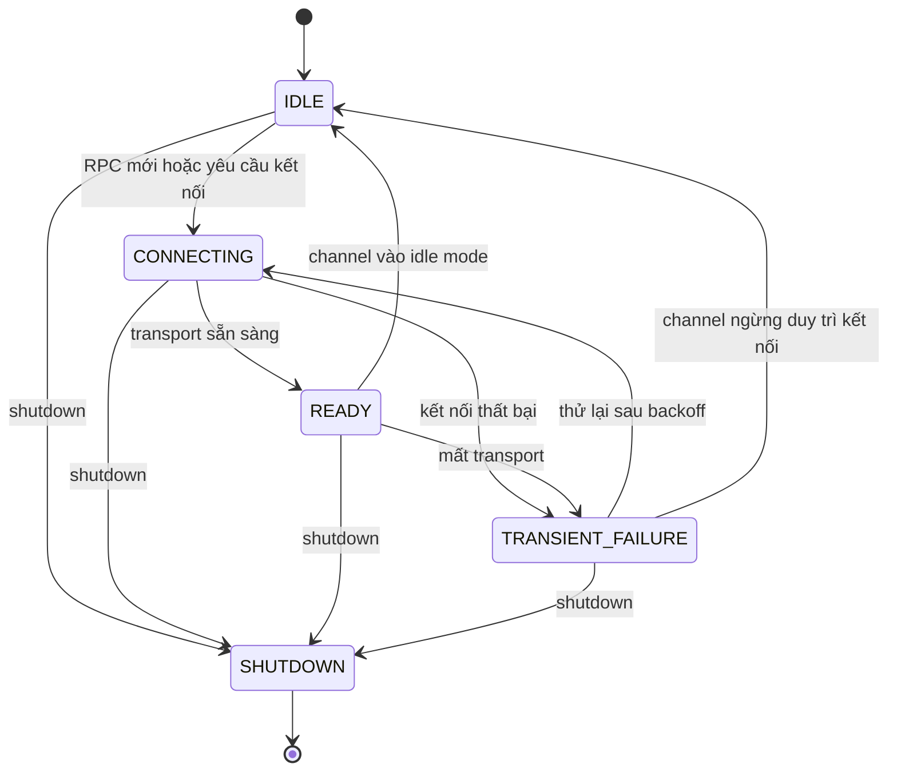
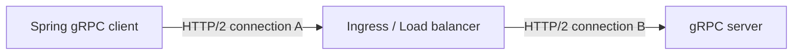

# Idle timeout và connection state

## 1. Mục tiêu

Trong Spring gRPC, client thường giữ một `ManagedChannel` để gửi nhiều RPC tới server. Sau một khoảng không có request, channel, server hoặc proxy có thể chuyển sang trạng thái nhàn rỗi và giải phóng kết nối. Khi request tiếp theo đến, hệ thống có thể phải phân giải target, mở TCP/TLS và thiết lập HTTP/2 trước khi RPC chạy.

Để cấu hình đúng, cần phân biệt **idle timeout của channel**, **trạng thái kết nối của channel**, **idle timeout của HTTP/2 connection ở server** và **timeout do proxy/network áp đặt**. Các cơ chế này có chủ sở hữu và tác động khác nhau.

Sau bài học, bạn có thể:

- Phân biệt `ConnectivityState.IDLE` với một TCP/HTTP/2 connection đang không truyền dữ liệu.
- Giải thích `ManagedChannelBuilder.idleTimeout` và `ManagedChannel.enterIdle()`.
- Phân biệt client channel idle timeout với server `maxConnectionIdle`, `maxConnectionAge` và timeout của proxy.
- Đọc trạng thái `IDLE`, `CONNECTING`, `READY`, `TRANSIENT_FAILURE`, `SHUTDOWN` đúng ngữ nghĩa.
- Cấu hình idle policy trong Spring client/server và chọn thời gian phù hợp với workload.
- Đánh giá tác động tới unary RPC, streaming RPC, deadline, keepalive và TLS handshake.
- Kiểm thử hành vi idle, reconnect và shutdown mà không nhầm lẫn giữa trạng thái channel và trạng thái socket.

## 2. “Idle” có nhiều nghĩa

Từ *idle* thường được dùng cho những đối tượng khác nhau. Nếu không xác định tầng đang nói tới, cấu hình một timeout có thể không giải quyết được timeout ở tầng khác.

| Khái niệm | Đối tượng được quản lý | Khi nào được xem là idle? | Hệ quả thường gặp |
|---|---|---|---|
| **Channel idle mode** | `ManagedChannel` phía client | Không có RPC trong khoảng thời gian cấu hình | Channel có thể dừng resolver/LB và giải phóng transport; RPC mới đánh thức channel |
| **Channel state `IDLE`** | Trạng thái tổng hợp của channel | Channel chưa chủ động duy trì kết nối ở thời điểm quan sát | Chưa có nghĩa server lỗi; RPC mới có thể kích hoạt kết nối |
| **Server max connection idle** | Một HTTP/2 connection ở server | Không có RPC đang hoạt động trên connection trong thời gian cấu hình | Server có thể gửi GOAWAY và drain/đóng connection |
| **Proxy/LB idle timeout** | Connection hoặc flow mà proxy theo dõi | Không có hoạt động theo tiêu chí riêng của proxy | Proxy có thể đóng connection dù channel client vẫn tồn tại |
| **TCP keepalive** | TCP socket | TCP stack kiểm tra peer sau thời gian nhàn rỗi | Kiểm tra khả năng phản hồi ở tầng TCP; không phải gRPC health check |
| **HTTP/2 keepalive PING** | HTTP/2 connection | Theo lịch ping và chính sách peer | Kiểm tra peer HTTP/2; không đồng nghĩa RPC đang chạy |
| **Connection age** | Tuổi của connection | Đạt tuổi tối đa kể từ lúc thiết lập | Server có thể drain connection dù nó vẫn có RPC |

Ví dụ: client không gọi RPC trong 15 phút. Channel có thể vào idle mode sau 10 phút và giải phóng transport. Trong một trường hợp khác, channel vẫn tồn tại nhưng load balancer đóng HTTP/2 connection sau 2 phút không có RPC. Cả hai đều có thể khiến request kế tiếp phải kết nối lại, nhưng nguồn gốc và nơi cấu hình khác nhau.

## 3. Connectivity state là trạng thái của channel

gRPC Java cung cấp `ConnectivityState` với năm trạng thái chính:

| Trạng thái | Ý nghĩa |
|---|---|
| `IDLE` | Channel không chủ động thiết lập hoặc duy trì kết nối lúc này; có thể đang chờ RPC mới |
| `CONNECTING` | Channel đang phân giải target hoặc thiết lập transport |
| `READY` | Có transport sẵn sàng gửi RPC |
| `TRANSIENT_FAILURE` | Một lần kết nối thất bại; channel có thể thử lại theo backoff |
| `SHUTDOWN` | Channel đã bắt đầu đóng và không nhận RPC mới |



Đây là sơ đồ khái quát, không phải cam kết mọi phiên bản/provider luôn phát ra chính xác chuỗi chuyển trạng thái trên. Channel có thể chuyển trạng thái nhanh đến mức polling không quan sát được một số trạng thái trung gian.

**`IDLE` không có nghĩa là lỗi.** Nó thường là trạng thái tiết kiệm tài nguyên khi channel không có RPC cần phục vụ. Khi có RPC mới, channel có thể rời idle mode và thiết lập lại transport.

**`READY` cũng không phải health check nghiệp vụ.** Nó cho biết channel có transport sẵn sàng ở thời điểm quan sát; server vẫn có thể trả lỗi, hết quota, mất database hoặc xử lý chậm.

Một điểm quan trọng: `ConnectivityState` là trạng thái **tổng hợp ở cấp channel**, không phải bảng trạng thái chi tiết của từng TCP socket hoặc từng backend. Một channel có nhiều subchannel/transport có thể có hành vi phức tạp hơn một connection đơn lẻ.

## 4. Idle timeout của client channel

gRPC Java cung cấp `ManagedChannelBuilder.idleTimeout(long, TimeUnit)` để đặt thời gian không có RPC trước khi channel đi vào idle mode. Khi idle mode được kích hoạt, channel có thể dừng name resolver/load balancer và giải phóng các tài nguyên kết nối không cần thiết. RPC mới sẽ đánh thức channel và kích hoạt quá trình kết nối lại.

Ví dụ cấu hình channel:

```java
ManagedChannel channel = NettyChannelBuilder
        .forTarget("dns:///greeter.internal.example:8443")
        .useTransportSecurity()
        .idleTimeout(10, TimeUnit.MINUTES)
        .build();
```

`NettyChannelBuilder` ở đây là transport Netty của gRPC Java. Target phải được phân giải và server phải hỗ trợ TLS/HTTP/2; certificate phải hợp lệ cho tên host. Nếu ứng dụng dùng CA nội bộ, cấu hình trust material phù hợp thay vì bỏ xác minh TLS.

### Khi nào nên đặt idle timeout?

- **Client ít hoạt động:** có thể giảm thời gian giữ transport và tài nguyên khi không có RPC.
- **Client có lưu lượng đều:** timeout quá ngắn có thể khiến channel liên tục vào idle mode rồi thiết lập lại connection, làm tăng handshake và latency.
- **Client có stream dài hạn:** stream đang hoạt động là RPC đang tồn tại; channel không được xem là không có RPC chỉ vì stream tạm thời chưa gửi message nghiệp vụ.
- **Client cần request đầu tiên sau thời gian dài có latency thấp:** có thể giữ channel hoạt động lâu hơn, hoặc chấp nhận cold connection và đo tác động thực tế.

Giá trị mặc định và giới hạn của `idleTimeout` phụ thuộc phiên bản gRPC Java; hãy xác minh tài liệu đúng dependency đang sử dụng. Đừng sao chép mặc định của một ngôn ngữ gRPC khác.

### Chủ động đưa channel vào idle mode

`ManagedChannel.enterIdle()` yêu cầu channel chuyển sang idle mode ngay, thay vì đợi idle timeout. Đây là API điều khiển, có thể hữu ích khi ứng dụng biết chắc sắp không dùng channel trong một khoảng dài:

```java
channel.enterIdle();

// Khi RPC tiếp theo được gọi, channel có thể rời idle mode
// và bắt đầu phân giải target/thiết lập transport.
```

Không gọi `enterIdle()` sau mỗi RPC hoặc trong khi ứng dụng vẫn có tải. Làm vậy sẽ gây churn connection và biến mọi request kế tiếp thành cơ hội phải reconnect.

## 5. Đánh thức channel và đọc trạng thái

Hai API thường dùng để quan sát/điều khiển:

```java
ConnectivityState state = channel.getState(false);
log.info("gRPC channel state={}", state);

// true yêu cầu channel bắt đầu kết nối nếu đang IDLE
ConnectivityState stateAfterRequest = channel.getState(true);
log.info("gRPC channel state after request={}", stateAfterRequest);
```

- `getState(false)` chỉ lấy snapshot; nó không yêu cầu channel mở connection.
- `getState(true)` có thể yêu cầu channel rời `IDLE` và bắt đầu kết nối; nó không chờ tới `READY`.
- `notifyWhenStateChanged(source, callback)` đăng ký callback một lần khi channel rời khỏi trạng thái `source`. Muốn theo dõi nhiều chuyển đổi, callback cần đăng ký lại sau khi chạy.
- Callback nên ngắn, không blocking và không thực hiện truy vấn mạng nặng.

Ví dụ theo dõi một chuyển đổi:

```java
ConnectivityState observed = channel.getState(false);
channel.notifyWhenStateChanged(observed, () -> {
    ConnectivityState current = channel.getState(false);
    log.info("gRPC state changed: {} -> {}", observed, current);
});
```

Đoạn code chỉ theo dõi một lần chuyển khỏi trạng thái ban đầu. Nếu cần theo dõi liên tục, cần một thành phần quản lý việc đăng ký lại, dừng theo lifecycle và tránh callback đệ quy quá nhanh.

Không nên viết logic nghiệp vụ kiểu “chỉ gọi RPC khi snapshot là READY”. Trạng thái có thể thay đổi ngay sau khi đọc; chính RPC và status trả về mới là bằng chứng kết quả thực tế. Hãy đặt deadline và xử lý lỗi phù hợp.

## 6. Idle timeout phía server: `maxConnectionIdle`

Client channel idle timeout quản lý **channel của client**. Phía server, gRPC Java Netty có thể đặt giới hạn thời gian một HTTP/2 connection không có RPC đang hoạt động:

```java
Server server = NettyServerBuilder.forPort(8443)
        .maxConnectionIdle(15, TimeUnit.MINUTES)
        .addService(new GreeterService())
        .build()
        .start();
```

`maxConnectionIdle` là chính sách ở **server connection**, không phải lệnh đưa toàn bộ channel client vào `IDLE`. Khi connection không có RPC hoạt động vượt ngưỡng, server có thể gửi HTTP/2 `GOAWAY` để bắt đầu drain connection. Client channel có thể tiếp tục tồn tại và thiết lập connection khác khi cần.

Một server connection có stream đang mở thường có RPC đang hoạt động, kể cả khi ứng dụng chưa gửi message trong một thời gian. Điều này khác với proxy có thể tính idle dựa trên thời gian không thấy frame/data. Hãy kiểm tra cách từng thiết bị định nghĩa “idle”.

### `maxConnectionIdle` khác `maxConnectionAge`

| Cấu hình | Đếm thời gian từ đâu? | Khi nào tác động? |
|---|---|---|
| `maxConnectionIdle` | Từ lúc connection không còn RPC đang hoạt động | Connection rảnh quá lâu |
| `maxConnectionAge` | Từ lúc connection được tạo | Connection đạt tuổi tối đa, dù vẫn có hoạt động |
| `maxConnectionAgeGrace` | Sau khi đạt max age | Thời gian grace để RPC đang chạy hoàn tất trước khi đóng |

Ví dụ server:

```java
Server server = NettyServerBuilder.forPort(8443)
        .maxConnectionIdle(15, TimeUnit.MINUTES)
        .maxConnectionAge(2, TimeUnit.HOURS)
        .maxConnectionAgeGrace(30, TimeUnit.SECONDS)
        .addService(new GreeterService())
        .build()
        .start();
```

Các giá trị chỉ minh họa. `maxConnectionAge` thường phục vụ drain/rotation connection dài hạn; `maxConnectionIdle` giải phóng connection rảnh. Không dùng hai tham số như thể chúng là một timeout duy nhất.

Nếu Spring gRPC starter tự sở hữu server, hãy cấu hình qua server builder/customizer hoặc property được phiên bản đó hỗ trợ. Không tạo server Netty thứ hai trên cùng cổng chỉ để áp dụng timeout.

## 7. Proxy và load balancer có idle timeout riêng

Trong production, đường đi có thể gồm:



Nếu proxy kết thúc HTTP/2/TLS, connection client–proxy và proxy–server là **hai chặng riêng**. Mỗi chặng có thể có idle timeout khác nhau. Nếu proxy passthrough TCP, cách nó theo dõi connection cũng khác.

Một số tình huống:

- Client channel vẫn sống nhưng proxy đóng socket sau 60 giây không hoạt động.
- Server giữ connection lâu hơn proxy, nhưng client không biết proxy đã đóng cho tới lần RPC kế tiếp.
- Server gửi GOAWAY do `maxConnectionIdle`; proxy chuyển tiếp hoặc xử lý theo policy của nó.
- Một streaming RPC đang mở nhưng không có DATA frame. Server có thể xem là RPC đang hoạt động, trong khi proxy có thể vẫn coi flow là idle nếu policy đếm thời gian không có traffic.

Vì vậy, **đặt client idle timeout dài hơn proxy idle timeout không ngăn proxy đóng connection**. Phải phối hợp timeout và cơ chế reconnect. Nếu cần giữ connection sống trong khoảng không có dữ liệu, cân nhắc HTTP/2 keepalive PING nhưng phải tuân theo chính sách server/proxy; PING không phải giải pháp mặc định cho mọi idle timeout.

### Keepalive không đồng nghĩa idle timeout

| Cơ chế | Tác dụng | Không làm được |
|---|---|---|
| Channel `idleTimeout` | Cho channel vào idle mode sau thời gian không có RPC | Không kiểm tra peer có phản hồi hay không |
| Server `maxConnectionIdle` | Drain connection không có RPC đang hoạt động | Không kiểm tra sức khỏe nghiệp vụ |
| HTTP/2 PING keepalive | Kiểm tra peer trên một HTTP/2 connection | Không đảm bảo RPC handler hoặc database khỏe |
| TCP keepalive | Kiểm tra phản hồi ở tầng TCP | Không hiểu stream gRPC hay service health |
| RPC deadline | Giới hạn thời gian một RPC | Không giữ connection mở |

Không tăng tần suất PING để chữa một lỗi server đã gọi `shutdown()` hoặc certificate TLS hết hạn. PING có thể bị server từ chối nếu vượt policy, ví dụ `GOAWAY` với `ENHANCE_YOUR_CALM`.

## 8. Cấu hình trong Spring client

Ví dụ dưới đây dùng một singleton channel theo profile production. Namespace `app.grpc.*` là cấu hình tự đặt cho bài học, không phải property mặc định được đảm bảo bởi mọi phiên bản Spring gRPC starter.

```yaml
# application-prod.yml
app:
  grpc:
    greeter:
      target: dns:///greeter.internal.example:8443
      channel-idle-timeout: 10m
```

```java
@Configuration(proxyBeanMethods = false)
@Profile("prod")
public class GreeterChannelConfiguration {
    @Bean(name = "greeterChannel", destroyMethod = "shutdown")
    ManagedChannel greeterChannel(
            @Value("${app.grpc.greeter.target}") String target,
            @Value("${app.grpc.greeter.channel-idle-timeout:10m}")
            Duration idleTimeout) {
        return NettyChannelBuilder.forTarget(target)
                .useTransportSecurity()
                .idleTimeout(
                        idleTimeout.toMillis(), TimeUnit.MILLISECONDS)
                .build();
    }
}
```

`Duration` trong ví dụ cần được import từ `java.time.Duration`; tùy cách binding, có thể dùng `@ConfigurationProperties` để nhận duration thay vì ép kiểu trực tiếp bằng `@Value`. Mục tiêu là cấu hình rõ ràng và kiểm tra giá trị lúc khởi động.

Gateway sử dụng channel được inject:

```java
@Service
public class GreeterGateway {
    private final GreeterGrpc.GreeterBlockingStub stub;

    public GreeterGateway(
            @Qualifier("greeterChannel") ManagedChannel channel) {
        this.stub = GreeterGrpc.newBlockingStub(channel);
    }

    public String greet(String name) {
        return stub.withDeadlineAfter(3, TimeUnit.SECONDS)
                .sayHello(HelloRequest.newBuilder()
                        .setName(name)
                        .build())
                .getMessage();
    }
}
```

Khi channel không có RPC trong 10 phút, nó có thể vào idle mode. Request tiếp theo đánh thức channel và có thể chịu chi phí DNS/connect/TLS handshake. Nếu độ trễ request đầu tiên sau idle quan trọng, hãy đo P95/P99 và cân nhắc tăng timeout hoặc duy trì kết nối theo chính sách đã thống nhất.

Nếu framework starter đã tạo channel, không tạo thêm channel chỉ để đặt timeout. Dùng API cấu hình tương ứng phiên bản starter và giữ quyền sở hữu lifecycle ở đúng thành phần.

## 9. Ảnh hưởng tới unary và streaming RPC

### Unary RPC

Unary RPC ngắn thường không cần giữ connection luôn hoạt động nếu lưu lượng thưa. Sau channel idle timeout hoặc proxy close, lần gọi kế tiếp có thể mất thêm thời gian để phân giải target và thiết lập TLS/HTTP2. Deadline phải bao phủ ngân sách đó nếu request cần hoàn tất trong một giới hạn.

```java
HelloReply reply = stub
        .withWaitForReady()
        .withDeadlineAfter(4, TimeUnit.SECONDS)
        .sayHello(request);
```

`withWaitForReady()` có thể chờ channel sẵn sàng trong deadline, nhưng không làm DNS sai trở nên đúng hoặc khiến server khởi động nhanh hơn. Nếu hết deadline trong lúc channel thức dậy, RPC vẫn có thể trả `DEADLINE_EXCEEDED`.

### Streaming RPC

Một stream đang tồn tại là RPC đang hoạt động, ngay cả khi không có message nghiệp vụ trong vài phút. Channel idle timeout dựa trên việc không có RPC thường không đưa channel vào idle mode khi stream vẫn mở. Tuy nhiên, server `maxConnectionAge`, proxy idle timeout hoặc connection failure vẫn có thể làm stream bị ngắt.

Khi stream lỗi:

1. Nhận `onError`/status và phân biệt lỗi tạm thời với cancellation chủ ý.
2. Mở RPC mới nếu nghiệp vụ cho phép.
3. Dùng cursor, sequence number hoặc resume token để đọc tiếp từ vị trí đã commit.
4. Deduplicate event có thể được gửi lại.
5. Dùng backoff và giới hạn reconnect để tránh vòng lặp dồn tải vào server.

Không giả định channel reconnect sẽ tự di chuyển một HTTP/2 stream cũ sang connection mới.

## 10. Quan sát connection state và idle behavior

Các chỉ số nên theo dõi:

| Chỉ số | Câu hỏi |
|---|---|
| Channel state transition | Channel đang `IDLE`, `CONNECTING`, `READY` hay `TRANSIENT_FAILURE`? |
| RPC count và in-flight RPC | Channel thực sự có RPC hoạt động hay đang rảnh? |
| Latency RPC đầu tiên sau idle | Cold connection có làm tăng tail latency không? |
| DNS resolution và TLS handshake | Thời gian thức dậy bị chi phối bởi resolver hay transport? |
| Connection close/GOAWAY | Server, proxy hay client bắt đầu đóng connection? |
| Reconnect và status | Có tăng `UNAVAILABLE`/`DEADLINE_EXCEEDED` sau idle không? |
| Streaming duration | Stream dài hạn có bị age/idle policy cắt không? |

Có thể log snapshot:

```java
ConnectivityState state = channel.getState(false);
log.debug("Greeter channel state={}", state);
```

State là thông tin **channel-level**, không phải số socket và không đủ để kết luận proxy còn giữ connection. Kết hợp metrics gRPC, tracing, transport log có kiểm soát, log ingress/server và Channelz nếu phiên bản triển khai hỗ trợ.

Tránh poll state quá thường xuyên để tạo dashboard “real-time”; callback state change thường phù hợp hơn. Callback phải được quản lý lifecycle và không blocking. Không log token hoặc toàn bộ metadata nhạy cảm khi bật chẩn đoán.

## 11. Kiểm thử idle timeout

Kiểm thử idle behavior cần phân biệt rõ điều đang kiểm tra. Unit test mock stub không chứng minh HTTP/2 connection đã được đóng; test in-process không đi qua TCP/proxy.

Các test có giá trị:

1. **Client channel idle mode:** cấu hình channel idle timeout ngắn trong test, để không có RPC đủ lâu, quan sát state/resource; sau đó gửi RPC và xác nhận channel hoạt động lại.
2. **Manual enterIdle:** gọi `enterIdle()` sau khi RPC kết thúc, sau đó gửi RPC mới; xác nhận cùng channel object vẫn dùng được.
3. **Server maxConnectionIdle:** dùng Netty server test với idle limit ngắn, giữ connection không có RPC, quan sát GOAWAY/connection replacement và RPC tiếp theo.
4. **Proxy idle timeout:** chạy qua proxy test hoặc môi trường staging, để connection rảnh quá ngưỡng rồi gọi lại; đo cold-start latency.
5. **Streaming:** giữ stream mở nhưng không gửi DATA; xác minh server/proxy có tính stream là hoạt động hay vẫn đóng theo policy.
6. **Shutdown:** đóng Spring context khi có RPC/stream, xác nhận channel được drain và không rò rỉ thread/socket.

Ví dụ kiểm tra channel vẫn gọi được sau khi chủ động vào idle mode:

```java
channel.enterIdle();

HelloReply reply = GreeterGrpc.newBlockingStub(channel)
        .withDeadlineAfter(3, TimeUnit.SECONDS)
        .sayHello(HelloRequest.newBuilder()
                .setName("Lan")
                .build());

assertEquals("Xin chào Lan", reply.getMessage());
```

Đây là minh họa cho test có server thật hoặc in-process phù hợp. Nó xác nhận RPC mới có thể đánh thức channel, **không** chứng minh timeout proxy hay server `maxConnectionIdle` đã được kiểm tra. Để kiểm tra các timeout ở tầng mạng, phải có server/proxy thật và quan sát frame/connection close tương ứng.

## 12. Lỗi thường gặp

| Hiện tượng | Nguyên nhân | Cách xử lý |
|---|---|---|
| RPC đầu tiên sau thời gian rảnh chậm | Channel vào idle hoặc proxy đã đóng connection | Đo DNS/TLS/connect; điều chỉnh timeout theo SLO |
| Channel state `IDLE` bị hiểu là server down | Nhầm trạng thái channel với health | Gọi health/RPC có deadline và quan sát server |
| Đặt client idle timeout dài nhưng socket vẫn bị đóng | Proxy/LB có timeout ngắn hơn | Kiểm tra timeout từng chặng; thiết kế reconnect |
| Đặt idle timeout quá ngắn gây handshake liên tục | Channel thường xuyên giải phóng transport | Tăng timeout hoặc giữ kết nối theo lưu lượng |
| Stream im lặng bị ngắt | Proxy đếm idle theo traffic/frame hoặc server age limit | Kiểm tra policy và thiết kế heartbeat/resume phù hợp |
| RPC `DEADLINE_EXCEEDED` ngay sau idle | Ngân sách deadline không đủ cho cold connection | Đo thời gian thức dậy; điều chỉnh ngân sách hoặc policy |
| PING bị `too_many_pings` | Keepalive vượt chính sách server/proxy | Đồng bộ `keepAliveTime` và permit policy; không ping quá dày |
| Server đóng connection dù channel vẫn sống | Server `maxConnectionIdle`/`maxConnectionAge` | Cho channel tái kết nối; kiểm tra GOAWAY và drain |

## 13. Bài tập thực hành

**Tình huống:** một Spring gateway gọi Greeter với lưu lượng không đều. Ban ngày có request liên tục; ban đêm có thể im lặng 20 phút. Ingress đóng connection sau 5 phút không có traffic. Request đầu tiên sau khoảng nghỉ đôi khi vượt deadline 2 giây.

Hãy thực hiện:

1. Phân biệt channel idle timeout, channel state `IDLE`, server `maxConnectionIdle` và ingress idle timeout trong sơ đồ triển khai.
2. Đo thời gian DNS, TCP/TLS/HTTP2 handshake và RPC đầu tiên sau 5–20 phút idle.
3. Thử client channel idle timeout 3 phút, 10 phút và một giá trị dài hơn; ghi nhận cold latency, connection churn và tài nguyên.
4. Kiểm tra server/ingress có đóng connection theo thời gian rảnh riêng hay không. Xác định liệu HTTP/2 PING được cho phép và có thực sự cần thiết.
5. Giữ một streaming RPC im lặng để phân biệt channel idle theo số RPC với proxy idle theo traffic.
6. Đặt deadline phù hợp với SLO và xử lý `UNAVAILABLE`/`DEADLINE_EXCEEDED` khi kết nối lại.
7. Đóng Spring context và xác nhận channel được giải phóng theo ngân sách shutdown.

**Tiêu chí hoàn thành:** giải thích được mỗi timeout thuộc về thành phần nào, channel `IDLE` không phải lỗi, và chọn cấu hình dựa trên latency/tài nguyên/timeout thực tế thay vì tăng keepalive hoặc giữ connection vô hạn.

## 14. Ghi nhớ

**Channel idle mode**, **channel state `IDLE`**, **server `maxConnectionIdle`** và **proxy idle timeout** là những cơ chế khác nhau. Client `idleTimeout` cho phép channel ngừng duy trì tài nguyên khi không có RPC; server `maxConnectionIdle` có thể drain một HTTP/2 connection rảnh; proxy có thể đóng từng chặng theo policy riêng. Khi request mới đến, channel còn sống có thể đánh thức và reconnect, nhưng cold connection có thể làm tăng latency. Hãy quan sát state, RPC và connection close cùng nhau, đặt deadline hợp lý, giữ channel theo vòng đời Spring và kiểm thử qua transport/proxy thật khi cần xác nhận idle timeout ở tầng mạng.
