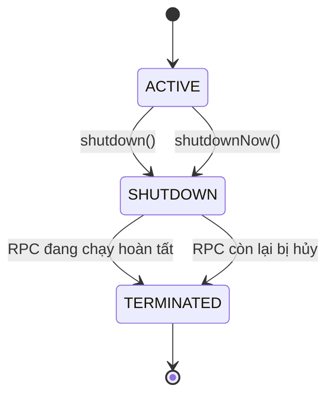

# Channel shutdown và await termination

## 1. Mục tiêu

Trong Spring gRPC, `ManagedChannel` thường được tạo một lần và dùng cho nhiều unary hoặc streaming RPC. Khi ứng dụng dừng hoặc deploy phiên bản mới, channel cần được giải phóng có trật tự để RPC đang chạy có cơ hội hoàn tất. Nếu chờ quá lâu, tiến trình có thể vượt thời gian shutdown của container; nếu đóng cưỡng bức quá sớm, request đang xử lý có thể bị hủy.

Ba API cốt lõi của gRPC Java:

- `shutdown()`: bắt đầu **graceful shutdown**. Channel từ chối RPC mới, còn RPC đã được chấp nhận có cơ hội hoàn tất.
- `awaitTermination(timeout, unit)`: chờ channel kết thúc, tối đa trong thời gian chỉ định.
- `shutdownNow()`: yêu cầu hủy các RPC còn hoạt động khi cần dừng cưỡng bức.

Sau bài học, bạn có thể phân biệt shutdown với termination, xây dựng trình tự dừng Spring client/server, tính shutdown budget, xử lý unary và streaming RPC, cũng như kiểm thử channel đã thực sự kết thúc.

## 2. Vòng đời của ManagedChannel

`ManagedChannel` là tài nguyên cấp ứng dụng, có vòng đời dài hơn một RPC. Nó điều phối resolver, load balancer, subchannel và transport để gửi nhiều RPC. Đóng channel là đóng **đầu mối gửi RPC** cùng các tài nguyên transport mà channel sở hữu.



Sơ đồ dùng nhãn khái niệm. API public không có enum `ACTIVE` hoặc `TERMINATED`; trạng thái được truy vấn bằng `isShutdown()` và `isTerminated()`.

| API | Tác dụng | Có chờ không? |
|---|---|---|
| `shutdown()` | Ngừng nhận RPC mới, cho RPC đã được chấp nhận cơ hội hoàn tất | Không |
| `shutdownNow()` | Bắt đầu shutdown và yêu cầu hủy RPC đang hoạt động | Không |
| `awaitTermination(t, unit)` | Chờ channel kết thúc hoặc hết thời gian chờ | Có, chặn thread gọi |
| `isShutdown()` | Kiểm tra shutdown đã được yêu cầu chưa | Không |
| `isTerminated()` | Kiểm tra channel đã kết thúc hoàn toàn chưa | Không |

**`shutdown()` không đồng nghĩa với `awaitTermination()`.** Gọi shutdown chỉ bắt đầu quá trình. Nếu ứng dụng cần biết channel đã kết thúc trước khi thoát, phải chờ và kiểm tra kết quả.

```java
channel.shutdown();
boolean terminated = channel.awaitTermination(5, TimeUnit.SECONDS);
if (!terminated) {
    channel.shutdownNow();
}
```

Nếu `awaitTermination` trả `false`, channel chưa kết thúc trong thời gian chờ. Nếu thread bị interrupt, phương thức ném `InterruptedException`; ứng dụng cần xử lý interruption và khôi phục interrupt flag.

## 3. Graceful shutdown và forceful shutdown

### Graceful shutdown

`shutdown()` phù hợp khi ứng dụng có thể dành thời gian để RPC đã bắt đầu hoàn tất:

1. Channel ngừng nhận RPC mới.
2. RPC đã được chấp nhận có cơ hội tiếp tục.
3. Khi các RPC kết thúc và tài nguyên được giải phóng, channel chuyển sang terminated.
4. Ứng dụng quan sát kết quả bằng `awaitTermination` hoặc `isTerminated`.

Graceful shutdown **không bảo đảm mọi RPC thành công**. RPC vẫn có thể thất bại do server, deadline, network hoặc cancellation.

### Forceful shutdown

`shutdownNow()` yêu cầu hủy các RPC đang hoạt động. Dùng khi hết ngân sách chờ hoặc khi ứng dụng phải dừng khẩn cấp. Hủy RPC ở client không chứng minh server chưa xử lý nghiệp vụ: server có thể đã ghi dữ liệu trước khi nhận cancellation. Retry sau đó phải xét idempotency và trạng thái nghiệp vụ.

```mermaid
flowchart TD
    A[Ngừng nhận công việc mới] --> B[channel.shutdown()]
    B --> C[awaitTermination trong grace period]
    C --> D{Đã terminated?}
    D -->|Có| E[Hoàn tất]
    D -->|Không| F[channel.shutdownNow()]
    F --> G[Chờ ngắn lần cuối]
    G --> H[Ghi nhận nếu vẫn chưa terminated]
```

Không gọi `shutdownNow()` ngay sau `shutdown()` mà không có khoảng grace, trừ khi đó là chủ đích của đường dừng khẩn cấp.

## 4. Shutdown budget

Ứng dụng thường có một khoảng thời gian tổng để dừng trước khi container hoặc nền tảng kết thúc process. Channel không nên sử dụng hết ngân sách này nếu ứng dụng còn phải đóng server, database, executor và tài nguyên khác.

Ví dụ tổng thời gian dừng là 30 giây:

| Giai đoạn | Ngân sách minh họa |
|---|---:|
| Ngừng nhận traffic và cập nhật readiness | 3 giây |
| Drain request/RPC inbound | 12 giây |
| Đóng outbound gRPC channel | 8 giây |
| Đóng executor và tài nguyên khác | 4 giây |
| Dự phòng cho hook/runtime | 3 giây |

Các con số phải được điều chỉnh theo nền tảng và SLO. Nếu channel tự chờ đủ 30 giây trong khi container cũng chỉ cho 30 giây tổng, các thành phần khác có thể không còn thời gian đóng.

**Deadline RPC và shutdown budget là hai giới hạn khác nhau:**

- Deadline giới hạn thời gian của từng RPC.
- Shutdown grace giới hạn thời gian ứng dụng dành cho việc dừng.
- `awaitTermination` chỉ chờ channel kết thúc; nó không kéo dài deadline RPC và không tạo thêm thời gian cho container.

Nên dùng một ngân sách tổng và truyền phần thời gian còn lại cho từng bước, thay vì mỗi bean tự chờ một khoảng dài độc lập.

## 5. Quản lý channel trong Spring

Không tạo channel trong controller hoặc service method. Một bean singleton có thể sở hữu channel và đóng nó khi Spring context kết thúc.

Ví dụ owner bọc channel, thực hiện graceful shutdown, chờ có giới hạn và forceful shutdown khi cần:

```java
package dev.example.client;

import io.grpc.ManagedChannel;
import java.time.Duration;
import java.util.concurrent.TimeUnit;

public final class GrpcChannelOwner implements AutoCloseable {
    private final ManagedChannel channel;
    private final Duration gracePeriod;

    public GrpcChannelOwner(
            ManagedChannel channel, Duration gracePeriod) {
        this.channel = channel;
        this.gracePeriod = gracePeriod;
    }

    public ManagedChannel channel() {
        return channel;
    }

    @Override
    public void close() {
        channel.shutdown();
        try {
            boolean terminated = channel.awaitTermination(
                    gracePeriod.toMillis(), TimeUnit.MILLISECONDS);
            if (!terminated) {
                channel.shutdownNow();
                channel.awaitTermination(2, TimeUnit.SECONDS);
            }
        } catch (InterruptedException e) {
            channel.shutdownNow();
            Thread.currentThread().interrupt();
        }
    }
}
```

Đăng ký owner thành Spring bean:

```java
@Configuration(proxyBeanMethods = false)
public class GreeterClientConfiguration {
    @Bean(destroyMethod = "close")
    GrpcChannelOwner greeterChannelOwner(
            @Value("${app.grpc.greeter.target}") String target) {
        ManagedChannel channel = NettyChannelBuilder
                .forTarget(target)
                .useTransportSecurity()
                .build();
        return new GrpcChannelOwner(
                channel, Duration.ofSeconds(8));
    }
}
```

Gateway phụ thuộc owner:

```java
@Service
public class GreeterGateway {
    private final GreeterGrpc.GreeterBlockingStub stub;

    public GreeterGateway(GrpcChannelOwner owner) {
        this.stub = GreeterGrpc.newBlockingStub(owner.channel());
    }

    public String greet(String name) {
        return stub.withDeadlineAfter(3, TimeUnit.SECONDS)
                .sayHello(HelloRequest.newBuilder()
                        .setName(name)
                        .build())
                .getMessage();
    }
}
```

Spring quản lý quan hệ phụ thuộc giữa gateway và owner; dependent bean được hủy trước dependency mà nó đang dùng. Với nhiều bean hoặc lifecycle coordinator tùy biến, hãy kiểm tra thứ tự dừng thực tế.

`app.grpc.greeter.target` là property tự đặt. Nếu Spring gRPC starter đã quản lý channel, hãy dùng lifecycle và API cấu hình của đúng phiên bản starter; không bọc rồi đóng một channel mà framework vẫn sở hữu.

**Không gọi shutdown trong mỗi request.** Một channel dùng chung phục vụ nhiều RPC; đóng nó khi một request hoàn tất sẽ làm các request khác thất bại và mất khả năng tái sử dụng transport.

## 6. Trình tự dừng ứng dụng vừa nhận vừa gọi gRPC

Một Spring service có thể đồng thời nhận HTTP request, cung cấp gRPC server và gọi outbound gRPC. Nếu đóng outbound channel trong khi inbound handler vẫn chạy, handler có thể không gọi được backend cần thiết để hoàn tất.

Trình tự tham khảo:

1. Đánh dấu instance **not ready** để load balancer ngừng gửi traffic mới.
2. Ngừng nhận HTTP request mới và bắt đầu shutdown gRPC server để từ chối RPC inbound mới.
3. Cho inbound handler và request đang chạy hoàn tất trong grace period. Outbound channel vẫn cần hoạt động trong giai đoạn này.
4. Khi handler đã drain hoặc hết ngân sách, hủy request/stream còn lại theo policy.
5. Đóng outbound gRPC channel bằng `shutdown()`, `awaitTermination` và `shutdownNow()` nếu cần.
6. Đóng executor, database pool và tài nguyên khác theo thứ tự phụ thuộc.

Nếu ứng dụng chỉ là gRPC client, bỏ qua phần server inbound. Nếu ứng dụng chỉ là server, quản lý vòng đời `Server` thay vì chỉ đóng `ManagedChannel`.

Không dựa vào thứ tự ngẫu nhiên giữa nhiều bean destroy method để điều phối chuỗi phức tạp. Với nhiều tài nguyên phụ thuộc nhau, tạo lifecycle coordinator rõ ràng hoặc dùng cơ chế lifecycle của Spring Boot phù hợp.

## 7. Server shutdown và await termination

Phía server có API tương ứng:

- `Server.shutdown()`: ngừng nhận RPC mới và cho RPC đã được chấp nhận cơ hội hoàn tất.
- `Server.shutdownNow()`: yêu cầu hủy RPC đang hoạt động.
- `Server.awaitTermination(timeout, unit)`: chờ server kết thúc trong thời gian giới hạn.

Ví dụ:

```java
server.shutdown();
try {
    if (!server.awaitTermination(15, TimeUnit.SECONDS)) {
        server.shutdownNow();
        server.awaitTermination(3, TimeUnit.SECONDS);
    }
} catch (InterruptedException e) {
    server.shutdownNow();
    Thread.currentThread().interrupt();
}
```

Trong Spring, gắn server lifecycle vào context hoặc starter thay vì tạo server ngoài sự quản lý của Spring. Khi ứng dụng nhận traffic qua Kubernetes/ingress, phối hợp readiness, endpoint removal, server shutdown và grace period của container.

**Readiness khác shutdown:** readiness giúp ngừng gửi traffic mới; `Server.shutdown()` thực sự bắt đầu đóng server. Chỉ đổi readiness có thể để process tiếp tục giữ tài nguyên. Chỉ shutdown server mà không cho endpoint ngừng nhận traffic có thể khiến client liên tục nhận lỗi trong lúc rollout.

## 8. Unary RPC đang chạy khi channel shutdown

Với unary RPC, `shutdown()` không tự biến mọi lời gọi đang chạy thành lỗi. RPC đã được chấp nhận có cơ hội hoàn tất; các lời gọi mới sau khi channel shutdown sẽ không được chấp nhận.

```java
GreeterGrpc.GreeterFutureStub stub =
        GreeterGrpc.newFutureStub(channel);

ListenableFuture<HelloReply> pending = stub.sayHello(
        HelloRequest.newBuilder().setName("Lan").build());

channel.shutdown();

// pending có thể hoàn tất nếu server xử lý kịp.
// Ứng dụng cần chờ Future trong shutdown budget.
```

Ví dụ giả định dự án đã có thư viện Future stub phù hợp với phiên bản gRPC Java. Trong code thực tế, quản lý Future/callback và chờ kết quả trong shutdown budget.

Nếu RPC có deadline ngắn hơn grace period, nó có thể tự kết thúc trước khi channel chấm dứt. Nếu RPC không có deadline hoặc backend treo, nó có thể giữ channel chưa terminated lâu hơn dự kiến. Đặt deadline hữu hạn cho unary RPC và dùng shutdown grace có giới hạn.

Nếu server đã ghi dữ liệu nhưng response chưa tới client khi channel bị đóng, caller có thể không biết thao tác đã commit hay chưa. Với thao tác ghi, dùng idempotency key và cơ chế tra cứu/reconciliation trước khi retry.

## 9. Streaming RPC và cancellation

Streaming RPC có thể tồn tại lâu hơn thời gian shutdown thông thường. Một stream mở không tự hoàn tất chỉ vì client không gửi message trong một khoảng ngắn.

Khi gọi `channel.shutdown()`, RPC đã được chấp nhận có cơ hội hoàn tất. Nếu stream không kết thúc, `awaitTermination` có thể hết timeout. Ứng dụng cần quyết định:

- Chờ thêm trong ngân sách còn lại nếu stream cần kết thúc tự nhiên.
- Chủ động gửi tín hiệu kết thúc/cancel ở tầng ứng dụng.
- Gọi `shutdownNow()` khi cần buộc dừng channel.

Với client streaming hoặc bidirectional streaming, giữ handle có thể cancel, chẳng hạn `ClientCallStreamObserver` trong API async phù hợp, và quản lý nó trong registry có vòng đời. Khi shutdown, ngừng nhận message mới, gửi completion nếu giao thức cho phép hoặc cancel stream.

Khi stream bị hủy, server có thể nhận cancellation và giải phóng tài nguyên. Tuy nhiên, nếu server đã xử lý một message trước khi cancellation tới, client không thể giả định message đó chưa được commit. Với stream có dữ liệu quan trọng, dùng sequence number, acknowledgment, cursor và deduplication để phục hồi an toàn.

## 10. awaitTermination không phải health check

Hai câu hỏi khác nhau:

- `awaitTermination`: “Channel/server đã kết thúc hoàn toàn chưa?”
- Health check: “Service có sẵn sàng xử lý nghiệp vụ không?”

Channel có thể `READY` nhưng server trả lỗi cho một method hoặc database đã ngừng hoạt động. Channel cũng có thể `IDLE` mà không có lỗi. Sau shutdown, `awaitTermination` trả true chỉ xác nhận tài nguyên channel đã kết thúc, không chứng minh RPC trước đó thành công hay dữ liệu đã commit.

| Phương thức | Dùng để |
|---|---|
| `channel.isShutdown()` | Xem shutdown đã được yêu cầu |
| `channel.isTerminated()` | Xem channel đã kết thúc hoàn toàn |
| `channel.awaitTermination(t, unit)` | Chờ channel kết thúc trong giới hạn |
| `server.isShutdown()` | Xem server đã bắt đầu shutdown |
| `server.isTerminated()` | Xem server đã kết thúc hoàn toàn |
| `server.awaitTermination(t, unit)` | Chờ server kết thúc trong giới hạn |

Không dùng `awaitTermination()` như readiness probe hoặc gọi nó trên event-loop/request thread. Đây là thao tác chờ có thể block; nên thực hiện trong lifecycle thread được quản lý.

## 11. Xử lý interruption và timeout

Một phương thức đóng channel cần xử lý ba tình huống:

1. **Kết thúc đúng hạn:** `awaitTermination` trả true; không cần force shutdown.
2. **Hết thời gian chờ:** trả false; gọi `shutdownNow()` rồi chờ thêm một khoảng ngắn.
3. **Thread bị interrupt:** yêu cầu force shutdown nếu cần, sau đó khôi phục interrupt flag bằng `Thread.currentThread().interrupt()`.

Không nuốt `InterruptedException` rồi tiếp tục chờ vô hạn. Interrupt có thể là tín hiệu từ Spring/container hoặc lifecycle coordinator yêu cầu dừng ngay.

Không tuyên bố đã giải phóng hoàn toàn chỉ vì đã gọi `shutdownNow()`. Hãy kiểm tra `isTerminated()` hoặc kết quả `awaitTermination` sau bước force shutdown.

Nếu có nhiều channel, tránh chờ tuần tự mỗi channel với timeout đầy đủ khiến tổng thời gian vượt shutdown budget. Có thể bắt đầu shutdown cho tất cả channel trước, rồi chờ theo **deadline tổng** hoặc thời gian còn lại.

## 12. Quan sát shutdown

Các tín hiệu nên thu thập:

| Tín hiệu | Ý nghĩa |
|---|---|
| Thời điểm bắt đầu shutdown | Xác định ngân sách còn lại |
| Số RPC/stream đang chạy | Lượng công việc cần drain |
| Số RPC hoàn tất trong grace | Hiệu quả graceful shutdown |
| Số RPC bị cancel/failed | Tác động của force shutdown |
| Thời gian `awaitTermination` | Phát hiện channel/server đóng chậm |
| Số channel chưa terminated | Phát hiện rò rỉ hoặc stream không kết thúc |
| RPC status theo method | Tác động tới caller trong rollout |

Log nên phân biệt bắt đầu graceful shutdown, grace hết hạn, đã yêu cầu forceful shutdown, channel/server terminated và channel/server chưa terminated sau thời gian cuối. Tránh log token, metadata hoặc payload nhạy cảm.

## 13. Kiểm thử shutdown và termination

Unit test mock stub không xác minh transport đã đóng. Integration test có thể dùng Netty server/client trên loopback để kiểm tra channel thật:

```java
package dev.example.hello;

import static org.junit.jupiter.api.Assertions.assertTrue;

import io.grpc.Grpc;
import io.grpc.InsecureChannelCredentials;
import io.grpc.ManagedChannel;
import io.grpc.Server;
import io.grpc.netty.shaded.io.grpc.netty.NettyServerBuilder;
import java.net.InetSocketAddress;
import java.util.concurrent.TimeUnit;
import org.junit.jupiter.api.Test;

class ChannelShutdownTest {
    @Test
    void shutdownTerminatesChannel() throws Exception {
        Server server = NettyServerBuilder
                .forAddress(new InetSocketAddress("127.0.0.1", 0))
                .addService(new GreeterGrpc.GreeterImplBase() {})
                .build()
                .start();

        ManagedChannel channel = Grpc.newChannelBuilderForAddress(
                "127.0.0.1", server.getPort(),
                InsecureChannelCredentials.create())
                .build();

        try {
            channel.shutdown();
            assertTrue(channel.isShutdown());
            assertTrue(channel.awaitTermination(5, TimeUnit.SECONDS));
            assertTrue(channel.isTerminated());
        } finally {
            channel.shutdownNow();
            server.shutdownNow();
            assertTrue(server.awaitTermination(5, TimeUnit.SECONDS));
        }
    }
}
```

Test trên kiểm tra channel kết thúc. Để kiểm tra RPC đang chạy, thêm handler có latch điều khiển: bắt đầu RPC, gọi `shutdown()`, xác nhận RPC đã được chấp nhận có thể hoàn tất, rồi kiểm tra channel terminated. Dùng latch/barrier và deadline thay vì `Thread.sleep` tùy tiện để tránh test flaky.

Các trường hợp nên kiểm tra:

1. Shutdown khi không có RPC: channel kết thúc trong grace.
2. Shutdown khi unary RPC đang chạy: RPC có thể hoàn tất nếu handler xong trước grace.
3. Shutdown khi stream đang mở: stream được hoàn tất/cancel; channel không bị giữ vô hạn.
4. Grace hết hạn: `shutdownNow()` được gọi và RPC còn lại bị hủy.
5. Interrupt trong lúc await: interrupt flag được khôi phục.
6. Spring context đóng: bean owner đóng channel, không còn transport thread/socket ngoài dự kiến.
7. Server graceful shutdown: server từ chối RPC mới và chờ RPC đang chạy trong grace.

Test loopback plaintext chỉ kiểm tra lifecycle channel, không kiểm tra TLS/mTLS, ingress hoặc orchestrator. Các lớp đó cần integration test phù hợp môi trường triển khai.

## 14. Lỗi thường gặp

| Triệu chứng | Nguyên nhân | Cách xử lý |
|---|---|---|
| Gọi `shutdown()` nhưng process chưa dừng | RPC/stream đang chạy hoặc tài nguyên khác còn mở | Kiểm tra in-flight RPC và dùng `awaitTermination` có giới hạn |
| `awaitTermination` trả false | Grace period không đủ hoặc stream chưa kết thúc | Drain/cancel stream, tăng ngân sách có căn cứ |
| RPC mới trả lỗi sau shutdown | Channel đã từ chối RPC mới | Ngừng nhận công việc trước khi đóng channel |
| Tạo channel mới mỗi khi gặp lỗi | Nhầm reconnect với vòng đời request | Giữ channel lâu dài; chỉ tạo lại khi owner/cấu hình thay đổi |
| `shutdownNow()` làm mất kết quả ghi | Server có thể đã commit trước cancellation | Idempotency key, deduplication và reconciliation |
| Spring đóng channel trước gateway | Lifecycle/dependency ownership không rõ | Để gateway phụ thuộc owner hoặc dùng coordinator |
| Server shutdown nhưng ingress vẫn gửi traffic | Readiness/endpoint removal chưa phối hợp | Ngừng nhận traffic mới trước, rồi drain server |
| Chờ từng channel quá lâu | Mỗi channel dùng timeout đầy đủ, vượt ngân sách tổng | Shutdown tất cả trước, chờ theo deadline tổng |

## 15. Bài tập thực hành

**Tình huống:** một Spring Boot service nhận HTTP request, gọi outbound Greeter unary RPC và giữ một bidirectional stream tới dịch vụ thông báo. Khi deploy, container có 30 giây để dừng. Unary RPC thường hoàn tất nhanh, nhưng stream có thể tồn tại nhiều phút.

Hãy thực hiện:

1. Tạo singleton `ManagedChannel` và xác nhận RPC unary thành công trước khi shutdown.
2. Viết owner thực hiện `shutdown()`, `awaitTermination()` và `shutdownNow()` khi hết grace; ghi log kết quả termination.
3. Đóng readiness/ngừng nhận request mới trước khi đóng outbound channel.
4. Giữ một unary RPC đang chạy và xác nhận graceful shutdown cho phép nó hoàn tất trong thời hạn.
5. Giữ một stream dài hạn; thiết kế tín hiệu stop/cancel và cursor để có thể tiếp tục sau deploy.
6. Tính shutdown budget cho inbound server, outbound channel và executor; bảo đảm tổng không vượt grace của container.
7. Thử force shutdown khi grace hết hạn và kiểm tra status/cancellation phía client/server.
8. Đóng Spring context trong integration test và xác nhận channel/server terminated, không còn thread/socket ngoài dự kiến.

**Tiêu chí hoàn thành:** phân biệt được yêu cầu shutdown và termination thực tế; triển khai graceful shutdown có giới hạn; xử lý unary và streaming RPC; không đóng channel trước khi thành phần phụ thuộc ngừng gửi RPC; có bằng chứng integration test cho termination.

## 16. Ghi nhớ

`shutdown()` bắt đầu graceful shutdown và từ chối RPC mới; `awaitTermination(timeout, unit)` chờ channel thực sự kết thúc; `shutdownNow()` yêu cầu hủy RPC còn hoạt động khi hết ngân sách. Trong Spring, channel cần một chủ sở hữu lifecycle rõ ràng và chỉ được đóng sau khi ứng dụng ngừng tạo RPC mới. Với server/client streaming, phải chủ động drain hoặc cancel stream và cân nhắc resume nghiệp vụ. Luôn tính shutdown budget tổng, xử lý interruption, kiểm tra `isTerminated()` và kiểm thử trên transport thật; gọi shutdown đơn thuần chưa chứng minh tài nguyên đã được giải phóng.
