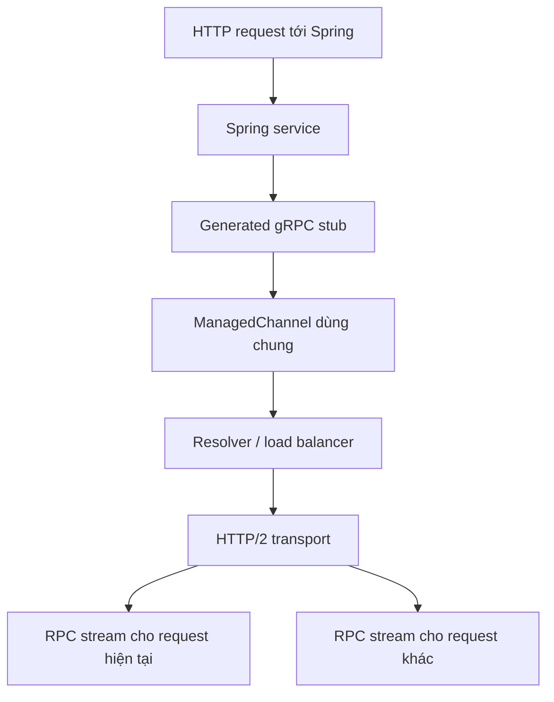
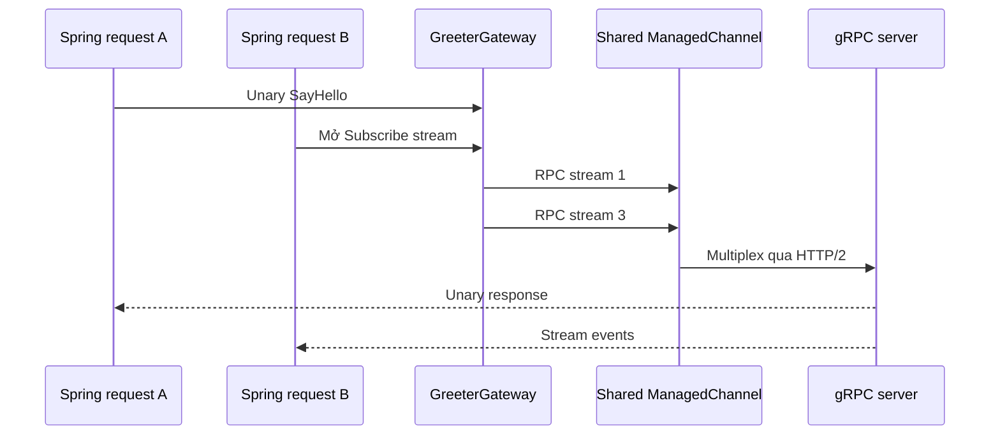

# Không tạo channel mỗi request

## 1. Mục tiêu

Trong Spring gRPC, `ManagedChannel` là tài nguyên kết nối logic tới một target. Nó được thiết kế để tồn tại lâu dài và phục vụ nhiều unary hoặc streaming RPC. Tạo channel mới cho mỗi HTTP request làm mất khả năng tái sử dụng transport, tăng chi phí DNS/TCP/TLS/HTTP/2 handshake và khiến việc quản lý socket, thread, reconnect trở nên khó kiểm soát.

Sau bài học, bạn có thể:

- Giải thích vì sao channel và generated stub nên được tái sử dụng.
- Phân biệt channel, HTTP/2 connection, RPC stream và request nghiệp vụ.
- Tổ chức một channel dùng chung theo target trong Spring.
- Giữ deadline, metadata và cancellation riêng cho từng RPC mà không tạo channel mới.
- Xác định khi nào cần channel riêng do target hoặc cấu hình transport khác nhau.
- Đóng channel đúng lifecycle và kiểm thử rằng nhiều request dùng chung tài nguyên.

**Quy tắc mặc định:** tạo channel theo target/cấu hình kết nối, đưa nó vào dependency injection và tái sử dụng qua nhiều request. Không tạo hoặc đóng channel bên trong controller, service method hay mỗi lần gọi stub.

## 2. Channel được thiết kế để dùng lâu dài

Một lời gọi gRPC đi qua nhiều lớp:



`ManagedChannel` là điểm vào logic cho các RPC. Phía dưới, gRPC quản lý resolver, load balancer, subchannel và transport. Một HTTP/2 connection có thể multiplex nhiều RPC stream đồng thời. Vì thế, một channel dùng chung có thể phục vụ nhiều request mà không cần một channel riêng cho mỗi request.

| Thành phần | Vòng đời | Có nên tạo theo từng request? |
|---|---|---|
| `ManagedChannel` | Dài hạn theo target và cấu hình kết nối | Không |
| Generated stub | Immutable, dùng để gọi một service qua channel | Thường không cần; có thể dùng chung |
| RPC call/stream | Một lần gọi nghiệp vụ | Có, mỗi request tạo RPC riêng |
| Request/response Protobuf | Dữ liệu của một lần gọi | Có, tạo riêng theo dữ liệu |
| Metadata/deadline | Ngữ cảnh của một RPC | Có, gắn riêng cho từng RPC |

**Tái sử dụng channel không có nghĩa tái sử dụng RPC.** Mỗi request vẫn tạo một call/stream riêng, với message, deadline, metadata và kết quả riêng.

## 3. Vì sao tạo channel mỗi request gây hại?

Ví dụ anti-pattern trong service:

```java
public String greet(String name) {
    ManagedChannel channel = NettyChannelBuilder
            .forAddress("greeter.internal.example", 8443)
            .useTransportSecurity()
            .build();

    try {
        return GreeterGrpc.newBlockingStub(channel)
                .sayHello(HelloRequest.newBuilder()
                        .setName(name)
                        .build())
                .getMessage();
    } finally {
        channel.shutdown();
    }
}
```

Dù có `finally` để đóng channel, code này vẫn tạo và hủy transport theo từng request. Với mỗi lần gọi, client có thể phải thực hiện lại:

- Phân giải DNS và chọn endpoint.
- Thiết lập TCP connection.
- TLS handshake và xác minh certificate.
- HTTP/2 connection preface và trao đổi SETTINGS.
- Khởi tạo tài nguyên transport, event loop hoặc bộ đệm theo implementation.

Khi tải tăng, các chi phí này tạo nhiều socket/handshake hơn cần thiết, tăng latency của request và áp lực CPU cho client, proxy lẫn server. Nếu quên đóng channel, tài nguyên có thể tồn tại ngoài ý muốn; nếu đóng quá sớm, request khác không thể dùng channel đó.

Không tạo channel theo request cũng giúp gRPC quản lý reconnect/backoff ở một nơi. Khi transport bị mất, channel lâu sống có thể thiết lập kết nối mới; ứng dụng không cần tạo channel mới mỗi khi gặp `UNAVAILABLE`.

## 4. Tạo channel một lần trong Spring

Đặt channel trong một bean có vòng đời dài. Ví dụ dùng target DNS và TLS:

```yaml
# application-prod.yml
# app.grpc.* là namespace cấu hình do ứng dụng tự định nghĩa
app:
  grpc:
    greeter:
      target: dns:///greeter.internal.example:8443
```

```java
package dev.example.client;

import io.grpc.ManagedChannel;
import io.grpc.netty.shaded.io.grpc.netty.NettyChannelBuilder;
import org.springframework.beans.factory.annotation.Value;
import org.springframework.context.annotation.Bean;
import org.springframework.context.annotation.Configuration;
import org.springframework.context.annotation.Profile;

@Configuration(proxyBeanMethods = false)
@Profile("prod")
public class GreeterChannelConfiguration {
    @Bean(name = "greeterChannel", destroyMethod = "shutdown")
    ManagedChannel greeterChannel(
            @Value("${app.grpc.greeter.target}") String target) {
        return NettyChannelBuilder.forTarget(target)
                .useTransportSecurity()
                .build();
    }
}
```

`useTransportSecurity()` sử dụng TLS; certificate server vẫn phải được tin cậy và có hostname/SAN phù hợp với tên dịch vụ. Nếu dùng CA nội bộ hoặc mTLS, cấu hình credentials/trust material tương ứng. Không chuyển sang plaintext để che lỗi certificate.

Gateway nhận channel qua constructor injection:

```java
package dev.example.client;

import dev.example.hello.GreeterGrpc;
import dev.example.hello.HelloRequest;
import io.grpc.ManagedChannel;
import java.util.concurrent.TimeUnit;
import org.springframework.beans.factory.annotation.Qualifier;
import org.springframework.stereotype.Service;

@Service
public class GreeterGateway {
    private final GreeterGrpc.GreeterBlockingStub stub;

    public GreeterGateway(
            @Qualifier("greeterChannel") ManagedChannel channel) {
        this.stub = GreeterGrpc.newBlockingStub(channel);
    }

    public String greet(String name) {
        return stub.withDeadlineAfter(2, TimeUnit.SECONDS)
                .sayHello(HelloRequest.newBuilder()
                        .setName(name)
                        .build())
                .getMessage();
    }
}
```

Gateway và channel là các bean được Spring quản lý. Mỗi lần `greet` được gọi, code tạo request Protobuf và RPC mới nhưng sử dụng cùng channel/stub. `withDeadlineAfter` trả về một stub immutable dẫn xuất với deadline riêng cho call đó.

Các property `app.grpc.greeter.target` là ví dụ tự đặt, không phải tên property được đảm bảo bởi mọi phiên bản Spring gRPC starter. Nếu starter đã tạo channel, dùng API cấu hình của phiên bản đó và inject channel/stub do framework quản lý; tránh tạo thêm một channel trùng target.

## 5. Stub và channel có thể dùng đồng thời

Generated gRPC stubs là immutable: các phương thức cấu hình như `withDeadlineAfter`, `withWaitForReady` hoặc `withInterceptors` tạo stub dẫn xuất thay vì thay đổi stub gốc. `ManagedChannel` cũng được thiết kế để nhiều thread gọi đồng thời.

Vì vậy, một gateway singleton có thể giữ stub:

```java
private final GreeterGrpc.GreeterBlockingStub baseStub;

public GreeterGateway(ManagedChannel channel) {
    this.baseStub = GreeterGrpc.newBlockingStub(channel);
}

public HelloReply greet(String name, Duration timeout) {
    return baseStub
            .withDeadlineAfter(timeout.toMillis(), TimeUnit.MILLISECONDS)
            .sayHello(HelloRequest.newBuilder()
                    .setName(name)
                    .build());
}
```

Không lưu deadline hoặc metadata của một request vào field mutable dùng chung. Nếu làm vậy, các thread có thể ghi đè ngữ cảnh của nhau. Giữ stub gốc bất biến và tạo stub dẫn xuất cho từng call là cách đơn giản để tách cấu hình RPC.

Blocking stub vẫn thực hiện lời gọi blocking. Trong Spring MVC, cần dùng thread xử lý phù hợp; trong WebFlux/event loop, không gọi blocking stub trực tiếp trên event-loop. Việc tái sử dụng channel không tự biến blocking RPC thành nonblocking.

## 6. Metadata và deadline vẫn riêng cho mỗi RPC

Một nhầm lẫn thường gặp là nghĩ rằng channel dùng chung thì mọi request phải dùng chung metadata hoặc deadline. Thực tế, các thông tin thuộc từng call có thể được gắn riêng.

### Deadline theo request

```java
HelloReply reply = baseStub
        .withDeadlineAfter(1500, TimeUnit.MILLISECONDS)
        .sayHello(request);
```

Request A có thể có deadline 1,5 giây, request B có deadline 4 giây. Hai call vẫn dùng chung channel. Deadline giới hạn thời gian của RPC; nó không tạo channel mới và không đặt lại vòng đời channel.

### Metadata theo request

Dùng interceptor/call credentials hoặc cơ chế call-scoped phù hợp để gắn metadata. Ví dụ với API `MetadataUtils` của gRPC Java:

```java
Metadata headers = new Metadata();
Metadata.Key<String> requestIdKey = Metadata.Key.of(
        "x-request-id", Metadata.ASCII_STRING_MARSHALLER);
headers.put(requestIdKey, requestId);

GreeterGrpc.GreeterBlockingStub requestStub =
        baseStub.withInterceptors(
                MetadataUtils.newAttachHeadersInterceptor(headers));

HelloReply reply = requestStub
        .withDeadlineAfter(2, TimeUnit.SECONDS)
        .sayHello(request);
```

Đây là ví dụ call-scoped headers; dùng đúng API `MetadataUtils` của phiên bản gRPC Java đang cài và tạo metadata riêng cho từng request. Không chia sẻ một `Metadata` mutable giữa nhiều thread. Với bearer token, ưu tiên call credentials hoặc interceptor có cơ chế lấy token an toàn; không log token.

Channel dùng chung không đồng nghĩa dùng chung danh tính người dùng. Nếu mỗi request có token riêng, token phải được gắn vào call tương ứng. Nếu các tenant yêu cầu **client certificate, trust root, proxy hoặc transport policy khác nhau**, có thể cần channel riêng theo cấu hình bảo mật, không phải theo từng HTTP request.

## 7. Khi nào cần nhiều channel?

Một channel dùng chung cho mỗi target/cấu hình kết nối là mặc định hợp lý. Nhiều channel chỉ nên xuất hiện khi có ranh giới cấu hình hoặc nhu cầu được chứng minh bằng phép đo.

| Trường hợp | Cách tổ chức phù hợp |
|---|---|
| Nhiều request gọi cùng service, cùng TLS identity | Dùng chung một channel |
| Nhiều method trong cùng service/target | Dùng chung channel; tạo stub tương ứng |
| Nhiều service ở các target khác nhau | Một channel cho mỗi target logic/cấu hình phù hợp |
| Tenant có client certificate hoặc trust policy khác nhau | Tách channel theo security identity/configuration |
| Load test chứng minh transport là điểm nghẽn | Đánh giá pool hữu hạn, đo trước/sau |
| Mỗi người dùng có bearer token riêng | Thường dùng call credentials/metadata theo RPC; không tạo channel theo user |

Không tạo một channel cho mỗi tenant nếu tất cả dùng cùng endpoint và cùng transport identity chỉ vì metadata khác nhau. Ngược lại, không gộp các tenant có yêu cầu TLS identity khác nhau vào cùng channel rồi cố đổi client certificate theo từng request; TLS identity thuộc kết nối, không phải metadata tùy ý của RPC.

Một channel có thể quản lý nhiều endpoint nhờ resolver/load balancer. Nhiều channel cũng không bảo đảm traffic được chia đều hơn; chúng có thể cùng chọn một backend. Nếu muốn cân bằng tải, cấu hình resolver/LB và quan sát phân phối endpoint thay vì tăng channel tùy tiện.

## 8. Streaming RPC cũng dùng lại channel

Mỗi streaming RPC có stream riêng nhưng vẫn có thể đi qua channel được dùng chung với unary RPC và các stream khác. Không tạo channel mới chỉ vì method trả về stream.



Một stream có thể sống lâu hơn request HTTP đã tạo nó. Khi client HTTP ngắt kết nối, ứng dụng cần quyết định có cancel gRPC stream tương ứng hay tiếp tục xử lý theo nghiệp vụ. Việc hủy một stream **không cần đóng channel dùng chung**, vì channel còn phục vụ RPC khác.

Khi connection bị mất, channel có thể reconnect nhưng stream cũ không tự chuyển sang connection mới. Nếu cần phục hồi subscription, ứng dụng mở RPC mới và dùng cursor/resume token theo hợp đồng.

## 9. Đóng channel theo lifecycle ứng dụng

Tái sử dụng channel yêu cầu có một chủ sở hữu rõ ràng. Khi Spring context dừng, channel cần được đóng một lần. `shutdown()` bắt đầu graceful shutdown; nếu cần chờ tài nguyên kết thúc, owner có thể gọi `awaitTermination` và dùng `shutdownNow()` khi hết grace period.

Ví dụ owner:

```java
public final class GrpcChannelOwner implements AutoCloseable {
    private final ManagedChannel channel;

    public GrpcChannelOwner(ManagedChannel channel) {
        this.channel = channel;
    }

    public ManagedChannel channel() {
        return channel;
    }

    @Override
    public void close() {
        channel.shutdown();
        try {
            if (!channel.awaitTermination(8, TimeUnit.SECONDS)) {
                channel.shutdownNow();
                channel.awaitTermination(2, TimeUnit.SECONDS);
            }
        } catch (InterruptedException e) {
            channel.shutdownNow();
            Thread.currentThread().interrupt();
        }
    }
}
```

Đăng ký owner bằng `@Bean(destroyMethod = "close")`. Thời gian 8 và 2 giây chỉ là giá trị minh họa; phải nằm trong shutdown budget tổng của ứng dụng/container. Nếu starter sở hữu channel, để starter đóng nó theo lifecycle của framework.

Không đóng channel trong `finally` của một controller/service method. Đó là nơi đóng tài nguyên của một request, trong khi channel thuộc về ứng dụng và còn được request khác sử dụng.

## 10. Kiểm thử việc tái sử dụng

Một test hữu ích cần chứng minh nhiều RPC có thể dùng cùng channel, đồng thời xác nhận channel được đóng khi owner/context kết thúc.

Các bước kiểm thử:

1. Khởi tạo channel một lần trong test hoặc Spring context.
2. Gửi nhiều unary RPC tuần tự và đồng thời qua cùng gateway.
3. Xác minh response đúng và không có channel mới được tạo cho từng call.
4. Nếu có metadata/deadline, xác minh mỗi RPC nhận giá trị riêng.
5. Gọi close context/owner và kiểm tra channel terminated.

Ví dụ test logic gateway có thể inject một channel dùng chung; integration test nên chạy server Netty thật qua loopback để kiểm tra transport HTTP/2:

```java
@Test
void manyCallsUseTheSameGatewayChannel() {
    ManagedChannel channel = testChannel();
    GreeterGateway gateway = new GreeterGateway(channel);

    assertEquals("Xin chào Lan", gateway.greet("Lan"));
    assertEquals("Xin chào Minh", gateway.greet("Minh"));

    channel.shutdown();
    assertTrue(channel.awaitTermination(5, TimeUnit.SECONDS));
}
```

Đoạn test là khung minh họa; `testChannel()` phải tạo channel tới server test đang chạy. Để chứng minh số channel được tạo, có thể kiểm tra factory/bean được gọi một lần hoặc xác minh gateway nhận cùng object reference. Chỉ gọi hai RPC thành công chưa đủ chứng minh không có channel ẩn khác được tạo.

Các trường hợp nên kiểm tra thêm:

- Gọi đồng thời nhiều unary RPC bằng cùng stub/channel.
- Hai request dùng deadline khác nhau và không ảnh hưởng lẫn nhau.
- Metadata request-scoped không bị rò sang request tiếp theo.
- Hủy một stream không làm channel hoặc RPC khác bị đóng.
- Server restart: cùng channel có thể reconnect cho RPC mới.
- Spring context shutdown: owner đóng channel và không rò rỉ thread/socket.

## 11. Lỗi thường gặp

| Hiện tượng | Nguyên nhân | Cách xử lý |
|---|---|---|
| Mỗi request tạo một channel | Khởi tạo channel trong controller/service method | Đưa channel vào singleton bean |
| Channel không được đóng | Không có lifecycle owner | Đăng ký bean destroy method hoặc coordinator |
| RPC khác bị lỗi khi một request kết thúc | Channel bị shutdown trong `finally` của request | Chỉ đóng channel khi ứng dụng dừng |
| Metadata người dùng bị lẫn | Dùng object mutable chung cho nhiều call | Tạo metadata/call credentials theo RPC |
| Token mới không được áp dụng | Token bị giữ trong interceptor/channel scope | Lấy token theo call hoặc dùng credentials phù hợp |
| Tạo quá nhiều channel theo tenant | Dùng channel để phân biệt dữ liệu request | Dùng metadata; chỉ tách khi transport/security config khác |
| Tạo nhiều channel nhưng tải vẫn lệch | Resolver/LB vẫn chọn cùng backend | Kiểm tra endpoint và load-balancing policy |
| Stream bị hủy làm các call khác lỗi | Đóng channel thay vì cancel stream | Hủy đúng RPC/stream, giữ channel dùng chung |
| Request đầu tiên sau idle chậm | Channel/connection đã vào idle hoặc bị proxy đóng | Đo cold connection, cấu hình idle/keepalive theo policy |

## 12. Bài tập thực hành

**Tình huống:** một Spring Boot API nhận 500 HTTP request mỗi giây và chuyển chúng thành unary gRPC call tới `Greeter`. Hiện tại controller tạo một `ManagedChannel` cho mỗi request. CPU client tăng, TLS handshake nhiều và P95 latency cao.

Hãy thực hiện:

1. Chuyển việc tạo channel sang singleton Spring bean theo target và TLS configuration.
2. Inject channel vào gateway và giữ generated stub bất biến để dùng lại.
3. Gửi nhiều RPC đồng thời qua cùng gateway; xác minh mỗi call vẫn có request/response riêng.
4. Đặt deadline riêng cho từng call và truyền request ID/token bằng metadata hoặc call credentials phù hợp.
5. Thử hai request với token khác nhau để xác nhận metadata không rò giữa các thread.
6. Đo số channel, socket, TLS handshake, P95/P99 latency và CPU trước/sau thay đổi.
7. Thêm owner đóng channel khi Spring context dừng; xác minh channel terminated trong shutdown budget.
8. Nếu có streaming RPC, hủy một stream và xác nhận unary RPC khác vẫn tiếp tục qua channel.

**Tiêu chí hoàn thành:** channel được tạo theo target/cấu hình kết nối, không theo request; metadata/deadline vẫn riêng từng RPC; nhiều thread có thể dùng channel/stub an toàn; channel được đóng đúng lifecycle và lợi ích được xác nhận bằng đo lường.

## 13. Ghi nhớ

`ManagedChannel` là tài nguyên dài hạn và nên được tái sử dụng qua nhiều request. HTTP/2 multiplexing cho phép nhiều RPC stream chia sẻ transport; generated stub immutable có thể được dùng chung, trong khi request, metadata, deadline và cancellation vẫn thuộc từng RPC. Trong Spring, tạo channel thành bean theo target/security configuration, inject vào gateway và đóng khi application context dừng. Chỉ tạo channel riêng khi đích hoặc transport identity khác nhau, hay khi phép đo chứng minh cần thiết; không tạo channel mới mỗi lần gọi service.
