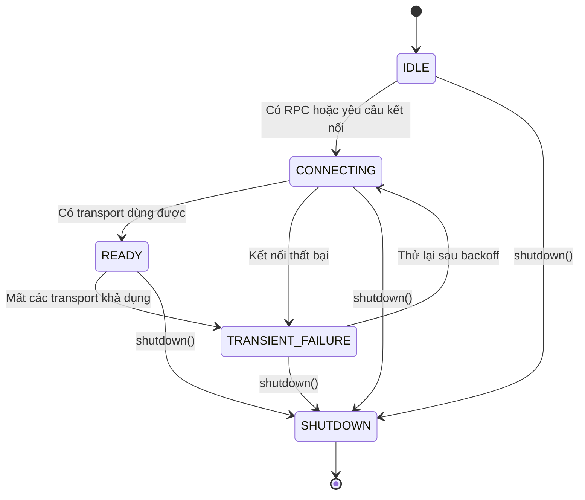

# Quan sát trạng thái channel

## 1. Mục tiêu

Trong Spring gRPC, `ManagedChannel` là điểm vào logic để client gửi unary hoặc streaming RPC tới một target. Channel có thể đi qua nhiều trạng thái khi phân giải DNS, thiết lập HTTP/2, mất kết nối, reconnect hoặc shutdown. Quan sát trạng thái giúp đội vận hành phân biệt channel đang chờ kết nối, đã sẵn sàng, đang gặp lỗi tạm thời hay đã bị đóng.

Sau bài học, bạn có thể:

- Giải thích năm trạng thái `IDLE`, `CONNECTING`, `READY`, `TRANSIENT_FAILURE` và `SHUTDOWN`.
- Dùng `getState()` để đọc snapshot và chủ động yêu cầu kết nối.
- Dùng `notifyWhenStateChanged()` để nhận thông báo chuyển trạng thái mà không polling liên tục.
- Xây dựng watcher có lifecycle rõ ràng trong ứng dụng Spring.
- Phân biệt trạng thái channel với health của service và trạng thái từng socket.
- Kết hợp state transition với RPC status, metrics, tracing và Channelz để chẩn đoán.
- Kiểm thử trạng thái khi server khởi động, mất kết nối, reconnect và shutdown.

## 2. Năm ConnectivityState

gRPC Java biểu diễn trạng thái tổng hợp của channel bằng `ConnectivityState`:

| Trạng thái | Ý nghĩa | Cách diễn giải khi vận hành |
|---|---|---|
| `IDLE` | Channel chưa chủ động thiết lập hoặc duy trì kết nối ở thời điểm đó | Có thể đang chờ RPC mới hoặc đã vào idle mode; không tự nó là lỗi |
| `CONNECTING` | Resolver/load balancer đang tìm endpoint hoặc transport đang được thiết lập | Có thể đang DNS lookup, TCP connect, TLS/HTTP/2 handshake |
| `READY` | Có đường transport sẵn sàng để gửi RPC | Channel có thể nhận call; chưa chứng minh handler hay database khỏe |
| `TRANSIENT_FAILURE` | Hiện không có đường kết nối sử dụng được sau lỗi tạm thời | gRPC có thể chờ backoff rồi thử lại |
| `SHUTDOWN` | Channel đã bắt đầu đóng | Không dùng channel này cho RPC mới; trạng thái cuối của vòng đời |

Một chu kỳ thường gặp:



Đây là mô hình khái quát. Tùy resolver, load balancer và thời điểm quan sát, channel có thể chuyển trạng thái nhanh; một lần polling có thể bỏ lỡ trạng thái trung gian.

### Đọc đúng ý nghĩa

- `IDLE` không có nghĩa server down. Channel có thể đang tiết kiệm tài nguyên vì chưa có RPC cần kết nối.
- `CONNECTING` không có nghĩa kết nối sẽ thành công; resolver hoặc TLS handshake vẫn có thể thất bại.
- `READY` chỉ nói rằng channel có transport sẵn sàng. Một RPC cụ thể vẫn có thể trả `UNAVAILABLE`, `PERMISSION_DENIED` hoặc lỗi nghiệp vụ.
- `TRANSIENT_FAILURE` mô tả việc hiện không có đường kết nối dùng được. Đây có thể là DNS, network, proxy, TLS hoặc server; state không chỉ ra nguyên nhân cụ thể.
- `SHUTDOWN` khác `TRANSIENT_FAILURE`: lỗi tạm thời có thể hồi phục, còn channel đã shutdown không được tái sử dụng.

## 3. Đọc snapshot bằng getState()

`ManagedChannel.getState(boolean requestConnection)` trả về trạng thái tại thời điểm gọi:

```java
ConnectivityState state = channel.getState(false);
log.info("gRPC channel state={}", state);
```

Tham số boolean có ý nghĩa:

- `getState(false)` chỉ đọc snapshot hiện tại; không yêu cầu channel bắt đầu kết nối.
- `getState(true)` có thể yêu cầu channel rời `IDLE` và bắt đầu kết nối nếu cần.

Ví dụ:

```java
ConnectivityState state = channel.getState(true);
log.info("Channel state after requesting connection: {}", state);
```

`getState(true)` **không chờ channel chuyển sang `READY`**. Nó chỉ yêu cầu bắt đầu kết nối. Nếu cần gửi RPC và chờ channel sẵn sàng trong một giới hạn, hãy dùng deadline và cân nhắc `withWaitForReady()` cho call phù hợp.

Không nên dùng snapshot như một cổng kiểm soát tuyệt đối:

```java
// Không nên dùng state snapshot để quyết định chắc chắn RPC sẽ thành công.
if (channel.getState(false) == ConnectivityState.READY) {
    return stub.sayHello(request);
}
throw new IllegalStateException("Channel chưa READY");
```

Ngay sau khi đọc `READY`, transport vẫn có thể mất. Ngược lại, channel đang `IDLE` có thể được đánh thức bởi RPC tiếp theo. Cách an toàn là thực hiện RPC với deadline phù hợp, xử lý gRPC status và dùng state để chẩn đoán hoặc quan sát xu hướng.

## 4. Nhận chuyển trạng thái bằng notifyWhenStateChanged()

Polling theo chu kỳ ngắn vừa tạo tải vừa có thể bỏ lỡ chuyển trạng thái nhanh. gRPC Java cung cấp `notifyWhenStateChanged(source, callback)` để đăng ký callback một lần khi channel rời trạng thái `source`.

```java
ConnectivityState observed = channel.getState(false);

channel.notifyWhenStateChanged(observed, () -> {
    ConnectivityState current = channel.getState(false);
    log.info("Channel state changed: {} -> {}", observed, current);
});
```

Callback chỉ được đăng ký cho **một lần rời khỏi trạng thái đã quan sát**. Muốn theo dõi liên tục, đọc trạng thái mới và đăng ký lại sau mỗi callback.

### Watcher có lifecycle riêng

Ví dụ dưới đây đưa công việc xử lý callback sang một executor riêng để callback của gRPC không thực hiện logging hoặc công việc ứng dụng kéo dài. Watcher không sở hữu channel; nó chỉ quan sát channel được inject.

```java
package dev.example.client;

import io.grpc.ConnectivityState;
import io.grpc.ManagedChannel;
import java.util.concurrent.ExecutorService;
import java.util.concurrent.Executors;
import java.util.concurrent.RejectedExecutionException;
import java.util.concurrent.atomic.AtomicBoolean;
import org.slf4j.Logger;
import org.slf4j.LoggerFactory;

public final class ChannelStateWatcher implements AutoCloseable {
    private static final Logger log =
            LoggerFactory.getLogger(ChannelStateWatcher.class);

    private final ManagedChannel channel;
    private final ExecutorService observer =
            Executors.newSingleThreadExecutor();
    private final AtomicBoolean running = new AtomicBoolean(false);

    public ChannelStateWatcher(ManagedChannel channel) {
        this.channel = channel;
    }

    public void start() {
        if (running.compareAndSet(false, true)) {
            armNextTransition();
        }
    }

    private void armNextTransition() {
        if (!running.get()) {
            return;
        }

        ConnectivityState source = channel.getState(false);
        if (source == ConnectivityState.SHUTDOWN) {
            return;
        }

        channel.notifyWhenStateChanged(source, () -> {
            if (!running.get()) {
                return;
            }
            try {
                observer.execute(() -> {
                    if (!running.get()) {
                        return;
                    }
                    ConnectivityState current = channel.getState(false);
                    log.info("gRPC channel state: {} -> {}", source, current);
                    armNextTransition();
                });
            } catch (RejectedExecutionException ignored) {
                // Watcher đã dừng trong lúc callback được phát.
            }
        });
    }

    @Override
    public void close() {
        running.set(false);
        observer.shutdown();
    }
}
```

Các điểm cần lưu ý:

- Gọi `start()` một lần sau khi bean được khởi tạo.
- `notifyWhenStateChanged` chỉ báo channel rời trạng thái nguồn; callback đọc lại snapshot mới rồi đăng ký tiếp.
- `close()` dừng watcher và executor riêng; nó **không đóng channel**.
- Owner của channel vẫn chịu trách nhiệm gọi `shutdown()`/`awaitTermination()` khi Spring context dừng.
- Callback không nên blocking hoặc thực hiện RPC đồng bộ. Nếu cần gửi alert, hãy chuyển sang queue/executor và kiểm soát tải.

Trong ứng dụng production, watcher cần được đăng ký và dừng theo Spring lifecycle. Nếu dùng executor do ứng dụng chia sẻ, không shutdown executor đó trong watcher; quyền sở hữu executor phải rõ ràng.

## 5. Tích hợp watcher vào Spring

Một cấu hình đơn giản có thể đăng ký watcher như bean phụ thuộc vào channel:

```java
@Configuration(proxyBeanMethods = false)
public class GreeterObservabilityConfiguration {
    @Bean(destroyMethod = "close")
    ChannelStateWatcher greeterChannelStateWatcher(
            @Qualifier("greeterChannel") ManagedChannel channel) {
        ChannelStateWatcher watcher = new ChannelStateWatcher(channel);
        watcher.start();
        return watcher;
    }
}
```

`greeterChannel` phải là channel do ứng dụng hoặc Spring gRPC starter quản lý. Ví dụ này giả định channel đã được khai báo ở cấu hình client. Không tạo một channel mới chỉ để theo dõi state; watcher quan sát đúng object mà gateway sử dụng.

Nếu framework starter đã có metrics hoặc lifecycle hook riêng, ưu tiên tích hợp với cơ chế đó để tránh đăng ký nhiều watcher cho cùng channel. Không để watcher sở hữu channel nếu channel thuộc starter.

## 6. Channel state không phải service health

Đây là ranh giới quan trọng khi xây dashboard và alert:

| Tín hiệu | Nó trả lời câu hỏi | Nó không chứng minh |
|---|---|---|
| Channel `READY` | Có transport sẵn sàng gửi RPC không? | Method cụ thể có xử lý thành công không |
| Channel `TRANSIENT_FAILURE` | Hiện có đường kết nối dùng được không? | Nguyên nhân duy nhất là server down |
| TCP socket connected | TCP peer có kết nối không? | TLS, HTTP/2 hoặc handler nghiệp vụ khỏe |
| gRPC Health Check | Service được health service báo trạng thái gì? | Mọi request nghiệp vụ đều thành công |
| RPC success/status | Lần gọi cụ thể có kết quả gì? | Toàn bộ service luôn khỏe |

Một channel có thể `READY` trong khi backend trả `UNAVAILABLE` cho một method do quota hoặc dependency hỏng. Ngược lại, channel `IDLE` có thể chỉ đơn giản là chưa có request.

Nếu cần biết một service có sẵn sàng nhận công việc hay không, dùng gRPC Health Checking Protocol nếu server triển khai health service. RPC `Check` trả trạng thái cho service; `Watch` có thể phát thay đổi trạng thái liên tục. Có thể kết hợp readiness của nền tảng và synthetic RPC có deadline.

Không dùng channel state làm readiness probe duy nhất cho toàn ứng dụng. Một channel tới một backend không đại diện cho tất cả dependency và nghiệp vụ của Spring service.

## 7. Kết hợp channel state với gRPC status

State cung cấp góc nhìn kết nối tổng thể; status cho biết kết quả của một RPC cụ thể. Nên phân tích cả hai:

| Channel state quan sát được | RPC status | Hướng điều tra |
|---|---|---|
| `READY` | Thành công | Đường kết nối và method đang hoạt động ở thời điểm đó |
| `READY` | `UNAVAILABLE` | Server/proxy có thể từ chối hoặc transport vừa mất; xem cause và server log |
| `CONNECTING` | `DEADLINE_EXCEEDED` | Deadline có thể hết trong DNS/connect/TLS hoặc lúc chờ transport |
| `TRANSIENT_FAILURE` | `UNAVAILABLE` | Kiểm tra resolver, network, proxy, TLS và backoff |
| `IDLE` | Chưa có RPC | Chưa có kết luận về sức khỏe service |
| `SHUTDOWN` | RPC mới thất bại | Kiểm tra lifecycle và thứ tự dừng |

Ví dụ xử lý status:

```java
try {
    return stub.withDeadlineAfter(2, TimeUnit.SECONDS)
            .sayHello(request);
} catch (StatusRuntimeException e) {
    log.warn("gRPC call failed: code={}, channelState={}",
            e.getStatus().getCode(),
            channel.getState(false));
    throw e;
}
```

Snapshot trong catch có thể khác trạng thái tại thời điểm lỗi xảy ra. Đây là thông tin hỗ trợ điều tra, không phải bằng chứng nhân quả. Nếu cần đối chiếu chính xác, ghi timestamp, method, deadline, attempt, status và trace ID.

Không retry chỉ vì channel đang `TRANSIENT_FAILURE`. Retry phải dựa trên status, idempotency, retry policy và deadline tổng.

## 8. Channelz, metrics và tracing

`ConnectivityState` là góc nhìn cấp channel. Khi cần biết chi tiết hơn, có thể kết hợp:

- **Channelz:** giao diện chẩn đoán nội bộ gRPC, có thể cung cấp thông tin channel, subchannel, socket, địa chỉ và trạng thái theo phiên bản/transport hỗ trợ.
- **Metrics:** số lần chuyển state, thời gian ở từng state, RPC count, latency, status và reconnect.
- **Tracing:** nối một RPC cụ thể qua Spring service, client interceptor và backend.
- **Log transport/proxy:** xác định connection close, GOAWAY, TLS handshake hoặc lỗi DNS.
- **Health checking:** quan sát trạng thái service ở tầng ứng dụng.

Không phải mọi transport hoặc bản build đều bật Channelz mặc định. Nếu expose Channelz service/endpoint, giới hạn quyền truy cập vì dữ liệu có thể tiết lộ topology, địa chỉ nội bộ và chi tiết kết nối.

### Metrics nên thiết kế thế nào?

| Metric gợi ý | Loại | Mục đích |
|---|---|---|
| `grpc.channel.state` | Gauge/state sample | Trạng thái gần nhất của channel |
| `grpc.channel.state.transitions` | Counter theo state đích | Đếm chuyển đổi trạng thái |
| `grpc.channel.state.duration` | Histogram/timer | Thời gian channel ở từng trạng thái |
| `grpc.client.calls` | Counter theo method/status | Kết quả RPC |
| `grpc.client.duration` | Histogram | Latency theo method |
| `grpc.client.inflight` | Gauge | Số RPC đang chạy |

Tên metric là gợi ý cho instrumentation của ứng dụng, không phải cam kết tên metric mặc định của mọi phiên bản gRPC/Micrometer. Dùng label có cardinality thấp như service, method và status. Tránh label bằng request ID, user ID, token hoặc địa chỉ động của từng socket.

## 9. Polling hay callback?

| Cách | Ưu điểm | Hạn chế |
|---|---|---|
| Polling `getState(false)` | Dễ tích hợp với scheduler/health dashboard | Có thể bỏ lỡ chuyển đổi nhanh; polling dày tạo overhead |
| `notifyWhenStateChanged` | Nhận thông báo khi state rời giá trị đã đăng ký | Callback một lần; phải đăng ký lại và quản lý lifecycle |
| Channelz/transport diagnostics | Chi tiết hơn về channel/subchannel/socket | Phụ thuộc hỗ trợ và cấu hình; cần bảo vệ endpoint |
| RPC/health probe chủ động | Kiểm tra được service/method ở tầng RPC | Tạo tải và cần deadline/chu kỳ hợp lý |

Với ứng dụng thường xuyên, callback phù hợp để ghi nhận chuyển đổi state; metrics/tracing ghi nhận kết quả RPC. Polling chậm có thể đủ cho dashboard tổng quan, nhưng không dùng vòng lặp busy-wait để chờ `READY`.

Nếu cần chờ trạng thái trong test, dùng callback kết hợp `CountDownLatch` hoặc `CompletableFuture` có timeout thay vì vòng lặp đọc state liên tục.

## 10. Kiểm thử chuyển trạng thái

Một integration test có giá trị nên dùng server và transport thật trên loopback:

1. Tạo server Netty trên cổng động.
2. Tạo một channel client tới server và đăng ký watcher.
3. Gửi RPC để kích hoạt kết nối; quan sát channel tiến tới `READY`.
4. Dừng server và quan sát state rời `READY`, thường qua `TRANSIENT_FAILURE` hoặc trạng thái kết nối trung gian.
5. Khởi động server mới trên cùng target/port; quan sát channel reconnect và trở lại `READY`.
6. Gọi `shutdown()`; xác nhận state cuối cùng là `SHUTDOWN` và channel terminated.

Không assert một chuỗi state tuyệt đối cho mọi runtime. Ví dụ, `CONNECTING` có thể xuất hiện quá nhanh để test nhìn thấy; backoff và thời gian scheduler cũng ảnh hưởng thứ tự quan sát. Assert điều kiện có ý nghĩa, chẳng hạn channel cuối cùng có thể phục vụ RPC mới trong deadline.

Ví dụ khung đồng bộ hóa một lần chuyển state:

```java
ConnectivityState initial = channel.getState(false);
CountDownLatch changed = new CountDownLatch(1);

channel.notifyWhenStateChanged(initial, changed::countDown);
channel.getState(true);

assertTrue(changed.await(5, TimeUnit.SECONDS));
ConnectivityState after = channel.getState(false);
assertNotEquals(initial, after);
```

Đoạn test xác nhận channel rời trạng thái ban đầu, không khẳng định state mới phải là `READY`. Để xác minh `READY`, hãy thực hiện RPC thành công hoặc chờ điều kiện cụ thể với callback và deadline.

### Những trường hợp nên có

- Target không phân giải được: ghi nhận lỗi kết nối và trạng thái phù hợp.
- Server tắt rồi bật lại: quan sát reconnect/backoff.
- Server trả lỗi nghiệp vụ khi transport vẫn `READY`: xác nhận state không thay thế status.
- Channel vào idle mode: phân biệt `IDLE` với `TRANSIENT_FAILURE`.
- Gọi shutdown: watcher dừng và không đăng ký callback mới.
- Spring context đóng: watcher và executor kết thúc, channel owner giải phóng channel.

## 11. Lỗi thường gặp

| Triệu chứng | Nguyên nhân | Cách xử lý |
|---|---|---|
| Alert server down khi state là `IDLE` | Xem IDLE như lỗi | Phân biệt idle mode và failure; dùng health check |
| State `READY` nhưng request lỗi | Transport sẵn sàng không đảm bảo handler khỏe | Đối chiếu RPC status, server log và dependency |
| Không thấy `CONNECTING` | Chuyển trạng thái nhanh hơn chu kỳ polling | Dùng callback state change |
| Callback chỉ chạy một lần | `notifyWhenStateChanged` là đăng ký một lần | Đọc state mới và đăng ký lại |
| Watcher tạo thread không dừng | Executor không có lifecycle owner | Dừng watcher khi Spring context đóng |
| Callback làm chậm transport | Thực hiện I/O/blocking trực tiếp trong callback | Chuyển công việc sang executor/queue riêng |
| State được dùng để chặn mọi RPC | Snapshot có thể lỗi thời ngay sau khi đọc | Gửi RPC với deadline và xử lý status |
| Metrics tăng cardinality | Gắn request ID/user/socket làm label | Chỉ dùng label ổn định, giới hạn |

## 12. Bài tập thực hành

**Tình huống:** một Spring service gọi `Greeter` qua một `ManagedChannel` singleton. Sau mỗi lần deploy server, dashboard báo channel lúc `TRANSIENT_FAILURE`, lúc `READY`; đôi khi RPC vẫn trả `UNAVAILABLE` dù channel vừa chuyển sang `READY`.

Hãy thực hiện:

1. Tạo watcher dùng `getState(false)` và `notifyWhenStateChanged()`; đăng ký lại sau mỗi chuyển đổi.
2. Đưa callback sang executor riêng, dừng executor theo Spring lifecycle và không để watcher đóng channel.
3. Ghi nhận state transition cùng timestamp, RPC method, deadline và `Status.Code`.
4. Dừng rồi khởi động lại server để quan sát reconnect/backoff.
5. Tạo một lỗi nghiệp vụ khi channel vẫn `READY`; giải thích vì sao state không phản ánh health của method.
6. Thêm gRPC Health Checking nếu server có health service; so sánh kết quả với channel state.
7. Kiểm tra metrics có cardinality thấp và bảo vệ thông tin chi tiết nếu expose Channelz.
8. Viết integration test dùng callback/latch và deadline; không phụ thuộc vào chuỗi chuyển trạng thái trung gian cố định.

**Tiêu chí hoàn thành:** đọc và diễn giải đúng năm state; biết giới hạn của snapshot/callback; phân biệt transport readiness với service health; theo dõi chuyển trạng thái không polling dày; watcher dừng đúng lifecycle và có test cho reconnect/shutdown.

## 13. Ghi nhớ

`ConnectivityState` cho biết trạng thái tổng hợp của `ManagedChannel`: `IDLE`, `CONNECTING`, `READY`, `TRANSIENT_FAILURE` hoặc `SHUTDOWN`. `getState(false)` đọc snapshot; `getState(true)` có thể yêu cầu kết nối; `notifyWhenStateChanged()` đăng ký callback một lần khi channel rời trạng thái đã quan sát. State không phải health check và không thay thế status của RPC. Trong Spring, hãy quản lý watcher theo lifecycle, kết hợp state transition với metrics, tracing, Channelz và gRPC Health Checking, rồi kiểm thử bằng server/transport thật.
