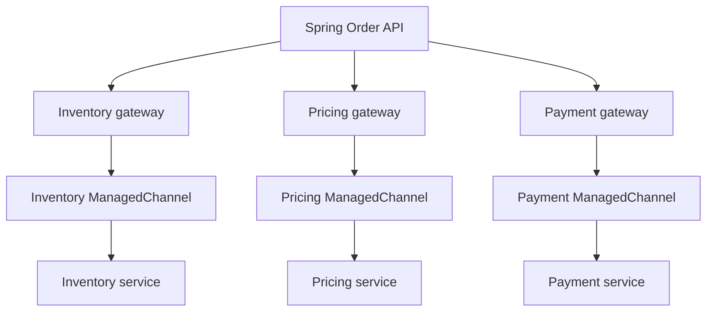

# Cấu hình channel riêng cho từng dependency

## 1. Mục tiêu

Một ứng dụng Spring gRPC thường gọi nhiều dịch vụ phía sau, chẳng hạn Inventory, Pricing, Payment hoặc Notification. Mỗi dependency có thể có target, TLS identity, load-balancing policy, retry policy và vòng đời vận hành khác nhau. Dùng một channel cho mọi dependency khiến các cấu hình kết nối khó tách biệt; tạo channel cho từng request lại gây lãng phí tài nguyên.

Mục tiêu hợp lý là **một channel dùng chung cho mỗi dependency logic có cấu hình kết nối riêng**, được tạo và quản lý theo vòng đời ứng dụng. Nhiều RPC method hoặc nhiều stub của cùng dependency có thể dùng chung channel.

Sau bài học, bạn có thể:

- Xác định ranh giới dependency nào cần channel riêng.
- Phân biệt dependency, service/method RPC, channel và request.
- Cấu hình target và credentials riêng cho từng downstream trong Spring.
- Inject đúng channel bằng constructor injection và qualifier.
- Giữ metadata, token và deadline ở phạm vi từng RPC.
- Cân nhắc isolation, tài nguyên, lifecycle và quan sát lỗi theo dependency.
- Kiểm thử việc một dependency lỗi trong khi dependency khác vẫn hoạt động.

## 2. Dependency là ranh giới cấu hình kết nối

Trong bài này, **dependency** là dịch vụ gRPC phía sau mà ứng dụng gọi như một đơn vị vận hành: có target, chính sách bảo mật và cấu hình kết nối được quản lý độc lập.

Ví dụ, một Order API gọi:

- `InventoryService` tại `dns:///inventory.internal:8443`.
- `PricingService` tại `dns:///pricing.internal:8443`.
- `PaymentService` tại `dns:///payment.internal:9443`.

Các dependency này có thể khác nhau về DNS, certificate, mTLS, load balancing, keepalive, giới hạn message và retry policy. Tách channel giúp mỗi nhóm RPC sử dụng đúng cấu hình và quan sát trạng thái riêng.



Mỗi channel có resolver, load balancer và trạng thái kết nối của riêng nó. Ví dụ, Pricing có thể ở `TRANSIENT_FAILURE` trong khi Inventory vẫn `READY`. Việc tách channel giúp cô lập cấu hình và quan sát ở tầng client; nó **không** bảo đảm các dịch vụ không chia sẻ proxy, network, DNS resolver hoặc hạ tầng vật lý.

## 3. Khi nào nên tách channel?

Hãy xem xét channel riêng khi một dependency có ít nhất một ranh giới kết nối cần được quản lý độc lập:

| Khác biệt giữa các dependency | Lý do có thể cần channel riêng |
|---|---|
| Target/authority hoặc name resolver khác nhau | Mỗi channel cần phân giải và định tuyến tới đích phù hợp |
| TLS trust roots hoặc client certificate khác nhau | TLS identity thuộc transport connection |
| Load-balancing hoặc service config khác nhau | Mỗi dependency có thể cần policy và retry behavior riêng |
| Keepalive, idle timeout hoặc giới hạn message khác nhau | Tránh áp dụng một transport policy cho mọi backend |
| Channel-level interceptor hoặc telemetry khác nhau | Gắn cấu hình chung đúng với dependency |
| Vòng đời/khả năng bảo trì khác nhau | Có thể quan sát, drain hoặc thay cấu hình từng dependency |

Không nên tách channel chỉ vì hai method khác nhau nếu chúng gọi cùng dependency, cùng target và cùng transport policy. Một channel có thể phục vụ nhiều service stub cùng endpoint.

### Khi nào có thể dùng chung?

Nếu hai generated service cùng được host trên một target và có cùng TLS identity, resolver, load-balancing và transport policy, chúng có thể dùng chung một channel:

```java
ManagedChannel sharedChannel = NettyChannelBuilder
        .forTarget("dns:///platform.internal:8443")
        .useTransportSecurity()
        .build();

CatalogGrpc.CatalogBlockingStub catalogStub =
        CatalogGrpc.newBlockingStub(sharedChannel);
ProfileGrpc.ProfileBlockingStub profileStub =
        ProfileGrpc.newBlockingStub(sharedChannel);
```

Không bắt buộc một channel cho mỗi generated stub. Ranh giới cần xét là **cấu hình và vòng đời kết nối**, không phải số lượng class `*Grpc`.

## 4. Cấu hình target theo dependency trong Spring

Đặt target riêng trong cấu hình môi trường:

```yaml
# application-prod.yml
app:
  grpc:
    inventory:
      target: dns:///inventory.internal:8443
    pricing:
      target: dns:///pricing.internal:8443
    payment:
      target: dns:///payment.internal:9443
```

Namespace `app.grpc.*` là cấu hình do ứng dụng tự định nghĩa, không phải property mặc định được đảm bảo bởi mọi Spring gRPC starter.

Tạo một bean cho mỗi dependency:

```java
package dev.example.orders.config;

import io.grpc.ManagedChannel;
import io.grpc.netty.shaded.io.grpc.netty.NettyChannelBuilder;
import org.springframework.beans.factory.annotation.Value;
import org.springframework.context.annotation.Bean;
import org.springframework.context.annotation.Configuration;

@Configuration(proxyBeanMethods = false)
public class DownstreamChannelConfiguration {

    @Bean(name = "inventoryChannel", destroyMethod = "shutdown")
    ManagedChannel inventoryChannel(
            @Value("${app.grpc.inventory.target}") String target) {
        return NettyChannelBuilder.forTarget(target)
                .useTransportSecurity()
                .build();
    }

    @Bean(name = "pricingChannel", destroyMethod = "shutdown")
    ManagedChannel pricingChannel(
            @Value("${app.grpc.pricing.target}") String target) {
        return NettyChannelBuilder.forTarget(target)
                .useTransportSecurity()
                .build();
    }

    @Bean(name = "paymentChannel", destroyMethod = "shutdown")
    ManagedChannel paymentChannel(
            @Value("${app.grpc.payment.target}") String target) {
        return NettyChannelBuilder.forTarget(target)
                .useTransportSecurity()
                .build();
    }
}
```

Mỗi bean có tên ổn định để inject bằng `@Qualifier`. TLS ở ví dụ dùng trust configuration mặc định của runtime. Nếu Payment yêu cầu mTLS hoặc CA riêng, cấu hình credentials/trust material riêng cho `paymentChannel`; không giả định `useTransportSecurity()` tự nạp client certificate.

Nếu ứng dụng dùng Spring gRPC starter đã tự tạo channel, hãy cấu hình và inject channel theo API của phiên bản starter. Tránh tạo channel thứ hai cho cùng dependency mà không có chủ đích.

## 5. Inject đúng channel vào gateway

Gateway chỉ nhận channel của dependency mà nó gọi:

```java
package dev.example.orders.gateway;

import dev.example.inventory.InventoryGrpc;
import dev.example.inventory.ReserveRequest;
import dev.example.inventory.ReserveReply;
import io.grpc.ManagedChannel;
import java.util.concurrent.TimeUnit;
import org.springframework.beans.factory.annotation.Qualifier;
import org.springframework.stereotype.Component;

@Component
public class InventoryGateway {
    private final InventoryGrpc.InventoryBlockingStub stub;

    public InventoryGateway(
            @Qualifier("inventoryChannel") ManagedChannel channel) {
        this.stub = InventoryGrpc.newBlockingStub(channel);
    }

    public ReserveReply reserve(String sku, int quantity) {
        ReserveRequest request = ReserveRequest.newBuilder()
                .setSku(sku)
                .setQuantity(quantity)
                .build();
        return stub.withDeadlineAfter(800, TimeUnit.MILLISECONDS)
                .reserve(request);
    }
}
```

Gateway Pricing nhận `pricingChannel` và tạo stub Pricing. Không inject một channel chung không có qualifier vào nhiều gateway nếu ứng dụng đã khai báo nhiều bean cùng kiểu `ManagedChannel`.

Constructor injection giúp dependency được xác định khi Spring khởi tạo bean. Nếu qualifier bị thiếu hoặc trùng, ứng dụng nên fail ngay khi startup thay vì chọn nhầm backend ở runtime.

## 6. Phân biệt channel-level policy và call-level policy

Tách channel theo dependency không có nghĩa mọi thuộc tính của RPC đều nằm trên channel.

| Thuộc tính | Phạm vi phù hợp | Ví dụ |
|---|---|---|
| Target URI/resolver | Channel | `dns:///inventory.internal:8443` |
| TLS trust/client certificate | Channel/transport | CA và mTLS identity của backend |
| Load-balancing policy | Channel hoặc service config | `round_robin`, `pick_first` |
| Channel-level interceptor | Channel | Trace/telemetry chung cho dependency |
| Deadline | RPC call | Inventory reserve 800 ms |
| Request ID/correlation ID | RPC metadata | `x-request-id` của từng request |
| User bearer token | RPC credentials/metadata | Token của người dùng hiện tại |
| Protobuf request/response | RPC | SKU và số lượng cần reserve |

Deadline phải được đặt theo yêu cầu của từng call hoặc policy method phù hợp. Không tạo channel riêng chỉ vì một request có deadline 500 ms và request khác có deadline 2 giây.

Tương tự, token của từng người dùng thường được gắn bằng call credentials hoặc metadata theo RPC. Không lưu token người dùng vào field mutable của gateway singleton hoặc tạo channel riêng cho mỗi người dùng.

Ngược lại, **client certificate và trust policy là thuộc tính transport**. Nếu hai dependency cần TLS identity khác nhau, tách channel là cách tổ chức phù hợp vì handshake diễn ra trên connection, trước khi RPC metadata được gửi.

## 7. Tách cấu hình bảo mật và định tuyến

Ví dụ ba dependency:

| Dependency | Target | Bảo mật | Routing |
|---|---|---|---|
| Inventory | `dns:///inventory.internal:8443` | TLS với CA nội bộ A | `round_robin` nếu DNS trả nhiều endpoint |
| Pricing | `dns:///pricing.internal:8443` | TLS với CA nội bộ A | `pick_first` |
| Payment | `dns:///payment.internal:9443` | mTLS với client certificate riêng | Policy theo hạ tầng Payment |

Khi tạo channel, hãy áp dụng credentials và resolver tương ứng. Không thay hostname bằng IP để né lỗi certificate; service identity/SAN phải khớp tên được xác minh. Nếu dùng service mesh hoặc proxy, kiểm tra authority/SNI và nơi TLS được kết thúc.

Một lỗi của Payment không nên khiến ứng dụng đóng channel Inventory hoặc Pricing. Tuy nhiên, các channel vẫn có thể cùng chịu ảnh hưởng khi DNS, node, proxy hoặc network dùng chung gặp sự cố.

## 8. Isolation có giới hạn và chi phí tài nguyên

Channel riêng tạo ranh giới vận hành hữu ích:

- Mỗi channel có trạng thái kết nối, resolver và backoff riêng.
- Có thể chọn credentials, service config và channel-level interceptor riêng.
- Có thể ghi metrics theo dependency và xác định backend nào đang gặp lỗi.
- Có thể thay đổi hoặc drain channel của một dependency mà không đóng các channel khác.

Đổi lại, nhiều channel có thể tạo nhiều subchannel, socket, TLS session, event-loop/resource và connection tới cùng hạ tầng. Số lượng thực tế phụ thuộc resolver, load balancer và transport; không phải lúc nào một channel cũng tương ứng đúng một TCP socket.

**Không tạo channel theo từng request, từng user hoặc từng RPC method.** Hãy tạo theo dependency logic và cấu hình transport. Nếu một dependency cần pool nhiều channel vì giới hạn tải hoặc isolation đặc biệt, pool phải có kích thước hữu hạn, lifecycle rõ ràng và được biện minh bằng benchmark.

Không nên dùng channel pool để thay thế HTTP/2 multiplexing hoặc load balancing. Trước tiên hãy kiểm tra số endpoint, policy LB, số stream đồng thời, giới hạn server và metrics.

## 9. Vòng đời của nhiều channel

Mỗi channel cần một chủ sở hữu rõ ràng. Với các bean Spring ở trên, `destroyMethod = "shutdown"` bắt đầu graceful shutdown khi context đóng. Nếu ứng dụng cần chờ transport kết thúc, dùng owner/coordinator có shutdown budget:

1. Ngừng nhận công việc mới.
2. Cho các request/stream đang chạy drain trong giới hạn.
3. Gọi `shutdown()` cho tất cả channel.
4. Chờ termination theo deadline tổng, không cấp lại toàn bộ timeout cho từng channel.
5. Gọi `shutdownNow()` cho channel chưa kết thúc khi hết grace.
6. Ghi nhận channel chưa terminated nếu vẫn còn sau bước cuối.

Đừng để mỗi gateway tự đóng channel trong `@PreDestroy` nếu channel được chia sẻ. Gateway không sở hữu tài nguyên đó; cấu hình hoặc lifecycle coordinator mới là nơi đóng.

Nếu cần thay đổi target/certificate lúc runtime, tạo channel mới với cấu hình mới, chuyển traffic sang channel mới, rồi drain và đóng channel cũ. Không sửa cấu hình của channel đang hoạt động bằng cách thay đổi field dùng chung rồi kỳ vọng transport tự thay certificate.

## 10. Quan sát theo dependency

Metrics và log nên gắn với tên dependency ổn định:

| Tín hiệu | Ví dụ dimension | Mục đích |
|---|---|---|
| Channel state | `dependency=inventory` | Biết channel nào đang `READY`/`TRANSIENT_FAILURE` |
| RPC count/status | `dependency=pricing, method=Quote` | Theo dõi lỗi theo backend |
| RPC latency | `dependency=payment, method=Authorize` | Đo P95/P99 và timeout |
| Retry attempts | `dependency=inventory` | Phát hiện retry storm |
| In-flight streams | `dependency=notification` | Theo dõi tài nguyên streaming |
| TLS/connect errors | `dependency=payment` | Khoanh vùng lỗi credentials hoặc handshake |

Không dùng request ID, user ID, token hoặc địa chỉ socket động làm metric label vì cardinality có thể tăng không giới hạn. Trace có thể mang correlation ID theo request; metric nên dùng nhãn có tập giá trị nhỏ.

Nếu channel Payment ở `TRANSIENT_FAILURE` còn Inventory `READY`, hãy kiểm tra DNS, certificate, proxy và endpoint của Payment trước khi thay đổi channel khác. State chỉ là tín hiệu; kết hợp RPC status, cause chain, server log và Channelz nếu runtime hỗ trợ.

## 11. Kiểm thử channel isolation

Integration test nên chứng minh cả hai điều: mỗi gateway gọi đúng dependency và lỗi của một dependency không làm ứng dụng chủ động đóng channel còn lại.

Một kịch bản:

1. Khởi động hai server test trên port động: Inventory và Pricing.
2. Tạo Spring context có `inventoryChannel` và `pricingChannel`.
3. Gọi một RPC qua mỗi gateway và xác nhận response đến từ đúng server.
4. Dừng Inventory server; gọi lại Inventory và quan sát lỗi/state của channel Inventory.
5. Gọi Pricing trong cùng khoảng thời gian và xác nhận vẫn thành công.
6. Khởi động lại Inventory server; xác nhận channel Inventory có thể reconnect cho RPC mới.
7. Đóng Spring context; xác nhận cả hai channel được giải phóng.

Ví dụ cấu trúc assertion:

```java
assertEquals("inventory", inventoryGateway.health());
assertEquals("pricing", pricingGateway.health());

inventoryServer.shutdownNow();

assertThrows(StatusRuntimeException.class,
        () -> inventoryGateway.health());

// Dependency khác vẫn phục vụ qua channel riêng.
assertEquals("pricing", pricingGateway.health());
```

Đây là khung minh họa; `health()` và server test cần được triển khai trong fixture của dự án. Không assert một status hoặc thời điểm reconnect cố định nếu test chưa kiểm soát deadline/backoff. Dùng latch và deadline thay vì `Thread.sleep` để đồng bộ.

### Các trường hợp bổ sung

- Hai generated service cùng target, cùng credentials: xác minh có thể dùng chung channel.
- Hai dependency khác client certificate: xác minh mỗi channel dùng đúng TLS identity.
- Deadline và metadata khác nhau giữa request: xác minh chúng không rò sang call khác.
- Một dependency trả lỗi nghiệp vụ nhưng channel vẫn `READY`: xác minh không đóng channel.
- Spring context shutdown: xác minh owner đóng tất cả channel đúng ngân sách.
- Load test: so sánh số channel/socket, TLS handshake, CPU và P95/P99 trước/sau.

## 12. Lỗi thường gặp

| Hiện tượng | Nguyên nhân | Cách xử lý |
|---|---|---|
| Mọi gateway đều dùng cùng một target | Inject channel mặc định hoặc qualifier sai | Khai báo bean rõ tên và constructor qualifier |
| Một backend lỗi làm đóng tất cả channel | Dùng một owner đóng channel chung khi một call lỗi | Tách owner theo dependency; không shutdown khi RPC lỗi |
| Tạo channel cho từng method | Nhầm service stub với ranh giới transport | Dùng chung channel nếu target và transport policy giống nhau |
| Tạo channel theo từng request/user | Dùng channel để mang metadata | Dùng call-scoped metadata/credentials |
| Dùng chung channel dù mTLS identity khác | TLS identity bị cấu hình sai tầng | Tách channel theo client certificate/trust policy |
| Tạo nhiều channel nhưng tải không đều | Nhầm channel count với load balancing | Kiểm resolver, endpoint và LB policy |
| Channel/socket tăng liên tục | Không đóng channel cũ hoặc tạo channel động không giới hạn | Quản lý lifecycle và giới hạn pool |
| Metrics khó xác định backend lỗi | Không gắn dimension dependency ổn định | Thêm label dependency có cardinality thấp |

## 13. Bài tập thực hành

**Tình huống:** Order API gọi Inventory, Pricing và Payment. Inventory dùng TLS nội bộ, Pricing dùng cùng CA nhưng yêu cầu `round_robin`, còn Payment yêu cầu mTLS với client certificate riêng. Một số method có deadline khác nhau và mọi request có request ID riêng.

Hãy thực hiện:

1. Xác định ranh giới dependency và liệt kê target, credentials, LB policy, channel-level interceptor cần thiết cho từng dịch vụ.
2. Khai báo ba channel bean theo cấu hình Spring, mỗi bean có qualifier và lifecycle owner rõ ràng.
3. Inject đúng channel vào từng gateway; tạo stub dùng lại thay vì tạo channel trong method.
4. Đặt deadline và metadata riêng cho mỗi RPC; không lưu token/request ID vào state mutable của gateway.
5. Kiểm thử Inventory lỗi trong khi Pricing vẫn hoạt động; quan sát state và status riêng theo dependency.
6. Kiểm thử Payment handshake với certificate đúng và sai; xác nhận lỗi TLS không làm thay đổi channel của Inventory/Pricing.
7. Đóng Spring context và xác nhận cả ba channel được shutdown/terminated trong ngân sách.
8. Đo tài nguyên và latency để quyết định có cần pool hữu hạn cho dependency nào hay không.

**Tiêu chí hoàn thành:** mỗi channel đại diện một dependency logic có cấu hình kết nối riêng; các method cùng dependency dùng chung channel; metadata/deadline vẫn thuộc từng RPC; TLS identity được tách đúng tầng; lifecycle và quan sát lỗi được quản lý độc lập.

## 14. Ghi nhớ

Tổ chức channel theo **dependency logic và cấu hình transport**, không theo request hay số lượng RPC method. Spring có thể quản lý mỗi channel như một bean riêng với qualifier rõ ràng, còn gateway dùng lại channel và stub qua nhiều call. Tách channel phù hợp khi target, TLS identity, resolver, load-balancing hoặc transport policy khác nhau; các thuộc tính như deadline, request ID và bearer token thường vẫn thuộc từng RPC. Channel riêng giúp cô lập state và vận hành nhưng làm tăng tài nguyên, vì vậy hãy giới hạn số lượng, quản lý shutdown và kiểm thử isolation bằng server thật.
