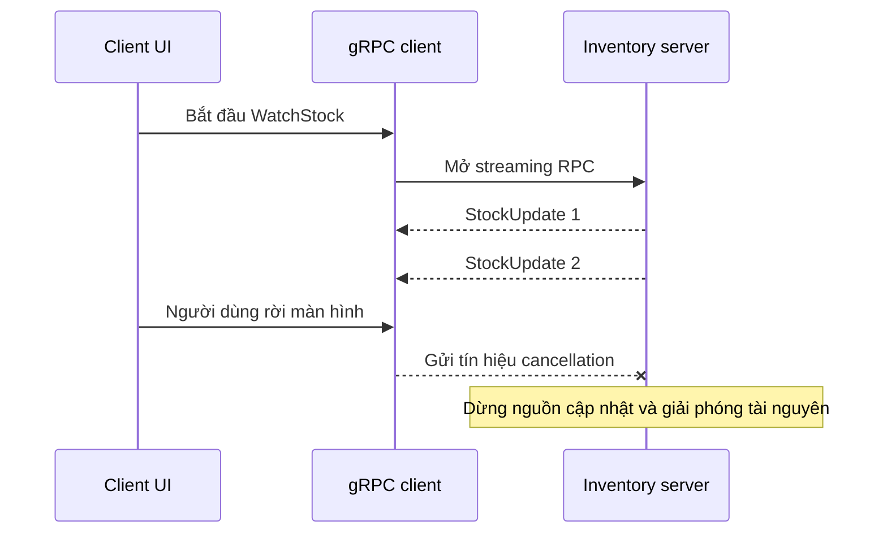

# CANCELLED và client chủ động hủy

Trong gRPC, **CANCELLED là status code số 1**, biểu thị một RPC đã bị hủy, thường do phía gọi chủ động hủy. Tình huống điển hình là người dùng rời màn hình đang theo dõi dữ liệu, ứng dụng không còn cần kết quả, hoặc một request cấp trên bị hủy nên các RPC downstream cũng phải dừng. Hủy RPC giúp tránh tiếp tục tiêu thụ tài nguyên cho công việc không còn giá trị.

Tuy nhiên, hủy không phải rollback. Khi client hủy, server có thể đã nhận request, đang xử lý hoặc thậm chí đã commit transaction. Tín hiệu hủy chỉ cho biết client không còn muốn tiếp tục RPC; server cần quan sát tín hiệu đó và chủ động dừng công việc có thể dừng. Vì vậy, khi phát triển **SPRING_GRPC**, cần hiểu status CANCELLED, cách truyền cancellation từ client đến server, vòng đời streaming và giới hạn của việc hủy.

## 1. Ý nghĩa của CANCELLED

gRPC định nghĩa CANCELLED với giá trị số **1**. Ý nghĩa tổng quát là thao tác đã bị hủy, thường bởi caller. Trong gRPC Java, status có thể được tham chiếu qua **io.grpc.Status.CANCELLED**.

| Góc nhìn | Ý nghĩa |
| --- | --- |
| Client | Ứng dụng chủ động dừng chờ hoặc hủy một RPC không còn cần thiết |
| Server | Runtime thông báo RPC đã bị hủy; handler có thể dừng công việc liên quan |
| gRPC runtime | Dừng trao đổi bình thường của RPC và giải phóng tài nguyên transport khi có thể |
| Nghiệp vụ | Không tự động hoàn tác những thay đổi đã thực hiện hoặc commit |

CANCELLED là trạng thái kết thúc ở **cấp RPC**. Nó không mô tả vì sao người dùng đổi ý, cũng không tự mang ý nghĩa nghiệp vụ như “đơn hàng bị hủy” hay “giao dịch đã được hoàn tiền”. Nếu nghiệp vụ cần hủy một đơn hàng đã tạo, cần một method nghiệp vụ riêng như CancelOrder; không thể thay thế thao tác đó bằng cách hủy RPC CreateOrder đang chờ.

## 2. Khi nào client nên chủ động hủy?

Một số tình huống phổ biến:

- Người dùng rời trang hoặc đóng màn hình đang theo dõi tiến độ.
- Người dùng thay đổi bộ lọc tìm kiếm; kết quả của truy vấn cũ không còn cần thiết.
- Một thao tác mới thay thế thao tác trước đó.
- Request HTTP phía trên đã bị client web hủy hoặc hết thời gian chờ, nên backend không cần tiếp tục các RPC downstream.
- Một streaming RPC không còn subscriber.
- Ứng dụng đang shutdown và cần dừng các lời gọi đang hoạt động theo chính sách.

Ví dụ Order Service bắt đầu gọi Inventory để theo dõi cập nhật tồn kho. Người dùng chuyển sang màn hình khác trước khi stream kết thúc. Tiếp tục nhận dữ liệu và truy vấn database cho màn hình đã đóng chỉ làm tiêu tốn tài nguyên.



Client hủy vì **không còn cần kết quả**, chứ không phải để thông báo rằng nghiệp vụ phía server đã thất bại.

## 3. Client cancellation khác deadline và lỗi server

Ba tình huống có thể khiến công việc phía server dừng, nhưng nguyên nhân và status quan sát được khác nhau:

| Tình huống | Nguyên nhân | Status thường thấy ở client |
| --- | --- | --- |
| Client chủ động hủy | Ứng dụng gọi API cancellation hoặc context bị hủy | CANCELLED |
| Deadline hết hạn | Thời gian RPC vượt quá deadline đã đặt | DEADLINE_EXCEEDED |
| Server chủ động trả lỗi | Handler kết thúc bằng status lỗi | Status do server trả, ví dụ INVALID_ARGUMENT, NOT_FOUND, INTERNAL |
| Kết nối bị đứt ngoài dự kiến | Network, proxy hoặc tiến trình gặp sự cố | Có thể là UNAVAILABLE hoặc lỗi transport phù hợp |

### 3.1. CANCELLED không đồng nghĩa DEADLINE_EXCEEDED

Deadline là giới hạn thời gian đã định trước. Khi deadline hết, client nhận DEADLINE_EXCEEDED; runtime cũng hủy công việc phía server nếu có thể. Client cancellation là quyết định chủ động dừng RPC trước khi cần nhận kết quả, ví dụ người dùng đã rời màn hình.

Cả hai trường hợp đều có thể khiến server nhận tín hiệu cancellation. Nhưng phía client cần phân biệt nguyên nhân để telemetry và hành vi ứng dụng chính xác: timeout có thể là dấu hiệu latency vượt SLO, còn cancellation do người dùng đổi màn hình có thể là hành vi bình thường.

### 3.2. CANCELLED không phải lỗi nghiệp vụ do server trả

Nếu server nhận request sai, handler nên trả status như INVALID_ARGUMENT. Nếu server không tìm thấy tài nguyên và contract quy định đó là lỗi, có thể trả NOT_FOUND. CANCELLED thường biểu thị RPC bị dừng từ phía caller hoặc context bên ngoài, không nên dùng thay cho mọi tình huống server muốn ngừng xử lý.

## 4. Chủ động hủy ở client Java

gRPC Java có nhiều API client. Cách hủy phụ thuộc kiểu stub và cách ứng dụng quản lý call.

### 4.1. Dùng cancellable Context cho async RPC

Một cách thông dụng là tạo Context.CancellableContext, khởi chạy RPC bên trong context đó, rồi hủy context khi ứng dụng không còn cần kết quả:

```java
Context.CancellableContext callContext =
    Context.current().withCancellation();

callContext.run(() -> {
    inventoryStub.watchStock(request, new StreamObserver<StockUpdate>() {
        @Override
        public void onNext(StockUpdate update) {
            // Cập nhật giao diện hoặc xử lý message.
        }

        @Override
        public void onError(Throwable error) {
            // Phân loại CANCELLED, DEADLINE_EXCEEDED hoặc lỗi khác.
        }

        @Override
        public void onCompleted() {
            // Server kết thúc stream bình thường.
        }
    });
});

// Gọi khi người dùng rời màn hình hoặc không cần stream nữa.
callContext.cancel(new CancellationException("Không còn cần theo dõi"));
```

RPC được khởi chạy trong context sẽ nhận cancellation khi context bị hủy. Ứng dụng cần giữ context gắn với đúng thao tác hoặc màn hình để không vô tình hủy các RPC khác. Khi stream hoàn tất hoặc lỗi, nên giải phóng/quản lý context theo vòng đời của call.

### 4.2. Future stub

Với unary RPC dùng future stub, ứng dụng có thể hủy future nếu không còn cần kết quả:

```java
ListenableFuture<CheckStockReply> result =
    inventoryFutureStub.checkStock(request);

// Khi thao tác phía người dùng bị thay thế:
result.cancel(true);
```

Việc hủy future được gRPC integration chuyển thành cancellation của call tương ứng. Không nên nhầm cancel(true) với việc chắc chắn ngắt mọi tác vụ database đang chạy ở server; server vẫn phải hợp tác với cancellation.

### 4.3. Blocking stub cần cân nhắc kỹ

Blocking stub làm luồng gọi chờ response. Nếu cần hủy một call đang chặn, ứng dụng nên thiết kế deadline hoặc dùng Context.CancellableContext được gắn khi khởi chạy lời gọi. Không nên tạo một thread không được quản lý cho mỗi RPC chỉ để có thể interrupt thread đó.

Trong ứng dụng Spring WebFlux hoặc môi trường event-loop, tránh gọi blocking stub trực tiếp trên event-loop. Có thể dùng async/future API hoặc đưa blocking call sang scheduler/executor phù hợp và quản lý cancellation xuyên suốt.

## 5. Server nhận biết client đã hủy như thế nào?

Server không nên giả định handler sẽ luôn được chạy đến onCompleted. Khi client hủy, gRPC runtime có thể báo cancellation cho server. Với gRPC Java, có thể dùng ServerCallStreamObserver để kiểm tra trạng thái và đăng ký callback:

```java
ServerCallStreamObserver<StockUpdate> serverObserver =
    (ServerCallStreamObserver<StockUpdate>) responseObserver;

serverObserver.setOnCancelHandler(() -> {
    // Dừng subscription hoặc công việc nền gắn với RPC này.
    stockSubscription.cancel();
});

if (serverObserver.isCancelled()) {
    return;
}
```

stockSubscription đại diện cho subscription của nguồn cập nhật mà ứng dụng đã tạo riêng cho RPC hiện tại. Ví dụ trên tập trung vào điểm nối cancellation; trong code thực tế cần xử lý race giữa lúc đăng ký subscription và lúc client hủy, đồng thời bảo đảm subscription được hủy đúng một lần.

Với công việc dài chạy ở server, có thể theo dõi cancellation qua Context hoặc API server call tương ứng. Khi nhận tín hiệu, handler cần:

1. Ngừng phát message mới.
2. Hủy subscription, timer, query hoặc task nền có thể hủy.
3. Giải phóng buffer và tài nguyên gắn với RPC.
4. Không gọi tiếp onNext hoặc onCompleted sau khi call đã bị hủy.
5. Ghi nhận cancellation đúng cách trong telemetry, không xem mọi cancellation là lỗi server.

## 6. Cancellation phải được xử lý hợp tác

Việc client gửi cancellation không có nghĩa CPU, thread hoặc truy vấn database ở server lập tức dừng. Cancellation là một tín hiệu; code server phải quan sát và phản ứng.

Ví dụ một luồng xử lý:

```text
Client:
  1. Bắt đầu WatchStock
  2. Nhận một số update
  3. Hủy RPC

Server:
  1. Runtime đánh dấu call bị cancelled
  2. Cancellation handler được gọi
  3. Ứng dụng hủy nguồn phát / task nền
  4. Công việc dừng tại điểm có thể hủy
  5. Tài nguyên của RPC được giải phóng
```

Nếu handler đang chạy một vòng lặp tính toán, nó cần kiểm tra trạng thái hủy hoặc xử lý interrupt. Nếu đang đăng ký nhận event, cần unsubscribe. Nếu đang chờ một API downstream, cần truyền cancellation hoặc deadline xuống API đó khi có thể.

Một handler bỏ qua cancellation có thể tiếp tục truy vấn database hoặc phát dữ liệu vào observer đã bị hủy. Điều này làm lãng phí tài nguyên và tạo log lỗi khó hiểu.

## 7. Hủy streaming RPC: đặc biệt chú ý nguồn dữ liệu và buffer

Streaming thường là nơi cancellation đem lại lợi ích rõ nhất vì một RPC có thể sống lâu và duy trì subscription.

Ví dụ WatchStock đăng ký nhận cập nhật tồn kho:

```protobuf
service InventoryService {
  rpc WatchStock(WatchStockRequest) returns (stream StockUpdate);
}

message WatchStockRequest {
  string sku = 1;
}

message StockUpdate {
  string sku = 1;
  int32 remaining = 2;
}
```

Khi client hủy, server cần dừng subscription cho đúng client đó. Không được hủy nguồn dữ liệu dùng chung cho các client khác. Mỗi RPC nên có handle hoặc subscription riêng, trong khi nguồn event chung có thể tiếp tục phục vụ những subscriber còn hoạt động.

### Flow control và cancellation là hai cơ chế khác nhau

- **Flow control/readiness** giúp server điều tiết tốc độ gửi message khi client hoặc transport chưa sẵn sàng nhận thêm.
- **Cancellation** báo rằng RPC không còn cần tiếp tục.

Một client đọc chậm chưa chắc đã hủy; server có thể cần chờ readiness hoặc giới hạn buffer. Một client đã hủy thì server nên ngừng tạo message cho call đó. Không dùng việc buffer đầy như một cách thay thế cho cancellation.

## 8. Hủy RPC không rollback transaction

Đây là giới hạn quan trọng nhất cần nhớ.

Giả sử client gọi ReserveStock:

1. Server nhận request.
2. Server trừ tồn kho trong database.
3. Database commit thành công.
4. Client chủ động hủy hoặc kết nối bị đóng trước khi nhận response.

Kết quả nghiệp vụ đã được commit. Cancellation không tự gọi rollback transaction và không hoàn tác lượng hàng đã trừ. Client có thể không biết kết quả, nên cần một API tra cứu trạng thái hoặc idempotency key nếu muốn gửi lại an toàn.

Nếu nghiệp vụ thực sự cần **hủy đặt giữ hàng**, hãy cung cấp thao tác riêng như ReleaseReservation(reservation_id). Đây là command nghiệp vụ có kiểm tra quyền, trạng thái và tính nhất quán; nó không giống việc hủy RPC đang chờ.

| Hành động | Ý nghĩa |
| --- | --- |
| Hủy RPC ReserveStock | Client không tiếp tục chờ kết quả của call |
| Server dừng công việc chưa hoàn tất | Hợp tác cancellation, có thể dừng phần công việc còn có thể hủy |
| Rollback transaction | Hoàn tác thay đổi trong transaction chưa commit theo cơ chế database |
| ReleaseReservation | Nghiệp vụ giải phóng một reservation đã được tạo |

## 9. Cancellation và các status liên quan

| Status | Ý nghĩa | Ví dụ |
| --- | --- | --- |
| CANCELLED | RPC bị hủy, thường bởi caller | Người dùng rời màn hình đang stream |
| DEADLINE_EXCEEDED | RPC không hoàn tất trước deadline | Client đặt 300 ms nhưng server phản hồi chậm hơn |
| UNAVAILABLE | Dịch vụ tạm thời không thể phục vụ hoặc kết nối thất bại | Server dừng hoặc network/proxy lỗi |
| INTERNAL | Lỗi nội bộ không mong đợi | Handler gặp lỗi không được xử lý |
| OK | RPC kết thúc bình thường | Server gửi xong response/stream |

Không nên retry CANCELLED như một lỗi tạm thời thông thường. Nếu cancellation xuất phát từ người dùng không còn cần kết quả, retry sẽ làm ngược lại ý định đó. Nếu ứng dụng chủ động hủy vì một lý do khác rồi sau đó cần kết quả, hãy tạo call mới theo quyết định rõ ràng của lớp nghiệp vụ.

## 10. Quan sát cancellation mà không báo động sai

Trong hệ thống có streaming hoặc UI thay đổi thường xuyên, cancellation có thể là hành vi bình thường. Dashboard nên phân biệt:

- Số RPC bị hủy theo service/method.
- Nguồn cancellation: người dùng, request cha, deadline, shutdown hoặc logic nội bộ nếu ứng dụng ghi nhận được.
- Thời gian sống của RPC trước khi bị hủy.
- Tài nguyên được giải phóng và công việc nền đã dừng hay chưa.
- Tỷ lệ cancellation bất thường theo client hoặc workload.

Không gộp mọi CANCELLED vào cùng nhóm lỗi server. Một tỷ lệ tăng có thể là hành vi UI mới, nhưng cũng có thể cho thấy timeout ở tầng trên hoặc client đóng kết nối quá sớm. Trace/correlation ID giúp nối sự kiện hủy với request cha.

Tránh ghi token, dữ liệu nhạy cảm hoặc nội dung request đầy đủ vào log cancellation. Thông tin như method, thời lượng, mã status và lý do đã được chuẩn hóa thường đủ cho chẩn đoán.

## 11. Kiểm thử cancellation

Một bài kiểm thử chỉ xác nhận client gọi cancel() chưa chứng minh server đã dừng công việc. Nên kiểm tra cả hai phía:

| Kiểm thử | Điều cần xác nhận |
| --- | --- |
| Client hủy unary async call | Client nhận trạng thái cancellation phù hợp và không tiếp tục xử lý response |
| Client hủy server stream | Server nhận callback cancellation |
| Server có task nền | Task/subscription được dừng hoặc interrupt tại điểm có thể hủy |
| Client hủy sau một vài message | Server không tiếp tục tạo message cho call đó |
| Deadline hết hạn | Phân biệt DEADLINE_EXCEEDED với cancellation do người dùng |
| Hủy sau khi transaction commit | Không giả định dữ liệu đã được rollback |
| Nhiều client cùng subscribe | Hủy một subscriber không ảnh hưởng subscriber khác |
| Server shutdown | Các call đang hoạt động được drain/hủy theo chính sách |

Với gRPC Java, test có thể dùng in-process transport để xác minh handler và callback cancellation. Vẫn cần test trên transport thật khi muốn kiểm chứng HTTP/2, proxy, TLS hoặc hành vi shutdown của môi trường triển khai.

## 12. Những sai lầm thường gặp

| Sai lầm | Hậu quả | Cách xử lý |
| --- | --- | --- |
| Xem CANCELLED là lỗi server | Báo động sai và retry không cần thiết | Phân loại theo nguồn và ngữ cảnh hủy |
| Nghĩ client cancel sẽ lập tức dừng database | Query/task vẫn chạy, lãng phí tài nguyên | Truyền cancellation xuống tầng có thể hủy |
| Coi cancellation là rollback | Dữ liệu đã commit vẫn còn | Dùng idempotency và command nghiệp vụ bù trừ |
| Retry ngay sau cancellation | Thực hiện lại công việc mà người dùng đã bỏ | Chỉ tạo call mới khi nghiệp vụ vẫn cần |
| Không hủy subscription streaming | Rò rỉ subscriber, buffer hoặc task | Đăng ký cancellation handler và unsubscribe |
| Hủy một nguồn event dùng chung | Ảnh hưởng các client khác | Quản lý subscription riêng cho từng RPC |
| Bỏ qua race khi đăng ký callback | Công việc vẫn chạy sau khi call đã bị hủy | Kiểm tra trạng thái trước/sau khi tạo task và xử lý idempotent cleanup |
| Chỉ test phía client | Không biết server có thực sự dừng hay không | Kiểm tra callback, task và tài nguyên phía server |

## 13. Checklist thiết kế client cancellation

Trước khi đưa cancellation vào một RPC, hãy xác định:

1. **Ai sở hữu vòng đời call?** UI, request HTTP cha, job hay service khác?
2. **Điều kiện nào kích hoạt hủy?** Người dùng rời màn hình, thao tác bị thay thế hay shutdown?
3. **Call được tạo trong context nào?** Có thể hủy đúng call mà không ảnh hưởng RPC khác không?
4. **Server quan sát cancellation bằng cách nào?** ServerCallStreamObserver, gRPC Context hay API của integration?
5. **Công việc nào có thể dừng?** Subscription, task, query, buffer hoặc downstream call?
6. **Có side effect đã commit không?** Nếu có, cách tra cứu hoặc bù trừ nghiệp vụ là gì?
7. **Có phân biệt cancellation với deadline không?** Status và telemetry phải phản ánh đúng nguyên nhân.
8. **Test có xác minh server cleanup không?** Không chỉ kiểm tra client đã gọi cancel.

## 14. Ghi nhớ

CANCELLED là gRPC status code 1, thường xuất hiện khi caller chủ động hủy RPC. Client có thể hủy vì không còn cần kết quả; gRPC runtime truyền tín hiệu cancellation đến server khi có thể. Server phải hợp tác bằng cách dừng task, hủy subscription, ngừng phát message và giải phóng tài nguyên gắn với call.

CANCELLED khác DEADLINE_EXCEEDED, khác lỗi do server trả và đặc biệt **không phải rollback**. Nếu thao tác đã commit, dữ liệu vẫn có thể đã thay đổi. Trong Spring gRPC, hãy gắn vòng đời call với context phù hợp, xử lý cancellation ở server handler, thiết kế streaming cleanup và kiểm thử cả client lẫn server. Làm đúng những điều này giúp ứng dụng tránh công việc thừa mà vẫn bảo toàn tính đúng đắn của nghiệp vụ.

### Tài liệu tham khảo

- [gRPC – Cancellation](https://grpc.io/docs/guides/cancellation/)
- [gRPC – Status codes](https://grpc.io/docs/guides/status-codes/)
- [gRPC Java – Context](https://grpc.github.io/grpc-java/javadoc/io/grpc/Context.html)
- [gRPC Java – ServerCallStreamObserver](https://grpc.github.io/grpc-java/javadoc/io/grpc/stub/ServerCallStreamObserver.html)
- [gRPC – Deadlines](https://grpc.io/docs/guides/deadlines/)
