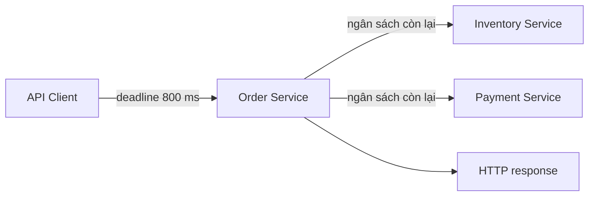
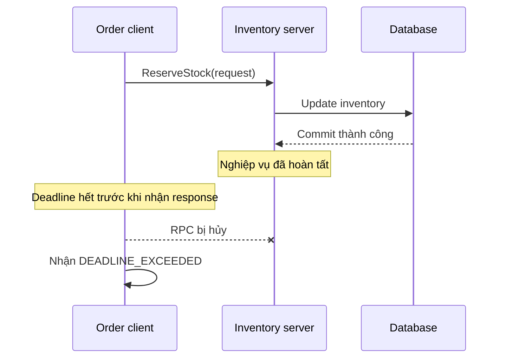

# DEADLINE_EXCEEDED

Trong gRPC, **`DEADLINE_EXCEEDED` là status code số `4`**, cho biết RPC không hoàn tất trước thời hạn mà caller đặt ra. Deadline giới hạn thời gian một lời gọi được phép tiêu thụ tài nguyên và giúp các service phối hợp trong cùng ngân sách độ trễ. Khi deadline hết, client không nhận được kết quả đúng hạn; gRPC cũng truyền tín hiệu hủy đến server khi có thể.

Điểm cần nhớ là **timeout không chứng minh server chưa thực hiện nghiệp vụ**. Server có thể đã commit transaction nhưng response về chậm hoặc bị mất. Trong **SPRING_GRPC**, cần đặt deadline ở client, truyền ngân sách còn lại qua downstream call, để server hợp tác với cancellation và thiết kế idempotency cho thao tác có side effect.

## 1. Ý nghĩa của DEADLINE_EXCEEDED

`DEADLINE_EXCEEDED` có giá trị số **4**. Status này thường xuất hiện khi một RPC không hoàn tất trong thời gian caller cho phép.

| Góc nhìn | Ý nghĩa |
| --- | --- |
| Client | Không nhận được kết quả trước deadline đã đặt |
| Server | RPC có thể bị hủy khi deadline của caller hết; công việc ứng dụng cần hợp tác dừng |
| gRPC runtime | Theo dõi thời hạn của call và kết thúc RPC khi thời gian cho phép đã hết |
| Nghiệp vụ | Không thể kết luận chỉ từ status rằng thao tác chưa chạy hoặc chưa commit |

Deadline là một phần của semantics RPC. Nó không chỉ là thời gian chờ của một thread ở client. Một call có deadline hữu hạn đặt ra giới hạn cho toàn bộ thời gian RPC, gồm truyền request, xếp hàng, xử lý server và trả response.

## 2. Phân biệt deadline và timeout

Hai khái niệm liên quan nhưng có góc nhìn khác nhau:

- **Deadline** là thời điểm cuối cùng mà RPC phải hoàn tất.
- **Timeout** thường là khoảng thời gian chờ tối đa mà ứng dụng cấu hình hoặc quan sát.

Ví dụ, client bắt đầu RPC lúc 10:00:00 và đặt timeout 300 ms. Deadline tương ứng là khoảng 10:00:00.300. Nếu request chờ trong queue 100 ms trước khi được xử lý, server chỉ còn khoảng 200 ms trong ngân sách.

Trong gRPC Java, API phổ biến là `withDeadlineAfter`:

```java
CheckStockReply reply = inventoryStub
    .withDeadlineAfter(300, TimeUnit.MILLISECONDS)
    .checkStock(request);
```

Con số 300 ms chỉ là ví dụ. Deadline gắn với call cụ thể; không cần tạo channel mới cho mỗi deadline. Stub dẫn xuất có thể mang call options khác nhau trong khi vẫn dùng chung `ManagedChannel`.

### 2.1. Vì sao không nên chỉ dùng Future.get(timeout)?

Một ứng dụng có thể gọi `future.get(300, MILLISECONDS)` để giới hạn thời gian thread chờ. Nhưng timeout của thao tác chờ ở Java không tự động đồng nghĩa deadline đã được gửi đến gRPC server. Nếu ứng dụng chỉ ngừng chờ mà không hủy future/call, RPC có thể tiếp tục chạy và tiêu thụ tài nguyên.

Hãy đặt deadline trên stub/call để gRPC runtime biết thời hạn. Nếu caller không còn cần kết quả vì một lý do khác, hãy chủ động cancel call hoặc future tương ứng.

## 3. Ngân sách deadline end-to-end

Một request trong hệ thống Spring có thể đi qua nhiều service. Ví dụ Order Service gọi Inventory rồi Payment trước khi trả kết quả cho client.



Không nên đặt timeout 800 ms riêng cho từng downstream call nếu toàn bộ request chỉ có ngân sách 800 ms. Hai call nối tiếp có thể khiến tổng thời gian vượt quá giới hạn của request gốc.

Hãy phân bổ ngân sách:

```text
Request budget:                 800 ms
  Order xử lý và trả response:  100 ms
  Inventory RPC:               250 ms
  Payment RPC:                 300 ms
  Dự phòng queue/network:      150 ms
```

Đây là ví dụ phân bổ, không phải công thức cố định. Ngân sách thực tế nên dựa trên latency p95/p99, SLA, số hop, mức song song và thời gian cần để trả response.

### 3.1. Không đặt lại toàn bộ timeout ở mỗi hop

Khi nhận một RPC có deadline, service downstream nên dùng **thời gian còn lại** thay vì cấp lại một timeout đầy đủ từ đầu. Nếu request cha đã tiêu thụ 500 ms trong ngân sách 800 ms, service tiếp theo không nên được cấp thêm 800 ms.

Trong gRPC Java, deadline có thể được đọc từ Context hiện tại:

```java
Deadline parentDeadline = Context.current().getDeadline();

if (parentDeadline != null) {
    long remainingNanos =
        parentDeadline.timeRemaining(TimeUnit.NANOSECONDS);

    long responseReserve =
        TimeUnit.MILLISECONDS.toNanos(25);
    long childBudget = remainingNanos - responseReserve;

    if (childBudget <= 0) {
        throw Status.DEADLINE_EXCEEDED
            .withDescription("Không còn đủ ngân sách gọi downstream")
            .asRuntimeException();
    }

    CheckStockReply reply = inventoryStub
        .withDeadlineAfter(childBudget, TimeUnit.NANOSECONDS)
        .checkStock(request);
}
```

Đoạn minh họa giả định đang chạy trong gRPC Context có deadline và có xử lý riêng khi không có deadline. Cần dành thời gian cho bước tổng hợp và trả response. Cơ chế propagation của gRPC Java phụ thuộc call được tạo trong Context nào; hãy kiểm tra integration và test thực tế, không giả định mọi tác vụ bất đồng bộ đều tự mang Context sang thread khác.

## 4. Server phản ứng khi deadline hết

Khi deadline hết, client thường nhận `DEADLINE_EXCEEDED`. Server có thể nhận tín hiệu cancellation của call. Tuy nhiên, code ứng dụng phải hợp tác dừng công việc có thể dừng:

- Không bắt đầu thêm truy vấn hoặc downstream call nếu RPC đã bị hủy.
- Hủy subscription, timer hoặc tác vụ nền gắn với RPC.
- Truyền deadline/cancellation xuống các API downstream có hỗ trợ.
- Dừng phát message cho stream đã bị hủy.
- Giải phóng buffer và tài nguyên theo vòng đời call.

Với gRPC Java, `Context.current()` trong quá trình xử lý có thể được dùng để kiểm tra cancellation. Với streaming handler, `ServerCallStreamObserver` cung cấp API như `isCancelled()` và `setOnCancelHandler(...)`.

Ví dụ minh họa cho server streaming:

```java
ServerCallStreamObserver<StockUpdate> serverObserver =
    (ServerCallStreamObserver<StockUpdate>) responseObserver;

serverObserver.setOnCancelHandler(() -> {
    stockSubscription.cancel();
});

if (serverObserver.isCancelled()) {
    return;
}
```

`stockSubscription` là subscription riêng của RPC hiện tại. Code thực tế cần xử lý race giữa lúc tạo subscription và lúc call bị hủy; cleanup phải an toàn khi được kích hoạt gần như đồng thời từ nhiều đường.

### 4.1. Deadline không tự dừng mọi công việc

Nếu server đang chạy một vòng lặp CPU dài mà không kiểm tra cancellation, công việc có thể tiếp tục sau khi client đã hết deadline. Nếu server gọi một API database không hỗ trợ cancellation, query cũng có thể tiếp tục đến khi database tự kết thúc hoặc timeout riêng.

Vì vậy, hãy phối hợp:

- gRPC deadline cho toàn RPC;
- timeout của database/HTTP client cho từng downstream operation;
- cancellation token hoặc interrupt phù hợp cho task nền;
- transaction timeout nếu nghiệp vụ/database cần;
- giới hạn concurrency và queue để tránh nhận nhiều việc hơn khả năng xử lý.

Các timeout này có liên quan nhưng không tự động đồng nhất. Cần cấu hình và kiểm thử từng lớp.

## 5. DEADLINE_EXCEEDED không chứng minh thao tác chưa hoàn tất

Đây là tình huống dễ gây lỗi dữ liệu nhất:



Trong ví dụ, client không nhận response đúng hạn nhưng server đã commit. Nếu client tự động gửi lại một request mới, hàng có thể bị giữ lần thứ hai.

Đối với thao tác ghi, cần một trong các cách:

1. **Idempotency key:** gửi cùng request ID cho những lần thử lại thuộc cùng một thao tác.
2. **Tra cứu trạng thái:** cung cấp method truy vấn kết quả theo operation/request ID.
3. **Đối soát:** nếu kết quả không thể xác định ngay, xử lý theo workflow nghiệp vụ thay vì retry mù quáng.

Ví dụ contract:

```protobuf
message ReserveStockRequest {
  string request_id = 1;
  string sku = 2;
  int32 quantity = 3;
}

message ReserveStockReply {
  string reservation_id = 1;
  bool reserved = 2;
}
```

Chỉ thêm `request_id` chưa đủ. Server cần lưu và xử lý request ID một cách nguyên tử với side effect, xử lý hai request trùng đến đồng thời và trả lại kết quả đã lưu khi nhận lại cùng ID.

## 6. Phân biệt DEADLINE_EXCEEDED với các status gần nghĩa

| Status | Ý nghĩa | Ví dụ |
| --- | --- | --- |
| `DEADLINE_EXCEEDED` | RPC không hoàn tất trước thời hạn | Server xử lý lâu hơn deadline client đặt |
| `CANCELLED` | RPC bị hủy, thường do caller | Người dùng rời màn hình và client chủ động cancel |
| `UNAVAILABLE` | Service tạm thời không thể phục vụ hoặc kết nối không dùng được | Server chưa sẵn sàng hoặc proxy mất kết nối |
| `INTERNAL` | Lỗi nội bộ không mong đợi | Handler gặp invariant violation |
| `UNKNOWN` | Không đủ thông tin để phân loại lỗi cụ thể | Exception không được mapping rõ |
| `RESOURCE_EXHAUSTED` | Hết quota hoặc tài nguyên | Server từ chối do giới hạn concurrency/quota |

Client cần phân biệt timeout với cancellation do người dùng. Một tỷ lệ `DEADLINE_EXCEEDED` tăng có thể báo hiệu latency hoặc capacity có vấn đề; tỷ lệ `CANCELLED` tăng có thể phản ánh hành vi UI hoặc request cha bị hủy.

## 7. Retry khi deadline hết

Retry không phải cách mặc định để sửa mọi `DEADLINE_EXCEEDED`. Trước khi thử lại, client cần biết:

- Method có side effect hay chỉ đọc?
- Nếu server đã commit nhưng response bị mất thì request lặp có an toàn không?
- Deadline tổng còn đủ cho lần thử mới không?
- Server đang quá tải hay retry sẽ làm tăng queue?
- Có backoff và jitter để tránh nhiều client retry đồng thời không?
- Có thể tra cứu trạng thái thay vì thực hiện lại không?

| Loại thao tác | Hướng xử lý |
| --- | --- |
| Read-only query | Có thể retry có giới hạn nếu deadline tổng còn và kết quả vẫn hữu ích |
| Write có idempotency key | Có thể gửi lại cùng key theo contract và policy |
| Write không idempotent | Không retry mù quáng; tra cứu hoặc đối soát trạng thái |
| Streaming | Xác định message đã nhận, cursor/sequence và khả năng resume |
| Nhiều downstream call nối tiếp | Phân bổ lại ngân sách; không cấp lại toàn bộ timeout cho từng hop |

Nếu deadline đã hết ở request cha, việc bắt đầu một RPC mới thường không còn ý nghĩa. Client hoặc service cần tôn trọng ngân sách còn lại thay vì tạo thêm công việc.

## 8. Deadline với streaming RPC

Deadline áp dụng cho toàn bộ RPC, không phải cho từng message riêng lẻ. Một server streaming kéo dài 30 phút sẽ hết deadline nếu client chỉ cấp 5 phút, dù server vẫn gửi update đều đặn.

Với stream dài:

- Chọn deadline phù hợp với vòng đời phiên, không đặt quá ngắn gây reconnect liên tục.
- Nếu phiên cần sống lâu hơn, thiết kế reconnect và resume ở tầng ứng dụng.
- Dùng sequence/cursor để client tiếp tục từ vị trí đã xử lý.
- Hủy subscription và giải phóng buffer khi deadline hết.
- Cân nhắc heartbeat hoặc cơ chế phát hiện kết nối chết; heartbeat không thay thế deadline.

Không nên đặt deadline vô hạn chỉ để giữ stream. Stream dài cần giới hạn tài nguyên, chính sách reconnect và khả năng drain khi server shutdown.

## 9. Tích hợp deadline trong Spring gRPC

Spring quản lý bean và cấu hình ứng dụng; deadline thuộc từng gRPC call. Một bean stub có thể được tái sử dụng, sau đó tạo stub dẫn xuất với deadline cho từng method call:

```java
@Component
public class InventoryGateway {
    private final InventoryServiceGrpc.InventoryServiceBlockingStub stub;

    public InventoryGateway(
            InventoryServiceGrpc.InventoryServiceBlockingStub stub) {
        this.stub = stub;
    }

    public CheckStockReply checkStock(CheckStockRequest request) {
        return stub
            .withDeadlineAfter(250, TimeUnit.MILLISECONDS)
            .checkStock(request);
    }
}
```

Ví dụ này giả định stub/channel đã được cấu hình bởi Spring hoặc starter. Deadline 250 ms là chính sách của lời gọi này; nó không phải `server.port`, HTTP request timeout hay transaction timeout của Spring.

Khi một handler Spring gọi downstream, không nên bắt đầu một call mới với ngân sách đầy đủ nếu request inbound đã tiêu thụ phần lớn thời gian. Dùng deadline còn lại trong gRPC Context hoặc một deadline budget được truyền rõ ràng. Nếu công việc chạy qua executor riêng, cần bảo đảm Context/cancellation được truyền theo cách mà API và executor hỗ trợ.

### 9.1. Không nhầm các loại timeout trong ứng dụng

| Timeout | Phạm vi |
| --- | --- |
| gRPC deadline | Một RPC từ client đến server |
| HTTP request timeout | Request đi qua web server/gateway |
| Database query timeout | Một thao tác truy vấn |
| Transaction timeout | Thời gian cho phép của transaction |
| Executor/queue timeout | Thời gian chờ được thực thi |
| Connection timeout | Thời gian thiết lập kết nối |

Các giới hạn cần phối hợp. Ví dụ, database timeout không nên dài hơn nhiều so với phần deadline còn lại của RPC nếu kết quả database không còn hữu ích sau khi caller đã hết hạn.

## 10. Kiểm thử DEADLINE_EXCEEDED

Một bộ test nên xác minh cả status phía client và hành vi cleanup phía server:

| Kịch bản | Điều cần xác nhận |
| --- | --- |
| Server phản hồi trước deadline | Client nhận response và status `OK` |
| Server xử lý chậm hơn deadline | Client nhận `DEADLINE_EXCEEDED` |
| Deadline inbound gần hết khi gọi downstream | Child call dùng ngân sách còn lại, không reset timeout |
| Server nhận cancellation | Task/subscription có thể hủy được dừng |
| Client timeout sau khi database commit | Không giả định transaction đã rollback |
| Retry thao tác ghi | Cùng idempotency key không tạo side effect trùng |
| Streaming hết deadline | Stream kết thúc, nguồn phát và buffer được cleanup |
| Server restart khi call đang chạy | Client phân loại status và xử lý theo policy |

In-process gRPC test hữu ích để kiểm tra deadline và handler logic, nhưng không thay thế test qua transport thật cho network, proxy, TLS và shutdown. Với Spring, nên kiểm tra cả Context propagation khi gọi downstream qua executor hoặc async API.

## 11. Quan sát deadline trong production

Không chỉ đếm số lần nhận `DEADLINE_EXCEEDED`. Hãy theo dõi:

- Tỷ lệ timeout theo service/method và client.
- Latency p50/p95/p99 so với deadline được cấp.
- Deadline budget còn lại khi bắt đầu downstream call.
- Thời gian queue, handler, database và các dependency.
- Số RPC bị hủy sau khi deadline hết.
- Tỷ lệ timeout theo phiên bản ứng dụng và môi trường.
- Với streaming: tuổi thọ stream, lý do kết thúc và số stream đang hoạt động.

Dùng trace để xác định hop nào tiêu thụ ngân sách. Metrics nên dùng nhãn service/method/status có cardinality kiểm soát; không đưa request ID, token hoặc dữ liệu người dùng vào metric labels. Logs có thể ghi deadline budget và trace ID nhưng không ghi credential.

Nếu timeout tập trung ở một method, điều tra handler và dependency của method đó. Nếu nhiều method cùng timeout, xem capacity, thread pool, network, database và proxy. Đừng chỉ tăng deadline để che một hệ thống đang quá tải; tăng deadline có thể làm nhiều request chờ lâu hơn và giữ tài nguyên lâu hơn.

## 12. Những lỗi thiết kế thường gặp

| Sai lầm | Hậu quả | Cách làm tốt hơn |
| --- | --- | --- |
| Không đặt deadline | RPC có thể chờ lâu và giữ tài nguyên | Đặt deadline theo SLA và ngân sách request |
| Cấp lại toàn bộ timeout ở mỗi hop | Tổng thời gian vượt deadline cha | Dùng thời gian còn lại và giữ response reserve |
| Chỉ dùng `Future.get(timeout)` | Thread ngừng chờ nhưng RPC có thể vẫn chạy | Đặt deadline trên gRPC call và cancel khi không còn cần |
| Nghĩ `DEADLINE_EXCEEDED` nghĩa server chưa commit | Retry có thể tạo side effect trùng | Idempotency key và tra cứu trạng thái |
| Retry vô hạn khi timeout | Retry storm và quá tải dây chuyền | Backoff, jitter, giới hạn và kiểm tra idempotency |
| Không truyền cancellation xuống downstream | Công việc tiếp tục dù caller đã hết hạn | Hợp tác cancellation ở handler và dependency |
| Đặt deadline ngắn cho stream dài | Reconnect liên tục, mất hiệu quả | Thiết kế session, cursor và resume |
| Chỉ tăng deadline khi timeout tăng | Che giấu queue/capacity bottleneck | Đo latency theo từng hop và xử lý nguyên nhân |

## 13. Checklist thiết kế deadline

Trước khi công bố một gRPC method, hãy xác định:

1. **Ngân sách tổng là bao nhiêu?** Dựa trên SLA và latency thực tế.
2. **Mỗi downstream call được bao nhiêu thời gian?** Chừa ngân sách cho phần xử lý và response.
3. **Deadline có được truyền tiếp không?** Kiểm tra Context propagation qua thread/executor.
4. **Server dừng công việc thế nào?** Hủy task, subscription và downstream call có thể hủy.
5. **Có side effect không?** Nếu có, chuẩn bị idempotency và truy vấn trạng thái.
6. **Retry có còn ngân sách không?** Không bắt đầu retry sau khi request cha đã hết hạn.
7. **Streaming sống bao lâu?** Thiết kế reconnect/resume thay vì giữ stream vô hạn.
8. **Telemetry có cho biết hop chậm không?** Đo latency và remaining budget.
9. **Test có mô phỏng timeout sau commit không?** Xác minh không tạo dữ liệu trùng.

## 14. Ghi nhớ

`DEADLINE_EXCEEDED` là gRPC status code `4`, cho biết RPC không hoàn tất trước thời hạn. Deadline cần được đặt ở client theo ngân sách end-to-end, truyền tiếp đến downstream theo thời gian còn lại và kết hợp với cancellation để server dừng công việc không còn hữu ích.

Status này **không chứng minh server chưa thực hiện nghiệp vụ**: transaction có thể đã commit nhưng response về trễ hoặc bị mất. Với thao tác ghi, hãy dùng idempotency key hoặc tra cứu trạng thái trước khi retry. Trong Spring gRPC, deadline thuộc từng call, còn HTTP timeout, database timeout và transaction timeout là các giới hạn riêng cần phối hợp. Quan sát latency theo từng hop và kiểm thử cả cleanup lẫn kết quả nghiệp vụ sẽ giúp dịch vụ phản hồi đúng hạn mà không đánh đổi tính nhất quán.

### Tài liệu tham khảo

- [gRPC – Deadlines](https://grpc.io/docs/guides/deadlines/)
- [gRPC – Cancellation](https://grpc.io/docs/guides/cancellation/)
- [gRPC – Status codes](https://grpc.io/docs/guides/status-codes/)
- [gRPC Java – Deadline](https://grpc.github.io/grpc-java/javadoc/io/grpc/Deadline.html)
- [gRPC Java – Context](https://grpc.github.io/grpc-java/javadoc/io/grpc/Context.html)
- [gRPC – Retry](https://grpc.io/docs/guides/retry/)
