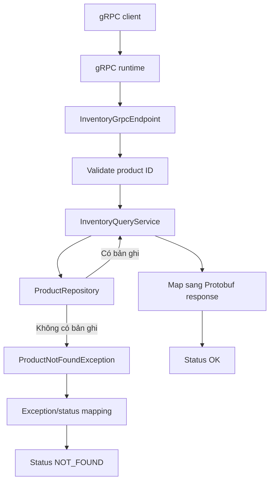

# NOT_FOUND

Trong gRPC, **NOT_FOUND là status code số 5**, dùng khi tài nguyên mà method đang tìm hoặc thao tác không tồn tại trong phạm vi API xác định. Ví dụ, client yêu cầu chi tiết sản phẩm bằng một SKU hợp lệ về cú pháp nhưng hệ thống không có sản phẩm đó. Server có thể kết thúc RPC bằng NOT_FOUND để client hiểu rằng tài nguyên đích không được tìm thấy.

Điều quan trọng là phân biệt **tài nguyên không tồn tại** với **request sai**, **không đủ quyền**, **trạng thái hiện tại không cho phép thao tác** và **một truy vấn hợp lệ không có kết quả**. Trong SPRING_GRPC, Protobuf định nghĩa định danh và message, Spring application service/repository thực hiện tra cứu, còn gRPC status truyền kết quả ở cấp RPC. Mapping đúng giúp client phản ứng chính xác và tránh biến mọi trường hợp rỗng thành lỗi.

## 1. Ý nghĩa của NOT_FOUND

NOT_FOUND có giá trị số **5**. Status này phù hợp khi tài nguyên được xác định bởi request không tồn tại hoặc không được tìm thấy theo contract của method.

| Góc nhìn | Ý nghĩa |
| --- | --- |
| Client | Tài nguyên đích không được tìm thấy theo phạm vi tra cứu của API |
| Server | Lookup hoặc thao tác xác định tài nguyên không tìm thấy đối tượng cần thiết |
| gRPC runtime | Kết thúc RPC với status NOT_FOUND |
| Nghiệp vụ | Không có tài nguyên phù hợp với định danh/điều kiện mà method cam kết xử lý |

Ví dụ:

- GetProduct(product_id) nhận ID hợp lệ nhưng không có sản phẩm tương ứng.
- GetOrder(order_id) không tìm thấy đơn hàng trong phạm vi tenant của người gọi.
- GetReservation(reservation_id) không tìm thấy reservation.
- DeleteDocument(document_id) được gọi cho tài liệu không tồn tại, nếu contract quy định trường hợp này là lỗi.

NOT_FOUND không phải lỗi kết nối, không có nghĩa database ngừng hoạt động và cũng không nhất thiết chỉ ra nguyên nhân gốc của việc không tìm thấy. Nó mô tả kết quả của thao tác theo contract.

## 2. Định danh hợp lệ nhưng tài nguyên không tồn tại

Hãy phân biệt hai bước:

1. **Kiểm tra định dạng định danh:** request có chứa ID/SKU hợp lệ về cấu trúc không?
2. **Tra cứu tài nguyên:** có tài nguyên tương ứng với định danh đó không?

Ví dụ với product_id:

- Chuỗi rỗng hoặc sai định dạng UUID: có thể là INVALID_ARGUMENT.
- UUID đúng định dạng nhưng không có bản ghi tương ứng: NOT_FOUND.
- Product tồn tại nhưng caller không được phép xem: thường là PERMISSION_DENIED, hoặc API có thể cố ý trả NOT_FOUND để không tiết lộ sự tồn tại.

NOT_FOUND thường xuất hiện **sau khi request đã qua validation**. Nếu định dạng đầu vào không hợp lệ, server không cần truy vấn database.

## 3. Không tìm thấy tài nguyên khác với truy vấn trả về danh sách rỗng

Đây là quyết định contract quan trọng. Cùng một database không có bản ghi có thể dẫn đến response OK hoặc status NOT_FOUND, tùy semantics method.

| Method | Kết quả không có bản ghi | Cách biểu diễn thường phù hợp |
| --- | --- | --- |
| GetProduct(product_id) | Không có sản phẩm mang ID đó | NOT_FOUND |
| ListProducts(filter) | Không có sản phẩm thỏa filter | Response OK với danh sách rỗng |
| SearchOrders(query) | Không có đơn hàng phù hợp | Response OK với zero results |
| GetLatestInvoice(account_id) | Chưa có hóa đơn nào | Có thể dùng NOT_FOUND hoặc response có presence/optional result, theo contract |
| GetRequiredConfiguration(key) | Thiếu cấu hình bắt buộc | Có thể là NOT_FOUND hoặc FAILED_PRECONDITION tùy ý nghĩa method |

Nguyên tắc:

- Nếu method yêu cầu **một tài nguyên cụ thể**, không có tài nguyên thường là NOT_FOUND.
- Nếu method yêu cầu **tìm tập kết quả**, tập rỗng thường là kết quả hợp lệ với OK.
- Nếu “chưa có kết quả” là trạng thái bình thường của domain, cân nhắc biểu diễn rõ trong response thay vì dùng lỗi.

Không nên trả NOT_FOUND cho một danh sách rỗng chỉ vì database query trả về zero rows. Hãy bắt đầu từ ý nghĩa API mà client cần hiểu.

## 4. Phân biệt NOT_FOUND với các status dễ nhầm

| Status | Ý nghĩa | Ví dụ |
| --- | --- | --- |
| NOT_FOUND | Tài nguyên đích không tồn tại/không tìm thấy | Product ID hợp lệ nhưng không có bản ghi |
| INVALID_ARGUMENT | Tham số request không hợp lệ | ID sai định dạng hoặc field bắt buộc rỗng |
| PERMISSION_DENIED | Caller không có quyền thực hiện thao tác | User không được đọc tài liệu của tenant khác |
| UNAUTHENTICATED | Không xác định được danh tính caller | Token thiếu hoặc không hợp lệ |
| FAILED_PRECONDITION | Tài nguyên/trạng thái hiện có không thỏa điều kiện để thao tác | Đơn hàng tồn tại nhưng đã đóng nên không thể sửa |
| ALREADY_EXISTS | Tài nguyên cần tạo đã tồn tại | Tạo account với username đã được sử dụng |
| UNAVAILABLE | Dịch vụ tạm thời không thể phục vụ | Database/service phụ trợ không sẵn sàng |
| INTERNAL | Lỗi nội bộ không mong đợi | Server gặp invariant violation |

### 4.1. NOT_FOUND và INVALID_ARGUMENT

ID sai cú pháp là request không hợp lệ; ID đúng cú pháp nhưng không có tài nguyên là không tìm thấy. Tách hai trường hợp giúp client sửa input khi cần, thay vì báo “không tồn tại” cho dữ liệu vốn không thể dùng làm định danh.

### 4.2. NOT_FOUND và PERMISSION_DENIED

Nếu tài nguyên tồn tại nhưng caller không có quyền, semantics thông thường là PERMISSION_DENIED. Tuy nhiên, một số API đa tenant chọn trả NOT_FOUND khi caller không được phép nhìn thấy tài nguyên, nhằm tránh tiết lộ tài nguyên của tenant khác có tồn tại hay không. Đây là **chính sách bảo mật có chủ đích**; phải áp dụng nhất quán và không để tạo ra kênh dò tìm dữ liệu.

### 4.3. NOT_FOUND và FAILED_PRECONDITION

Nếu tài nguyên không tồn tại, NOT_FOUND thường phù hợp. Nếu tài nguyên tồn tại nhưng trạng thái của nó ngăn thao tác, FAILED_PRECONDITION có thể phù hợp hơn. Ví dụ, không có reservation mang ID đã gửi là NOT_FOUND; reservation tồn tại nhưng đã được hoàn tất và không thể giải phóng lần nữa có thể là FAILED_PRECONDITION hoặc kết quả idempotent theo contract.

## 5. Luồng xử lý trong Spring gRPC

Một lookup điển hình đi qua các lớp:



Vai trò của từng lớp:

- **gRPC handler/endpoint:** chuyển request Protobuf thành lời gọi ứng dụng và chọn response/status.
- **Validator:** kiểm tra định dạng và điều kiện đầu vào.
- **Spring application service:** thực hiện use case, kiểm tra phạm vi tenant/quyền và điều phối repository.
- **Repository:** tra cứu dữ liệu; biểu diễn rõ trường hợp không có bản ghi.
- **Exception/status mapper:** chuyển lỗi domain đã biết thành status gRPC tương ứng.

Không nên để mọi null từ repository tự động trở thành NOT_FOUND. Có thể null là lỗi lập trình, quan hệ optional hoặc kết quả không có dữ liệu theo semantics khác. Hãy dùng kiểu trả về rõ ràng như Optional<Product> hoặc exception domain có ý nghĩa.

## 6. Ví dụ mapping NOT_FOUND ở server

Một application service có thể thể hiện rõ trường hợp không tìm thấy:

```java
public Product getRequiredProduct(String productId) {
    return productRepository.findById(productId)
        .orElseThrow(() ->
            new ProductNotFoundException(productId));
}
```

Handler chuyển exception domain thành status:

```java
@Override
public void getProduct(
        GetProductRequest request,
        StreamObserver<GetProductReply> observer) {
    try {
        if (request.getProductId().isBlank()) {
            observer.onError(Status.INVALID_ARGUMENT
                .withDescription("product_id không được để trống")
                .asRuntimeException());
            return;
        }

        Product product =
            productService.getRequiredProduct(request.getProductId());

        GetProductReply reply = GetProductReply.newBuilder()
            .setProductId(product.getId())
            .setName(product.getName())
            .build();

        observer.onNext(reply);
        observer.onCompleted();
    } catch (ProductNotFoundException ex) {
        observer.onError(Status.NOT_FOUND
            .withDescription("Không tìm thấy sản phẩm")
            .asRuntimeException());
    }
}
```

Ví dụ giả định ProductNotFoundException, productService và repository đã được định nghĩa. Handler không trả nội dung exception chứa định danh hoặc chi tiết nội bộ nếu không cần thiết. Với ứng dụng lớn, nên gom mapping vào một exception mapper/interceptor phù hợp với gRPC stack để tránh lặp try/catch ở mọi method.

### 6.1. Không biến mọi lỗi truy cập dữ liệu thành NOT_FOUND

Repository có thể phát sinh nhiều loại lỗi:

- Không có bản ghi: có thể ánh xạ NOT_FOUND.
- Database không kết nối được: thường là UNAVAILABLE hoặc status phù hợp với hạ tầng.
- Query sai, mapping lỗi hoặc schema không tương thích: có thể là INTERNAL.
- Constraint conflict: có thể là ALREADY_EXISTS, ABORTED hoặc status khác theo contract.

Chỉ chuyển lỗi “không có bản ghi” thành NOT_FOUND. Nếu bắt toàn bộ DataAccessException rồi trả NOT_FOUND, client sẽ hiểu nhầm sự cố database thành dữ liệu không tồn tại.

## 7. Error details và thông tin tài nguyên

Một status cùng description ngắn có thể đủ cho API đơn giản. Với API cần client xử lý nhiều loại tài nguyên hoặc cần hỗ trợ chẩn đoán có cấu trúc, có thể dùng richer error details như google.rpc.ResourceInfo.

Thông tin logic có thể gồm:

```text
grpc-status: NOT_FOUND
grpc-message: Không tìm thấy tài nguyên

ResourceInfo:
  resource_type: "commerce.inventory.v1.Product"
  resource_name: "products/{product_id}"
  owner: "tenant"
```

Đây là minh họa về dữ liệu; để truyền detail trong gRPC Java cần dùng các Protobuf types và API status details tương ứng của thư viện đang sử dụng.

Khi thiết kế error details:

- Chỉ đưa tên loại tài nguyên và định danh mà caller được phép biết.
- Không tiết lộ tenant, email, internal database key hoặc thông tin cá nhân của người khác.
- Giữ resource type/name ổn định theo public contract.
- Client nên dựa vào status và structured detail, không parse chuỗi description tự do.
- Nếu API cố ý che giấu sự tồn tại tài nguyên, không đưa ResourceInfo làm lộ ID hoặc owner.

## 8. Client xử lý NOT_FOUND như thế nào?

Với blocking stub, client nhận StatusRuntimeException khi RPC kết thúc bằng status lỗi:

```java
try {
    GetProductReply reply = catalogStub.getProduct(
        GetProductRequest.newBuilder()
            .setProductId(productId)
            .build());

    // Hiển thị sản phẩm.
} catch (StatusRuntimeException ex) {
    if (ex.getStatus().getCode() == Status.Code.NOT_FOUND) {
        // Hiển thị trạng thái không tìm thấy theo UX của ứng dụng.
    } else {
        // Xử lý các status khác theo policy.
    }
}
```

Client thường nên:

1. Kiểm tra status code, không suy luận từ message text.
2. Hiển thị trạng thái không tìm thấy hoặc điều hướng phù hợp.
3. Không retry nguyên request liên tục nếu tài nguyên thực sự không tồn tại.
4. Phân biệt không tìm thấy với không đủ quyền nếu contract cho phép phân biệt.
5. Ghi nhận method, resource type và correlation ID an toàn để hỗ trợ điều tra.

Không nên hiển thị nguyên grpc-message cho người dùng cuối nếu message được thiết kế cho developer. Client có thể ánh xạ NOT_FOUND sang nội dung UI thân thiện mà không làm lộ chi tiết hệ thống.

## 9. Retry, eventual consistency và cache

Thông thường, NOT_FOUND **không phải lỗi tạm thời** và không nên tự động retry. Tuy nhiên, có một số kiến trúc mà tài nguyên vừa được tạo có thể chưa xuất hiện ngay ở read replica, search index hoặc cache phân tán.

Trong trường hợp eventual consistency:

- Contract cần nói rõ thời gian tài nguyên có thể chưa đọc được sau khi tạo.
- Client chỉ retry có giới hạn nếu method và yêu cầu nghiệp vụ cho phép chờ.
- Dùng backoff và deadline tổng; không polling vô hạn.
- Nếu cần read-after-write consistency, định tuyến đọc đến nguồn nhất quán hoặc cung cấp operation status.

### 9.1. Cache kết quả NOT_FOUND

Cache negative result có thể giảm tải lookup lặp lại, nhưng dễ gây vấn đề nếu cache giữ “không tồn tại” sau khi tài nguyên vừa được tạo.

Hãy cân nhắc:

- TTL ngắn hơn cho negative cache so với dữ liệu ổn định.
- Invalidate cache khi tạo hoặc khôi phục tài nguyên.
- Phân biệt NOT_FOUND thực sự với UNAVAILABLE; không cache lỗi hạ tầng như dữ liệu vắng mặt.
- Xem xét tenant và quyền trong cache key để không chia sẻ kết quả giữa các phạm vi bảo mật.
- Có thể không cache kết quả không tìm thấy nếu yêu cầu nhất quán cao.

### 9.2. Xóa mềm và tombstone

Nếu hệ thống dùng soft delete, tài nguyên có thể còn trong database nhưng không còn được coi là tồn tại đối với API thông thường. Contract cần xác định NOT_FOUND có áp dụng cho bản ghi đã xóa mềm hay không. Với event replication hoặc đồng bộ, tombstone giúp downstream biết tài nguyên đã bị xóa thay vì nhầm với dữ liệu chưa từng xuất hiện.

## 10. Bảo mật: không để NOT_FOUND trở thành công cụ dò dữ liệu

Trong hệ thống đa tenant, việc phân biệt “không tồn tại” và “tồn tại nhưng không có quyền” có thể tiết lộ thông tin. Ví dụ attacker thử nhiều order_id và quan sát status để suy ra đơn hàng của tenant khác có tồn tại hay không.

Một số API chọn trả NOT_FOUND cho cả hai trường hợp:

- Tài nguyên không tồn tại.
- Tài nguyên tồn tại nhưng caller không được phép biết đến.

Đây là chính sách che giấu sự tồn tại, không phải quy tắc bắt buộc cho mọi API. Cần bảo đảm cùng một cách phản hồi về status, message, thời gian xử lý và side channel ở những trường hợp cần che giấu. Việc kiểm tra quyền vẫn phải thực hiện phía server; không dựa vào ID khó đoán để thay thế authorization.

## 11. Kiểm thử NOT_FOUND

Một bộ test nên xác minh cả semantics API lẫn status thực sự client nhận:

| Kịch bản | Điều cần xác minh |
| --- | --- |
| ID sai định dạng | INVALID_ARGUMENT, không truy vấn repository nếu không cần |
| ID đúng định dạng nhưng không tồn tại | NOT_FOUND theo contract |
| ListProducts không có kết quả | OK với danh sách rỗng nếu empty list là kết quả hợp lệ |
| Tài nguyên tồn tại và caller có quyền | Response thành công |
| Tài nguyên tồn tại nhưng caller không có quyền | Status theo chính sách PERMISSION_DENIED hoặc che giấu bằng NOT_FOUND |
| Database mất kết nối | Không bị ánh xạ nhầm thành NOT_FOUND |
| Tài nguyên vừa được tạo nhưng read replica chưa cập nhật | Hành vi phù hợp với consistency contract |
| Negative cache sau khi tạo tài nguyên | Cache được invalidate hoặc hết TTL theo thiết kế |
| Tài nguyên đã soft-delete | Kết quả phù hợp semantics đã công bố |

Unit test application service kiểm tra lookup và exception domain. Integration test qua gRPC client/server xác nhận status và error details. Test authorization nên dùng các tenant/user khác nhau để kiểm tra không rò rỉ sự tồn tại tài nguyên.

## 12. Quan sát NOT_FOUND trong production

NOT_FOUND có thể là hành vi bình thường, nhưng tỷ lệ tăng bất thường cũng có thể báo hiệu client dùng ID sai, contract lệch phiên bản hoặc lỗi đồng bộ dữ liệu.

Nên theo dõi:

- Số lượng và tỷ lệ NOT_FOUND theo service/method.
- Resource type và nhóm thao tác, không nhất thiết ghi resource ID.
- Client/SDK version gây ra lookup thất bại.
- Tỷ lệ NOT_FOUND sau create/update/delete.
- Mức chênh giữa primary database, replica, search index và cache nếu hệ thống có nhiều nguồn đọc.
- Trace/correlation ID để nối request với quá trình tạo hoặc xóa tài nguyên.

Không dùng resource ID, email, tenant ID hoặc token làm metric label có cardinality cao. Log cần tuân thủ chính sách dữ liệu và không ghi chi tiết tài nguyên mà caller không được phép biết.

## 13. Những lỗi thiết kế thường gặp

| Sai lầm | Hậu quả | Cách làm tốt hơn |
| --- | --- | --- |
| Trả NOT_FOUND cho mọi danh sách rỗng | Client khó phân biệt không có kết quả với lỗi tài nguyên | Dùng response OK với collection rỗng khi đúng semantics |
| Trả NOT_FOUND cho ID sai định dạng | Che giấu lỗi input và làm khó client | Validate rồi trả INVALID_ARGUMENT |
| Chuyển mọi database exception thành NOT_FOUND | Sự cố hạ tầng bị hiểu thành dữ liệu không tồn tại | Chỉ map no-row; phân loại lỗi database khác riêng |
| Dùng NOT_FOUND thay cho authorization mà không có chính sách | Có thể rò rỉ sự tồn tại tài nguyên | Chọn semantics rõ và áp dụng nhất quán theo threat model |
| Retry NOT_FOUND vô hạn | Tăng tải mà không sửa được nguyên nhân | Chỉ retry có giới hạn khi eventual consistency được công bố |
| Cache negative result quá lâu | Tài nguyên mới tạo vẫn bị báo không tồn tại | TTL phù hợp và invalidate khi create/restore |
| Trả error detail chứa owner hoặc internal ID | Rò rỉ thông tin | Chỉ trả resource metadata caller được phép biết |

## 14. Checklist thiết kế NOT_FOUND

Trước khi công bố method, hãy xác định:

1. **Method tìm một tài nguyên hay một tập kết quả?** Chọn NOT_FOUND hay collection rỗng theo semantics.
2. **Định danh sai định dạng được xử lý thế nào?** Tách INVALID_ARGUMENT khỏi lookup miss.
3. **Phạm vi tìm kiếm là gì?** Tenant, owner, soft-delete và visibility có ảnh hưởng kết quả không?
4. **Tài nguyên tồn tại nhưng không có quyền thì sao?** Chọn PERMISSION_DENIED hay chính sách che giấu bằng NOT_FOUND.
5. **Repository phân biệt no-row với lỗi hạ tầng không?** Không map mọi exception thành NOT_FOUND.
6. **Có eventual consistency không?** Quy định retry, read-after-write và cache invalidation.
7. **Error details có tiết lộ thông tin không?** Chỉ trả resource metadata được phép công khai.
8. **Client xử lý status ra sao?** Không retry vô hạn hoặc parse message text.
9. **Test có phân biệt empty list, missing resource và forbidden không?**
10. **Telemetry có đủ chẩn đoán mà không lộ ID nhạy cảm không?**

## 15. Ghi nhớ

NOT_FOUND là gRPC status code 5, dùng khi tài nguyên đích không được tìm thấy theo contract. Nó khác INVALID_ARGUMENT (định danh sai), PERMISSION_DENIED (không có quyền), FAILED_PRECONDITION (trạng thái hiện tại ngăn thao tác) và một truy vấn danh sách hợp lệ nhưng không có kết quả.

Trong Spring gRPC, hãy để application service/repository biểu diễn rõ lookup miss, map đúng exception domain sang Status.NOT_FOUND, và giữ lỗi database/hạ tầng ở status phù hợp. Client nên xử lý status có cấu trúc; chỉ retry khi contract về eventual consistency cho phép. Với API đa tenant, cân nhắc nguy cơ tiết lộ sự tồn tại tài nguyên và bảo vệ error details. Mapping NOT_FOUND đúng semantics giúp API rõ ràng, an toàn và dễ vận hành.

### Tài liệu tham khảo

- [gRPC – Status codes](https://grpc.io/docs/guides/status-codes/)
- [gRPC – Error handling](https://grpc.io/docs/guides/error/)
- [gRPC – Java basics](https://grpc.io/docs/languages/java/basics/)
- [Google API – Error model](https://cloud.google.com/apis/design/errors)
- [Google API – Resource-oriented design](https://cloud.google.com/apis/design/resources)
