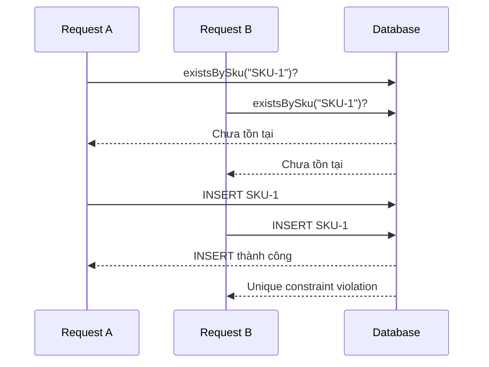

# ALREADY_EXISTS

Trong gRPC, **`ALREADY_EXISTS` là status code số `6`**, dùng khi thao tác tạo một tài nguyên thất bại vì tài nguyên đó đã tồn tại. Ví dụ client gọi `CreateAccount` với username đã được đăng ký hoặc `CreateProduct` với mã SKU đang được sử dụng. Status này cho client biết xung đột nằm ở trạng thái tài nguyên hiện tại; gửi lại nguyên request thường không giải quyết được.

Trong **SPRING_GRPC**, Protobuf định nghĩa request và response, Spring application service thực hiện use case, repository/database bảo đảm tính duy nhất, còn gRPC status truyền kết quả về client. Để dùng `ALREADY_EXISTS` đúng, cần xác định rõ danh tính tài nguyên, ranh giới unique constraint, xử lý cạnh tranh khi hai request tạo cùng lúc và chính sách khi client gửi lại request sau timeout.

## 1. Ý nghĩa của ALREADY_EXISTS

`ALREADY_EXISTS` có giá trị số **6**. Status phù hợp khi method muốn tạo một tài nguyên mới nhưng tài nguyên tương ứng đã tồn tại theo quy tắc định danh của API.

| Góc nhìn | Ý nghĩa |
| --- | --- |
| Client | Tài nguyên cần tạo đã tồn tại; client cần chọn cách xử lý xung đột |
| Server | Điều kiện tạo mới không thỏa vì định danh hoặc thuộc tính unique đã được sử dụng |
| gRPC runtime | Kết thúc RPC với status `ALREADY_EXISTS` |
| Nghiệp vụ | Không tạo thêm tài nguyên trùng theo contract |

Ví dụ:

- `CreateUser` với email đã được đăng ký.
- `CreateProduct` với SKU đã tồn tại trong catalog.
- `CreateReservation` với mã reservation đã được cấp.
- `RegisterDevice` với device ID đã gắn với một tài khoản.

`ALREADY_EXISTS` thường phù hợp với thao tác create. Nó không có nghĩa mọi lần client gửi cùng một request đều là lỗi; nếu API được thiết kế idempotent, server có thể trả lại tài nguyên đã tạo cho cùng một operation key. Điều đó cần được quy định rõ trong contract.

## 2. Xác định thế nào là “đã tồn tại”?

Một tài nguyên có thể được định danh bằng khóa chính hoặc quy tắc unique nghiệp vụ:

| Tài nguyên | Khóa/điều kiện unique có thể dùng |
| --- | --- |
| User | user ID, email chuẩn hóa hoặc username |
| Product | product ID hoặc SKU trong phạm vi catalog |
| Reservation | reservation ID hoặc khóa nghiệp vụ của lần giữ hàng |
| Device registration | device ID trong phạm vi tenant/account |
| Payment instruction | merchant reference hoặc idempotency key theo contract |

Phải xác định **phạm vi unique**. Ví dụ SKU có thể unique toàn hệ thống, hoặc chỉ unique trong từng catalog. Email có thể unique toàn nền tảng, hoặc unique theo tenant. Nếu database constraint và API contract hiểu khác nhau về phạm vi này, server có thể trả status khó giải thích hoặc cho phép dữ liệu trùng ngoài ý muốn.

Với dữ liệu đa tenant, unique key thường phải bao gồm tenant scope nếu quy tắc nghiệp vụ cho phép hai tenant dùng cùng một định danh. Không nên chỉ kiểm tra bằng một truy vấn trước khi insert rồi coi đó là bảo đảm duy nhất; cạnh tranh đồng thời vẫn có thể tạo duplicate.

## 3. Phân biệt ALREADY_EXISTS với các status dễ nhầm

| Status | Khi nào phù hợp | Ví dụ |
| --- | --- | --- |
| `ALREADY_EXISTS` | Tài nguyên muốn tạo đã tồn tại | Tạo user với email đã được dùng |
| `INVALID_ARGUMENT` | Request chứa dữ liệu sai định dạng/giá trị | Email sai cú pháp |
| `FAILED_PRECONDITION` | Tài nguyên hoặc hệ thống ở trạng thái không cho phép thao tác | Tài khoản tồn tại nhưng đang bị khóa nên không thể kích hoạt |
| `ABORTED` | Thao tác bị hủy do xung đột cần xử lý ở mức transaction | Optimistic locking conflict khi cập nhật |
| `PERMISSION_DENIED` | Caller không có quyền tạo hoặc truy cập tài nguyên | User không có quyền tạo product trong catalog |
| `UNAUTHENTICATED` | Không xác minh được danh tính caller | Token thiếu hoặc hết hạn |
| `RESOURCE_EXHAUSTED` | Hết quota hoặc tài nguyên được cấp | Tenant đã đạt quota số lượng device |
| `INTERNAL` | Lỗi nội bộ không mong đợi | Lỗi mapping hoặc invariant phía server |

### 3.1. ALREADY_EXISTS và INVALID_ARGUMENT

Email sai định dạng là `INVALID_ARGUMENT`; email đúng định dạng nhưng đã được một tài khoản khác sử dụng có thể là `ALREADY_EXISTS`. Trường hợp đầu cần sửa input. Trường hợp sau cần chọn định danh khác hoặc xử lý tài khoản đã tồn tại theo quy tắc nghiệp vụ.

### 3.2. ALREADY_EXISTS và FAILED_PRECONDITION

`ALREADY_EXISTS` mô tả xung đột do tài nguyên đã tồn tại khi tạo. `FAILED_PRECONDITION` mô tả trạng thái hiện tại ngăn thao tác, kể cả khi tài nguyên đã tồn tại. Ví dụ `CreateUser` với email trùng có thể trả `ALREADY_EXISTS`; `ActivateUser` cho tài khoản đã bị khóa bởi chính sách có thể trả `FAILED_PRECONDITION`.

### 3.3. ALREADY_EXISTS và ABORTED

`ABORTED` thường phù hợp với xung đột transaction hoặc concurrency mà caller có thể cần chạy lại một quy trình đọc-sửa-ghi. `ALREADY_EXISTS` là kết quả nghiệp vụ cụ thể: tài nguyên cần tạo đã tồn tại. Không nên đổi mọi lỗi unique constraint thành `ABORTED`, hoặc mọi transaction conflict thành `ALREADY_EXISTS`.

## 4. Contract Protobuf cho thao tác tạo

Ví dụ tạo sản phẩm theo SKU:

```protobuf
syntax = "proto3";

package commerce.catalog.v1;

option java_package = "com.example.catalog.grpc";
option java_multiple_files = true;

service CatalogService {
  rpc CreateProduct(CreateProductRequest) returns (CreateProductReply);
}

message CreateProductRequest {
  string sku = 1;
  string name = 2;
}

message CreateProductReply {
  string product_id = 1;
  string sku = 2;
  string name = 3;
}
```

Contract nên làm rõ:

- SKU unique trong phạm vi nào: toàn hệ thống, tenant hay catalog.
- Quy tắc chuẩn hóa SKU trước khi so sánh, ví dụ chữ hoa/thường và khoảng trắng.
- Khi trùng SKU, server trả `ALREADY_EXISTS` hay trả resource hiện có theo chính sách idempotency.
- Client có được phép cập nhật tài nguyên đã có qua method khác không.
- Response chỉ trả các trường caller được phép xem.

Không nên âm thầm biến `CreateProduct` thành upsert nếu contract nói rằng method chỉ tạo mới. Upsert có semantics khác: tài nguyên chưa có thì tạo, đã có thì cập nhật hoặc giữ nguyên theo quy tắc. Nếu cần hành vi đó, hãy định nghĩa method/operation rõ ràng.

## 5. Bảo đảm tính duy nhất trong Spring và database

Một lỗi thường gặp là kiểm tra tồn tại trước rồi mới insert:

```java
if (!productRepository.existsBySku(sku)) {
    productRepository.save(product);
}
```

Đoạn code này không bảo đảm unique khi có hai request đồng thời:



Hai request đều vượt qua bước kiểm tra trước insert. Vì vậy, **database unique constraint là lớp bảo vệ cuối cùng**. Có thể kiểm tra trước để đưa ra phản hồi sớm, nhưng vẫn phải bắt và phân loại xung đột từ thao tác ghi.

Ví dụ entity:

```java
@Entity
@Table(
    name = "products",
    uniqueConstraints = @UniqueConstraint(
        name = "uk_products_tenant_sku",
        columnNames = {"tenant_id", "sku"}
    )
)
public class ProductEntity {
    // fields
}
```

Ví dụ này giả định SKU unique trong từng tenant. Tên constraint cụ thể và cách khai báo phụ thuộc database/migration đang dùng. Với production, nên quản lý constraint bằng migration để schema thực tế và mapping trong code nhất quán.

## 6. Mapping duplicate key thành ALREADY_EXISTS

Application service có thể biểu diễn lỗi domain:

```java
public Product createProduct(CreateProductCommand command) {
    try {
        return productRepository.save(
            ProductEntity.from(command)
        ).toDomain();
    } catch (DataIntegrityViolationException ex) {
        if (isSkuUniqueConstraint(ex)) {
            throw new ProductAlreadyExistsException(command.sku(), ex);
        }
        throw ex;
    }
}
```

`isSkuUniqueConstraint` là hàm minh họa. Code thực tế cần nhận diện đúng constraint hoặc SQL state/driver cause theo database đang dùng; không được xem mọi `DataIntegrityViolationException` là duplicate. Lỗi foreign key, not-null hoặc lỗi constraint khác có thể cần status khác.

Ở gRPC boundary, map domain exception:

```java
try {
    Product product = catalogService.createProduct(command);
    CreateProductReply reply = CreateProductReply.newBuilder()
        .setProductId(product.id())
        .setSku(product.sku())
        .setName(product.name())
        .build();

    observer.onNext(reply);
    observer.onCompleted();
} catch (ProductAlreadyExistsException ex) {
    observer.onError(Status.ALREADY_EXISTS
        .withDescription("SKU đã được sử dụng")
        .asRuntimeException());
}
```

Ví dụ giả định command, domain model và service đã được định nghĩa. Ở ứng dụng lớn, có thể gom mapping vào exception mapper/interceptor của gRPC stack để tránh lặp code. Giữ chi tiết constraint, SQL và stack trace ở log server; response client chỉ nên chứa thông tin cần thiết.

### 6.1. Transaction và thời điểm phát response

Với create operation, response thành công chỉ nên được phát sau khi transaction commit theo cam kết của API. Nếu handler gọi `onNext`/`onCompleted` trước khi transaction thực sự commit hoặc trước khi dữ liệu được bảo đảm, client có thể nhận thành công dù insert sau đó rollback.

Hãy để ranh giới transaction nằm trong application service/repository theo thiết kế Spring, và bảo đảm handler chỉ hoàn tất RPC sau khi lời gọi ứng dụng đã trả về thành công theo semantics đã định. Với transaction bất đồng bộ hoặc event-driven, cần định nghĩa rõ `OK` nghĩa là đã tạo tài nguyên hay chỉ mới chấp nhận yêu cầu.

## 7. Idempotency: request lặp không nhất thiết là duplicate create

Có hai khái niệm thường bị nhầm:

- **Business uniqueness:** không được có hai sản phẩm cùng SKU trong một catalog.
- **Request idempotency:** cùng một thao tác được gửi lại do timeout/mất response thì không tạo side effect lần nữa.

Client có thể gửi `CreateProduct`, server đã commit thành công nhưng response bị mất. Khi client retry, server nhìn thấy SKU đã tồn tại. Nếu chỉ trả `ALREADY_EXISTS`, client không biết tài nguyên đó được tạo bởi lần gọi trước của chính nó hay bởi một caller khác.

Một API cần retry an toàn có thể nhận idempotency key:

```protobuf
message CreateProductRequest {
  string request_id = 1;
  string sku = 2;
  string name = 3;
}
```

Server lưu kết quả theo `request_id` và phạm vi caller/tenant phù hợp:

1. Nếu request ID chưa từng được xử lý, thực hiện tạo tài nguyên và lưu kết quả cùng transaction.
2. Nếu cùng request ID và cùng payload được gửi lại, trả lại kết quả đã lưu.
3. Nếu cùng request ID nhưng payload khác, trả lỗi theo contract, thường là `INVALID_ARGUMENT` hoặc status xung đột đã quy định.
4. Nếu request ID khác nhưng SKU đã tồn tại, áp dụng business uniqueness và trả `ALREADY_EXISTS` hoặc kết quả theo chính sách API.

Idempotency key cần có TTL/chính sách lưu trữ, scope và tính nguyên tử. Chỉ thêm field `request_id` vào proto không tự bảo đảm idempotency.

## 8. Client xử lý ALREADY_EXISTS

Với blocking stub, client có thể bắt `StatusRuntimeException`:

```java
try {
    CreateProductReply reply =
        catalogStub.createProduct(request);
    // Lưu product_id và hiển thị tài nguyên mới.
} catch (StatusRuntimeException ex) {
    if (ex.getStatus().getCode() == Status.Code.ALREADY_EXISTS) {
        // Hướng người dùng chọn SKU khác hoặc mở tài nguyên hiện có
        // nếu API cho phép và caller có quyền truy cập.
    } else {
        // Xử lý status khác theo policy.
    }
}
```

Client nên:

- Không retry nguyên request liên tục; xung đột unique thường không tự biến mất.
- Cho người dùng chọn định danh khác hoặc chuyển sang luồng lấy tài nguyên hiện có.
- Chỉ gọi `GetProduct` sau `ALREADY_EXISTS` nếu contract cho phép và authorization được kiểm tra.
- Với request có idempotency key, phân biệt retry cùng operation với create mới có chủ đích.
- Không suy luận nội dung tài nguyên từ `grpc-message`; dùng response hoặc API đọc được bảo vệ.

Không phải API nào cũng nên trả thông tin tài nguyên đã tồn tại. Ví dụ đăng ký tài khoản, việc tiết lộ email đã có tài khoản có thể tạo rủi ro dò danh tính. Contract cần cân bằng UX, bảo mật và yêu cầu nghiệp vụ.

## 9. Error details và thông tin tài nguyên đã tồn tại

Với API nội bộ, client có thể cần biết loại tài nguyên gây xung đột. Rich error details như `google.rpc.ResourceInfo` có thể mô tả resource type/name:

```text
grpc-status: ALREADY_EXISTS
grpc-message: SKU đã được sử dụng

ResourceInfo:
  resource_type: "commerce.catalog.v1.Product"
  resource_name: "catalogs/{catalog_id}/products/{product_id}"
```

Đây là minh họa logic; để gửi detail cần dùng Protobuf types và status detail API tương ứng trong gRPC Java. Chỉ trả resource name/ID nếu caller được phép biết. Với public API hoặc dữ liệu nhạy cảm, có thể chỉ trả mã lỗi chung mà không tiết lộ tài nguyên nào đang sở hữu unique key.

## 10. Kiểm thử ALREADY_EXISTS và cạnh tranh đồng thời

Không chỉ test trường hợp tạo trùng tuần tự. Cần kiểm tra database constraint và race:

| Kịch bản | Điều cần xác minh |
| --- | --- |
| Tạo tài nguyên lần đầu | RPC trả response và status `OK` sau commit |
| Tạo lại cùng unique key | RPC trả `ALREADY_EXISTS` theo contract |
| Hai request đồng thời cùng tạo key | Chỉ một insert thành công; request còn lại được map đúng |
| Unique key khác scope tenant | Hành vi phù hợp quy tắc unique theo tenant/global |
| Constraint khác bị vi phạm | Không bị map nhầm thành `ALREADY_EXISTS` |
| Client retry cùng idempotency key | Nhận kết quả đã lưu, không tạo side effect lần hai |
| Cùng request ID nhưng payload khác | Bị từ chối theo contract |
| Tài nguyên tồn tại nhưng caller không có quyền | Không rò rỉ thông tin qua status/detail |
| Transaction rollback | Client không nhận `OK` trước khi commit |

Unit test có thể kiểm tra exception mapper. Integration test nên dùng database thật hoặc container phù hợp để xác minh unique constraint và transaction. Test concurrency cần khởi chạy các request gần đồng thời và kiểm tra số bản ghi cuối cùng, không chỉ kiểm tra exception Java.

## 11. Quan sát xung đột trong production

`ALREADY_EXISTS` có thể là kết quả bình thường của business uniqueness, nhưng tỷ lệ tăng đột ngột có thể báo hiệu client retry sai, nhiều producer tạo cùng định danh hoặc contract không rõ.

Nên theo dõi:

- Số lượng/tỷ lệ `ALREADY_EXISTS` theo service/method.
- Loại unique constraint hoặc resource type ở dạng nhãn có cardinality thấp.
- Client/SDK version và tenant class nếu policy cho phép.
- Tỷ lệ xung đột so với tổng số create.
- Số request retry theo idempotency key và số duplicate được nhận diện.
- Trace/correlation ID để nối client call với transaction/log server.

Không dùng email, SKU, request ID hoặc user ID làm metric label có cardinality cao. Log có thể ghi constraint name và correlation ID; tránh ghi payload nhạy cảm hoặc dữ liệu của tài nguyên mà caller không được phép xem.

## 12. Những lỗi thiết kế thường gặp

| Sai lầm | Hậu quả | Cách làm tốt hơn |
| --- | --- | --- |
| Chỉ dùng `existsBy...` trước insert | Race condition vẫn tạo duplicate | Database unique constraint và mapping lỗi ghi |
| Map mọi `DataIntegrityViolationException` thành `ALREADY_EXISTS` | Che giấu lỗi constraint khác | Nhận diện đúng constraint/SQL state |
| Trả `ALREADY_EXISTS` cho mọi lần retry | Client không phân biệt retry cùng operation với create mới | Thiết kế idempotency key và lưu kết quả |
| Âm thầm upsert trong method Create | Có thể ghi đè tài nguyên ngoài ý muốn | Tách create, update và upsert semantics |
| Retry `ALREADY_EXISTS` liên tục | Tăng tải mà không giải quyết xung đột | Sửa định danh hoặc lấy tài nguyên hiện có theo contract |
| Phát `OK` trước transaction commit | Client thấy thành công nhưng dữ liệu có thể rollback | Chỉ hoàn tất RPC sau khi cam kết ghi được bảo đảm |
| Tiết lộ resource ID trong error detail | Rò rỉ thông tin tài nguyên | Kiểm tra authorization và giới hạn detail |

## 13. Checklist thiết kế ALREADY_EXISTS

Trước khi công bố method create, hãy xác định:

1. **Tài nguyên được định danh bằng gì?** Primary key, natural key hay unique business key?
2. **Phạm vi unique là gì?** Global, tenant, catalog hay owner?
3. **Chuẩn hóa key ra sao?** Case sensitivity, whitespace và canonical form.
4. **Database bảo vệ unique thế nào?** Có constraint/index tương ứng và migration không?
5. **Lỗi constraint nào map thành ALREADY_EXISTS?** Phân biệt với foreign key/not-null/constraint khác.
6. **Retry sau timeout được xử lý thế nào?** Có idempotency key và kết quả lưu bền không?
7. **Create và upsert có semantics riêng không?** Không âm thầm cập nhật tài nguyên trùng.
8. **Client được biết tài nguyên hiện có đến mức nào?** Xem xét authorization và resource detail.
9. **Test có mô phỏng race condition không?** Xác minh chỉ một tài nguyên được tạo.
10. **Telemetry có theo dõi conflict mà không lộ dữ liệu không?**

## 14. Ghi nhớ

`ALREADY_EXISTS` là gRPC status code `6`, dùng khi tài nguyên mà method muốn tạo đã tồn tại theo quy tắc định danh của API. Nó khác `INVALID_ARGUMENT` (request sai), `FAILED_PRECONDITION` (trạng thái hiện tại ngăn thao tác) và `ABORTED` (xung đột transaction).

Trong Spring gRPC, hãy định nghĩa unique scope trong contract, bảo vệ tính duy nhất bằng database constraint, chỉ map đúng duplicate-key violation thành `Status.ALREADY_EXISTS` và không phát thành công trước khi transaction commit. Với timeout/retry, phân biệt business uniqueness với request idempotency. Client nên xử lý xung đột theo contract, không retry vô hạn và không để error details tiết lộ tài nguyên ngoài quyền. Làm rõ những semantics này giúp thao tác create an toàn trước cạnh tranh đồng thời và lỗi mạng.

### Tài liệu tham khảo

- [gRPC – Status codes](https://grpc.io/docs/guides/status-codes/)
- [gRPC – Error handling](https://grpc.io/docs/guides/error/)
- [Google API – Error model](https://cloud.google.com/apis/design/errors)
- [Google API – Resource-oriented design](https://cloud.google.com/apis/design/resources)
- [Spring Data – Repository fundamentals](https://docs.spring.io/spring-data/commons/reference/repositories/core-concepts.html)
