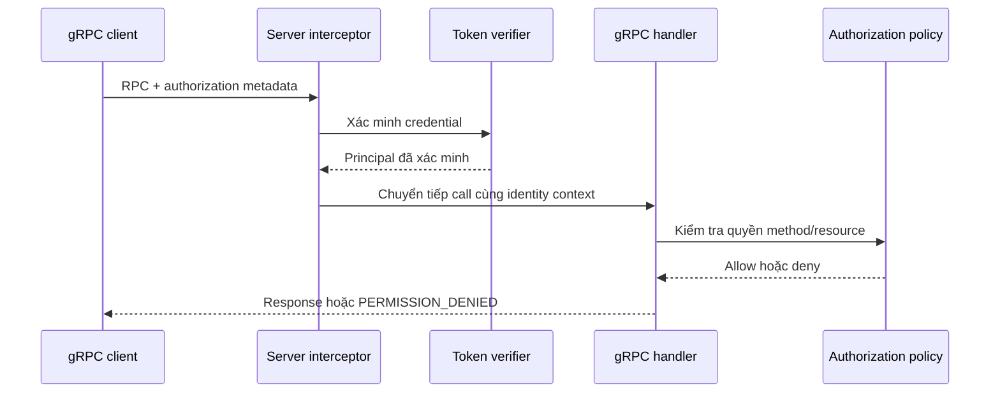

# PERMISSION_DENIED

Trong gRPC, **`PERMISSION_DENIED` là status code số `7`**, cho biết caller không được phép thực hiện thao tác được yêu cầu. Trường hợp điển hình là server đã xác định được danh tính người gọi nhưng danh tính đó không có quyền truy cập tài nguyên hoặc gọi method trong ngữ cảnh hiện tại. Ví dụ, một nhân viên đã đăng nhập nhưng không được xem hồ sơ của tenant khác.

Khi phát triển **SPRING_GRPC**, cần tách hai câu hỏi: **caller là ai?** và **caller được phép làm gì?** Authentication xác minh danh tính; authorization kiểm tra quyền. gRPC status `UNAUTHENTICATED` thường dùng khi không xác minh được danh tính, còn `PERMISSION_DENIED` dùng khi danh tính đã được xác minh nhưng không đủ quyền. Spring Security có thể hỗ trợ xây dựng identity và policy, nhưng gRPC server vẫn cần tích hợp xác thực, truyền ngữ cảnh và kiểm tra quyền tại đúng ranh giới.

## 1. Ý nghĩa của PERMISSION_DENIED

`PERMISSION_DENIED` có giá trị số **7**. Status này phù hợp khi caller không có quyền thực hiện thao tác, bất kể tài nguyên có tồn tại hay không. Server không nên thực hiện side effect sau khi đã xác định caller không được phép.

| Góc nhìn | Ý nghĩa |
| --- | --- |
| Client | Danh tính hiện tại không được phép thực hiện thao tác |
| Server | Policy authorization từ chối method hoặc hành động trên tài nguyên |
| gRPC runtime | Kết thúc RPC với status `PERMISSION_DENIED` |
| Nghiệp vụ | Caller không đáp ứng quyền, vai trò, ownership hoặc policy cần thiết |

Ví dụ:

- Người dùng đã đăng nhập nhưng không có quyền `inventory:write`.
- Nhân viên thuộc tenant A yêu cầu xem đơn hàng của tenant B.
- Service account được phép đọc catalog nhưng không được xóa sản phẩm.
- Người dùng có quyền xem hồ sơ nhưng không được thay đổi trường thông tin nhạy cảm.
- Caller có role hợp lệ nhưng thao tác bị policy cấp cao hơn cấm.

`PERMISSION_DENIED` là kết quả authorization ở cấp RPC. Nó không tự cho biết quyền nào bị thiếu hoặc policy nào đã từ chối; thông tin chi tiết cần được xử lý an toàn ở server và có thể được ghi nhận trong audit log.

## 2. Phân biệt authentication và authorization

Hai bước này thường diễn ra liên tiếp nhưng có mục đích khác nhau:

1. **Authentication:** xác minh credential và xác định principal, chẳng hạn user, workload hoặc service account.
2. **Authorization:** đánh giá principal có được gọi method và thao tác trên tài nguyên cụ thể hay không.

| Tình huống | Status thường phù hợp | Lý do |
| --- | --- | --- |
| Không gửi credential trong API yêu cầu đăng nhập | `UNAUTHENTICATED` | Server chưa xác định được caller |
| Token sai chữ ký, hết hạn hoặc không hợp lệ | `UNAUTHENTICATED` | Danh tính không được xác minh |
| Token hợp lệ nhưng thiếu scope cần thiết | `PERMISSION_DENIED` | Danh tính đã biết nhưng không có quyền |
| User hợp lệ nhưng không sở hữu tài nguyên | `PERMISSION_DENIED` | Ownership policy từ chối truy cập |
| Service account hợp lệ nhưng không được gọi method quản trị | `PERMISSION_DENIED` | Identity không có quyền trên method |

### 2.1. PERMISSION_DENIED và UNAUTHENTICATED

Đây là cặp status quan trọng nhất:

- `UNAUTHENTICATED` trả lời: server không xác minh được caller là ai.
- `PERMISSION_DENIED` trả lời: server biết caller là ai nhưng caller không được phép làm việc này.

Không nên trả `UNAUTHENTICATED` cho mọi lỗi quyền. Nếu token hợp lệ nhưng thiếu scope, client không thể giải quyết bằng cách đăng nhập lại; policy hoặc quyền của principal cần được thay đổi bởi bên có thẩm quyền.

### 2.2. PERMISSION_DENIED và NOT_FOUND

Nếu caller có quyền tra cứu nhưng tài nguyên không tồn tại, `NOT_FOUND` thường phù hợp. Nếu tài nguyên tồn tại nhưng caller không được phép truy cập, semantics thông thường là `PERMISSION_DENIED`.

Một số API chọn trả `NOT_FOUND` cho cả tài nguyên không tồn tại và tài nguyên caller không được phép nhìn thấy, nhằm tránh tiết lộ sự tồn tại của dữ liệu. Đây là chính sách che giấu có chủ đích; cần áp dụng nhất quán và không để status, message, thời gian phản hồi hoặc error details vô tình tiết lộ khác biệt.

### 2.3. PERMISSION_DENIED và FAILED_PRECONDITION

`PERMISSION_DENIED` nói về quyền của caller. `FAILED_PRECONDITION` nói về trạng thái hệ thống/tài nguyên chưa thỏa điều kiện để thực hiện thao tác. Ví dụ user có quyền hủy đơn hàng nhưng đơn đã được giao, policy nghiệp vụ có thể trả `FAILED_PRECONDITION`; user không có quyền hủy đơn của người khác thì trả `PERMISSION_DENIED`.

## 3. Quyền có thể áp dụng ở nhiều phạm vi

Không phải mọi authorization đều là kiểm tra role ở cấp method. Một gRPC service có thể cần kiểm tra nhiều lớp:

| Phạm vi | Câu hỏi | Ví dụ |
| --- | --- | --- |
| Service/method | Principal có được gọi RPC này không? | Chỉ role `CATALOG_ADMIN` được gọi `DeleteProduct` |
| Tenant | Caller có thuộc tenant sở hữu dữ liệu không? | Tenant A không được truy cập dữ liệu tenant B |
| Resource/object | Caller có quyền trên tài nguyên cụ thể không? | User chỉ xem được đơn hàng do mình tạo |
| Field/property | Caller có được đọc hoặc sửa field này không? | Chỉ HR được xem lương |
| Business action | Trạng thái và vai trò hiện tại có cho phép hành động không? | Approver không được tự duyệt yêu cầu do chính mình tạo |

Kiểm tra role ở method không thay thế kiểm tra ownership hoặc tenant. Một principal có quyền gọi `GetOrder` vẫn không được mặc định xem mọi `order_id` mà client gửi.

## 4. Đưa identity vào gRPC bằng metadata và interceptor

Client thường gửi credential trong gRPC metadata, ví dụ bearer token ở header `authorization`. Metadata là phương tiện vận chuyển thông tin; bản thân metadata không chứng minh token hợp lệ.

Luồng khái quát:



Một server interceptor có thể:

- Đọc metadata theo key đã quy định.
- Xác minh token qua thư viện/identity provider tin cậy.
- Kiểm tra issuer, audience, expiry và chữ ký theo cấu hình.
- Tạo principal đã xác minh và gắn vào gRPC `Context`.
- Từ chối credential không hợp lệ bằng `UNAUTHENTICATED`.
- Không log token hoặc credential thô.

Không nên tự viết bộ xác minh JWT bằng cách chỉ decode payload. Decode không xác minh chữ ký, issuer, audience hay thời hạn. Hãy dùng thư viện xác thực đã được kiểm chứng và cấu hình đúng trust boundary.

## 5. Ví dụ interceptor xác thực trong gRPC Java

Ví dụ dưới đây minh họa cách nối metadata với gRPC Context. `TokenVerifier` là abstraction của ứng dụng, được cấu hình để xác minh token với identity provider phù hợp:

```java
public final class AuthenticationInterceptor implements ServerInterceptor {
    private static final Metadata.Key<String> AUTHORIZATION =
        Metadata.Key.of("authorization", Metadata.ASCII_STRING_MARSHALLER);

    static final Context.Key<Principal> PRINCIPAL =
        Context.key("authenticated-principal");

    private final TokenVerifier tokenVerifier;

    public AuthenticationInterceptor(TokenVerifier tokenVerifier) {
        this.tokenVerifier = tokenVerifier;
    }

    @Override
    public <ReqT, RespT> ServerCall.Listener<ReqT> interceptCall(
            ServerCall<ReqT, RespT> call,
            Metadata headers,
            ServerCallHandler<ReqT, RespT> next) {

        String value = headers.get(AUTHORIZATION);
        if (value == null || !value.startsWith("Bearer ")) {
            call.close(Status.UNAUTHENTICATED
                .withDescription("Thiếu thông tin xác thực"), new Metadata());
            return new ServerCall.Listener<>() {};
        }

        try {
            Principal principal =
                tokenVerifier.verify(value.substring("Bearer ".length()));

            Context context = Context.current().withValue(PRINCIPAL, principal);
            return Contexts.interceptCall(context, call, headers, next);
        } catch (InvalidCredentialException ex) {
            call.close(Status.UNAUTHENTICATED
                .withDescription("Thông tin xác thực không hợp lệ"), new Metadata());
            return new ServerCall.Listener<>() {};
        }
    }
}
```

Đây là skeleton để giải thích ranh giới; cần điều chỉnh kiểu `Principal`, exception, verifier và cách đăng ký interceptor theo gRPC server/starter đang dùng. Interceptor xác thực danh tính; việc caller có quyền gọi một method hoặc truy cập một resource vẫn cần authorization policy.

Với Spring, có thể quản lý `TokenVerifier` và interceptor dưới dạng bean rồi đăng ký interceptor vào server qua cơ chế của starter. Chỉ tạo bean không đảm bảo interceptor tự động được gắn vào mọi server. Hãy xác minh cấu hình và test rằng RPC thực sự đi qua interceptor.

## 6. Kiểm tra quyền ở method và resource

Sau authentication, handler hoặc application service cần kiểm tra quyền phù hợp. Ví dụ user chỉ được xem đơn hàng thuộc tenant của mình:

```java
public Order getOrder(String orderId, Principal principal) {
    Order order = orderRepository.findById(orderId)
        .orElseThrow(OrderNotFoundException::new);

    if (!authorization.canReadOrder(principal, order)) {
        throw new AccessDeniedException("Không được phép truy cập đơn hàng");
    }

    return order;
}
```

Ở gRPC boundary, chuyển access denied thành status:

```java
try {
    Principal principal = AuthenticationInterceptor.PRINCIPAL.get();
    Order order = orderService.getOrder(request.getOrderId(), principal);
    observer.onNext(toReply(order));
    observer.onCompleted();
} catch (AccessDeniedException ex) {
    observer.onError(Status.PERMISSION_DENIED
        .withDescription("Không có quyền thực hiện thao tác")
        .asRuntimeException());
}
```

Ví dụ giả định `authorization`, `orderService` và principal context đã được thiết lập. Trong code production, tránh chỉ kiểm tra quyền bằng dữ liệu `tenant_id` do client gửi. Tenant/subject cần được lấy từ identity đã xác minh hoặc được đối chiếu với policy đáng tin cậy.

### 6.1. Authorization nên nằm gần dữ liệu cần bảo vệ

Kiểm tra ở gRPC handler giúp chặn method-level access sớm. Nhưng resource-level authorization thường nên được thực hiện trong application service hoặc domain boundary, nơi có đủ ngữ cảnh về resource, owner, tenant và hành động.

Không nên chỉ ẩn nút trên UI hoặc dựa vào client không gửi một field. Client có thể bị sửa hoặc gọi RPC trực tiếp. Server phải kiểm tra mọi request trước khi đọc/ghi dữ liệu nhạy cảm.

## 7. Tích hợp với Spring Security

Spring Security cung cấp mô hình `Authentication`, `GrantedAuthority`, `AuthorizationManager` và các cơ chế policy. Tuy nhiên, gRPC không đi qua Servlet filter chain giống một HTTP controller truyền thống trong mọi cấu hình. Vì vậy, không nên giả định `SecurityContextHolder` tự động chứa principal của gRPC call.

Một cách tích hợp tổng quát:

1. gRPC server interceptor đọc credential từ metadata.
2. Token verifier xác minh credential và tạo `Authentication`/principal.
3. Identity được gắn vào gRPC `Context` theo vòng đời call.
4. Adapter hoặc application service chuyển identity sang authorization layer.
5. Policy đánh giá role/scope/tenant/resource/action.
6. Kết quả deny được ánh xạ thành `PERMISSION_DENIED`.

Nếu ứng dụng muốn dùng `SecurityContextHolder`, cần bridge identity vào đúng execution context và dọn context sau call. Với async callback, executor hoặc streaming, không được giả định ThreadLocal tự truyền sang thread khác. Có thể truyền principal rõ ràng qua application command hoặc dùng cơ chế context propagation tương ứng.

### 7.1. Role và scope không thay thế resource authorization

Một token có scope `orders:read` có thể cho phép gọi method đọc đơn hàng, nhưng không nhất thiết cho phép đọc mọi đơn hàng. Policy còn cần kiểm tra tenant, ownership, relationship hoặc thuộc tính của resource.

Tránh thiết kế role quá rộng như `ADMIN` rồi bỏ qua mọi kiểm tra dữ liệu. Với quyền quản trị, vẫn nên xác định phạm vi, audit và điều kiện cụ thể.

## 8. Metadata, TLS và bảo vệ credential

Authorization chỉ đáng tin nếu identity được xác minh qua kênh và trust model phù hợp:

- Dùng TLS để bảo vệ credential khi truyền qua mạng.
- Cân nhắc mTLS cho workload-to-workload để xác minh danh tính client ở tầng transport.
- Bearer token nên có audience/scope phù hợp với service đích.
- Hạn chế thời hạn token và có quy trình rotation/revocation theo hệ thống identity.
- Không ghi authorization metadata vào log, trace attribute hoặc exception.
- Không coi một header do client tự khai như `x-user-role` hoặc `x-tenant-id` là bằng chứng danh tính.

TLS mã hóa và xác thực đầu bên kia theo cấu hình; TLS không tự quyết định caller có quyền gọi `DeleteProduct`. Authentication và authorization vẫn là các bước riêng.

## 9. Khi nào dùng NOT_FOUND để che giấu tài nguyên?

Một API có thể không muốn tiết lộ tài nguyên tồn tại nhưng caller không được phép xem. Ví dụ, nếu user thử nhiều `order_id`, trả `PERMISSION_DENIED` cho ID có thật và `NOT_FOUND` cho ID không tồn tại sẽ giúp attacker dò dữ liệu.

Có thể chọn chính sách trả `NOT_FOUND` cho cả:

- Tài nguyên không tồn tại.
- Tài nguyên tồn tại nhưng không hiển thị với caller hiện tại.

Chỉ dùng chính sách này khi phù hợp với contract và threat model. Phải giữ hành vi nhất quán ở status, message, error details và các kênh quan sát phía client. Server vẫn phải thực hiện authorization; `NOT_FOUND` chỉ là cách biểu diễn kết quả ra ngoài, không thay thế kiểm tra quyền.

## 10. Client xử lý PERMISSION_DENIED

Với blocking stub, client có thể phân loại status:

```java
try {
    DeleteProductReply reply = catalogStub.deleteProduct(request);
    // Xử lý kết quả thành công.
} catch (StatusRuntimeException ex) {
    Status.Code code = ex.getStatus().getCode();
    if (code == Status.Code.PERMISSION_DENIED) {
        // Thông báo caller không có quyền; không retry nguyên request.
    } else if (code == Status.Code.UNAUTHENTICATED) {
        // Thực hiện luồng xác thực/làm mới credential theo policy.
    } else {
        // Xử lý status khác.
    }
}
```

Client nên:

- Không retry liên tục cùng credential khi nhận `PERMISSION_DENIED`.
- Không tự nâng role hoặc sửa claim để thử lại.
- Có thể yêu cầu người dùng chọn tài khoản/tenant khác nếu ứng dụng hỗ trợ.
- Chỉ refresh credential khi lỗi thực sự thuộc authentication/expiry theo contract.
- Hiển thị thông báo phù hợp mà không tiết lộ policy nội bộ.

Nếu quyền vừa được cấp nhưng cache policy chưa cập nhật, hệ thống có thể cần một quy trình refresh quyền có kiểm soát. Không nên biến mọi `PERMISSION_DENIED` thành retry tự động.

## 11. Kiểm thử authorization

Test cần xác minh cả allow và deny, ở method lẫn resource:

| Kịch bản | Điều cần xác minh |
| --- | --- |
| Không có token | `UNAUTHENTICATED` |
| Token sai chữ ký/hết hạn | `UNAUTHENTICATED` |
| Token hợp lệ nhưng thiếu scope | `PERMISSION_DENIED` |
| Principal đúng tenant và có quyền | RPC thành công |
| Principal khác tenant | Bị từ chối hoặc che giấu bằng `NOT_FOUND` theo policy |
| Có quyền đọc nhưng không có quyền ghi | Read thành công, write bị `PERMISSION_DENIED` |
| User cố sửa tenant ID trong request | Server không tin claim do client tự gửi |
| Role hợp lệ nhưng resource ownership không phù hợp | Bị từ chối |
| Async/streaming callback | Identity/context vẫn đúng trong suốt call |
| Error details | Không tiết lộ token, policy nội bộ hoặc dữ liệu người khác |

Integration test nên gọi qua gRPC client/server để xác minh interceptor thực sự được đăng ký, metadata được đọc và status tới client đúng. Với Spring, kiểm tra cấu hình bean và security context bridge trong test context.

## 12. Audit và observability

`PERMISSION_DENIED` có thể là hành vi bảo mật bình thường, nhưng tăng đột biến có thể báo hiệu client cấu hình sai scope, policy thay đổi hoặc hành vi dò tìm dữ liệu.

Nên ghi nhận có kiểm soát:

- Service/method và status code.
- Principal ID ở dạng được phép ghi log hoặc đã pseudonymize.
- Resource type và action, tránh ghi toàn bộ payload.
- Tenant scope nếu chính sách dữ liệu cho phép.
- Policy decision ID hoặc rule category, không nhất thiết lộ nội dung rule.
- Trace/correlation ID để liên kết request với audit event.

Metrics nên nhóm theo service/method/status và loại policy deny có cardinality thấp. Không dùng token, email, resource ID hoặc user ID làm metric label. Audit log cần bảo vệ quyền đọc, thời gian lưu và tính toàn vẹn; không đưa credential vào log.

Phân biệt deny do người dùng thiếu quyền với deny do cấu hình service account sai. Trường hợp đầu có thể là hoạt động bình thường; trường hợp sau có thể làm gián đoạn workflow và cần cảnh báo vận hành.

## 13. Những lỗi thiết kế thường gặp

| Sai lầm | Hậu quả | Cách làm tốt hơn |
| --- | --- | --- |
| Dùng `UNAUTHENTICATED` cho mọi lỗi quyền | Client hiểu sai và refresh token vô ích | Tách xác thực khỏi phân quyền |
| Chỉ kiểm tra role ở method | Có thể đọc dữ liệu tenant/resource khác | Kiểm tra tenant, ownership và action ở resource boundary |
| Tin `x-user-id` hoặc `x-role` từ client | Caller có thể giả mạo identity | Xác minh credential và tạo principal phía server |
| Cho rằng Spring Security filter chain tự bảo vệ mọi gRPC method | RPC có thể bỏ qua cơ chế bảo vệ dự kiến | Đăng ký interceptor/integration và test thực tế |
| Dựa vào UI để ẩn thao tác | RPC vẫn có thể bị gọi trực tiếp | Authorization luôn được kiểm tra phía server |
| Trả policy detail hoặc resource ID nhạy cảm | Tiết lộ cấu trúc quyền và dữ liệu | Error message tối thiểu, audit detail ở server |
| Retry `PERMISSION_DENIED` liên tục | Tăng tải và không thay đổi quyền | Chờ thay đổi policy/credential hợp lệ |
| Không truyền identity sang async callback | Quyết định quyền sai hoặc mất audit context | Context propagation hoặc truyền principal tường minh |

## 14. Checklist thiết kế PERMISSION_DENIED

Trước khi công bố gRPC method, hãy xác định:

1. **Authentication được thực hiện ở đâu?** Metadata, token verifier, mTLS hoặc identity provider.
2. **Principal được truyền thế nào?** gRPC Context và async/streaming propagation có được kiểm thử không?
3. **Ai được gọi method?** Role, scope, service identity hay policy nào?
4. **Quyền trên resource được kiểm tra ở đâu?** Tenant, owner, relationship và field-level access.
5. **Thiếu identity khác thiếu quyền thế nào?** Mapping `UNAUTHENTICATED` và `PERMISSION_DENIED` rõ ràng.
6. **Có cần che giấu sự tồn tại tài nguyên không?** Chọn `NOT_FOUND` nhất quán nếu threat model yêu cầu.
7. **Credential có được bảo vệ không?** TLS, token audience, expiry, rotation và không log secret.
8. **Client phản ứng thế nào?** Không retry mù quáng hoặc tự thay đổi quyền.
9. **Audit có đủ thông tin không?** Method, action, resource type, decision và trace ID theo policy.
10. **Test có cả allow/deny không?** Bao gồm tenant boundary, resource ownership và async/streaming.

## 15. Ghi nhớ

`PERMISSION_DENIED` là gRPC status code `7`, dùng khi caller không có quyền thực hiện method hoặc hành động trên tài nguyên. Nó khác `UNAUTHENTICATED`, vốn biểu thị server chưa xác minh được danh tính caller. Authorization cần xét cả method, tenant, resource ownership và business action; role hoặc scope đơn lẻ có thể chưa đủ.

Trong Spring gRPC, interceptor có thể xác minh credential từ metadata và gắn principal vào gRPC Context; application service hoặc policy layer kiểm tra quyền thực tế. Hãy bảo vệ metadata bằng TLS, không tin identity do client tự khai, không để lộ policy/data trong error details và kiểm thử cả allow lẫn deny. Khi status được ánh xạ đúng, client biết cần xác thực, xin quyền hay dừng thao tác; hệ thống cũng có audit và telemetry rõ ràng hơn.

### Tài liệu tham khảo

- [gRPC – Status codes](https://grpc.io/docs/guides/status-codes/)
- [gRPC – Authentication](https://grpc.io/docs/guides/auth/)
- [gRPC – Metadata](https://grpc.io/docs/guides/metadata/)
- [gRPC – Interceptors](https://grpc.io/docs/guides/interceptors/)
- [Spring Security – Authorization](https://docs.spring.io/spring-security/reference/servlet/authorization/index.html)
